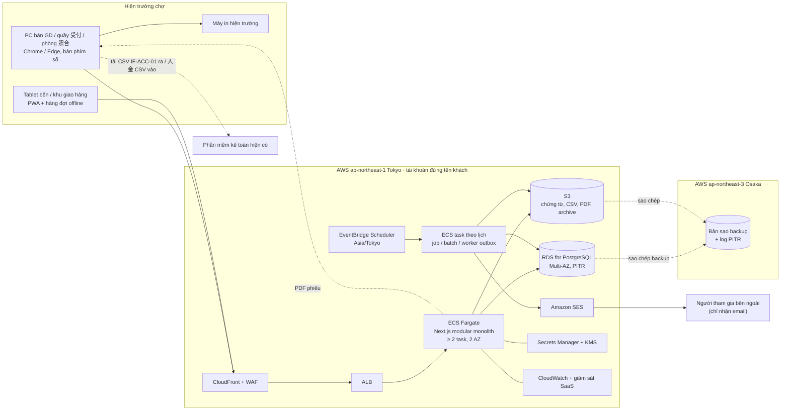
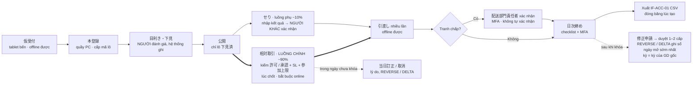
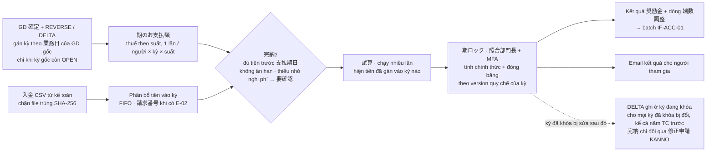
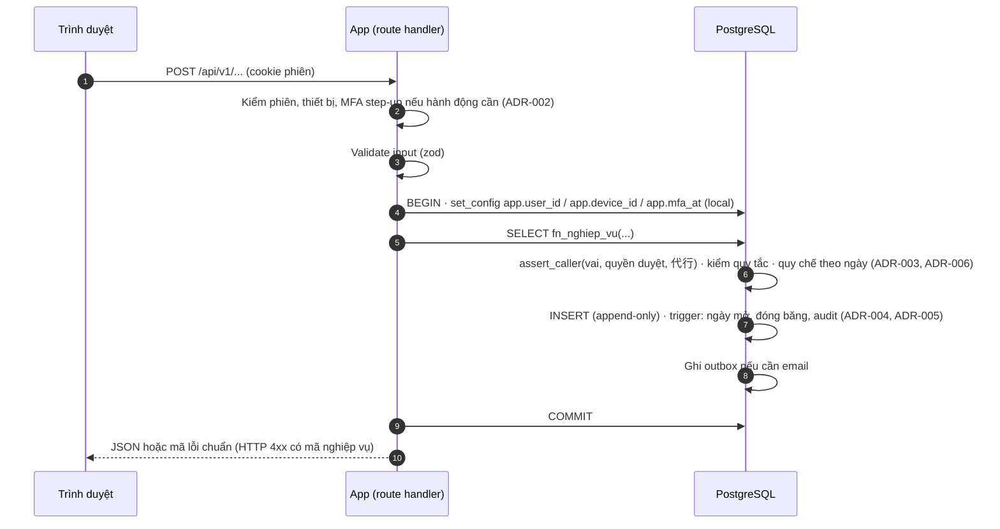
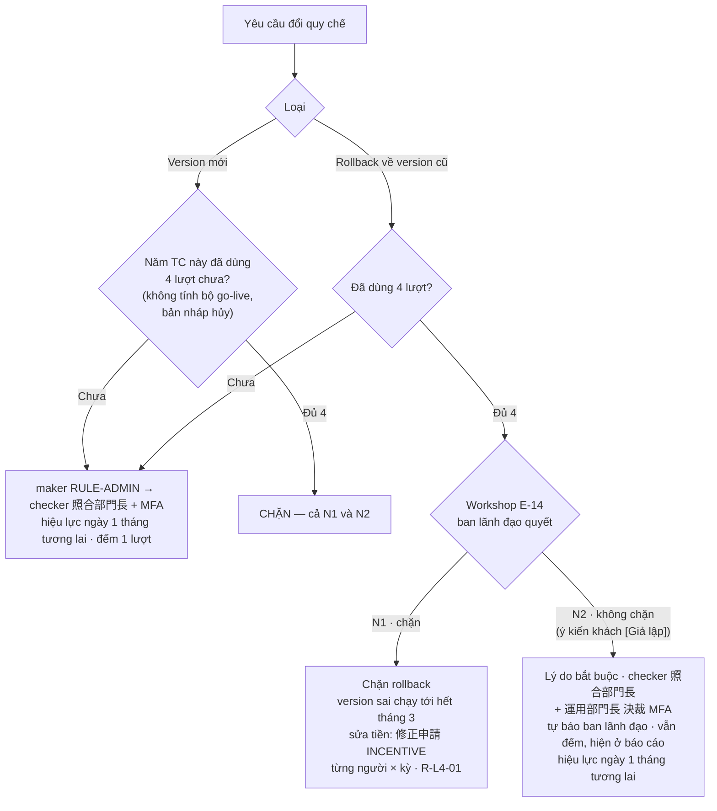

# Kiến trúc to-be Product A (第1期)

Tài liệu mô tả hệ thống **sẽ xây** cho 第1期 (giai đoạn 1, phạm vi hợp đồng gói R1 — PREMISE §1.2): thành phần trên AWS Tokyo, luồng dữ liệu chính, điểm tích hợp, cách các ràng buộc nghiệp vụ của chợ được đặt vào kiến trúc. Lý do của từng lựa chọn nằm ở ADR ([adr/_index.md](adr/_index.md)); tài liệu này chỉ dẫn số ADR, không lặp lại phần cân nhắc.

Không phải phạm vi của tài liệu: bảng / cột chi tiết (Database Design, `specs/system-design/database-design/`), hợp đồng API (API Design), hành vi từng màn (Screen Specification). Option và 17 mục 第2期 chỉ có **điểm mở rộng có tên** (§10), không thiết kế chi tiết (luật 6).

## 0. Thuật ngữ dùng trong tài liệu

| Thuật ngữ | Nghĩa |
|---|---|
| 相対取引 (aitai) | Mua bán thỏa thuận trực tiếp giữa 卸売業者 và người mua — **luồng chính, ~90% giá trị GD** |
| せり (seri) | Đấu giá tại chỗ — **luồng phụ, ~10%**; hệ thống chỉ ghi kết quả do せり人 (người điều khiển đấu giá) quyết |
| 仲卸 / 許可 | Người bán buôn trung gian / **giấy phép** có xét duyệt — căn cứ tham gia của 仲卸 |
| 売買参加者 / 承認 | Người tham gia mua bán / **chấp thuận**, thủ tục nhẹ hơn, kèm 参加上限 (hạn mức tham gia) |
| 買出人 | Người mua lẻ đăng ký tại chợ, không có tài khoản ở 第1期 |
| 受付 / 仮受付 / 本登録 | Tiếp nhận lô / tiếp nhận tạm ở bến / đăng ký chính thức ở quầy |
| 目利き・下見 | Đánh giá chất lượng, độ tươi bằng mắt — chỉ người làm, hệ thống ghi lại |
| 引渡し | Giao hàng cho người mua (nhiều lần / GD) |
| 業務日 / 日次締め | Ngày nghiệp vụ: [D 01:00, D+1 01:00) JST — bắt đầu từ giờ nhận lô (01:00, tham số quy chế), chốt GD từ 02:00 / khóa ngày nghiệp vụ |
| 期 / 期ロック | Kỳ thanh toán (tháng dương lịch theo 業務日) / khóa kỳ |
| 修正申請 / 当日訂正 / 取消 | Yêu cầu điều chỉnh sau khi khóa ngày (có duyệt) / sửa trong ngày chưa khóa / hủy GD trong ngày chưa khóa |
| 完納奨励金 | Tiền thưởng cho người trả đủ, đúng hạn tiền của kỳ |
| 入金 / 消込 | Tiền người mua trả vào / đối chiếu tiền vào với khoản phải thu |
| 照合部門長 / 運用部門長 / 配送部門責任者 | Trưởng phòng đối soát / trưởng phòng vận hành / người phụ trách giao hàng — ba **quyền duyệt** gắn vào tài khoản |
| REVERSE / DELTA | Bản ghi đảo ngược dòng cũ / bản ghi chênh lệch dòng mới — cách sửa không ghi đè |

Ký hiệu ID theo PREMISE §0. `Q-ARCH-xx` là câu hỏi mới phát sinh ở tài liệu này (§12).

## 1. Bối cảnh và ràng buộc chính

| Ràng buộc | Giá trị | ID |
|---|---|---|
| Giờ dịch vụ có SLA | 02:00–10:00 JST, 週6日 (trừ 休市日); 10:00–18:00 vẫn chạy nhưng ngoài SLA; bảo trì 20:00–24:00 hoặc 休市日, cấm 01:00–02:00 | NFR-AVL-01, PRM-081 |
| Khả dụng | 99,5% / tháng trong giờ dịch vụ | NFR-AVL-01 |
| DR | RTO ≤ 4h, RPO ≤ 15 phút | NFR-AVL-03, PRM-082 |
| Tải | 180 TK, 60 đồng thời (thiết kế cho ~230 TK, ~77 đồng thời × burst 2 × dư 1,5); 350–600 lô, 700–1.200 GD / ngày | FIG-LOAD-01, PRM-083 |
| Hiệu năng | Tìm kiếm thường p95 ≤ 2s; báo cáo / batch xuất xong trước 11:00 | NFR-PERF-01, PRM-084 |
| Lưu trữ | Dữ liệu nghiệp vụ online 7 năm; chứng từ theo loại: 受入票・取引票・照合表 online 7 năm, ảnh / chứng cứ tranh chấp và hồ sơ migration online 3 năm rồi lưu lạnh; xóa vật lý sau hạn phải có duyệt | DR-RET-01, TBL-ATTACH-01, B.7 |
| Mạng hiện trường | Mất mạng ngắn 3–5 lần / tuần mùa cao điểm; chốt GD bắt buộc online | NFR-AVL-02, DEC-004, PRM-085 |
| Bảo mật | MFA cho quản trị và người có quyền duyệt; khóa tạm khi sai nhiều lần; TLS; secret tách khỏi source; APPI | NFR-SEC-01, NFR-SEC-03, NFR-SEC-04, 09-06 |
| Nền tảng | AWS Tokyo managed, tài khoản đứng tên khách, IaC, dev / stg / prod | DEC-002, PRM-080, L4-D01 |

## 2. Kiểu kiến trúc

**Modular monolith** một codebase Next.js + TypeScript, một PostgreSQL. Ranh giới module theo miền dữ liệu của RFP (08-01). Mọi ghi nghiệp vụ đi qua **hàm trong DB** kiểm quyền + quy tắc trong cùng transaction — giữ nguyên nguyên tắc đã chạy được ở prototype (as-built §1), chỉ thay lớp gắn với Supabase. Lý do: ADR-001.

| Module | Miền | Trách nhiệm chính | Ràng buộc đặt ở module |
|---|---|---|---|
| `iam` | — | Tài khoản, vai, quyền duyệt, 代行者 (người làm thay), PIN, MFA, phiên, thiết bị | ADR-002, ADR-003 |
| `party` | D-PARTY | Hồ sơ 4 loại người tham gia; **許可 (仲卸)** và **承認 (売買参加者)** hai bảng, hai vòng đời; 保証金, 参加上限 | ADR-003; luật 2 |
| `lot` | D-LOT | 仮受付 → 本登録 → 目利き → 公開 → 確定 / 持ち越し; sổ số lượng lô | BR-LOT-02, CAP-HUMAN-01 |
| `trade` | D-TRADE | **相対 (luồng chính)**, せり (phụ), 当日訂正 / 取消 | BR-PERM-01, luật 1 |
| `delivery` | D-DELIVERY | 引渡し nhiều lần, ngoại lệ, tranh chấp | BR-DEL-03, CAP-HUMAN-01 |
| `settle` | D-SETTLE | 日次精算, 日次締め, 修正申請 + duyệt, xuất IF-ACC-01 | BR-CLOSE-01, ADR-004, ADR-005 |
| `incentive` | D-INCENTIVE | Kỳ, 入金, phân bổ tiền vào kỳ, 完納奨励金, 期ロック | BR-INC-01, ADR-007 |
| `rule` | — | Quy chế có version, maker-checker, rollback, quota 4 lần / năm TC | GOV-RULE-01, ADR-006 |
| `calendar` | — | Lịch chợ – ngân hàng, mở 業務日 | ADR-005 |
| `notify` | — | In-app + email (outbox, gửi lại ≤ 3), danh sách in | BR-NOTIFY-01, L4-A08 |
| `report` | — | 12 báo cáo cố định, CSV, PDF phiếu | FR-RPT-01..03 |
| `audit` | D-AUDIT | 監査ログ chỉ thêm, tra cứu | FR-AUDIT-01..03 |
| `sync` | — | Nhận hàng đợi offline, đối chiếu (SC-03-07) | ADR-008 |

Quy tắc phụ thuộc: module chỉ gọi module khác qua service công khai của module đó; không đọc bảng của module khác trừ qua view được công bố. Tách được thành service riêng sau này mà không đổi mô hình dữ liệu (DEC-002 "kiến trúc dễ chuyển").

## 3. Thành phần trên AWS Tokyo

| Thành phần | Vai trò | Cấu hình định hướng | NFR / ID |
|---|---|---|---|
| CloudFront + WAF | TLS, chặn tấn công phổ biến, giới hạn tần suất đăng nhập / PIN | Rule set managed + rate-based rule; có thể giới hạn IP chợ cho màn quản trị (Q-ARCH-06) | NFR-SEC-03, NFR-SEC-04 |
| ALB + ECS Fargate (app) | Chạy Next.js (trang + route handler API) | ≥ 2 task trên 2 AZ, auto scaling theo CPU; deploy rolling, không deploy trong 01:00–10:00 | NFR-AVL-01, PRM-081 |
| ECS task theo lịch (job) | Lưới an toàn mở 業務日 lúc 01:00 (ngày kế tiếp thường do hàm 日次締め mở — ADR-005), worker outbox email, xuất batch, báo cáo, nhắc hạn, danh sách chứng từ đến hạn xóa | Cùng image với app, entrypoint khác; EventBridge Scheduler cron múi giờ Asia/Tokyo | M10, NFR-OPS-01 |
| RDS for PostgreSQL Multi-AZ | Dữ liệu nghiệp vụ, hàm nghiệp vụ, trigger, RLS | Multi-AZ DB instance, PITR 35 ngày, mã hóa KMS, maintenance window 20:00–24:00 | NFR-AVL-01, NFR-AVL-03, ADR-009 |
| S3 | Đính kèm, CSV xuất / nhập (bản gốc), PDF, archive | Versioning, mã hóa, chặn public; lifecycle **theo tag loại chứng từ**: 受入票・取引票・照合表 7 năm online, tranh chấp / migration 3 năm → Glacier; **không tự xóa** — danh sách đến hạn → 決裁 + MFA → xóa (ADR-009 §2.2-9) | DR-RET-01, TBL-ATTACH-01, B.7 |
| Amazon SES | Email cho người tham gia bên ngoài và nội bộ | Domain đã xác thực (SPF / DKIM / DMARC); bounce / complaint về app | BR-NOTIFY-01, PRM-073 |
| Secrets Manager + KMS | Mật khẩu DB, khóa ký phiên, khóa SES | Xoay vòng định kỳ; không có secret trong repo / image | NFR-SEC-04 |
| CloudWatch + giám sát SaaS | Health, lỗi batch / xuất, lỗi gửi email, sự kiện bảo mật | Alarm → on-call; NOTIFY-02 Critical ≤ 5 phút | NFR-OPS-01, FR-NOTIFY-02 |
| Osaka (bản sao backup) | Khôi phục khi cả region Tokyo hỏng | Sao chép tự động backup RDS + log PITR, sao chép S3 | NFR-AVL-03, ADR-009 (Q-ARCH-01) |
| IaC | Dựng dev / stg / prod giống nhau, dựng lại được ở Osaka | AWS CDK (TypeScript) — đề xuất PL, cùng ngôn ngữ với app | PRM-080 |

Chi phí cloud tham chiếu: ~235.000 JPY / tháng sau go-live, khách trả thẳng cho AWS (estimate-basis §5.3). Cấu hình trên nằm trong khung đó; dòng Osaka là chi phí lưu trữ backup, không chạy máy chờ.

## 4. Luồng dữ liệu nghiệp vụ chính

### 4.1 Một ngày chợ: 受付 → 取引 → 引渡し → 日次締め

Mũi tên đậm là luồng chính. せり đi chung các bước sau 確定 với 相対 nhưng có thêm bước xác nhận bởi người thứ hai (PRM-115). Lô còn số lượng khi khóa ngày → 持ち越し sang 業務日 sau cùng mã lô (PRM-110, E-12).

### 4.2 Một kỳ: 請求 / 入金 → 完納奨励金 → 期ロック

Điều chỉnh (REVERSE / DELTA) mang hai ngày: **ngày áp** (ghi sổ ngày, 精算, IF-ACC-01) và **kỳ của GD gốc**. Kỳ gốc còn OPEN → vào 期のお支払額 kỳ đó; kỳ gốc đã khóa → không vào kỳ đang mở, chỉ đi DELTA — một đồng chênh chỉ đếm một lần. Khi khóa kỳ N, engine tính lại **mọi kỳ đã khóa có đầu vào đổi sau khi khóa, không giới hạn năm TC**; giới hạn năm TC chỉ áp cho việc trừ dần delta âm (CARRY → `CARRY_EXPIRED`). Chi tiết tính và test vector: ADR-007 §2.3–§2.7, `specs/system-design/database-design/INCENTIVE_DB.md`; Technical Design 完納奨励金 (P3).

### 4.3 Đường đi của một thao tác ghi

App server không có quyền INSERT / UPDATE / DELETE trực tiếp lên bảng; DB role của app chỉ có EXECUTE trên hàm nghiệp vụ và SELECT qua RLS. Mất app layer vẫn không ghi tắt được quy tắc.

## 5. Phân quyền: vai nội bộ, quyền duyệt, 許可 ≠ 承認

Ba lớp tách nhau, kiểm trong DB (ADR-003):

| Lớp | Áp cho | Gồm | Kiểm lúc |
|---|---|---|---|
| Vai nội bộ | Nhân viên chợ (có tài khoản) | ROLE-INTAKE, JUDGE, TRADE, DELIVERY, SETTLEMENT, RULE-ADMIN, SYS-ADMIN (TBL-ROLE-01) | Mỗi lần gọi hàm; quyền đọc theo đủ ma trận vai × màn (L4-A06) |
| Quyền duyệt | Người được giao | 照合部門長, 運用部門長, 配送部門責任者 + 代行者 có ngày bắt đầu / kết thúc (PRM-129) | Hành động duyệt; cấm tự duyệt thứ mình lập / ghi |
| Tư cách tham gia | Người tham gia (không đăng nhập ở 第1期) | **許可** cho 仲卸 · **承認** cho 売買参加者 (+ 参加上限) · đăng ký chợ cho 卸売業者 · đăng ký tại điểm cho 買出人 | **Lúc chốt GD** (BR-PERM-01), không phải lúc nhập |

許可 và 承認 là **hai bảng, hai vòng đời, hai căn cứ, hai thủ tục** (luật 2); không có bảng "giấy phép chung" có cột loại. Khác nhau ở thủ tục và trường (ADR-003 §2.2): **許可** cấp mới có **審査** + điều kiện 許可, 照合部門長 起案 → **運用部門長 決裁** (giả định [PL]); **承認** là 届出 + **照合部門長 確認** (xét nhẹ 保証金 / 資力, một người); gia hạn bình thường của cả hai theo PRM-121 (照合事務局 nhập + 照合部門長 確認); có **参加上限** đổi bằng sự kiện có lịch sử (không sửa đè). Trạng thái tư cách (有効 / 一時停止 / 失効 / 再審査 — FIG-010) nằm ở từng 許可 / 承認, không ở mức người tham gia. Duyệt nội bộ trên màn và tài liệu dùng chữ 決裁 / 確認, không dùng 承認, để khỏi lẫn với 承認 của 売買参加者 (PRM-121; tên màn SC-08-03 / SC-10-04 đổi theo L4-D03).

## 6. Người quyết định cuối (human-in-the-loop)

Hệ thống **chỉ ghi** quyết định của người; không OCR ký hiệu tay, không nhận dạng 符丁, không AI chấm chất lượng (CAP-HUMAN-01, SCOPE-OUT-01/02/06; ADR-010).

| Điểm quyết | Người quyết | Hệ thống làm gì | MFA | ID |
|---|---|---|---|---|
| 目利き・下見 | ROLE-JUDGE | Ghi grade / ghi chú + người + thời điểm; chỉ lô 下見済 mới 公開 | — | FR-LOT-02, PRM-117 |
| Kết quả せり | せり人 quyết tại sàn; người xác nhận khác người nhập | Ghi kết quả; trùng người → bắt lý do, gắn cờ 要確認 | — | FR-SERI-01/02, PRM-115 |
| Vượt 参加上限 (売買参加者) | Người chốt GD | Cảnh báo + bắt lý do, không chặn cứng | — | PRM-046, L4-A04 (1) |
| 修正申請 cấp 1 / cấp 2 | 照合部門長 / 運用部門長 (ngưỡng = tiền thay đổi lớn nhất của một người mua, trong quy chế; đổi 買受人, KANNO, INCENTIVE luôn 2 cấp) | Sinh REVERSE / DELTA, bản gốc giữ nguyên | Có | FR-CORR-02, PRM-055, PRM-120 |
| Giao có tranh chấp | 配送部門責任者, không phải người đã ghi lần giao đó | Ghi xác nhận; mất mạng → đường giấy (ADR-008) | Có | CAP-HUMAN-01, PRM-111 |
| 日次締め / 期ロック | 照合部門長 (hoặc 代行) | Checklist trước khóa (gồm 「端末回収不能」 cho máy hỏng / mất); 期ロック chốt các dòng 要確認 (vd. nghi trừ phí chuyển khoản) với lý do; khóa không mở lại | Có (luôn hỏi lại mã) | BR-CLOSE-01, PRM-119, ADR-005 §2.5–2.6, ADR-007 §2.6 |
| Duyệt quy chế / rollback | Checker 照合部門長 (+ 運用部門長 ở nhánh N2) | maker ≠ checker | Có | GOV-RULE-01, ADR-006 |
| 一時停止 / 失効 / phục hồi tư cách | 運用部門長 決裁 | Đổi trạng thái có lịch sử, gửi email | Có | PRM-121, PREMISE §3.2 |
| Cấp mới / gia hạn 許可 · 承認 | Cấp mới 許可: 運用部門長 決裁 sau 審査 · cấp mới 承認 và gia hạn bình thường của cả hai: 照合部門長 確認 (PRM-121) | Ghi sự kiện có lịch sử | Có | PRM-121, ADR-003 §2.2 |
| Xóa vật lý chứng từ hết hạn lưu | 運用部門長 決裁 | Chỉ xóa dòng có trong danh sách đến hạn, ghi người duyệt | Có (luôn hỏi lại mã) | B.7, ADR-009 §2.2-9 |

## 7. Không ghi đè lịch sử, khóa ngày / kỳ, quy chế có version

### 7.1 Append-only + REVERSE / DELTA (ADR-004)

- GD đã 確定 bị đóng băng; mọi thay đổi sinh **REVERSE** (đảo dòng cũ, gắn người mua cũ) + **DELTA** (dòng mới, gắn người mua mới). Một cơ chế cho cả 当日訂正 / 取消 (trước khóa ngày, chỉ cần lý do) và 修正申請 (sau khóa ngày, duyệt 1–2 cấp). 修正申請 có 4 phạm vi: `TRADE` · `KANNO` · `INCENTIVE` · `LATE_ENTRY` (ADR-004 §2.2).
- Sổ số lượng lô, giao hàng, điều chỉnh, 入金, kết quả thưởng, 監査ログ: chỉ INSERT, trigger chặn UPDATE / DELETE. Không có cờ tắt audit, không có hàm reset ở production (sửa D19, M24).

### 7.2 Khóa ngày, khóa kỳ (ADR-005)

- **Một định nghĩa 業務日:** D = [D 01:00, D+1 01:00) JST, 01:00 = giờ nhận lô trong quy chế (E-16); chốt GD từ 02:00 (PRM-116). Hàm 日次締め mở luôn 業務日 chợ kế tiếp; job 01:00 là lưới an toàn (sửa D22, Gate 1 M-01). Ví dụ biên: lô nhận 01:30 ngày 1 thuộc 業務日 ngày 1 → kỳ mới.
- 日次締め khóa vĩnh viễn ngày đó ở mức DB (trigger `DAY_LOCKED`); không có chức năng mở khóa (Q-ARCH-02). Checklist 12 mục (ADR-005 §2.5; mục 12 「未入力の引渡し確認票なし」 tick tay — Q-STL-02); máy hỏng / mất → 「端末回収不能」 (照合部門長 + lý do + MFA) để ngày không bị kẹt. Sửa sau khóa đi 修正申請, chênh lệch ghi vào **ngày chưa khóa sớm nhất** (PRM-120). GD / lô / lần giao **mới** của ngày đã khóa (紙伝票後入力, offline trễ) đi 修正申請 `LATE_ENTRY`, ghi vào ngày mở nhưng giữ **ngày GD thật** (ADR-005 §2.8).
- 期 = tháng dương lịch theo 業務日 của GD gốc (`trade_date`). Điều chỉnh vào kỳ gốc nếu kỳ gốc còn OPEN; kỳ gốc đã 期ロック → DELTA ghi ở kỳ đang khóa (mọi kỳ đã khóa, không giới hạn năm TC — ADR-007 §2.4).

### 7.3 Quy chế có version, maker-checker, rollback — hai nhánh E-14 (ADR-006)

Quy chế gồm **bảng tỷ lệ (2 bảng: 仲卸 / 売買参加者, 5 bậc)** và **tham số đụng tiền** (PREMISE §3.1). Mỗi bản ghi tiền lưu version đã áp (FR-AUDIT-03). Tham số thuần vận hành nằm ở file cấu hình có nhật ký (PRM-126), không tính quota.

Kỳ đã khóa không bị version mới hay rollback chạm vào (FB-CUS-227); tiền thưởng của kỳ đã khóa tính theo tỷ lệ sai chỉ sửa được bằng 修正申請 `INCENTIVE` (ADR-006 §2.4-8a). Hai nhánh **không** làm thành công tắc cấu hình — workshop chọn một, code cài một (PREMISE §6 OPEN-L4-01). Workshop còn được trình hai phương án F (rollback hồi tố về đầu kỳ chưa khóa, chỉ bảng tỷ lệ) và G (tách gói tỷ lệ theo kỳ / tham số theo ngày) — ADR-006 §3. Đếm quota: version `CHANGE` + `ROLLBACK` ở `APPROVED` / `ACTIVE` / `SUPERSEDED`; hủy version `APPROVED` trước hiệu lực cũng maker-checker.

## 8. Hiện trường: PIN, offline, máy in

- **Máy dùng chung:** đăng nhập một lần cho thiết bị, đổi người bằng mã nhân viên + PIN 4 số; MFA step-up trước hành động ở PREMISE §3.2, hiệu lực **10 phút** cùng người cùng thiết bị; tài khoản SYS-ADMIN MFA ngay khi đăng nhập (ADR-002). Người không dùng điện thoại riêng nhận mã bằng **token phần cứng TOTP** cá nhân (FB-CUS-231).
- **Offline (ADR-008):** chỉ 仮受付, ghi 引渡し, 紙伝票後入力 có hàng đợi cục bộ; chốt 相対 / xác nhận せり / mọi duyệt bắt buộc online. Màn hình báo đang mất mạng + số bản ghi chưa đồng bộ; tra cứu offline ở SC-06-02 hiện giờ của dữ liệu tải về (「取引データ hh:mm 時点」); đồng bộ lỗi vào SC-03-07, không ghi đè (ngày đã khóa → 修正申請 `LATE_ENTRY`); khóa ngày đếm thiết bị còn bản ghi chưa đồng bộ, trừ máy đã 「端末回収不能」.
- **Đường giấy:** 相対 lúc mất mạng → 紙伝票 rồi 後入力; giao có tranh chấp lúc mất mạng → phiếu giấy có chữ ký 配送部門責任者, nhập bù + đính kèm bản scan, xác nhận lại trong hệ thống có MFA (FB-CUS-232).
- **Máy in:** server sinh PDF theo mẫu FORM, PC bàn GD in thẳng không xem trước (§9).

## 9. Điểm tích hợp

Các lựa chọn dưới đây đã chốt ở LAB-1 (PRM / DEC), không phải quyết định kiến trúc mới nên không viết ADR riêng.

| Điểm | Hướng | Cách làm | Lỗi / an toàn | ID |
|---|---|---|---|---|
| Kế toán IF-ACC-01 | Ra | Batch CSV tạo sau 日次締め; **đóng băng nội dung lúc tạo** (kể cả ánh xạ 勘定科目 / 税区分), xuất lại cùng ngày trả đúng file cũ; dòng 端数調整 ở 期ロック; người dùng tải về và import tay vào phần mềm kế toán. Định dạng chờ E-01 | Ánh xạ 仕訳 có lịch sử, đổi chỉ áp cho batch sau; batch đã import sai → kế toán làm bút toán sửa (08-05) | DEC-009, DEC-012, PRM-123, M06 |
| 入金 CSV | Vào | Tải lên file xuất từ phần mềm kế toán; lưu bản gốc ở S3; chặn file trùng bằng SHA-256; ánh xạ mã đối tác → người tham gia; hủy batch do người khác người import, kỳ chưa khóa | Dòng không khớp vào danh sách chờ 照合, không tự đoán | DEC-009, M07, E-02 |
| Email | Ra | Ghi outbox trong cùng transaction nghiệp vụ → worker gửi qua SES; gửi lại tối đa 3 lần; lỗi hẳn → danh sách in ở quầy hôm sau + danh sách "chưa gửi được" cho 照合 | Không SMS / FAX / LINE; đổi địa chỉ email chỉ do nhân viên chợ theo giấy yêu cầu, có lịch sử | BR-NOTIFY-01, PRM-073, L4-A08, M09 |
| Máy in hiện trường | Ra | PDF sinh ở server theo mẫu FORM (取引確認票, 引渡し票, danh sách sắp hết hạn, danh sách email lỗi); PC bàn GD dùng chính sách in thẳng của Chrome / Edge (kiosk printing) | Model máy in, loại giấy chờ khảo sát hiện trường (PRM-095, E-05) — Q-ARCH-05 | PRM-114, PRM-118, M05 |
| Lịch chợ – ngân hàng | Nội bộ | SC-10-05; 支払期日 (ngày 10) rơi **ngày ngân hàng nghỉ** → lùi về **ngày ngân hàng mở trước** (`PAYMENT_DUE_RULE` = `PREV_BANK_DAY`, giả định — Q-ARCH-11; vd. 2028-06-10 thứ Bảy chợ mở → 2028-06-09); 臨時休市 / 臨時開市 đổi trong ngày, không tính quota | — | M10, PRM-054, FB-CUS-239 |
| Migration (một lần) | Vào | ECS task một lần: nạp master + khoản còn mở + chi tiết 2 năm TC + 2 kỳ thưởng từ file khách → bảng tạm → kiểm → nạp; báo cáo đối chiếu 100% để ký lúc cutover | Không có cột `is_sample`; dữ liệu cũ hơn để ở file khách, chỉ đọc | DEC-005, PRM-125, M01 |
| Ngân hàng | — | **N/A** — chuyển khoản ngân hàng ngoài phạm vi | — | SCOPE-OUT-05 |

## 10. Điểm mở rộng cho Option / 第2期 (không thiết kế chi tiết)

| Điểm mở rộng | Option / 第2期 | Ranh giới chừa sẵn ở 第1期 | Không làm ở 第1期 |
|---|---|---|---|
| Cổng người ngoài | Portal người mua, giao dịch từ xa (SCOPE-OUT-03/04); đăng nhập OTP email (SEC-IAM-02) | Nhóm route riêng `/portal`, realm xác thực riêng, chỉ gọi service công khai của module; bảng người tham gia đã có email | Không có tài khoản người ngoài, không màn hình người ngoài |
| Phân tích / dự báo | 08-06 | Xuất dữ liệu cấu trúc (FR-RPT-03) ra S3; read replica thêm sau nếu cần | Không kho dữ liệu, không mô hình dự báo |
| AI suggestion-only | SCOPE-OUT-06 | Gợi ý (nếu có) nằm ở bảng riêng, không có quyền gọi hàm ghi nghiệp vụ; người xác nhận luôn là người (ADR-010) | Không AI / OCR nào trong 第1期 |
| Tem / quét mã lô | Cải tiến 04-07 | Mã lô duy nhất, in được dạng mã vạch | Không quét mã |
| Màn tham số vận hành | 第2期 (SC-10-06 bị bỏ — PRM-126) | File cấu hình có nhật ký | Không màn hình |

## 11. NFR → cách đáp ứng

| NFR | Cách đáp ứng | Nơi chi tiết |
|---|---|---|
| NFR-AVL-01 99,5% trong 02:00–10:00 | ECS ≥ 2 task / 2 AZ; RDS Multi-AZ (failover ~1–2 phút); không deploy / bảo trì trong 01:00–10:00; alarm health | ADR-001, ADR-009 |
| NFR-AVL-02 mất mạng ngắn | PWA + hàng đợi cục bộ cho 3 thao tác; đường giấy | ADR-008 |
| NFR-AVL-03 RTO 4h / RPO 15' | PITR (log 5 phút); Multi-AZ; bản sao backup sang Osaka + IaC dựng lại; diễn tập khôi phục trước go-live | ADR-009 |
| NFR-PERF-01/02 | Truy vấn luôn có khoảng 業務日 + phân trang + index; thiết kế cho ~77 đồng thời × 2 × 1,5; test tải trước go-live | ADR-009 (M23) |
| NFR-SEC-01 MFA | Step-up trước hành động §3.2; SYS-ADMIN MFA khi đăng nhập; token phần cứng cho người không dùng điện thoại riêng | ADR-002 |
| NFR-SEC-03 | Timeout theo loại máy (PC ~30', tablet ~5'); step-up MFA hết khi idle > 3', hành động không quay lại được luôn hỏi lại mã; khóa PIN theo người + theo thiết bị; log bất thường | ADR-002, ADR-008 |
| NFR-SEC-04 | TLS ở CloudFront / ALB / RDS; Secrets Manager; backup mã hóa | ADR-009 |
| NFR-OPS-01 | CloudWatch + SaaS: health, batch, lỗi email, sự kiện bảo mật | §3 |
| NFR-OPS-02 | Đổi quy chế bằng version mới, không sửa lịch sử | ADR-006 |
| DR-RET-01 7 năm | DB online 7 năm, `audit_logs` chia theo năm TC; chứng từ theo loại TBL-ATTACH-01 (7 năm / 3 năm → lạnh), xóa vật lý có duyệt (B.7) | ADR-009 |
| 09-06 APPI | Mã hóa at-rest / in-transit; quyền đọc theo ma trận; xuất dữ liệu cá nhân có MFA + audit | ADR-002, ADR-003 |

## 12. Prototype LAB-2 → to-be

| Prototype (as-built) | To-be | Giữ / thay | Lệch (as-built §5) | ADR |
|---|---|---|---|---|
| Vercel Hobby + Supabase free | ECS Fargate + RDS PostgreSQL Multi-AZ trên AWS Tokyo | Thay | M14 | ADR-001 |
| Next.js 16 App Router, route handler, zod, `require-role` | Giữ nguyên code app; chạy trong container | Giữ | — | ADR-001 |
| Supabase Auth email + mật khẩu, `auth.users`, `auth.uid()`, `banned_until` | Module `iam` tự quản: bảng tài khoản trong DB, phiên server-side, MFA TOTP, PIN; định danh đưa vào DB bằng `set_config` theo transaction | Thay | D17, D21 | ADR-002 |
| `supabase.rpc()` qua PostgREST | Client SQL có kiểu gọi thẳng hàm DB bằng DB role chỉ có EXECUTE | Thay lớp gọi, giữ hàm | D21 | ADR-001, ADR-003 |
| RLS theo JWT Supabase, mọi nội bộ đọc hết | RLS theo `app.user_id`, ma trận đọc TBL-ROLE-01 | Thay điều kiện | D18, M18 | ADR-003 |
| ~70 hàm `security definer`, `assert_caller`, trigger append-only / ngày mở / đóng băng / audit | Giữ mô hình; sửa nội dung theo bảng lệch | Giữ | D19 (bỏ cờ seeding) | ADR-004 |
| `trade_status` PROVISIONAL / CONFIRMED, chốt thẳng | Trạng thái theo FIG-012, ghi người + thời điểm từng bước | Sửa | D10 | ADR-004 |
| Mọi điều chỉnh qua `correction_requests` | Thêm 当日訂正 / 取消 cùng cơ chế REVERSE / DELTA | Sửa | D11, M17 | ADR-004 |
| `current_business_date()` = ngày OPEN lớn nhất, không job | Một định nghĩa 業務日 [01:00, 01:00); 日次締め mở ngày kế tiếp + job 01:00 dự phòng + lịch chợ | Thay | D22, M10 | ADR-005 |
| Quy chế chỉ có 1 bảng tỷ lệ; quota đếm cả go-live; ngưỡng 300.000 hằng số | 2 bảng tỷ lệ + tham số; quota bỏ go-live; ngưỡng là tham số (tạm 100.000) | Sửa | D01, D06, D07, D09, M13, M15 | ADR-006 |
| Thưởng tính trên số 税込, 1 thuế suất, 期日 ngày 10 cố định, gán tiền theo cửa sổ ngày | Bậc theo 適格金額 税抜, thuế theo suất + 端数調整, 期日 theo quy chế + lịch ngân hàng, bảng phân bổ FIFO, delta âm mang sang tới hết năm TC | Sửa | D02–D05, D23, M08, M21 | ADR-007 |
| Tính lại **mọi kỳ LOCKED** trước kỳ đang khóa; gán điều chỉnh vào kỳ theo ngày GD gốc | Giữ nguyên hai hành vi này (to-be 0.1.x từng làm kém: chỉ cùng năm TC, gán theo ngày áp) | Giữ | N15, N16 | ADR-007 |
| PIN online, khóa theo người đích; không offline | PIN offline gắn thiết bị; khóa theo người + thiết bị; hàng đợi 3 thao tác + SC-03-07 | Thay | D17, M03, M04, M22 | ADR-008 |
| Không backup / PITR / giám sát; view quét toàn lịch sử | PITR, Multi-AZ, Osaka, giám sát; truy vấn có khoảng ngày | Thay | D24, M14, M23 | ADR-009 |
| `is_sample`, `seed_demo_*`, `reset_demo_business_data` | Không có ở production; migration thật | Bỏ | D19, D20, M01, M24 | ADR-004 |
| Không có thông báo, CSV kế toán, máy in, đính kèm | Outbox + SES, batch IF-ACC-01, PDF, S3 | Thêm | D16, M05, M06, M09, M11 | §9 |

## 13. Câu hỏi mở phát sinh ở kiến trúc

Các câu đã có (E-01..E-21, OPEN-L4-01..03) không lặp lại; dưới đây là câu mới. Điều phối đưa vào `qa.md` / 確認事項一覧.

| ID | Câu hỏi | Giả định tạm trong thiết kế | Nếu giả định sai | Ai trả lời |
|---|---|---|---|---|
| Q-ARCH-01 | RTO 4h / RPO 15' có áp cho sự cố **cả region Tokyo** không, hay chỉ sự cố trong region? | Có — sao chép backup + log PITR sang Osaka, dựng lại bằng IaC | Không cần → bỏ dòng Osaka, giảm chút phí lưu trữ; cần chạy chờ nóng ở Osaka → tăng phí cloud đáng kể, ngoài TCO hiện tại | IT khách |
| Q-ARCH-02 | Có cần mở lại ngày đã khóa trong trường hợp khóa nhầm không? | Không có chức năng mở khóa; sửa bằng 修正申請 | Cần → thêm luồng mở khóa có 運用部門長 決裁 + MFA + audit, ~0,2–0,3 MM | 運用部門, 照合部門 |
| Q-ARCH-03 | Số người cần token phần cứng (không dùng điện thoại riêng)? Khách mua token? Ai giữ runbook cấp / thu / thay pin token (pin ~3–5 năm, hệ thống 7 năm)? | ~nửa trong 12–13 người có quyền duyệt; khách mua (PRM-088); IT khách giữ runbook, thay token theo lô | Nhiều hơn → chỉ tăng chi phí mua token của khách; không đổi thiết kế | IT khách (E-15) |
| Q-ARCH-04 | Thời gian PIN offline còn hiệu lực trên thiết bị (N giờ) | 12 giờ, trong file cấu hình | Ngắn hơn → người ca đêm phải đăng nhập online lại giữa ca | IT khách (E-18) |
| Q-ARCH-05 | Model máy in, cách nối (USB / mạng) ở bàn GD và bến | In từ PC bàn GD; tablet bến in qua máy in mạng gần nhất | Máy in chỉ nối được với tablet / cần in nhiệt → thêm agent in cục bộ, CR theo CR-10 | 運用部門 (E-05, PRM-095) |
| Q-ARCH-06 | Màn quản trị (SYS-ADMIN, RULE-ADMIN) có giới hạn theo IP mạng chợ được không? | Có, qua WAF | Không → chỉ dựa vào MFA | IT khách |
| Q-ARCH-07 | (a) B.7 ghi 「添付書類は3年間」, TBL-ATTACH-01 ghi 受入票・取引票・照合表 7 năm — dự án theo TBL-ATTACH-01, đúng không? (b) Sau hạn lưu, chính sách của khách là xóa (có duyệt) hay giữ? (c) Khôi phục lưu lạnh "最大2営業日" hay "2日以内"? | (a) theo TBL-ATTACH-01; (b) **không tự xóa** — danh sách đến hạn → 運用部門長 決裁 + MFA → xóa (B.7); (c) mục tiêu ≤ 1 ngày làm việc (đáp ứng cả hai cách đọc) | (a) chỉ đổi lifecycle theo tag; (b) giữ lâu hơn → không xóa, chỉ thêm phí lưu | 照合部門, kiểm toán (DR-RET-01, B.7) |
| Q-ARCH-08 | Phần delta âm còn lại cuối năm TC **thu bằng cách nào** (trừ vào khoản phải trả khác, yêu cầu người tham gia nộp lại, hay xóa sổ có duyệt)? | Delta âm trừ dần (CARRY) vào thưởng các kỳ sau tới hết năm TC của kỳ ghi nhận; phần âm còn lại cuối năm ghi dòng `CARRY_EXPIRED` và hiện ở RPT-07 để 照合部門 xử lý — cách thu ghi lại trên dòng đó (người, ngày, cách) | Thu ngoài hệ thống mà không ghi lại → mất dấu (luật 4); muốn trừ vào khoản khác → thêm bút toán ở IF-ACC-01, đổi Technical Design 完納奨励金 | 照合部門, 財務 |
| Q-ARCH-09 | Mọi nội dung quy chế (kể cả tham số không phải bảng tỷ lệ) đều hiệu lực từ ngày 1 tháng? | Có — một version, một ngày hiệu lực, trùng ranh giới kỳ | Cần đổi tham số giữa tháng → ngày hiệu lực theo từng tham số, phức tạp hơn | 運用部門 |
| Q-ARCH-10 | Khách có IdP doanh nghiệp (vd. Microsoft Entra ID) muốn dùng cho PC văn phòng không? | Không — tài khoản do hệ thống quản lý | Có → SSO cho PC văn phòng là cải tiến tách giá; máy dùng chung vẫn PIN | IT khách |
| Q-ARCH-11 | 支払期日 (ngày 10) rơi ngày ngân hàng nghỉ thì lùi về ngày nào: ngày **ngân hàng** mở trước, hay ngày **chợ** mở trước? | Ngày ngân hàng mở trước (`PREV_BANK_DAY`) — hạn chuyển khoản theo ngân hàng; test vector 2028-06-10 (thứ Bảy, chợ mở) → 2028-06-09 | Theo ngày chợ → đổi giá trị `PAYMENT_DUE_RULE` (tham số quy chế), không đổi bảng | 経理部 |
| Q-ARCH-12 | 完納奨励金 xuất ở IF-ACC-01 với 税区分 nào (giảm giá bán có thuế 8% / 10%, hay ngoài thuế)? Hệ số 110/100 của BR-INC-01 giữ cố định bất kể thuế suất hàng (8%) — đúng ý khách? | 110/100 cố định theo BR-INC-01 / 13-06; 税区分 tạm theo ánh xạ 仕訳 (chờ E-01, E-06) | Khác → chỉ đổi `journal_mappings`, không đổi công thức | 経理部 (E-01, E-06) |

---

## History of change

| No | Version | Action | Nội dung thay đổi | Ngày | Người sửa | Approve |
|---|---|---|---|---|---|---|
| 1 | 0.1.0 | Add new | Bản đầu: module, thành phần AWS Tokyo, luồng ngày / kỳ, đường ghi, phân quyền 3 lớp, human-in-the-loop, append-only, khóa ngày / kỳ, quy chế 2 nhánh E-14, hiện trường, tích hợp, điểm mở rộng, NFR, mapping prototype → to-be, Q-ARCH-01..10 | 2026-11-25 | phuongnnm-23344 | |
| 2 | 0.2.0 | Update | Sửa theo Expert Gate 1 + khách wireframe: một định nghĩa 業務日, job 01:00 dự phòng (M-01); hai trục thời gian, kỳ khóa chỉ đi DELTA, tính lại mọi kỳ đã khóa (C-01, C-02 — §4.2, §7.2); 支払期日 theo ngày ngân hàng + Q-ARCH-11 (M-03); N1 sửa tiền bằng 修正申請 INCENTIVE, phương án F / G (M-04); 「端末回収不能」, LATE_ENTRY (M-05); khác biệt thủ tục 許可 / 承認 (M-07); lưu chứng từ theo loại, không tự xóa, Q-ARCH-07 viết lại (M-08); Q-ARCH-08 hỏi cách thu (m-05); step-up idle (m-06); Q-ARCH-12 税区分 (m-07); mermaid §3 tách link (m-08); bảng §12 thêm N15 / N16 | 2026-11-25 | phuongnnm-23344 | |
| 3 | 0.2.1 | Update | Gate 1 recheck N-03: thủ tục cấp mới / gia hạn 許可 · 承認 theo PRM-121 (§5, §6) | 2026-11-25 | phuongnnm-23344 | |
| 4 | 0.2.2 | Update | Gộp P3: sơ đồ đường ghi dùng `/api/v1/...` theo `specs/_common/api-conventions.md` (DEC-052) | 2026-11-25 | phuongnnm-23344 | |
| 5 | 0.2.3 | Update | Gate 2 / khách Q-STL-02: checklist 日次締め 12 mục (thêm tick 「未入力の引渡し確認票なし（紙台帳で確認）」) | 2026-11-25 | phuongnnm-23344 |  |
