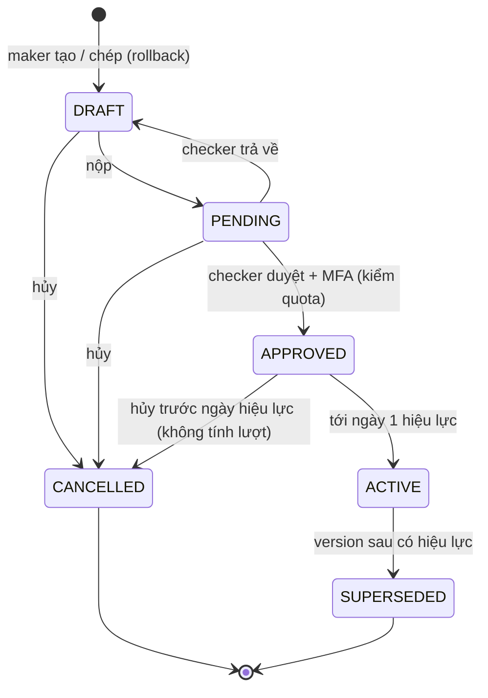

# ADR-006 — Quy chế có version theo ngày hiệu lực, maker-checker, quota 4 lần / năm TC, rollback hai nhánh E-14

| Trạng thái | Ngày | Người quyết | Thay thế |
|---|---|---|---|
| **Proposed** — giữ theo L4-D09: §2.5 và phương án F, G phụ thuộc workshop E-14; phần còn lại đã qua Gate 1–3, là thiết kế hiện hành | 2026-11-26 | PL đề xuất; người dùng quyết giữ Proposed (L4-D09) | — |

## 1. Bối cảnh

- Luật 5 / GOV-RULE-01: quy chế và tỷ lệ có version + ngày hiệu lực + maker-checker + rollback; tối đa 4 lần / năm; không làm biến dạng dữ liệu đã chốt trước ngày hiệu lực. NFR-OPS-02: đổi bằng cấu hình, không sửa lịch sử. FR-INC-02: version mới có ngày hiệu lực tương lai.
- Sau 2020 mỗi chợ tự ban hành quy chế → hệ thống phải mang **quy chế của 桜水産市場**, không phải khuôn mẫu chung.
- PREMISE §3.1 (L4-A03): giá trị đụng tiền / 支払期日 / khóa / 業務日 / 完納 nằm trong **quy chế có version** (tính quota); giá trị thuần vận hành nằm ở **file cấu hình có nhật ký** (PRM-126, không tính quota). Bộ giá trị go-live là version đầu, không tính; bản nháp hủy trước hiệu lực không tính; năm TC 4月→3月 theo ngày hiệu lực; version mới thứ 5 bị chặn (L4-A04 (3)).
- Prototype: chỉ có 1 bảng tỷ lệ (D01), quy chế không chứa tham số (D09), ngưỡng 2 cấp hằng số 300.000 (D07), quota đếm cả go-live (D06), rollback = version mới chép tỷ lệ (đúng hướng).
- **E-14 chưa có câu trả lời:** rollback khi đã dùng đủ 4 lượt. Khách giả lập muốn không chặn (FB-CUS-226); PL không tự nới vì GOV-RULE-01 đếm 4 lần — ban lãnh đạo khách quyết ở workshop (OPEN-L4-01, rủi ro R-L4-01 "tỷ lệ sai cả năm").

## 2. Quyết định

### 2.1 Nội dung một version

1. Một version = **một gói nhất quán**: 2 bảng tỷ lệ 完納奨励金 (仲卸 / 売買参加者, mỗi bảng 5 bậc gồm bậc 0%) + tập tham số có kiểu theo PREMISE §3.1 (ngưỡng duyệt 2 cấp, giờ bắt đầu nhận lô, quy tắc 「残り全部」, quy tắc 支払期日, giờ khóa, quy tắc làm tròn thuế…, và tạm thời E-12 / E-13 — OPEN-L4-03).
2. **Ngày hiệu lực = ngày 1 của một tháng tương lai** cho cả gói (trùng ranh giới kỳ; Q-ARCH-09). Tra cứu duy nhất qua `rule_at(業務日)`.
3. Mỗi bản ghi tiền (精算, 奨励金, 修正申請) lưu id version đã áp (FR-AUDIT-03).

### 2.2 Vòng đời và maker-checker

4. DRAFT (maker ROLE-RULE-ADMIN sửa được) → PENDING → APPROVED-chờ-hiệu-lực (checker 照合部門長, **MFA**, maker ≠ checker) → ACTIVE vào ngày hiệu lực → SUPERSEDED. Trả về → DRAFT; hủy trước hiệu lực → CANCELLED (không tính quota). Nội dung khóa từ PENDING.
5. Kỳ đã 期ロック **không bao giờ** bị version mới hay rollback chạm vào; kỳ khóa nếu cần sửa thì đi DELTA (FB-CUS-227).

### 2.3 Quota

6. Đếm số version loại `CHANGE` + `ROLLBACK` ở trạng thái **`APPROVED`, `ACTIVE` hoặc `SUPERSEDED`** có ngày hiệu lực trong năm TC (4月→3月) — version đã có hiệu lực rồi bị thay vẫn tính; trừ version go-live (`BASELINE`) và `CANCELLED`. Kiểm ở hàm duyệt của checker, trong transaction, khóa dòng năm TC để tránh hai người duyệt cùng lúc vượt quota.
7. Version mới khi đã đủ 4 → **chặn** (cả hai nhánh E-14).
7a. **Hủy version đã `APPROVED` trước ngày hiệu lực** cũng là maker-checker: maker (ルール管理者) đề nghị hủy kèm lý do → checker 照合部門長 決裁 + MFA (không phải người đã đề nghị). Version hủy → `CANCELLED`, không tính lượt.

### 2.4 Rollback

8. Rollback = version mới **chép nội dung** của version cũ được chọn, ghi `rollback_of`; cùng vòng đời maker-checker, cùng ràng buộc ngày hiệu lực tương lai (phương án hiện chọn — xem phương án F, G ở §3 cho workshop E-14). Không có thao tác "kích hoạt lại" version cũ.
8a. **Đường sửa tiền thưởng của kỳ đã khóa tính theo tỷ lệ sai:** version sai đã được duyệt vẫn là version "đúng" của kỳ đó với engine (ADR-007), nên engine **không tự sinh** DELTA khi phát hiện tỷ lệ sai. Đường sửa duy nhất là **修正申請 phạm vi `INCENTIVE`** từng người × kỳ (lý do, version tham chiếu, số tiền; duyệt 2 cấp) → dòng DELTA gắn `correction_id` ở 期ロック kế tiếp (ADR-007 §2.5).

### 2.5 Rollback khi đã đủ 4 lượt — hai nhánh, chờ E-14

| | N1 — chặn | N2 — không chặn (ý kiến khách **[Giả lập]**) |
|---|---|---|
| Hành vi | Rollback cũng bị chặn khi đủ 4 | Cho rollback; **vẫn đếm** (lượt thứ 5+) và hiện ở báo cáo cho ban lãnh đạo |
| Điều kiện | — | Lý do bắt buộc; checker 照合部門長 **+ 運用部門長 決裁 có MFA**; tự gửi thông báo cho ban lãnh đạo |
| Version mới thứ 5 | Chặn | Chặn |
| Rủi ro | **R-L4-01**: version thứ 4 sai tỷ lệ chạy tới hết tháng 3. Engine coi version đã duyệt là đúng nên **không tự sinh DELTA**; mỗi kỳ khóa với tỷ lệ sai phải sửa bằng **修正申請 INCENTIVE từng người × kỳ, duyệt 2 cấp** (§2.4-8a) — tới ~170 người × tối đa 11 kỳ; bỏ sót là trả sai mà không có dòng nào báo | Thiệt hại giới hạn tới ngày 1 tháng sau (các kỳ đã khóa trước đó vẫn phải sửa bằng 修正申請 INCENTIVE); đổi lại quy tắc 4 lần có ngoại lệ phải giải trình với kiểm toán |

9. Hai nhánh **không** làm thành công tắc cấu hình: sau workshop chỉ cài một nhánh. Code đặt toàn bộ khác biệt trong **một hàm chính sách** `can_approve_rule_version(...)`, nên đổi nhánh là sửa một hàm + test, không đổi bảng.
10. Phát hiện version sai **trước** ngày hiệu lực → hủy (CANCELLED, không tính lượt) — đường này có ở cả hai nhánh và nên là cách xử lý chính; vì vậy màn duyệt hiện bảng tỷ lệ cũ / mới cạnh nhau và ví dụ tính cho vài mức tiền.

### 2.6 File cấu hình (ngoài quy chế)

11. Tham số vận hành (nơi nhận, giờ gửi, mẫu câu email, hạn SLA tranh chấp, timeout máy, thời gian PIN offline, cảnh báo sắp hết hạn) ở file cấu hình: IT khách sửa theo runbook, áp không dừng hệ thống; lần nạp ghi nhật ký ai / khi nào / cũ → mới / lý do vào 監査ログ; trả về bản trước theo runbook (PRM-126). Đổi tài khoản nhận tiền trong mẫu câu cần 照合部門長 hoặc 財務部門 xác nhận.

## 3. Phương án đã cân nhắc

| Phương án | Ưu | Nhược | Kết luận |
|---|---|---|---|
| **A. Version gói (2 bảng tỷ lệ + tham số), hiệu lực ngày 1, quota kiểm ở hàm duyệt, E-14 hai nhánh trong một hàm chính sách (chọn)** | Một version = một trạng thái quy chế rõ ràng cho cả kỳ; tra cứu một hàm; đổi nhánh E-14 rẻ | Đổi một tham số cũng tốn một lượt quota (đúng ý GOV-RULE-01); không đổi giữa tháng được | **Chọn** |
| B. Version riêng cho từng tham số | Linh hoạt ngày hiệu lực | Đếm quota mơ hồ (đổi 3 tham số cùng ngày = 1 hay 3 lượt?); tổ hợp tham số tại một ngày khó kiểm | Bỏ |
| C. Tham số tiền để ở file cấu hình | Đổi nhanh | Mất maker-checker, mất quota → trái luật 5 (PRM-126 đã loại) | Bỏ |
| D. E-14 thành công tắc cấu hình | Không phải chờ workshop | Quy tắc quản trị đổi được bằng một dòng cấu hình → trái tinh thần GOV-RULE-01; khách đã đồng ý không làm vậy (PREMISE §6) | Bỏ |
| E. Rollback = kích hoạt lại version cũ | Ít bản ghi | Phá chuỗi thời gian (một version có hai khoảng hiệu lực), khó audit | Bỏ |
| F. **Rollback hồi tố về đầu kỳ chưa 期ロック, chỉ cho phần bảng tỷ lệ** | Kỳ chưa khóa chưa có kết quả thưởng nào bị đóng băng → không trái vế "không làm biến dạng dữ liệu đã chốt" của GOV-RULE-01; TBL-RATE-01 chỉ ghi 発効日 "có thể đặt ngày tương lai" và rollback "truy được", **không bắt** rollback ở tương lai; thiệt hại của tỷ lệ sai giảm còn các kỳ **đã khóa** | Gói version hiện trộn bảng tỷ lệ với tham số có tác dụng theo ngày (ngưỡng 2 cấp, giờ nhận lô) → phải tách phần tỷ lệ ra mới lùi ngày được; 期のお支払額 không đổi (tỷ lệ chỉ dùng lúc 期ロック) nên an toàn, nhưng thông báo / 試算 đã gửi phải ghi "theo tỷ lệ cũ" | **Tư liệu cho workshop E-14** (L4-D06 — người dùng: để mở, LAB-5 tách issue làm rõ); chưa chọn vì đụng cách đếm 4 lần và cách khách hiểu "ngày hiệu lực". Effort nếu chọn F + G (ước PL): ~0,3–0,5 MM (tách loại version, đếm quota theo loại, hàm `rule_at` theo kỳ, màn SC-10-04, test) — **chưa** có trong DEC-048 |
| G. Tách gói: **bảng tỷ lệ theo kỳ** (hiệu lực = kỳ, cho phép áp cho kỳ chưa khóa) / **tham số vận hành theo ngày** (hiệu lực ngày 1 tương lai) — hai loại version | Mỗi loại có quy tắc ngày hiệu lực đúng bản chất; là điều kiện để làm F | Đếm quota phải nói rõ một lượt = một version loại nào; thêm một vòng đời version | **Tư liệu cho workshop E-14** cùng F (L4-D06); effort tính chung với F |

## 4. Hệ quả

**Tích cực**
- Luật 5 có ở dữ liệu, ở hàm duyệt và ở màn hình; mọi số tiền truy được version.
- Sửa lệch D01, D06, D07, D09 của prototype trong cùng một mô hình.

**Tiêu cực / rủi ro**
- R-L4-01 còn mở tới khi có E-14; nhánh N1 nặng hậu quả hơn — cần trình rủi ro rõ ở workshop, kèm phương án F / G và khối lượng 修正申請 INCENTIVE thật nếu chọn N1.
- Hiệu lực chỉ ngày 1 tháng: tham số không phải tiền mà cần đổi gấp phải chờ hoặc chuyển sang file cấu hình (Q-ARCH-09).

**Việc kéo theo**
- Database Design: bảng version, 2 bảng tỷ lệ theo loại người tham gia, bảng tham số có kiểu, đếm quota.
- Technical Design quy chế (SC-10-04) vẽ đủ hai nhánh; test vector ngày biên 3/31 → 4/1.

## 5. Truy vết

Luật 5; GOV-RULE-01, NFR-OPS-02, FR-INC-02, FR-RULE-01, FR-AUDIT-03, RACI-01; PRM-042, PRM-126; E-08, E-12, E-13, E-14, E-16, E-17; L4-A03, L4-A04 (3); PREMISE §3.1, §6 (OPEN-L4-01, OPEN-L4-03, R-L4-01); as-built D01, D06, D07, D09; M13, M15; FB-CUS-218..220, FB-CUS-226, FB-CUS-227; TBL-RATE-01; Gate 1 M-04, m-09.

## 6. Điểm mở (chờ khách)

ADR này **giữ Proposed** (L4-D09): §2.5 và phương án F / G phụ thuộc workshop E-14 với ban lãnh đạo khách. Phần còn lại (§2.1–2.4, §2.6) đã qua Gate 1–3 và là thiết kế hiện hành cho LAB-5. Sau workshop: chốt nhánh → chuyển Accepted (đổi hướng → ADR mới).

| ID | Điểm chờ khách | Thiết kế đang theo (giả định) | Nếu khách trả lời khác | Ai trả lời |
|---|---|---|---|---|
| E-14 (OPEN-L4-01, Q-RULE-01) | Rollback quy chế khi đã đủ 4 lần trong năm TC: chặn hay không | Hai nhánh N1 / N2 trong một hàm chính sách; mặc định build N1 (không nới GOV-RULE-01); F / G chỉ là tư liệu (L4-D06) | N2 → thay một hàm + bật màn 決裁, ~0,5 MD; chọn F / G → ước lại ~0,3–0,5 MM (ngoài DEC-048) | Ban lãnh đạo (workshop) |
| Q-ARCH-09 | Mọi nội dung quy chế (kể cả tham số) hiệu lực từ ngày 1 tháng | Có — một version, một ngày hiệu lực | Ngày hiệu lực theo từng tham số (gần phương án G) | 運用部門 |
| E-12, E-13 (OPEN-L4-03) | Hai điểm này có làm đổi tiền không | Tạm xếp là tham số quy chế (PREMISE §3.1) | Chuyển sang file cấu hình hoặc ngược lại | 運用部門 |
| Q-RULE-03 | Danh sách 「経営層」 nhận thông báo ở nhánh N2 | 代表取締役 + 運用部門長 + 照合部門長 [Customer giả lập] | Chỉ đổi file cấu hình | 経営陣 |

---

## History of change

| No | Version | Action | Nội dung thay đổi | Ngày | Người sửa | Approve |
|---|---|---|---|---|---|---|
| 1 | 0.1.0 | Add new | Bản đầu; E-14 vẽ hai nhánh, chưa chốt | 2026-11-25 | phuongnnm-23344 | |
| 2 | 0.2.0 | Update | Sửa theo Expert Gate 1: thêm phương án F (rollback hồi tố về đầu kỳ chưa khóa, chỉ bảng tỷ lệ) và G (tách gói tỷ lệ theo kỳ / tham số theo ngày) cho workshop E-14; đường sửa tiền thưởng kỳ đã khóa bằng 修正申請 INCENTIVE (§2.4-8a); viết lại rủi ro N1 / R-L4-01 cho đúng (M-04); quota đếm APPROVED / ACTIVE / SUPERSEDED, hủy version APPROVED theo maker-checker (m-09) | 2026-11-25 | phuongnnm-23344 | |
| 3 | 0.3.0 | Update | L4-D06: F / G là tư liệu cho workshop E-14, kèm ước effort ~0,3–0,5 MM chưa có trong DEC-048 | 2026-11-25 | phuongnnm-23344 | |
| 4 | 0.3.1 | Update | L4-D09 / DEC-059: giữ **Proposed** vì §2.5 và F / G phụ thuộc workshop E-14 (ghi lý do ở bảng trạng thái); thêm §6 Điểm mở (chờ khách) — không đổi nội dung quyết định | 2026-11-26 | phuongnnm-23344 |  |
