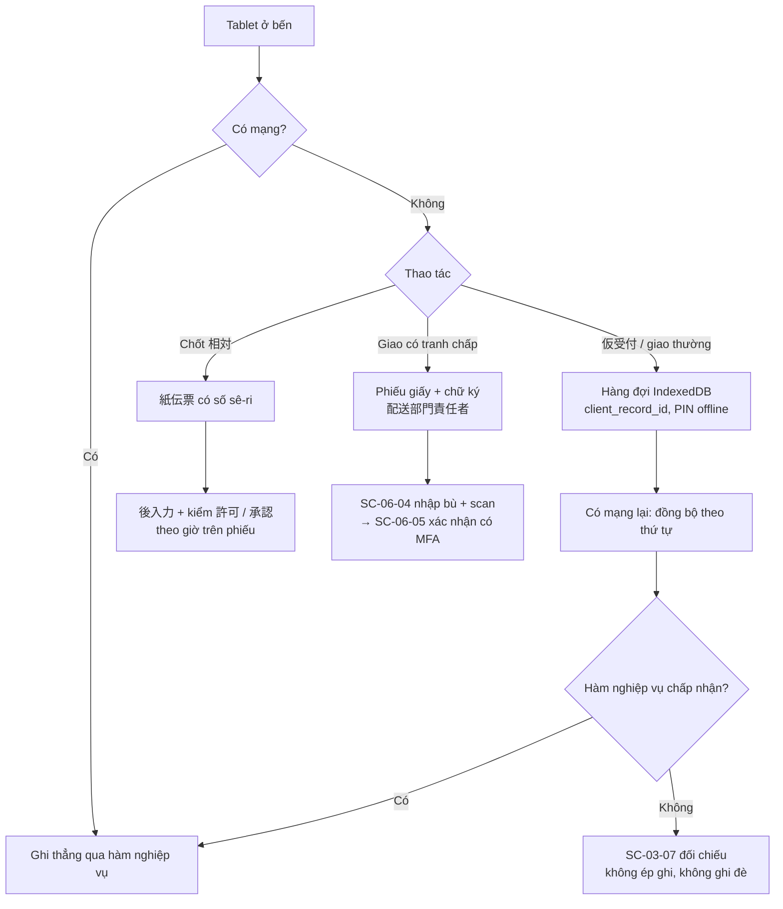

# ADR-008 — Offline có giới hạn tại bến: PWA + hàng đợi cho 3 thao tác, PIN offline gắn thiết bị, đường giấy

| Trạng thái | Ngày | Người quyết | Thay thế |
|---|---|---|---|
| **Accepted** (trừ các điểm chờ khách ở §6) | 2026-11-26 | Người dùng (L4-D09), PL đề xuất | — |

## 1. Bối cảnh

- NFR-AVL-02: làm tiếp được khi mất mạng ngắn + đồng bộ lại; không yêu cầu offline toàn phần. Mất mạng 3–5 lần / tuần mùa cao điểm (PRM-085).
- DEC-004 / L4-A05: offline chỉ cho **仮受付, ghi 引渡し, 紙伝票後入力**; **chốt 相対, xác nhận せり, mọi duyệt bắt buộc online** — vì 許可 / 承認 và SL lô phải kiểm tại thời điểm chốt (BR-PERM-01, BR-LOT-02).
- Khách giả lập: màn hình báo rõ đang mất mạng và số bản ghi chưa đồng bộ; đồng bộ không làm SL lô âm; khóa ngày đếm máy còn bản ghi chưa đồng bộ; mất mạng mà người mua đang chờ chốt 相対 → phiếu giấy rồi 後入力.
- **FB-CUS-232:** mất mạng thì không duyệt được (không MFA online) → xác nhận giao có tranh chấp cần **đường giấy**: ghi tay, chữ ký 配送部門責任者, nhập bù và duyệt có MFA sau.
- Đổi người trên máy dùng chung bằng PIN phải chạy cả lúc mất mạng (PRM-112); điều kiện chờ IT khách xác nhận (E-18). Prototype: PIN chỉ online, không offline (M03, M04, D17).

## 2. Quyết định

### 2.1 Phạm vi offline

1. Chỉ 3 màn có chế độ offline: **SC-03-02 仮受付**, **SC-06-02 引渡し記録** (giao thường, không tranh chấp), **màn 後入力 phiếu giấy**. Các màn khác khi mất mạng hiện thông báo "cần mạng" và giữ dữ liệu đang nhập.
2. Công nghệ: **PWA** (service worker cache phần tĩnh của 3 màn + IndexedDB làm hàng đợi). Không làm app native.
3. Thanh trạng thái trên mọi màn: online / **đang mất mạng** + **số bản ghi chưa đồng bộ** trên máy.

### 2.2 Hàng đợi và đồng bộ

4. Mỗi bản ghi offline có `client_record_id` (UUID sinh trên máy — khóa idempotent), id thiết bị, id người (qua PIN), thời điểm thiết bị. Server nhận lại cùng id → trả kết quả cũ, không ghi đôi.
5. Đồng bộ theo thứ tự tạo, từng bản ghi qua **cùng hàm nghiệp vụ** như online (kiểm vai, SL, ngày mở). 業務日 do server xác định (ADR-005).
6. Bản ghi bị từ chối (SL lô sẽ âm, ngày đã khóa, lô đã đổi trạng thái…) **không bị ép ghi, không ghi đè** — vào danh sách đối chiếu **SC-03-07 オフライン同期・照合** (要確認) cho người có quyền xử lý. Hai lối ra, dùng chung với ADR-005 §2.8: (a) **lập 修正申請 phạm vi `LATE_ENTRY`** (điền sẵn nội dung bản ghi + ngày gốc) → 照合部門長 決裁 → ghi vào ngày đang mở, giữ ngày GD thật; hoặc (b) **không phản ánh** — đóng bản ghi có lý do (audit).
7. Thiết bị gửi heartbeat khi online (thời điểm đồng bộ cuối, số bản ghi chờ). Checklist 日次締め liệt kê thiết bị còn bản ghi chờ (PRM-119). Bản ghi đồng bộ sau khi ngày đã khóa → SC-03-07, không vào ngày đã khóa. Thiết bị hỏng / mất → 「端末回収不能」 (ADR-005 §2.6): ra khỏi checklist, thu hồi phiên + bản băm PIN offline; bản ghi về sau của máy đó vào SC-03-07.
7a. **Dữ liệu tra cứu offline có giờ:** khi mất mạng, SC-06-02 tìm trong dữ liệu GD tải về lần cuối; màn hiện 「取引データ hh:mm 時点」 cạnh ô tìm và 「この時刻以降の取引は表示されません」 để người giao không tưởng người mua không có hàng [Customer giả lập, 2026-11-25 — #2].

### 2.3 PIN offline

8. Chỉ người đã **đăng nhập online trên đúng thiết bị đó trong N giờ** (tạm **12 giờ**, file cấu hình — Q-ARCH-04 / E-18) mới đổi người bằng PIN được khi mất mạng. Thiết bị giữ bản băm PIN (PBKDF2 qua WebCrypto, có salt, gắn khóa thiết bị), xóa khi hết hạn hoặc khi thiết bị bị thu hồi.
9. Sai PIN offline 5 lần → khóa người đó **trên thiết bị đó** tới khi online; số lần sai được gửi lên khi đồng bộ (NFR-SEC-03, M22).
10. Offline **không có** MFA, nên **không có hành động duyệt nào** chạy offline.

### 2.4 Đường giấy

11. **相対 khi mất mạng:** ghi 紙伝票 (phiếu in sẵn có số sê-ri); khi có mạng nhập ở màn 後入力 kèm số phiếu + giờ trên phiếu. Hệ thống kiểm 許可 / 承認 **theo hiệu lực tại giờ trên phiếu** và SL hiện tại; không đạt → ngoại lệ cho 照合, không tự chốt.
12. **Giao có tranh chấp khi mất mạng (FB-CUS-232):**
    1. Người giao ghi **phiếu giấy 争いのある引渡し確認票** (in sẵn số sê-ri, có trong bộ FORM): GD, SL, nội dung tranh chấp, người nhận phía mua.
    2. 配送部門責任者 xác nhận tại chỗ bằng **chữ ký tay** — vẫn áp quy tắc không tự xác nhận lần giao do mình ghi (PRM-111).
    3. Khi có mạng: người giao nhập ngoại lệ ở SC-06-04 kèm số phiếu + bản scan (scan ở PC — E-21).
    4. 配送部門責任者 mở SC-06-05, đối chiếu bản scan, **xác nhận trong hệ thống có MFA**. Mặc định là người đã ký; người ký nghỉ ca / nghỉ phép thì **một 配送部門責任者 khác** (hoặc 代行) xác nhận được với **lý do bắt buộc** + đối chiếu scan, audit ghi rõ hai tên [Customer giả lập, 2026-11-25 — #16]. Quy tắc cấm tự xác nhận lần giao do mình ghi vẫn áp. Bản ghi hiện "xác nhận trên giấy lúc hh:mm, nhập lúc hh:mm".
    5. Chưa nhập bù trước 日次締め → hiện ở checklist; giao chưa xác nhận đi tiếp sang ngày sau theo quy tắc giao còn dư.

## 3. Phương án đã cân nhắc

| Phương án | Ưu | Nhược | Kết luận |
|---|---|---|---|
| **A. PWA, offline 3 thao tác, chốt / duyệt online, đường giấy (chọn)** | Đúng DEC-004; kiểm tư cách và SL vẫn ở thời điểm chốt; giấy là thói quen hiện tại của chợ | Hai đường (máy / giấy) → cần màn đối chiếu và checklist | **Chọn** |
| B. Offline toàn phần, kể cả chốt 相対 | Không cần giấy | Chốt khi không kiểm được 許可 / 承認 / SL → trái BR-PERM-01, BR-LOT-02; xung đột bán trùng lô | Bỏ |
| C. Không offline, chỉ giấy | Đơn giản nhất | Không đạt NFR-AVL-02 (đồng bộ lại); nhập lại tăng → trái OBJ-01 | Bỏ |
| D. App native (iOS / Android) | Offline mạnh hơn | Thiết bị chưa chọn (E-05); thêm một codebase, phát hành qua store / MDM | Bỏ |
| E. Duyệt tranh chấp offline bằng PIN của 配送部門責任者 | Không cần giấy | Không có MFA → trái NFR-SEC-01 / PREMISE §3.2; PIN dễ bị nhìn trộm ở bến | Bỏ |
| F. Router 4G dự phòng là bắt buộc | Ít mất mạng | Thiết bị khách mua (PRM-027); chỉ là khuyến nghị (DEC-004) | Giữ là khuyến nghị, không phải thiết kế |

## 4. Hệ quả

**Tích cực**
- Bến vẫn nhận lô và giao hàng khi mất mạng ngắn; không có bản ghi nào bị ghi đè lúc đồng bộ.
- Đóng FB-CUS-232: có đường giấy đủ chữ ký, xác nhận lại có MFA.

**Tiêu cực / rủi ro**
- Bản băm PIN nằm trên thiết bị → phải có thu hồi thiết bị từ xa và hạn N giờ; chờ IT khách đồng ý (E-18).
- Thêm mẫu phiếu giấy có số sê-ri vào bộ FORM; in sẵn là việc của khách.

**Việc kéo theo**
- Database Design: thiết bị, heartbeat, hàng đợi phía server / kết quả đồng bộ, liên kết phiếu giấy.
- Wireframe SC-03-07, SC-06-04, SC-06-05; Technical Design đổi người (PIN offline).

## 5. Truy vết

NFR-AVL-02, NFR-SEC-01, NFR-SEC-03, BR-PERM-01, BR-LOT-02, BR-DEL-03, CAP-HUMAN-01, OBJ-01; DEC-004; PRM-027, PRM-085, PRM-111, PRM-112, PRM-119; E-05, E-18, E-21; L4-A05, L4-A07; as-built D16, D17; M03, M04, M16, M22; FB-CUS-232; Gate 1 M-05; khách #1, #2, #16.

## 6. Điểm mở (chờ khách)

Quyết định ở §2 đã **Accepted** (L4-D09). Các điểm dưới đây còn chờ khách thật trả lời; câu trả lời chỉ đổi giá trị / nhánh ghi trong bảng, không đổi hướng của ADR — nếu đổi hướng thì viết ADR mới thay thế. Câu gắn `[Customer giả lập]` trong ADR là giả định có căn cứ, khách thật xác nhận cùng `project/02_requirements/qa.md`.

| ID | Điểm chờ khách | Thiết kế đang theo (giả định) | Nếu khách trả lời khác | Ai trả lời |
|---|---|---|---|---|
| E-18 / Q-ARCH-04 | IT khách có chấp nhận đổi người offline bằng PIN gắn thiết bị; N giờ | N = 12 giờ (file cấu hình); bản băm PIN trên thiết bị, thu hồi từ xa | Không chấp nhận → offline chỉ người đang đăng nhập; N ngắn hơn → chỉ đổi cấu hình | IT khách |
| E-21 | Chứng từ giấy 受入証憑 scan ở đâu | Scan bằng máy đa năng sẵn có, đính kèm từ PC | Scan bằng tablet → thêm chụp ảnh trên PWA | 運用部門 |
| E-05 / Q-ARCH-05 | Model tablet, máy in và cách nối | Chưa chọn; PWA trên trình duyệt; in từ PC bàn GD | Chỉ nối tablet / in nhiệt → agent in cục bộ (CR-10) | 運用部門, IT khách |

---

## History of change

| No | Version | Action | Nội dung thay đổi | Ngày | Người sửa | Approve |
|---|---|---|---|---|---|---|
| 1 | 0.1.0 | Add new | Bản đầu; đường giấy cho giao có tranh chấp khi mất mạng (FB-CUS-232) | 2026-11-25 | phuongnnm-23344 | |
| 2 | 0.2.0 | Update | Sửa theo Expert Gate 1 + khách wireframe: bản ghi bị từ chối vì ngày đã khóa đi chung đường 修正申請 LATE_ENTRY với ADR-005 §2.8 (M-05); 「端末回収不能」 (khách #1); giờ dữ liệu offline ở SC-06-02 (khách #2); 配送部門責任者 khác người ký xác nhận phiếu giấy có lý do (khách #16) | 2026-11-25 | phuongnnm-23344 | |
| 3 | 1.0.0 | Update | Người dùng chốt **Accepted** sau Gate 1–3 (L4-D09 / DEC-059); thêm §6 Điểm mở (chờ khách) — không đổi nội dung quyết định | 2026-11-26 | phuongnnm-23344 | Người dùng (L4-D09) |
