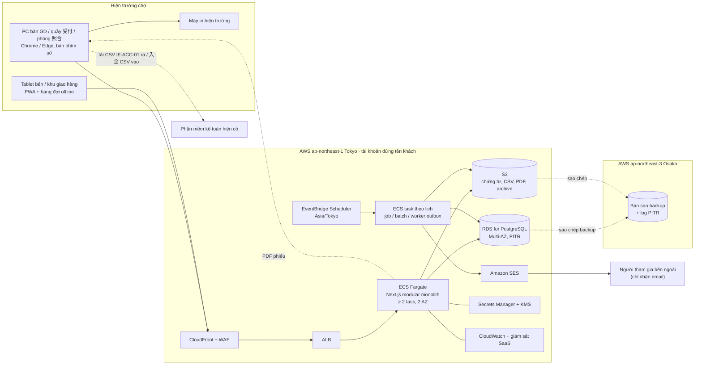
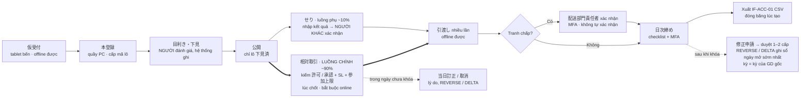
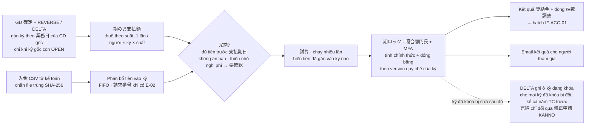
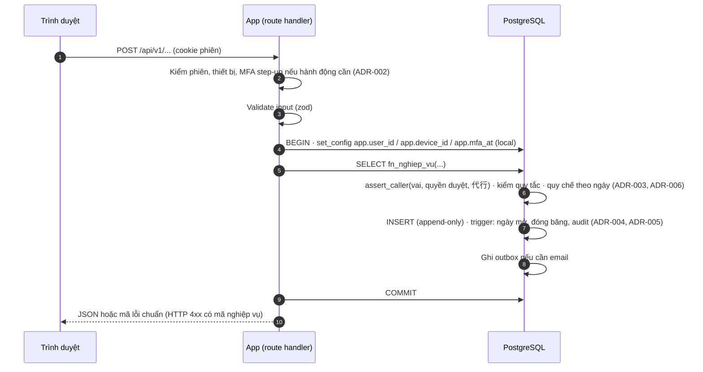
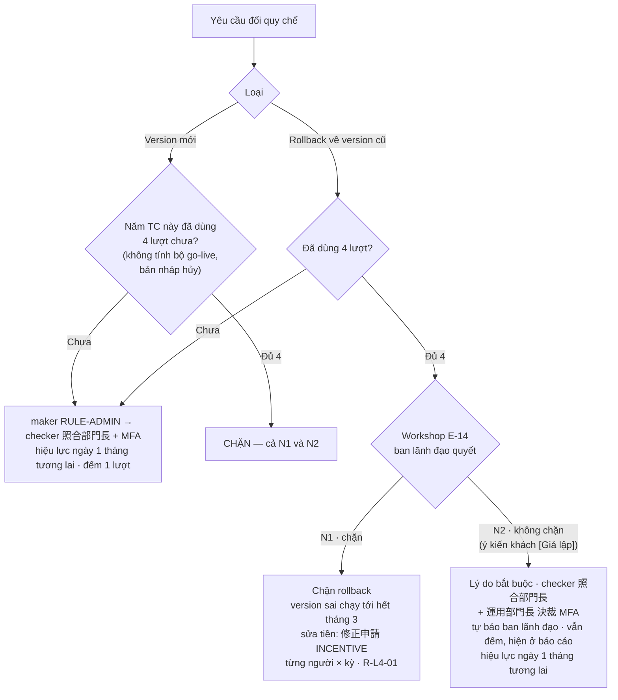

# Product A To-be アーキテクチャ（第1期）

本書は第1期（フェーズ1、RFP契約パッケージR1 — PREMISE §1.2）で**構築する**システムを説明する。AWS東京上のコンポーネント、主要なデータフロー、連携ポイント、市場の業務制約をアーキテクチャにどう組み込むかを扱う。各選択の理由はADR（[adr/_index.md](adr/_index.md)）にある。本書はADR番号のみを示し、検討内容は繰り返さない。

本書の対象外：テーブル・列の詳細（Database Design、`specs/system-design/database-design/`）、APIの契約（API Design）、画面ごとの振る舞い（Screen Specification）。Optionおよび第2期の17項目は、名前付きの**拡張ポイント**のみ示す（§10）。ルール6に従い詳細設計はしない。

## 0. 本書で使う用語

| 用語 | 意味 |
|---|---|
| 相対取引 (aitai) | 卸売業者と買受人の直接交渉による売買 — **主要フロー、取引額の約90%** |
| せり (seri) | 会場での競り。**副次フロー、約10%**。システムはせり人が決めた結果のみを記録する |
| 仲卸 / 許可 | 仲卸業者（中間卸）／仲卸として参加する根拠となる**審査付きの許可** |
| 売買参加者 / 承認 | 売買参加者／**承認**（手続きがより軽い。参加上限を伴う） |
| 買出人 | 市場に登録する小売の買出人。第1期はアカウントを持たない |
| 受付 / 仮受付 / 本登録 | ロットの受付／岸壁での仮受付／カウンターでの正式登録 |
| 目利き・下見 | 目視による品質・鮮度の評価。人が行い、システムは記録のみ |
| 引渡し | 買受人への商品の引渡し（取引ごとに複数回） |
| 業務日 / 日次締め | 業務日：[D 01:00, D+1 01:00) JST。ロット受付時刻（01:00、市場規則のパラメータ）から始まり、取引の確定は02:00から可能／業務日のロック |
| 期 / 期ロック | 期（業務日に基づく暦月の支払期間）／期のロック |
| 修正申請 / 当日訂正 / 取消 | 日次締め後の修正依頼（決裁あり）／未締めの当日中の修正／未締めの取引の取消 |
| 完納奨励金 | 期の代金を期限内に全額支払った人へのインセンティブ |
| 入金 / 消込 | 買受人からの入金／入金と売掛金の照合 |
| 照合部門長 / 運用部門長 / 配送部門責任者 | 照合部門の長／運用部門の長／配送部門の責任者。アカウントに紐づく3つの**決裁権限** |
| REVERSE / DELTA | 旧行を打ち消す逆仕訳行／新行の差分行。上書きせずに修正する方法 |

ID の表記は PREMISE §0 に従う。`Q-ARCH-xx` は本書で新たに生じた質問（§12）。

## 1. 背景と主要な制約

| 制約 | 値 | ID |
|---|---|---|
| 営業時間のSLA | 02:00–10:00 JST、週6日（休市日を除く）。10:00–18:00 も稼働するがSLA対象外。保守は 20:00–24:00 または休市日、01:00–02:00 は禁止 | NFR-AVL-01, PRM-081 |
| 可用性 | 営業時間内で 99.5% / 月 | NFR-AVL-01 |
| DR | RTO ≤ 4時間、RPO ≤ 15分 | NFR-AVL-03, PRM-082 |
| 負荷 | 180アカウント、同時60（約230アカウントを想定、同時約77 × バースト2 × 余裕1,5 で設計）；350–600ロット、700–1,200取引 / 日 | FIG-LOAD-01, PRM-083 |
| 性能 | 通常検索 p95 ≤ 2秒。帳票・バッチ出力は11:00前に完了 | NFR-PERF-01, PRM-084 |
| 保存 | 業務データはオンラインで7年保存。証憑は種類別：受入票・取引票・照合表はオンライン7年、写真・紛争の証拠・移行記録はオンライン3年の後にコールドストレージへ。保存期限後の物理削除は決裁を必要とする | DR-RET-01, TBL-ATTACH-01, B.7 |
| 現場ネットワーク | 繁忙期に短時間の通信断が週3–5回。取引の確定はオンライン必須 | NFR-AVL-02, DEC-004, PRM-085 |
| セキュリティ | 管理者および決裁権限者はMFA。誤操作が続いた場合は一時ロック。TLS。シークレットはソースから分離。APPI | NFR-SEC-01, NFR-SEC-03, NFR-SEC-04, 09-06 |
| 基盤 | AWS東京のマネージド、アカウントは顧客名義、IaC、dev / stg / prod | DEC-002, PRM-080, L4-D01 |

## 2. アーキテクチャの型

**モジュラーモノリス**。Next.js + TypeScript のコードベース1つと、PostgreSQL 1つ。モジュールの境界は RFP のデータ領域（08-01）ごとに区切る。業務の書き込みはすべて**DB内の関数**を通し、権限チェックと規則を同一トランザクションで実施する。プロトタイプ（as-built §1）で動作した原則をそのまま維持し、Supabase に依存する層のみ差し替える。理由：ADR-001。

| Module | ドメイン | 主な責務 | モジュールに置く制約 |
|---|---|---|---|
| `iam` | — | アカウント、ロール、決裁権限、代行者、PIN、MFA、セッション、端末 | ADR-002, ADR-003 |
| `party` | D-PARTY | 参加者4種類のプロフィール。**許可（仲卸）**と**承認（売買参加者）**は二つのテーブル、二つのライフサイクル。保証金、参加上限 | ADR-003; ルール2 |
| `lot` | D-LOT | 仮受付 → 本登録 → 目利き → 公開 → 確定 / 持ち越し；ロットの数量台帳 | BR-LOT-02, CAP-HUMAN-01 |
| `trade` | D-TRADE | **相対（主要フロー）**、せり（副次）、当日訂正 / 取消 | BR-PERM-01, ルール1 |
| `delivery` | D-DELIVERY | 複数回の引渡し、例外、紛争 | BR-DEL-03, CAP-HUMAN-01 |
| `settle` | D-SETTLE | 日次精算、日次締め、修正申請＋決裁、IF-ACC-01 の出力 | BR-CLOSE-01, ADR-004, ADR-005 |
| `incentive` | D-INCENTIVE | 期、入金、入金の期への割当、完納奨励金、期ロック | BR-INC-01, ADR-007 |
| `rule` | — | バージョン付きの市場規則、メーカー・チェッカー、ロールバック、年間4回の上限 | GOV-RULE-01, ADR-006 |
| `calendar` | — | 市場・銀行の休日カレンダー、業務日の開始 | ADR-005 |
| `notify` | — | アプリ内＋メール（アウトボックス、再送3回まで）、印刷リスト | BR-NOTIFY-01, L4-A08 |
| `report` | — | 固定12帳票、CSV、伝票PDF | FR-RPT-01..03 |
| `audit` | D-AUDIT | 追記のみの監査ログ、検索 | FR-AUDIT-01..03 |
| `sync` | — | オフラインのキューの受信、照合（SC-03-07） | ADR-008 |

依存関係のルール：モジュールは他モジュールを、そのモジュールの公開サービス経由でのみ呼び出す。公開されたビュー以外で他モジュールのテーブルは読まない。後で独立サービスに分割しても、データモデルを変えずに済む（DEC-002「移行しやすいアーキテクチャ」）。

## 3. AWS東京のコンポーネント

| 構成要素 | 役割 | 想定構成 | NFR / ID |
|---|---|---|---|
| CloudFront + WAF | TLS、一般的な攻撃の遮断、ログイン / PIN の試行頻度の制限 | マネージドルールセット + レートベースのルール。管理画面は市場のIPに限定可能（Q-ARCH-06） | NFR-SEC-03, NFR-SEC-04 |
| ALB + ECS Fargate (app) | Next.js の実行（ページ + route handler API） | 2つのAZに跨る2タスク以上、CPUによる自動スケール。ローリングデプロイ、01:00–10:00 はデプロイしない | NFR-AVL-01, PRM-081 |
| ECS タスク（スケジュール実行のジョブ） | 業務日の 01:00 の開始の安全網（翌業務日は通常、日次締め関数が開く — ADR-005）、アウトボックスのメール送信ワーカー、バッチ出力、帳票、期限の通知、期限到来の証憑一覧 | app と同じイメージ、エントリポイントは別。EventBridge Scheduler の cron（Asia/Tokyo） | M10, NFR-OPS-01 |
| RDS for PostgreSQL Multi-AZ | 業務データ、業務関数、トリガー、RLS | Multi-AZ DBインスタンス、PITR 35日、KMSで暗号化、メンテナンスウィンドウ 20:00–24:00 | NFR-AVL-01, NFR-AVL-03, ADR-009 |
| S3 | 添付、CSVの入出力（原本）、PDF、アーカイブ | バージョニング、暗号化、公開禁止。ライフサイクルは**証憑種別のタグごと**：受入票・取引票・照合表はオンライン7年、紛争 / 移行は3年後に Glacier へ。**自動削除しない** — 期限到来の一覧 → 決裁 + MFA → 削除（ADR-009 §2.2-9） | DR-RET-01, TBL-ATTACH-01, B.7 |
| Amazon SES | 外部参加者および内部向けのメール | ドメイン認証済み（SPF / DKIM / DMARC）。バウンス / 苦情をアプリへ戻す | BR-NOTIFY-01, PRM-073 |
| Secrets Manager + KMS | DBのパスワード、セッション署名鍵、SESの鍵 | 定期的にローテーション。リポジトリやイメージにシークレットを置かない | NFR-SEC-04 |
| CloudWatch + 監視 SaaS | ヘルス、バッチ / 出力の失敗、メール送信の失敗、セキュリティイベント | アラーム → オンコール。NOTIFY-02 Critical ≤ 5分 | NFR-OPS-01, FR-NOTIFY-02 |
| 大阪（バックアップの複製） | 東京リージョン全体の障害時の復旧 | RDSバックアップ＋PITRログを自動複製、S3を複製。待機機は動かさない | NFR-AVL-03, ADR-009 (Q-ARCH-01) |
| IaC | dev / stg / prod を同一に構築、大阪で再構築可能 | AWS CDK（TypeScript）— PLの提案、アプリと同じ言語 | PRM-080 |

クラウド費用の参考値：go-live 後およそ 235,000 JPY / 月。顧客がAWSへ直接支払う（estimate-basis §5.3）。上記の構成はこの枠内に収まる。大阪の行はバックアップの保管費用であり、待機機の稼働費用ではない。

## 4. 主要な業務データフロー

### 4.1 市場の一日：受付 → 取引 → 引渡し → 日次締め

太線は主要フロー。せりは確定後の手順を相対と共通にするが、第二の人による確認ステップが追加される（PRM-115）。日次締め時点で数量が残るロットは、ロットコードの後ろに付けて次の業務日へ持ち越す（PRM-110, E-12）。

### 4.2 期の流れ：請求 / 入金 → 完納奨励金 → 期ロック

修正（REVERSE / DELTA）は二つの日付を持つ：**適用日**（業務日帳、精算、IF-ACC-01 に載る日）と**元取引の期**。元の期がまだ OPEN であれば、その期の期のお支払額に入る。元の期がロック済みであれば、開いている期には入らず DELTA のみとなり、同じ差額は一度だけ数える。期Nをロックするとき、エンジンはロック後に入力が変わった**ロック済みのすべての期**を再計算する（会計年度の上限なし）。会計年度の上限は、負の差分の段階的な相殺（CARRY → `CARRY_EXPIRED`）にのみ適用される。計算の詳細とテストベクタ：ADR-007 §2.3–§2.7、`specs/system-design/database-design/INCENTIVE_DB.md`；技術設計 完納奨励金（P3）。

### 4.3 書き込み操作の経路

アプリケーションサーバーにはテーブルへの直接の INSERT / UPDATE / DELETE 権限がない。アプリ用DBロールが持つのは業務関数への EXECUTE と、RLS 経由の SELECT のみである。アプリ層が失われても、規則を迂回して書き込むことはできない。

## 5. 権限：社内ロール、決裁権限、許可 ≠ 承認

3つの層は分離され、DBで検査する（ADR-003）：

| 層 | 適用対象 | 内容 | 検査タイミング |
|---|---|---|---|
| 社内ロール | 市場の職員（アカウントを持つ） | ROLE-INTAKE, JUDGE, TRADE, DELIVERY, SETTLEMENT, RULE-ADMIN, SYS-ADMIN（TBL-ROLE-01） | 関数の呼び出しごと。閲覧権限はロール × 画面のマトリクス全体に従う（L4-A06） |
| 決裁権限 | 任命された者 | 照合部門長、運用部門長、配送部門責任者 ＋ 開始 / 終了日付きの代行者（PRM-129） | 決裁の操作。自分が起票・記録したものは自分で決裁できない |
| 参加資格 | 参加者（第1期はログインなし） | 仲卸は**許可**、売買参加者は**承認**（＋参加上限）、卸売業者は市場への登録、買出人は拠点での登録 | **取引確定時**（BR-PERM-01）、入力時ではない |

許可と承認は**二つのテーブル、二つのライフサイクル、二つの根拠、二つの手続き**（ルール2）。「許可の種類を列に持つ共通の表」は作らない。違いは手続きと記載項目にある（ADR-003 §2.2）。**許可**の新規は**審査**＋許可の条件が必要で、照合部門長が起案 → **運用部門長が決裁**（前提 [PL]）。**承認**は届出＋**照合部門長が確認**（保証金・資力を軽く確認、一人）。両方の通常の更新は PRM-121 に従う（照合事務局が入力＋照合部門長が確認）。**参加上限**は履歴付きのイベントで変更する（上書きしない）。資格の状態（有効 / 一時停止 / 失効 / 再審査 — FIG-010）は参加者単位ではなく、各**許可 / 承認**単位で持つ。画面と文書における社内の承認操作は 決裁 / 確認 を使い、売買参加者の 承認 と混同しないようにする（PRM-121；画面名 SC-08-03 / SC-10-04 は L4-D03 に従い変わる）。

## 6. 最終決定者（human-in-the-loop）

システムは人の決定を**記録するのみ**。手書きの記号のOCR、符丁の認識、品質のAI判定は行わない（CAP-HUMAN-01, SCOPE-OUT-01/02/06；ADR-010）。

| 決定点 | 決定者 | システムの動作 | MFA | ID |
|---|---|---|---|---|
| 目利き・下見 | ROLE-JUDGE | grade / メモ・記録者・日時を保存。下見済みのロットのみ公開可 | — | FR-LOT-02, PRM-117 |
| せりの結果 | せり人が会場で決定。確認者は入力者と別人 | 結果を記録。同一人物の場合は理由を入力させ、要確認フラグを付ける | — | FR-SERI-01/02, PRM-115 |
| 売買参加者の参加上限超過 | 取引を確定する者 | 警告＋理由の入力。強制停止はしない | — | PRM-046, L4-A04 (1) |
| 修正申請 1次 / 2次 | 照合部門長 / 運用部門長（閾値 = 一人の買受人について変更された金額の最大値、規則に定める。買受人の変更、KANNO、INCENTIVE は常に2次） | REVERSE / DELTA を生成、原本は保持 | 有 | FR-CORR-02, PRM-055, PRM-120 |
| 配送の紛争あり | 配送部門責任者（その引渡しを記録した本人以外） | 確認を記録。ネット切断時 → 紙の経路（ADR-008） | 有 | CAP-HUMAN-01, PRM-111 |
| 日次締め / 期ロック | 照合部門長（または代行） | 締め前のチェックリスト（故障・紛失の端末用の「端末回収不能」を含む）。期ロックは理由付きで要確認の行を確定（例：振込手数料の控除の疑い）。ロック後は再開しない | 有（毎回コードを再確認） | BR-CLOSE-01, PRM-119, ADR-005 §2.5–2.6, ADR-007 §2.6 |
| 規則の決裁 / ロールバック | チェッカーの照合部門長（N2 ブランチでは ＋ 運用部門長） | maker ≠ checker | 有 | GOV-RULE-01, ADR-006 |
| 一時停止 / 失効 / 資格の回復 | 運用部門長が決裁 | 履歴付きで状態を変更、メールを送信 | 有 | PRM-121, PREMISE §3.2 |
| 許可 · 承認の新規 / 更新 | 許可の新規：審査後に運用部門長が決裁 · 承認の新規、および両方の通常の更新：照合部門長が確認（PRM-121） | 履歴付きのイベントを記録 | 有 | PRM-121, ADR-003 §2.2 |
| 保存期限切れ証憑の物理削除 | 運用部門長が決裁 | 期限到来の一覧に含まれる行のみ削除。決裁者を記録 | 有（毎回コードを再確認） | B.7, ADR-009 §2.2-9 |

## 7. 履歴を上書きしない、日・期のロック、バージョン付きの規則

### 7.1 追記のみ＋REVERSE / DELTA（ADR-004）

- 確定済みの取引は凍結される。すべての変更は **REVERSE**（旧行の打ち消し、旧買受人に紐づく）＋ **DELTA**（新行、新買受人に紐づく）を生成する。当日訂正 / 取消（日のロック前、理由のみ必要）と修正申請（日のロック後、1〜2次の決裁）は同じ仕組みを使う。修正申請には4つの範囲がある：`TRADE` · `KANNO` · `INCENTIVE` · `LATE_ENTRY`（ADR-004 §2.2）。
- ロットの数量台帳、引渡し、調整、入金、奨励金の結果、監査ログは INSERT のみ。トリガーで UPDATE / DELETE を拒否する。監査を無効にするスイッチはなく、本番にはリセット関数もない（D19、M24 を修正）。

### 7.2 日・期のロック（ADR-005）

- **業務日の定義は一つ：** D = [D 01:00, D+1 01:00) JST。01:00 は規則上のロット受付時刻（E-16）。取引の確定は 02:00 から（PRM-116）。日次締め関数は常に次の市場の業務日を開く。01:00 のジョブは安全網（D22、Gate 1 M-01 を修正）。境界の例：1日の01:30に受け付けたロットは業務日1日に属する → 新しい期。
- 日次締めは、その日を DB レベルで永久にロックする（トリガー `DAY_LOCKED`）。ロックを解除する機能はない（Q-ARCH-02）。チェックリストは12項目（ADR-005 §2.5。項目12「未入力の引渡し確認票なし」は手動チェック — Q-STL-02）。機器の故障・紛失 → 「端末回収不能」（照合部門長 + 理由 + MFA）で、日が止まらないようにする。ロック後の修正は修正申請で行い、差額は**最も早い未締めの日**に記録する（PRM-120）。締め済みの日に**新たに**発生した取引・ロット・引渡し（紙伝票の後入力、オフラインの遅延）は修正申請 `LATE_ENTRY` で、開いている日に記録するが、**実際の取引日**は保持する（ADR-005 §2.8）。
- 期 ＝ 元取引の `trade_date`（業務日）に基づく暦月。元の期が OPEN のままなら、修正はその期に入る。元の期が期ロック済みなら、DELTA は現在ロック中の期に記録する（ロック済みのすべての期が対象、会計年度の制限なし — ADR-007 §2.4）。

### 7.3 バージョン付きの規則、メーカー・チェッカー、ロールバック — E-14 の二つのブランチ（ADR-006）

規則は**税率表（2表：仲卸 / 売買参加者、5段階）**と**金額に影響するパラメータ**からなる（PREMISE §3.1）。金額を扱う各レコードは適用されたバージョンを保存する（FR-AUDIT-03）。運用上のみに関わるパラメータは、ログ付きの設定ファイルに置く（PRM-126）。上限回数の計算には含めない。

既に締められた期は、新しいバージョンやロールバックの影響を受けない（FB-CUS-227）。締め済みの期の奨励金で誤った税率により計算された分は、修正申請 `INCENTIVE` でのみ修正可能（ADR-006 §2.4-8a）。二つのブランチは設定スイッチ**ではない**。ワークショップで一方を選び、コードには一方のみを組み込む（PREMISE §6 OPEN-L4-01）。ワークショップには、さらに二案 F（未締めの期の初めに遡るロールバック、税率表のみ）と G（税率は期ごとのパッケージ、パラメータは日ごとに分離）も提示される — ADR-006 §3。上限回数の計算：`CHANGE` + `ROLLBACK` のバージョンで `APPROVED` / `ACTIVE` / `SUPERSEDED` のもの。発効前の `APPROVED` バージョンの取消もメーカー・チェッカーを要する。

## 8. 現場：PIN、オフライン、プリンター

- **共用端末：** 端末単位で一度ログインし、社員番号＋4桁のPINで担当者を切り替える。PREMISE §3.2 に定める操作前の MFA step-up は、同じ人・同じ端末で **10分** 有効。SYS-ADMIN は、ログイン時点で MFA を要する（ADR-002）。携帯を使わない人は、個人用の **TOTP ハードウェアトークン**でコードを受け取る（FB-CUS-231）。
- **オフライン（ADR-008）：** 仮受付、引渡しの記録、紙伝票の後入力のみローカルキューで扱える。取引の確定 / せりの確認 / すべての決裁はオンライン必須。画面にはネット切断中であることと、未同期の件数を表示する。SC-06-02 のオフライン閲覧は、ダウンロードしたデータの時点（「取引データ hh:mm 時点」）を表示する。同期エラーは SC-03-07 に出し、上書きしない（日が締め済みなら修正申請 `LATE_ENTRY`）。日次締めでは未同期レコードの残る端末を数える。ただし「端末回収不能」とした端末は除く。
- **紙の経路：** 相対取引が通信断のとき → 紙伝票を作成し、後で入力。通信断中に紛争のある引渡し → 配送部門責任者の署名入りの紙の伝票、後で入力 ＋ スキャン画像を添付し、MFA付きでシステム内に再確認（FB-CUS-232）。
- **プリンター：** サーバーが FORM のテンプレートに従って PDF を生成し、受付カウンターのPCは確認なしでそのまま印刷する（§9）。

## 9. 連携ポイント

以下の選択は LAB-1 で確定済み（PRM / DEC）であり、新たなアーキテクチャ決定ではないため個別の ADR は作らない。

| 論点 | 方針 | 実現方法 | 障害 / 安全 | ID |
|---|---|---|---|---|
| 会計 IF-ACC-01 | 出力 | 日次締め後にCSVバッチを作成。**作成時に内容を凍結**（勘定科目・税区分のマッピングを含む）。同日に再出力すると元のファイルと同じものを返す。期ロック時に端数調整の行。利用者がダウンロードして会計ソフトへ手動で取り込む。形式は E-01 待ち | 仕訳マッピングは履歴付き。変更は次のバッチからのみ適用。誤って取り込まれたバッチ → 経理が修正仕訳を作成（08-05） | DEC-009, DEC-012, PRM-123, M06 |
| 入金 CSV | 入力 | 会計ソフトから出力したファイルをアップロード。原本を S3 に保存。SHA-256 で重複ファイルを拒否。取引先コード → 参加者のマッピング。他者が取り込んだバッチの取消は未締めの期に限る | 一致しない行は照合の待ちリストに入り、自動推測はしない | DEC-009, M07, E-02 |
| メール | 出力 | 業務の取引と同じトランザクションでアウトボックスに記録 → SES で送信するワーカー。再送は最大3回。完全に失敗 → 翌日の窓口用の印刷リスト ＋ 照合用の「未送信」リスト | SMS / FAX / LINE は使わない。メールアドレスの変更は市場の職員のみが申請書に基づいて行い、履歴を残す | BR-NOTIFY-01, PRM-073, L4-A08, M09 |
| 現場のプリンター | 出力 | サーバーが FORM のテンプレート（取引確認票、引渡し票、期限間近の一覧、メール失敗の一覧）で PDF を生成。受付のPCはブラウザ（Chrome / Edge）の直接印刷ポリシー（キオスク印刷）を使用 | プリンターの機種・用紙は現場調査待ち（PRM-095, E-05）— Q-ARCH-05 | PRM-114, PRM-118, M05 |
| 市場・銀行カレンダー | 社内 | SC-10-05。支払期日（10日）が**銀行の休業日**に当たる場合 → **直前の銀行営業日**に繰り上げ（`PAYMENT_DUE_RULE` = `PREV_BANK_DAY`、前提 — Q-ARCH-11。例：2028-06-10 土曜、市場は開場 → 2028-06-09）。臨時休市 / 臨時開市は当日中に変更し、上限回数には含めない | — | M10, PRM-054, FB-CUS-239 |
| 移行（一回限り） | 入力 | ECS タスクを一回実行：マスタ、残高のある未決済、2会計年度分の取引明細、顧客ファイルからの2期分の奨励金 → 一時テーブル → 検証 → 投入。カットオーバー時に署名する100%の照合レポート | `is_sample` 列は設けない。それ以前のデータは顧客ファイルに残し、読み取りのみ | DEC-005, PRM-125, M01 |
| 銀行 | — | **対象外** — 銀行振込はシステム範囲外 | — | SCOPE-OUT-05 |

## 10. Option / 第2期 の拡張ポイント（詳細設計はしない）

| 拡張点 | Option / 第2期 | 第1期で確保しておく境界 | 第1期で行わないこと |
|---|---|---|---|
| 外部向けのポータル | 買受人ポータル、遠隔取引（SCOPE-OUT-03/04）；メールのOTPログイン（SEC-IAM-02） | 別ルート `/portal`、独立した認証レルム、公開サービスのみ呼び出す。参加者テーブルは既にメールを持つ | 外部アカウント・外部向け画面はなし |
| 分析 / 予測 | 08-06 | 構造化データ（FR-RPT-03）をS3へ出力。必要ならあとで読み取りレプリカを追加 | データウェアハウスも予測モデルも作らない |
| AI（提案のみ） | SCOPE-OUT-06 | 提案（もしあれば）は別テーブルに置き、業務の書き込み関数を呼ぶ権限を持たない。確認者は必ず人（ADR-010） | 第1期では AI / OCR は使わない |
| ラベル / ロットコードのスキャン | 改善 04-07 | ロットコードは一意で、バーコードとして印刷できる形式 | スキャンはしない |
| 運用パラメータ画面 | 第2期（SC-10-06 は削除 — PRM-126） | ログ付きの設定ファイル | 画面はなし |

## 11. NFR → 対応方法

| NFR | 対応方法 | 詳細の場所 |
|---|---|---|
| NFR-AVL-01 02:00–10:00 で 99.5% | ECS 2タスク以上 / 2 AZ；RDS Multi-AZ（フェイルオーバー 約1–2分）；01:00–10:00 はデプロイ・保守をしない；ヘルスのアラーム | ADR-001, ADR-009 |
| NFR-AVL-02 通信断が短時間 | PWA + 3つの操作のローカルキュー；紙の経路 | ADR-008 |
| NFR-AVL-03 RTO 4時間 / RPO 15分 | PITR（ログ5分）；Multi-AZ；大阪へのバックアップ複製 ＋ IaC で再構築；go-live 前に復旧訓練 | ADR-009 |
| NFR-PERF-01/02 | クエリは常に業務日の範囲 + ページング + インデックス。約77同時 × 2 × 1.5 を前提に設計。go-live 前に負荷テスト | ADR-009 (M23) |
| NFR-SEC-01 MFA | §3.2 の操作前の step-up。SYS-ADMIN はログイン時に MFA。携帯を使わない人はハードウェアトークン | ADR-002 |
| NFR-SEC-03 | 端末種別ごとのタイムアウト（PC 約30分、タブレット 約5分）。アイドル3分超で step-up MFA が失効。取り消せない操作では必ずコードを再確認。PIN のロックは人単位と端末単位。異常のログ | ADR-002, ADR-008 |
| NFR-SEC-04 | CloudFront / ALB / RDS で TLS。Secrets Manager。バックアップの暗号化 | ADR-009 |
| NFR-OPS-01 | CloudWatch + SaaS：ヘルス、バッチ、メール失敗、セキュリティイベント | §3 |
| NFR-OPS-02 | 規則の変更は新しいバージョンで行い、履歴は変更しない | ADR-006 |
| DR-RET-01 7年 | DBはオンラインで7年。`audit_logs` は会計年度ごとに分割。証憑は種別ごとに TBL-ATTACH-01（7年 / 3年 → コールド）。物理削除は決裁を経る（B.7） | ADR-009 |
| 09-06 APPI | 保存時・通信時の暗号化。閲覧権限はマトリクスに従う。個人データの書き出しは MFA + 監査 | ADR-002, ADR-003 |

## 12. プロトタイプ LAB-2 → To-be

| Prototype (as-built) | To-be | 維持 / 置換 | 差異（as-built §5） | ADR |
|---|---|---|---|---|
| Vercel Hobby + Supabase free | AWS東京の ECS Fargate + RDS PostgreSQL Multi-AZ | 置換 | M14 | ADR-001 |
| Next.js 16 App Router, route handler, zod, `require-role` | アプリのコードは維持。コンテナ内で実行 | 維持 | — | ADR-001 |
| Supabase Auth のメール + パスワード、`auth.users`、`auth.uid()`、`banned_until` | `iam` モジュールが自ら管理：DB内のアカウントテーブル、サーバー側セッション、MFA（TOTP）、PIN。識別子はトランザクションごとに `set_config` で DB に渡す | 置換 | D17, D21 | ADR-002 |
| Supabase の PostgREST 経由の `supabase.rpc()` | 型付きの SQL クライアントで DB 関数を直接呼ぶ。DB ロールは EXECUTE のみ | 呼び出し層を置換、関数は維持 | D21 | ADR-001, ADR-003 |
| Supabase JWT による RLS、内部はすべて全件読み取り | `app.user_id` による RLS、TBL-ROLE-01 の閲覧マトリクス | 条件を置換 | D18, M18 | ADR-003 |
| 約70の `security definer` 関数、`assert_caller`、追記専用 / 日のロック / 凍結 / 監査のトリガー | モデルは維持。乖離表に従い内容を修正 | 維持 | D19（シーディングのフラグを削除） | ADR-004 |
| `trade_status` PROVISIONAL / CONFIRMED、即確定 | FIG-012 に従う状態。各ステップの人 + 日時を記録 | 修正 | D10 | ADR-004 |
| すべての修正を `correction_requests` 経由 | 当日訂正 / 取消を REVERSE / DELTA の同じ仕組みに追加 | 修正 | D11, M17 | ADR-004 |
| `current_business_date()` = 最大の OPEN 日、ジョブなし | 業務日の定義は一つ [01:00, 01:00)。日次締めで翌日を開く ＋ 01:00 の予備ジョブ ＋ 市場カレンダー | 置換 | D22, M10 | ADR-005 |
| 税率表は1つのみ。ノルマは go-live も数える。閾値 300,000 は定数 | 税率表2つ＋パラメータ。ノルマから go-live を除外。閾値はパラメータ（暫定 100,000） | 修正 | D01, D06, D07, D09, M13, M15 | ADR-006 |
| 奨励金は税込額で計算、税率1つ、期日は10日固定、金額を日付の窓で割当 | 適格金額（税抜）による区分、税率ごと＋端数調整、期日は規則 + 銀行カレンダー、FIFO の割当表、マイナスの差分は会計年度末まで繰り越し | 修正 | D02–D05, D23, M08, M21 | ADR-007 |
| **LOCKED の全期** を未締めの期の前に再計算。修正は元取引の日付で期に割当 | この二つの動作を維持（to-be 0.1.x では不十分だった：同じ会計年度のみ、適用日で割当） | 維持 | N15, N16 | ADR-007 |
| PIN はオンライン、対象者単位でロック。オフラインなし | PIN はオフラインで端末に紐づく。人 + 端末単位でロック。3操作のキュー + SC-03-07 | 置換 | D17, M03, M04, M22 | ADR-008 |
| バックアップ / PITR / 監視なし。ビューが全履歴をスキャン | PITR、Multi-AZ、大阪、監視。日付範囲付きクエリ | 置換 | D24, M14, M23 | ADR-009 |
| `is_sample`、`seed_demo_*`、`reset_demo_business_data` | 本番にはなし。本番移行 | 削除 | D19, D20, M01, M24 | ADR-004 |
| 通知、会計CSV、プリンター、添付なし | Outbox + SES、IF-ACC-01 バッチ、PDF、S3 | 追加 | D16, M05, M06, M09, M11 | §9 |

## 13. アーキテクチャで生じた未決事項

既存の質問（E-01..E-21, OPEN-L4-01..03）は繰り返さない。以下は新しいもの。調整は `qa.md` / 確認事項一覧 に転記する。

| ID | 質問 | 設計上の暫定前提 | 前提が誤っていた場合 | 回答者 |
|---|---|---|---|---|
| Q-ARCH-01 | RTO 4時間 / RPO 15分は、**東京リージョン全体**の障害にも適用されるか。それとも、リージョン内の障害のみか？ | はい — バックアップ + PITR ログを大阪へ複製し、IaC で再構築 | 不要 → 大阪の行を削除し、保管費用を減らす。大阪でホットスタンバイが必要 → クラウド費用が大きく増え、現在の TCO の外 | 顧客IT |
| Q-ARCH-02 | 誤ってロックした場合、締め済みの日を再度開く必要があるか？ | ロック解除の機能はなし。修正申請で対応 | 必要 → 運用部門長の決裁 + MFA + 監査付きのロック解除フローを追加、約0,2–0.3 MM | 運用部門、照合部門 |
| Q-ARCH-03 | ハードウェアトークン（携帯を使わない人）が必要な人数は？ 顧客が購入するか？ トークンの発行 / 回収 / 電池交換（電池 約3–5年、システムは7年）の運用手順書は誰が持つか？ | 決裁権限者12–13人のうち約半数。顧客が購入（PRM-088）。顧客IT が手順書を持ち、ロット単位でトークンを交換 | 多い → 顧客のトークン購入費が増えるだけ。設計は変わらない | 顧客IT（E-15） |
| Q-ARCH-04 | 端末上で PIN のオフライン有効時間（N時間）は？ | 12時間、設定ファイルに記載 | 短い → 夜勤の人がシフト中に再度オンラインでログインが必要になる | 顧客IT（E-18） |
| Q-ARCH-05 | 受付のPCおよび岸壁のプリンターの機種、接続方法（USB / ネットワーク）は？ | 受付のPCから印刷。タブレット（岸壁）は最寄りのネットワークプリンター経由で印刷 | タブレットに接続できない / 感熱印刷が必要 → CR-10 に従い、ローカル印刷エージェントを追加 | 運用部門（E-05, PRM-095） |
| Q-ARCH-06 | 管理画面（SYS-ADMIN、RULE-ADMIN）を市場のネットワークIPで制限できるか？ | はい、WAF経由 | 不可 → MFA のみに依存 | 顧客IT |
| Q-ARCH-07 | (a) B.7 は「添付書類は3年間」、TBL-ATTACH-01 は 受入票・取引票・照合表 7年。プロジェクトは TBL-ATTACH-01 に従うで正しいか？ (b) 保存期限後、顧客の方針は削除（決裁付き）か保持か？ (c) コールドからの復元は「最大2営業日」か「2日以内」か？ | (a) TBL-ATTACH-01 に従う。(b) **自動削除しない** — 期限到来の一覧 → 運用部門長の決裁 + MFA → 削除（B.7）。(c) 目標 ≤ 1 営業日（両方の読み方に対応） | (a) ライフサイクルのタグのみ変更。(b) より長く保持 → 削除せず、保管費用のみ増える | 照合部門、監査（DR-RET-01, B.7） |
| Q-ARCH-08 | 会計年度末に残る負の差分はどう回収するか（他の支払から相殺、参加者に再納付を求める、決裁を経て帳消し）？ | 負の差分は後の期の奨励金から会計年度末まで段階的に相殺（CARRY）。年度末に残る負の部分は `CARRY_EXPIRED` の行を記録し、RPT-07 に表示して照合部門が処理する。回収方法はその行に記録する（人、日付、方法） | システム外で回収し記録しない → 追跡不能（ルール4）。他の債務と相殺したい → IF-ACC-01 に仕訳を追加、完納奨励金の技術設計を変更 | 照合部門、財務 |
| Q-ARCH-09 | 規則の内容（税率表以外のパラメータを含む）はすべて1日付けで発効するか？ | はい — バージョン1つ、発効日1つ、期の境界と一致 | 月の途中でパラメータを変える必要がある → パラメータごとの発効日が必要になり、より複雑 | 運用部門 |
| Q-ARCH-10 | 顧客は社内のIdP（例：Microsoft Entra ID）を事務所のPCに使いたいか？ | いいえ — アカウントはシステムが管理 | はい → 事務所PCのSSOは料金を分ける改善になる。共用端末は引き続き PIN | 顧客IT |
| Q-ARCH-11 | 支払期日（10日）が銀行の休業日に当たる場合、どちらの日に繰り上げるか：**銀行**の営業日か、**市場**の開場日か？ | 銀行の営業日（`PREV_BANK_DAY`）— 銀行振込の期限に従う。テストベクタ 2028-06-10（土曜、市場開場）→ 2028-06-09 | 市場日に従う → `PAYMENT_DUE_RULE`（規則のパラメータ）の値を変更。テーブルは変更しない | 経理部 |
| Q-ARCH-12 | 完納奨励金は IF-ACC-01 でどの税区分で出力されるか（販売の税込 8% / 10%、それとも対象外か）？ BR-INC-01 の係数 110/100 は商品の税率（8%）に関係なく固定でよいか？ | 110/100 は BR-INC-01 / 13-06 に従い固定。税区分は仕訳マッピングに従う暫定（E-01, E-06 待ち） | 異なる → `journal_mappings` のみ変更、計算式は変更なし | 経理部（E-01, E-06） |

---

## 変更履歴

| No | Version | Action | 変更内容 | 更新日 | 更新者 | Approve |
|---|---|---|---|---|---|---|
| 1 | 0.1.0 | Add new | 初版：モジュール、AWS東京の構成、業務日・期の流れ、記録の経路、3層の権限、human-in-the-loop、追記専用、日・期のロック、規則の2系統（E-14）、現場、連携、拡張ポイント、NFR、プロトタイプ → To-be の対応、Q-ARCH-01..10 | 2026-11-25 | phuongnnm-23344 | |
| 2 | 0.2.0 | Update | Expert Gate 1 と顧客のワイヤーフレームに基づく修正：業務日の定義は一つ、01:00 の予備ジョブ（M-01）；二つの時間軸、締め済みの期は DELTA のみ、締め済みのすべての期を再計算（C-01, C-02 — §4.2, §7.2）；支払期日は銀行の営業日 + Q-ARCH-11（M-03）；N1 の金額修正は修正申請 INCENTIVE、案 F / G（M-04）；「端末回収不能」、LATE_ENTRY（M-05）；許可 / 承認の手続きの違い（M-07）；証憑は種別ごとに保存、自動削除しない、Q-ARCH-07 を書き直し（M-08）；Q-ARCH-08 は回収方法を質問（m-05）；アイドル時の step-up（m-06）；Q-ARCH-12 税区分（m-07）；§3 の mermaid のリンクを分離（m-08）；§12 の表に N15 / N16 を追加 | 2026-11-25 | phuongnnm-23344 | |
| 3 | 0.2.1 | Update | Gate 1 再確認 N-03：許可 · 承認の新規 / 更新の手続き（PRM-121）（§5, §6） | 2026-11-25 | phuongnnm-23344 | |
| 4 | 0.2.2 | Update | P3：記録の経路の図で `/api/v1/...` を `specs/_common/api-conventions.md` に従う（DEC-052） | 2026-11-25 | phuongnnm-23344 | |
| 5 | 0.2.3 | Update | Gate 2 / 顧客 Q-STL-02：日次締めのチェックリストを12項目に（手動チェック項目「未入力の引渡し確認票なし（紙台帳で確認）」を追加） | 2026-11-25 | phuongnnm-23344 |  |
