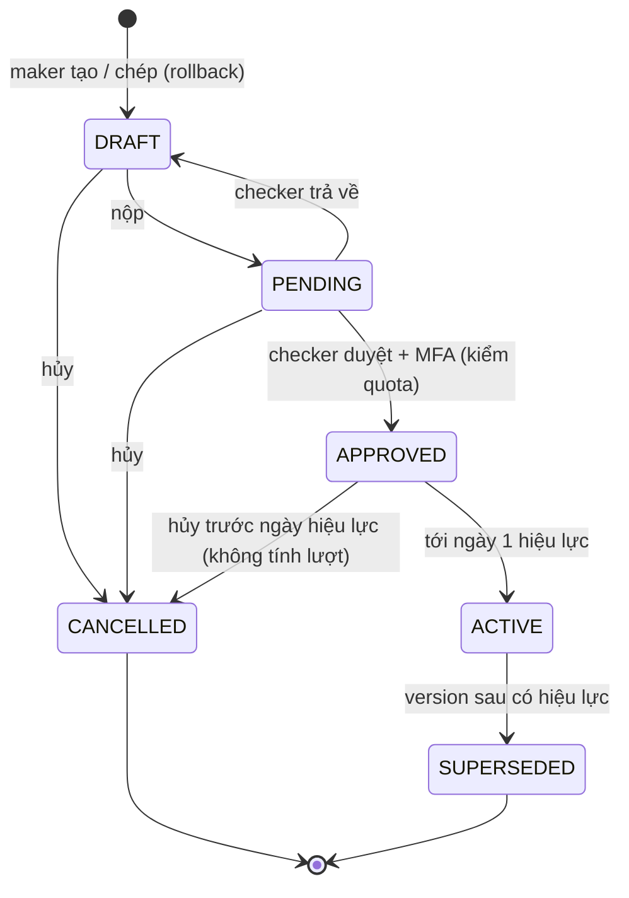

# ADR-006 — 発効日付きのバージョン管理された規則、メーカー・チェッカー、会計年度ごと4回の上限、E-14 の二つのブランチによるロールバック

| 状態 | 日付 | 決定者 | 置換 |
|---|---|---|---|
| **Proposed** — L4-D09 に従い維持：§2.5 と案 F、G は E-14 のワークショップに依存；残りは Gate 1–3 を通過済みで、現行の設計 | 2026-11-26 | PL が提案；受講者が Proposed の維持を決定（L4-D09） | — |

## 1. 背景

- ルール5 / GOV-RULE-01：規則と税率はバージョン管理し、発効日・メーカー・チェッカー・ロールバックを持つ；年4回まで；発効前に確定したデータを壊さない。NFR-OPS-02：設定の変更で行い、履歴は書き換えない。FR-INC-02：新しいバージョンは将来の発効日を持つ。
- 2020年以降、各市場が独自に規則を定める → システムは一般的なひな形ではなく、**桜水産市場の規則**を持つ必要がある。
- PREMISE §3.1（L4-A03）：金額に影響する値 / 支払期限 / ロック / 業務日 / 完納は**バージョン管理された規則**に入る（上限回数に数える）；運用だけに関わる値は**ログ付きの設定ファイル**（PRM-126、上限回数には数えない）。go-live の値セットは最初のバージョンで数えない；発効前に取り消した下書きは数えない；会計年度は 4月→3月、発効日で決まる；5つ目の新バージョンは止める（L4-A04 (3)）。
- プロトタイプ：税率表が1つだけ（D01）、規則にパラメータがない（D09）、二次決裁の閾値が定数 300,000（D07）、上限は go-live も数える（D06）、ロールバック = 税率を複写した新バージョン（方向は正しい）。
- **E-14 は未回答：** 4回を使い切った後のロールバック。顧客（模擬）は「止めない」ことを望む（FB-CUS-226）。PL は GOV-RULE-01 の4回を勝手に緩められないため、顧客の経営陣がワークショップで決める（OPEN-L4-01、リスク R-L4-01「一年間の税率が誤り」）。

## 2. 決定

### 2.1 一つのバージョンの内容

1. 一つのバージョン = **一貫したセット**：2つの完納奨励金の税率表（仲卸 / 売買参加者、それぞれ0%を含む5段階）＋ PREMISE §3.1 に従う型付きのパラメータ群（二次決裁の閾値、ロット受付開始時刻、「残り全部」のルール、支払期限のルール、締め時刻、税の端数処理のルールなど、および暫定の E-12 / E-13 — OPEN-L4-03）。
2. **発効日 = 将来の月の1日**（セット全体；期の境界と一致；Q-ARCH-09）。照会は一つだけ：`rule_at(業務日)`。
3. 金額を扱う各レコード（精算、奨励金、修正申請）は、適用したバージョンの ID を保存する（FR-AUDIT-03）。

### 2.2 ライフサイクルとメーカー・チェッカー

4. DRAFT（maker = ROLE-RULE-ADMIN が編集可能）→ PENDING → APPROVED（発効待ち。checker = 照合部門長、**MFA**、maker ≠ checker）→ 発効日に ACTIVE → SUPERSEDED。差し戻し → DRAFT；発効前の取消 → CANCELLED（上限には数えない）。PENDING から内容をロック。
5. 期ロック済みの期には、新しいバージョンもロールバックも**決して**影響しない；ロック済みの期を修正する必要がある場合は DELTA で行う（FB-CUS-227）。

### 2.3 上限

6. 会計年度（4月→3月）内で発効日を持つ、`CHANGE` + `ROLLBACK` のバージョンのうち、状態が **`APPROVED`、`ACTIVE` または `SUPERSEDED`** のものを数える — 発効済みで置き換えられたバージョンも数える；go-live のバージョン（`BASELINE`）と `CANCELLED` は数えない。確認者の決裁関数で、トランザクション内、会計年度の行をロックして、二人が同時に上限を超えないようにする。
7. 上限の4回に達した状態で新バージョン → **止める**（両方のブランチ E-14）。
7a. **発効前の `APPROVED` バージョンの取消**も maker-checker：maker（ルール管理者）が理由付きで取消を申請 → checker の照合部門長が決裁 + MFA（申請者とは別人）。取消されたバージョンは `CANCELLED`、上限には数えない。

### 2.4 ロールバック

8. ロールバック = 選んだ古いバージョンの**内容を複写**した新バージョン。`rollback_of` を記録；同じ maker-checker のライフサイクル、同じ将来の発効日の制約（現在選ばれている方式 — ワークショップ E-14 の案 F、G は §3 を参照）。古いバージョンを「再有効化」する操作はない。
8a. **締め済みの期の奨励金が誤った税率で計算された場合の修正経路：** 誤ったバージョンは、確認済みであればその期の「正しい」バージョンとしてエンジンに扱われる（ADR-007）。そのためエンジンは税率の誤りを検出しても DELTA を**自動生成しない**。唯一の修正経路は、**修正申請の範囲 `INCENTIVE`**（人 × 期ごと：理由、参照バージョン、金額；2次決裁）→ 次の期ロックで `correction_id` 付きの DELTA 行（ADR-007 §2.5）。

### 2.5 上限に達した後のロールバック — 二つのブランチ、E-14 待ち

| | N1 — ブロックする | N2 — ブロックしない（顧客の意見 **【模擬】**） |
|---|---|---|
| 動作 | 4回達したらロールバックも止める | ロールバックを許可；**数える**（5回目以降）し、経営陣向けのレポートに表示 |
| 条件 | — | 理由必須；確認者は照合部門長 **+ 運用部門長の決裁（MFA 付き）**；経営陣へ自動で通知 |
| 5つ目の新バージョン | 止める | 止める |
| リスク | **R-L4-01**：4つ目の誤った税率のバージョンが3月まで動く。エンジンは確認済みのバージョンを正しいと扱うため、**DELTA を自動生成しない**。締めるたびに誤った税率の分は **修正申請 INCENTIVE（人 × 期ごと、2次決裁）** で直す必要がある（§2.4-8a）— 約170人 × 最大11期。漏れると、何の通知もないまま誤った支払いになる | 影響は翌月1日までに限られる（それ以前に締めた期は引き続き修正申請 INCENTIVE で直す）。代わりに「4回まで」の規則に例外が生じ、監査に説明が必要 |

9. 二つのブランチは**設定スイッチではない**：ワークショップの後は一方だけを組み込む。コードでは違いをすべて**一つのポリシー関数** `can_approve_rule_version(...)` に置くため、ブランチの変更は関数の修正 + テストで済み、テーブルは変えない。
10. 発効前に誤ったバージョンを見つけた → 取消（CANCELLED、上限には数えない）。この経路は両方のブランチにあり、主要な対処とする；そのため決裁の画面では、旧 / 新の税率表を並べ、いくつかの金額の例で計算を示す。

### 2.6 設定ファイル（規則の外）

11. 運用パラメータ（受取先、送信時刻、メールの文面、税務紛争の SLA 期限、端末のタイムアウト、オフライン PIN の有効時間、期限切れ前の警告）は設定ファイルに置く：IT 部門が運用手順に従って変更し、システムを止めずに反映；読み込みのたびに、誰が / いつ / 旧 → 新 / 理由を監査ログに記録；運用手順に従って前の版に戻せる（PRM-126）。メール文面の振込先口座を変える場合は、照合部門長または財務部門の確認が必要。

## 3. 検討した選択肢

| 案 | 長所 | 短所 | 結論 |
|---|---|---|---|
| **A. バージョンのパッケージ（税率表2つ + パラメータ）、発効は1日、上限は決裁関数で検査、E-14 の二つのブランチは一つのポリシー関数の中（採用）** | 一つのバージョン = 一つの期の規則の状態が明確；照会は一つの関数；E-14 のブランチ変更は安価 | パラメータを一つ変えるだけでも上限の1回を消費する（GOV-RULE-01 の意図どおり）；月の途中では変えられない | **採用** |
| B. パラメータごとのバージョン | 発効日が柔軟 | 上限の数え方が曖昧（3パラメータを同日に変えたら1回か3回か）；ある日の組み合わせの検証が難しい | 却下 |
| C. 金額に関わるパラメータを設定ファイルに置く | すぐ変えられる | maker-checker を失い、上限も失う → ルール5 に反する（PRM-126 で既に除外） | 却下 |
| D. E-14 を設定スイッチにする | ワークショップを待たなくてよい | 統治ルールが設定の1行で変わる → GOV-RULE-01 の趣旨に反する。顧客も行わないことに同意済み（PREMISE §6） | 却下 |
| E. ロールバック = 古いバージョンの再有効化 | レコードが少ない | 時系列が崩れる（一つのバージョンが二つの有効期間を持つ）；監査が難しい | 却下 |
| F. **未ロックの期の初めまで遡るロールバック。税率表の部分のみ** | ロック前の期にはまだ奨励金の結果が凍結されていないため、GOV-RULE-01 の「確定済みのデータを壊さない」に反しない；TBL-RATE-01 は発効日を「将来の日付も可」、ロールバックは「追跡可能」とするだけで、将来のロールバックを**強制しない**；税率の誤りの影響は**ロック済み**の期だけに縮小 | 現在のバージョンのパッケージは税率表とパラメータを混ぜている（二次決裁の閾値、受付時刻は日単位で効く）→ 税率表だけを分けないと日付を遡れない；期のお支払額は不変（税率は期ロック時にだけ使う）ので安全だが、既に送った通知 / 試算は「旧税率による」と書く必要がある | **ワークショップ E-14 の資料**（L4-D06 — 受講者の判断：オープンのまま、LAB-5 で課題を分けて明確化）。上限の4回の数え方と、顧客が「発効日」をどう理解するかに関わるため、まだ選ばない。F + G を選んだ場合の工数（PL 見積）：約0,3–0.5 MM（税率の種別の分割、種別ごとの上限、期ごとの `rule_at` 関数、画面 SC-10-04、テスト）— DEC-048 には**未計上** |
| G. パッケージの分割：**税率表は期ごと**（発効 = 期、未ロックの期に適用可）/ **運用パラメータは日ごと**（発効 = 将来の1日）— 二種類のバージョン | 各種別に、発効日のルールが本質に合う；F を行うための前提条件 | 上限の数え方を、一回 = どの種類のバージョンか明確にする必要；バージョンのライフサイクルが一つ増える | **ワークショップ E-14 の資料**、F と一緒（L4-D06）；工数は F と合算 |

## 4. 結果

**良い点**
- ルール5 がデータ、決裁関数、画面に現れる；すべての金額がバージョンまで辿れる。
- プロトタイプの D01、D06、D07、D09 のずれを同じモデルで直す。

**悪い点 / リスク**
- R-L4-01 は E-14 まで残る；N1 のブランチは影響がより重い — ワークショップでリスクを明確に示し、F / G の案と、N1 を選んだ場合の実際の修正申請 INCENTIVE の量を添える。
- 発効は月の1日のみ：金額でないパラメータを急ぎ変更する必要がある場合は、待つか設定ファイルに移す必要がある（Q-ARCH-09）。

**派生する作業**
- Database Design：バージョンの表、種別ごと（参加者の種類別）の税率表 2 つ、型付きのパラメータ表、上限の計数。
- 規則の技術設計（SC-10-04）は両方のブランチを描く；テストベクタは 3/31 → 4/1 の境界日。

## 5. トレーサビリティ

ルール5；GOV-RULE-01, NFR-OPS-02, FR-INC-02, FR-RULE-01, FR-AUDIT-03, RACI-01；PRM-042, PRM-126；E-08, E-12, E-13, E-14, E-16, E-17；L4-A03, L4-A04 (3)；PREMISE §3.1, §6 (OPEN-L4-01, OPEN-L4-03, R-L4-01)；as-built D01, D06, D07, D09；M13, M15；FB-CUS-218..220, FB-CUS-226, FB-CUS-227；TBL-RATE-01；Gate 1 M-04, m-09。

## 6. 顧客待ちの点

本 ADR は **Proposed のまま**（L4-D09）：§2.5 と案 F / G は、顧客の経営陣とのワークショップ E-14 に依存する。残り（§2.1–2.4、§2.6）は Gate 1–3 を通過済みで、LAB-5 向けの現行の設計。ワークショップの後：ブランチを確定 → Accepted に変更（方向を変える場合は新しい ADR）。

| ID | 顧客回答待ちの点 | 現行設計（前提） | 顧客の回答が異なる場合 | 回答者 |
|---|---|---|---|---|
| E-14 (OPEN-L4-01, Q-RULE-01) | 上限の4回を使い切った後のロールバックを止めるかどうか | 二つのブランチ N1 / N2 を一つのポリシー関数に。既定は N1 を実装（GOV-RULE-01 を緩めない）；F / G は資料のみ（L4-D06） | N2 → 関数を一つ入れ替え、決裁の画面を有効化、約0,5 MD；F / G を選ぶ → 約0,3–0.5 MM を再見積もり（DEC-048 の外） | 経営陣（ワークショップ） |
| Q-ARCH-09 | すべての規則の内容（パラメータを含む）は1日付けで発効するか | はい — バージョン1つ、発効日1つ | パラメータごとの発効日（案 G に近い） | 運用部門 |
| E-12, E-13 (OPEN-L4-03) | この二つは金額を変えるか | 暫定で規則のパラメータとして扱う（PREMISE §3.1） | 設定ファイルへ移す、またはその逆 | 運用部門 |
| Q-RULE-03 | N2 のブランチで通知を受ける「経営層」のリスト | 代表取締役 + 運用部門長 + 照合部門長 【顧客（模擬）】 | 設定ファイルの変更のみ | 経営陣 |

---

## 変更履歴

| No | Version | Action | 変更内容 | 更新日 | 更新者 | Approve |
|---|---|---|---|---|---|---|
| 1 | 0.1.0 | Add new | 初版。E-14 は二つのブランチを描く、未確定 | 2026-11-25 | phuongnnm-23344 | |
| 2 | 0.2.0 | Update | Expert Gate 1 に従い修正：案 F（未ロックの期の初めまで遡るロールバック、税率表のみ）と G（期ごとの税率、日ごとのパラメータ）をワークショップ E-14 向けに追加；確認済みの税率の誤りは修正申請 INCENTIVE で修正（§2.4-8a）；R-L4-01 / N1 のリスクを書き直し（M-04）；上限は APPROVED / ACTIVE / SUPERSEDED を数え、APPROVED の取消は maker-checker（m-09） | 2026-11-25 | phuongnnm-23344 | |
| 3 | 0.3.0 | Update | L4-D06：F / G は E-14 ワークショップの資料、工数の見積もり約0,3–0.5 MM は DEC-048 に未計上 | 2026-11-25 | phuongnnm-23344 | |
| 4 | 0.3.1 | Update | L4-D09 / DEC-059：§2.5 と F / G がワークショップ E-14 に依存するため **Proposed** のまま（理由は状態の表に記載）；§6 顧客待ちの点を追加 — 決定内容は変更なし | 2026-11-26 | phuongnnm-23344 |  |
