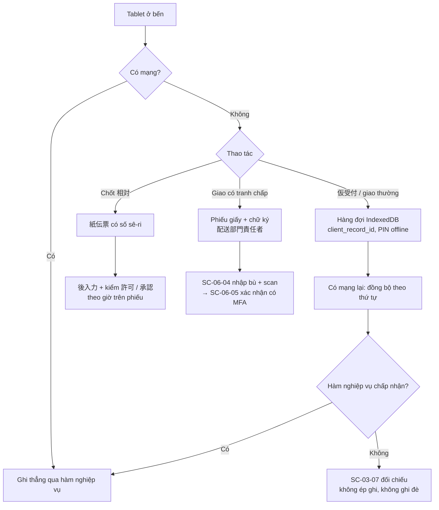

# ADR-008 — 岸壁での限定的なオフライン：PWA + 3操作のキュー、オフラインの PIN は端末に紐づく、紙の経路

| 状態 | 日付 | 決定者 | 置換 |
|---|---|---|---|
| **Accepted**（§6 の顧客待ちの点を除く） | 2026-11-26 | 受講者（L4-D09）、PL が提案 | — |

## 1. 背景

- NFR-AVL-02：短時間の通信断でも作業を続けられ、後で同期できること。完全なオフラインは要求しない。繁忙期は通信断が週3–5回（PRM-085）。
- DEC-004 / L4-A05：オフラインは **仮受付、引渡しの記録、紙伝票の後入力** のみ；**取引の確定、せりの確認、すべての決裁はオンライン必須** — 許可 / 承認 と ロットの数量は確定の時点で検査する必要があるため（BR-PERM-01, BR-LOT-02）。
- 顧客（模擬）の要望：通信断中は画面に状態を明示し、未同期の件数を表示する；同期でロットの数量がマイナスになってはいけない；日次締めは未同期レコードの残る端末を数える；通信断中に買受人が取引確定を待つ場合 → 紙伝票を作り、後で入力する。
- **FB-CUS-232：** 通信断中は決裁できない（オンラインの MFA がない）→ 配送の紛争の確認には**紙の経路**が必要：手書きで記録し、配送部門責任者の署名を取り、後で入力して MFA 付きで確認する。
- 通信断中も、共用端末での担当者の切替は PIN で行えなければならない（PRM-112）。IT 顧客の確認待ち（E-18）。プロトタイプは PIN がオンラインのみで、オフラインはなし（M03, M04, D17）。

## 2. 決定

### 2.1 オフラインの範囲

1. オフラインの機能を持つのは3画面のみ：**SC-03-02 仮受付**、**SC-06-02 引渡し記録**（通常の引渡し、紛争なし）、**紙伝票の後入力画面**。他の画面は通信断時に「ネットワークが必要」を表示し、入力中のデータを保持する。
2. 技術：**PWA**（service worker が3画面の静的部分をキャッシュ + IndexedDB をキューとして使う）。ネイティブアプリは作らない。
3. すべての画面に状態バー：オンライン / **通信断中** + **端末上の未同期レコード数**。

### 2.2 キューと同期

4. オフラインの各レコードは `client_record_id`（端末で生成する UUID — 冪等キー）、端末 ID、人の ID（PIN 経由）、端末の時刻を持つ。サーバーは同じ ID を受け取ると、以前の結果を返し、二重に書き込まない。
5. 作成順に同期し、各レコードは**オンラインと同じ業務関数**を通す（役割、数量、日付の開きを検査）。業務日はサーバーが決める（ADR-005）。
6. 拒否されたレコード（ロットの数量がマイナスになる、締め済みの日、ロットの状態が変わっている…）は**強制的に書き込まず、上書きもしない** — 権限者が処理できるよう照合画面 **SC-03-07 オフライン同期・照合**（要確認）に入る。出口は二つ、ADR-005 §2.8 と共通：(a) 修正申請の範囲 `LATE_ENTRY` を**作成**（レコードの内容 + 元の日付を初期入力）→ 照合部門長が決裁 → 開いている日へ記録、実際の取引日は保持；または (b) **反映しない** — 理由を付けてレコードを閉じる（監査あり）。
7. 端末は online のときに heartbeat を送る（最後の同期時刻、待機中のレコード数）。日次締めのチェックリストは、待機中のレコードがある端末を一覧にする（PRM-119）。締め済みの日の後に同期されたレコード → SC-03-07 に入り、締め済みの日には入らない。端末が故障 / 紛失 → 「端末回収不能」（ADR-005 §2.6）：チェックリストから外し、セッションとオフライン PIN のハッシュを無効化；その端末のレコードが後で届いた場合は SC-03-07 に入る。
7a. **オフラインの閲覧データには時刻を表示：** 通信断中、SC-06-02 は最後にダウンロードした取引データから検索する；検索欄の横に「取引データ hh:mm 時点」を表示し、「この時刻以降の取引は表示されません」も表示する。引渡し担当者が、買受人に商品がないと誤解しないようにするため【顧客（模擬）、2026-11-25 — #2】。

### 2.3 オフラインの PIN

8. 通信断中に担当者を PIN で切り替えられるのは、**その同じ端末で N 時間以内にオンラインでログインしたことがある人**のみ（暫定 **12時間**、設定ファイル — Q-ARCH-04 / E-18）。端末は PIN のハッシュ（WebCrypto の PBKDF2、ソルトあり、端末の鍵に紐づく）を保持し、期限切れまたは端末の失効時に削除する。
9. オフライン PIN を5回誤る → その人を**その端末上で**ロック（オンラインに戻るまで）；誤りの回数は同期時にサーバーへ送る（NFR-SEC-03, M22）。
10. オフラインには MFA がないため、**オフラインで行える決裁はない**。

### 2.4 紙の経路

11. **通信断中の相対取引：** 紙伝票（連番の印刷済み伝票）に記入；通信が戻ったら後入力画面で、伝票番号と伝票上の時刻を入力。システムは**伝票上の時刻の時点で有効だった**許可 / 承認と、現在の数量を検査する；合格しなければ照合への例外とし、自動で確定はしない。
12. **通信断中の紛争のある引渡し（FB-CUS-232）：**
    1. 引渡し担当者が**紙の争いのある引渡し確認票**（連番入りの印刷済み、FORM の一式に含まれる）に記入：取引、数量、紛争の内容、買受人側の受取人。
    2. 配送部門責任者が現場で**手書きの署名**で確認 — 自分が記録した引渡しを自分で確認しないルールは維持（PRM-111）。
    3. 通信が戻ったら、引渡し担当者が SC-06-04 で例外を入力し、伝票番号 + スキャン画像を添付（スキャンは PC で — E-21）。
    4. 配送部門責任者が SC-06-05 を開き、スキャンと照合し、**システム内で MFA 付きで確認する**。既定は署名した本人；本人が当番外 / 休暇の場合は、**別の配送部門責任者**（または代行）が**理由必須**＋スキャンとの照合で確認でき、監査に二人の名前を記録する【顧客（模擬）、2026-11-25 — #16】。自分が記録した引渡しを自分で確認する禁止は維持。記録には「紙で hh:mm に確認、hh:mm に入力」と表示する。
    5. 日次締め前に補入力していない → チェックリストに表示；未確認の引渡しは、余剰の引渡しのルールに従って翌日へ持ち越す。

## 3. 検討した選択肢

| 案 | 長所 | 短所 | 結論 |
|---|---|---|---|
| **A. PWA、オフラインは3操作のみ、確定 / 決裁はオンライン、紙の経路（採用）** | DEC-004 に一致；資格と数量は確定の時点で検査；紙は現在の慣習 | 二つの経路（機械 / 紙）→ 照合の画面とチェックリストが必要 | **採用** |
| B. 取引確定を含む完全なオフライン | 紙が不要 | 許可 / 承認 / 数量を検査できないまま確定 → BR-PERM-01, BR-LOT-02 に反する；ロットの二重販売の競合 | 却下 |
| C. オフラインなし、紙のみ | 最も単純 | NFR-AVL-02（再同期）を満たさない；再入力が増える → OBJ-01 に反する | 却下 |
| D. ネイティブアプリ（iOS / Android） | オフラインがより強い | 端末が未選定（E-05）；コードベースが増え、ストア / MDM で配布 | 却下 |
| E. 配送部門責任者の PIN で紛争の確認をオフラインで行う | 紙が不要 | MFA がない → NFR-SEC-01 / PREMISE §3.2 に反する；岸壁では PIN が覗き見されやすい | 却下 |
| F. 予備の 4G ルーターを必須にする | 通信断が減る | 機器は顧客が購入（PRM-027）；DEC-004 では推奨にすぎない | 推奨として残し、設計の要件にはしない |

## 4. 結果

**良い点**
- 岸壁は通信断が短い間もロットの受付と引渡しを続けられ、同期で既存のレコードが上書きされることはない。
- FB-CUS-232 を解消：署名付きの紙の経路があり、MFA 付きで再確認する。

**悪い点 / リスク**
- PIN のハッシュが端末上にある → 端末のリモート失効と N 時間の期限が必要；顧客 IT の同意待ち（E-18）。
- 連番の印刷済みの伝票の様式を FORM に追加する。印刷は顧客の作業。

**派生する作業**
- Database Design：端末、heartbeat、サーバー側のキュー / 同期結果、紙伝票との紐づけ。
- ワイヤーフレーム SC-03-07、SC-06-04、SC-06-05；技術設計 担当者切替（オフライン PIN）。

## 5. トレーサビリティ

NFR-AVL-02, NFR-SEC-01, NFR-SEC-03, BR-PERM-01, BR-LOT-02, BR-DEL-03, CAP-HUMAN-01, OBJ-01; DEC-004; PRM-027, PRM-085, PRM-111, PRM-112, PRM-119; E-05, E-18, E-21; L4-A05, L4-A07; as-built D16, D17; M03, M04, M16, M22; FB-CUS-232; Gate 1 M-05; 顧客 #1, #2, #16。

## 6. 顧客待ちの点

§2 の決定は **Accepted**（L4-D09）。以下の点は顧客の実際の回答をまだ待っている。回答は表の値や分岐を変えるだけで、ADR の方向性は変えない。方向性を変えるなら新しい ADR で置き換える。ADR 内の `[Customer giả lập]` を含む文は、根拠のある前提であり、顧客の実際の確認は `project/02_requirements/qa.md` と合わせて行う。

| ID | 顧客回答待ちの点 | 現行設計（前提） | 顧客の回答が異なる場合 | 回答者 |
|---|---|---|---|---|
| E-18 / Q-ARCH-04 | 顧客 IT は、端末に紐づく PIN による担当者切替を受け入れるか。N 時間 | N = 12時間（設定ファイル）；PIN のハッシュは端末上、リモートで失効 | 受け入れない → オフラインはログイン中の人のみ；N を短くする → 設定の変更のみ | 顧客 IT |
| E-21 | 受入証憑の紙はどこでスキャンするか | 手持ちの複合機でスキャンし、PC から添付 | タブレットでスキャン → PWA に撮影機能を追加 | 運用部門 |
| E-05 / Q-ARCH-05 | タブレットの機種、プリンターと接続方法 | 未選定；PWA（ブラウザ）；受付の PC から印刷 | タブレットのみ接続 / 感熱印刷 → ローカル印刷エージェント（CR-10） | 運用部門、顧客 IT |

---

## 変更履歴

| No | Version | Action | 変更内容 | 更新日 | 更新者 | Approve |
|---|---|---|---|---|---|---|
| 1 | 0.1.0 | Add new | 初版：通信断中の紙の経路で配送の紛争を扱う（FB-CUS-232） | 2026-11-25 | phuongnnm-23344 | |
| 2 | 0.2.0 | Update | Expert Gate 1 + 顧客ワイヤーフレームに従い修正：拒否されたレコードは LATE_ENTRY の修正申請と同じ経路へ（ADR-005 §2.8）（M-05）；「端末回収不能」（顧客 #1）；SC-06-02 のオフラインデータの時刻（顧客 #2）；紛争の確認で、署名者と異なる配送部門責任者が理由付きで確認できる（顧客 #16） | 2026-11-25 | phuongnnm-23344 | |
| 3 | 1.0.0 | Update | 受講者が Gate 1–3 の後に **Accepted** に確定（L4-D09 / DEC-059）。§6 顧客待ちの点を追加 — 決定内容は変更なし | 2026-11-26 | phuongnnm-23344 | 受講者（L4-D09） |
