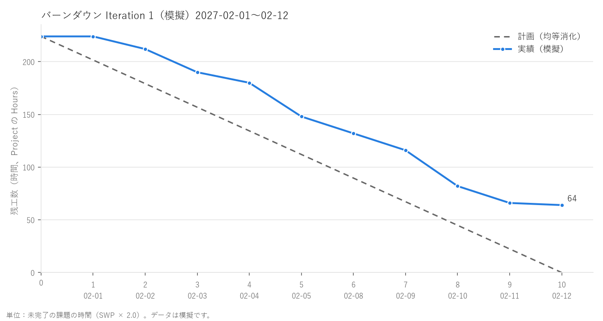

# 進捗報告書 — Iteration 1（模擬）

株式会社 桜水産市場 御中　／　株式会社Sun Asterisk

| 項目 | 内容 |
|---|---|
| Project 上の Iteration | **Iteration 1**（WBS の S1） |
| 模擬期間 | **2027-02-01（月）〜 2027-02-12（金）**、稼働日 10 日。数値は 2027-02-12 終業時点 |
| S1 の範囲 | 参加資格の管理（仲卸の許可と売買参加者の承認は別々の記録）、ログインと共用 PC での利用者切替、操作ログ。主要フローである相対取引は S3 で開発します。S1 では相対取引で使う参加資格チェックの土台を作りました |

> **本報告の進捗はすべて模擬（シミュレーション）です。** 開発はまだ始まっておらず、貴社の実データも使っていません。本文中の貴社側の出来事（確認事項、ファイルの内容、回答の時期など）は演習用の想定で、貴社に確認いただいた事実ではありません。課題数と作業量は GitHub Project 上の実際の値です。

**要約**

- S1 で予定した作業量の **71%** が完了しました（26 件中 20 件）。残り 6 件は S2 の最初に対応します。
- **共用 PC で PIN による利用者切替**と、**キーボードだけで買い手（仲卸・売買参加者）の資格を照会する画面**は完了しました。
- 承認申請の却下処理と一時停止の画面は未完了です。主な原因は、業務手順の確認事項 1 件（#24）の回答待ちと、画面の共通部品がまだなく画面ごとに入力部品を作ったことです。
- **S3（相対取引）の開始日 03-01 は変えません。** S2 では持ち越し分を先に行い、その分 S2 の一部機能を S4〜S5 に移すことをご提案します（第3節 R-01）。

**貴社にご検討をお願いしたい事項（いずれも弊社からのご提案です）**

| 事項 | ご提案の期限 | ご担当（想定） |
|---|---|---|
| 確認事項 #24（承認申請を却下する前に弁明の機会を設けるか）へのご回答 | 照合部門長のご判断なら 02-17、経営陣のご判断が必要なら 02-19 | 照合部門長 |
| actors.csv の形式の異なる参加者コードの修正 | 02-19（actors.csv のみ。他の 6 ファイルは従来の日程） | IT ご担当 |
| 失効日のない参加者の行の扱い（「要確認」で登録する案）と失効日の確認 | 02-26 | 照合事務局・照合部門長 |
| 規則版が年 4 回に達した後のロールバックの扱い（E-14） | 02-16（経営会議） | 経営陣 |
| 経理部への確認事項 4 件 | 03-05 | 照合部門長・経理部 |
| 岸壁で使うタブレットの機種決定 | 02-26 | IT・運用部門 |

## 1. スプリント終了時の状態

### 1.1 S1 でご確認いただく内容（弊社案）

| 確認内容 | 結果 | 課題 |
|---|---|---|
| 貴社のマスキング済み参加者リスト（actors.csv 第1弾）で操作する（架空データは使わない） | **一部達成** — 有効な行を投入。失効日のない行は除外し、第2弾での受領をご相談中 | #300、確認事項 #63 |
| 照合事務局が画面で、仲卸の許可と売買参加者の承認（それぞれ有効日・失効日）を登録し、一時停止を設定する | **一部達成** — 許可：登録と決裁は完了。承認：申請の登録と確認は動作、却下は #24 のご回答待ち。一時停止の画面は未完了 | 完了 #225, #263, #227, #306 · 残り #264, #307, #425, #427, #428 |
| 取引担当がキーボードだけで買い手（仲卸・売買参加者）のコードを入力し、有効か、根拠（許可／承認）、失効日をすぐ確認できる | **達成** | #151, #357, #358 |
| 共用 PC で 2 人が PIN で数秒で切り替わり、操作ログに正しい担当者が残る | **達成** | #333, #384, #289, #423, #471, #484 |

注：許可と承認で手続きの名前が違うのは、設計上の手順が違うためです。許可（仲卸）は照合部門長の審査・起案のうえ運用部門長が**決裁**、承認（売買参加者）は届出を照合事務局が入力し照合部門長が**確認**する 1 段階の手続きとしています。これは弊社の前提（暫定、確認事項 #24 と関連）です。貴社の運用と違う場合はご指摘ください。

### 1.2 計画どおり S2 で対応する事項（遅延ではありません）

- 決裁・確認の操作で求める本人の追加確認（多要素認証）は、S1 では試験用の仕組みで動かし、本番の仕組みは S2 で入れます（#114, #387）。追加確認を求める操作の一覧は変わりません。
- 参加者詳細画面 SC-01-02 の許可・承認欄（#304, #305）と、ログイン画面のエラー・アカウントロック・セッション切れ（#424）は S2 で対応します。S1 では許可・承認の登録画面へメニューと参加者コードから入ります。
- 保証金・参加上限は S3 で相対取引と合わせて、失効 30 日前のメール通知は UAT までに対応します。

### 1.3 課題の状態（Project の集計）

数え方は末端の課題（子課題を持たない課題）です。作業量は SWP（弊社の作業量ポイント、1 SWP ≒ 2 時間）で表します。親課題 #302（子は #357・#358）は二重計上を避けるため件数に含めません。

| 状態 | 課題数 | SWP 合計 | 備考 |
|---|---|---|---|
| 完了（Done） | 20 | 80 | #22, #88, #89, #151, #224, #225, #227, #255, #256, #263, #286, #289, #306, #333, #357, #358, #384, #423, #471, #484 |
| 社内レビュー中（In Review） | 2 | 6 | #300 参加者リスト第1弾の投入 — 有効な行は検証環境に投入済み、除外した行の一覧を貴社 IT ご担当とご相談中 · #307 承認の登録画面 — 申請の確認は動作、却下は #264 待ち |
| 回答待ち（Blocked） | 1 | 5 | #264 承認申請の確認・却下 — 確認は完了。却下は確認事項 #24 のご回答待ちで、弊社では決めずにお待ちしています |
| 作業中（In Progress） | 2 | 13 | #425 一時停止の画面 — 決裁への送付と時刻（時分）の保存が残り · #427 許可の一連の手続きのテスト — 登録・決裁は実施済み、一時停止は #425 待ち |
| 未着手（Todo） | 1 | 8 | #428 承認の一連の手続きのテスト — テストケースは作成済み、#264・#307・#425 待ち |
| **合計** | **26** | **112** | |

## 2. バーンダウン

残作業量＝その日の終わりに未完了の課題の作業量（時間＝SWP × 2）。

| 日 | 計画（時間） | 残（時間） | 残（SWP） | 差（時間） | 当日完了 |
|---|---|---|---|---|---|
| 1 · 02-01 | 201.6 | 224 | 112 | +22.4 | — |
| 2 · 02-02 | 179.2 | 212 | 106 | +32.8 | #22, #423 |
| 3 · 02-03 | 156.8 | 190 | 95 | +33.2 | #255, #256 |
| 4 · 02-04 | 134.4 | 180 | 90 | +45.6 | #88 |
| 5 · 02-05 | 112.0 | 148 | 74 | +36.0 | #89, #225, #358, #471 |
| 6 · 02-08 | 89.6 | 132 | 66 | +42.4 | #151, #286 |
| 7 · 02-09 | 67.2 | 116 | 58 | +48.8 | #227, #357 |
| 8 · 02-10 | 44.8 | 82 | 41 | +37.2 | #224, #263, #289, #333 |
| 9 · 02-11 | 22.4 | 66 | 33 | +43.6 | #306, #384 |
| 10 · 02-12 | 0 | 64 | 32 | +64.0 | #484 |

**計画とのずれ：**

1. **序盤の遅れは見積りではなく、作業の順番待ちによるものです。** ログインまわりは 4 件が直列で（利用者テーブル #255 → ログイン #286 → 端末登録 #333 → PIN 切替 #384）、合計 40 時間＝1 名分のスプリント全体です。参加者まわりも #22 → #88／#89 → #151 → #224 と続きます。社内レビュー後に完了とするため、最初の 2 日はほぼ横ばいです。
2. **確認が必要な点が 3 件ありました（模擬）。** (a) 共用端末のログインセッション期間について設計の確認が必要になり、#333 が 02-05〜02-08 停止（設計は変更なし）。(b) actors.csv 第1弾に失効日のない承認の行と形式の異なるコードがあり、#300 が 02-04〜02-10 停止。(c) 確認事項 #24（弁明の手順）により #264 が 02-10 から停止（02-11 は祝日）。
3. **画面の共通部品がまだありません。** 共通部品（#500）は未分割の課題です。日付・時分の入力部品を画面ごとに作ったため、#306 は 2 時間超過、#425 は未完了です。チーム内の余力で共通部品を 10 時間分先行して作りました（確約外）。
4. **テストが作業の最後に集中しました。** #427・#428 は機能と画面の両方の完了が前提のため、S2 からはテストを画面単位に分けて早く始めます。チーム全体では担当の割り振りに偏りがあり、S2 から割り振り方を見直します（R-06）。
5. **見積り。** 完了 20 件は見積り 160 時間に対し実績 169 時間（+5.6%、模擬）で、見積りの換算は変えません。

## 3. 遅延リスク

マイルストーン：S2＝2027-02-15〜02-26 · S3（相対取引）＝03-01〜03-12 · 完納奨励金の数値確認（S4 末）＝03-26 · S7＝04-26〜05-07。担当は想定の役割、貴社側の期限はすべて弊社からのご提案です。

| # | リスク | 課題 | 影響するマイルストーン | 対応 | 担当・期限 |
|---|---|---|---|---|---|
| R-01 | 未完了 6 件（64 時間）が S2 に持ち越し | #264, #300, #307, #425, #427, #428 | S2 デモ（02-26）。相対取引で資格チェックを使うため、一時停止（#425）と失効の自動処理は S3 前に完了が必要 | S2 の最初に 6 件を行い、同じ量（約 66 時間）を次のとおり後ろに移します：許可・承認の更新と全項目チェック（#362, #363）、再審査・早期更新・復帰（#426）、端末種別ごとのセッション時間（#446）、アカウント管理・代行の画面（#469）、添付ファイルの共通機能（#290）→ S4。失効 30 日前の通知（#155）、不審操作ログ（#338）→ S5（UAT 前）。S2 の主な機能（ロット受付・目利き・規則版・カレンダー・オフライン基盤）は維持し、**相対取引は動かしません** | PL・BrSE-1、02-15 の S2 計画で確定 |
| R-02 | 承認申請を却下する前に弁明の機会を設けるか（#24）が未回答 | #24 → #264, #307, #428 | **S3 の開始日には影響しません**（相対取引が使うのは有効・一時停止・失効の状態で、却下された申請は有効になりません）。回答が S3 中までずれると FG-01 の受入が遅れます | 02-12 のデモで再度ご説明し、ご回答をお願いします。現在の前提（暫定）：却下は照合部門長の確認で行い、理由を記録して申請者へ通知する。却下前の弁明の手続きは設けない。弁明が必要な場合は手順を 1 段追加します | BrSE-1 02-12、照合部門長 02-17（経営陣のご判断なら 02-19） |
| R-03 | actors.csv 第1弾に失効日のない行・形式の異なるコードがあり、S1 は有効な行のみで操作 | #300, #63 | S2 デモ、データ移行の準備 | (1) 形式の異なるコードは対応表で修正（actors.csv のみ 02-19、他の 6 ファイルは従来の日程）。(2) 失効日のない行は照合事務局に紙の台帳でご確認いただく（02-26）。(3) 失効日が分かるまで「要確認」として登録し、取引には使えないようにする案をご提案します。採否は貴社でご判断ください。除外行の一覧は投入ツールに残し、本番移行でも同じチェックを使います | IT ご担当 02-19、照合事務局 02-26、BE-6 受領後 1 日で再投入 |
| R-04 | 本番の追加確認（多要素認証）が遅れると、決裁・確認の受入ができない | #114, #387, #263, #264 | S2 デモ | S1 デモで試験用であることをご説明します（追加確認を求める操作の一覧は不変）。本番の仕組みは S2 の最初に対応します | PL（02-12 デモ）、BE（02-15〜02-19） |
| R-05 | 画面の共通部品がなく、画面ごとに作り直しが発生 | #500, #306, #425 | S2 デモ（岸壁のタブレット画面）、S3 相対取引の画面 | S2 計画で #500 から基本部品の課題を切り出し（S1 で先行して作った分を含む）、画面より先に着手します | FE-1・PL、02-15 |
| R-06 | 担当ごとの作業量に偏りがあり、テストが後ろに寄った | Iteration 2 | S2、S3 | S2 からは課題の作業量で割り振り、テストは画面単位で早めに実施します。テスト担当の 30% は各課題の完了確認に確保します。換算は S2 後に実績で見直します | PL、02-15 |
| R-07 | 設計第4波が 02-19〜03-05 に 23 件（概算 311 時間）集中し、S2 と並行。設計に専任を出すと S2 の開発量が減る | 設計第4波の 23 件 | G2（03-05）→ S4 以降の仕様、S2 | 02-15 から BrSE-1＋BE 1 名＋FE 1 名を設計専任にします。S2 の開発量は約 500 時間（WBS どおり S2 は通常の約 7 割、約 4 名増員の前提、設計専任 2 名を除く）で、持ち越し 64 時間を先に充て、R-01 の移動で S2 の主な機能を維持します。レビューは 02-22 週と 03-01 週に各 1 回（13:00〜14:30、90 分以内、02-23 は祝日のため避ける、資料は 2 営業日前に送付）をご提案します | PL、02-15 から |
| R-08 | 規則版が年 4 回に達した後のロールバックの扱い（E-14）。01-15 のワークショップで未決のため（模擬）、期限を移しています | #36 | S2（規則版） | 02-16 の経営会議でのご決定をご提案します。それまで S2 の最初の 1〜2 日は設計済みの 2 案のどちらにも対応できる形で進めます | 経営陣、02-16 |
| R-09 | 経理部への確認事項（E-02 入金 CSV の請求番号・対象年月、E-06 税計算、Q-INC-01、Q-INC-02）の回答遅れ。4〜5 月は決算期 | #37, #43, #41, #42 | 完納奨励金の数値確認（#121、03-26）、S6〜S7 | 未回答の一覧を毎週月曜に送付します。期限を過ぎた項目は、暫定前提どおりとするかを貴社に書面でご選択・ご確認いただき確定します（照合部門長、税は経理部） | BrSE-1 毎週月曜、照合部門長・経理部 03-05 |
| R-10 | 岸壁の端末（E-05）が未選定のまま、S2 でタブレットの受付画面を作る | #61 | S2 の現場デモ | (1) 弊社が 02-19 までに最低限の構成（OS、画面サイズ）をお送りします。(2) 既存のタブレット 1〜2 台をお借りできる前提で、使える機種を貴社 IT にご確認いただきます（S2 デモ前）。(3) 機種の決定は別に 02-26。(4) S2 デモ当日は、夜間勤務の方（受付・取引・配送）が勤務明けに実機を試せる時間（10:30〜11:15）を設け、デモ本体は 13:00〜14:30 とする案です | 弊社 02-19、IT ご担当（S2 デモ前）、IT・運用部門 02-26 |
| R-11 | S7（完納奨励金）がゴールデンウィークと重なり、経理部は決算期 | EP-FG09 #12 | S7 デモ、UAT | S6〜S7 の経理部の日程を今から確保し、S7 デモはゴールデンウィーク明けの 05-07 13:00〜14:30 とする案です | 照合部門長・経理部（経営陣にご報告）、03-31 |
| R-12 | 仕様はあるが 1 件 16 時間を超える課題が 18 件。直近は相対取引の #432 | #432 ほか 17 件 | S3（相対取引） | #432 は S2 中に分割・再見積りし、他は該当スプリントの計画前に分割します | PL、#432 は 02-26 |
| R-13 | 2027 年の旧正月（テト、元日は 02-06）が S1 期間と重なりました。本報告の模擬は WBS どおり S1 を稼働日 10 日として計算しています（前提）。WBS は開発チームの休暇を差し引いていないため、S2 以降の計画に休暇を入れないと各スプリントの作業量を多く見込むことになります | Iteration 2 以降 | S2、S3（開始日 03-01 は維持）、S7 | (1) S2 以降は開発チームの休暇を実際の日程で各スプリントの計画に記載し、稼働日をもとに作業量を計画します。(2) 元の WBS を休暇（テト、ゴールデンウィーク）に合わせて更新し、不足する場合は機能を後のスプリントへ移すか要員を追加します。どちらの場合も S3 の開始日を守る案を優先します | PL、02-15 の S2 計画まで |

## 付録：数値の出所

- 課題の状態と SWP：GitHub Project 1 の Status・Point を読み直して集計（`backlog/scripts/set-iteration-status-on-project.py`）。
- バーンダウン：模擬の日次ログ [`progress/iteration-1-daily.csv`](../progress/iteration-1-daily.csv) から生成（`backlog/scripts/render-iteration-burndown.py`）、表データ [`progress/iteration-1-burndown.csv`](../progress/iteration-1-burndown.csv)。
