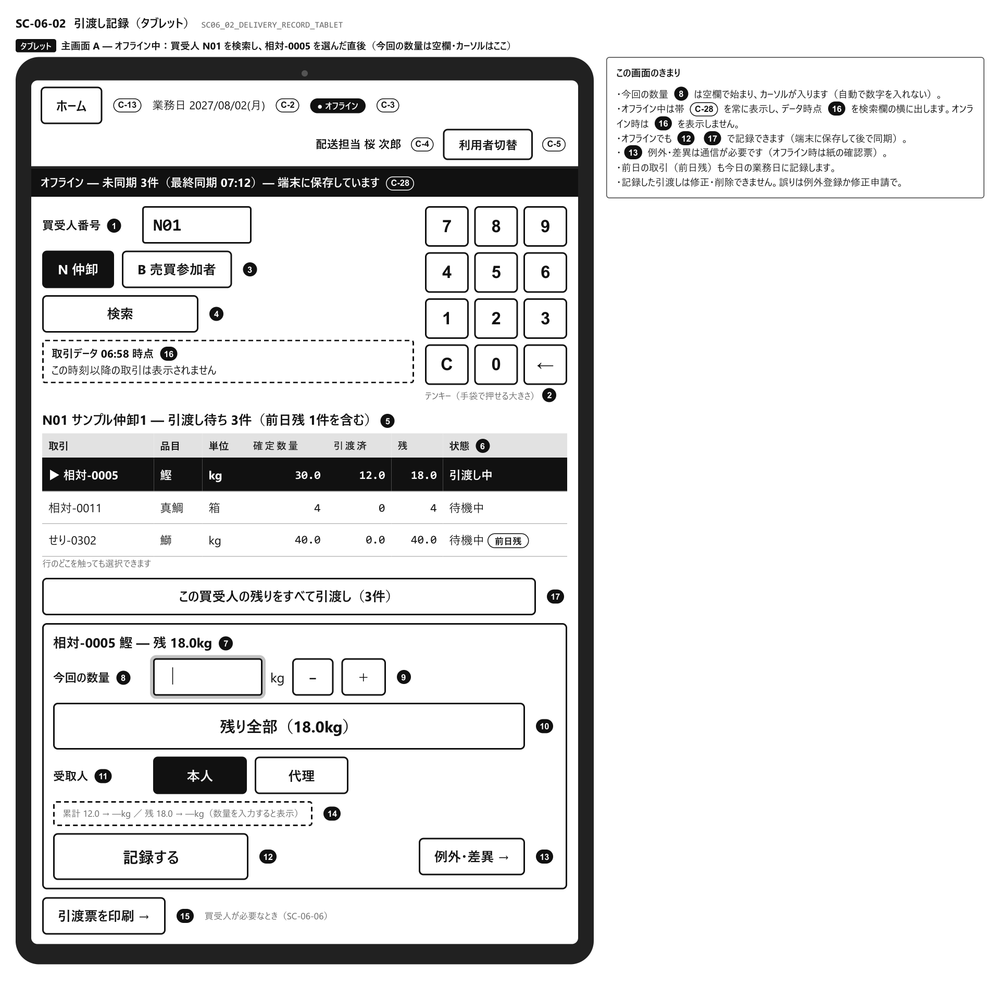
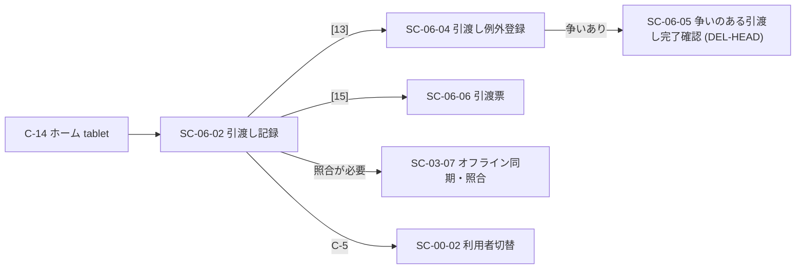

# SC-06-02 — 引渡し記録（タブレット）

> 様式: **BM-2-901-51 v2.1** — Screen Specification · SUN ASTERISK VIETNAM CO., LTD · ISO/IEC 27001:2013 & ISO 9001:2015

---

## 1. 改訂履歴

| No | Version | Action | 変更内容 | 更新日 | 更新者 | Approve |
|---|---|---|---|---|---|---|
| 1 | 0.1.0 | Add New | ワイヤーフレーム WF-SC-06-02 0.2.0 から初版作成 | 2026-11-25 | phuongnnm-23344 | |
| 2 | 0.1.1 | Update | 顧客（模擬）Q-DEL-03: 本人ボタンが既定、代理 + 氏名は任意; Q-DEL-01/02/03 を終了; G2-m07: [PL] 性能目標のラベル | 2026-11-25 | phuongnnm-23344 |  |
| 3 | 0.1.2 | Update | LAB-4: 注釈付き画像をワイヤーフレーム HTML `wireframes/html/SC-06-02.html` の変種 A（WF 0.2.2）に置換; バッジは画像に載らないことを記録; HTML / PNG / PDF のリンク | 2026-11-25 | phuongnnm-23344 | |

---

## 2. レイアウト

**デザイン:** [Wireframe SC-06-02 0.2.3](../../../wireframes/SC-06-02-delivery-record-tablet-wireframe.md) · HTML 図の元 [`wireframes/html/SC-06-02.html`](../../../../wireframes/html/SC-06-02.html) · すべての変種: [`wireframes/png/SC-06-02.png`](../../../../wireframes/png/SC-06-02.png) / [`wireframes/pdf/wireframes-all.pdf`](../../../../wireframes/pdf/wireframes-all.pdf) · 共通枠 [_common-layout](../../../wireframes/_common-layout.md) · プロトタイプの現状画像: `wireframes/assets/SC-06-02_prototype-tablet.png`

> - 画像 = ワイヤーフレーム HTML の **変種 A**（メイン画面）。`scripts/render-wireframes.py --spec` で生成（Figma はまだなし）。画像上の番号 = §4 の `ID` 列 = ワイヤーフレームの `No` 列; `C-x` = `_common-layout.md` の共通項目。
> - この画像にはバッジがない: 11.1 代理人の氏名 (B), C-12 · C-22 (C), 17.1–17.4 残りすべて引渡しの確認ダイアログ (D), C-21 · C-29 (E) → 対応する変種は [`wireframes/png/SC-06-02.png`](../../../../wireframes/png/SC-06-02.png) / PDF を参照。
> - 変種 A の [14] は数字を置くためのプレースホルダとして描かれている; 実際の画面では [8] に数量を入力した後にのみ表示（§4）。

---

## 3. 説明

引渡し場（埠頭、06:30–10:00）での**入力**画面。配送担当（DELIVERY — 引渡しの担当者）が買受人への引渡しを**一回ごとに記録する**; 一つの取引（GD — 相対 または せり）は残がなくなるまで**複数回**に分けて引き渡せる。利用者は手袋をし、日差しの中で作業する → ボタン ≥ 64 px、文字 ≥ 20 px、高コントラスト（PRM-086）。

この画面は**通信断のときにも使われる**（ADR-008 §2.1、DEC-004）: 引渡しは記録番号 `clientRecordId` を付けて端末上のキュー（IndexedDB）に入り、同じ業務ロジックの関数を通じて順番に冪等に再同期される。**争い**のある引渡しはここでは記録しない: ボタン [13] で SC-06-04 を開く; 争いは配送部門責任者が SC-06-05 で確認する（最終決裁者 — CAP-HUMAN-01）。

引渡しの記録は**追記のみ**（ルール4）: 記録済みの引渡しは修正・削除しない; 誤記録は例外（SC-06-04）または修正申請で対応。前日の取引の引渡し残は**現在の業務日**に記録する — 通常のこと、修正申請は不要。

---

## 4. 画面

項目 ID = to-be ワイヤーフレームの番号; `C-` = 共通項目（`wireframes/_common-layout.md`）。

### 4.1 項目一覧

| ID | Item Name | Item Type | Required | Note |
|---|---|---|---|---|
| **H** | **タブレットのヘッダー** | | | |
| C-13 | ホーム | Button | - | 「ホーム」の文字、左上 → C-14 |
| C-2 | 業務日 | Label | - | `YYYY/MM/DD`; オンライン時はサーバーが付与、オフライン時は直近の同期時の値を使用 |
| C-3 | 通信状態 | Label | - | ●オンライン / ●オフライン + 文字 |
| C-4 | 利用者 | Label | - | 役割 + 現在の利用者の名前（PIN） |
| C-5 | 利用者切替 | Button | - | → SC-00-02（大きなテンキー） |
| C-28 | オフライン帯 | Label | - | オフライン時は常に表示: 「オフライン — 未同期 {n}件（最終同期 {hh:mm}）— 端末に保存しています」 |
| C-12 | トースト | Label | - | 記録の後 |
| **A** | **買受人の検索** | | | |
| 1 | 買受人番号 | Text box | 有 | 大きな入力欄、[2] / [3] からのみ入力可; 空のとき 「例：N01」 を表示 |
| 2 | テンキー | Button | - | 0–9、C（全消去）、←（一文字削除）; キー ≥ 64 px |
| 3 | 種別 N / B | Button | - | `N` 仲卸 / `B` 売買参加者 — [1] の接頭辞、選択中のボタンは塗りつぶし |
| 4 | 検索 | Button | - | [1] が不足している間は薄く表示（接頭辞 + 1 桁以上の数字） |
| 16 | オフライン時点表示 | Label | - | **オフラインのときのみ**: 「取引データ {hh:mm} 時点」 + 「この時刻以降の取引は表示されません」（顧客 #2） |
| **B** | **引渡し待ちの取引一覧** | | | |
| 5 | 買受人サマリー | Label | - | 「{買受人番号} {名称} — 引渡し待ち {n}件（前日残 {m}件を含む）」 |
| 6 | 引渡し待ち一覧 | Label (選択表) | - | 列: 取引 / 品目 / 単位 / 確定数量 / 引渡済 / 残 / 状態; 行のどこを押しても選択; 選択行には ▶ と濃い背景。業務日が今日より前の取引には 「前日残」 のラベル |
| 17 | 残りをすべて引渡し | Button | - | 買受人に残のある取引が 2 件以上ある場合のみ表示 → ダイアログ D |
| **C** | **引渡しの一回分を記録（選択中の取引）** | | | |
| 7 | 記録ブロック | Label | - | 見出し 「{取引} {品目} — 残 {残}{単位}」 |
| 8 | 今回の数量 | Text box | 有（[10] を押した場合を除く） | **空欄のまま、カーソルはここ**（取引を選んだとき）— 事前入力しない（顧客 #8） |
| 9 | − / + | Button | - | ステップ 1（箱 / 尾）; kg の場合は 0.1 |
| 10 | 残り全部 | Button | - | 最も大きいボタン; 残りの全量を記録、`isRemainingAll = true` |
| 11 | 受取人 本人 / 代理 | Button | 有 | 大きな 2 つのボタン; **既定は「本人」**（選択済み）; 「代理」を選んだときのみ 11.1 を表示（Q-DEL-03 【顧客（模擬）、2026-11-25】） |
| 11.1 | 代理人氏名 | Text box | 無 | 短い名前（**任意**、運転手／買受人の担当者）; 文字キーボード（この画面で唯一の例外） |
| 12 | 記録する | Button | - | |
| 13 | 例外・差異 | Button | - | → SC-06-04（`tradeId` を渡す） |
| 14 | 記録前プレビュー | Label | - | 「累計 {引渡済} → {引渡済+今回}{単位} ／ 残 {残} → {残−今回}{単位}」 |
| 15 | 引渡票を印刷 | Button | - | → SC-06-06 |
| **D** | **確認ダイアログ [17]** | | | |
| 17.1 | 引渡す取引の一覧 | Label | - | 各行: 取引 / 品目 / 残 |
| 17.2 | 受取人 本人 / 代理 (+ 氏名) | Button | 有 | 一度選べば全体に適用 |
| 17.3 | すべて記録 | Button | - | |
| 17.4 | キャンセル | Button | - | |

### 4.2 Validation

| ID | Type | Min | Max | Default | 備考 |
|---|---|---|---|---|---|
| [1] | String | 2 | 11 | （空） | `^[NB][0-9]{1,10}$`（接頭辞は [3] から）。[4] を押したとき空 → `E-DEL-001` 「買受人番号を入力してください」. 見つからない → `E-DEL-002` 「該当する買受人が見つかりません」 |
| [8] | Decimal | > 0 | 取引の残 | （空） | 空 / ≤ 0 → `E-DEL-003` 「数量を入力してください（0より大きい値）」. 単位 `KG`: 小数 1 桁まで; `CASE` / `PIECE`: 整数 → `E-DEL-004` 「kg は小数点以下1桁まで、箱・尾は整数で入力してください」. > 残 → `E-DEL-005` 「残数量（{残}{単位}）を超えています」（オフライン: 端末上の残と比較） |
| [11] | Enum | — | — | `SELF`（本人） | UI では常に値あり; API が `receiver.type` を受け取らない → `E-DEL-006` 「受取人（本人／代理）を選んでください」 |
| 11.1, 17.2 | String | 0 | 50 | （空） | 代理のとき任意; > 50 → `E-DEL-007` 「代理人の氏名は50文字以内で入力してください」 |

> クライアントでは検証しない: 取引の状態（確定 / 完了済み）— サーバーが確認（`E-DEL-008`, `E-DEL-009`）。「精算と一致」のルール（`DELIVERY_MATCH_RULE`、E-17）は完了を計算するときにサーバーが適用。

### 4.3 Data Mapping

| ID | Data Source | API ID | API URL | Key / Param | 備考 |
|---|---|---|---|---|---|
| [4], [5], [6] | API（オンライン） | `API-DEL-001` | `GET /api/v1/deliveries/pending` | `buyerNo` | |
| [4], [5], [6], [16] | ローカル DB（IndexedDB） | `API-DEL-002` | `GET /api/v1/deliveries/offline-snapshot` | `snapshotAt` | 始業時および各同期の後に snapshot を読込; オフラインでは snapshot の中から検索し、端末上で保留中の引渡しを差し引く |
| [8]–[12], [17] | API（オンライン） | `API-DEL-003` | `POST /api/v1/deliveries` | `items[].tradeId`, `qty`, `isRemainingAll`, `clientRecordId`, `receiver` | [17] のとき一つのリクエストに複数取引 |
| [8]–[12], [17] | ローカル DB（オフライン） | —（モジュール `sync`） | キュー → `sync` の同期 API | `clientRecordId`, `deviceId`, `capturedBy`, `capturedAt` | 同期は同じ DB 関数 `fn_delivery_record` を呼ぶ（ADR-008 §2.2） |
| C-28 | ローカル DB | — | — | 保留中の記録数、`lastSyncedAt` | |

---

## 5. Event

| ID | Given (Pre-condition) | When (Trigger/Action) | Then (Result) | Note |
|---|---|---|---|---|
| **Initializing Process（初期処理）** | | | | |
| - | 端末が登録済み、利用者が DELIVERY / DEL-HEAD（PIN） | 画面を開く | 1. [1] は空、[3] は既定で 「N」。 2. オンライン: snapshot が直近の同期より古ければ `API-DEL-002` を呼ぶ → IndexedDB に保存。 3. オフライン: C-28 と [16]（`snapshotAt` 付き）を表示 | |
| **Standard Process（通常処理）** | | | | |
| [2], [3] | - | キーを押す | [1] に連結; [3] を変えると接頭辞が変わる | |
| [4] | [1] が有効 | 「検索」を押す | オンライン: `API-DEL-001` → [5], [6]; オフライン: snapshot を絞り込み、端末上で同期待ちの引渡しを差し引く。待ちの取引がない → C-21 「{買受人番号} の引渡し待ちはありません」（オフラインでは [16] の文も追加） | |
| [6] | 一覧がある | 一行を押す | その取引の [7] を開く; [8] は空、カーソルは [8]; [11] は選択解除; [14] は数量が入るまで非表示 | 顧客 #8 |
| [8], [9] | - | 入力 / −+ を押す | 4.2 で検証; [14] を数量に合わせて更新 | |
| [10] | 取引の残 > 0 | 「残り全部」を押す | [8] = 残（読み取り専用）、`isRemainingAll = true`; [14] に 「残 → 0」 | kg で計量する取引は再計量しない（PRM-118 (a)） |
| [11] | - | 「代理」を押す | 11.1 を表示し、カーソルを移す | |
| [12] | [8] / [10] と [11] が有効 | 「記録する」を押す | **オンライン:** `clientRecordId`（UUID v4）を生成 → `API-DEL-003` → 201: C-12 「引渡し：{買受人} {品目} {数量}{単位}（残 {残}{単位}）」、[6] を更新; 残 = 0 → 行は 「完了」 へ（FT-06-03）。 **オフライン:** IndexedDB に保存（`clientRecordId`, `deviceId`, 現在の利用者, 端末時刻）→ C-12 「端末に保存（未同期 {n}件）」、C-28 の件数を増やす、[6] を端末上で差し引く | ボタンは押した後 2 秒間ロック（連打防止）; 同じ `clientRecordId` の再送は二重に記録しない |
| [17] | 買受人に残のある取引が 2 件以上 | 押す | 取引ごとに一覧するダイアログ D を開く; 17.3 → オンライン: 複数の `items` を持つ **一回の** `API-DEL-003`（取引ごとに `clientRecordId`、`isRemainingAll = true`）; オフライン: 取引ごとに一件のキュー記録 | 顧客 #12 |
| [13] | 取引を選択済み | 押す | → SC-06-04（`tradeId`） | オフライン: 6.1 を参照 |
| [15] | 買受人を選択済み | 押す | → SC-06-06 | |
| C-3 | オフライン → オンライン | 通信が回復 | C-29 「オンラインに復帰しました。未同期 {n}件を送信中…」; モジュール `sync` がキューを順番に送信; 完了 → snapshot を再読込。保留された記録（`HELD`）→ ラベル 「照合が必要 {n}件」 → SC-03-07 | ADR-008 §2.2 |
| **Error Handling（エラー制御）** | | | | |
| [8] | オンライン、保存 | 409 `E-DEL-005`（他の人が引き渡し、残が減った） | C-23 「残数量が {残}{単位} に変わりました」、[6] を再読込、選択中の取引は保持 | |
| [12] | オンライン | 409 `E-DEL-008` / `E-DEL-009` | エラー文付きの C-23; [6] を再読込 | |
| [12] | オンライン | 423 `E-CMN-003`（現在の業務日がロック済み — まれ、端末が古い日付を保持） | C-24; ヘッダー C-2 を再読込 | |
| [12] | 送信中 | 途中で通信断／タイムアウト | 同じ `clientRecordId` を付けて記録をキューに保存 → オフラインモードへ切替; 利用者に再入力を求めない | 冪等 — サーバーは重複を受けると古い結果を返す |
| - | いずれも | 401 `E-CMN-001` / 端末の時間切れ（約 5 分、PRM-112） | → SC-00-02 で利用者を切替; 入力中のデータは保持 | |
| - | いずれも | 5xx | C-26; 記録はキューに入れ、同期時に再試行 | |

---

## 6. Other Notes

### 6.1 画面の状態

| 状態 | 表示 / 挙動 |
|---|---|
| 読込中 | [6] の中の C-20 |
| 待ちの取引がない | C-21 「{買受人番号} の引渡し待ちはありません」 |
| オフライン | C-28 は常に表示（未同期の件数）; [16] に時刻の目安; [12], [17] は引き続き記録可能; [13] → SC-06-04 では C-28 「通信が回復してから登録してください。争いがある場合は紙の確認票（争いのある引渡し確認票）に記入し、責任者の署名を受けてください」 — 例外は**オフラインでは記録しない**（ADR-008 §2.1; WF-SC-06-04 0.2.1 に合わせて修正済み） |
| 通信回復後、同期が保留された | ラベル 「照合が必要 {n}件」 → SC-03-07; 自動でまとめない、上書きしない |
| 前日の取引（前日残） | 通常どおり現在の業務日に記録; [6] に 「前日残」 のラベル |
| 例外が開いている取引 | [6] の状態 「例外」; 残りは引き渡せる; 争いは同じ買受人の他の取引をブロックしない（PRM-111） |
| 残の超過エラー | [8] の下に C-22 |
| 送信中 | [12] / 17.3 を薄く + 回転アイコン; 目標 ≤ 2 秒（書き込み API の [PL]、検索の NFR-PERF-01 の水準に合わせる） |

### 6.2 役割別の表示権限

| Item | DELIVERY | DEL-HEAD | SETTLE / STL-HEAD / OPS-HEAD | その他の役割 |
|---|---|---|---|---|
| 画面全体（[1]–[17]） | T | T | 非表示 — 引渡しの状態は SC-06-01 / SC-04-04（PC）で確認 | 非表示（C-25） |

役割なしで URL を直接開く → C-25。この画面には役割別の読み取り専用項目はない。

### 6.3 画面遷移

### 6.4 開発者が知っておくべき業務ルール

- 残 = 取引の有効な数量（`v_trade_effective`、当日訂正 / 修正申請 / 例外 不足・返品・一部取消 の後）− Σ `deliveries.qty_delivered`。完了は規程の `DELIVERY_MATCH_RULE` による残 = 0 のとき（BR-DEL-03、E-17）。
- `receiver_name`（TRADE_DB 4.34 で NOT NULL）: 本人 → 文字列 「本人」 を保存; 代理 → 11.1 で入力した名前、空なら 「代理」 を保存。Q-DEL-03 【顧客（模擬）、2026-11-25】。
- この画面に引渡しの修正／削除の操作はない（ルール4）。

### 6.5 トレーサビリティ

FR-DEL-01, FR-DEL-02, FR-DEL-05, BR-DEL-03, FT-06-01, FT-06-03, FT-06-07, PRM-086, PRM-111, PRM-112, PRM-118, E-17, NFR-AVL-02, NFR-PERF-01, DEC-004, L4-A05; ADR-005, ADR-008; TRADE_DB 4.34, IAM_AUDIT_DB 4.55; 顧客 #2, #8, #12, #13, #32。

### 6.6 未決事項／前提（新規）

| 提案 ID | 内容 | 暫定前提 | 前提が誤っていた場合の影響 |
|---|---|---|---|
| Q-DEL-01 | 通常の引渡しの例外（不足 / 過剰…）も**オフラインで**記録が必要か？ | **回答済み** 【顧客（模擬）、2026-11-25】: 不要; 通信断 → 通し番号付きの紙の引渡し確認票に記入（画面と同じ欄）、**当日中、日次締め の前に入力し直す**（SC-06-04 後入力; チェックリスト #12 で確認 — Q-STL-02）。通常の引渡しはオフラインでも引き続き動く | 必要な場合: `sync_kind = DELIVERY_EXCEPTION` を追加、SC-03-07 で競合処理、+0.3 MM |
| Q-DEL-02 | オフライン snapshot は何業務日前までの取引（引渡し残）を含むか？ | **回答済み** 【顧客（模擬）、2026-11-25】: 7 業務日で十分（通常 1–3 日で完了） | 長くする場合: IndexedDB の容量と読込時間が増える |
| Q-DEL-03 | `receiver_name` に「本人」をどう保存するか（必須）？ | **回答済み** 【顧客（模擬）、2026-11-25】: 既定は 「本人」; 「代理」 + 短い任意の名前 — 実名の入力は必須にしない | 実名が必要な場合: 入力欄を追加、埠頭での操作が遅くなる |
