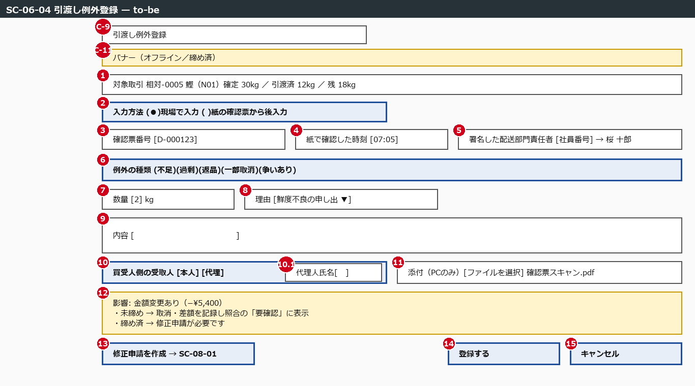

# SC-06-04 — 引渡し例外登録

> 様式: **BM-2-901-51 v2.1** — Screen Specification · SUN ASTERISK VIETNAM CO., LTD · ISO/IEC 27001:2013 & ISO 9001:2015

---

## 1. 改訂履歴

| No | Version | Action | 変更内容 | 更新日 | 更新者 | Approve |
|---|---|---|---|---|---|---|
| 1 | 0.1.0 | Add New | ワイヤーフレーム WF-SC-06-04 0.2.0 から初版作成（SC-06-02 に接続する画面） | 2026-11-25 | phuongnnm-23344 | |
| 2 | 0.1.1 | Update | 顧客: Q-DEL-01/04/05/06 を終了（Q-DEL-04: 配送は実引渡し数量のみ入力、金額は確定単価から自動計算）; 行 10.1 の代理人氏名は任意 | 2026-11-25 | phuongnnm-23344 |  |
| 3 | 0.1.2 | Update | LAB-4: 注釈付き画像をワイヤーフレーム HTML `wireframes/html/SC-06-04.html` の変種 A（WF 0.2.2）に置換; バッジは画像に載らないことを記録; HTML / PNG / PDF のリンク; §4.1 行 10.1 代理人氏名 → 任意（§4.2 / Q-DEL-03 と一致） | 2026-11-25 | phuongnnm-23344 | |
| 4 | 0.1.3 | Update | W-m06: 行 C-11 は C-24 / C-28 を含む枠であることを明記。ワイヤーフレームには個別のバッジはない | 2026-11-25 | phuongnnm-23344 |  |

---

## 2. レイアウト

**デザイン:** [Wireframe SC-06-04 0.2.3](../../../wireframes/SC-06-04-delivery-exception-registration-wireframe.md) · HTML 図の元 [`wireframes/html/SC-06-04.html`](../../../../wireframes/html/SC-06-04.html) · すべての変種: [`wireframes/png/SC-06-04.png`](../../../../wireframes/png/SC-06-04.png) / [`wireframes/pdf/wireframes-all.pdf`](../../../../wireframes/pdf/wireframes-all.pdf) · 共通枠 [_common-layout](../../../wireframes/_common-layout.md)

> - 画像 = ワイヤーフレーム HTML の **変種 A**（メイン画面）。`scripts/render-wireframes.py --spec` で生成（Figma はまだなし）。画像上の番号 = §4 の `ID` 列 = ワイヤーフレームの `No` 列; `C-x` = `_common-layout.md` の共通項目。
> - この画像にはバッジがない: 13 (B), C-24 (B), C-12 (C), C-28 (D), C-22 (E) → 対応する変種は [`wireframes/png/SC-06-04.png`](../../../../wireframes/png/SC-06-04.png) / PDF を参照。
> - プロトタイプにはこの画面がない（M16）。

---

## 3. 説明

引渡し時の例外の**入力**画面: 不足、過剰、返品、一部取消、**争いあり**。通信断の間に手書きで署名した**争いのある引渡し確認票の紙を後から入力する**場所でもある（ADR-008 §2.4-12）。利用者: DELIVERY、DEL-HEAD; PC またはタブレット（スキャンの添付は PC のみ — E-21）。

例外は**追記する記録**であり、元の引渡しは修正しない（ルール4）。例外が**金額を変える**のは（不足 / 返品 / 一部取消 で数量があるとき）:
- 取引の業務日が**未締め** → システムが直ちに REVERSE / DELTA を記録（ソース `SAME_DAY`）し、照合事務局の 要確認 に載せる（SC-07-01）; 照合が 「確認済」 を押すまで 日次締め はブロックされる（SC-07-02 [20]、顧客 #4）。
- 取引の業務日が**締め済み** → 調整は記録しない; 例外は保存され、画面は修正申請（SC-08-01）へ誘導 — BR-CLOSE-01。

争い → 状態 「確認待ち（配送部門責任者）」、SC-06-05 に表示; 同じ買受人の他の取引の引渡しは止めない（PRM-111）。

---

## 4. 画面

### 4.1 項目一覧

| ID | Item Name | Item Type | Required | Note |
|---|---|---|---|---|
| **H** | **枠** | | | |
| C-9 | 画面タイトル 「引渡し例外登録」 | Label | - | |
| C-11 | バナー（C-24 / C-28 を含む枠、ワイヤーフレームに個別のバッジはない — W-m06） | Label | - | C-24 / C-28 |
| **A** | **対象の取引** | | | |
| 1 | 対象取引 | Label | - | 「{取引} {品目}（{買受人番号} {名称}） 確定 {数量} ／ 引渡済 {数量} ／ 残 {数量}」 |
| **B** | **入力方法** | | | |
| 2 | 入力方法 | Button (1つ選択) | 有 | 「現場で入力」（既定）/ 「紙の確認票から後入力」 |
| 3 | 確認票番号 | Text box | 後入力のとき有 | 印刷済みの通し番号 |
| 4 | 紙で確認した時刻 | Text box (time) | 後入力のとき有 | `hh:mm` |
| 5 | 署名した配送部門責任者 | Text box | 後入力 + 争いありのとき有 | 社員番号を入力 → 氏名を表示 |
| **C** | **例外の内容** | | | |
| 6 | 例外の種類 | Button (1つ選択) | 有 | 不足 / 過剰 / 返品 / 一部取消 / 争いあり (`code_values.DELIVERY_EXCEPTION`) |
| 7 | 数量 | Text box | 有（争いあり以外） | 取引の単位による |
| 8 | 理由 | Text box (▼で選択) | 有 | 種類ごとの理由一覧（`code_values`） |
| 9 | 内容 | Text box (複数行) | 争いありのとき有 | |
| 10 | 買受人側の受取人 本人 / 代理 | Button | 無 | 代理を選ぶ → 10.1 を表示 |
| 10.1 | 代理人氏名 | Text box | 無（代理のとき任意 — Q-DEL-03、SC-06-02 11.1 と同じ） | |
| 11 | 添付 | Button (file) | 後入力のとき有 | **PC のみ**; タブレットでは非表示にし、「スキャンはPCで添付してください」 を表示 |
| **D** | **影響 + 操作** | | | |
| 12 | 影響 | Label | - | [6] を選ぶ / [7] を入力したときに計算: 「金額変更あり（{±¥}）」 + 次のいずれか: 「業務日が未締め → 取消・差額を記録し、照合の『要確認』に表示」 / 「業務日が締め済 → 修正申請が必要です」. 金額が変わらない → 「金額への影響はありません」 |
| 13 | 修正申請を作成 | Button | - | 取引が締め済みで金額が変わる場合のみ → SC-08-01（`tradeId`、種類、数量、理由を渡す） |
| 14 | 登録する | Button | - | |
| 15 | キャンセル | Button | - | → 前の画面（SC-06-02 / SC-06-01） |

### 4.2 Validation

| ID | Type | Min | Max | Default | 備考 |
|---|---|---|---|---|---|
| [3] | String | 1 | 20 | （空） | 空 → `E-DEL-030` 「確認票番号を入力してください」. 使用済み → `E-DEL-014` 「この確認票番号は既に登録されています」（サーバー） |
| [4] | Time | 業務日 01:00 | 現在時刻 | （空） | 範囲外 → `E-DEL-015` 「紙で確認した時刻は業務日内・現在時刻以前で入力してください」 |
| [5] | String | 1 | 20 | （空） | DEL_HEAD でない → `E-DEL-018` 「署名した配送部門責任者の社員番号が正しくありません」; 引渡しの記録者と同じ → `E-DEL-016` 「記録者本人は確認できません」 |
| [6] | Enum | — | — | （未選択） | → `E-DEL-011` 「例外の種類を選んでください」 |
| [7] | Decimal | > 0 | 確定数量（有効） | （空） | 争いあり以外で未入力 → `E-DEL-003`. 小数の単位が不正 → `E-DEL-004`. 不足 / 一部取消 > 未引渡しの残、返品 > 引渡済 → `E-DEL-028` 「数量が対象の範囲を超えています（上限 {n}{単位}）」 |
| [8] | Code | — | — | （未選択） | → `E-DEL-012` 「理由を選んでください」 |
| [9] | String | 1 | 500 | （空） | 争いありのとき必須 → `E-DEL-013` 「争いありの場合は内容を入力してください（500文字以内）」; その他の種類は 0–500 |
| 10.1 | String | 0 | 50 | （空） | 代理のとき任意; > 50 → `E-DEL-007`（Q-DEL-03） |
| [11] | File | 1 ファイル | 10 MB | — | PDF / JPEG / PNG. 後入力で未添付 → `E-DEL-017` 「後入力の場合は確認票のスキャンを添付してください」. 種類／サイズ超過 → `E-DEL-029` 「PDF・JPEG・PNG（10MB以下）を添付してください」 |

### 4.3 Data Mapping

| ID | Data Source | API ID | API URL | Key / Param | 備考 |
|---|---|---|---|---|---|
| [1], [12] | API | `API-DEL-001` | `GET /api/v1/deliveries/pending` | `tradeId` | 取引 + `businessDateLocked`、単価、税を取得して [12] を計算 |
| [5] | API | —（モジュール `iam`） | 社員番号でアカウントを照会 | `employeeNo` | `iam` の API、仕様未定 — [`specs/_index.md`](../../_index.md) の依存項目（DEP-02） |
| [11] | API | —（共通モジュール `attachments`） | 証憑をアップロード → `attachmentId` | `docClass = DISPUTE_EVIDENCE` | 共通 API、仕様未定 — [`specs/_index.md`](../../_index.md) の依存項目（DEP-03） |
| [2]–[11], [14] | API | `API-DEL-004` | `POST /api/v1/delivery-exceptions` | body は 4.1 に従う | |

---

## 5. Event

| ID | Given (Pre-condition) | When (Trigger/Action) | Then (Result) | Note |
|---|---|---|---|---|
| **Initializing Process（初期処理）** | | | | |
| - | SC-06-02 [13]（`tradeId`）または SC-06-01 から、オンライン | 画面を開く | `API-DEL-001?tradeId=` を呼ぶ → [1]; [2] = 現場; [3]–[5], [11] は非表示 | |
| - | オフライン | 画面を開く | C-28 + 「通信が回復してから登録してください。争いがある場合は紙の確認票…に記入し、責任者の署名を受けてください」; フォームをロック | Q-DEL-01 |
| **Standard Process（通常処理）** | | | | |
| [2] | - | 「紙の確認票から後入力」を選ぶ | [3], [4], [11] を表示; [6] = 争いあり のとき [5] を表示 | ADR-008 §2.4 |
| [6], [7] | - | 種類を選ぶ / 数量を入力 | [12] を計算: 金額 = floor(数量 × 単価) × 方向（−）、不足 / 返品 / 一部取消; 過剰 / 争いあり → 「金額への影響はありません」（争いによる金額変更は SC-06-05 で決定）; 取引が締め済みで金額が変わるとき [13] を表示 | |
| [14] | フォームが有効 | 「登録する」を押す | 1. `API-DEL-004`. 2. 201 + `adjustmentCreated = true` → C-12 「照合部門の確認待ち（要確認）に追加しました」. 3. 201 + `correctionRequired = true` → 画面を保持、情報型のバナー C-24 + [13] を目立たせる. 4. 争いあり → C-12 「確認待ち（配送部門責任者）に登録しました」 → SC-06-02 へ戻る | |
| [13] | 取引が締め済みで金額が変わる | 押す | → SC-08-01 へ `tradeId`、種類、数量、理由を渡す（入力済みの内容は失われない） | C-24 顧客 #5 |
| [15] | - | 押す | 前の画面へ戻る; 入力済みのデータがあれば破棄の確認を出す | |
| **Error Handling（エラー制御）** | | | | |
| [3] | 保存 | 409 `E-DEL-014` | [3] の下に C-22 | |
| [5] | 保存 | 422 `E-DEL-016` / `E-DEL-018` | [5] の下に C-22 | |
| [7] | 保存 | 409 `E-DEL-028`（別の引渡しで数量が変わった） | 新しい数値付きの C-23; [1] を再読込 | |
| - | 保存 | 423 `E-CMN-003`（途中で現在の業務日がロックされた） | C-24、内容は保持 | |
| - | 保存 | 通信断 | C-28; 画面の内容は保持、キューに入れない | |

---

## 6. Other Notes

### 6.1 画面の状態

| 状態 | 表示 |
|---|---|
| オフライン | C-28 + 紙の確認票の案内; フォームをロック（Q-DEL-01） |
| 取引が未締め + 金額が変わる | [12] の一文目; 保存後 C-12 「…要確認に追加しました」 |
| 取引が締め済み + 金額が変わる | [12] の二文目 + [13]（C-24） |
| 確認票番号が使用済み／署名者 = 記録者 | C-22 |
| タブレット | [11] 非表示; 後入力の場合は 「後入力（スキャン添付）はPCで行ってください」 を表示、[14] を薄く |

### 6.2 役割別の表示権限

| Item | DELIVERY | DEL-HEAD | SETTLE / STL-HEAD / OPS-HEAD | その他の役割 |
|---|---|---|---|---|
| [1]–[15] | T | T | 非表示 — SC-07-03 / SC-07-04 / RPT-04 で確認 | 非表示（C-25） |

### 6.3 画面遷移

SC-06-02 [13] / SC-06-01 → **SC-06-04** → （争いあり）SC-06-05 · （金額変更、締め済み）SC-08-01 · （金額変更、未締め）SC-07-01 要確認（照合側）。

### 6.4 トレーサビリティ

FT-06-04, FR-DEL-03, FR-DEL-04, FR-SETTLE-01, OBJ-05, BR-CLOSE-01, PRM-048, PRM-111, TBL-ATTACH-01, B.7, E-21, M16; ADR-004, ADR-005, ADR-008 §2.4; TRADE_DB 4.35, ADJUST_DB 4.32 / 4.39; 顧客 #4, #13。

### 6.5 未決事項／前提（新規）

| 提案 ID | 内容 | 暫定前提 | 前提が誤っていた場合の影響 |
|---|---|---|---|
| Q-DEL-01 | （SC-06-02 を参照）例外のオフライン | **回答済み** 【顧客（模擬）、2026-11-25】: オフラインでは不可; 通し番号付きの紙の確認票を、この画面で当日中・日次締め の前に後入力 | — |
| Q-DEL-04 | 未締めの日の金額を変える例外を、**DELIVERY の役割**が `trade_fixes`（ソース `SAME_DAY`）による REVERSE / DELTA で記録してよいか？ | **回答済み（修正）** 【顧客（模擬）、2026-11-25】: 条件付きで可 — 配送は**実際に引き渡した数量のみ入力**（不足 / 返品 / 一部取消）、金額は**確定単価**から自動計算、配送は金額・単価を入力・修正しない; すべての仕訳は照合の確認済を経て締める; 減額方向のみ | 不可とする場合: 例外は記録のみ、TRADE が当日訂正を別途行う — 手作業が一手増える |
| Q-DEL-05 | 返品／不足の数量をロット台帳（`lot_quantity_ledger`）に戻すか？ | **回答済み** 【顧客（模擬）、2026-11-25】: 自動では戻さない; 返品品は品質を人が再確認したうえで、返品・廃棄 で再販売／廃棄を決める（ルール3） | 戻す場合: 同一トランザクションに仕訳 `SALE_REVERSE` を追加 |
| Q-DEL-06 | 過剰（余分に引き渡した）は金額を変えるか？ | **回答済み** 【顧客（模擬）、2026-11-25】: 変えない — 記録のみ; 買受人が追加で受け取る場合は TRADE が当日訂正 / 修正申請を行う | 変える場合: 正の DELTA を追加 |
