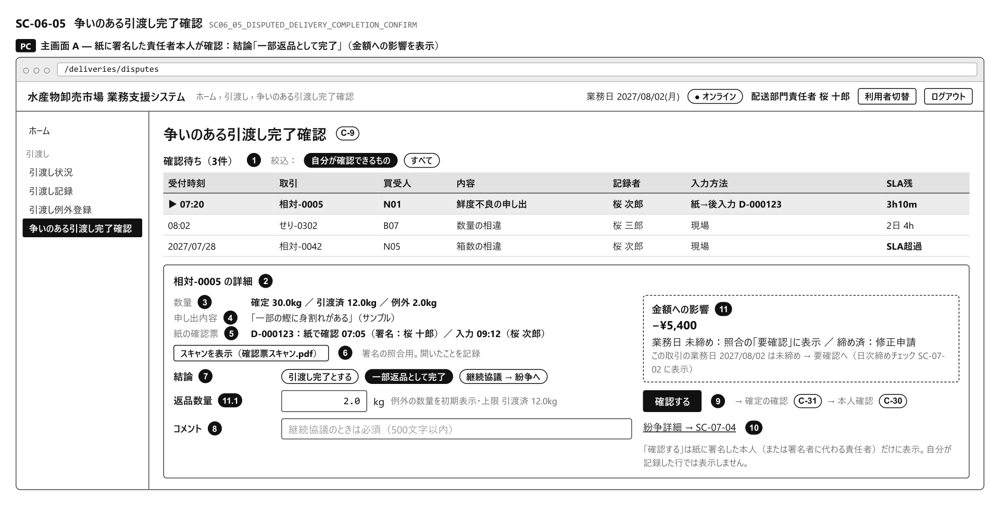

# SC-06-05 — 争いのある引渡し完了確認

> 様式: **BM-2-901-51 v2.1** — Screen Specification · SUN ASTERISK VIETNAM CO., LTD · ISO/IEC 27001:2013 & ISO 9001:2015

---

## 1. 改訂履歴

| No | Version | Action | 変更内容 | 更新日 | 更新者 | Approve |
|---|---|---|---|---|---|---|
| 1 | 0.1.0 | Add New | ワイヤーフレーム WF-SC-06-05 0.2.0 から初版作成（SC-06-02 に接続する画面） | 2026-11-25 | phuongnnm-23344 | |
| 2 | 0.1.1 | Update | 顧客 Q-DEL-07: RPT-04 で 継続協議 を絞り込み、各回の協議履歴を見るニーズ（DEP-17）; Q-DEL-08 を終了 | 2026-11-25 | phuongnnm-23344 |  |
| 3 | 0.1.2 | Update | LAB-4: 注釈付き画像をワイヤーフレーム HTML `wireframes/html/SC-06-05.html`（WF 0.2.1）の変種 A に置換; バッジは画像に載らないことを記録; HTML / PNG / PDF のリンク | 2026-11-25 | phuongnnm-23344 | |
| 4 | 0.1.3 | Update | W-m06: 行 C-11 は C-28 を含む枠であることを明記。ワイヤーフレームには個別のバッジはない | 2026-11-25 | phuongnnm-23344 |  |

---

## 2. レイアウト

**デザイン:** [Wireframe SC-06-05 0.2.1](../../../wireframes/SC-06-05-disputed-delivery-completion-confirm-wireframe.md) · HTML 図の元 [`wireframes/html/SC-06-05.html`](../../../../wireframes/html/SC-06-05.html) · すべての変種: [`wireframes/png/SC-06-05.png`](../../../../wireframes/png/SC-06-05.png) / [`wireframes/pdf/wireframes-all.pdf`](../../../../wireframes/pdf/wireframes-all.pdf) · 共通枠 [_common-layout](../../../wireframes/_common-layout.md)

> - 画像 = ワイヤーフレーム HTML の **変種 A**（メイン画面）。`scripts/render-wireframes.py --spec` で生成（Figma はまだなし）。画像上の番号 = §4 の `ID` 列 = ワイヤーフレームの `No` 列; `C-x` = `_common-layout.md` の共通項目。
> - この画像にはバッジがない: 8.1 署名者に代わって確認する理由 (B), C-12 (E), C-28 (F) → 対応する変種は [`wireframes/png/SC-06-05.png`](../../../../wireframes/png/SC-06-05.png) / PDF を参照。
> - プロトタイプにはこの画面がない（M16）。変種 A の C-30 / C-31 は [9] の横の注釈に過ぎない; 実際のダイアログは変種 C（C-31）と D（C-30）を参照。

---

## 3. 説明

**決定**の画面: 配送部門責任者（DEL-HEAD — 配送の責任者）が争いのある引渡し一件について結論を出す — CAP-HUMAN-01 の**最終決裁点**（ルール3）。システムは自動で結論を出さない。三つの結論: 引渡し完了とする（完了）、一部返品として完了（一部返品を伴う完了 — 金額を変える）、継続協議（未決 → 紛争へ、SC-07-04）。

制約: 自分が記録した引渡し／例外の**自己確認は禁止**（PRM-111）; MFA を必須とする（PREMISE §3.2）; **通信断の間はできない**（紙の署名付き確認票で対応し、SC-06-04 で後入力、ここで後から確認 — ADR-008 §2.4）。紙の確認票の場合、既定では署名した本人が確認する; 署名者が不在 → 別の DEL-HEAD（または代行）が、スキャンを開いたうえで必須の理由を付けて確認（顧客 #16）。

---

## 4. 画面

### 4.1 項目一覧

| ID | Item Name | Item Type | Required | Note |
|---|---|---|---|---|
| **H** | **枠** | | | |
| C-9 | 画面タイトル | Label | - | |
| C-11 | バナー（C-28 を含む枠、ワイヤーフレームに個別のバッジはない — W-m06） | Label | - | オフライン時の C-28 |
| **A** | **確認待ち一覧** | | | |
| 1 | 確認待ち一覧 | Label (選択表) | - | 見出し 「確認待ち（{n}件）」; 絞り込み 「自分が確認できるもの」（既定）/ 「すべて」. 列: 受付時刻 / 取引 / 買受人 / 内容 / 記録者 / 入力方法 (現場 \| 紙→後入力 {番号}) / SLA残 |
| **B** | **詳細** | | | |
| 2 | 詳細ブロック | Label | - | 「{取引} の詳細」 |
| 3 | 数量 | Label | - | 確定 / 引渡済 / 例外 |
| 4 | 申し出内容 | Label | - | |
| 5 | 紙の確認票 | Label | - | 後入力のときのみ: 「紙の確認票 {番号}: 紙で確認 {hh:mm}（署名: {氏名}）／ 入力 {hh:mm}（{氏名}）」 |
| 6 | スキャンを表示 | Button | - | スキャンを開く（新しいタブ）; 開いたことを記録 |
| 7 | 結論 | Button (1つ選択) | 有 | 引渡し完了とする / 一部返品として完了 / 継続協議 → 紛争へ |
| 11 | 金額への影響 | Label | - | 一部返品のときのみ: 「−¥{額} → 業務日 未締め: 要確認に表示 ／ 締め済: 修正申請」 |
| 11.1 | 返品数量 | Text box | 一部返品で、例外に数量がないとき有 | 既定 = 例外に記録された数量（あれば）。ワイヤーフレームにない子項目を追加（[11] の計算に数量が必要） |
| 8 | コメント | Text box (複数行) | 継続協議のとき有 | |
| 8.1 | 署名者に代わって確認する理由 | Text box | 閲覧者 ≠ 署名者のとき有 | 紙の確認票の行にのみ表示 |
| 9 | 確認する | Button | - | 8.1 が表示されるとき 「署名者に代わって確認する」 のラベル。閲覧者が記録者なら非表示 |
| 10 | 紛争詳細 | Button | - | → SC-07-04 |

### 4.2 Validation

| ID | Type | Min | Max | Default | 備考 |
|---|---|---|---|---|---|
| [7] | Enum | — | — | （未選択） | → `E-DEL-020` 「結論を選んでください」 |
| 11.1 | Decimal | > 0 | 取引の引渡済 | 例外の数量 | → `E-DEL-026` 「返品数量を入力してください」; > 引渡済 → `E-DEL-028`; 小数の単位が不正 → `E-DEL-004` |
| [8] | String | 0（継続協議のとき 1） | 500 | （空） | 継続協議で空 → `E-DEL-021` 「継続協議の場合はコメントを入力してください」 |
| 8.1 | String | 1 | 200 | （空） | → `E-DEL-022` 「署名者に代わって確認する場合は理由を入力してください」 |
| [6] → [9] | Flag | — | — | false | 紙の確認票で、閲覧者 ≠ 署名者 かつ [6] を開いていない → [9] は薄く; サーバーが再確認 → `E-DEL-023` 「スキャンを表示して確認してから確定してください」 |

### 4.3 Data Mapping

| ID | Data Source | API ID | API URL | Key / Param | 備考 |
|---|---|---|---|---|---|
| [1]–[5], [11] | API | `API-DEL-005` | `GET /api/v1/delivery-exceptions/disputes` | `scope=confirmable\|all` | `paper`, `canConfirm`, `isSigner`, `amountPreview` も返す |
| [6] | API | —（共通モジュール `attachments`） | `attachmentId` でファイルを取得（短期の署名付き URL） | `attachmentId` | 開いたとき、クライアントが `scanViewedAt` を送信 |
| [7]–[9], 11.1 | API | `API-DEL-006` | `POST /api/v1/delivery-exceptions/{exceptionId}/confirmation` | `conclusion`, `returnQty`, `comment`, `signerAbsentReason`, `scanViewedAt` | MFA step-up |

---

## 5. Event

| ID | Given (Pre-condition) | When (Trigger/Action) | Then (Result) | Note |
|---|---|---|---|---|
| **Initializing Process（初期処理）** | | | | |
| - | DEL-HEAD（または代行）、オンライン | 画面を開く | `API-DEL-005?scope=confirmable` → [1]、先頭の行を選択 → [2]–[5]。空 → C-21 「確認待ちの争いはありません」 | |
| - | オフライン | 画面を開く | C-28 「通信断中は確認できません。紙の確認票に署名してください」; 直近にキャッシュした一覧を読み取り専用で表示 | ADR-008 §2.3-10 |
| **Standard Process（通常処理）** | | | | |
| [1] | - | 絞り込みを変える | 「すべて」→ `scope=all`: 自分が記録した行には 「自分の記録のため確認できません」 のラベル | |
| [1] | - | 一行を押す | [2]–[6] を読込; 紙の確認票の行で閲覧者 ≠ 署名者 → 「紙で署名した {氏名} が確認する予定です」 + 8.1 + [9] を 「署名者に代わって確認する」 の形で表示（[6] を開くまで薄く） | 顧客 #16 |
| [6] | - | 押す | スキャンを開く; クライアントで `scanViewedAt` を記録; 条件が揃えば [9] を有効化 | |
| [7] | - | 一部返品を選ぶ | [11]、11.1 を表示（既定は例外の数量）し金額を計算: floor(数量 × 単価); 文は `businessDateLocked` に従う | 顧客 #17 |
| [9] | [7] + 4.2 の条件が満たされる | 押す | 1. C-31: 「この争いを『{結論}』として確定します。確定後は取り消せません」. 2. C-30 MFA（step-up が切れている場合）. 3. `API-DEL-006`. 4. 200 → C-12 「確認しました：{取引}（{結論}）」; 読み取り専用の記録に 3 つの時刻 「紙で確認 {hh:mm} ／ 入力 {hh:mm} ／ システム確認 {hh:mm}（{氏名}、MFA済）」; `correctionRequired` → バナー + ボタン 「修正申請を作成 → SC-08-01」 | |
| [10] | - | 押す | → SC-07-04 | |
| **Error Handling（エラー制御）** | | | | |
| [9] | - | 403 `E-DEL-019`（自己確認 — サーバーが再確認） | C-23 「自分の記録のため確認できません」 | PRM-111 |
| [9] | - | 403 `E-CMN-005` | C-30 を開き、コード入力後に再送 | |
| [9] | - | 409 `E-DEL-024`（他の人が先に確認した） | C-23; [1] を再読込 | |
| [9] | - | 422 `E-DEL-023` | [6] の横に C-22 | |
| - | - | 通信断 | C-28; [9] を薄く | |

---

## 6. Other Notes

### 6.1 画面の状態

| 状態 | 表示 |
|---|---|
| 待ちの項目がない | C-21 |
| 自分が記録した行 | ラベル 「自分の記録のため確認できません」; [9] 非表示 |
| 紙の確認票、閲覧者 ≠ 署名者 | 署名者の予定の文; 8.1 + [9] 「署名者に代わって確認する」、[6] を開いた後に有効 |
| SLA 超過（`slaDueAt` < now、PRM-048 暫定 3 営業日） | 行を赤く + 文字 「SLA超過」; 引き続き確認可能 |
| オフライン | C-28; 確認不可 |
| 確認済み | 読み取り専用 + 3 つの時刻 |

### 6.2 役割別の表示権限

| Item | DEL-HEAD（記録者ではない） | DEL-HEAD = その行の記録者 | DELIVERY | SETTLE / STL-HEAD / OPS-HEAD |
|---|---|---|---|---|
| [1]–[6], [10], [11] | T | 閲覧 | 非表示 — 状態は SC-06-01 で確認 | 閲覧（SC-07-03 経由; この画面は読み取りのみ） |
| [7], [8], 8.1, 11.1, [9] | T | 非表示 | 非表示 | 非表示 |

DEL-HEAD の代行（`delegations`、有効なもの）= DEL-HEAD; 監査には「…の代わりに」と記録。

### 6.3 画面遷移

SC-06-04（争いあり）→ **SC-06-05** → （継続協議）SC-07-04 · （一部返品、締め済み）SC-08-01。ほかに C-14 のボタン 「争いの確認待ち {n}」 と SC-07-03 から入る。

### 6.4 トレーサビリティ

FT-06-05, CAP-HUMAN-01, PRM-048, PRM-111, FR-DEL-03, FR-DEL-04, BR-CLOSE-01, NFR-SEC-01; ADR-002, ADR-008 §2.4; TRADE_DB 4.35, 4.36; PREMISE §3.2; 顧客 #16, #17。

### 6.5 未決事項／前提（新規）

| 提案 ID | 内容 | 暫定前提 | 前提が誤っていた場合の影響 |
|---|---|---|---|
| Q-DEL-07 | 継続協議 はどこに保存するか？ | 列 `conclusion` + unique partial `conclusion <> 'CONTINUE_DISPUTE'`（TRADE_DB 0.2.1 §4.36）。顧客 【顧客（模擬）、2026-11-25】: 保存先は社内の作業; ニーズは **RPT-04 で 継続協議 の案件を絞り込み、各回の協議履歴を見られること** — `report` の依存項目（`specs/_index.md`）で扱う | 追加しない場合: 継続協議は `audit_logs` にしか残らず、報告 RPT-04 で絞り込めない |
| Q-DEL-08 | 継続協議 にも MFA が必要か（業務データは変わらないが）？ | **回答済み** 【顧客（模擬）、2026-11-25】: 必要 — 争いの確認と同じ | MFA を外す場合: ボタンを分け、処理の順序を変える |
