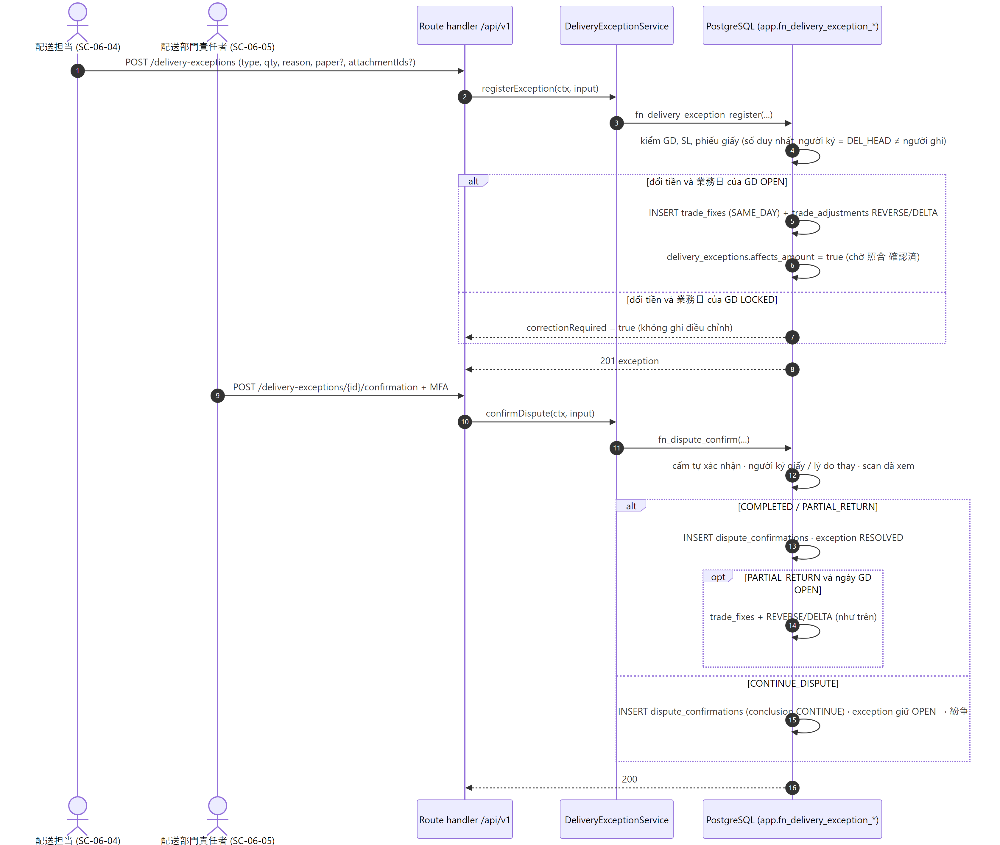
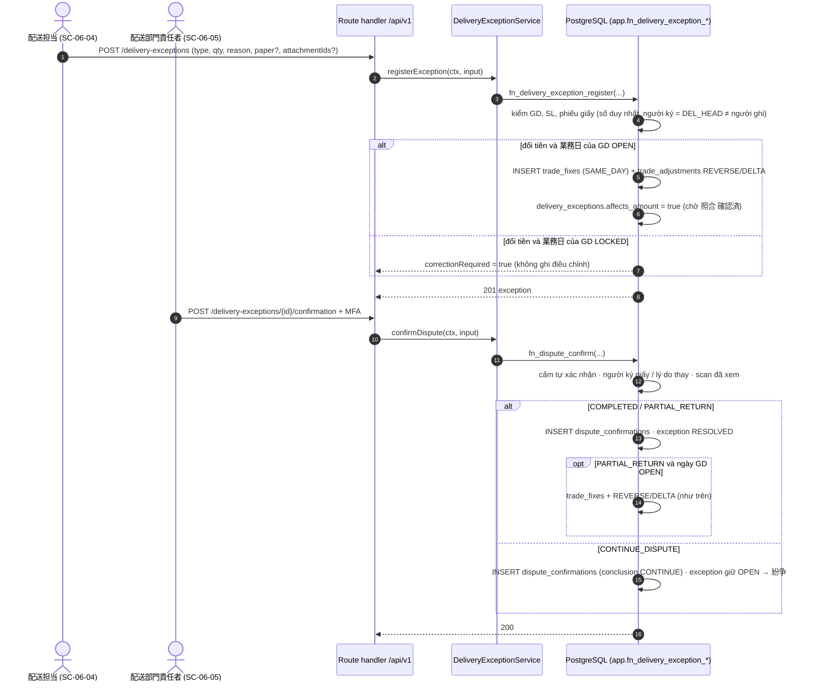

# DEL_EXCEPTION_DISPUTE — 引渡しの例外と争いの確認

> 様式: **BM-2-901-53 v01** — Detail Design (Chart + Description) · SUN ASTERISK VIETNAM CO., LTD · ISO/IEC 27001:2013 & ISO 9001:2015

---

## 1. 改訂履歴

| No | Version | Action | 対象箇所 / ステップ | 変更内容 | 更新日 | 更新者 | Approve |
|---|---|---|---|---|---|---|---|
| 1 | 0.1.0 | Add new | — | 初版作成 | 2026-11-25 | phuongnnm-23344 | |
| 2 | 0.1.1 | Update | — | Gate 2 G2-M02: 完了条件（LAB-5）; 顧客（模擬）Q-DEL-04: 実際に引き渡した数量のみ、金額は確定単価に基づき、減額方向のみ | 2026-11-25 | phuongnnm-23344 |  |
| 3 | 0.1.2 | Update | §2 | FB-EXP-236: Mermaid ブロックから書き出した PNG `./assets/DEL_EXCEPTION_DISPUTE_sequence.png` を埋め込み（`scripts/export-mermaid-png.py`）; Mermaid が引き続き原本 | 2026-11-25 | phuongnnm-23344 |  |
| 4 | 0.1.3 | Update | 争いの確認 No 2 | LAB-5 PREMISE L5-S01（Expert Gate A Q-01）: 結論 `COMPLETED` / `PARTIAL_RETURN` で同じトランザクション内に `app.fn_lot_refresh_delivery_status` を呼ぶ | 2026-11-26 | phuongnnm-23344 |  |

---

## 2. シーケンス図

原本: 下の Mermaid ブロック（編集用）。画像は `python scripts/export-mermaid-png.py DEL_EXCEPTION_DISPUTE` で生成 — Mermaid を修正したら再実行して両者を一致させる。

---

## 3. 説明

2 つの関数が連続する: (1) SC-06-04（DELIVERY / DEL-HEAD）からの**例外の記録** — 追記のみ、元の引渡しは変更しない; (2) SC-06-05 での**争いの確認** — 配送部門責任者が最終決裁者（CAP-HUMAN-01、ルール3）、MFA、自己確認の禁止（PRM-111）、オフラインでは動かない。

金額を変える例外は次の二つの経路のいずれか一方を必ず通る（ルール4、BR-CLOSE-01、ADR-004 §2.2）:

| 元取引の 業務日 | システムの処理 | 照合 / 締め |
|---|---|---|
| `OPEN` | 同一トランザクションで `trade_fixes`（kind `FIX`、`reason_code = DELIVERY_EXCEPTION`）+ `trade_adjustments` の REVERSE / DELTA（ソース `SAME_DAY`、`period_id` = 取引の期）を記録; `delivery_exceptions.affects_amount = true` | 日次締め に ✖ 「金額が変わる引渡し例外」 の行が出て、照合事務局が確認済 (`settle_reviewed_*`) を押すまで残る — SC-07-02 [20] |
| `LOCKED` | 調整は**記録しない**; 例外を保存（`affects_amount = false`）、`correctionRequired = true` を返す | 利用者が修正申請を作成（SC-08-01） — SC-08-03 で決裁 |

（1）実行後: `delivery_exceptions` がある（OPEN; 争いには `sla_due_at` がある）。（2）実行後: `dispute_confirmations` がある; 例外は `RESOLVED`（継続協議の場合は OPEN のまま）。

---

## 4. 詳細関数

### 4.1. 認証、権限、MFA

| 項目 | 値 |
|---|---|
| Input | Cookie `sid`; body JSON |
| Output | `SessionContext` → 4.2 / 4.4 |

**Error**

| エラー条件 | 処理 | Status code |
|---|---|---|
| セッションなし | 停止; `E-CMN-001` | 401 |
| (1) 役割が DELIVERY / DEL-HEAD でない; (2) `DEL_HEAD` 権限がない（または代行） | 停止; `E-CMN-002` | 403 |
| (2) MFA step-up がない | 停止; `E-CMN-005` | 403 |
| ボディの型が不正 | 停止; `E-CMN-007` | 422 |

**Detail**

| No | 処理内容 |
|---|---|
| 1 | 他の TECH と同じ（セッション、役割、権限、代行、`set_config`） |

### 4.2. 例外の検証（`fn_delivery_exception_register` — 検証部分）

| 項目 | 値 |
|---|---|
| Input | `tradeId`, `deliveryId?`, `inputMode` (`ON_SITE` \| `PAPER_LATE`), `exceptionCode`, `qty?`, `reasonCode`, `description?`, `receiver?`, `paper?` (`formNo`, `signedAt`, `signerEmployeeNo`), `attachmentIds[]` |
| Output | 取引の行をロック + 見積もり `amount_delta` → 4.3 |

**Error**

| エラー条件 | 処理 | Status code |
|---|---|---|
| 取引がない / `CONFIRMED` でない | 停止; `E-DEL-027` / `E-DEL-008` | 404 / 409 |
| `exceptionCode` / `reasonCode` が `code_values` にない | 停止; `E-DEL-011` / `E-DEL-012` | 422 |
| 種類が争いあり以外で `qty` がない; 小数の単位が不正 | 停止; `E-DEL-003` / `E-DEL-004` | 422 |
| `qty` が範囲超過（不足 / 一部取消 > 未引渡しの残; 返品 > 引渡済） | 停止; `E-DEL-028` | 409 |
| 争いありで `description` が空 | 停止; `E-DEL-013` | 422 |
| `PAPER_LATE`: `formNo` が重複 | 停止; `E-DEL-014` | 409 |
| `PAPER_LATE`: `signedAt` が業務日の外／未来 | 停止; `E-DEL-015` | 422 |
| `PAPER_LATE` + 争いあり: 署名者に `DEL_HEAD` 権限がない | 停止; `E-DEL-018` | 422 |
| 署名者 = 引渡しの記録者（`deliveries.recorded_by`）または呼び出し元 | 停止; `E-DEL-016` | 422 |
| `PAPER_LATE` で `attachmentIds` がない（`doc_class = DISPUTE_EVIDENCE`） | 停止; `E-DEL-017` | 422 |
| 現在の業務日が `OPEN` でない | 停止; `E-CMN-003` | 423 |

**Detail**

| No | 処理内容 |
|---|---|
| 1 | `SELECT … FROM trades WHERE id = :tradeId FOR UPDATE`; 残 / 引渡済 を DEL_RECORD §4.3 のとおり計算 |
| 2 | `affects_amount_candidate` = 種類 ∈ (不足, 返品, 一部取消) かつ `qty` > 0 |
| 3 | `amount_delta` = −floor(`qty` × `unit_price_jpy`)（税抜、PRM-053）— `unit_price_jpy` は確定取引の単価（有効な価格）から取得; ボディに価格／金額の項目は**ない**、配送は数量のみ入力; 減額方向のみ（`EXCESS` 過剰 → `affects_amount = false`、記録のみ — Q-DEL-04、Q-DEL-06 【顧客（模擬）、2026-11-25】） |

### 4.3. 例外の記録（業務日が開いていれば調整も）

| 項目 | 値 |
|---|---|
| Input | 4.2 の結果 |
| Output | `{ exception, adjustmentCreated, correctionRequired, amountDeltaJpy }` → 201 |

**Error**

`該当なし — 4.2 で同一トランザクション内に検証済み; DB エラー → ロールバック、500 E-CMN-004`

**Detail**

| No | 処理内容 |
|---|---|
| 1 | `delivery_exceptions` に INSERT（`business_date` = 開いている業務日, `is_dispute` = (種類 = 争いあり), `sla_due_at` = now + 設定ファイルの SLA（PRM-048、暫定 3 営業日、カレンダーによる）, `paper_form_no`, `paper_signed_at`, `paper_signed_by`, `status = OPEN`） |
| 2 | `attachments` を紐付ける（`ref_table = 'delivery_exceptions'`, `doc_class = DISPUTE_EVIDENCE`） |
| 3 | `affects_amount_candidate` かつ `trades.business_date` が `OPEN`: `trade_fixes` を INSERT（`kind = FIX`, `change` = {before: 有効な数量, after: 数量 − `qty`}, `reason_code = DELIVERY_EXCEPTION`, `max_buyer_diff_incl_jpy`, `buyer_changed = false`）+ `trade_adjustments` の REVERSE（旧数量／旧価格）+ DELTA（新数量; 新数量 = 0 なら DELTA は作らない）、`source = SAME_DAY`, `business_date` = 取引の日付, `period_id` = `trade_date` を含む期; `delivery_exceptions.affects_amount = true` と `fix_id` = 作成した `trade_fixes` を記録（Q-DEL-04、Q-DEL-09） |
| 4 | `affects_amount_candidate` かつ取引の日付が `LOCKED`: 調整は記録しない; `correctionRequired = true` |
| 5 | 争い: `notifications` → DEL-HEAD（署名者がいればその人も）「争いのある引渡しの確認待ち: {取引}」 |
| 6 | `audit_logs`（`DELIVERY_EXCEPTION_REGISTER`） |

### 4.4. 確認の検証（`fn_dispute_confirm` — 検証部分）

| 項目 | 値 |
|---|---|
| Input | `exceptionId`, `conclusion` (`COMPLETED` \| `PARTIAL_RETURN` \| `CONTINUE_DISPUTE`), `returnQty?`, `comment?`, `signerAbsentReason?`, `scanViewedAt?` |
| Output | 例外の行をロック済み → 4.5 |

**Error**

| エラー条件 | 処理 | Status code |
|---|---|---|
| 例外がない | 停止; `E-DEL-025` | 404 |
| 争いでない、または既に結論の確認がある（`COMPLETED` / `PARTIAL_RETURN`） | 停止; `E-DEL-024` | 409 |
| 呼び出し元 = `delivery_exceptions.created_by` または関連する引渡しの `deliveries.recorded_by` | 停止; `E-DEL-019` 「自分の記録のため確認できません」 | 403 |
| `conclusion` がない | 停止; `E-DEL-020` | 422 |
| `PARTIAL_RETURN` で `returnQty` がない（かつ例外に数量がない）／ 引渡済を超過 | 停止; `E-DEL-026` / `E-DEL-028` | 422 / 409 |
| `CONTINUE_DISPUTE` で `comment` がない | 停止; `E-DEL-021` | 422 |
| 紙の確認票で、呼び出し元 ≠ `paper_signed_by`、`signerAbsentReason` がない | 停止; `E-DEL-022` | 422 |
| 上記と同じで `scanViewedAt` が空 | 停止; `E-DEL-023` | 422 |
| MFA がない | 停止; `E-CMN-005` | 403 |

**Detail**

| No | 処理内容 |
|---|---|
| 1 | `SELECT … FROM delivery_exceptions WHERE id = :id FOR UPDATE`（二人の DEL-HEAD が同時に押した → 後の人は `E-DEL-024`） |
| 2 | 自己確認の禁止を DB で確認（UI だけでなく） |

### 4.5. 確認の記録

| 項目 | 値 |
|---|---|
| Input | 4.4 の結果 + `app.mfa_verified_at` |
| Output | `{ confirmation, exceptionStatus, adjustmentCreated, correctionRequired }` → 200 |

**Error**

`該当なし — 4.4 で検証; DB エラー → ロールバック、500`

**Detail**

| No | 処理内容 |
|---|---|
| 1 | `dispute_confirmations` に INSERT（`exception_id`, `confirmed_by`, `delegation_id`, `mfa_verified_at`, `decision_note` = コメントまたは結論ラベル, `signer_absent_reason`, **`conclusion`** — TRADE_DB 0.2.1 §4.36、Q-DEL-07） |
| 2 | `COMPLETED` / `PARTIAL_RETURN`: UPDATE `delivery_exceptions.status = RESOLVED`, `resolved_at`; 取引のロットについて `app.fn_lot_refresh_delivery_status(lot_id)` を呼ぶ（LOT_FUNC 2.11、同じトランザクション） |
| 3 | `PARTIAL_RETURN`: `returnQty` で金額を計算、§3 の表どおりの経路（取引の日付が `OPEN` → `trade_fixes` + REVERSE / DELTA + `affects_amount = true`; `LOCKED` → `correctionRequired`） |
| 4 | `CONTINUE_DISPUTE`: 例外は `OPEN` のまま（日次締め では ⚠ 「未確認の争い」 のまま、翌日に持ち越し）; `notifications` → SETTLE（紛争管理 SC-07-03） |
| 5 | `audit_logs` — `signer_absent_reason` に値があるとき「紙の署名者 {氏名} の代わりに確認」と明記、および代行 |

---

## 5. その他の注記

- **データベース設計（統合済み、TRADE_DB 0.2.1）:** (a) `dispute_confirmations.conclusion` + `uq_dispute_confirmations_exception` を unique partial `conclusion <> 'CONTINUE_DISPUTE'` に統合 — §4.36（Q-DEL-07）; (b) `delivery_exceptions.fix_id` を FK `trade_fixes` にして例外と調整を結び、日次締め のチェックリストで**二重に数えない**（当日訂正の項目は、例外が指す `trade_fixes` を除外 — ADR-005 0.2.2 §2.5 項目 6、Q-DEL-09） — §4.35。役割 DELIVERY が例外の関数経由で `trade_fixes` を作成: ADR-004 0.2.1 §2.2（Q-DEL-04）。
- **対象外:** `deliveries` を修正／削除しない; 人に代わって結論を出さない（SLA による自動完了はない）; オフラインで動かさない（ADR-008 §2.3-10 — オフラインでは MFA を使わない）。
- **期への影響:** 調整は元の取引の `period_id` を持つ; 期ロック済みの期 → 次の期ロックで DELTA のみ（ADR-007 §2.3）— モジュール `incentive` が処理。
- **SLA:** `sla_due_at` は `market_calendar` の営業日による; 期限超過は警告のみ（RPT-09）、ブロックはしない。
- トレーサビリティ: ルール3、ルール4; CAP-HUMAN-01, FT-06-04, FT-06-05, FR-DEL-03, FR-DEL-04, FR-SETTLE-01, OBJ-05, PRM-048, PRM-053, PRM-111, BR-CLOSE-01, TBL-ATTACH-01, E-21; ADR-002, ADR-004, ADR-005, ADR-007, ADR-008 §2.4; TRADE_DB 4.34–4.36, ADJUST_DB 4.32, 4.39, IAM_AUDIT_DB 4.54; 顧客 #4, #16, #17。

### 完了条件（LAB-5）

各行は検証可能な一ケース（API／DB 関数を呼ぶ統合テスト）; LAB-5 の issue は全行が合格で完了。流れ 1 と同じ形式（例 `trade/technical-design/TRADE_AITAI_CONFIRM_TECH.md` §5）。

| # | Cho / Khi | 期待結果 |
|---|---|---|
| 1 | 業務日 `OPEN`; 配送が不足 2kg を記録（確定単価 1,500） | 201; `delivery_exceptions` `affects_amount = true`、`fix_id` は新しい `trade_fixes` を指す; REVERSE + DELTA で金額 −3,000 を取引の単価から計算（ボディに価格／金額の項目はない）; 日次締め チェックリストの項目 #6 が +1、照合が確認済を押すまで; 項目 #5 / #9 はこの fix を**数えない**（Q-DEL-09） |
| 2 | 業務日 `LOCKED`; 返品を記録 | 201; `trade_adjustments` なし、`correctionRequired = true` |
| 3 | 過剰 (`EXCESS`) を記録 | 201; `affects_amount = false`、金額の調整なし（Q-DEL-06） |
| 4 | 不足 / 一部取消 > 未引渡しの残; 返品 > 引渡済 | 409 `E-DEL-028` |
| 5 | 争いありで内容なし | 422 `E-DEL-013` |
| 6 | 紙の確認票の後入力（`PAPER_LATE`）: 確認票番号が使用済み／スキャンなし／署名者 = 引渡しの記録者 | 409 `E-DEL-014` / 422 `E-DEL-017` / 422 `E-DEL-016` |
| 7 | 配送部門責任者が**自分自身**が記録した争いを確認（例外の記録者または引渡しの記録者） | 403 `E-DEL-019` — DB で確認、UI だけでなく |
| 8 | `CONTINUE_DISPUTE` を同じ例外に 2 回確認し、その後 `COMPLETED` | `dispute_confirmations` 3 行（`CONTINUE_DISPUTE` 2 + `COMPLETED` 1）; 例外 `RESOLVED`; 結論の確認を 2 回目 → 409 `E-DEL-024` |
| 9 | `CONTINUE_DISPUTE` でコメントなし | 422 `E-DEL-021` |
| 10 | 業務日 `OPEN` の `PARTIAL_RETURN` | `trade_fixes` 1 件 + REVERSE / DELTA; `fix_id` を例外に紐付け; チェックリストは項目 #6 で**一回**数える |
| 11 | 紙の確認票、確認者 ≠ 署名者、理由なし／スキャン未表示 | 422 `E-DEL-022` / `E-DEL-023` |
| 12 | 確認時に step-up MFA がない（継続協議を含む — Q-DEL-08） | 403 `E-CMN-005` |
| 13 | 通信断 | フォームをロック（C-28）、例外のオフラインキューなし（Q-DEL-01） — UI テストで確認 |
