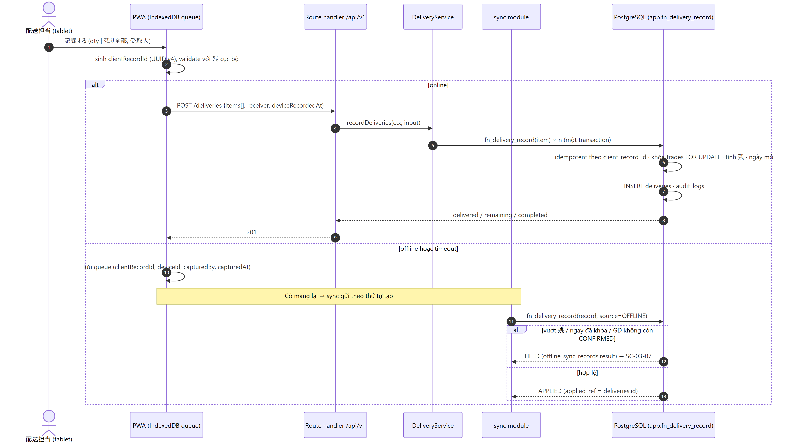
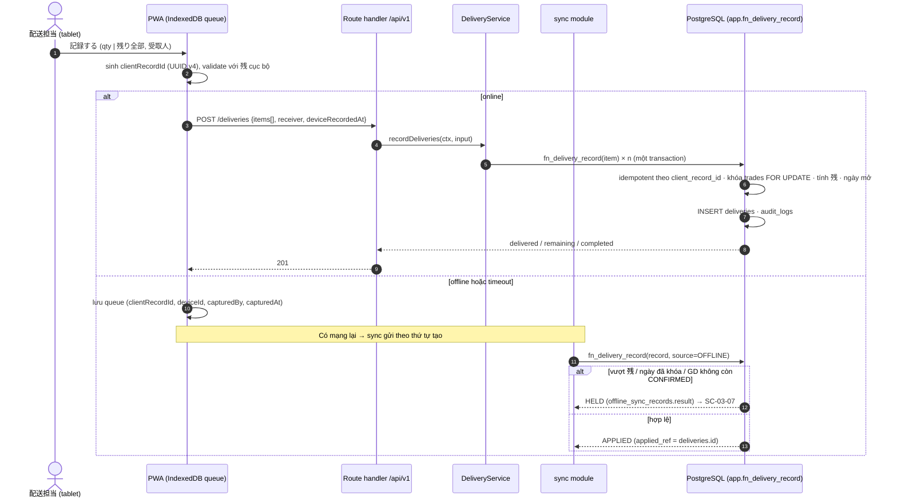

# DEL_RECORD — 複数回の引渡しの記録、オフラインでの冪等性

> 様式: **BM-2-901-53 v01** — Detail Design (Chart + Description) · SUN ASTERISK VIETNAM CO., LTD · ISO/IEC 27001:2013 & ISO 9001:2015

---

## 1. 改訂履歴

| No | Version | Action | 対象箇所 / ステップ | 変更内容 | 更新日 | 更新者 | Approve |
|---|---|---|---|---|---|---|---|
| 1 | 0.1.0 | Add new | — | 初版作成 | 2026-11-25 | phuongnnm-23344 | |
| 2 | 0.1.1 | Update | — | Gate 2 G2-M02: 完了条件（LAB-5）; 顧客（模擬）Q-DEL-03; G2-m07: 性能目標のラベル [PL] | 2026-11-25 | phuongnnm-23344 |  |
| 3 | 0.1.2 | Update | §2 | FB-EXP-236: Mermaid ブロックから書き出した PNG `./assets/DEL_RECORD_sequence.png` を埋め込み（`scripts/export-mermaid-png.py`）; Mermaid が引き続き原本 | 2026-11-25 | phuongnnm-23344 |  |
| 4 | 0.1.3 | Update | §4.5 No 2, §5 | LAB-5 PREMISE L5-S01（Expert Gate A Q-01）: COMMIT 前に同じトランザクションで `app.fn_lot_refresh_delivery_status` を呼ぶ; §5 から「module lot が v_delivery_status を読む」を削除 | 2026-11-26 | phuongnnm-23344 |  |

---

## 2. シーケンス図

原本: 下の Mermaid ブロック（編集用）。画像は `python scripts/export-mermaid-png.py DEL_RECORD` で生成 — Mermaid を修正したら再実行して両者を一致させる。

---

## 3. 説明

**引渡し一回ごとに `deliveries` の一行**を記録する（追記のみ、業務日 — TRADE_DB 4.34）。一つの取引は複数回に分けて引き渡せる; 残と状態は取引の有効な数量（`v_trade_effective` — 元 + Σ 調整）から Σ 引渡済を引いて計算し、`v_delivery_status` 経由で読む。**オンラインとオフライン同期の両方に一つの DB 関数 `fn_delivery_record`**（ADR-008 §2.2-5）: 役割、数量、業務日の確認は同じ; 違うのは拒否結果の記録先だけ（オンライン → HTTP エラー; オフライン → `offline_sync_records.result = HELD`）。

冪等性: `client_record_id`（端末で生成された UUID）がキー — unique `uq_deliveries_client_record`; 同じ id・**同じ内容**の再送 → 古い結果を返し、二重に記録しない; 同じ id・**違う内容** → `E-DEL-010` で拒否（クライアント側の不具合の兆候）。

実行後: `deliveries` に行があり、`business_date` = サーバーが決めた現在の業務日（端末の時計ではない — ADR-005 §2.3）; 残がなくなった取引（`DELIVERY_MATCH_RULE` による）は完了と表示。

---

## 4. 詳細関数

### 4.1. 認証 + リクエストの検証

| 項目 | 値 |
|---|---|
| Input | Cookie `sid`; body `{ items: [{ tradeId, qty?, isRemainingAll, clientRecordId }], receiver: { type: SELF \| PROXY, name? }, deviceRecordedAt }` |
| Output | `SessionContext` + 正規化された入力 → 4.2 |

**Error**

| エラー条件 | 処理 | Status code |
|---|---|---|
| セッションなし | 停止; `E-CMN-001` | 401 |
| 役割が DELIVERY / DEL-HEAD でない | 停止; `E-CMN-002` | 403 |
| `items` が空または 20 超; 項目の型が不正 | 停止; `E-CMN-007` | 422 |
| `isRemainingAll = false` のとき `qty` がない、または ≤ 0 | 停止; `E-DEL-003` | 422 |
| `receiver.type` がない | 停止; `E-DEL-006` | 422 |
| `PROXY` で `name` > 50（氏名は任意 — Q-DEL-03） | 停止; `E-DEL-007`, `field` = `receiver.name` | 422 |

**Detail**

| No | 処理内容 |
|---|---|
| 1 | セッション、役割、端末を確認（`devices.is_active`、`lost_reported_at` がないこと） |
| 2 | `SELF` のとき `receiver_name` = 「本人」; `PROXY` のとき = `name`、`name` が空 → 「代理」（Q-DEL-03 【顧客（模擬）、2026-11-25】） |
| 3 | `items` 全体で**一つの**トランザクションを開く（[17] の一括引渡しは原子的: 一件でもエラー → どの取引も記録しない） |

### 4.2. `client_record_id` による冪等性

| 項目 | 値 |
|---|---|
| Input | 各 `item.clientRecordId` |
| Output | 記録が必要な item の一覧; 記録済みの item → 古い結果を取得 → 4.5 |

**Error**

| エラー条件 | 処理 | Status code |
|---|---|---|
| `deliveries.client_record_id` が既にあるが `trade_id` / `qty_delivered` / `is_remaining_all` が異なる | 停止; `E-DEL-010` 「同じ記録IDで異なる内容が送信されました」; ログ `WARN` | 409 |

**Detail**

| No | 処理内容 |
|---|---|
| 1 | `SELECT … FROM deliveries WHERE client_record_id = ANY(:ids)` |
| 2 | 完全に一致 → `replayed = true` を付け、INSERT しない |
| 3 | 同期経路: さらに `offline_sync_records (device_id, client_record_id)` を確認 — 結果があれば古い結果を返す（`APPLIED` / `HELD` / `REJECTED`） |

### 4.3. 取引、残、業務日の確認

| 項目 | 値 |
|---|---|
| Input | 記録が必要な item |
| Output | `qty_to_record`, `remaining_after` → 4.4 |

**Error**

| エラー条件 | 処理 | Status code |
|---|---|---|
| 取引が存在しない | 停止; `E-DEL-027` | 404 |
| 取引が `CONFIRMED` でない（下書き / 確認待ち / 取消） | 停止; `E-DEL-008`. オフライン → `HELD` | 409 |
| 残 = 0 | 停止; `E-DEL-009`. オフライン → `HELD` | 409 |
| `qty` > 残（行をロックした後） | 停止; `E-DEL-005` と `remaining`. オフライン → 理由 「残数量超過」 で `HELD` | 409 |
| 小数の単位が不正（`KG` は小数 1 桁; `CASE` / `PIECE` は整数） | 停止; `E-DEL-004` | 422 |
| `business_date_for(now())` が `OPEN` でない | 停止; `E-CMN-003`. オフライン: `captured_at` がロック済み業務日に属する記録 → `HELD`（ADR-008 §2.2-7） | 423 |

**Detail**

| No | 処理内容 |
|---|---|
| 1 | `SELECT … FROM trades WHERE id = ANY(:tradeIds) ORDER BY id FOR UPDATE` — 同じ買受人を引き渡す二台のタブレット間のデッドロックを防ぐため順序を固定 |
| 2 | 残 = `v_trade_effective.qty` − Σ `deliveries.qty_delivered`（ロック後に読む） |
| 3 | `isRemainingAll` → `qty_to_record = 残`、クライアントの `qty` は無視（残が変わっていても食い違わないように — 利用者は「残りすべて」を望む） |
| 4 | オフライン経路: 記録の業務日 = `business_date_for(captured_at)`; 開いている業務日と異なり、その日が `LOCKED` → `HELD`（ロック済みの日には記録しない、日付を自動でずらさない） |

### 4.4. 引渡しの記録

| 項目 | 値 |
|---|---|
| Input | 4.3 の結果 |
| Output | 新しい `deliveries` 行 → 4.5 |

**Error**

`該当なし — 4.3 のすべての条件は行ロックのある同一トランザクション内で確認済み; その他の DB エラー → ロールバック、500 E-CMN-004（オンライン）／ 記録は PENDING のまま再試行（オフライン）`

**Detail**

| No | 処理内容 |
|---|---|
| 1 | `deliveries` に INSERT（`trade_id`, `business_date` = 開いている業務日, `qty_delivered`, `is_remaining_all`, `receiver_name`, `recorded_by` = 操作者（オフライン: PIN 経由の `captured_by`）, `device_id`, `client_record_id`, `device_recorded_at`） |
| 2 | オフライン経路: `offline_sync_records` を UPDATE `result = APPLIED`, `applied_ref_table = 'deliveries'`, `applied_ref_id` |
| 3 | `audit_logs`（`action = DELIVERY_RECORD`、`device_id`、`offline` フラグ付き） |

### 4.5. 状態の計算 + response

| 項目 | 値 |
|---|---|
| Input | 今記録した行／再送分 |
| Output | `{ results: [{ clientRecordId, deliveryId, tradeId, qtyDelivered, deliveredTotal, remaining, status, replayed }] }` → 201 |

**Error**

`該当なし — 記録後に view を読むだけ`

**Detail**

| No | 処理内容 |
|---|---|
| 1 | 取引ごとに `v_delivery_status` を読む: `status` = 待機中（引渡し 0）· 引渡し中 · 完了（取引日の規程バージョンの `DELIVERY_MATCH_RULE` による残 = 0 — E-17）· 例外（`delivery_exceptions` が OPEN にある） |
| 2 | 引渡しを記録した取引のロットごとに `app.fn_lot_refresh_delivery_status(lot_id)` を呼ぶ（LOT_FUNC 2.11、同じトランザクション — ロットが `CLOSED` で全取引が完了 → `DELIVERED`）; COMMIT; 201 を返す（全件再送 → 同じボディで 200） |

---

## 5. その他の注記

- **オフライン snapshot**（`API-DEL-002`）: 直近最大 7 業務日の残 > 0 の `CONFIRMED` 取引（Q-DEL-02 — 顧客（模擬）が同意 【顧客（模擬）、2026-11-25】）+ 買受人一覧（番号、名称）+ `snapshotAt`。価格／金額は含まない（端末上のデータを減らす）。PWA はローカルの残 = snapshot − その端末の未同期キューで計算する。
- **オフラインで二台のタブレットが同じ取引を引き渡した場合**: 両方ともローカルに記録できる; 同期時、後から届いた記録が残を超えると `HELD` → SC-03-07（決裁者が保持／破棄／修正申請 `LATE_ENTRY` を作成）— 自動でまとめない、上書きしない（ADR-008 §2.2-6）。
- **対象外:** 引渡しを修正／削除しない; 例外は扱わない（DEL_DISPUTE）; ロットの状態を自分では書かない — ロットを `DELIVERED` にするのはモジュール `lot` の public 関数（`app.fn_lot_refresh_delivery_status`、LOT_FUNC 2.11）で、delivery は 4.5 No 2 でこの関数を呼ぶだけ。
- **性能:** 20 item で p95 ≤ 2 秒（書き込み API の [PL]、検索の NFR-PERF-01 の水準に合わせる）; インデックス `idx_deliveries_trade`, `uq_deliveries_client_record`。
- **同期 API** はモジュール `sync` に属する（P3 ではまだ仕様なし）— `fn_delivery_record` を `offline` フラグと、キュー記録から取った `captured_by`, `captured_at`, `device_id` を付けて呼び出すこと。
- トレーサビリティ: ルール4; FR-DEL-01, FR-DEL-02, FR-DEL-05, BR-DEL-03, PRM-111, PRM-118, E-17, NFR-AVL-02, NFR-PERF-01, DEC-004; ADR-004, ADR-005 §2.3, ADR-008 §2.2; TRADE_DB 4.34, IAM_AUDIT_DB 4.6, 4.55。

### 完了条件（LAB-5）

各行は検証可能な一ケース（API／DB 関数を呼ぶ統合テスト）; LAB-5 の issue は全行が合格で完了。流れ 1 と同じ形式（例 `trade/technical-design/TRADE_AITAI_CONFIRM_TECH.md` §5）。

| # | Cho / Khi | 期待結果 |
|---|---|---|
| 1 | オンライン、取引 `CONFIRMED` 残 = 12kg; 6kg を `receiver.type = SELF` で引渡し | 201; `deliveries` 1 行（`receiver_name` = 「本人」）、`remaining = 6.0`、`status` 引渡し中 |
| 2 | 同じ `clientRecordId` を同じ内容で再送（2 回、または通信断後の再同期） | 200 `replayed = true`; `deliveries` は依然 **1** 行 |
| 3 | 同じ `clientRecordId` だが `qty` が異なる | 409 `E-DEL-010`; ログ `WARN`; 追加の記録なし |
| 4 | `qty` > 残（例: 別のタブレットが引き渡したばかり） | 409 `E-DEL-005`、`field = items[i].qty`、`detail.remaining`; オフライン → 記録は `HELD`、理由 「残数量超過」 |
| 5 | 残が変わった後に `isRemainingAll = true` | 現在の残をそのまま記録（クライアントの `qty` は無視） |
| 6 | 3 件の取引を一括で引渡し、2 件目でエラー | どの取引も記録されない（一つのトランザクション）; `field = items[1]…` |
| 7 | `captured_at` がロック済みの業務日に属するオフライン記録 | `HELD`（ロック済みの日には記録しない、日付を自動でずらさない）; オンラインでロック日に直接呼ぶ → 423 `E-CMN-003` |
| 8 | `PROXY` で氏名なし | 201; `receiver_name` = 「代理」（Q-DEL-03）。氏名 > 50 → 422 `E-DEL-007` |
| 9 | 単位違いの小数（`CASE` 1.5） | 422 `E-DEL-004` |
| 10 | 取引 `PENDING` / 取消; 取引が既に引渡し済み | 409 `E-DEL-008` / `E-DEL-009` |
| 11 | 同じ買受人の取引（取引が重なる）を二台のタブレットが同時に引き渡し | デッドロックなし（`trades` を `id` 順にロック）; 合計引渡し ≤ 有効な数量 |
