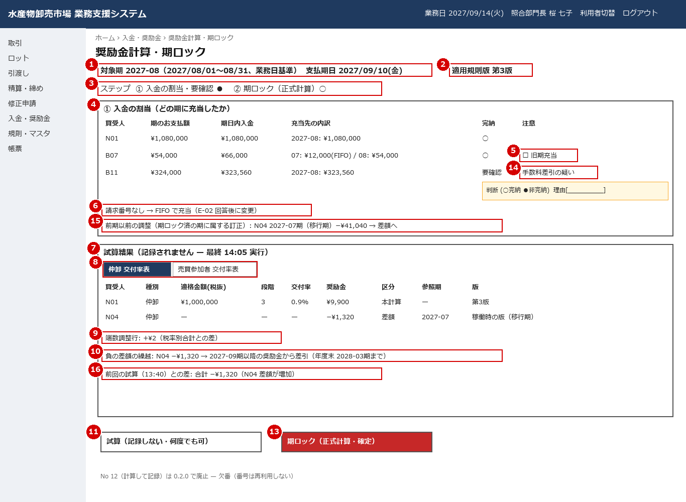

# SC-09-04 — 奨励金計算・期ロック

> 様式: **BM-2-901-51 v2.1** — 画面仕様書 · SUN ASTERISK VIETNAM CO., LTD · ISO/IEC 27001:2013 & ISO 9001:2015

---

## 1. 変更履歴

| No | Version | Action | 変更内容 | 更新日 | 更新者 | Approve |
|---|---|---|---|---|---|---|
| 1 | 0.1.0 | Add New | ワイヤーフレーム SC-09-04 0.2.1 から作成（LAB-4 P3） | 2026-11-25 | phuongnnm-23344 | |
| 2 | 0.1.1 | Update | 顧客 Q-INC-01/02: 項目 [17] チェック「支払期日分までの入金CSV取込済」、[18] 前期分の後入力; バリデーション、対応付け、役割、E-INC-014; 注釈付き画像を再作成 | 2026-11-25 | phuongnnm-23344 |  |
| 3 | 0.1.2 | Update | LAB-4: 注釈付き画像をワイヤーフレーム HTML `wireframes/html/SC-09-04.html`（WF 0.2.3）のバリアント A に差し替え; 画像にないバッジを記載; HTML / PNG / PDF のリンク | 2026-11-25 | phuongnnm-23344 | |
| 4 | 0.1.3 | Update | W-m03: [1] の例は期 2027-09、支払期日 2027/10/08（10/10 は日曜）; バリアント A の画像を再作成; W-m06: 4.1 節に C-9 画面タイトルの行を追加 | 2026-11-25 | phuongnnm-23344 |  |

---

## 2. レイアウト

**デザイン:** [ワイヤーフレーム SC-09-04 0.2.4](../../../wireframes/SC-09-04-incentive-calc-period-lock-wireframe.md) · 画像の元 HTML [`wireframes/html/SC-09-04.html`](../../../../wireframes/html/SC-09-04.html) · 全バリアント: [`wireframes/png/SC-09-04.png`](../../../../wireframes/png/SC-09-04.png) / [`wireframes/pdf/wireframes-all.pdf`](../../../../wireframes/pdf/wireframes-all.pdf) · 共通枠 [_common-layout](../../../wireframes/_common-layout.md) · 試作品のそのままの画像: [`SC-09-04_prototype.png`](../../../../wireframes/assets/SC-09-04_prototype.png)

> - 画像 = **バリアント A**（メイン画面）の HTML ワイヤーフレーム。`scripts/render-wireframes.py --spec` で生成（Figma はまだ無い）。画像上の番号 = 4 章の `ID` 列 = ワイヤーフレームの `No` 列; `C-x` = `_common-layout.md` の共通項目。
> - この画像にないバッジ: C-31 (C)、C-30 (D)、C-12 · C-24 (E)。番号 12（計算して記録を外す）は意図的に描かない — 番号は保持し、表示しない（4.1 節）→ 対応するバリアントは [`wireframes/png/SC-09-04.png`](../../../../wireframes/png/SC-09-04.png) / PDF を参照。

---

## 3. 説明

画面は 照合部門長（STL-HEAD）が**判断**する画面: 入金をどの期に充当したかを確認し、要確認の行を決め、その後**期ロック** — **一つのトランザクション**内で完納奨励金（支払いが全額で期限どおりであることへの奨励金）を正式に計算し、結果を記録して期を凍結する（ADR-007 §2.1）。ロック前は**試算**のみ（仮計算、結果は記録せず、何度でも実行可能、毎回監査ログを残す）。ロック後は、この期の差異はすべて**次の期ロックでの DELTA** としてのみ現れる（ルール 4）。

- 利用者: STL-HEAD（操作）; SETTLE 照合事務局（閲覧 + 試算）; OPS-HEAD 運用部門長（閲覧のみ）。
- 入口: メニュー 入金・奨励金 → SC-09-03 期別お支払額・入金状況 → ボタン「奨励金計算・期ロックへ」（`periodId` を渡す）; または URL `/periods/{periodId}/incentive-lock`。
- 遷移先: SC-09-05 奨励金明細（ロック後、ボタン C-10）; SC-09-03（パンくず / 配分の修正）; SC-09-02（振込人未マッピングの入金の警告）; SC-08-01 修正申請（期がロック済みのときバナー C-24 から）。
- 端末: PC 1366 × 900。

---

## 4. 表示

**ID の付け方:** 列 `ID` はワイヤーフレームの**項目番号そのまま**を使う（1–18、振り直さない; `C-xx` = `wireframes/_common-layout.md` の共通項目、画面に固有のルールがある場合のみ列挙）。太字の A–E の行は表示グループであり、項目ではない。5 章は項目をこの番号で指す（例: `13`）。

### 4.1 項目一覧

| ID | Item Name | Item Type | Required | Note |
|---|---|---|---|---|
| **A** | **画面上部（期、版、ステップ）** | | | |
| 1 | 対象期 + 支払期日 | Label | - | 「対象期 2027-09（2027/09/01〜09/30、業務日基準）　支払期日 2027/10/08(金)」。日付は `YYYY/MM/DD(曜)`。支払期日が後ろにずれる場合（10 日が銀行休業日）は「（10日は銀行休業日のため前銀行営業日）」を追加 |
| 2 | 適用規則版 | Label | - | 「適用規則版 第{n}版」= 期の版（期の 1 日に発効、PRM-042）; 移行期の期: 「稼働時の版（移行期）」 |
| 3 | ステップ表示 | Label | - | ① 入金の割当・要確認 / ② 期ロック（正式計算）; ● 現在のステップ、○ 未到達。② は要確認の行がすべて決まるまで ● にならない |
| **B** | **① 入金の割当（どの期に充当したか）** | | | |
| 4 | 入金の配分表 | Label（表） | - | 列: 買受人（購入者コード）· 期のお支払額 · 期日内入金 · 充当先の内訳 · 完納 (○ / ✖ / 要確認) · 注意。買受人コード順。金額は `¥#,##0`。期のお支払額 > 0 または期への配分がある購入者ごとに 1 行 |
| 5 | ⚠ 旧期充当 | Label | - | 注意列の警告: 期の期限の期間内の入金が、FIFO により古い期の支払いに充てられた場合（`OLD_PERIOD_ALLOCATION`）; 「⚠ 過入金」（`OVERPAYMENT`）も表示。ツールチップ: 「期日内の入金の一部が前の期に充当されたため、この期が完納にならない場合があります」 |
| 6 | FIFO 注記 | Label | - | 「請求番号なし → FIFO で充当（E-02 回答後に変更）」。E-02 で請求番号の利用が確定したら非表示 |
| 14 | 手数料差引の疑い + 判断 | Label + Radio + Text box | 有（要確認の行のとき） | 注意列にラベル; クリック → 行の下に判断ボックス: ラジオ「完納とする」 / 「非完納とする」（既定で非完納を選択 — PRM-040 の既定の提案）+ 欄「判断理由」。判断は期ロックまで画面上の下書きとして保持; 試算に添えて送り、数字を確認できる |
| 15 | 前期以前の調整 | Label | - | 「前期以前の調整（ロック済みの期に属する訂正）: {買受人} {期}期 {±金額} → 差額へ」。修正申請 TRADE の調整のみ; この期のお支払額には加算しない（OPEN-DB-08） |
| 18 | 前期分の後入力 | Label | - | 「前期分の後入力（この期の支払額に含む）: {買受人} 取引日 {MM/DD} ¥{税抜}」— 締め済みの期の GD 後入力がこの期へ移り、**既に**この期のお支払額に加算され、この期の支払期日で完納を判定したもの（Q-INC-02、TECH §3.4）。該当行が無ければ非表示 |
| 17 | 入金CSV取込確認 | Checkbox + Label | 有（期ロックの前） | チェックボックス「支払期日分までの入金CSV取込済」+ 横のラベル「最新の入金日 {YYYY/MM/DD}（取込 {MM/DD HH:MM}）」を `paymentCsv` から表示。既定は未チェック、自動でチェックしない; チェックするのはロックする人のみ（Q-INC-01 【顧客（模擬）、2026-11-25】）。下書きは保存しない — 画面を開くたびに再度チェックする |
| **C** | **試算結果 / 確定結果** | | | |
| 7 | 結果ブロック | Label（表） | - | 見出し（ロック前）: 「試算結果（記録されません — 最終 HH:MM 実行）」; ロック後: 「確定結果（期ロック {氏名} MM/DD HH:MM）」。列: 買受人 · 種別 · 適格金額(税抜) · 段階 · 交付率 · 奨励金 · 区分（本計算 / 差額 / 繰越 / 繰越失効）· 参照期 · 版 |
| 8 | 交付率表のタブ | Button (tab) | - | 「仲卸 交付率表」/「売買参加者 交付率表」— 項目 [7] の行を種別で絞り込み; 既定は仲卸のタブ。各タブに版の 5 等級を見る小さなリンク |
| 9 | 端数調整行 | Label | - | 「端数調整行: {±¥n}（税率別合計との差）」 |
| 10 | 負の差額の繰越 | Label | - | 「負の差額の繰越: {買受人} {−¥n} → {期}期以降の奨励金から差引（年度末 {YYYY}-03期まで）」; 3 月の期: 「年度末で繰越失効: {¥n}（RPT-07 で未回収として表示）」 |
| 16 | 前回の試算との差 | Label | - | 「前回の試算（HH:MM）との差: 合計 {±¥n}（{買受人} …）」; 前回の試算が無ければ非表示 |
| **D** | **操作** | | | |
| 11 | 試算 | Button | - | 「試算（記録しない・何度でも可）」 |
| 12 | (削除) 計算して記録 | — | - | ワイヤーフレーム 0.2.0 で削除（N13）— 番号は保持し、表示しない |
| 13 | 期ロック | Button | - | 「期ロック（正式計算・確定）」、強調の赤色。ダイアログ C-31 → C-30 を開く |
| **E** | **ダイアログ（この画面に属する）** | | | |
| C-31 | 期ロックの確認 | Dialog | - | 「期ロックすると、この期の奨励金が確定し、直接修正できません。差額は次の期ロックで計上されます。」+ 主要な数字: 本計算 合計 / 差額 合計 / 件数。⚠ がある場合: チェックボックス「注意事項 {n} 件を確認しました」（必須）。ボタン「期ロックする」/「戻る」 |
| C-30 | MFA（常にコードを再確認） | Dialog + Text box | 有 | 6 桁のコード; 期ロックは元に戻せない操作 → step-up が有効でも常に再確認（ADR-002 §2-6a） |
| C-9 | 画面タイトル「奨励金計算・期ロック」 | Label | - | |
| C-10 | 右上のボタン | Button | - | ロック前: 「入金状況へ」（→ SC-09-03）; ロック後: 「奨励金明細へ」（→ SC-09-05） |

> - `Item Type`: `Label` · `Image` · `Text box` · `Button` (+ `Radio`, `Dialog` — この画面に必要な拡張)。
> - `Required`: `あり` · `なし` · `-`（入力を受け付けない項目）。

### 4.2 バリデーション

| ID | Type | Min | Max | Default | 備考 |
|---|---|---|---|---|---|
| 14 (判断) | Enum `KANNO` / `NOT_KANNO` | - | - | `NOT_KANNO` | 要確認のすべての行に必須（[13] を有効にする前）。期ロック時に欠けていると `E-INC-006` 「要確認の判断が入力されていない買受人が {count} 件あります。」（行の位置に C-22） |
| 14 (判断理由) | String (UTF-8, 改行可) | 1 | 500 | （空） | 判断があるときは必須; 前後の空白を除去; 空 / 500 文字超 → `E-INC-007` 「判断の理由を入力してください（500文字以内）。」を欄の直下に表示 |
| 17 | Boolean | - | - | `false` | [13] を有効にするには `true` が必要; `paymentCsvImportConfirmed` として送信。サーバーが `false` を受け取ると 422 `E-INC-014`「支払期日分までの入金CSVの取込を確認し、チェックを入れてください。」（[17] の下に C-22） |
| C-31 (checkbox ⚠) | Boolean | - | - | `false` | ⚠ の数が 0 より大きいとき `true` が必要; 画面に表示中の ⚠ の数を `ackWarningCount` として送信。サーバーの数が異なる → `E-INC-013` |
| C-30（MFA コード） | String（数字） | 6 | 6 | （空） | 数字のみ; コードは iam の MFA 認証 API で検証（未仕様化）、5 回誤ると一時ロック（ADR-002） |

項目 [11]、[8] は検証なし（入力を受け付けない）。ボタンの有効 / 無効の条件は 6.2 節。

### 4.3 データ対応

| ID | Data Source | API ID | API URL | Key / Param | 備考 |
|---|---|---|---|---|---|
| 1, 2, 3 | API | `API-INC-001` | `GET /api/v1/periods/{periodId}/lock-view` | `period.code`, `period.startDate`, `period.endDate`, `period.dueDate`, `period.dueDateShifted`, `ruleVersion.label` | |
| 4, 5, 6, 14 (ラベル), 15, 17 (ラベル), 18 | API | `API-INC-001` | `GET /api/v1/periods/{periodId}/lock-view` | `allocations[]`, `warnings[]`, `fifoMode`, `priorPeriodAdjustments[]`, `paymentCsv`, `lateEntries[]` | `allocations[].kannoStatus` = `OK` / `NG` / `SUSPECT` |
| 7, 8, 9, 10, 16（ロック前） | API | `API-INC-002` | `POST /api/v1/periods/{periodId}/incentive-previews` | `results[]`, `roundingAdjustments[]`, `carry[]`, `diffFromPrevious` | [11] を押した後に返す |
| 7, 9, 10（ロック後） | API | `API-INC-004` | `GET /api/v1/periods/{periodId}/incentive-results` | `results[]`, `roundingAdjustments[]`, `carry[]`, `lockedBy`, `lockedAt` | |
| 14（判断） | API | `API-INC-002`, `API-INC-003` | (上記と同じ) · `POST /api/v1/periods/{periodId}/lock` | `judgements` | 下書きは `periodId` 単位で `sessionStorage` に保持（タブを閉じると消える — 利便性のためのみ、保存ではない） |
| 13, 17, C-31, C-30 | API | `API-INC-003` | `POST /api/v1/periods/{periodId}/lock` | `expectedInputHash`, `judgements`, `ackWarningCount`, `paymentCsvImportConfirmed`, header `X-MFA-Token` | `expectedInputHash` = セッション内で直近に [11] を実行したときの `inputHash` |

> - `API ID` は [`_common/api-list.md`](../../_common/api-list.md) と [`api-design/_index.md`](../../system-design/api-design/_index.md) で確認する。

### 4.4 役割ごとの表示権限（LAB-4 の要件により追加）

記号: **T** 操作可 · **R** 閲覧のみ · **H** 非表示 · `—` 画面にアクセス不可（C-25「この画面を表示する権限がありません」）。権限は API で再度検査される（ADR-003）; この表は表示のみ。

| ID | STL-HEAD（照合部門長、有効な 代行 を含む） | SETTLE (照合事務局) | OPS-HEAD (運用部門長) | その他の役割（INTAKE, JUDGE, TRADE, DELIVERY, RULE, SYSADM） |
|---|---|---|---|---|
| 1, 2, 3 | R | R | R | — |
| 4, 5, 6, 15, 18 | R | R | R | — |
| 14（ラベル 要確認） | R | R | R | — |
| 14（判断 + 理由） | T | H（「照合部門長の判断待ち」の文字のみ表示） | H | — |
| 7, 8, 9, 10, 16 | R（8: T タブ選択） | R（8: T） | R（8: T） | — |
| 11 試算 | T | T | H | — |
| 17 tick 入金CSV | T | R（日付のラベルは見えるがチェックは不可） | R | — |
| 13 期ロック, C-31, C-30 | T | H | H | — |
| C-10 | T | T | T | — |

役割 SETTLE と STL_HEAD の権限を両方持つ者: 権限の多い方を適用する。画面を開いている間に代行の期限が切れた → API は 403 を返し、[13] を H にしてバナー C-25 を表示する。

---

## 5. イベント

| ID | Given (Pre-condition) | When (Trigger/Action) | Then (Result) | Note |
|---|---|---|---|---|
| **Initializing Process（初期処理）** | | | | |
| - | `periodId` が有効、役割に権限あり | 画面を開く | 1. `API-INC-001` を呼ぶ（300 ms 超で C-20 を表示） 2. [1]–[6]、[14] のラベル、[15] を表示 3. 期が `LOCKED` → `API-INC-004` を呼ぶ、[7] = 確定結果、[11] [13] [14] を非表示、C-10 = 「奨励金明細へ」 4. 期が `OPEN` → [7] は空: 「まだ試算していません。［試算］を押してください」（C-21）; [16] は `lastPreview` があれば使う | 画面を開くたびに試算を自動実行しない（各試算は監査ログを書く） |
| - | 期が `OPEN`、配分がまだ無い / 期が終わっていない | 画面を開く | [4] C-21「この期に充当された入金はまだありません。入金CSV取込（SC-09-01）を確認してください →」; [13] 非活性 + 理由 | |
| **Standard Process（通常処理）** | | | | |
| 8 | [7] に結果がある | タブをクリック | [7] の行を 仲卸 / 売買参加者 で絞り込む; API は呼ばない | |
| 14 | 要確認の行、役割 STL-HEAD | 「手数料差引の疑い」のラベルをクリック | 行の下に判断ボックスを開く（ラジオは既定で非完納、理由欄）; 不足額を表示「不足額 ¥440（判定基準 ¥{FEE_MAX} 以下）」 | 判断は `sessionStorage` に下書き保存 |
| 14 | 判断ボックスが開いている | ラジオを選び理由を入力、欄から離れる | 4.2 で検証; 有効 → 完納列に「○（判断）」/「✖（判断）」を表示、[3] を更新 | |
| 11 | 期が `OPEN`、ネットワークあり | 試算をクリック | 1. `API-INC-002` を判断の下書きと共に呼ぶ 2. [7] に結果を表示、見出しに実行時刻 3. [9]、[10]、[16] を更新 4. 返された `inputHash` を `expectedInputHash` として保持 5. トースト C-12「試算しました（記録されません）」 | 未決の要確認の行は列 区分に「要確認」を表示、奨励金は仮に 0 |
| 13 | [13] が有効（6.2 節） | 期ロックをクリック | C-31 を開く: 結果 + 主要な数字; ⚠ がある → チェックボックスが必須 | |
| C-31 | C-31 が開いている | 「期ロックする」をクリック | C-30 を開く（常にコードを再確認） | |
| C-30 | 6 桁を全て入力 | 「確認」をクリック | 1. `API-INC-003` を呼ぶ 2. 200 → トースト C-12「{期}期を期ロックしました（本計算 {n} 件・差額 {m} 件）」 3. `API-INC-001` と `API-INC-004` を再読込; 画面は「ロック済み」の状態へ | 結果メールはコミット後に送信（outbox） |
| C-10 | — | クリック | SC-09-03（ロック前）/ SC-09-05（ロック後、`periodId` を渡す）へ遷移 | |
| 5 | ⚠ `UNMAPPED_PAYMENT` がある | 「未対応の入金 {n} 件」のリンクをクリック | SC-09-02 へ遷移 | |
| **Error Handling（エラー制御）** | | | | |
| 13 | `API-INC-003` を呼ぶ | 409 `E-INC-008` | エラーボックス C-23: JP メッセージ; [7] に「古い試算」のラベル; [13] は再試算まで非活性 | 試算とロックの間に新しい配分 / 修正申請が発生 |
| 13 | `API-INC-003` を呼ぶ | 409 `E-INC-013` | C-23; `API-INC-001` を再読込; 新しい ⚠ の数で C-31 を開き直す | |
| 13 | `API-INC-003` を呼ぶ | 409 `E-INC-003` / `E-INC-004` / `E-INC-005` / `E-INC-009` | コードの JP メッセージで C-23; 画面は変えない | |
| 13 | `API-INC-003` を呼ぶ | 422 `E-INC-006` / `E-INC-007` / `E-INC-011` | 関連する [14] の行に C-22、最初の行へスクロール | |
| 13 | `API-INC-003` を呼ぶ | 422 `E-INC-014` | [17] の下に C-22、チェックを外し、[17] へスクロール | Q-INC-01 |
| 11, 13 | 他の人がちょうどこの期をロック | 423 `E-INC-002` | バナー C-24（期ロック版: 「この期は期ロック済みです。訂正は修正申請で行い、差額は次の期ロックで計上されます。」+ ボタン → SC-08-01）; ロック済みの状態で画面を再読込 | |
| C-30 | コード検証（iam の API）/ `API-INC-003` を呼ぶ | コードの誤り: MFA 認証 API のエラー（iam、未仕様化）; トークンの欠落 / 期限切れ: 403 `E-CMN-005` | C-30 のボックスを残し、欄の下に赤字; 5 回誤ると ADR-002 に従い一時ロック | |
| - | いずれも | 403 | C-25; 書き込みボタンを非表示 | |
| - | いずれも | 500 `E-INC-010` / 5xx / timeout | C-26 赤いバナー + エラーコード; 判断の下書きは保持 | |
| - | ネットワーク断 | — | C-28: [11]、[13]、判断ボックス [14] を「通信が回復するまで確定できません」で遮断; 読み込み済みのデータは閲覧可能 | この画面にはオフラインモードは無い |

---

## 6. その他の注記

### 6.1 画面の状態

| 状態 | 条件 | 表示 |
|---|---|---|
| 読込中 | `API-INC-001` が 300 ms 超 | C-20 |
| 空 | 期に配分がまだ無い / 期が終わっていない | [4] C-21; [13] 非活性 |
| 試算前 | 期が `OPEN`、セッションで [11] をまだ押していない | [7] C-21「まだ試算していません」; [13] 非活性 |
| 古い試算 | `lock-view.inputHash` ≠ 直近の [11] のハッシュ | [7] のラベル「古い試算 — 入力が変わりました」; [13] 非活性 |
| 要確認が残る | `SUSPECT` の行が 1 件以上未決 | ① の [3]; 文「要確認 {n}件の判断が必要です」; [13] 非活性 |
| ⚠ あり | `warningCount` > 0 | ブロックしない; C-31 にチェックボックス（必須） |
| 決裁待ち | — | N/A — 期ロックは一人の判断（STL-HEAD + MFA）であり、二段目の決裁ステップは無い |
| ロック済み | `status = LOCKED` | 閲覧のみ; [7] 確定結果; [11] [13] [14] 非表示; 修正の操作 → C-24 → SC-08-01 → 次の期ロックで DELTA |
| エラー | 4xx / 5xx | 5 章に従い C-22 / C-23 / C-24 / C-26 |
| ネットワーク断 | オフライン | C-28 |

### 6.2 [13] 期ロックを有効にする条件（画面側 — サーバーは `API-INC-003` で再検査）

すべてが満たされること: 役割 STL-HEAD（または代行）; `period.status = OPEN`; `previousPeriodLocked = true`; `allBusinessDaysLocked = true`; 業務日の現在日 > `dueDate`; 未決の `SUSPECT` の行が無い; [17] がチェック済み（Q-INC-01）; セッションで試算済みかつ `inputHash` が変わっていない; ネットワークあり。ボタンは非活性にし、最初に満たされなかった条件の理由を添える（例: 「支払期日（2027/09/10）の翌日以降にロックできます」）。

### 6.3 規則 / 前提

- 計算式、計算順序、DELTA、CARRY、テストベクター: [INC_ENGINE_TECH](../technical-design/INC_ENGINE_TECH.md) — 画面は金額を計算せず、API が返した数字のみ表示する。
- 画像の金額の例は税 8%（軽減税率、生鮮の水産物）を使用; 110/100 は BR-INC-01 の固定の税係数（ADR-007 §2.2-5）。
- 期 = **元取引** (`trade_date`) の業務日による月; GD 後入力は紙伝票の日付で計算する（L4-A04 (2)）。**奨励金の例外:** 元の期がロック済みのときに記録された GD 後入力は、記帳の業務日を含む開いている期に入り、その期の支払期日で完納を判定する — 取引が元の期に有る人 / 無い人に同じ一つのルール（[18], TECH §3.4, TV-13, TV-15; Q-INC-02）。
- 完納は**銀行 CSV の入金日**で判定し、取込日では判定しない; ロック前に照合担当者が [17] をチェックする（Q-INC-01）。
- この画面では「承認」の語を表示しない（L4-D03）; 内部の判断は「判断」/「期ロック」と記す。
- Q-INC-01、Q-INC-02 は顧客（模擬）が回答済み 【顧客（模擬）、2026-11-25】（まだ経理部に確認が必要: 銀行 CSV の到着時刻; GD 後入力の請求への記載方法）; Q-INC-03（次の期の作成時点）— TECH §5 を参照。

### 6.4 トレーサビリティ

FT-09-06, FT-09-07, FT-09-08, FT-09-10; BR-INC-01, B.5, 13-06; FR-INC-01, FR-INC-03; PRM-040..043, PRM-053, PRM-055; OPEN-L4-02, OPEN-DB-08, E-02; ADR-002, ADR-007; as-built D01–D05, N13; 顧客 #6, #7 【顧客（模擬）、2026-11-25】; CAP-HUMAN-01.
