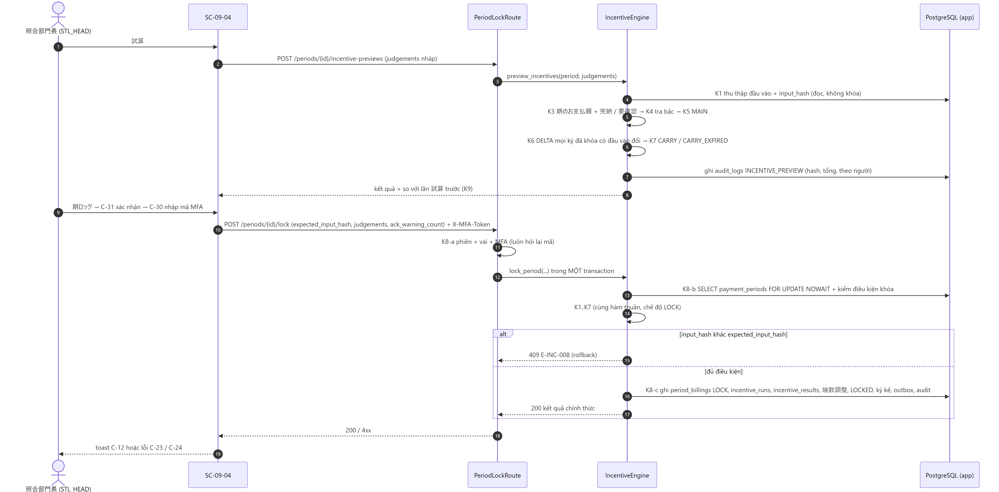
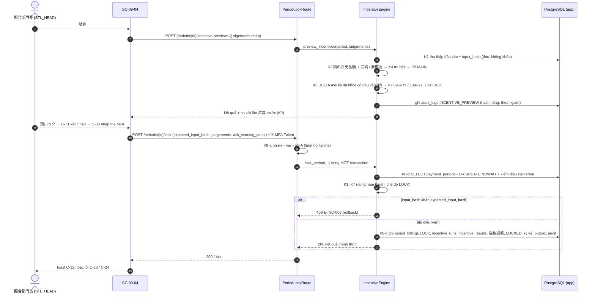

# INC_ENGINE — エンジン 完納奨励金 (試算 / 期ロック, DELTA, CARRY)

> 様式: **BM-2-901-53 v01** — 詳細設計（チャート + 説明） · SUN ASTERISK VIETNAM CO., LTD · ISO/IEC 27001:2013 & ISO 9001:2015

本ファイルで使う用語: **完納奨励金**（かんのうしょうれいきん — 一つの期の支払いを期限どおりに全額済ませた購入者への奨励金）、**期のお支払額**（期の支払うべき額）、**適格金額**（奨励金の算定基礎となる金額、税抜 = 税を含まない）、**交付率**（ランクごとの奨励率）、**期ロック**（期の確定 = 正式計上 + 凍結）、**試算**（仮計算、結果は書き込まない）、**要確認**（人が判断すべきもの）、**消込**（入金と債権の照合）、**年度 / TC 年度**（会計年度 4月→3月）。

---

## 1. 変更履歴

| No | Version | Action | 対象箇所 / ステップ | 変更内容 | 更新日 | 更新者 | Approve |
|---|---|---|---|---|---|---|---|
| 1 | 0.1.0 | Add new | — | 初版（LAB-4 P3）: LAB-5 でタスク分割するための完了条件付き 9 ブロック K1–K9; 変数、整数の計算式、計算順序、DELTA の行分割ルール、TV-01..14 との対応（INCENTIVE_DB §5） | 2026-11-25 | phuongnnm-23344 | |
| 2 | 0.1.1 | Update | — | 顧客 Q-INC-02: 締め済みの期の GD 後入力を、開いている奨励金計算期（`incentive_period_id`）へ移す; 完納はその期の支払期日で判定; DELTA なし; 全購入者に一つのルール（§3.4、K1/K2/K6/K9、TV-15、+0.5 MD）。Q-INC-01: 完納は CSV の入金日で判定; 期ロックにはチェックが必要（K8、E-INC-014） | 2026-11-25 | phuongnnm-23344 |  |
| 3 | 0.1.2 | Update | §2 | FB-EXP-236: Mermaid ブロックから書き出した PNG `./assets/INC_ENGINE_sequence.png` を埋め込み（`scripts/export-mermaid-png.py`）; Mermaid は引き続き出典 | 2026-11-25 | phuongnnm-23344 |  |

---

## 2. シーケンス図



出典: 下の Mermaid ブロック（編集用の版）; 画像はそのブロックから `python scripts/export-mermaid-png.py INC_ENGINE` で生成 — Mermaid を修正したら再実行し、二つの版がずれないようにする。

<details open>
<summary>Mermaid 版 — 試算 と 期ロック（ステップ番号は 4 章と一致）</summary>



</details>

---

## 3. 説明

エンジンは、仲卸（`NAKAOROSHI`）と売買参加者（`BAIBAI`）に属する全購入者について、**一つの支払期** P（元取引の業務日による月）の完納奨励金を計算する。二つの呼び出し方は、**同じ純粋関数** `compute_period_incentives` を使う（ADR-007 §2.1）:

- **試算**（SETTLE または STL_HEAD、何度実行してもよい）: 業務テーブルには書かず、次回比較のために `audit_logs` を一行だけ記録する。
- **期ロック**（STL_HEAD のみ / 代行者、MFA でコードを再度求める）: **一つのトランザクション**内で正式計算し、要確認の行を確定させ、結果を追記専用で書き込み、期を閉じ、IF-ACC-01 向けの端数調整の行を生成し、メールを予約する。一つの期は一度だけロックし、再度開くことはない。

期がロックされた後は、その期の入力に対する変更（TRADE の修正申請、ロック後の入金配分、KANNO / INCENTIVE の修正申請）は、**次の期ロック**で DELTA の行としてのみ現れ、古い期の版（ルール 4、BR-INC-01、PRM-043）で計算される。ロック済みの結果を上書きする経路は無い。**例外 — 締め済みの期に対する GD 後入力（`LATE_ENTRY`）は DELTA にならない**。代わりに、開いている期に移され、通常の入金として完納を判定する（§3.4、Q-INC-02）。

### 3.1 変数（4 章・FUNC・テストで統一して使用）

| 記号 | 意味 | データソース | 型 |
|---|---|---|---|
| P | 処理中の期（試算中または締め中） | `payment_periods` (CLOSE_DB 4.43) | uuid |
| Q | 再計算される `LOCKED` 済みの期（Q ≠ P） | `payment_periods.status = 'LOCKED'` | uuid |
| V_X | 期 X の規程の版 = X の `payment_periods.rule_version_id`（X の 1 日に発効していた版） | CLOSE_DB 4.43, RULE_DB 4.21 | uuid |
| i, c_i | 購入者と交付率表の区分（`NAKAOROSHI` / `BAIBAI`） | `participants.kind` | uuid, enum |
| IP(g) | 取引 g の**奨励金計算期** = `trades.incentive_period_id` が値を持てばそれ（GD 後入力として、`trade_date` の期がすでに `LOCKED` のときに記録 — §3.4）、それ以外は `trade_date` を含む期 | TRADE_DB 4.30（新しい列 — Q-INC-02） | uuid |
| S_excl(i,X,r) | 期 X における i の税率 r ごとの税抜合計 | `v_trade_effective` を **IP(g) = X** で絞り込み + `trade_adjustments.period_id` | bigint |
| T(i,X,r) | 税率ごとの期の税額 = ROUND_{TAX_ROUNDING}(S_excl × rate_r / 100) | `tax_rates`, V_X の `rule_parameters.TAX_ROUNDING` | bigint |
| B(i,X) | 期のお支払額 = Σ_r (S_excl + T) | BILLING_DB 4.49 / 4.50 | bigint |
| E0(i,X) | 税抜合計 = Σ_r S_excl(i,X,r) | — | bigint |
| OT(i,X) | X へ**支払期日どおりに**配分された額 = Σ `payment_allocations.amount_jpy`（`REVERSE` の負の額を含む）のうち `is_on_time = true`; 期日どおり = **入金 CSV 上の入金日**（`payments.paid_on` — 銀行口座に入金された日、取込日では**ない**）≤ `due_date`（Q-INC-01） | BILLING_DB 4.47, 4.48 | bigint |
| s(i,X) | 不足 = B − OT | — | bigint |
| FEE_MAX | `KANNO_FEE_SUSPECT_MAX_JPY` — 「手数料差引の疑い」の閾値（設定ファイル、印を付けるためだけに使い、金額は変えない） | 設定ファイル（ADR-006 §2.6） | bigint |
| K(i,X) | 完納（boolean） | K3 / 判断 / 修正申請 KANNO | boolean |
| E(i,X) | 適格金額 = K ? max(0, E0) : 0 | — | bigint |
| t, ρ | ランクと交付率（basis point, 1 bp = 0.01%） | V_X の `incentive_rate_rows`、c_i | smallint, int |
| I(i,X) | 計算式による奨励額 = ⌊E × ρ × 110 / 1,000,000⌋ | K5 | bigint |
| C_INC(i,X) | (i, X) について決裁済みの修正申請 `INCENTIVE` の額の合計 — 固定額で、加算する | ADJUST_DB 4.37 `change.amount_jpy` | bigint |
| R(i,Q) | Q について記録済みの合計 = (i, Q) の `MAIN` 行の `incentive_jpy` の合計 + i の `ref_period_id = Q` の `DELTA` 行の合計 | INCENTIVE_DB 4.52 | bigint |
| new(c) | 修正申請 c が `APPROVED` で「新規」である条件 = `correction_id = c` の `incentive_results` 行がまだ無い | INCENTIVE_DB 4.52 | boolean |
| H | `input_hash` = 正規化済みの入力集合の SHA-256（K1） | — | char(64) |

### 3.2 計算式（整数、実数は使わない）

```
I(i,X)   = floor( E(i,X) × ρ × 110 / 1_000_000 )          -- ρ tính bằng bp; 110/100 là 税係数 cố định (BR-INC-01, B.5, 13-06)
I'(i,Q)  = floor( E'(i,Q) × ρ'(V_Q) × 110 / 1_000_000 ) + C_INC(i,Q)
DELTA    = I'(i,Q) − R(i,Q)                               -- ghi ở kỳ P nếu ≠ 0, ref_period = Q
Payout(i,P) = max(0, Σ incentive_jpy mọi dòng của i có period_id = P)
```

オーバーフローの確認: E ≤ 10^11（1,000 億円）× ρ ≤ 10,000 × 110 = 1.1 × 10^17 < 2^63。除算は PostgreSQL の整数 `div()` を使う（正の数では切り捨て; E ≥ 0 なので負の場合は無い）。例: TV-11 1,234,567 × 90 × 110 = 12,222,213,300 → ÷ 1,000,000 = **12,222**。

### 3.3 一回の呼び出し内の計算順序（必ず守る）

1. K1 で P の入力と DELTA 候補の期の集合を収集 → H。
2. K3 で P の期のお支払額 + 完納 / 要確認を計算（判断があれば適用）。
3. K4 で V_P を選び、ランクを照会 → K5 で MAIN。
4. K6 で各 Q を順に（`period_code` の昇順）: 再計算、R と比較、DELTA の行を生成（出所ごとに分ける）。
5. K7 で P の各 i の全行（MAIN + DELTA + 繰り越し分）を合算 → payout、次の期への CARRY / 年度末の CARRY_EXPIRED。
6. K8（LOCK のみ）は同一トランザクションで全てを書き込む; K9 は報告 / 試算との比較に読み出す。

K2（入金の配分）は**エンジン内では実行しない**: CSV 取込 / バッチ取消 / 手動割当の時点で実行する（SC-09-01、SC-09-03）; エンジンは配分結果を読むだけ。

### 3.4 締め済みの期への GD 後入力 — 全購入者に一つのルール（Q-INC-02）

出典: 顧客（模擬）は従来の前提に同意しなかった 【顧客（模擬）、2026-11-25 — Q-INC-02】; BR-INC-01（締め後 → 次期差分）。

| | 0.1.0 版（廃止） | 本版から |
|---|---|---|
| 期 Q が締め済みで、購入者が Q に取引を**持つ**（MAIN 行がある） | GD 後入力を Q の E0' に加算、K' = MAIN の K（後入力の支払い済みかどうかは見ない） → 次の期ロックで正の DELTA（旧 TV-13: +1,980） | GD 後入力は Q を再計算**しない**; 奨励金計算期 P\* へ移す |
| 購入者が Q に取引を**持たない**（MAIN なし） | K' = false → 奨励金なし（旧 PL の前提）— 市場の入力が遅れたため購入者が奨励金を失う | 上の行と同じ |

ルール（両グループに共通の一つのルール）:

1. 修正申請 `LATE_ENTRY`（settle → trade）の取引記録関数は、`SELECT … FROM payment_periods WHERE id = Q FOR SHARE` で取引日の期 Q を読む（期ロックの `FOR UPDATE` と直列化 — 「ロックの最中に書き込む」隙間を作らない）。Q が `LOCKED` → `trades.incentive_period_id` = **P\*** を記録。P\* = 取引の `business_date`（業務日の記帳日 = 決裁時に開いている最も早い日 — ADR-005 §2.8）を含む期。Q が `OPEN` → NULL のまま（取引は通常どおり Q に属する、TV-01）。
2. P\* は必ず `OPEN`: 記帳の業務日が `OPEN` ならその期はまだロックできない（K8: 未ロックの業務日がある → `E-INC-005`）。
3. P\* において、その取引は**通常の P\* の金額**: S_excl / B（期のお支払額 — 購入者は同じ期 P\* で請求を受ける）、E0 に入り、ランクは V_P\* で照会; 完納は **P\* の支払期日**で判定（OT ≥ B）。K3–K5 に専用の分岐は無い。
4. Q は、この取引のために DELTA の候補に入らない（K1-4）; Q の `period_billings` LOCK と結果は変わらない（ルール 4）。
5. `trade_date`、`business_date`、日ごとの集計（日次精算、IF-ACC-01、日別報告）は**変わらない** — `incentive_period_id` は期のお支払額と完納奨励金にのみ使う。

影響: +0.5 MD（PL — 列 + 取引記録関数の `FOR SHARE` 読み取り + K1 の IP によるフィルタ + TV-13 / TV-15 のテスト）。経理部 + 照合部門長の確認待ち: この金額を期 P\* の請求書にどう記載するか（前提 [PL]: 期 P\* のお支払額の中に「前期分の後入力（取引日 MM/DD）」という独立した行を置く）。

---

## 4. 詳細関数

各ブロックには**完了条件（DoD）**があり検証できる — LAB-5 では各ブロックを一つのタスクとして分ける（K2 は K1 / K3 と並行可能; K6 は K1–K5 に依存; K8 は全てに依存）。

### 4.1. K1 — 入力の収集と Hash（`incentive_collect_inputs`, `incentive_input_hash`）

| 項目 | 値 |
|---|---|
| Input | `period_id` P; モード `PREVIEW` / `LOCK` |
| Output | P の正規化された入力行の集合 + DELTA 候補の期 Q の集合; `input_hash` H → K3, K6, K8 |

**Error**

| エラー条件 | 処理 | Status code |
|---|---|---|
| P が存在しない | 停止、`E-INC-001` を返す | 404 |
| P が `LOCKED` 済み（試算またはロックのやり直し） | 停止、`E-INC-002` を返す | 423 |
| 候補の期 Q に `rule_version_id` が無い（移行データの不備） | 停止、ERROR をログ、`E-INC-010` を返す | 500 |

**Detail**

| No | 処理内容 |
|---|---|
| 1 | P を読む（`period_code`, `start_date`, `end_date`, `due_date`, `rule_version_id`, `fiscal_year`）; LOCK モードでは K8 で `FOR UPDATE NOWAIT` を使い、PREVIEW モードでは通常読みをする。 |
| 2 | `v_trade_effective` から **IP(g) = P** の有効な取引を読む: （`incentive_period_id IS NULL` かつ `trade_date ∈ [start_date, end_date]`）**または** `incentive_period_id = P`（締め済みの期の GD 後入力が P へ移ったもの — §3.4）+ `period_id = P` の `trade_adjustments`; （購入者, `tax_rate_id`）でまとめる。`participants.kind ∈ (NAKAOROSHI, BAIBAI)` の購入者のみ。 |
| 3 | `period_id = P` の `payment_allocations` を読む（`ALLOCATE` と `REVERSE` の両方）、`is_on_time` を保持する。 |
| 4 | DELTA 候補 = `LOCKED` 済みの Q のうち、Q 自身の締め後の入力を**少なくとも一つ**持つもの: `created_at > Q.locked_at` の `trade_adjustments.period_id = Q`; `created_at > Q.locked_at` の `payment_allocations.period_id = Q`; `target_period_id = Q` の決裁済み修正申請 `KANNO` / `INCENTIVE`。年度でフィルタしない（Gate 1 C-01）、**前回のロック時刻でもフィルタしない**: `locked_at = now()` はトランザクション**開始**時刻なので、その時刻より小さい `created_at` を持ち、後にコミットされる並行書き込みは、前回のロックから漏れる可能性がある — Q の全体を再計算して R と比較する（K6）のは冪等なので、広めに走査しても正しく、追加コストは数期分（小さい）だけ。 |
| 5 | 正規化: 各ソースを `(id, participant_id, tax_rate_id, amount, is_on_time, created_at)` の配列にし `id` で並べる; `V_P` と候補の（Q, 入力の `id`）の一覧を追加; `jsonb` → 標準テキスト → `sha256` → H。判断は H に**含めない**（判断は決定であり、入力ではない）。 |
| 6 | 期や期限の決定に `now()` を使わない; 全ての日付はテーブルから取得する（ADR-007 §2.1-1）。 |

**DoD K1:** (a) 新しい書き込みなしで 2 回連続で呼ぶ → 同じ H; (b) P に `payment_allocations` を一件追加 → H が変わる; (c) TV-13 / TV-15: `trade_date` 2027-08-31 / 08-30 の `LATE_ENTRY` 取引が 2027-09-21 / 09-22 に記録され、`incentive_period_id` = 2027-09 の期 → 09 の入力に入る; 期 2027-08 は候補に**入らない**; (d) TV-01: 期 08 が `OPEN` の間に 2027-09-03 に記録された期 08 への調整 → 期 08 の S_excl に入り、候補には入らない。

### 4.2. K2 — 入金の期への配分（`allocate_payment_fifo`）— エンジン外で実行

| 項目 | 値 |
|---|---|
| Input | `payments` の一行（購入者が特定済み、`paid_on` = **銀行 CSV 上の入金日**、`amount_jpy`、`invoice_no`） |
| Output | `payment_allocations` の行（追記のみ）→ K1 が読む |

**Error**

| エラー条件 | 処理 | Status code |
|---|---|---|
| `participant_id` が NULL（支払者コードが未対応） | 配分しない; SC-09-02 の要判断一覧に入れる; 他の行は続行 | —（API エラーなし） |
| `invoice_no` はあるが期を特定できない | FIFO に切り替え、取込結果に警告を記録 | — |

**Detail**

| No | 処理内容 |
|---|---|
| 1 | `invoice_no` があり、E-02 で請求番号による配分が確定している → その番号の期へ全額を配分（`method = INVOICE_NO`）。E-02 はまだ回答されていない → このルートは機能フラグで無効化し、FIFO のみ実行する。 |
| 2 | FIFO: その購入者の期 X のうち `start_date ≤ paid_on` かつ**未払い** > 0 のものを列挙し、`period_code` の昇順に並べる。未払い(X) = （X が `OPEN`: X の現在の B）または（X が `LOCKED`: `period_billings` LOCK + ロック後に X に紐づいた調整の合計 — GD 後入力は締め済みの X ではなく P\* の B に入る、§3.4）− X への配分の合計（BILLING_DB 4.48）。 |
| 3 | 各期へ min(残額, 未払い) を順に配分する; `is_on_time = paid_on ≤ X.due_date` — `paid_on` は**銀行 CSV に記載された入金日**であり、取込日ではない（Q-INC-01）: 遅れて取り込まれた CSV でも入金日 ≤ 期限なら期日どおりになる。 |
| 4 | 未払いを全て支払った後の余剰 → その購入者の最も古い `OPEN` の期へ配分（`is_on_time` はその期の期限で判定）; K9 は照合担当者が処理できるように「過入金」の警告を付ける。 |
| 5 | 入金バッチの取消 → バッチの各配分行に、負の額の `REVERSE` 行を一つ生成し、`reverses_id` で元の行を指す; 削除はしない。 |
| 6 | 手動割当（`MANUAL`、理由必須）は照合担当者が SC-09-03 で行う; ロック済みの期への割当は有効だが、効果は DELTA を通じてのみ現れる（完納は遡及しない — TV-07）。 |

**DoD K2:** 2027-10-09 に取り込んだ CSV で、入金日 2027-10-07 の行が期限 2027-10-08 の期に対応 → `is_on_time = true`（取込日は影響しない）; TV-06（108,000 → 期 09 は遅れ、432,000 → 期 10、期 10 は完納にならない）; TV-05（`paid_on` 2027-10-12 > 期限 2027-10-08 → `is_on_time = false`）; バッチ取消 → バッチの配分合計 = 0。

### 4.3. K3 — 期のお支払額、完納と要確認の判定（`period_payable`, `kanno_status`）

| 項目 | 値 |
|---|---|
| Input | K1 の (i, X) の入力; `judgements`（人 → `{decision: KANNO \| NOT_KANNO, reason}` の map） |
| Output | B, E0, OT, s, K, `kanno_basis`, 行の状態（`OK` / `NG` / `SUSPECT`） → K4 |

**Error**

| エラー条件 | 処理 | Status code |
|---|---|---|
| LOCK: `SUSPECT` の行に判断が無い | 停止、`E-INC-006` を人の一覧と共に返す | 422 |
| LOCK: 判断に理由が無い / 理由が 500 文字超 | 停止、`E-INC-007` を返す | 422 |
| `SUSPECT` ではない人に判断が指定されている | 停止、`E-INC-011` を返す | 422 |
| PREVIEW: 判断が無い | エラーなし — 行は `SUSPECT` のまま、K = false を仮に置き、要確認と表示 | — |

**Detail**

| No | 処理内容 |
|---|---|
| 1 | 税率 r ごとに: T = ROUND(S_excl × rate_r / 100)、ROUND は V_X の `TAX_ROUNDING`（デフォルト `FLOOR`、DEC-011、E-06）。B = Σ_r (S_excl + T)。税は**人 × 期 × 税率ごとに合計した上で一度だけ**計算する（PRM-053）、取引ごとには加算しない。 |
| 2 | B ≤ 0 → i の MAIN 行は生成しない（支払うものが無い）; i が P に DELTA / CARRY の行を持つ場合は K7 へ進む。 |
| 3 | OT ≥ B → `OK`: K = true、`kanno_basis = AUTO`。 |
| 4 | 0 < s ≤ FEE_MAX **かつ** OT > 0（期限内の入金が少なくとも一件ある）→ `SUSPECT`「手数料差引の疑い」: エンジンは**自動で結論を出さない**（ADR-007 §2.6、顧客 #7）。画面の既定の提案: `NOT_KANNO`（振込手数料は購入者負担 — FQ-02、PRM-040）。判断があれば、その決定により K を決め、`kanno_basis = JUDGED`、`judgement_note` = 理由。 |
| 5 | その他の場合（s > FEE_MAX、または OT = 0）→ `NG`: K = false、`AUTO`。支払期日の後の**入金日**の入金は OT に入れない（猶予なし — B.5「超過時は0」）; 銀行の入金日は猶予ではない（Q-INC-01）。 |
| 6 | E = K ? max(0, E0) : 0。 |

**DoD K3:** TV-05 → `NG`、E = 0; TV-10 → 440 ≤ FEE_MAX で不足のとき `SUSPECT`; 判断 `KANNO` + 理由 → K = true、`JUDGED`、奨励金 9,900; 判断 `NOT_KANNO` → 0; 1,050,000 の 8% 税 = 84,000（TV-01）。

### 4.4. K4 — 版の選択とランクの照会（`rate_tier_for`）

| 項目 | 値 |
|---|---|
| Input | V_X, c_i, E |
| Output | (t, ρ) → K5 |

**Error**

| エラー条件 | 処理 | Status code |
|---|---|---|
| (V_X, c_i) の交付率表が連続する 5 ランクを満たさない、または E を含むランクが無い | 計算全体を停止、ERROR をログ（規程データの破損 — 関数 `submit_rule_version` で本来は阻止されているはず）、`E-INC-010` を返す | 500 |

**Detail**

| No | 処理内容 |
|---|---|
| 1 | 版 = **期 X の V_X**（期の 1 日）。ロック日や再計算日の発効版では**ない**（TV-12: 期 09 は v2 を照会、期 10 は v3 を照会; Q の DELTA は常に V_Q を照会 — TV-02, TV-03）。 |
| 2 | `incentive_rate_rows` から `participant_class = c_i`、`min_eligible_jpy ≤ E`、かつ（`max_eligible_jpy` IS NULL または `E < max_eligible_jpy`）の行を選ぶ — 下限は「以上」、上限は「未満」。 |
| 3 | E = 0 → ランク 1、ρ = 0（ランク 1 は常に 0 bp — RULE_DB 4.22）。 |

**DoD K4:** TV-12: 1,000,000 → ランク 3（下限ちょうど）; 999,999 → ランク 2; 同じ人の期 09 / 期 10 は異なる版を照会する。

### 4.5. K5 — MAIN の奨励額の計算（`incentive_amount`）

| 項目 | 値 |
|---|---|
| Input | E, ρ |
| Output | 行 `MAIN` (i, P): `payable_incl_jpy = B`, `paid_on_time_jpy = OT`, `kanno`, `kanno_basis`, `judgement_note`, `eligible_excl_jpy = E`, `tier_no`, `rate_bp`, `incentive_jpy = I`, `rule_version_id = V_P`, `participant_class = c_i` → K7 |

**Error**

`N/A — hàm số học thuần trên số nguyên đã kiểm miền ở K3 / K4; không có nhánh lỗi.`

**Detail**

| No | 処理内容 |
|---|---|
| 1 | I = `div(E * ρ * 110, 1000000)`; 関数は `IMMUTABLE`、テーブルは読まない。 |
| 2 | 途中で丸めない（E × ρ / 10000 を `numeric` で丸めてから × 1.1 はしない）。 |

**DoD K5:** TV-11 → 12,222; TV-12 → 9,900 / 5,499 / 8,800; TV-01 → 10,395; 単体テストで境界ケース 6 件以上（E = 0、ρ = 0、閾値の直下 / 直上、E = 10^11）。

### 4.6. K6 — 締め済みの期の DELTA（`compute_delta_rows`）

| 項目 | 値 |
|---|---|
| Input | P, 候補の期 Q の集合（K1）、Q の記録済み結果（`incentive_results`）、決裁済みの修正申請 KANNO / INCENTIVE |
| Output | P に書き込まれる 0..n 行の `DELTA`（`period_id = P`, `ref_period_id = Q`, `rule_version_id = V_Q`）→ K7 |

**Error**

| エラー条件 | 処理 | Status code |
|---|---|---|
| 候補の Q に `incentive_runs` が無い（移行データが結果を取り込んでいない） | 停止、ERROR をログ、`E-INC-010` を返す（移行した期は締め済みの期と同じように取り込むこと — DEC-005、ADR-007 §2.7-15） | 500 |

**Detail**

| No | 処理内容 |
|---|---|
| 1 | Q を `period_code` の昇順に処理; 入力が変わった、または Q に結果行がある各購入者 i について、**現在の時点で Q 全体を再計算**する（差分の加算はしない）: S_excl', B', E0' は IP(g) = Q の**全**取引を含む（Q の締め後に記録された GD 後入力は `incentive_period_id` ≠ Q なので**含まない** — §3.4）+ `period_id = Q` の全 `trade_adjustments`; OT' は Q への全配分を含む。税は V_Q の `TAX_ROUNDING` で再計算。 |
| 2 | K'（再計算後の完納）= (i, Q) の MAIN 行の K — **遡及しない**（PRM-043）。締め後の配分により OT' ≥ B' になった場合も同様（TV-07: DELTA 0）。**唯一の例外:** (i, Q) に決裁済みの修正申請 `KANNO` がある → K' = 最も新しく決裁された申請の `kanno_after`（ADR-007 §2.5-11）。0.1.0 版の「MAIN がない人 → K' = false」という前提は削除: 取引が Q に無い人の GD 後入力は、P\* に入っている（§3.4）ため、Q には再計算するものが無い（Q-INC-02）。 |
| 3 | E' = K' ? max(0, E0') : 0; (t', ρ') は **V_Q** で照会（K4）; I' = ⌊E' × ρ' × 110 / 10^6⌋ + C_INC(i, Q)。C_INC は修正申請 `INCENTIVE` の**固定額**で、E' に応じて伸縮しない（TV-14; ADR-007 §2.5-12）。 |
| 4 | D = I' − R(i, Q)。D = 0 → 行を書かない。 |
| 5 | (i, Q) に決裁済みの**新しい**修正申請 `APPROVED` がある場合は**出所ごとに行を分ける** — すなわち、その `correction_id` を持つ `incentive_results` 行がまだ無いもの（判定はデータで行い、時刻では行わない）: (a) 新しい `INCENTIVE` ごとに DELTA 行を一つ = その `amount_jpy`、`correction_id` を付与; (b) 新しい `KANNO` ごとに DELTA 行を一つ = I'（K' を使用）− I'（旧 K を使用）。他の入力は新しいものと同じとみなす。`correction_id` を付与、`kanno_basis = CORRECTION`; (c) 残り D − Σ(a) − Σ(b) ≠ 0 → `correction_id` を付けない DELTA 行を一つ。行の合計 = D。TV-14 の変形例: +2,000（INCENTIVE）+ +990（TRADE）。 |
| 6 | DELTA 行の項目: `kanno = K'`; `kanno_basis` は行 (b) では `CORRECTION`、他は Q の MAIN から複写; `payable_incl_jpy = B'`, `paid_on_time_jpy = OT'`, `eligible_excl_jpy = E'`, `tier_no = t'`, `rate_bp = ρ'`, `participant_class = c_i`。 |
| 7 | DELTA 行の TC 年度 = **P**（計上する期）の TC 年度。Q が前の TC 年度に属していても同じ（TV-03, ADR-007 §2.4-10）。 |

**DoD K6:** TV-02（+1,980、期 08 の K は true のまま）; TV-03（−15,400 を 2028-05 に記録、v3 を照会、TC 年度 2028）; TV-07（締め後の配分 → DELTA 0; KANNO の後 → +9,900、`correction_id` あり、`CORRECTION`）; TV-13 / TV-15（GD `LATE_ENTRY` は期 08 に DELTA を**生成しない**）; TV-14（期 11 で +2,000; 期 12 で +990; −2,000 は生成しない; 行を二つに分けるバリアント）; K6 を続けて 2 回、新しい入力なしで実行 → 2 回目は 0 行（冪等）。

### 4.7. K7 — 合算、CARRY と CARRY_EXPIRED（`compute_carry_rows`）

| 項目 | 値 |
|---|---|
| Input | i に属し `period_id = P` の全行（MAIN、今計算した DELTA、前期から入ってきた CARRY） |
| Output | Payout(i, P); 0..1 行の `CARRY`（次の期 P+1 に記録）または 0..1 行の `CARRY_EXPIRED`（P に記録） → K8 |

**Error**

`N/A — 既存の行の加減算のみ; 次の期 P+1 は K8 が書き込み前に存在を保証する。`

**Detail**

| No | 処理内容 |
|---|---|
| 1 | Σ = i の P の全行の `incentive_jpy` の合計。Payout = max(0, Σ)。 |
| 2 | Σ < 0 かつ P が TC 年度の最終期（3 月）でない → 額 Σ（負）の `CARRY` 行を **P+1** に記録（`period_id = P+1`、`run_id` = P の実行 ID）、`ref_period_id` = 負の連鎖の起点となる期（P に入ってくる CARRY があればその `ref_period_id`、無ければ P）。 |
| 3 | Σ < 0 かつ P が TC 年度の最終期 → 額 **−Σ（正）** の `CARRY_EXPIRED` 行を P に記録。`ref_period_id` は No 2 と同じルール → i の P における Σ は 0、payout は 0。RPT-07 は絶対値を照合部門に未回収分として表示する（Q-ARCH-08）。新年度には持ち越さず、負の額を二重に数えない（Gate 1 m-05、recheck n-01）。 |
| 4 | CARRY が TC 年度を超えることは無い（3 月の期は必ず No 3 で締める）。 |

**DoD K7:** TV-04: 期 2028-05 の Σ = −12,100 → 2028-06 に CARRY −12,100; 2028-06: −2,200 → 2028-07 に CARRY …; 期 2029-03: CARRY_EXPIRED +2,200、Σ = 0、payout 0。

### 4.8. K8 — 一つのトランザクションでの期ロック（`lock_period`）と試算モード（`preview_incentives`）

| 項目 | 値 |
|---|---|
| Input | P, `expected_input_hash`, `judgements`, `ack_warning_count`, `payment_csv_confirmed`（チェック「支払期日分までの入金CSV取込済」 — Q-INC-01）, セッションのコンテキスト（`app.user_id`, `app.device_id`, `app.mfa_verified_at`）, header `X-MFA-Token`（`purpose = PERIOD_LOCK`） |
| Output | 期 P が `LOCKED`; `incentive_runs` + `incentive_results`; `period_billings` LOCK; 端数調整の行; 次の期 P+1 が存在する; メールの outbox; `audit_logs` → API-INC-003 |

**Error**

| エラー条件 | 処理 | Status code |
|---|---|---|
| 未ログイン | 停止、`E-CMN-001` | 401 |
| 権限なし `STL_HEAD`（有効な代行を含む） | 停止、`E-CMN-002` | 403 |
| MFA トークンが無い / 期限切れ / 使用済み / `purpose` が違う（期ロックは常にコードを再度求める — ADR-002 §2-6a） | 停止、`E-CMN-005` | 403 |
| P の行をロックできない（`NOWAIT`） | ロールバック、`E-INC-009` | 409 |
| P が既に `LOCKED` | ロールバック、`E-INC-002` | 423 |
| P の前の期がまだ `OPEN` | ロールバック、`E-INC-003` | 409 |
| 業務日の現在日 ≤ P の `due_date` | ロールバック、`E-INC-004` | 409 |
| [start_date, end_date] に未ロックの業務日がある | ロールバック、`E-INC-005` | 409 |
| `payment_csv_confirmed` ≠ true（照合が支払期日までの入金 CSV を全て取り込んだと確認していない — Q-INC-01） | ロールバック、`E-INC-014`、`field = paymentCsvImportConfirmed` | 422 |
| `ack_warning_count` ≠ 現在の ⚠ 警告数（K9） | ロールバック、新しい件数を添えて `E-INC-013` | 409 |
| H ≠ `expected_input_hash` | ロールバック、`E-INC-008`（試算し直す必要あり） | 409 |
| K1 / K3 / K4 / K6 のエラー | ロールバック、そのブロックのコードを返す | 422 / 500 |

**Detail**

| No | 処理内容 |
|---|---|
| 1 | Route handler がセッション、権限、MFA を検査（iam が発行した `purpose = PERIOD_LOCK` の `X-MFA-Token` を消費 — 期ロックは戻せないため 10 分の step-up は再利用しない）、その後トランザクション内で `app.lock_period` を呼ぶ; 呼ぶ前に `set_config('app.user_id' …)` を行う。 |
| 2 | `SELECT … FROM payment_periods WHERE id = P FOR UPDATE NOWAIT`; `pg_advisory_xact_lock(hashtext('incentive_period_lock'))` で二つの期が並行してロックされないようにする（K6 は互いの結果を読む）。 |
| 3 | Error の表に従い（表の順序どおり）条件を検査する。`assert_caller('SETTLE', 'STL_HEAD')` は代行（`lock_delegation_id`）も検査する。 |
| 4 | K1（LOCK モード）を実行 → H を比較。K3 を `judgements`（全件必須）で実行、K4、K5、K6、K7。 |
| 5 | B > 0 の全 (i, P) について `period_billings` を `snapshot_kind = LOCK` で、`period_billing_tax_lines` を書き込む; `incentive_runs`（P, V_P, H, `payment_csv_confirmed_at` = ロック時刻, `payment_csv_latest_paid_on` = ロック時点で取り込んだ入金 CSV の最大の入金日 — 監査の証跡）を書き込む; `incentive_results` の全行（MAIN, DELTA, P+1 への CARRY, CARRY_EXPIRED）を書き込む。 |
| 6 | 税率ごとに端数調整の行を生成: 期の税額（Σ T）と、P の IF-ACC-01 で日ごとに出力済みの税額の合計との差 → 端数調整の種別の `accounting_export_lines`、開いている業務日のバッチに紐づける（BILLING_DB 4.42; 書式は E-01 / OPEN-DB-01 待ち）。 |
| 7 | `UPDATE payment_periods SET status = 'LOCKED', locked_by, lock_delegation_id, locked_at = now()`。P+1 が存在することを保証（無ければ作成、`rule_version_id = rule_at(P+1.start_date)`、`due_date` は `PAYMENT_DUE_RULE` と銀行カレンダーから算出）。 |
| 8 | `notifications` を予約（期の結果メールを、P に行がある各人へ; FORM-INC-01） — コミット後に outbox のワーカーが送信する。 |
| 9 | `audit_logs` を書く（`action = PERIOD_LOCK`、P、H、MAIN / DELTA / CARRY の合計、判断の一覧と理由、実行者、代行、端末、MFA の時刻）。コミット。No 2–9 のどこでエラーが起きても全体をロールバックし、「計算済みだが未ロック」の状態を作らない（N13）。 |
| 10 | **試算モード**（`preview_incentives`）: No 4 と同じ、ただし `judgements` は下書き（不足分は要確認のまま）; No 2 は実行しない（ロックしない）、No 5–8 も実行しない; `audit_logs` に 1 行だけ書く（`action = INCENTIVE_PREVIEW`、P、H、合計、人 → 奨励額の map）— K9 で使う。権限: `SETTLE` または `STL_HEAD`; MFA は不要。 |

**DoD K8:** (a) ロールバック成功 → 全ての書き込みが同一トランザクション内（テスト: 監査ログへの書き込み直前にエラーを注入 → `incentive_results` の行が一つも残らず、P は `OPEN` のまま）; (b) 二つのセッションが同時にロック → 一方は `E-INC-009`; (c) 試算とロックの間に配分を一件変更 → `E-INC-008`; (d) 期 08 が `OPEN` の間に期 09 をロック → `E-INC-003`; (d2) 業務日 > `due_date` だが `payment_csv_confirmed = false` → 422 `E-INC-014`、P は `OPEN` のまま; チェックを入れた場合 → `incentive_runs.payment_csv_confirmed_at` に値がある; (e) `lock_period` 以外のどの呼び出し方も `incentive_results` に書けない（アプリ role の EXECUTE 権限を検査）。

### 4.9. K9 — 読み出し: 画面、報告、直前の試算との比較（`period_lock_view`, `incentive_results_view`）

| 項目 | 値 |
|---|---|
| Input | P; P の直近で、かつその直前の `audit_logs` の `INCENTIVE_PREVIEW` 行 |
| Output | 配分の表（SC-09-04 の [4]）、⚠ 警告、「前期以前の調整」の行、試算との比較、SC-09-05 / RPT-07 / FORM-INC-01 向けの確定結果 → API-INC-001, API-INC-004 |

**Error**

| エラー条件 | 処理 | Status code |
|---|---|---|
| 期が未ロックのときに確定結果を求める | `E-INC-012` を返す | 404 |

**Detail**

| No | 処理内容 |
|---|---|
| 1 | 「充当先の内訳」: 各 i について、P に少なくとも一件配分された入金の全配分を列挙し、配分先の期（期、額、`method`、`is_on_time`）でまとめる。 |
| 2 | ⚠ 警告（`warning_count` に数える）: `OLD_PERIOD_ALLOCATION` — `paid_on` ∈ (P.end_date, P.due_date] の入金が、P より古い期の支払いに FIFO で充てられた（TV-06、OPEN-L4-02）; `OVERPAYMENT` — B を超える配分; `UNMAPPED_PAYMENT` — `paid_on ≤ P.due_date` で購入者未対応の入金（TV-07）。 |
| 3 | 「前期以前の調整」: ロック済みの期へ紐づき、締め後に記録された `trade_adjustments` の合計を、人 × 元の期ごとに表示 — P の B には加算しない（OPEN-DB-08）。GD 後入力は**ここには出ない**（P\* の B に既に入っている）。 |
| 3a | 「前期分の後入力」: `incentive_period_id = P` の取引（`trade_date` が P の外）— 人 × `trade_date` × 額で表示; 既に P の B と E0 に入っている（§3.4）、照合担当者が購入者へ説明できるよう表示する。 |
| 3b | チェック項目 Q-INC-01 の情報: 最新の入金 CSV バッチの最大の入金日と取込日時; 画面は自動でチェックしない。 |
| 4 | 試算との比較: 最新と直前の試算の map の、人ごとの差分; 合計の差。`last_preview.input_hash` も返し、画面が再試算の必要性を判断できるようにする（現在の H ≠ 最後の試算のハッシュ → 期ロックのボタンを非活性にする）。 |
| 5 | 確定結果: P に記録された `incentive_results` を読む + K7-1 の payout + RPT-07 向けの `CARRY_EXPIRED` の絶対値。 |

**DoD K9:** TV-06 は期 10 の B05 に `OLD_PERIOD_ALLOCATION` を生成; TV-02 は期 09 の「前期以前の調整」に 216,000 を表示; TV-13 は期 09 の「前期分の後入力」に 08/31 の B12 200,000（税抜）を表示（「前期以前の調整」には出ない）; 二回の試算の間に新しい配分があった → 差分がちょうど奨励額の変化分になる。

---

## 5. その他の注記

**テストベクターの唯一の出典:** `specs/system-design/database-design/INCENTIVE_DB.md` §5（TV-01..TV-15）。数値はここにコピーしない; CI のフィクスチャはその表から構築する（交付率表はダミー — `incentive-rate-table.csv` が来るまで — E-03, L4-A02）。ブロックとの対応:

| TV | 主な検査ブロック | 備考 |
|---|---|---|
| TV-01 | K1, K3, K5 | 期の `period_id` を開いている期へ調整 → B に入る |
| TV-02 | K6, K9 | DELTA +1,980; 「前期以前の調整」 |
| TV-03 | K4, K6 | TC 年度を跨ぐ、古い期の版を照会 |
| TV-04 | K7 | CARRY → 正の CARRY_EXPIRED |
| TV-05 | K2, K3 | 期限超過 → 0 |
| TV-06 | K2, K9 | FIFO で新しい期が完納を失う + 警告 |
| TV-07 | K2, K6 | 遡及しない; KANNO → `correction_id` 付きの DELTA |
| TV-08 | (カレンダー — calendar) | 支払期日は銀行の日付による; エンジンは `due_date` を読むだけ |
| TV-09 | (業務日 — settle / calendar) | K1 の前提であり、エンジンのロジックではない |
| TV-10 | K3, K8 | 要確認 + 判断 |
| TV-11 | K5 | floor |
| TV-12 | K4, K5 | 下限「以上」+ 期ごとの版 |
| TV-13 | K1, K3, K6, K9 | 締め済みの期に取引を**持つ**人の GD 後入力 → P\* に入る、DELTA なし |
| TV-15 | K1, K3 | 締め済みの期に取引を**持たない**人の GD 後入力 → 同じルール |
| TV-14 | K6 | INCENTIVE は固定、逆転しない; 行分割のバリアント |

**境界 — エンジンがやらないこと:** 締め済みの完納を自動で変えない（修正申請 KANNO のみ）; 決裁済みの率の誤りを自動で検出しない（修正申請 INCENTIVE で修正 — ADR-006 §2.4-8a）; 支払い義務の通知のために期のお支払額を計算しない（SC-09-B1 は K3 の `period_payable` を共有する）; 入金の配分はしない（K2 は CSV 取込の流れに属する）; スケジュールで実行しない（ロックは人の判断 — CAP-HUMAN-01）。

**性能:** 約 170 人 ×（1 期 + 数期の候補）— 一つのトランザクションで数秒（ADR-007 §1）。必要なインデックス: `idx_allocations_period_created`、`idx_incentive_results_participant`、`trade_adjustments (period_id, created_at)`、`trades (trade_date)`。

**質問 / 新しい前提（詳細は PL の報告書）:**
- Q-INC-01 — **回答済み（修正）** 【顧客（模擬）、2026-11-25】: 完納は銀行 CSV の入金日で判定、取込日では判定しない; ロックは業務日 > 支払期日 **かつ** 照合担当者がチェック「支払期日分までの入金CSV取込済」を入れたとき（K8, `E-INC-014`）。入金日が期限後 → OT に入らない（猶予なし）; 入金日 ≤ 期限だがロック後に取り込んだ → 完納の変更は修正申請 KANNO のみ（PRM-055）→ 次の期の DELTA。まだ経理部に確認が必要: 銀行 CSV がいつ届くか（前提 [PL]: 入金日の後の最初の営業日の午前）。
- Q-INC-02 — **回答済み（従来の前提に不同意）** 【顧客（模擬）、2026-11-25】: §3.4 — 締め済みの期への GD 後入力は、開いている期 P\* に移り、完納は P\* の支払期日で判定; 締め済みの期に取引が有る / 無い人に同じ一つのルール; +0.5 MD。まだ経理部 + 照合部門長に確認が必要: この金額を期 P\* の請求書にどう記載するか（前提 [PL]: 独立した行「前期分の後入力」）。
- Q-INC-03 — 次の期 P+1 はロック時点の P で作成する（プロトタイプ 0023 を維持）が、`trade_adjustments.period_id` は NOT NULL で、古い期がロックされる**前**に新しい月の取引の期が必要になる（例: 期 08 が未ロックのときに、取引 09-02 に対する 09-05 の修正申請）。提案 [PL]: 月の最初の業務日を開く時点で期を作成する（SC-07-B1）; K8-7 は「存在を保証する」のみ。CLOSE_DB 0.2.1 §4.43 に反映済み（前提を維持、顧客の確認待ち）。

**依存:** iam（MFA の API がトークンを発行・消費 — 未仕様化、`specs/_index.md` の依存の節を参照; `assert_caller`、代行）; settle（業務日のロック、バッチ IF-ACC-01）; notify（outbox のワーカー）; calendar（`due_date`、`is_bank_open`）。
