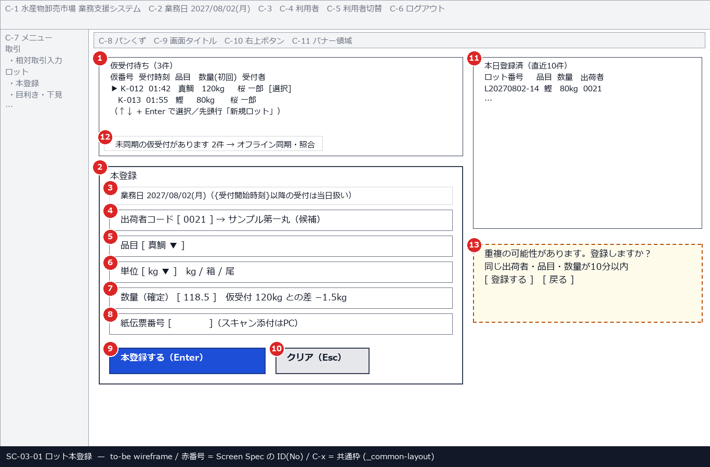

# SC-03-01 — ロット本登録（受付台・PC）

> 様式: **BM-2-901-51 v2.1** — Screen Specification · SUN ASTERISK VIETNAM CO., LTD · ISO/IEC 27001:2013 & ISO 9001:2015

---

## 1. 変更履歴

| No | Version | Action | 変更内容 | 更新日 | 更新者 | Approve |
|---|---|---|---|---|---|---|
| 1 | 0.1.0 | Add New | ワイヤーフレーム WF-SC-03-01 0.2.0 から作成（LAB-4 P3） | 2026-11-25 | phuongnnm-23344 | |
| 2 | 0.1.1 | Update | 顧客（模擬）Q-LOT-01: 仮番号で検索、取消のロットは番号を保持; G2-m07: 性能目標のラベル [PL] | 2026-11-25 | phuongnnm-23344 |  |
| 3 | 0.1.2 | Update | LAB-4: 注釈付き画像をワイヤーフレーム HTML `wireframes/html/SC-03-01.html` のバリアントA（WF 0.2.1）に差し替え; 画像にないバッジを記載; HTML / PNG / PDF へのリンク | 2026-11-25 | phuongnnm-23344 | |
| 4 | 0.1.3 | Update | 有識者（Expert）Gate 3 G3-m05: §6.1 画面の状態を追加（§5 Event から集約）、旧注記を §6.2 へ | 2026-11-25 | phuongnnm-23344 | |

---

## 2. レイアウト

**設計:** [Wireframe SC-03-01 0.2.1](../../../wireframes/SC-03-01-lot-main-registration-wireframe.md) · HTML 元データ [`wireframes/html/SC-03-01.html`](../../../../wireframes/html/SC-03-01.html) · 全バリアント: [`wireframes/png/SC-03-01.png`](../../../../wireframes/png/SC-03-01.png) / [`wireframes/pdf/wireframes-all.pdf`](../../../../wireframes/pdf/wireframes-all.pdf) · 共通レイアウト [_common-layout](../../../wireframes/_common-layout.md) · as-is プロトタイプ画像: [SC-03-01_prototype.png](../../../../wireframes/assets/SC-03-01_prototype.png)

> - 画像 = ワイヤーフレーム HTML の **バリアントA**（メイン画面）。`scripts/render-wireframes.py --spec` で生成（Figma はまだなし）。画像上の番号 = §4 の `ID` 列 = ワイヤーフレームの `No` 列; `C-x` = `_common-layout.md` の共通項目。
> - この画像にはバッジがありません: 13 ダイアログ (C), C-12 (B), C-22 (D), C-24 (E), C-28 (F), C-21 (G), C-23 (H) → 対応するバリアントは [`wireframes/png/SC-03-01.png`](../../../../wireframes/png/SC-03-01.png) / PDF を参照。

---

## 3. 概要

- **目的:** ロット受付の2ステップ目（約04:00、受付台の PC + テンキー）。受付担当者は 仮受付（岸壁での仮の受付、SC-03-02）のロットか 「新規ロット」 を選び、出荷者 (出荷する人) コードをマスタから補完し、品目、単位、確定数量、紙伝票番号を入力 → ロットは正式な状態（`RECEIVED` 受付）になり、数量台帳に受入の行が作られる（FR-LOT-01, FORM-LOT-01, PRM-116）。
- **利用者:** 記録権限の INTAKE。閲覧のみの役割（SETTLE, STL-HEAD, OPS-HEAD）は **この画面に入らず**、ロットは SC-03-03 / SC-03-04 で閲覧（role-list P13, L4-A06）。
- **連続入力:** 保存後も画面に留まり、カーソルは [1] の次の行へ戻る（DEC-033）。
- **遷移先:** SC-03-04（行 [11] をクリック）; SC-03-07（[12]）; SC-08-01（業務日が締め済みの時 C-24）。本登録の後、ロットは SC-03-05 目利き → SC-03-03 公開へ進む（FIG-011）。
- **この画面でやらないこと:** 受付先での証憑の撮影（第1期は PC でのスキャンのみ — E-21）; 本登録済みロットの修正（→ SC-03-04, PRM-128）; オフラインでの保存（L4-A05: PC の受付はオフライン 3 画面に含まれない）。

---

## 4. 表示

**ID の付け方:** `ID` 列 = **ワイヤーフレーム to-be の項目番号**（振り直しなし — ブリーフ P3、`_common-layout` の番号保持ルール）。`A`, `B`, `C` はグループ名のみ。共通枠の項目 `C-n` は `_common-layout.md` で一度定義し、ここでは画面が使うものだけを列挙。

### 4.1 項目一覧

| ID | Item Name | Item Type | Required | Note |
|---|---|---|---|---|
| **C** | **共通枠（PC）** | | | `_common-layout` の C-1..C-12, C-20..C-26, C-28, C-29。C-27 は使用しない（決裁ステップがない）、C-30 は使用しない（MFA なし — PREMISE §3.2）、C-31 も使用しない |
| **A** | **仮受付待ち** | | | |
| 1 | 仮受付待ち一覧（N件） | Label (選択表) | - | 列: 仮番号 · 受付時刻 · 品目 · 数量(初回) · 受付者 · [選択]. 先頭行は固定の 「新規ロット」. ↑↓ + Enter で選択. 受付時刻の昇順 |
| 12 | 未同期の仮受付があります N件 → | Button (リンク) | - | N > 0 の時のみ表示（`offline_sync_records` の仮受付レコード `PENDING`/`HELD`）。→ SC-03-07 |
| **B** | **本登録** | | | |
| 2 | 本登録のブロック | Label (領域) | - | 見出し 「本登録」; 一覧 [1] の行を選ぶと [5][6][7] が仮受付の内容で埋まる |
| 3 | 業務日 + 説明文 | Label | - | `YYYY/MM/DD(曜)（{HH:MM}以降の受付は当日扱い）`; HH:MM は有効な規程バージョンの `LOT_INTAKE_START_TIME`（顧客 #27, E-16）— ハードコードしない |
| 4 | 出荷者コード | Text box + 候補 | 必須 | プレースホルダー 「例：0021」. コードを入力 → 右側に名前をすぐ表示（「→ サンプル第一丸」）; 候補 ≤ 10 行 |
| 5 | 品目 | Text box (選択) | 必須 | マスタ品目の選択欄、コード/名前で絞り込み |
| 6 | 単位 | Text box (選択) | 必須 | `kg` / `箱` / `尾`; 品目を変えると、その品目の既定単位になる |
| 7 | 数量（確定） | Text box (数値) | 必須 | ロットに仮受付がある場合、右側に 「仮受付 {qty}{unit} との差 {±diff}{unit}」 を表示 |
| 8 | 紙伝票番号 | Text box | 不要 | プレースホルダー 「紙伝票の番号」 + 小さい文字 「スキャン添付はPC」 |
| 9 | 本登録する（Enter） | Button | - | 主ボタン |
| 10 | クリア（Esc） | Button | - | フォームを消去、[1] の選択は保持 |
| **D** | **補助パネル、ダイアログ** | | | |
| 11 | 本日登録済（直近10件） | Label (表) | - | 列: ロット番号 · 品目 · 数量 · 出荷者. 行をクリック → SC-03-04 |
| 13 | 重複の可能性ダイアログ | Label (dialog) | - | 「同じ出荷者・品目・数量のロットが10分以内に登録されています（{lotNo}）。登録しますか？」 [登録する] [戻る]. 強制ブロックではない |

> `Item Type` は様式上 Label · Image · Text box · Button のみ; 表 / ダイアログは `Label (…)` と記載。

### 4.2 入力検証

クライアントで検査（欄から離れた時 / [9] 押下時）**かつ** サーバー (API-LOT-002) で検査 — サーバーが最終チェック。エラーは C-22 で表示（欄の下に赤文字、カーソルは最初の誤った欄へ）。

| ID | Type | Min | Max | Default | 備考 |
|---|---|---|---|---|---|
| 4 | String (コード) | 1 | 10 | 空 | 使用中のマスタ `shippers` に存在すること。空 → `E-LOT-015` 「出荷者コードを入力してください」; 無い → `E-LOT-001` 「出荷者コードがマスタにありません（{code}）」 + リンク 「マスタに無い場合は管理者へ」 |
| 5 | String (コード) | 1 | 10 | 仮受付の値 / 空 | 空 → `E-LOT-016` 「品目を選択してください」; マスタに無い → `E-LOT-002` 「品目がマスタにありません」 |
| 6 | Enum `unit_code` | - | - | 品目の既定単位 | `KG` / `CASE` / `PIECE`; 不正 → `E-LOT-016` |
| 7 | Number | > 0 | 99,999,999.9 | 仮受付の数量 / 空 | 空または ≤ 0 → `E-LOT-003` 「数量は0より大きい値を入力してください」. kg は小数第1位 **まで**、箱 / 尾 は **整数** のみ（入力時点で阻止） → `E-LOT-004` 「kg は小数第1位まで、箱・尾は整数で入力してください」 (BR-LOT-02, NUMERIC(12.1), m-11) |
| 8 | String | 0 | 20 | 空 | 20文字超 → `E-LOT-005` 「紙伝票番号は20文字以内で入力してください」. 使用可能な文字: 英数字、`-` |

### 4.3 データマッピング

| ID | Data Source | API ID | API URL | Key / Param | 備考 |
|---|---|---|---|---|---|
| 1, 12 | API | `API-LOT-001` | `GET /api/v1/lots/provisional` | → `items[]`, `unsyncedCount` | 画面を開いた時 + 保存のたび + 画面表示中は 60 秒ごと |
| 3, 5, 6 | API | `API-LOT-006` | `GET /api/v1/lots/form-options` | → `businessDate`, `intakeStartTime`, `items[]`, `units[]` | 画面を開いた時に一度 |
| 4 | API | `API-LOT-005` | `GET /api/v1/master/shippers` | `q` → `shippers[]` | 入力時に呼び出し（デバウンス 200 ms） |
| 4–9 | API | `API-LOT-002` | `POST /api/v1/lots` | `provisionalLotId`, `shipperId`, `itemCode`, `unit`, `qty`, `voucherNo`, `confirmDuplicate` | → `lotId`, `lotNo` |
| 13 | API | `API-LOT-002` | `POST /api/v1/lots` | `confirmDuplicate=true` | 利用者が 「登録する」 を押した後に再送 |
| 11 | API | `API-LOT-003` | `GET /api/v1/lots` | `registeredBy=me&status=RECEIVED,INSPECTED,PUBLISHED&sort=-registeredAt&limit=10` | |

> 全システムの API 一覧: [`_common/api-list.md`](../../_common/api-list.md); 機能の API Design は `specs/system-design/api-design/lot/` にある。

### 4.4 役割別の表示権限（ブリーフ P3 により追加）

| Vai \ Item | 1, 12 | 2–8 | 9, 10, 13 | 11 |
|---|---|---|---|---|
| INTAKE | 操作 | 操作 | 操作 | 閲覧のみ（クリック → SC-03-04） |
| SETTLE · STL-HEAD · OPS-HEAD | 画面に入らない — メニューに項目なし; URL を開く → C-25。ロットは SC-03-03 / SC-03-04 で閲覧 | | | |
| JUDGE · TRADE · DELIVERY · RULE · SYSADM | 画面に入らない (C-25) | | | |

---

## 5. イベント

| ID | Given (Pre-condition) | When (Trigger/Action) | Then (Result) | Note |
|---|---|---|---|---|
| **Initializing Process（初期処理）** | | | | |
| - | INTAKE の役割を持つ利用者、オンライン | 画面を開く | 1. API-LOT-006, API-LOT-001, API-LOT-003 を並列に呼び出し（300 ms 超で C-20） 2. [3] に開いている業務日 + 規程のロット受付時刻を表示 3. [1] に一覧を表示; カーソルは最初の仮受付の行（無ければ 「新規ロット」 の行） | |
| 1 | 業務日の `PROVISIONAL` ロットがない | 画面を開く | [1] に C-21 「仮受付待ちはありません」; 「新規ロット」 の行は選択可能 | |
| 12 | `unsyncedCount` > 0 | 画面を開く | 件数 N を付けて [12] を表示 | ADR-008 |
| **Standard Process（通常処理）** | | | | |
| 1 | - | ↑↓ の後 Enter（または [選択] を押す）を仮受付の行で | 1. [5][6][7] を仮受付の内容で埋める（仮受付の数量は [7] に入り、修正可能） 2. カーソルを [4] へ | |
| 1 | - | 「新規ロット」 を選ぶ | [4]–[8] を消去、カーソルは [4] | |
| 4 | - | コードを入力 | 候補 ≤ 10 行（コード + 名前）; Enter で先頭行を選択 → 右側に名前を表示、カーソルを [5] へ | |
| 5 | - | 品目を選ぶ | [6] は手で変更されていなければ、既定単位を入れる | |
| 7 | 仮受付があるロット | 数量を入力 | 「仮受付 … との差 …」 の文言を更新 | 差が 5% を超えたら黄色に（顧客 #28）: **未実装** — FB-CUS-287 として後回し |
| 9 | [4]–[7] が有効 | [8] で Enter または [9] を押す | 1. API-LOT-002 を呼び出し（`confirmDuplicate=false`）、待機中は [9] をグレー 2. 201 → C-12 「本登録：{lotNo} {品目} {qty}{unit}（{出荷者名}）」 3. [4]–[8] を消去; [1], [11] を再読込; カーソルを [1] の次の行へ | DEC-033 |
| 13 | API-LOT-002 が 409 `E-LOT-007` を返す | - | 疑いのあるロット番号付きで [13] を開く; [登録する] → `confirmDuplicate=true` で再送; [戻る] → 閉じ、内容は保持 | PRM-116; 強制ブロックではない |
| 10 | - | Esc / [10] を押す | [4]–[8] を消去; [1] で選択中の行は保持 | |
| 11 | - | 行をクリック | SC-03-04 へ（そのロット） | |
| 12 | - | [12] を押す | SC-03-07 へ（仮受付で絞り込み） | |
| **Error Handling（エラー制御）** | | | | |
| 4–8 | - | 誤りのある欄がある状態で [9] を押す | API を呼ばない; 最初の誤った欄に C-22（エラーコードは 4.2） | |
| 9 | 他の人が同じ仮受付を本登録したばかり | API が 409 `E-LOT-006` を返す | C-23 「この仮受付はすでに本登録済みです（{lotNo}）」; [1] を再読込 | |
| 9 | 業務日が締め済み（まれ: 10:00 に締め） | API が 423 `E-CMN-003` を返す | C-24: 黄色のバナー、フォームは閲覧のみで **内容を保持**; 「修正申請を作成 →」 のボタンは内容を持って SC-08-01 の `LATE_ENTRY` スコープへ | BR-CLOSE-01, ADR-005 |
| 9 | - | API が 403 `E-CMN-002` を返す | C-25 | |
| 9 | - | API が 5xx / タイムアウト 10 s | C-26 赤いバナー + エラーコード; 内容は保持、再度押下可能 | NFR-OPS-01 |
| - | 画面を開いている | 通信断 | C-28: バナー 「通信が回復するまで登録できません」; [9] 固定、内容は保持; 回復後 → C-29、[9] は再び押せる | L4-A05: この PC はオフライン保存をしない |

---

## 6. その他の注記

### 6.1 画面の状態

§5 Event から集約; 状態コード `C-xx` は `wireframes/_common-layout.md` で定義。役割別の権限は §4.4 を参照。

| 状態 | 表示 / 挙動 |
|---|---|
| 読込中 | 画面を開く API が 300 ms を超えたら C-20 |
| 仮受付がない | [1] に C-21 「仮受付待ちはありません」; 「新規ロット」 は選択可能 |
| 未同期のレコードがある | [12] に件数 N を表示（`unsyncedCount` > 0）→ SC-03-07 |
| 入力エラー | 最初の誤った欄の下に C-22、API は呼ばない（エラーコードは §4.2） |
| 送信中 | API-LOT-002 の応答待ちは [9] をグレー |
| 保存完了 | C-12 トースト; [4]–[8] を消去、[1], [11] を再読込 |
| 重複の疑い (409 `E-LOT-007`) | ダイアログ [13]; 強制ブロックではない — [登録する] で `confirmDuplicate=true` を再送 |
| 競合 (409 `E-LOT-006`) | C-23; [1] を再読込 |
| 業務日が締め済み (423 `E-CMN-003`) | C-24: フォームは閲覧のみ、内容を保持; 「修正申請を作成 →」 で SC-08-01 `LATE_ENTRY` へ |
| 権限なし (403) | C-25 |
| サーバーエラー / タイムアウト 10 s | C-26; 内容は保持、再度押下可能 |
| オフライン | C-28、[9] 固定、内容を保持（この PC はオフライン保存をしない — L4-A05）; 回復後 → C-29 |

### 6.2 その他の注記

- **トレーサビリティ:** FR-LOT-01, FORM-LOT-01, BR-LOT-02, FT-03-01, FT-03-06, FT-10-06, PRM-116, E-16, E-21, DEC-033, ADR-005, ADR-008; 顧客 #27 (FB-CUS-286), #28 (FB-CUS-287 後回し); Gate 1 M-01（受付時刻から業務日）, m-11（単位ごとの小数）; 差異表 D15（出荷者は テキストではなくコード）。
- **数量台帳:** 本登録は `lot_quantity_ledger` に `RECEIVE` の行を1つ書く = 確定数量; 仮受付は台帳に **書かない**（ロットはまだ販売できない）。詳細: [LOT_REGISTER_TECH](../technical-design/LOT_REGISTER_TECH.md) §5（enum `ATTR_FIX` の注釈は MKT_DB 0.3.2 で修正済み）。
- **ロット番号:** `lots.lot_no` は Database Design で NOT NULL → 番号 `L{YYYYMMDD}-{n}` は、ロットのレコードが **サーバーに上がる時** に採番（仮受付の同期、またはこの画面での新規）。[9] のトーストにその番号が出る。Q-LOT-01 は 【顧客（模擬）、2026-11-25】 で回答済み: 採番のタイミングは据え置き; 受付は仮番号を入力するだけで当日中はロットを検索できる（API-LOT-003 `q`）、番号は再利用しない、仮受付で取消になったロットは番号を保持し状態は 取消、印刷する伝票は正式な番号を使う。
- **意図的に検証しない:** [3], [11] は表示のみ。[1] は検証しない（サーバーが返した一覧から選ぶ）。
- **性能:** API-LOT-002 は 60 名同時で p95 ≤ 1 s — [PL] 書き込み API の社内目標（RFP は検索に NFR-PERF-01、負荷に NFR-PERF-02 のみ）; 表 [1] は1日最大 約150 行（350–600 ロット/日、ピーク2時間に集中）— ページングなし。
- **未決事項 / TBD:** Q-LOT-02（数量差の黄色表示の閾値、顧客 #28）— [LOT_FUNC §3](../function-specifications/LOT_FUNC.md#3-モジュールのエラーコード質問前提) を参照。
