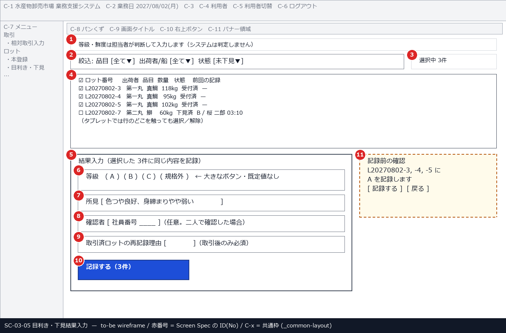

# SC-03-05 — 目利き・下見結果入力

> 様式: **BM-2-901-51 v2.1** — Screen Specification · SUN ASTERISK VIETNAM CO., LTD · ISO/IEC 27001:2013 & ISO 9001:2015

---

## 1. 変更履歴

| No | Version | Action | 変更内容 | 更新日 | 更新者 | Approve |
|---|---|---|---|---|---|---|
| 1 | 0.1.0 | Add New | ワイヤーフレーム WF-SC-03-05 0.2.0 から作成（LAB-4 P3） | 2026-11-25 | phuongnnm-23344 | |
| 2 | 0.1.1 | Update | LAB-4: 注釈付き画像をワイヤーフレーム HTML `wireframes/html/SC-03-05.html` のバリアントA（WF 0.2.1）に差し替え; 画像にないバッジを記載; HTML / PNG / PDF へのリンク | 2026-11-25 | phuongnnm-23344 | |
| 3 | 0.1.2 | Update | 有識者（Expert）Gate 3 G3-m05: §6.1 画面の状態を追加（§5 Event から集約）、旧注記を §6.2 へ | 2026-11-25 | phuongnnm-23344 | |
| 4 | 0.1.3 | Update | 有識者 Gate 3 差分確認 D3-n01: §6.1 の 「締め済みの日」 行に、C-24 共通の 修正申請 ボタンを表示しない旨を明記（§5 と整合） | 2026-11-26 | phuongnnm-23344 |  |

---

## 2. レイアウト

**設計:** [Wireframe SC-03-05 0.2.1](../../../wireframes/SC-03-05-mekiki-inspection-result-entry-wireframe.md) · HTML 元データ [`wireframes/html/SC-03-05.html`](../../../../wireframes/html/SC-03-05.html) · 全バリアント: [`wireframes/png/SC-03-05.png`](../../../../wireframes/png/SC-03-05.png) / [`wireframes/pdf/wireframes-all.pdf`](../../../../wireframes/pdf/wireframes-all.pdf) · 共通レイアウト [_common-layout](../../../wireframes/_common-layout.md) · as-is プロトタイプ画像: [SC-03-05_prototype.png](../../../../wireframes/assets/SC-03-05_prototype.png)

> - 画像 = ワイヤーフレーム HTML の **バリアントA**（メイン画面）。`scripts/render-wireframes.py --spec` で生成（Figma はまだなし）。画像上の番号 = §4 の `ID` 列 = ワイヤーフレームの `No` 列; `C-x` = `_common-layout.md` の共通項目。
> - この画像にはバッジがありません: 11 確認ダイアログ (B), C-12 (C), C-13 タブレット (D), C-28 (E), C-21 (F), C-23 (G) → 対応するバリアントは [`wireframes/png/SC-03-05.png`](../../../../wireframes/png/SC-03-05.png) / PDF を参照。
> - タブレットのレイアウト（同じ項目、ボタン [6] ≥ 64 px）= バリアント D。

---

## 3. 概要

- **目的:** 目利き・下見（鮮度・品質の判定）の結果を、**人が判定して** 記録する — CAP-HUMAN-01 における人による最終判断点。システムは **採点せず**、等級を提案せず、OCR / AI も使わない（SCOPE-OUT-01/02, ADR-010, ルール 3）。選んだ複数のロットに同じ結果を適用するが、**ロットごとに1行を保存**（FT-03-02, PRM-117）。`受付` のロットは記録後に `下見済` となり、これが公開の条件（FIG-011, E-13 は暫定で FIG-011 に従う）。
- **利用者:** JUDGE (◎)。SETTLE / STL-HEAD / OPS-HEAD は SC-03-04 で目利きの履歴を閲覧; INTAKE, TRADE は SC-03-03 / SC-04-01 [2] で 「前回の記録」 を見る — この画面には入らない（role-list P14）。
- **端末:** PC またはタブレット。オフラインモードはない（Q-SC0305-01 は 【顧客（模擬）、2026-11-25】 で回答済み）。
- **上書きしない:** 既に結果があるロットを記録し直す = 新しい行を追加、古い行は保持（append-only, ルール 4）; 取引のあるロットは理由が必要。

---

## 4. 表示

**ID の付け方:** `ID` 列 = ワイヤーフレーム to-be の項目番号; `A`, `B`, `C` はグループ名のみ。

### 4.1 項目一覧

| ID | Item Name | Item Type | Required | Note |
|---|---|---|---|---|
| **C** | **共通枠** | | | PC: C-1..C-12; タブレット: C-13, C-14 は C-7 の代わり。状態: C-20..C-26, C-28, C-29. C-27, C-30, C-31 は使用しない（確認ダイアログ [11] は別） |
| **A** | **ロットの検索と選択** | | | |
| 1 | 等級・鮮度は担当者が判断して入力します（システムは判定しません） | Label | - | 常に表示、太字、一番上 |
| 2 | 絞込（品目・出荷者/船・状態） | Text box (3 欄の選択) | 不要 | 品目 [全て▼] · 出荷者 [全て▼] · 状態: 未下見 (既定) / 下見済 / 販売公開中 / 全て |
| 3 | 選択中 N件 | Label | - | [4] で選択中のロットを数える |
| 4 | ロット一覧 | Label (複数選択の表) | - | 列: ☑ · ロット番号 · 出荷者 · 品目 · 数量 · 状態 · 前回の記録 (`{grade} / {人} {HH:MM}` または 「—」). 取引のある行には 「取引あり」 のラベルを追加。タブレット: **行全体**をタップして選択 / 解除（顧客 #14）。見出しの ☑ = 絞り込み中の行をすべて選択 |
| **B** | **結果入力** | | | |
| 5 | 結果入力（選択した N件に同じ内容を記録） | Label (領域) | - | 見出しは N に応じて変わる |
| 6 | 等級 | Button (1つだけ選ぶボタン群) | 必須 | 市場の等級一覧（`grades[]` — L4-A02 のフィクスチャ待ち、暫定 A / B / C / 規格外）。**既定値はない**; 選択中のボタンは塗りつぶし + 「選択中」 の文字 |
| 7 | 所見 | Text box (複数行) | 不要 | プレースホルダー 「色つや、身締まり など」 |
| 8 | 確認者（社員番号） | Text box (数値) | 不要 | 2人で確認する場合の2人目; 番号を入力 → 名前を表示 |
| 9 | 取引済ロットの再記録理由 | Text box | 「取引あり」 のロットを1件以上選んだ場合は必須 | 選択に 「取引あり」 のロットがなければ非表示 |
| 10 | 記録する（N件） | Button | - | 条件を満たさない時はグレー + ボタン横に理由（「ロットを選択してください」/「等級を選択してください」） |
| 11 | 記録前の確認 | Label (dialog) | - | 「{lotNo1}, {lotNo2}, … に {grade} を記録します」（コードを全て列挙、10件超ならスクロール）+ [記録する] [戻る]（顧客 #15） |

### 4.2 入力検証

| ID | Type | Min | Max | Default | 備考 |
|---|---|---|---|---|---|
| 4 | Array ロット | 1 | 50 | 未選択 | 0 件 → [10] グレー（クライアント）; サーバー `E-LOT-010` 「ロットを1件以上選択してください（最大50件）」. `仮受付` / `引渡し完了` のロットは表示しない; サーバーでも検査 → `E-LOT-013` 「ロット {lotNo} は下見を記録できない状態です（{status}）」 |
| 6 | String (等級コード) | 1 | 10 | **なし** | 未選択 → [10] グレー; サーバー `E-LOT-008` 「等級を選択してください」. `grades[]` に含まれること |
| 7 | String | 0 | 200 | 空 | 200 超 → `E-LOT-009` 「所見は200文字以内で入力してください」（文字数を数え、200 で入力を止める） |
| 8 | String (社員番号) | 0 | 10 | 空 | 見つからない、アカウントが `ACTIVE` でない、または記録者本人と同じ → `E-LOT-012` 「確認者の社員番号が見つからないか、記録者本人です」 |
| 9 | String | 1 | 200 | 空 | 「取引あり」 のロットを選んだ時は必須 → `E-LOT-011` 「取引のあるロットを再記録する場合は理由を入力してください」; 200 超 → `E-LOT-017` |

### 4.3 データマッピング

| ID | Data Source | API ID | API URL | Key / Param | 備考 |
|---|---|---|---|---|---|
| 2, 6 | API | `API-LOT-006` | `GET /api/v1/lots/form-options` | → `items[]`, `grades[]` | 画面を開いた時に一度 |
| 2 | API | `API-LOT-005` | `GET /api/v1/master/shippers` | `q` | 絞り込みの 出荷者 欄 |
| 4 | API | `API-LOT-003` | `GET /api/v1/lots` | `status`, `itemCode`, `shipperId`, `include=latestInspection,hasTrades` | 既定は `status=RECEIVED`; 絞り込みを変えたら再呼び出し |
| 5–11 | API | `API-LOT-004` | `POST /api/v1/lots/inspections` | `lotIds[]`, `grade`, `note`, `secondCheckerEmployeeNo`, `rerecordReason` | → `count`, `batchNo`, `recordedAt` |
| 8 | API | `API-LOT-004` | (同上) | | 氏名は `iam` モジュールの `GET /api/v1/staff/lookup` から表示 — **API Design はまだない**、仕様化もされていない — [`specs/_index.md`](../../_index.md) の依存関係の項目 (DEP-02) を参照 |

### 4.4 役割別の表示権限

| Vai \ Item | 1–4 | 5–9 | 10, 11 |
|---|---|---|---|
| JUDGE | 操作 | 操作 | 操作 |
| SETTLE · STL-HEAD · OPS-HEAD | 画面に入らない (C-25); SC-03-04 で閲覧 | | |
| INTAKE · TRADE | 画面に入らない (C-25); SC-03-03 / SC-04-01 [2] で 「前回の記録」 を閲覧 | | |
| DELIVERY · RULE · SYSADM | 画面に入らない (C-25) | | |

---

## 5. イベント

| ID | Given (Pre-condition) | When (Trigger/Action) | Then (Result) | Note |
|---|---|---|---|---|
| **Initializing Process（初期処理）** | | | | |
| - | 役割 JUDGE、オンライン | 画面を開く | 1. API-LOT-006 + API-LOT-003 (`status=RECEIVED`) を呼び出し 2. [6] は等級未選択、[10] はグレー | |
| 4 | 絞り込みで対象のロットがない | 画面を開く / 絞り込みを変える | C-21 「下見対象のロットはありません」 | |
| **Standard Process（通常処理）** | | | | |
| 2 | - | 絞り込みを変える | API-LOT-003 を再呼び出し; 結果に残る選択済みロットは **保持**、なくなったロットは選択解除 | |
| 4 | - | ☑ をクリック (PC) / 行をタップ (タブレット) | 選択を反転; [3], [5] を更新; 「取引あり」の行を選ぶと [9] を表示 | 顧客 #14 |
| 6 | - | 等級のボタンを押す | その等級を選択（1つだけ）; 選択中のボタンを再度押すと解除 | |
| 10 | 1件以上のロット、等級あり、必要なら [9] が充足 | [10] を押す | [11] を開き、ロット番号と等級を正確に列挙 | 顧客 #15 |
| 11 | [11] が開いている | [記録する] | 1. API-LOT-004 を呼び出し 2. 201 → C-12 「目利き記録：{N}件（{grade}）記録者 {名前} {HH:MM}」 3. 全選択を解除、[6]–[9] を消去（等級は次回に **保持しない**）、API-LOT-003 を再呼び出し | ロット `受付` → `下見済` |
| 11 | [11] が開いている | [戻る] | 閉じる、選択と内容はそのまま | |
| **Error Handling（エラー制御）** | | | | |
| 6–9 | - | 誤りのある欄がある状態で [10] を押す | 誤った欄の下に C-22（コードは 4.2） | |
| 4 | ロットが読込後に状態変更 / 取引が発生 | API が 409 `E-LOT-013` または 422 `E-LOT-011` を返す | C-23 でロット番号を示す; [4] を再読込、等級 + 所見は保持; どのロットも記録されない（ロールバック） | 全件か無か |
| - | 日が締め済み | 423 `E-CMN-003` | C-24; 内容は保持、閲覧のみ。締め済みの日の目利き記録には 修正申請 の経路がない（目利きは金額を変えない）→ 持ち越しロットなら開いている日に記録し直す | ADR-005 |
| - | - | 403 / 5xx | C-25 / C-26 | |
| - | ロットを選択、等級を押した後 | 通信断 | C-28: 選択したロットと等級を **保持**; [10] はグレー 「通信が回復するまで記録できません」; 現状どおり紙に記録。回復後 → C-29、[10] を再び押せる、押せば即保存 | Q-SC0305-01 【顧客（模擬）、2026-11-25】 |

---

## 6. その他の注記

### 6.1 画面の状態

§5 Event から集約; 状態コード `C-xx` は `wireframes/_common-layout.md` で定義。役割別の権限は §4.4 を参照。

| 状態 | 表示 / 挙動 |
|---|---|
| 初めて開く | [6] は等級未選択、[10] はグレー |
| 絞り込みの対象がない | C-21 「下見対象のロットはありません」 |
| 「取引あり」のロットを選択 | [9] を表示（再記録の理由） |
| 入力エラー | 誤った欄の下に C-22（コードは §4.2） |
| 確認待ち | 確認 [11] にロット番号と等級を列挙 |
| 保存完了 | C-12 トースト; 全選択を解除、[6]–[9] を消去 |
| 競合 (409 `E-LOT-013` / 422 `E-LOT-011`) | C-23 でロット番号; [4] を再読込、等級 + 所見は保持; 全件とも記録しない |
| 締め済みの日 (423 `E-CMN-003`) | C-24、閲覧のみ、内容は保持; C-24 共通の 「修正申請を作成 →」 ボタンは **表示しない**（目利きは金額を変えないため修正申請の経路がない — §5）; 持ち越しロットは開いている日に記録し直す |
| 権限なし / サーバーエラー | C-25 / C-26 |
| オフライン | C-28: 選択したロットと等級を保持; [10] はグレー 「通信が回復するまで記録できません」; 回復後 → C-29 |

### 6.2 その他の注記

- **トレーサビリティ:** FR-LOT-02, FT-03-02, CAP-HUMAN-01, SCOPE-OUT-01, SCOPE-OUT-02, SCOPE-OUT-06, PRM-086, PRM-117, FIG-011, E-13, ADR-010, ルール 3, ルール 4; 顧客 #14 (FB-CUS-273), #15 (FB-CUS-274), Q-SC0305-01 (FB-CUS-295); to-be で prototype と異なる点: 既定の等級 「A」 を削除。
- **Database Design:** ワイヤーフレーム [8] 確認者 と [9] 再記録の理由 は `lot_inspections.second_checker_id`（FK `staff_accounts`、記録者とは別）と `rerecord_reason VARCHAR(200)` に保存 — LOT_DB 0.2.1 §4.27 に反映済み。等級の一覧 `grades[]` は `code_values` の種別 `INSPECTION_GRADE`（RULE_DB 0.2.1 §4.18）から取得; 実際の一覧は未確定 — Q-LOT-03。「下見時刻」欄（顧客 #31）は後回し — FB-CUS-290。
- **上書きしない:** 後の記録が現在の結果を置き換える（最新の行を取得）; 古い行は `lot_inspections` に残す; SC-03-04 は履歴をすべて表示。
- **未決事項 / TBD:** Q-SC0305-02（通信断時に紙で目利きなしのまま販売されるロット — E-13 / OPEN-L4-03 待ち）; Q-LOT-03（等級の実際の一覧 — L4-A02 のフィクスチャ待ち）; Q-LOT-04（取引のあるロットを再記録する際に、確定者へ通知が必要か）— [LOT_FUNC §3](../function-specifications/LOT_FUNC.md#3-モジュールのエラーコード質問前提) を参照。
