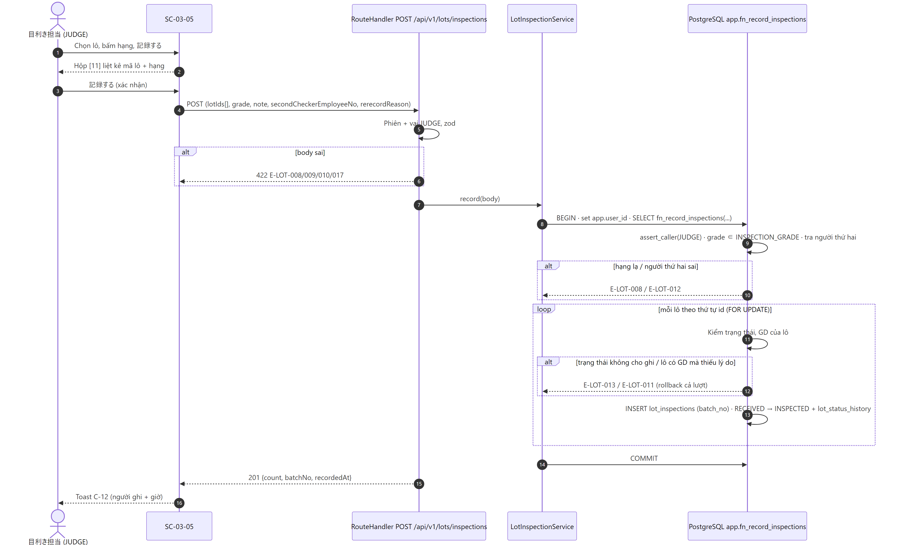
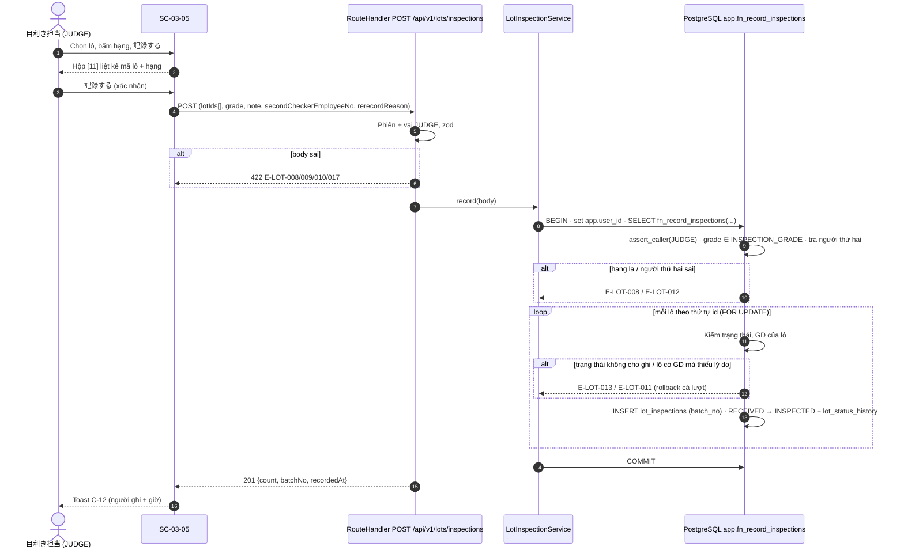

# LOT_INSPECTION_RECORD — 目利き・下見の結果を人が決めて記録

> 様式: **BM-2-901-53 v01** — Detail Design (Chart + Description) · SUN ASTERISK VIETNAM CO., LTD · ISO/IEC 27001:2013 & ISO 9001:2015

---

## 1. 変更履歴

| No | Version | Action | 対象箇所 / ステップ | 変更内容 | 更新日 | 更新者 | Approve |
|---|---|---|---|---|---|---|---|
| 1 | 0.1.0 | Add new | — | 初期作成（LAB-4 P3） | 2026-11-25 | phuongnnm-23344 | |
| 2 | 0.1.1 | Update | §2 | FB-EXP-236: 画像 PNG `./assets/LOT_INSPECTION_RECORD_sequence.png` を Mermaid ブロックから出力して埋め込み（`scripts/export-mermaid-png.py`）; Mermaid が引き続きソース | 2026-11-25 | phuongnnm-23344 |  |

---

## 2. シーケンス図

出典: 下の Mermaid ブロック（編集用の原本）; 画像はそのブロックから `python scripts/export-mermaid-png.py LOT_INSPECTION_RECORD` で生成 — Mermaid を編集したら再実行し、両者がずれないようにする。

**図の元ファイル:** このファイル内の Mermaid ブロック。

---

## 3. 概要

- 1ロット以上について、**目利き担当者が決めた結果**（等級、所見、2人目の確認者がいれば）を記録する; ロットごとに `lot_inspections` に1行、同じ `batch_no`（PRM-117）。`RECEIVED` のロットは `INSPECTED`（下見済）になる — 公開の条件（FIG-011）。
- システムは等級を **生成せず、提案せず、修正もしない**; 画像 / OCR / モデルの入力はない（CAP-HUMAN-01, ADR-010, ルール 3）。等級は人がボタンを押したものだけ。
- 結果のあるロットを記録し直す = 新しい行、古い行は保持（ルール 4）; 取引のあるロットは理由を必須にする。

---

## 4. 詳細な関数

### 4.1. リクエストと呼び出し元の検査

| 項目 | 値 |
|---|---|
| Input | Body `RecordInspectionsBody`（API-LOT-004 §3）, セッションの cookie |
| Output | 検証済みの body → 4.2 |

**Error**

| エラー条件 | 処理 | Status code |
|---|---|---|
| 未ログイン | `E-CMN-001` を返して停止 | 401 |
| 役割 JUDGE がない | `E-CMN-002` を返して停止 | 403 |
| `lotIds` が空 / 50件超 / 重複 | `E-LOT-010` を返して停止 | 422 |
| `grade` が空 | `E-LOT-008` を返して停止 | 422 |
| `note` > 200 / `rerecordReason` > 200 | `E-LOT-009` / `E-LOT-017` を返して停止 | 422 |

**Detail**

| No | 処理内容 |
|---|---|
| 1 | `requireRole(["JUDGE"])`; zod; 件数を数える前に `lotIds` の重複を除く |
| 2 | transaction を開き、`app.user_id`, `app.device_id` を付与 |

### 4.2. 等級と2人目の確認者の検査

| 項目 | 値 |
|---|---|
| Input | `p_grade`, `p_second_checker_employee_no` |
| Output | `v_caller`, `v_day`, `v_second_checker` → 4.3 |

**Error**

| エラー条件 | 処理 | Status code |
|---|---|---|
| `p_grade` が使用中の `code_values` `INSPECTION_GRADE` に含まれない | `E-LOT-008` を投げ、rollback | 422 |
| 社員番号がない / アカウントが `ACTIVE` でない / `v_caller` と同じ | `E-LOT-012` を投げ、rollback | 422 |
| 業務日 `OPEN` がない | `E-CMN-003` を投げ、rollback | 423 |

**Detail**

| No | 処理内容 |
|---|---|
| 1 | `v_caller := assert_caller(['JUDGE'], [])` |
| 2 | `v_day :=` 業務日 `OPEN`（目利きは開いている日に記録する — 持ち越しロットも記録可能） |
| 3 | `staff_accounts.employee_no` を照会 → `v_second_checker`（2人目が JUDGE の役割を持つことは要求しない — PL の前提） |

### 4.3. ロットごとの記録

| 項目 | 値 |
|---|---|
| Input | `p_lot_ids`, `p_note`, `p_rerecord_reason`, `v_second_checker` |
| Output | `count`, `batch_no` → 4.4 |

**Error**

| エラー条件 | 処理 | Status code |
|---|---|---|
| 見つかったロット数 ≠ 送られた id 数 | `E-LOT-014` を投げ、rollback | 404 |
| ロットが `PROVISIONAL` または `DELIVERED` | `E-LOT-013: {lot_no} ({status})` を投げ、全件 rollback | 409 |
| ロットに取引がある（`v_trade_effective` に行がある）が `p_rerecord_reason` が空 | `E-LOT-011: {lot_no}` を投げ、rollback | 422 |
| トリガー `DAY_LOCKED` | `E-CMN-003` を投げ、rollback | 423 |

**Detail**

| No | 処理内容 |
|---|---|
| 1 | `v_batch_no := gen_random_uuid()` |
| 2 | ロットを `ORDER BY id FOR UPDATE` でロック（順序を固定し、公開 / 取引確定とのデッドロックを回避） |
| 3 | ロットごとに: 状態が (`RECEIVED`, `INSPECTED`, `PUBLISHED`, `CLOSED`) のいずれかか検査; 取引を検査 |
| 4 | `INSERT lot_inspections (lot_id, business_date = v_day, grade, freshness_note, batch_no, inspected_by = v_caller, second_checker_id, rerecord_reason)` — 最後の2列は LOT_DB 0.2.1 §4.27 にある |
| 5 | ロット `RECEIVED` → `UPDATE lots SET status = 'INSPECTED'` + `lot_status_history`; 他の状態は変えない（記録し直しで販売済みのロットが下見済に戻ることはない） |

### 4.4. コミットと結果の返却

| 項目 | 値 |
|---|---|
| Input | `count`, `v_batch_no` |
| Output | 201 `{count, batchNo, recordedAt}` |

**Error**

| エラー条件 | 処理 | Status code |
|---|---|---|
| `40P01` / `40001` | Rollback、`E-CMN-006` | 409 |
| その他のエラー | `ERROR` をログ、`E-CMN-004` | 500 |

**Detail**

| No | 処理内容 |
|---|---|
| 1 | `COMMIT`; `INFO lot.inspected batchNo={…} count={…} rerecord={true/false}` をログに記録 |

---

## 5. その他の注記

- **この関数がしないこと:** ロットの公開（SC-03-03）; 販売可能かどうかの判断（E-13 / OPEN-L4-03 — FIG-011 に従い暫定: `下見済` のみ公開）; 画像やファイルの受付。
- **オフライン:** なし（Q-SC0305-01）。通信断時はクライアントが選択を保持; キューはない。
- **Database Design:** `lot_inspections.second_checker_id`, `rerecord_reason` は LOT_DB 0.2.1 §4.27 に反映済み; 種別 `INSPECTION_GRADE` は RULE_DB 0.2.1 §4.18（実際の等級一覧 — Q-LOT-03）。
- **完了条件（LAB-5）:** (a) ロット `RECEIVED` 3件 + 等級 A → 同じ `batch_no` の行3件、ロット3件とも `INSPECTED`; (b) 仮受付ロットが途中に混ざる → 409、行は1つも書かれない; (c) 取引のあるロットに理由なし → 422 `E-LOT-011`、理由ありなら記録され、ロットの状態は保持; (d) 等級を提案する API / パラメータがない; (e) 2人目の確認者が記録者本人と同じ → 422 `E-LOT-012`。
