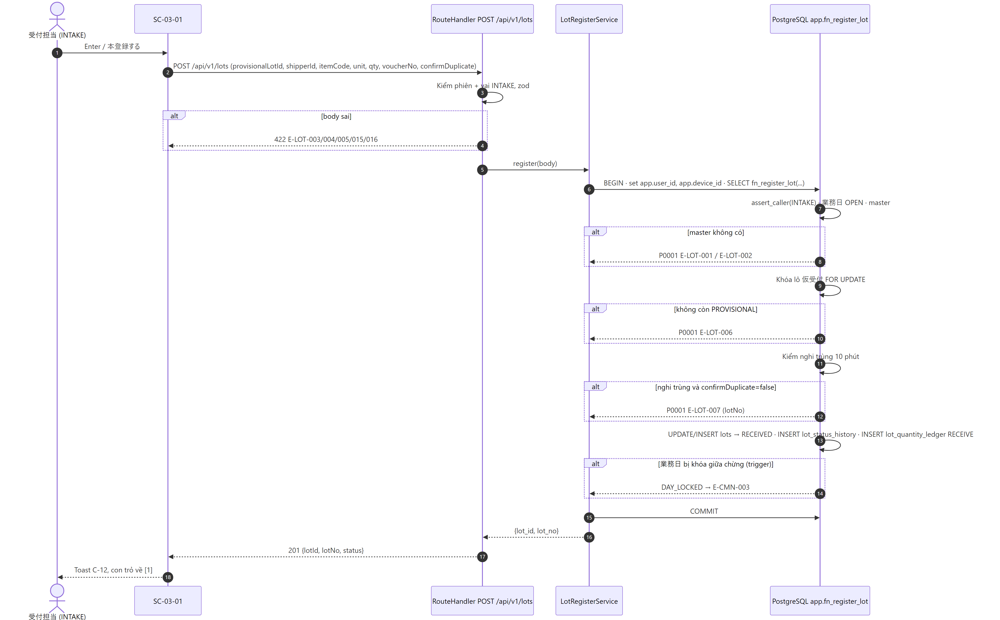
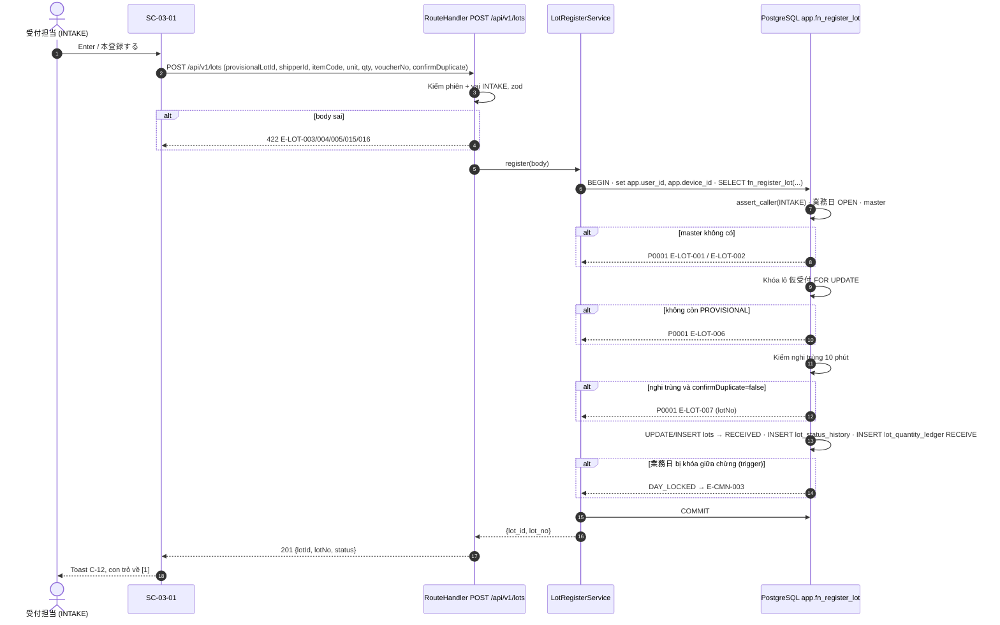

# LOT_REGISTER — 本登録 ロットと数量台帳の受入行

> 様式: **BM-2-901-53 v01** — Detail Design (Chart + Description) · SUN ASTERISK VIETNAM CO., LTD · ISO/IEC 27001:2013 & ISO 9001:2015

---

## 1. 変更履歴

| No | Version | Action | 対象箇所 / ステップ | 変更内容 | 更新日 | 更新者 | Approve |
|---|---|---|---|---|---|---|---|
| 1 | 0.1.0 | Add new | — | 初期作成（LAB-4 P3） | 2026-11-25 | phuongnnm-23344 | |
| 2 | 0.1.1 | Update | — | 顧客（模擬）Q-LOT-01: DoD (g), (h) を追加 — 正式番号は再利用しない、仮受付の取消ロットは番号を保持 | 2026-11-25 | phuongnnm-23344 |  |
| 3 | 0.1.2 | Update | §2 | FB-EXP-236: 画像 PNG `./assets/LOT_REGISTER_sequence.png` を Mermaid ブロックから出力して埋め込み（`scripts/export-mermaid-png.py`）; Mermaid が引き続きソース | 2026-11-25 | phuongnnm-23344 |  |

---

## 2. シーケンス図

出典: 下の Mermaid ブロック（編集用の原本）; 画像はそのブロックから `python scripts/export-mermaid-png.py LOT_REGISTER` で生成 — Mermaid を編集したら再実行し、両者がずれないようにする。

**図の元ファイル:** このファイル内の Mermaid ブロック。

---

## 3. 概要

- 仮受付のロット（SC-03-02 から、サーバーへ同期済み）を完了させる、または受付台で新規ロットを作成: 出荷者コードを master から付与、品目、単位、確定数量、紙伝票番号 → ロットは `RECEIVED`（受付）になり、数量台帳に `RECEIVE`（受入）の行が入る — ここからロットの利用可能数量 = Σ `qty_delta`（BR-LOT-02）。
- 呼び出し元: SC-03-01（役割 INTAKE）。1回の呼び出し = 1 transaction; どの手順で失敗しても何も書き込まれない。
- 完了時: ロットは `RECEIVED` になり、目利き（SC-03-05）→ 公開（SC-03-03）を待つ。

---

## 4. 詳細な関数

### 4.1. リクエストと呼び出し元の検査

| 項目 | 値 |
|---|---|
| Input | `Request` JSON `RegisterLotBody`（API-LOT-002 §3）; セッションの cookie |
| Output | 検証済みの `RegisterLotBody` + `userId`, `deviceId` → 手順 4.2 |

**Error**

| エラー条件 | 処理 | Status code |
|---|---|---|
| 認証なし / セッション期限切れ | `E-CMN-001` を返して停止 | 401 |
| 役割 INTAKE がない利用者 | `E-CMN-002` を返して停止 | 403 |
| `qty` ≤ 0 / 単位に対して小数桁が不正; `voucherNo` > 20 または使用不可の文字; `shipperId` / `itemCode` / `unit` が欠落 | `E-LOT-003` / `004` / `005` / `015` / `016` を `field` 付きで返して停止 | 422 |

**Detail**

| No | 処理内容 |
|---|---|
| 1 | `requireRole(["INTAKE"])` でセッションと端末を読む（ADR-002） |
| 2 | zod で body を parse; 小数桁: `unit = KG` → `qty * 10` が整数であること; `CASE` / `PIECE` → `qty` が整数であること |
| 3 | transaction を開き、`set_config('app.user_id', userId, true)`, `set_config('app.device_id', deviceId, true)` |

### 4.2. 業務日の特定とマスタの検査

| 項目 | 値 |
|---|---|
| Input | 検証済みの body |
| Output | `v_caller`, `v_day`, 有効な `shipper` → 手順 4.3 |

**Error**

| エラー条件 | 処理 | Status code |
|---|---|---|
| `assert_caller(INTAKE)` が失敗（途中でアカウントが停止） | `E-CMN-002` を投げ、rollback | 403 |
| 業務日 `OPEN` がない | `E-CMN-003` を投げ、rollback | 423 |
| `shipperId` がない / もう使われていない | `E-LOT-001` を投げ、rollback | 422 |
| `itemCode` がない | `E-LOT-002` を投げ、rollback | 422 |

**Detail**

| No | 処理内容 |
|---|---|
| 1 | `v_caller := assert_caller(['INTAKE'], [])` |
| 2 | `v_day :=` `business_days` の業務日 `OPEN`（`now()` から推定しない — MKT_DB §4.0, ADR-005） |
| 3 | `shippers`, `item_codes` を検査（`security definer` 関数内で読む） |

### 4.3. 仮受付ロットのロックと重複の検査

| 項目 | 値 |
|---|---|
| Input | `p_provisional_lot_id`（NULL 可）, `p_shipper_id`, `p_item_code`, `p_qty`, `p_confirm_duplicate` |
| Output | `v_lot`（ロック済みの行）または NULL → 手順 4.4 |

**Error**

| エラー条件 | 処理 | Status code |
|---|---|---|
| `p_provisional_lot_id` が存在しない | `E-LOT-014` を投げ、rollback | 404 |
| ロットが仮受付ではなくなった（別の端末が本登録したばかり） | `E-LOT-006: {lot_no}` を投げ、rollback | 409 |
| 同じ `shipper_id`, `item_code`, `qty_received` = `p_qty`, `status <> PROVISIONAL`, `updated_at`（本登録の時刻）が10分以内のロットがあり、かつ `p_confirm_duplicate = false` | `E-LOT-007: {lot_no}` を投げ、rollback — クライアントが再確認して `true` を送る | 409 |

**Detail**

| No | 処理内容 |
|---|---|
| 1 | `p_provisional_lot_id` がある場合: `SELECT … FROM lots WHERE id = … FOR UPDATE` |
| 2 | `v_day` の `lots` で重複を検査（index `idx_lots_business_date_status`）; `p_confirm_duplicate` の時は省略 |

### 4.4. ロットの記録、状態履歴、数量台帳

| 項目 | 値 |
|---|---|
| Input | `v_lot`, body, `v_caller`, `v_day` |
| Output | `{lot_id, lot_no, status}` → 手順 4.5 |

**Error**

| エラー条件 | 処理 | Status code |
|---|---|---|
| トリガー `enforce_open_business_day` が `DAY_LOCKED` を報告（手順 4.2 と 4.4 の間に業務日が締まった） | `E-CMN-003` に変換、rollback; クライアントは内容を保持（C-24） | 423 |
| CHECK 違反（数量 / 単位）— クライアントが検証をすり抜けた場合 | `E-CMN-007` に変換、rollback | 422 |

**Detail**

| No | 処理内容 |
|---|---|
| 1 | 仮受付のロット: `UPDATE lots SET shipper_id, item_code, unit, qty_received = p_qty, voucher_no, status = 'RECEIVED', registered_by = v_caller, registered_at = now(), updated_*`（ロットの `qty_provisional`, `provisional_no`, `business_date` は保持） |
| 2 | 新規ロット: `INSERT lots` で `lot_no = 'L' || YYYYMMDD(v_day) || '-' || next_day_counter(v_day,'LOT')`, `business_date = v_day`, `status = 'RECEIVED'`, `provisional_by = registered_by = v_caller`, `registered_at = now()` |
| 3 | `INSERT lot_status_history`（PROVISIONAL|NULL → RECEIVED） |
| 4 | `INSERT lot_quantity_ledger (entry_kind = 'RECEIVE', qty_delta = p_qty, business_date = v_day)` — **1行** のみ; 仮受付の数量は台帳に書かない（A-LOT-01） |
| 5 | トリガー監査が `audit_logs` に書く（`lots` の変更前 / 後）— FR-AUDIT-01 |

### 4.5. コミットと結果の返却

| 項目 | 値 |
|---|---|
| Input | 手順 4.4 の結果 |
| Output | HTTP 201 `{lotId, lotNo, status: "RECEIVED"}` |

**Error**

| エラー条件 | 処理 | Status code |
|---|---|---|
| デッドロック / シリアライズ失敗（`40P01`, `40001`） | Rollback、`E-CMN-006` を返す — クライアントは再度押す | 409 |
| その他のエラー | `ERROR` をログに記録（log-convention）、traceId 付きで `E-CMN-004` を返す。SQL は見せない | 500 |

**Detail**

| No | 処理内容 |
|---|---|
| 1 | `COMMIT` |
| 2 | `INFO lot.registered lotNo={…} provisional={true/false}` をログに記録（出荷者名は書かない） |

---

## 5. その他の注記

- **この関数がしないこと:** `RECEIVED` のロットの修正（→ SC-03-04, PRM-128, `ATTR_FIX`）; 目利きの記録; 公開; オフラインの仮受付の処理（`sync` モジュールが仮受付用の別関数を呼んで同期 — ADR-008 §2.2; `HELD` のレコード → SC-03-07）。
- **Database Design との照合（統合済み）:** (1) enum `ATTR_FIX` の注釈を「本登録後の数量修正（SC-03-04）」に修正 — MKT_DB 0.3.2 §4.0 (A-LOT-01); (2) `lots.voucher_no` は ワイヤーフレーム [8] に合わせて `VARCHAR(20)` で統一 — LOT_DB 0.2.1 §4.25; (3) `lots.registered_at`（本登録の時刻、API-LOT-003 の sort `-registeredAt` で使用）— LOT_DB 0.2.1 §4.25; (4) `lot_no` の採番時点は依然として仮定（Q-LOT-01）。
- **前提:** 業務日 `OPEN` は前日の 日次締め で開かれている（ADR-005）; マスタ `shippers` / `item_codes` にデータがある（SC-10-07）。
- **ロット番号（Q-LOT-01 【顧客（模擬）、2026-11-25】）:** `lot_no` はロットのレコードが **サーバーに上がる時**（仮受付の同期 / 新規）に `next_day_counter` で採番 — カウンターは増えるだけ、番号は **再利用しない**、飛び番は許容。仮受付の取消（入力ミス・重複）は `CANCELLED` 取消 + 理由付きの `lot_status_history` の行に変わり、**DELETE しない**（LOT_DB 4.25）— 取消の関数は未仕様化の依存。仮番号 (`provisional_no`) は API-LOT-003 `q` で業務日の終わりまで検索可能。サーバーに未登録のオフラインロットは `lot_no` がないため `PUBLISHED` にできない（販売不可）。取引確認票 / 出荷者向けの伝票には `lot_no` を印字し、仮番号は印字しない。
- **完了条件（LAB-5）:** (a) 仮受付 → `RECEIVED` + `RECEIVE` の行1つ、数量が正しいこと; (b) 新規 → 新しいロットに日付付きの `lot_no`; (c) 2台の端末が同じ仮受付を押す → 1件は 201、1件は 409 `E-LOT-006`; (d) 重複の疑い → 409 `E-LOT-007`、`confirmDuplicate=true` で再送 → 201; (e) 日がロック → 423、行は1つも書かれない; (f) `qty = 1.25` kg / `2.5` 箱 → 422 `E-LOT-004`; (g) API-LOT-003 `q` に仮番号 `K1-012` → 正しいロットが出る（本登録の後も、業務日の終わりまで）; (h) 仮受付ロットを取消して新しいロットを作成 → 新しいロットは次の番号を受け取り、古い番号は `CANCELLED` で検索可能。
