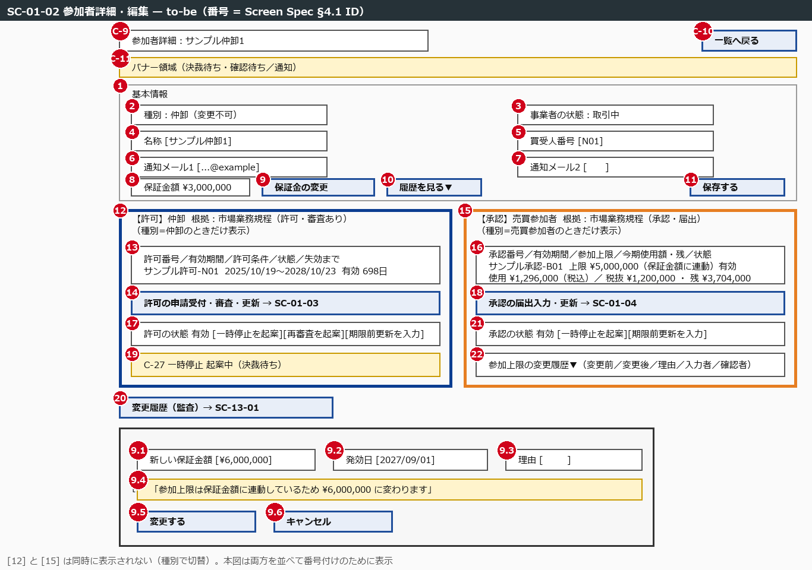
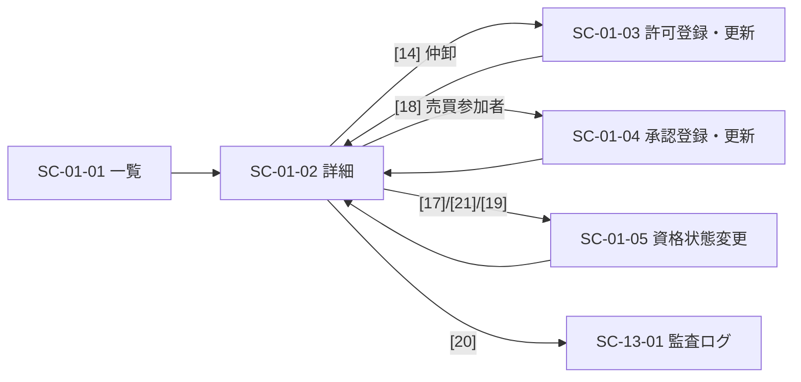

# SC-01-02 — 参加者詳細・編集

> 様式: **BM-2-901-51 v2.1** — Screen Specification · SUN ASTERISK VIETNAM CO., LTD · ISO/IEC 27001:2013 & ISO 9001:2015

---

## 1. 改訂履歴

| No | Version | Action | 変更内容 | 更新日 | 更新者 | Approve |
|---|---|---|---|---|---|---|
| 1 | 0.1.0 | Add New | ワイヤーフレーム WF-SC-01-02 0.2.2 から初版作成（Gate 1 recheck の D-01 反映済み） | 2026-11-25 | phuongnnm-23344 | |
| 2 | 0.1.1 | Update | 顧客（模擬）Q-PTY-06: 権限表、[9], [21], [22] — 照合部門長のみが保証金 / 参加上限を変更、一段階、MFA; Q-TRD-02: [16] に税込 / 税抜を表示 | 2026-11-25 | phuongnnm-23344 |  |
| 3 | 0.1.2 | Update | LAB-4: 注釈付き画像をワイヤーフレーム HTML `wireframes/html/SC-01-02.html` の変種 A（WF 0.2.5）に置換; バッジは画像に載らないことを記録; HTML / PNG / PDF のリンク | 2026-11-25 | phuongnnm-23344 | |
| 4 | 0.1.3 | Update | [10]: 誤記 「發效日」 → 「発効日」 を修正（`ja/` 作成時の点検） | 2026-11-26 | phuongnnm-23344 |  |

---

## 2. レイアウト

**デザイン:** [Wireframe SC-01-02 0.2.6](../../../wireframes/SC-01-02-participant-detail-kyoka-shonin-wireframe.md) · HTML 図の元 [`wireframes/html/SC-01-02.html`](../../../../wireframes/html/SC-01-02.html) · すべての変種: [`wireframes/png/SC-01-02.png`](../../../../wireframes/png/SC-01-02.png) / [`wireframes/pdf/wireframes-all.pdf`](../../../../wireframes/pdf/wireframes-all.pdf) · 共通枠 [_common-layout](../../../wireframes/_common-layout.md) · プロトタイプの現状画像: `wireframes/assets/SC-01-02_prototype-nakaoroshi.png`, `wireframes/assets/SC-01-02_prototype-baibai.png`

> - 画像 = ワイヤーフレーム HTML の **変種 A**（メイン画面）。`scripts/render-wireframes.py --spec` で生成（Figma はまだなし）。画像上の番号 = §4 の `ID` 列 = ワイヤーフレームの `No` 列; `C-x` = `_common-layout.md` の共通項目。
> - この画像にはバッジがない: 9.1–9.6 ダイアログ 保証金の変更 (C), C-30 (D), C-11 · C-27 (E), C-21 · C-22 (F) → 対応する変種は [`wireframes/png/SC-01-02.png`](../../../../wireframes/png/SC-01-02.png) / PDF を参照。
> - 変種 A は 【許可】ブロック [12]–[14], [17], [19] と 【承認】ブロック [15], [16], [18], [21], [22] を**番号を振るためだけに**並べて配置している; 実際の画面では 種別 に応じて一方のブロックだけ表示される（§3, §6）。ダイアログ [9] = 変種 C。

---

## 3. 説明

参加者（市場で売買する事業者・個人）一人の**管理**画面と、その法的資格の確認。主な利用者: 照合事務局（SETTLE — 照合部門の担当者）と 照合部門長（STL-HEAD — 照合部門の長）。運用部門長（OPS-HEAD）は閲覧のみ。

中核となる点（ルール2、ADR-003、L4-D02）: **許可 (kyoka — 審査を伴う許可、仲卸／中間卸向け)** と **承認 (shōnin — 簡易な手続きによる承認、売買参加者向け)** は**二つの別ブロック**であり、二つの法的根拠、二つの手続き、二つのデータテーブルを持つ。「取引資格」のような共通ブロックは存在しない。参加者の 種別 に応じて、常に一方のブロックだけが表示される。

この画面が直接書き込むのは**基本情報と保証金のみ**（保証金（担保金）は履歴行を追加する; **照合部門長のみ**、MFA、確認者なし — Q-PTY-06 【顧客（模擬）、2026-11-25】）。資格の変更（新規、更新、一時停止、再審査）は maker-checker の手続きで SC-01-03 / SC-01-04 / SC-01-05 の入力画面を経由する; 参加上限の変更は SC-01-04 での **照合部門長の一段階の操作**（MFA、監査）。この画面は現況、待機中の申請、履歴を表示するだけ。

遷移先: SC-01-01（一覧）、SC-01-03（許可）、SC-01-04（承認）、SC-01-05（状態変更／更新）、SC-13-01（監査ログ）。

---

## 4. 画面

**ID の付け方:** セクションは文字、**項目 ID = to-be ワイヤーフレームの項目番号**（振り直さない — brief P3）。共通項目は接頭辞 `C-` を持つ（定義は `wireframes/_common-layout.md`、今後 `specs/_common/` へ移行予定）。§5 は項目を `[n]` で参照する。

### 4.1 項目一覧

| ID | Item Name | Item Type | Required | Note |
|---|---|---|---|---|
| **H** | **画面枠** | | | |
| C-9 | 画面タイトル 「参加者詳細：{名称}」 | Label | - | |
| C-10 | 一覧へ戻る | Button | - | → SC-01-01（直前のフィルタを保持） |
| C-11 | バナー領域 | Label | - | バナー 決裁待ち / 確認待ち (C-27), システムエラー (C-26) |
| **A** | **基本情報** | | | |
| 1 | 基本情報ブロック | Label | - | 領域 |
| 2 | 種別 | Label | - | 卸売業者 / 仲卸 / 売買参加者 / 買出人; 登録後はロック、「（登録後変更不可）」を併記 |
| 3 | 事業者の状態 | Label | - | 取引中 / 退会 — このレベルでは一時停止 / 失効を**表示しない** |
| 4 | 名称 | Text box | 有 | |
| 5 | 買受人番号 | Text box | 有（仲卸 / 売買参加者） | 入力時に小文字→大文字へ自動変換; 卸売業者 / 買出人では非表示 |
| 6 | 通知メール1 | Text box | 無 | プレースホルダ `example@example.co.jp` |
| 7 | 通知メール2 | Text box | 無 | 最大 2 件 |
| 8 | 保証金額 | Label | - | 現行の値（`v_participant_current_deposit`）、形式 `¥#,###` |
| 9 | 保証金の変更 | Button | - | ダイアログ D を開く（下記） |
| 10 | 履歴を見る ▼ | Button | - | 保証金の履歴表を開く／閉じる（発効日 / 金額 / 理由 / 入力者 / 入力日時） |
| 11 | 保存する | Button | - | 変更がなければ薄く表示 |
| **K** | **【許可】仲卸 — 種別 = 仲卸 のときのみ** | | | |
| 12 | 許可ブロック | Label | - | 濃い青枠、見出しは大きな文字 「【許可】仲卸 ─ 根拠: 市場業務規程（許可・審査あり）」. **参加上限の列はない** |
| 13 | 許可の表 | Label | - | 列: 許可番号 / 有効期間 / 許可条件 / 状態 / 失効まで（日）. 更新前の版は「更新済」ラベル付きの履歴行に表示 |
| 14 | 許可の申請受付・審査・更新 | Button | - | → SC-01-03。ボタンの下に手続きを表示: 「新規: 審査→起案→運用部門長決裁／更新: 照合事務局入力→照合部門長確認（MFA）」 |
| 17 | 許可の状態 + ボタン | Label + Button | - | 状態ラベル (有効 / 一時停止 / 失効 / 再審査中) + 状態と役割（§6.2）に応じたボタン 「一時停止を起案」「再審査を起案」「再開を起案」「期限前更新を入力」 → SC-01-05 |
| 19 | 進行中の申請 | Label | - | C-27: 「一時停止 起案中（決裁待ち）」/「期限前更新 入力済（確認待ち）」. **決して** 「承認待ち」 は表示しない |
| **S** | **【承認】売買参加者 — 種別 = 売買参加者 のときのみ** | | | |
| 15 | 承認ブロック | Label | - | オレンジ枠、見出し 「【承認】売買参加者 ─ 根拠: 市場業務規程（承認・届出）」 |
| 16 | 承認の表 + 参加上限 | Label | - | 列: 承認番号 / 有効期間 / 参加上限 / 今期使用額 / 残 / 状態. 今期使用額は 「¥{usedIncl}（税込）／ 税抜 ¥{usedExcl}」 を表示、残 = 参加上限 − 税込 (Q-TRD-02 【顧客（模擬）、2026-11-25】). 参加上限には 「保証金額に連動」 または 「個別設定」 を併記 |
| 18 | 承認の届出入力・更新 | Button | - | → SC-01-04。ボタンの下に: 「手続: 届出 → 照合事務局入力 → 照合部門長確認（MFA）」 |
| 21 | 承認の状態 + ボタン | Label + Button | - | [17] と同様（承認向け）; さらに 「参加上限の変更」（STL-HEAD のみ）→ SC-01-04、C-30 の MFA の直後に即時適用、確認ステップなし (Q-PTY-06) |
| 22 | 参加上限の変更履歴 ▼ | Button | - | 折りたたみ表: 発効日 / 変更前 / 変更後 / 理由 / 変更者（照合部門長）/ 変更日時（イベント `LIMIT_CHANGED`） |
| **L** | **共通リンク** | | | |
| 20 | 変更履歴（監査） | Button | - | → SC-13-01 を `participant_id` で絞り込み |
| **D** | **ダイアログ [9] 保証金の変更** | | | |
| 9.1 | 新しい保証金額 | Text box | 有 | テンキー; フォーカスを外すと `¥#,###` を表示 |
| 9.2 | 発効日 | Text box (date) | 有 | 既定 = 現在の業務日 |
| 9.3 | 理由 | Text box | 有 | |
| 9.4 | 参加上限への影響文 | Label | - | 売買参加者のみ: 「参加上限は保証金額に連動しているため ¥{新額} に変わります」 または 「参加上限は個別設定のため ¥{現上限} のまま変わりません」（顧客 #20） |
| 9.5 | 変更する | Button | - | |
| 9.6 | キャンセル | Button | - | |

> `9.x` はダイアログ [9] の子項目 — ワイヤーフレームではダイアログ全体を一つの番号にまとめているため、4.2 / 5 から参照できるように子番号を振る。

### 4.2 Validation

| ID | Type | Min | Max | Default | 備考 |
|---|---|---|---|---|---|
| [4] | String | 1 | 100 | 現在の値 | 前後の空白を除去。空／長すぎ → `E-PTY-001` 「名称は1〜100文字で入力してください」 |
| [5] | String | 1 | 10 | 現在の値 | `^[A-Z0-9]{1,10}$` → `E-PTY-002` 「買受人番号は英大文字・数字1〜10文字で入力してください」. 重複（サーバー）→ `E-PTY-003` 「この買受人番号は既に使われています」（欄の下に C-22） |
| [6], [7] | String (email) | 0 | 254 | 現在の値 | 形式 `local@domain`（`@` は一つ、ドメインに `.` を含む）→ `E-PTY-004` 「メールアドレスの形式が正しくありません」. [6] = [7] → `E-PTY-021` 「同じメールアドレスは2件登録できません」 |
| 9.1 | Integer | 0 | 99,999,999,999 | （空） | 0 以上の整数、単位は円 → `E-PTY-005` 「保証金額は0以上の整数で入力してください」. 現行値と同じ → `E-PTY-022` 「現在の保証金額と同じです」 |
| 9.2 | Date | 現在の業務日 | — | 現在の業務日 | `YYYY/MM/DD` または `YYYY-MM-DD`; 現在の業務日より前 → `E-PTY-006` 「発効日は本日（業務日）以降の日付を入力してください」（前提 Q-PTY-02）. 既存の日付と重複 → `E-PTY-008` 「同じ発効日の保証金変更が既にあります」 |
| 9.3 | String | 1 | 200 | （空） | → `E-PTY-007` 「理由を入力してください」 |

> **意図的に検証しない:** [2] 種別（編集不可 — 別の値が送られた場合はサーバーが拒否、`E-PTY-009`）; [8]（読み取り専用）。第1期ではメールに確認メールを送らない（L4-A08 — 依頼書に従って変更し、履歴を残す）。

### 4.3 Data Mapping

| ID | Data Source | API ID | API URL | Key / Param | 備考 |
|---|---|---|---|---|---|
| [2]–[8], [10], [13], [16], [17], [19], [21], [22] | API | `API-PTY-001` | `GET /api/v1/participants/{participantId}` | `participant`, `contacts`, `deposit`, `depositHistory`, `permit` \| `approval`, `openRequest`, `events` | 画面を開くとき一回呼び出し; 許可 / 承認ブロックは `participant.kind` による |
| [4]–[7], [11] | API | `API-PTY-002` | `PUT /api/v1/participants/{participantId}` | `name`, `buyerNo`, `emails[]`, `version` | `version` = 楽観的ロック（E-CMN-008） |
| 9.1–9.3, 9.5 | API | `API-PTY-003` | `POST /api/v1/participants/{participantId}/deposits` | `depositJpy`, `effectiveFrom`, `reason` | C-12 に表示するため `limitAfter` を返す |
| 9.4 | API（読込済み） | `API-PTY-001` | — | `approval.limitMode`, `approval.participationLimitJpy` | クライアントで計算、追加の呼び出しはしない |

> システム全体の API 一覧: [`_common/api-list.md`](../../_common/api-list.md); この機能の API 設計: [`specs/system-design/api-design/party/`](../../../../specs/system-design/api-design/party)。

---

## 5. Event

| ID | Given (Pre-condition) | When (Trigger/Action) | Then (Result) | Note |
|---|---|---|---|---|
| **Initializing Process（初期処理）** | | | | |
| - | 参加者を閲覧できる役割（SETTLE, STL-HEAD, OPS-HEAD） | 画面 `/participants/{id}` を開く | 1. C-20（スケルトン）を表示。 2. `API-PTY-001` を呼び出す。 3. [1]–[11] を表示; `kind = NAKAOROSHI` → [12]–[14], [17], [19] を表示; `kind = BAIBAI` → [15], [16], [18], [21], [22]; `WHOLESALER` / `KAIDASHI` → 二つのブロックはなく、「この種別は許可・承認の対象外です」 と表示。 4. `openRequest` がある → [19] C-27 + バナー C-11; そのブロックの状態変更ボタンを非表示。 5. §6.2 を適用（役割によりボタンを非表示） | |
| - | 他の役割（INTAKE, JUDGE, TRADE, DELIVERY, RULE） | URL を直接開く | ページ C-25 「この画面を表示する権限がありません」（403 `E-CMN-002`） | 資格の簡易照会は SC-01-06 を使用 |
| **Standard Process（通常処理）** | | | | |
| [5] | - | 文字を入力 | 小文字は大文字に自動変換; `A-Z0-9` 以外の文字は受け付けない | |
| [4]–[7] | 読み込んだデータから変更あり | フォームを離れる | クライアントで検証（4.2）; エラー → 欄の下に C-22; [11] はエラーがなくなると有効 | |
| [11] | フォームが有効 | 「保存する」を押す | 1. `version` を付けて `API-PTY-002` を呼び出す。 2. 200 → C-12 「保存しました：{名称}」、`API-PTY-001` を再読み込み。 3. メール変更 → サーバーが旧行を閉じ、新行を追加（履歴） | 変更前／変更後を監査（FR-AUDIT-01） |
| [9] | 役割 STL-HEAD（または代行）、`participant.status = ACTIVE` | 「保証金の変更」を押す | ダイアログ D を開く; 9.2 = 業務日; カーソルは 9.1 | Q-PTY-06: SETTLE にはボタンが見えない |
| 9.1 | 参加者が売買参加者 | 数字を入力 | 9.4 を即時更新: `limitMode = DEPOSIT` → 「…¥{新額} に変わります」; `INDIVIDUAL` → 「…¥{現上限} のまま変わりません」 | 顧客 #20 |
| 9.5 | 9.1–9.3 が有効 | 「変更する」を押す | 0. Step-up MFA が切れている → 先に C-30（403 `E-CMN-005` → C-30 → 再送）。 1. `API-PTY-003` を呼び出す。 2. 201 → ダイアログを閉じ、C-12 「保証金を変更しました（{発効日}から ¥{額}）」、[8], [10], [16] を再読み込み。 3. **上書きしない**: `participant_deposit_history` に行を追加 | ルール4, D14 |
| 9.6 | - | 「キャンセル」を押す | ダイアログを閉じる、保存しない | |
| [10] / [22] | - | ▼ を押す | 履歴表を開く／閉じる（読み込み済みデータ） | |
| [14] | `kind = NAKAOROSHI` | 押す | → SC-01-03（`participantId`） | |
| [18] | `kind = BAIBAI` | 押す | → SC-01-04（`participantId`） | |
| [17] / [21] | そのブロックに `openRequest` がない | 状態変更ボタンを押す | → SC-01-05（`participantId`, `target = PERMIT` \| `APPROVAL`, `action`） | 遷移先の画面が `API-PTY-004` / `API-PTY-006` を呼び出す |
| [19] | `openRequest` がある | ラベルを押す | SC-01-05 をその申請の閲覧／決裁モードで開く | |
| [20] | - | 押す | → SC-13-01 を `participant_id` で絞り込み | |
| C-10 | 未保存の変更がある | 押す | 確認ダイアログ 「保存していない変更があります。破棄して一覧へ戻りますか？」 | |
| **Error Handling（エラー制御）** | | | | |
| [5] | 保存 | サーバーが 409 `E-PTY-003` を返す | [5] の下に C-22; カーソルを [5] に戻す | |
| [11] | 保存 | 409 `E-CMN-008`（他の利用者が更新した） | C-23 「他の利用者が更新しました。最新の内容を読み込み直してください」 + ボタン 「再読み込み」; 入力中の内容を保持 | |
| [11], 9.5 | 保存 | 409 `E-PTY-010`（退会） | C-23; すべての書き込みボタンを非表示 | |
| 9.5 | 保存 | 403 `E-CMN-005`（step-up 切れ） | C-30 を開き、ダイアログの内容を保持、コード入力後に再送 | Q-PTY-06 |
| 9.5 | 保存 | 422 `E-PTY-006` / `E-PTY-008` | 9.2 の下に C-22、ダイアログはそのまま | |
| - | いずれも | 401 `E-CMN-001` | SC-00-01 へ戻る。戻れるよう URL を保持 | |
| - | いずれも | 5xx / タイムアウト | C-26 赤いバナー + コード `traceId`; 入力中のデータを保持 | |
| - | 通信断 | いずれも | C-28 「通信が回復するまで保存できません」; [11], 9.5 を薄く表示 | この画面にはオフラインモードはない（ADR-008 §2.1） |

---

## 6. Other Notes

### 6.1 画面の状態

| 状態 | 条件 | 表示 |
|---|---|---|
| 読込中 | `API-PTY-001` の待ち > 300 ms | C-20 |
| 仲卸で許可が未登録 | `kind = NAKAOROSHI`, `permit = null` | [13] C-21: 「許可が登録されていません。取引の確定はできません」 + [14] |
| 売買参加者で承認が未登録 | `kind = BAIBAI`, `approval = null` | [16] C-21: 「承認が登録されていません。取引の確定はできません」 + [18] |
| 対象外 | `WHOLESALER` / `KAIDASHI` | [12], [15] はない; 「この種別は許可・承認の対象外です」; [5] 非表示 |
| 失効間近 | `daysToExpiry ≤ 30`（PRM-045） | [13] / [16] に黄色のラベル 「失効まで {n}日」 — SC-04-01 と同じ閾値 |
| 一時停止 / 失効 / 再審査中 | `status ≠ VALID` | [17] / [21] に赤いラベル + 文字（色だけに頼らない）; [14] / [18] は正しい手続きで更新するため引き続き使用可能 |
| 決裁／確認待ち | `openRequest ≠ null` | [19] C-27; バナー C-11; そのブロックの状態変更ボタンを非表示 |
| 退会 | `participant.status = WITHDRAWN` | [3] グレー; すべての書き込みボタンを非表示; 読み取り専用 |
| 入力エラー | 検証 | 欄の下に C-22 |
| 日付がロック済み（423） | 該当なし — マスタデータは業務日に紐づかない; この画面に 423 はない | |
| オフライン | 通信断 | C-28; 保存をブロック |

### 6.2 役割別の表示権限（役割 × 項目）

記号: **T** = 操作可 · **閲覧** = 読み取りのみ · **非表示** = 表示しない。表にない役割（INTAKE, JUDGE, TRADE, DELIVERY, RULE, SYSADM）→ C-25、画面には入れない。

| Item | SETTLE (照合事務局) | STL-HEAD (照合部門長) | OPS-HEAD (運用部門長) |
|---|---|---|---|
| [2], [3], [8], [13], [16], [19], [22] | 閲覧 | 閲覧 | 閲覧 |
| [4]–[7] | T | T | 閲覧 |
| [9] | 非表示（Q-PTY-06） | T (MFA) | 非表示 |
| [11] | T | T | 非表示 |
| [10], [20] | T | T | T |
| [14] (→ SC-01-03) | T — 新規の許可資料を入力; 更新時は新しい失効日を入力 | T — 審査 + 起案の結果を記録（新規）; 更新の確認（MFA） | T — 待機中の申請がある場合のみ新規の決裁（MFA） |
| [17] 許可: 「期限前更新を入力」 | T | 非表示（確認者本人のため） | 非表示 |
| [17] 許可: 「一時停止を起案」「再審査を起案」「再開を起案」 | 非表示 | T（起案） | 非表示 — OPS-HEAD の決裁は SC-01-05 で [19] 経由 |
| [18] (→ SC-01-04) | T — 新規／更新の届出を入力 | T — 確認（MFA）; 参加上限の変更を一段階で（MFA） | 非表示 |
| [21] 承認: 「期限前更新を入力」 | T | 非表示 | 非表示 |
| [21] 承認: 「参加上限の変更」 | 非表示（Q-PTY-06） | T（MFA、一段階） | 非表示 |
| [21] 承認: 「一時停止を起案」「再審査を起案」「再開を起案」 | 非表示 | T | 非表示 |

追加ルール: (0) 保証金／参加上限の変更は maker-checker を使わない: 照合部門長のみ、一段階、MFA + `audit_logs`（Q-PTY-06 【顧客（模擬）、2026-11-25】）。 (1) 入力者／起案者は、その申請の確認／決裁を行えない（maker ≠ checker — CHECK `decided_by <> proposed_by` かつ `≠ created_by`、PARTY_DB 4.13 / 4.15）。 (2) `openRequest` がある間は、そのブロックの状態変更ボタンはすべての役割で非表示（一資格につき開いている申請は一件 — 前提 Q-PTY-01）。 (3) 役割は複数役割のアカウント属性（`staff_roles`）＋決裁権限（`staff_authorities`）; 有効な代行は対応する決裁権限とみなす。

### 6.3 画面遷移

### 6.4 手続き — 二つのブロック、二つの手続き（開発者向けの要約。詳細は TECH）

| | 許可 (仲卸) — [SPEC-PTY_PERMIT_LIFECYCLE-001](../technical-design/PTY_PERMIT_LIFECYCLE_TECH.md) | 承認 (売買参加者) — [SPEC-PTY_APPROVAL_LIFECYCLE-001](../technical-design/PTY_APPROVAL_LIFECYCLE_TECH.md) |
|---|---|---|
| 新規 | 照合事務局が入力 → 照合部門長が審査結果 + 起案を記録 → **運用部門長 決裁 (MFA)** — 前提 [PL], OPEN-DB-09 | 照合事務局が届出を入力 → **照合部門長 確認 (MFA)**、保証金 / 資力を簡易審査 — OPEN-DB-09 |
| 通常の更新 | 照合事務局が新しい失効日を入力 → **照合部門長 確認 (MFA)** — PRM-121、審査は再度行わない | 左と同じ（PRM-121） |
| 一時停止 / 再審査 / 再開 | 照合部門長 起案 → 運用部門長 決裁 (MFA) | 左と同じ |
| 専用項目 | 許可条件、審査結果 | 参加上限（`LIMIT_CHANGED` 経由で変更、上書きしない） |
| 失効日の到来 | 自動で失効（前提 [PL]） | 左と同じ |

### 6.5 トレーサビリティ

FR-PARTY-01, TBL-ACTOR-01, 02-08, B.2, BR-PERM-01, PRM-044, PRM-045, PRM-046, PRM-121, FIG-010, FR-AUDIT-01, NFR-SEC-01; L4-D02, L4-D03, L4-A08; ADR-003, ADR-002; PARTY_DB 4.9–4.15; Gate 1 M-07, recheck N-03, D-01; 顧客 #18–#21。

### 6.6 未決事項／前提（この仕様で新規）

| 提案 ID | 内容 | 暫定前提 | 前提が誤っていた場合の影響 |
|---|---|---|---|
| Q-PTY-01 | 一つの資格（許可または承認）に待機中の申請を**複数**同時に持てるか（例: 期限前更新と一時停止の同時）？ | いいえ — 資格ごとに開いている申請は最大 1 件 | 申請キューと順序ルールの追加: +0.3 MM |
| Q-PTY-02 | 保証金は**遡及**（発効日が現在の業務日より前）で記録できるか？ 遡及すると、期内で確定済みの取引の参加上限が変わる | いいえ — 発効日 ≥ 現在の業務日 | 遡及を許す場合: 記録済みの上限超過警告の再計算が必要、+0.2 MM |
| Q-PTY-03 | 仲卸／売買参加者に通知メールを最低 1 件必須とするか？ | 必須ではない; メールがなければ紙での案内（L4-A08） | 必須にする場合: 検証を追加し、移行データにメールを揃える必要 |
