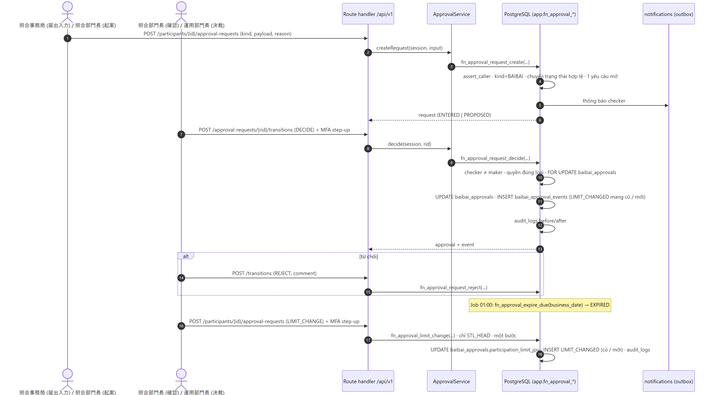
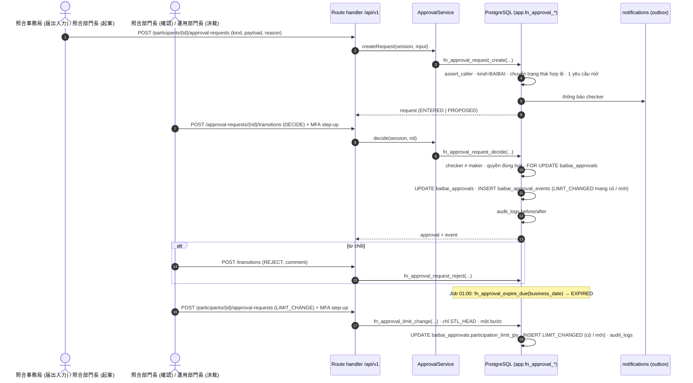

# PTY_APPROVAL_LIFECYCLE — 承認 (売買参加者) のライフサイクルと参加上限

> 様式: **BM-2-901-53 v01** — Detail Design (Chart + Description) · SUN ASTERISK VIETNAM CO., LTD · ISO/IEC 27001:2013 & ISO 9001:2015

---

## 1. 改訂履歴

| No | Version | Action | 対象箇所 / ステップ | 変更内容 | 更新日 | 更新者 | Approve |
|---|---|---|---|---|---|---|---|
| 1 | 0.1.0 | Add new | — | 初版作成 | 2026-11-25 | phuongnnm-23344 | |
| 2 | 0.1.1 | Update | — | Gate 2 G2-M02: 完了条件（LAB-5）; G2-M03: 承認が失効済みの RENEW → 409 E-PTY-013; 顧客（模擬）Q-PTY-06: LIMIT_CHANGE は照合部門長による一段階（§4.2b） | 2026-11-25 | phuongnnm-23344 |  |
| 3 | 0.1.2 | Update | §2 | FB-EXP-236: Mermaid ブロックから書き出した PNG 画像 `./assets/PTY_APPROVAL_LIFECYCLE_sequence.png` を埋め込み（`scripts/export-mermaid-png.py`）; Mermaid が引き続き原本 | 2026-11-25 | phuongnnm-23344 |  |

---

## 2. シーケンス図

原本: 下の Mermaid ブロック（編集用）。画像はそのブロックから `python scripts/export-mermaid-png.py PTY_APPROVAL_LIFECYCLE` で生成 — Mermaid を修正したら再実行して両者を一致させる。

---

## 3. 説明

承認は許可とは別の根拠です: **簡易な手続き** — 届出（届出書の提出） → 照合事務局が入力 → 照合部門長が確認（MFA）し、保証金・資力を軽く審査する。独立した審査の段階はなく、`REVIEWED` もない（PARTY_DB 4.15 の CHECK）。専用項目「参加上限」（取引参加の上限額）がある: 期内で上限を超えても取引画面で警告と理由入力のみ、**ブロックはしない**（PRM-046、L4-A04 (1)）。関数、テーブル、エンドポイントは許可（[PTY_PERMIT_LIFECYCLE](PTY_PERMIT_LIFECYCLE_TECH.md)）から**完全に分離**されている — 一方を変えても他方は連動しない（ADR-003）。

| 種別 | 状態（前 → 後） | Maker | Checker (MFA) | Event | 出典 |
|---|---|---|---|---|---|
| `NEW` 新規 | （なし） → 有効 | SETTLE が届出を入力 → `ENTERED` | **STL-HEAD 確認** | `REGISTERED` | PARTY_DB 4.15; OPEN-DB-09（簡易審査、一名） |
| `RENEW` 更新 | 有効 / 一時停止 → 据え置き、`valid_to` を更新 | SETTLE | **STL-HEAD 確認** | `RENEWED` | PRM-121 |
| `LIMIT_CHANGE` 参加上限の変更 | 据え置き | **STL-HEAD が直接実行、一段階**（個別の起票者なし） | —（確認者なし; MFA step-up + 監査） | `LIMIT_CHANGED` (`old_limit_jpy`, `new_limit_jpy`) | PRM-046, Gate 1 M-07, **Q-PTY-06 【顧客（模擬）、2026-11-25】** |
| `SUSPEND` / `RESUME` / `REVIEW_START` / `REINSTATE` | 許可と同じ（FIG-010） | STL-HEAD 起案 → `PROPOSED` | **OPS-HEAD 決裁** | `SUSPENDED` / `RESUMED` / `REVIEW_STARTED` / `REINSTATED` | PRM-121 |
| (job) 失効 | 有効 / 一時停止 → 失効 | システム | — | `EXPIRED` | 前提 [PL] |

**参加上限の有効値**（SC-01-02 [16], SC-04-01, SC-05-02 で参照）:
`limit = baibai_approvals.participation_limit_jpy` が NULL でなければ（`INDIVIDUAL`）その値、そうでなければ = 審査日時点の現行保証金 `v_participant_current_deposit`（`DEPOSIT`）。**今期使用額** = 期内の `trade_date` ごとの有効な買受代金の合計（相対 + せり、`period_id` = 対象期の調整を含む） — view `v_buyer_period_usage`; **残** = `limit − 使用額`（マイナスもあり得る、赤表示）。

待機中の申請テーブル: `baibai_approval_requests` — PARTY_DB §4.60（専用テーブル、列名は `nakaoroshi_permit_requests` と同じ; `LIMIT_CHANGE` は**受け付けない** — 参加上限の変更は待機申請を経由しない; `NEW` に `PROPOSED` はない）。

**なぜ `LIMIT_CHANGE` は一段階か（Q-PTY-06）:** 顧客は保証金／参加上限の変更を**照合部門長のみ**に限定し、照合事務局が自分で変更できないようにしたい。確認者や追加の決裁フローは加えない。maker-checker（SETTLE が入力 → STL-HEAD が確認）を残すと一つ目の要望に反し、二人目の確認者を加えると二つ目の要望に反する。その代わりに MFA step-up（Q-PTY-07 顧客が同意 — 金額に関わる項目）、`audit_logs` の変更前／変更後、SC-01-02 [22] に表示される `LIMIT_CHANGED` の履歴を備える。保証金の変更（API-PTY-003）も同じルール。

---

## 4. 詳細関数

### 4.1. 認証、権限、MFA

| 項目 | 値 |
|---|---|
| Input | Cookie `sid`; body JSON (zod); `participantId` / `requestId` |
| Output | `SessionContext` → 4.2–4.4 |

**Error**

| エラー条件 | 処理 | Status code |
|---|---|---|
| セッションなし | 停止; `E-CMN-001` | 401 |
| 役割が §3 の表に合わない（SETTLE は `NEW` / `RENEW` を作成; STL-HEAD は起案の種別と `LIMIT_CHANGE` を作成; 確認者は正しい権限） | 停止; `E-CMN-002` | 403 |
| `DECIDE` または `LIMIT_CHANGE` で step-up MFA がない | 停止; `E-CMN-005` | 403 |
| ボディの型が不正 | 停止; `E-CMN-007` | 422 |

**Detail**

| No | 処理内容 |
|---|---|
| 1 | SPEC-PTY_PERMIT_LIFECYCLE-001 §4.1 と同じ（セッション、役割、決裁権限、代行、MFA、`set_config`） |

### 4.2. 申請の作成（`fn_approval_request_create`）

| 項目 | 値 |
|---|---|
| Input | `participantId`, `kind`, `payload`（`approvalNo`, `validFrom`, `validTo`, `limitMode` `DEPOSIT` \| `INDIVIDUAL`, `participationLimitJpy?`, `NEW` は `screeningNote`; `RENEW` は `newValidTo`）、`reason` — `LIMIT_CHANGE` は §4.2b へ |
| Output | 申請 `ENTERED` / `PROPOSED` → response `API-PTY-006` |

**Error**

| エラー条件 | 処理 | Status code |
|---|---|---|
| 参加者が存在しない | 停止; `E-PTY-018` | 404 |
| `kind ≠ BAIBAI` | 停止; `E-PTY-009` 「この種別では承認を登録できません」 | 409 |
| `WITHDRAWN` | 停止; `E-PTY-010` | 409 |
| 状態遷移が不正 / 失効していない承認がある状態で `NEW` | 停止; `E-PTY-013` | 409 |
| 開いている申請がある | 停止; `E-PTY-011` | 409 |
| `approvalNo` が重複 | 停止; `E-PTY-019` | 409 |
| `validTo < validFrom` | 停止; `E-PTY-020` | 422 |
| 承認が失効済みの `RENEW` — 猶予なし（Q-PTY-04） | 停止; `E-PTY-013`, `detail` = `{ currentStatus: "EXPIRED", kind: "RENEW", nextAction: "REVIEW_START" }` | 409 |
| `RENEW`: `newValidTo ≤ valid_to` | 停止; `E-PTY-014`, `field` = `payload.newValidTo`, `detail.currentValidTo` | 422 |
| `INDIVIDUAL` で `participationLimitJpy` が ≤ 0 / 未入力; または新しい上限 = 現在の上限 | 停止; `E-PTY-016` | 422 |
| `reason` が空 | 停止; `E-PTY-007` | 422 |

**Detail**

| No | 処理内容 |
|---|---|
| 1 | `assert_caller`; 現行の `participants`, `baibai_approvals` を `SELECT … FOR UPDATE` |
| 2 | 上の Error 表どおりに確認 |
| 3 | `baibai_approval_requests` に INSERT（SETTLE の起票は `ENTERED`、STL-HEAD の起案は `PROPOSED`） |
| 4 | `notifications` → STL-HEAD (`ENTERED`) / OPS-HEAD (`PROPOSED`); `audit_logs` |

### 4.2b. 参加上限の一段階変更（`fn_approval_limit_change`）

| 項目 | 値 |
|---|---|
| Input | `participantId`, `payload` (`limitMode` `DEPOSIT` \| `INDIVIDUAL`, `participationLimitJpy?`, `effectiveOn`), `reason`, `app.mfa_verified_at` |
| Output | `baibai_approvals` を更新 + `LIMIT_CHANGED` を 1 行 → response `API-PTY-006` の行 1b |

**Error**

| エラー条件 | 処理 | Status code |
|---|---|---|
| 呼び出し元が STL-HEAD（または代行）でない | 停止; `E-CMN-002` | 403 |
| Step-up MFA が失効 | 停止; `E-CMN-005` | 403 |
| 参加者が存在しない / 売買参加者でない / 退会 | 停止; `E-PTY-018` / `E-PTY-009` / `E-PTY-010` | 404 / 409 / 409 |
| 承認がない、または `EXPIRED` | 停止; `E-PTY-013` | 409 |
| `INDIVIDUAL` で `participationLimitJpy` が ≤ 0 / 未入力; または新しい上限 = 現在の上限 | 停止; `E-PTY-016` | 422 |
| `effectiveOn` < 現在の業務日 | 停止; `E-PTY-006` | 422 |
| `reason` が空 | 停止; `E-PTY-007` | 422 |

**Detail**

| No | 処理内容 |
|---|---|
| 1 | `assert_caller(['STL_HEAD'])`; 現行の `participants`, `baibai_approvals` を `SELECT … FOR UPDATE` |
| 2 | `v_old := participation_limit_jpy`（NULL = 保証金に連動） |
| 3 | `participation_limit_jpy` を UPDATE（`DEPOSIT` に戻す場合は NULL）**かつ** `LIMIT_CHANGED` を INSERT（`old_limit_jpy`, `new_limit_jpy`, `effective_on`, `reason`, `decided_by` = `created_by` = 呼び出し元, `mfa_verified_at`）**同一トランザクション内で** — 上限列を更新する別経路はない（PARTY_DB 4.14 の列 6）。新しい上限は `effective_on` を**含む期**から適用 |
| 4 | `audit_logs` の変更前／変更後（代行は「…の代わりに」と記録）; 確認者がいないため checker 向けの `notifications` は作らない |

### 4.3. 確認 / 決裁 (`fn_approval_request_decide`)

| 項目 | 値 |
|---|---|
| Input | `requestId`, `comment?`, `app.mfa_verified_at` |
| Output | `baibai_approvals` を新規／更新 + `baibai_approval_events` を 1 行 → response `API-PTY-007` |

**Error**

| エラー条件 | 処理 | Status code |
|---|---|---|
| 決裁待ちでない申請 | 停止; `E-PTY-017` | 409 |
| 権限が合わない（`NEW` / `RENEW` は `STL_HEAD` が必要; 起案の種別は `OPS_HEAD` が必要） | 停止; `E-CMN-002` | 403 |
| 呼び出し元 = 起票者（`entered_by` / `proposed_by`） | 停止; `E-PTY-012` | 403 |
| 作成時から承認の状態が変わった | 停止; `E-PTY-013` | 409 |
| MFA がない | 停止; `E-CMN-005` | 403 |

**Detail**

| No | 処理内容 |
|---|---|
| 1 | 申請と `baibai_approvals` を `SELECT … FOR UPDATE`; 状態遷移を再確認 |
| 2 | `NEW`: `baibai_approvals` に INSERT（`status = VALID`、`DEPOSIT` なら `participation_limit_jpy` = NULL）; `REGISTERED` を INSERT（`decided_by` = STL-HEAD、MFA; `reason` には `screeningNote` の簡易審査結果（保証金 / 資力）を記録） |
| 3 | `RENEW`: `valid_to` を UPDATE; `RENEWED` を INSERT（`old_valid_to`, `new_valid_to`） |
| 5 | 起案の種別: `status` を UPDATE; 対応するイベントを INSERT（`proposed_by`, `decided_by` = OPS-HEAD, MFA） |
| 6 | 申請を `DECIDED` に UPDATE; `audit_logs`（代行は「…の代わりに」と記録）; `notifications` → 起票者 |

### 4.4. 却下 (`fn_approval_request_reject`)

| 項目 | 値 |
|---|---|
| Input | `requestId`, `comment`（必須） |
| Output | 申請 `REJECTED`; 承認は変わらない |

**Error**

| エラー条件 | 処理 | Status code |
|---|---|---|
| `comment` が空 | 停止; `E-PTY-023` | 422 |
| 申請が終了済み | 停止; `E-PTY-017` | 409 |
| 確認者でない / 起票者本人 | 停止; `E-CMN-002` / `E-PTY-012` | 403 |

**Detail**

| No | 処理内容 |
|---|---|
| 1 | SPEC-PTY_PERMIT_LIFECYCLE-001 §4.5 と同じ |

### 4.5. 失効の自動ジョブ（`fn_approval_expire_due`）

| 項目 | 値 |
|---|---|
| Input | `p_business_date`（業務日を開く関数から `fn_permit_expire_due` と同時に呼び出す） |
| Output | 期限切れの承認 → `EXPIRED` |

**Error**

| エラー条件 | 処理 | Status code |
|---|---|---|
| DB エラー | `ERROR` ログを記録、バッチをロールバック、アラーム; 業務日を開くのを止めない | —（バッチ） |

**Detail**

| No | 処理内容 |
|---|---|
| 1 | `baibai_approvals` / `baibai_approval_events` について SPEC-PTY_PERMIT_LIFECYCLE-001 §4.6 と同じ |

---

## 5. その他の注記

- **保証金の変更は参加上限にも影響** (`API-PTY-003`、申請を経由しない): `fn_participant_deposit_change` は `participant_deposit_history` に INSERT（追記のみ、`uq_deposit_participant_from`）し、`LIMIT_CHANGED` は**生成しない** — `limitMode = DEPOSIT` の場合、上限は日付ごとに保証金から導出される値で、履歴は保証金テーブル自体に残る; response は `limitAfter` を返し、画面で知らせる（顧客 #20）。保証金の変更: **STL-HEAD のみ**、MFA step-up、監査あり、確認者なし（Q-PTY-06 【顧客（模擬）、2026-11-25】）。経理部に確認: システム上の保証金は毎期の経理帳簿と一致するか — 一致させる必要があるなら比較項目が必要（別途見積）。
- **`LIMIT_CHANGE` の MFA:** PARTY_DB 4.15 は `decided_by` がある場合に `mfa_verified_at` を必須とする; 顧客が同意（Q-PTY-07 【顧客（模擬）、2026-11-25】）。PREMISE §3.2 の 「参加上限の変更の確認」 を 「保証金 / 参加上限の変更（照合部門長、一段階）」 に改める必要がある。
- **対象外:** 参加上限を超えても取引を止めない（`trade` で警告のみ）; `effective_on` より前へ上限を遡及させない。
- テーブル `baibai_approval_requests`: PARTY_DB 0.3.1 §4.60（列は 4.59 と同じ、専用テーブル）。
- 未決事項: OPEN-DB-09（新規の承認は照合部門長の確認のみでよいか — 簡易審査か？）; 経理部に保証金の帳簿一致を確認。回答済み 【顧客（模擬）、2026-11-25】: Q-PTY-01（資格ごとに開いている申請は一件）、Q-PTY-04（猶予なし → 再審査）、Q-PTY-06、Q-PTY-07。
- **完了条件（LAB-5）:** (a) 承認と許可は二つの関数／二つのテーブル: `trade` の資格エラーは承認が `E-TRD-006`（文言「売買参加者の承認」）、許可が `E-TRD-005` — 共通コードはない; (b) `NEW` → `ENTERED`、入力者とは別の STL-HEAD が `DECIDE` + MFA → `baibai_approvals` が `VALID` + `REGISTERED`; 入力者本人が `DECIDE` → 403 `E-PTY-012`; (c) STL-HEAD + MFA による `LIMIT_CHANGE` → `old_limit_jpy` / `new_limit_jpy` / `effective_on` を持つ `LIMIT_CHANGED` がちょうど 1 行、`baibai_approvals.participation_limit_jpy` は同一トランザクションで変わる、`baibai_approval_requests` の行はなし; SETTLE が呼ぶ → 403 `E-CMN-002`; step-up がない → 403 `E-CMN-005`; (d) `effective_on` を含む期内で確定した取引は新しい上限を使い、前の期は旧上限のまま; (e) `ENTERED` / `PROPOSED` の申請が既にある → 二件目の作成は 409 `E-PTY-011`（Q-PTY-01）; (f) 承認が失効済みの `RENEW` → 409 `E-PTY-013` `detail.nextAction = "REVIEW_START"`; 有効中に `newValidTo ≤ valid_to` → 422 `E-PTY-014`; (g) 業務日を開くジョブ: 承認の `valid_to` < 業務日 → `EXPIRED` + `EXPIRED` イベント（`decided_by` NULL）; 同日の再実行で行を追加しない; 開いている申請は残り、決裁者は `E-PTY-013` に当たる; (h) 保証金変更時、`limitMode = DEPOSIT` なら `LIMIT_CHANGED` は生成されないが `limitAfter` は新しい保証金; (i) `SUSPEND` は決裁時刻（イベントの時分）に即時有効: それより前に確定した取引はそのまま、後に確定した取引は `E-TRD-006`（Q-PTY-05）。
- トレーサビリティ: ルール2、ルール4; FR-PARTY-01, BR-PERM-01, PRM-046, PRM-121, FIG-010, L4-A04 (1); ADR-003; PARTY_DB 4.11, 4.14, 4.15; Gate 1 M-07, N-03; 顧客 #20, #21。
