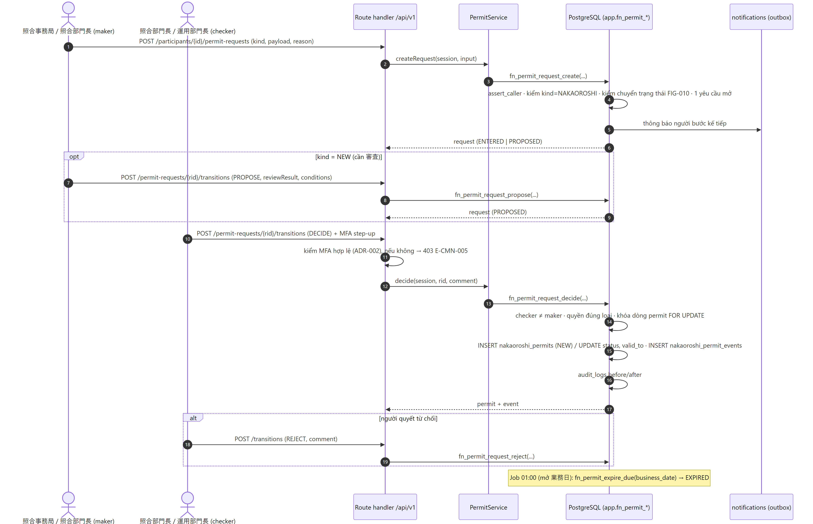
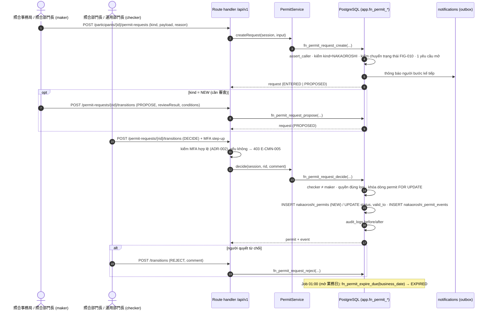

# PTY_PERMIT_LIFECYCLE — 許可 (仲卸) のライフサイクル

> 様式: **BM-2-901-53 v01** — Detail Design (Chart + Description) · SUN ASTERISK VIETNAM CO., LTD · ISO/IEC 27001:2013 & ISO 9001:2015

---

## 1. 改訂履歴

| No | Version | Action | 対象箇所 / ステップ | 変更内容 | 更新日 | 更新者 | Approve |
|---|---|---|---|---|---|---|---|
| 1 | 0.1.0 | Add new | — | 初版作成 | 2026-11-25 | phuongnnm-23344 | |
| 2 | 0.1.1 | Update | — | Gate 2 G2-M02: 完了条件（LAB-5）; G2-M03: 許可が失効済みの RENEW → 409 E-PTY-013 + `detail.nextAction`、E-PTY-014 は 422 のみ、旧エラーキーを削除（`detail` / `field` に置換）; Q-PTY-01/04/05 を終了 | 2026-11-25 | phuongnnm-23344 |  |
| 3 | 0.1.2 | Update | §2 | FB-EXP-236: Mermaid ブロックから書き出した PNG 画像 `./assets/PTY_PERMIT_LIFECYCLE_sequence.png` を埋め込み（`scripts/export-mermaid-png.py`）; Mermaid が引き続き原本 | 2026-11-25 | phuongnnm-23344 |  |

---

## 2. シーケンス図

原本: 下の Mermaid ブロック（編集用）。画像はそのブロックから `python scripts/export-mermaid-png.py PTY_PERMIT_LIFECYCLE` で生成 — Mermaid を修正したら再実行して両者を一致させる。

---

## 3. 説明

すべての許可（仲卸）の資格変更は**一つの、起票者と確認者のある申請**を経由する; `nakaoroshi_permits.status` / `valid_to` を直接修正する経路はない（PARTY_DB 4.12: 同一トランザクション内でイベントを生成する関数経由のみ）。許可の手続きは承認と**異なる**（ルール2、ADR-003）— 承認は [PTY_APPROVAL_LIFECYCLE](PTY_APPROVAL_LIFECYCLE_TECH.md) で扱い、関数、テーブル、エンドポイントを共有しない。

資格の種別（`request_kind`）と手続き:

| 種別 | 状態（前 → 後）（FIG-010） | Maker（作成） | 中間ステップ | Checker (MFA) | Event ghi | 出典 |
|---|---|---|---|---|---|---|
| `NEW` 新規 | （なし） → 有効 | SETTLE が資料を入力 → `ENTERED` | STL-HEAD が審査 + 起案 → `PROPOSED` | **OPS-HEAD 決裁** | `REVIEWED` + `REGISTERED` | ADR-003 §2.2, 前提 [PL] (OPEN-DB-09) |
| `RENEW` 通常の更新 | 有効 / 一時停止 → 据え置き, `valid_to` を更新 | SETTLE が新しい失効日を入力 → `ENTERED` | — | **STL-HEAD 確認** | `RENEWED` | **PRM-121**（LAB-1 で確定） |
| `SUSPEND` 一時停止 | 有効 → 一時停止 | STL-HEAD 起案 → `PROPOSED` | — | OPS-HEAD 決裁 | `SUSPENDED` | PRM-121 |
| `RESUME` 再開 | 一時停止 → 有効 | STL-HEAD 起案 | — | OPS-HEAD 決裁 | `RESUMED` | PRM-121 |
| `REVIEW_START` 再審査開始 | 有効 / 一時停止 / 失効 → 再審査中 | STL-HEAD 起案 | — | OPS-HEAD 決裁 | `REVIEW_STARTED` | PRM-121, FIG-010 |
| `REINSTATE` 再審査 → 有効 | 再審査中 → 有効（`valid_to`、新しい許可条件を伴う） | 審査結果を伴う STL-HEAD 起案 | — | OPS-HEAD 決裁 | `REVIEWED` + `REINSTATED` | PRM-121 |
| (job) 失効 | 有効 / 一時停止 → 失効（`valid_to` < 業務日のとき） | システム | — | — | `EXPIRED` | 前提 [PL] |

実行後: `nakaoroshi_permits` は新しい状態／期限を持ち、`nakaoroshi_permit_events` に新しい行が追加される（追記のみ）、申請は `DECIDED` または `REJECTED` になり、`audit_logs` に変更前／変更後が残る。モジュール `trade` は確定時に `v_qualification_current` で資格を読む（BR-PERM-01）— この関数の範囲外。

**待機中の申請テーブル:** `nakaoroshi_permit_requests`（許可専用; 承認は専用の `baibai_approval_requests` — 共通テーブルは使わない、ADR-003）が待機中の申請を保持する（起案中 / 確認待ち — ワイヤーフレーム [19] C-27） — PARTY_DB 0.3.1 §4.59。

---

## 4. 詳細関数

### 4.1. 認証、権限、MFA

| 項目 | 値 |
|---|---|
| Input | Cookie セッション `sid` + body JSON（zod）; `participantId` / `requestId`（path） |
| Output | `SessionContext`（`userId`, `deviceId`, `roles[]`, `authorities[]`, `delegationId?`, `mfaVerifiedAt?`） → 手順 4.2–4.5 |

**Error**

| エラー条件 | 処理 | Status code |
|---|---|---|
| セッションなし / 期限切れ | 停止; `E-CMN-001` | 401 |
| 役割で操作できない（§3 の表: SETTLE は `NEW` / `RENEW` を作成; STL-HEAD は `SUSPEND` / `RESUME` / `REVIEW_START` / `REINSTATE` と `PROPOSE` を作成; 確認者は正しい権限） | 停止; `E-CMN-002` | 403 |
| `DECIDE` 操作で MFA step-up が有効でない（10 分、無操作 3 分 — ADR-002 §2.2） | 停止; `E-CMN-005`; クライアントは C-30 を開いて再送 | 403 |
| ボディの型が不正 / 項目不足 | 停止; `E-CMN-007` + `field` = エラーキー（例 `payload.validTo`） | 422 |

**Detail**

| No | 処理内容 |
|---|---|
| 1 | サーバー側でセッションを読み、役割（`staff_roles`）、決裁権限（`staff_authorities`）、有効な代行（`delegations`、当日）を読み込む |
| 2 | `DECIDE` の場合: `staff_sessions.mfa_verified_at` ≥ now − 10 分、かつ最後の操作から ≤ 3 分を確認; `app.mfa_verified_at` を記録 |
| 3 | トランザクションを開き、`set_config('app.user_id' / 'app.device_id' / 'app.mfa_verified_at', …, true)`（ADR-002 §2.1-4） |
| 4 | `kind` / `action` ごとのスキーマでボディを検証（4.2, 4.3）; 型エラーは DB 呼び出し前に 422 |

### 4.2. 申請の作成（`fn_permit_request_create`）

| 項目 | 値 |
|---|---|
| Input | `participantId`, `kind`, `payload`（`NEW` は `permitNo`, `validFrom`, `validTo`, `permitConditions`; `RENEW` は `newValidTo`; `REINSTATE` は `newValidTo?`, `permitConditions?`, `reviewResult`, `reviewedOn`）、`reason`（1–500） |
| Output | `nakaoroshi_permit_requests` の行（`NEW` / `RENEW` は `ENTERED`; STL-HEAD が起案する種別は `PROPOSED`） → response `API-PTY-004` |

**Error**

| エラー条件 | 処理 | Status code |
|---|---|---|
| 参加者が見つからない | 停止; `E-PTY-018` | 404 |
| `participants.kind ≠ NAKAOROSHI` | 停止; `E-PTY-009` 「この種別では許可を登録できません」 | 409 |
| `participants.status = WITHDRAWN` | 停止; `E-PTY-010` | 409 |
| 失効していない許可がある状態で `NEW` | 停止; `E-PTY-013` | 409 |
| §3 の表に反する状態遷移（例: 有効中に `RESUME`） | 停止; `E-PTY-013` 「この状態からは指定の操作はできません」 | 409 |
| 同じ許可／同じ参加者（`NEW`）に開いている申請（`ENTERED` / `PROPOSED`）がある | 停止; `E-PTY-011` | 409 |
| `permitNo` が重複 | 停止; `E-PTY-019` | 409 |
| `validTo < validFrom` | 停止; `E-PTY-020` | 422 |
| 許可が失効済みの `RENEW`（`valid_to` < 業務日 または状態 `EXPIRED`）— 猶予なし（Q-PTY-04） | 停止; `E-PTY-013`, `detail` = `{ currentStatus: "EXPIRED", kind: "RENEW", nextAction: "REVIEW_START" }` → クライアントは再審査へ誘導 | 409 |
| `RENEW`: `newValidTo ≤ valid_to` 現在 | 停止; `E-PTY-014`, `field` = `payload.newValidTo`, `detail.currentValidTo` | 422 |
| `reason` が空 | 停止; `E-PTY-007` | 422 |

**Detail**

| No | 処理内容 |
|---|---|
| 1 | §3 の表に従い `assert_caller`（正しい種別の起票者の役割） |
| 2 | 並行する二件の申請を防ぐため、`participants` 行（あれば現行の `nakaoroshi_permits` も）を `SELECT … FOR UPDATE` |
| 3 | `kind = NAKAOROSHI`、`status = ACTIVE`、状態遷移が有効、開いている申請がないことを確認（unique partial `status IN ('ENTERED','PROPOSED')`） |
| 4 | `nakaoroshi_permit_requests` に INSERT（`status` は種別による、`entered_by` または `proposed_by` = 呼び出し元、`payload`、`reason`） |
| 5 | `notifications` を記録: `ENTERED` → STL-HEAD（と代行）「許可の{種類}が入力されました（確認／審査待ち）」; `PROPOSED` → OPS-HEAD「許可の{種類}が起案されました（決裁待ち）」 |
| 6 | `audit_logs` を記録（`action = PERMIT_REQUEST_CREATE`） |

### 4.3. 新規の審査 + 起案（`fn_permit_request_propose`）

| 項目 | 値 |
|---|---|
| Input | `requestId`, `reviewResult`（1–500）, `reviewedOn`（日付 ≤ 本日）, `permitConditions?`（≤ 500）, `comment?` |
| Output | 申請 `PROPOSED` → 4.4 を待つ |

**Error**

| エラー条件 | 処理 | Status code |
|---|---|---|
| `NEW` でない、または `ENTERED` でない申請 | 停止; `E-PTY-017` | 409 |
| 呼び出し元に `STL_HEAD` 権限がない（または代行） | 停止; `E-CMN-002` | 403 |
| 呼び出し元 = `entered_by` | 停止; `E-PTY-012` 「入力者本人は起案できません」 | 403 |
| `reviewResult` が空 | 停止; `E-PTY-015` | 422 |

**Detail**

| No | 処理内容 |
|---|---|
| 1 | 申請を `SELECT … FOR UPDATE`; 状態、権限、`entered_by` と別人であることを確認 |
| 2 | `review_result`, `reviewed_on`, `permit_conditions` を `payload` に記録; `proposed_by` = 呼び出し元、`status = PROPOSED` |
| 3 | `notifications` → OPS-HEAD; `audit_logs` |

### 4.4. 決裁 / 確認 (`fn_permit_request_decide`)

| 項目 | 値 |
|---|---|
| Input | `requestId`, `comment?`（≤ 500）, `app.mfa_verified_at` |
| Output | `nakaoroshi_permits`（新規／更新）+ `nakaoroshi_permit_events` を 1–2 行; 申請 `DECIDED` → response `API-PTY-005` |

**Error**

| エラー条件 | 処理 | Status code |
|---|---|---|
| 決裁者待ちの状態でない申請（`NEW` は `PROPOSED` が必要; `RENEW` は `ENTERED` が必要; 起案の種別は `PROPOSED` が必要） | 停止; `E-PTY-017` | 409 |
| 種別と権限が合わない: `RENEW` は `STL_HEAD` が必要; その他は `OPS_HEAD` が必要（または対応する代行） | 停止; `E-CMN-002` | 403 |
| 呼び出し元 = `entered_by` または `proposed_by` | 停止; `E-PTY-012` 「申請者・起案者本人は決裁（確認）できません」 | 403 |
| 申請作成時から許可の状態が変わった（例: 失効ジョブが途中で実行） | 停止; `E-PTY-013`; 申請は残し、決裁者が却下できるようにする | 409 |
| MFA がない | 停止; `E-CMN-005` | 403 |

**Detail**

| No | 処理内容 |
|---|---|
| 1 | 申請と `nakaoroshi_permits` 行を `SELECT … FOR UPDATE`; 現在のデータで状態遷移を再確認 |
| 2 | `NEW`: `nakaoroshi_permits` に INSERT（`status = VALID`、`permit_conditions`）→ イベント `REVIEWED` を INSERT（`review_result`, `reviewed_on`, `proposed_by` = STL-HEAD, `decided_by` NULL）と `REGISTERED`（`from_status` NULL, `to_status = VALID`, `proposed_by`, `decided_by` = OPS-HEAD, `mfa_verified_at`） |
| 3 | `RENEW`: `valid_to` を UPDATE（条件の再確認を記録した場合は `permit_conditions` も）; `RENEWED` を INSERT（`old_valid_to`, `new_valid_to`, `created_by` = `entered_by`, `decided_by` = STL-HEAD, MFA）; 状態は変わらない |
| 4 | 起案の種別: `status` を UPDATE; 対応するイベントを INSERT（`from_status`, `to_status`, `proposed_by`, `decided_by`, MFA）。`REINSTATE`: 先に `REVIEWED` を INSERT し、次に `REINSTATED`、あれば `valid_to` / 許可条件を更新 |
| 5 | `effective_on` = 現在の業務日（`business_date_for(now())`）— 即時有効（前提 [PL]） |
| 6 | 申請を UPDATE: `status = DECIDED`, `decided_by`, `decided_at`, `delegation_id`, `mfa_verified_at` |
| 7 | `audit_logs` の変更前／変更後（代行時は「…の代わりに」と記録）; `notifications` → 起票者「許可の{種類}が決裁されました」 |

### 4.5. 却下 (`fn_permit_request_reject`)

| 項目 | 値 |
|---|---|
| Input | `requestId`, `comment`（1–500、必須） |
| Output | 申請 `REJECTED`; 許可は変わらない |

**Error**

| エラー条件 | 処理 | Status code |
|---|---|---|
| `comment` が空 | 停止; `E-PTY-023` 「却下理由を入力してください」 | 422 |
| 申請が終了済み | 停止; `E-PTY-017` | 409 |
| 現在の段階の確認者でない（`ENTERED` は STL-HEAD; `PROPOSED` は OPS-HEAD）、または起票者本人 | 停止; `E-CMN-002` / `E-PTY-012` | 403 |

**Detail**

| No | 処理内容 |
|---|---|
| 1 | 4.4 の手順 1 と同様に確認（MFA は不要 — 却下は資格を変えない; 前提 [PL]、PREMISE §3.2 は資格変更のみ列挙） |
| 2 | UPDATE `status = REJECTED`, `decided_by`, `decision_comment`; `nakaoroshi_permit_events` には記録しない |
| 3 | `audit_logs`; `notifications` → 起票者（理由を添付） |

### 4.6. 失効の自動ジョブ（`fn_permit_expire_due`）

| 項目 | 値 |
|---|---|
| Input | `p_business_date` — 直前に開いた業務日（業務日を開く関数から呼び出し: 日次締め または 01:00 ジョブ、ADR-005 §2.4） |
| Output | 失効に移った許可の件数; イベント `EXPIRED` |

**Error**

| エラー条件 | 処理 | Status code |
|---|---|---|
| 1 行の処理中に DB エラー | `ERROR` ログを記録（log-convention）、バッチ全体をロールバック、CloudWatch アラーム; 業務日を開くジョブは**そのまま続行**（失効が一回遅れても業務日を止めない）; 次に業務日を開いたときに再処理 | —（バッチ） |

**Detail**

| No | 処理内容 |
|---|---|
| 1 | `status IN ('VALID','SUSPENDED')` かつ `valid_to < p_business_date` の `nakaoroshi_permits` を選ぶ（冪等: 失効済みの行は再び選ばない） |
| 2 | 各行: `status = EXPIRED` を UPDATE; イベント `EXPIRED` を INSERT（`created_by` NULL, `decided_by` NULL, `reason = '失効日経過'`） |
| 3 | その行の開いている申請（`RENEW` / `SUSPEND` / `RESUME` の `ENTERED` / `PROPOSED`）は残す — 決裁者は `E-PTY-013` に当たり却下することになる; SETTLE 向けに `notifications` を記録 |
| 4 | 合計の `audit_logs` を 1 行記録（`action = PERMIT_EXPIRE_BATCH`、行数） |

---

## 5. その他の注記

- **テーブル `nakaoroshi_permit_requests`**: PARTY_DB 0.3.1 §4.59 で定義（列 `id`, `participant_id`, `permit_id`（`NEW` のとき NULL）, `request_kind`, `status`（`ENTERED` / `PROPOSED` / `DECIDED` / `REJECTED`）, `payload`, `reason`, `entered_by`, `proposed_by`, `decided_by`, `decided_at`, `delegation_id`, `mfa_verified_at`, `decision_comment`; 参加者ごと・許可ごとに開いている申請は一件（unique partial））。決裁の状態列は一度だけ UPDATE; DELETE しない。
- **対象外:** `status` / `valid_to` を直接修正しない; 許可の取消（取消）はない — enum 未定義、OPEN-DB-09 待ち（誰が決裁するか、弁明の機会）; 取引確定時の資格確認はしない（モジュール `trade`、BR-PERM-01）。
- **UI の用語:** 内部の決裁行為は「決裁」「確認」「起案」のみを使い、L4-D03・ルール2に従う。
- **並行性:** `participants` と `nakaoroshi_permits` の行を固定順（participant → permit → request）でロックし、失効ジョブとのデッドロックを避ける。
- **通知:** outbox `notifications` 経由、再送は 3 回以内; 送信エラーは業務をロールバックしない。
- **未決事項:** OPEN-DB-09（新規の許可に運用部門長の決裁が必要か — 必要と前提）。
- **回答済み 【顧客（模擬）、2026-11-25】:** Q-PTY-01（その通り — 資格ごとに開いている申請は一件; 一時停止があれば先に処理し、更新の申請は取り下げてから作り直す）、Q-PTY-04（猶予なし; 失効 → 再審査: 照合部門長が起案、運用部門長が決裁; 通常の更新は失効日の**前に**行う）、Q-PTY-05（決裁時点で即時有効、その時刻**以降**に確定した取引に適用; 決裁の時分を保存 — `nakaoroshi_permit_events.created_at` / 申請の `decided_at`; 将来日の選択はまだ不要）。
- トレーサビリティ: ルール2、ルール4; FR-PARTY-01, BR-PERM-01, PRM-045, PRM-121, FIG-010, NFR-SEC-01; ADR-002, ADR-003; PARTY_DB 4.12, 4.13; Gate 1 N-03, D-01。
- **完了条件（LAB-5）:** (a) 許可と承認は二つの異なるエラーコード: 仲卸の許可が `SUSPENDED` の状態で取引確定 → `E-TRD-005`（文言「仲卸の許可」）、`E-TRD-006` にはならない; 関数、申請テーブル（`nakaoroshi_permit_requests`）、エンドポイントは承認と分離; (b) `NEW`: SETTLE が入力 → `ENTERED`; STL-HEAD が審査 + 起案 → `PROPOSED`; OPS-HEAD が `DECIDE` + MFA → 許可 `VALID` + 二つのイベント `REVIEWED` + `REGISTERED` を同一トランザクションで; (c) 起票者が自ら起案／決裁 → 403 `E-PTY-012`、関数を直接呼んでも DB の CHECK が阻止; (d) `ENTERED` / `PROPOSED` の申請が既にある → 二件目は 409 `E-PTY-011`（unique partial `uq_permit_requests_open`）; (e) 許可が失効済みで `RENEW` → 409 `E-PTY-013`（`detail.nextAction = "REVIEW_START"`）; 有効中に `newValidTo ≤ valid_to` の `RENEW` → 422 `E-PTY-014`（`field = payload.newValidTo`）; (f) `SUSPEND` の決裁が 10:05 → 10:04 に確定した取引はそのまま、10:06 に確定した取引は `E-TRD-005`（Q-PTY-05）; (g) 業務日を開くジョブ: 許可 `valid_to` < 業務日 → `EXPIRED` + イベント `EXPIRED`（`decided_by` NULL）+ 合計の `audit_logs` 1 行; 同日の再実行で追加されない; DB エラーは業務日を止めない（アラーム）; (h) `DECIDE` で step-up MFA がない → 403 `E-CMN-005`; (i) `nakaoroshi_permits` の `status` / `valid_to` を直接 UPDATE する API は存在しない。
