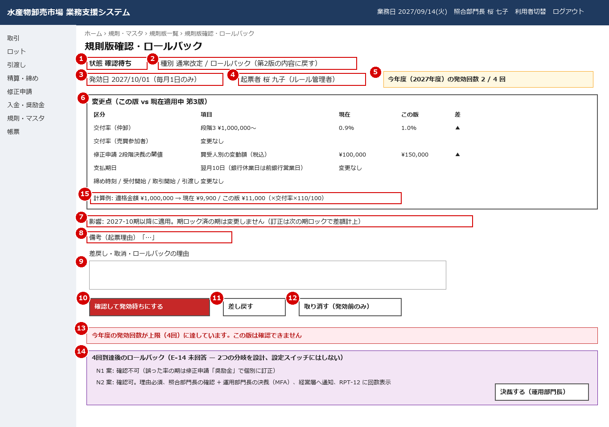

# SC-10-04 — 規則版確認・ロールバック

> 様式: **BM-2-901-51 v2.1** — 画面仕様書 · SUN ASTERISK VIETNAM CO., LTD · ISO/IEC 27001:2013 & ISO 9001:2015

---

## 1. 変更履歴

| No | Version | Action | 変更内容 | 更新日 | 更新者 | Approve |
|---|---|---|---|---|---|---|
| 1 | 0.1.0 | Add New | WF 0.2.1 の SC-10-04 から作成（LAB-4 P3）; E-14 の N1 / N2 の二分岐をすべて描画 | 2026-11-25 | phuongnnm-23344 | |
| 2 | 0.1.1 | Update | Gate 2 G2-M01: C-30 は PREMISE §3.2 ★ に従う — 確認（`CHANGE` と `ROLLBACK`）、決裁 N2、`APPROVED` 版の取消は常に再確認; 差し戻す、`DRAFT` / `PENDING` の取消は step-up を使用 | 2026-11-25 | phuongnnm-23344 | |
| 3 | 0.1.2 | Update | LAB-4: 注釈付き画像をワイヤーフレーム HTML `wireframes/html/SC-10-04.html`（WF 0.2.3）のバリアント A に差し替え; 画像にないバッジを記載; HTML / PNG / PDF のリンク | 2026-11-25 | phuongnnm-23344 | |

---

## 2. レイアウト

**デザイン:** [ワイヤーフレーム SC-10-04 0.2.3](../../../wireframes/SC-10-04-rule-version-approve-rollback-wireframe.md) · 画像の元 HTML [`wireframes/html/SC-10-04.html`](../../../../wireframes/html/SC-10-04.html) · 全バリアント: [`wireframes/png/SC-10-04.png`](../../../../wireframes/png/SC-10-04.png) / [`wireframes/pdf/wireframes-all.pdf`](../../../../wireframes/pdf/wireframes-all.pdf) · 共通枠 [_common-layout](../../../wireframes/_common-layout.md) · 試作品のそのままの画像: [`SC-10-04_prototype.png`](../../../../wireframes/assets/SC-10-04_prototype.png)

> - 画像 = **バリアント A**（メイン画面）の HTML ワイヤーフレーム。`scripts/render-wireframes.py --spec` で生成（Figma はまだ無い）。画像上の番号 = 4 章の `ID` 列 = ワイヤーフレームの `No` 列; `C-x` = `_common-layout.md` の共通項目。
> - この画像にないバッジ: C-31 (B)、C-30 (C)、13 バナー N1 (D)、14 バナー N2 + ボタン「決裁する（運用部門長）」 (E) → 対応するバリアントは [`wireframes/png/SC-10-04.png`](../../../../wireframes/png/SC-10-04.png) / PDF を参照。
> - バナー [13] / [14] は該当する状況（6.1 章）でのみ表示されるため、バリアント D / E に分けた; ボタン「決裁する（運用部門長）」は項目 [14] に属し、個別の番号は付けない。

---

## 3. 説明

画面は、提出済みの規程の版に対して checker である 照合部門長（STL-HEAD）が判断する画面: **確認**（確認して発効待ちにする）、**差し戻す**（maker へ差戻し）、**取り消す**（発効日より前に取消）。版は交付率表 2 件（仲卸 / 売買参加者）と規程パラメータからなり、通常改定または **ロールバック**（旧版の内容を複写）のいずれかである。画面には **今年度の発効回数 n / 4** のカウンタを表示し（ただし go-live 一式、取消版、市場カレンダー・銀行休業日は除く）、現在適用中の版と比較する（例: 奨励金の例）。また **E-14** の二つの分岐（4 回に達している場合のロールバック — 未確定、OPEN-L4-01）を示す。

- 利用者: STL-HEAD（checker、maker と別人）; OPS-HEAD（N2 の分岐のみ: 4 回到達後のロールバックの決裁）; RULE ルール管理者（maker: 閲覧のみ、発効待ちの版の取消を依頼）。
- 入口: SC-10-01 規則版一覧（版の行をクリック）または通知「確認待ち」/「決裁待ち」（C-27）。URL `/rule-versions/{versionId}/review`。
- 遷移先: SC-10-01（操作後 / パンくず）; SC-10-02（maker が差戻された版を修正）; SC-11-13 RPT-12（[5] のリンク）。
- 画面では「承認」の語を使わない（ルール 2、L4-D03）: checker =「確認」、運用部門長 =「決裁」。端末: PC。

---

## 4. 表示

**ID の付け方:** 列 `ID` = ワイヤーフレームの項目番号（1–15、振り直さない）; `C-xx` = 共通項目。太字の A–D の行はグループ。

### 4.1 項目一覧

| ID | Item Name | Item Type | Required | Note |
|---|---|---|---|---|
| **A** | **版の情報** | | | |
| 1 | 状態 | Label | - | 下書き / 確認待ち / 決裁待ち（運用部門長）/ 発効待ち / 適用中 / 置換済 / 取消 (対応 `DRAFT` / `PENDING` / `PENDING`+checker (N2) / `APPROVED` / `ACTIVE` / `SUPERSEDED` / `CANCELLED`) |
| 2 | 種別 | Label | - | 「通常改定」 または 「ロールバック（第{n}版の内容に戻す）」 |
| 3 | 発効日 | Label | - | `YYYY/MM/DD` + 「（毎月1日のみ）」 |
| 4 | 起票者 | Label | - | 氏名 + 「（ルール管理者）」; 閲覧者 = maker → ボタン横に「起票者本人は確認できません」 |
| 5 | 今年度の発効回数 | Label | - | 「{年度}年度（4月〜3月）の発効回数 {used} / 4 回」 — TC 年度はこの版の **発効日** で決まる; 小さい行に「※移行時の初期版・発効前に取り消した版・市場カレンダーは数えない」. used = 3 → 黄色背景「残り1回」; used ≥ 4 → 赤背景。リンク「RPT-12 へ」 |
| **B** | **変更内容** | | | |
| 6 | 変更点（この版 vs 現在適用中） | Label（表） | - | 列: 区分 · 項目 · 現在 · この版 · 差 (▲ 増 / ▼ 減 / 変更あり). 交付率表 2 件（各 5 ランク: 下限 以上 · 率 %）と **すべての規程パラメータ**（修正申請の 2 段階の閾値、支払期日、ロット受付 / 取引開始時刻、日次締め期限、引渡しルール、税の端数処理、持ち越し、下見前販売を含む）。変更のない行は「変更なし」にまとめる |
| 15 | 計算例 | Label | - | 「適格金額 ¥{E} → 現在 ¥{I_cur} / この版 ¥{I_new}（×交付率×110/100）」を 4 段階 500,000 / 1,000,000 / 3,000,000 / 10,000,000 ごとに、仲卸 / 売買参加者それぞれ表示 |
| 7 | 影響 | Label | - | 「{YYYY-MM}期以降に適用。期ロック済の期は変更しません（訂正は次の期ロックで差額計上）」 |
| 8 | 備考（起票理由） | Label | - | maker の理由（`note`） |
| **C** | **操作** | | | |
| 9 | 理由 | Text box（複数行） | 有（差戻し / 取消 / ロールバックの確認 / 決裁 N2 / 取消依頼 のとき） | Placeholder 「差戻し・取消・ロールバックの理由を入力」 |
| 10 | 確認して発効待ちにする | Button | - | メインボタン。ROLLBACK: ラベル「ロールバックを確認する」 |
| 11 | 差し戻す | Button | - | |
| 12 | 取り消す（発効前のみ） | Button | - | RULE 役で版が `APPROVED` のとき: ラベル「取消を依頼する」 |
| **D** | **ブロックバナー / E-14** | | | |
| 13 | 上限到達 | Label（赤バナー） | - | 「今年度の発効回数が上限（4回）に達しています。この版は確認できません」 — `CHANGE` で used ≥ 4 のとき（N1、N2 とも） |
| 14 | 4回到達後のロールバック | Label (banner) + Button | - | `ROLLBACK` かつ used ≥ 4 のときのみ。**N1:** 「4回到達後のロールバックは確認できません。誤った率で計算された期は修正申請『奨励金』で個別に訂正してください」 + SC-08-01 へのリンク。**N2:** 「理由必須。照合部門長の確認後、運用部門長の決裁（MFA）が必要です。経営層へ自動通知し、RPT-12 に回数として表示します」; 決裁待ちの状態では OPS-HEAD に「決裁する（運用部門長）」ボタンを表示 |
| C-27 | 待機ラベル | Label | - | [1] の横に「確認待ち」 / 「決裁待ち（運用部門長）」 |
| C-31 | 確認 | Dialog | - | 確認: 「発効日 {date} から適用されます。今年度 {used+1} / 4 回目になります。」; ROLLBACK では「第{n}版の内容に戻します」を追加; 取消: 「取り消した版は回数に数えません」 |
| C-30 | MFA | Dialog + Text box | 有 | **常に再確認**（PREMISE §3.2 ★、ワンタイムトークン）: 確認 `CHANGE` (`RULE_CHANGE_CONFIRM`), 確認 `ROLLBACK` (`RULE_ROLLBACK_CONFIRM`), 決裁 N2 (`RULE_SECOND_APPROVAL`), `APPROVED` 版の取消 (`RULE_CANCEL_DECIDE`). 差し戻す、`DRAFT` / `PENDING` 版の取消では、残っていれば 10 分の step-up を使用 |
| C-10 | 右上のボタン | Button | - | 「規則版一覧へ」 → SC-10-01 |

### 4.2 バリデーション

| ID | Type | Min | Max | Default | 備考 |
|---|---|---|---|---|---|
| 9 | String (UTF-8, 改行可) | 1 | 500 | （空） | [11]、[12]、`ROLLBACK` の [10]、決裁ボタン [14]、「取消を依頼する」で必須; `CHANGE` の [10] では任意。前後の空白を除去; 誤りの場合 `E-RULE-007` 「理由を入力してください（500文字以内）。」を入力欄の直下に表示 (C-22) |
| C-30 | 数字の文字列 | 6 | 6 | （空） | iam の MFA 認証 API で検証（未仕様化） |

業務条件（回数上限、発効日、状態、maker ≠ checker）は**入力の検証ではない** — サーバーが検査し、画面は `permissions` に従ってボタンを非表示 / 非活性にする（6.2 章参照）。

### 4.3 データ対応

| ID | Data Source | API ID | API URL | Key / Param | 備考 |
|---|---|---|---|---|---|
| 1–8, 13, 14, 15, C-27 | API | `API-RULE-001` | `GET /api/v1/rule-versions/{versionId}/review` | `version`, `quota`, `diff[]`, `examples[]`, `impact`, `policy`, `permissions` | `policy.branch` = `N1` / `N2`（導入中の分岐） |
| 9, 10 | API | `API-RULE-002` | `POST /api/v1/rule-versions/{versionId}/confirm` | `reason`, header `X-MFA-Token` | |
| 9, 14 (決裁) | API | `API-RULE-003` | `POST /api/v1/rule-versions/{versionId}/second-approval` | `reason`, header `X-MFA-Token` | N2 のみ |
| 9, 11 | API | `API-RULE-004` | `POST /api/v1/rule-versions/{versionId}/return` | `reason` | |
| 9, 12 (STL-HEAD / maker) | API | `API-RULE-005` | `POST /api/v1/rule-versions/{versionId}/cancel` | `reason`, header `X-MFA-Token` | |
| 9, 12 (RULE, `APPROVED`) | API | `API-RULE-006` | `POST /api/v1/rule-versions/{versionId}/cancel-request` | `reason` | |

### 4.4 役割ごとの表示権限（LAB-4 の要件により追加）

記号: **T** 操作可 · **R** 閲覧のみ · **H** 非表示 · `—` アクセス不可（C-25）。複数の役割を持つ者（OPEN-DB-10）は、権限を各列の和集合とする。ただし **S4** を除く — この版の maker である者は [10]、[11]、決裁ボタン [14] を持たない。

| ID | STL-HEAD (checker, ≠ maker) | OPS-HEAD | RULE (maker / ルール管理者) | SETTLE、その他の役割 |
|---|---|---|---|---|
| 1–8, 13, 15, C-27 | R | R | R | — |
| 9 | T | T (決裁待ちのときのみ) | T (取消依頼 / 自分の `DRAFT`、`PENDING` 版の取消のとき) | — |
| 10 確認 | T (checker 未設定の `PENDING` 版) | H | H | — |
| 11 差し戻す | T (`PENDING`) | H | H | — |
| 12 取り消す | T (`DRAFT` / `PENDING`; 取消依頼がある場合は `APPROVED`) | H | T: 自分の `DRAFT` / `PENDING` 版は「取り消す」; `APPROVED` 版は「取消を依頼する」 | — |
| 14 (banner) | R | R | R | — |
| 14（決裁 ボタン、N2） | H | T (maker・checker と別人) | H | — |
| C-10 | T | T | T | — |

---

## 5. イベント

| ID | Given (Pre-condition) | When (Trigger/Action) | Then (Result) | Note |
|---|---|---|---|---|
| **Initializing Process（初期処理）** | | | | |
| - | `versionId` が有効、役割に権限あり | 画面を開く | 1. `API-RULE-001` を呼ぶ（300 ms 超で C-20） 2. [1]–[8]、[15] を表示 3. `policy.blockedReason = QUOTA` のとき [13]; `ROLLBACK` かつ `quota.used ≥ 4` のとき [14] を表示 4. `permissions`（4.4）に従いボタンを表示 / 非表示 | |
| - | 閲覧者が maker | 画面を開く | [10]、[11] を非表示; 「起票者本人は確認できません」 | S4 |
| **Standard Process（通常処理）** | | | | |
| 10 | `PENDING`、used < 4（または N2 の `ROLLBACK`） | 確認をクリック | `ROLLBACK` なら [9] を検査 → C-31 → C-30（`CHANGE` を含め常に再確認）→ `API-RULE-002`。200: トースト C-12 「第{n}版を確認しました（発効日 {date}・今年度 {used}/4 回）」 または (N2) 「運用部門長の決裁待ちにしました」; 画面を再読込 | |
| 14 | N2、決裁待ち、役割 OPS-HEAD | 「決裁する（運用部門長）」をクリック | [9] を検査 → C-31（「4回到達後のロールバックです。経営層へ通知されます」）→ C-30（常に再確認）→ `API-RULE-003`; 200: トースト 「決裁しました（今年度 {used}/4 回超）」 | |
| 11 | `PENDING` | 差し戻すをクリック | [9] を検査 → C-31 → C-30（step-up）→ `API-RULE-004`; 200: トースト「差し戻しました」、SC-10-01 へ遷移 | maker は SC-10-02 で修正 |
| 12 | `DRAFT` / `PENDING`（maker または checker）、または取消依頼がある `APPROVED`（checker） | 取り消すをクリック | [9] を検査 → C-31 → C-30（`APPROVED`: 常に再確認; `DRAFT` / `PENDING`: step-up）→ `API-RULE-005`; 200: トースト 「取り消しました（回数に数えません）」 | |
| 12 | `APPROVED`、役割 RULE | 取消を依頼するをクリック | [9] を検査 → C-31 → `API-RULE-006`; 200: トースト 「取消を依頼しました（照合部門長の決裁待ち）」; C-27 に「取消依頼中」を表示 | |
| 5 | — | 「RPT-12 へ」をクリック | SC-11-13 へ遷移し TC 年度で絞り込み | |
| 14 (N1) | — | 修正申請のリンクをクリック | `INCENTIVE` 種別で SC-08-01 へ遷移 | |
| **Error Handling（エラー制御）** | | | | |
| 10 | `API-RULE-002` を呼ぶ | 409 `E-RULE-006` / `E-RULE-009` | 再読込; 該当する [13] / [14] を表示; C-23 | 他の者が別の版を決裁したばかり（RV-13） |
| 10, 14 | API を呼ぶ | 409 `E-RULE-004` | C-23 + ヒント「取り消して発効日を見直してください」 | |
| 10, 14 | API を呼ぶ | 409 `E-RULE-003` / `E-RULE-005` / `E-RULE-010` / `E-RULE-013` | C-23; 状態を再読込 | |
| 10, 11, 12, 14 | API を呼ぶ | 403 `E-RULE-002` / `E-RULE-011` | C-23（日本語のメッセージ）; ボタンを非表示 | |
| 12 | API を呼ぶ | 409 `E-RULE-008` / `E-RULE-012` / `E-RULE-014` | C-23 | |
| 9 | 送信 | 422 `E-RULE-007` | [9] の下に C-22 | |
| C-30 | コード検証（iam の API）/ API 呼び出し | コードの誤り: MFA 認証 API のエラー（iam、未仕様化）; トークンの欠落 / 期限切れ: 403 `E-CMN-005` | C-30 のボックスを残し、文字は赤 | |
| - | いずれも | 404 `E-RULE-001` | 「指定された規則版が見つかりません」ページ + SC-10-01 へのリンク | |
| - | いずれも | 403 / 5xx / 通信断 | C-25 / C-26 / C-28（オフライン時はすべての決裁操作を停止） | |

---

## 6. その他の注記

### 6.1 画面の状態

| 状態 | 表示 |
|---|---|
| 読込中 | C-20 |
| 空 | N/A — 画面は必ず特定の版を開く; 版が存在しない → 404 |
| `DRAFT`（下書き） | checker は閲覧のみ（未提出）; maker は [12] を持つ |
| `PENDING`（確認待ち） | 役割に応じて [9]–[12] |
| 決裁待ち (N2) | C-27「決裁待ち（運用部門長）」; STL-HEAD は [11]（差戻し → 最初からやり直し）、[12] のみ; OPS-HEAD は決裁ボタンを持つ |
| `APPROVED`（発効待ち） | 閲覧のみ + [12]（取消依頼がある場合の checker; maker は「取消を依頼する」） |
| `ACTIVE` / `SUPERSEDED` / `CANCELLED` | 閲覧のみ; [12] 非表示 |
| 3 / 4 回 | [5] 黄色「残り1回」 |
| 4 回到達 | [13]（CHANGE）または [14]（ROLLBACK）; N1 では [10] 非表示 |
| エラー | C-22 / C-23 / C-26 |
| 通信断 | C-28 |

### 6.2 ルール / 前提

- 決裁ロジック、回数上限、E-14 のポリシー、テストベクター RV-01..18: [RULE_VERSION_TECH](../technical-design/RULE_VERSION_TECH.md).
- E-14 の分岐は**いずれか一つ**を導入する（ワークショップ実施までは N1 がデフォルト — Q-RULE-01）; 画面は API の `policy.branch` を読み、設定スイッチは**持たない**。方式 F / G（ADR-006 §3）は画面に含まない（L4-D06）。
- 発効日は 1 日のみ。確認をクリックする時点で現在の業務日より後でなければならない（PRM-042）。
- 発効済みの版は修正・取消できない; 発効日の後に率の誤りが見つかった場合 → 人ごと × 期ごとに修正申請 INCENTIVE（R-L4-01）。
- 例 [6]: 1,000,000 は INCENTIVE_DB §5 による **ランク 3** — WF-SC-10-04 0.2.2 で修正済み（以前は誤って「ランク2」と記載）。

### 6.3 トレーサビリティ

FT-10-01; GOV-RULE-01, NFR-OPS-02, FR-INC-02, FR-RULE-01, TBL-RATE-01, RACI-01; PRM-042, PRM-054, PRM-126; E-14 (OPEN-L4-01), R-L4-01; L4-A03, L4-A04 (3), L4-D03, L4-D06; ADR-002, ADR-006; as-built D01, D06, D07, D09, M15, N14; Gate 1 M-04, M-06, m-09.
