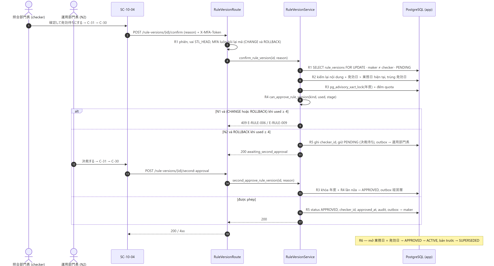
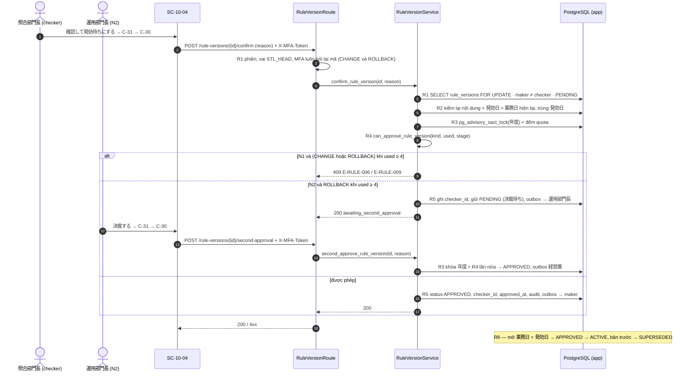

# RULE_VERSION — 版管理された規程: メーカー・チェッカー、発効日、回数上限、ロールバック、E-14 の分岐

> 様式: **BM-2-901-53 v01** — 詳細設計（チャート + 説明） · SUN ASTERISK VIETNAM CO., LTD · ISO/IEC 27001:2013 & ISO 9001:2015

用語: **規則版**（規程の版 — 交付率表 2 件 + 規程パラメータのまとめ）、**起票者**（maker、ルール管理者）、**確認**（checker 照合部門長による確認 — 「承認」の語は使わない、L4-D03）、**決裁**（運用部門長が決める、N2 分岐のみ）、**発効日**（発効する日、必ず月の 1 日）、**年度 / TC 年度**（4月→3月）。

---

## 1. 変更履歴

| No | Version | Action | 対象箇所 / ステップ | 変更内容 | 更新日 | 更新者 | Approve |
|---|---|---|---|---|---|---|---|
| 1 | 0.1.0 | Add new | — | 初版（LAB-4 P3）: R1–R7 の 7 ブロック、E-14 のポリシー関数に N1 / N2 を描画（F / G は資料のみ — L4-D06）、テストベクター RV-01..17 | 2026-11-25 | phuongnnm-23344 | |
| 2 | 0.1.1 | Update | — | Gate 2 G2-M01: confirm `CHANGE` と cancel `APPROVED` は PREMISE §3.2 ★ に従い常に MFA コードを再確認（`RULE_CHANGE_CONFIRM`、`RULE_CANCEL_DECIDE`）; RV-18 を追加; G2-m04: Mermaid のメッセージから `;` を削除 | 2026-11-25 | phuongnnm-23344 | |
| 3 | 0.1.2 | Update | §2 | FB-EXP-236: Mermaid ブロックから書き出した PNG `./assets/RULE_VERSION_sequence.png` を埋め込み（`scripts/export-mermaid-png.py`）; Mermaid は引き続き出典 | 2026-11-25 | phuongnnm-23344 |  |
| 4 | 0.1.3 | Update | §2 | G2C-n01: ステップ 13 の second-approval に `+ X-MFA-Token` を記載（API-RULE-003、`RULE_SECOND_APPROVAL` と一致）; PNG を再書き出し | 2026-11-25 | phuongnnm-23344 |  |

---

## 2. シーケンス図



出典: 下の Mermaid ブロック（編集用の版）; 画像はそのブロックから `python scripts/export-mermaid-png.py RULE_VERSION` で生成 — Mermaid を修正したら再実行し、二つの版がずれないようにする。

<details open>
<summary>Mermaid 版 — 確認 (checker)、N2 の分岐を含む</summary>



</details>

---

## 3. 説明

規程の版のライフサイクルを **checker** 側（SC-10-04）から管理し、日付による **発効** を扱うサービス。maker の作成 / 修正 / 提出は SC-10-02、SC-10-03 で行う（本ファイルの対象外; 関数 `submit_rule_version` は 5 ランクの連続した交付率表を検査 — RULE_DB 4.22）。

ルール 5 / GOV-RULE-01 は次のように適用する:
- 版 1 件 = 交付率表 2 件（仲卸 / 売買参加者、5 ランク）+ 規程パラメータ（`rule_parameters`）の**まとめ**。発効は**将来の月の 1 日**から（PRM-042, ADR-006 §2.1）。
- **Maker ≠ checker**; checker 照合部門長は MFA を持つ。版が `PENDING` になったら内容はロックする。
- **回数上限 TC 年度あたり 4 回**。審査中の版の **発効日の TC 年度** で数える; `APPROVED` / `ACTIVE` / `SUPERSEDED` の `CHANGE` + `ROLLBACK` を数え、`BASELINE`（go-live の値一式）と `CANCELLED` は**数えない**。市場カレンダー・銀行休業日（`market_calendar`, SC-10-05）はマスタであり**版ではない**ため、回数上限には決して入らない（PRM-054）。
- **ロールバック** = 旧版の内容を複写した新しい版（`rollback_of_id`）、同じライフサイクルと回数上限に従う; 旧版を「再有効化」はしない。
- **締め済みの期を歪めない:** 版は発効日からのみ適用; 期ロック済みの期は自分の `rule_version_id` を保持する（CLOSE_DB 4.43）。決裁済みの率の誤りは、人ごと × 期ごとの修正申請 `INCENTIVE` によってのみ修正できる（ADR-006 §2.4-8a, R-L4-01）。
- **4 回到達後のロールバック — E-14 は未回答:** N1（阻止）/ N2（認める、運用部門長の決裁あり）の両分岐を**一つのポリシー関数**で設計する; ワークショップ後は一方の分岐のみ導入し、設定スイッチにはし**ない**（ADR-006 §2.5-9, PREMISE §6）。ADR-006 §3 の方式 F / G は**ワークショップの資料**であり、ここでは設計しない（L4-D06）。

### 3.1 変数

| 記号 | 意味 | 出典 |
|---|---|---|
| v | 処理中の version | `rule_versions` (RULE_DB 4.21) |
| d_bd | 現在の業務日（開いている） | `business_days` (CLOSE_DB 4.24) — `now()` は使わない |
| FY(x) | 日 x の TC 年度 = 月(x) ≥ 4 なら年(x)、それ以外は年(x) − 1 | `rule_versions.fiscal_year` (GENERATED) |
| used(y) | TC 年度 y について回数上限に算入済みの version 数 = count(`change_kind ∈ {CHANGE, ROLLBACK}` ∧ `status ∈ {APPROVED, ACTIVE, SUPERSEDED}` ∧ `fiscal_year = y`) | RULE_DB 4.21 |
| QUOTA | 4（GOV-RULE-01）— 関数内の定数であり、パラメータではない | — |
| stage | `CHECKER` (確認) / `SECOND` (決裁 N2) | — |
| BRANCH | `N1` または `N2` — **ビルド時に**導入された `can_approve_rule_version` の版で選ぶ | ADR-006 §2.5 |

### 3.2 E-14 のポリシー関数（`can_approve_rule_version`）— N1 / N2 の違いはすべてここにある

```
input: kind ∈ {CHANGE, ROLLBACK}, used, stage
-- chung cả hai nhánh
if kind = CHANGE   and used ≥ QUOTA → DENY  E-RULE-006          (version mới thứ 5 luôn bị chặn)
if used < QUOTA                      → ALLOW (needs_second = false)
-- chỉ còn: kind = ROLLBACK và used ≥ QUOTA
N1: → DENY E-RULE-009                                          (sửa tiền bằng 修正申請 INCENTIVE)
N2: stage = CHECKER → ALLOW (needs_second = true, reason bắt buộc)
    stage = SECOND  → ALLOW (needs_second = false; đếm vào used → lượt thứ 5+; thông báo 経営層; RPT-12)
```

---

## 4. 詳細関数

### 4.1. R1 — 認証、読み取り、version のロック

| 項目 | 値 |
|---|---|
| Input | `versionId`; セッション（`app.user_id`, 権限, `app.mfa_verified_at`）, header `X-MFA-Token` |
| Output | `FOR UPDATE` 済みの行 v → R2 |

**Error**

| エラー条件 | 処理 | Status code |
|---|---|---|
| 未ログイン | 停止, `E-CMN-001` | 401 |
| 権限なし: `STL_HEAD`（confirm / return / cancel）、`OPS_HEAD`（second-approval）、役割 `RULE`（cancel-request） | 停止, `E-CMN-002` | 403 |
| MFA 不合格 — PREMISE §3.2 ★、`purpose` が一致する `X-MFA-Token` が必要（step-up では代替不可）: confirm `CHANGE` (`RULE_CHANGE_CONFIRM`), confirm `ROLLBACK` (`RULE_ROLLBACK_CONFIRM`), second-approval (`RULE_SECOND_APPROVAL`), `APPROVED` 版の cancel (`RULE_CANCEL_DECIDE`); return と `DRAFT` / `PENDING` 版の cancel: 有効な 10 分の step-up | 停止, `E-CMN-005` | 403 |
| version が存在しない | 停止, `E-RULE-001` | 404 |
| 呼び出し者 = `maker_id`（confirm / return / second-approval のとき） | 停止, `E-RULE-002` | 403 |

**Detail**

| No | 処理内容 |
|---|---|
| 1 | Route handler がセッション、CSRF、MFA（ADR-002）を検査し、`set_config` でコンテキストを設定、トランザクションを開き、対応する DB 関数を呼ぶ。 |
| 2 | `SELECT * FROM rule_versions WHERE id = v FOR UPDATE`（待機する。`NOWAIT` は使わない — 短い操作のため）。 |
| 3 | 操作ごとに `assert_caller(...)`; S4 を検査: `caller ≠ maker_id`（CHECK 制約 `checker_id <> maker_id` が最後の防御）。 |

**DoD R1:** RV-02（maker が自分で confirm → `E-RULE-002`）; OPS-HEAD が confirm を呼ぶ → 403; RV-18（confirm `CHANGE` / `ROLLBACK`、cancel `APPROVED` は step-up が有効でも `X-MFA-Token` を送らない → 403 `E-CMN-005`; `purpose` が異なるトークン → 403; `DRAFT` の cancel は step-up があり、トークンなし → 200）。

### 4.2. R2 — 状態、内容、発効日の検査

| 項目 | 値 |
|---|---|
| Input | v, d_bd |
| Output | 確認可能な有効な v → R3 |

**Error**

| エラー条件 | 処理 | Status code |
|---|---|---|
| confirm: `status ≠ PENDING`、または（`PENDING` かつ `checker_id` あり = N2 の決裁待ち） | 停止, `E-RULE-003` | 409 |
| second-approval: 決裁待ちの状態でない（PENDING + `checker_id` + `second_approver_id` が NULL） | 停止, `E-RULE-010` | 409 |
| `effective_from ≤ d_bd`（発効日に到達 / 経過） | 停止, `E-RULE-004`（取消して作り直す案内） | 409 |
| 同じ `effective_from` で別の version が `APPROVED` / `ACTIVE` | 停止, `E-RULE-005` | 409 |
| 交付率表 / パラメータが無効（`submit_rule_version` と同様に再検査） | 停止, `E-RULE-013` | 409 |
| ROLLBACK / return / cancel で理由が無い、または 500 文字超 | 停止, `E-RULE-007` | 422 |

**Detail**

| No | 処理内容 |
|---|---|
| 1 | `effective_from` は 1 日（テーブルの CHECK）、かつ **> d_bd** でなければならない — 発効日当日の確認もブロックする。今日始まる期の version が途中で変わらないようにするため（PRM-042, FR-INC-02）。 |
| 2 | 内容を再検査（想定外に変更されたデータへの対策）: 各 `participant_class` は 0 から始まる連続した 5 ランクを持つ、ランク 1 = 0 bp、ランク 5 は上限なし; 必須の `param_key` をすべて正しい型で備える（RULE_DB 4.23）。 |
| 3 | ROLLBACK: `rollback_of_id` は過去に発効した version（`ACTIVE` / `SUPERSEDED`）を指し、内容が正しく複写されていること（二つの version の内容ハッシュを比較）。 |

**DoD R2:** RV-03（d_bd 2027-10-01 のとき `effective_from` 2027-10-01 → `E-RULE-004`）; RV-15（発効日の重複 → `E-RULE-005`）; ランクを手で不連続に変更 → `E-RULE-013`。

### 4.3. R3 — TC 年度のロックと回数の計数

| 項目 | 値 |
|---|---|
| Input | y = FY(v の `effective_from`) |
| Output | used(y) → R4 |

**Error**

`N/A — chỉ đọc + khóa advisory (chờ tới khi có, không lỗi); vượt quota do R4 quyết.`

**Detail**

| No | 処理内容 |
|---|---|
| 1 | `pg_advisory_xact_lock(hashtext('rule_quota:' || y))` — 同じ TC 年度の二つの version を確認する二人の checker は逐次実行され、同時に上限を超えない（ADR-006 §2.3-6）。 |
| 2 | ロック取得の**後に** §3.1 に従って used(y) を数える。TC 年度は d_bd ではなく **v の発効日**で決める（RV-06: 2028-02-10 に、発効 2028-04-01 の version を確認 → TC 2028 で数える）。 |
| 3 | `BASELINE`、`CANCELLED`、`DRAFT`、`PENDING`（N2 の決裁待ち PENDING を含む）は used に入れない。 |

**DoD R3:** RV-05（BASELINE + CANCELLED 1 件 + CHANGE 3 件 → used = 3）; RV-06, RV-07（境界 3/31 → 4/1）; RV-13（used = 3 で二つのセッションが同時 → 一方成功、一方 `E-RULE-006`）。

### 4.4. R4 — E-14 のポリシー（`can_approve_rule_version`）

| 項目 | 値 |
|---|---|
| Input | v の `change_kind`、used(y)、stage |
| Output | `{allowed, needs_second, error_code}` → R5 |

**Error**

| エラー条件 | 処理 | Status code |
|---|---|---|
| CHANGE かつ used ≥ 4（N1、N2 とも） | 停止, `E-RULE-006` | 409 |
| N1: ROLLBACK かつ used ≥ 4 | 停止, `E-RULE-009`（修正申請「奨励金」への案内メッセージ） | 409 |

**Detail**

| No | 処理内容 |
|---|---|
| 1 | §3.2 に従う `IMMUTABLE` 関数。コード中で N1 / N2 の語を持つ**唯一の箇所**。ワークショップ後に分岐を変えるには、関数本体と RV-09 / RV-10 のテストを変更する — テーブルも API も変えない。 |
| 2 | E-14 が決まるまでは **N1** をデフォルトとしてビルドする（GOV-RULE-01 の観点で安全）; N2 のテストは、切り替えに備えてテストセット内の N2 関数版で実行する。前提 [PL] — Q-RULE-01。 |

**DoD R4:** 境界値表が 2 kind ×（used < 4、used = 4、used = 5）× 2 stage × 2 分岐 = 24 ケースを網羅し、§3.2 と一致すること。

### 4.5. R5 — 状態の書き込み、監査、通知

| 項目 | 値 |
|---|---|
| Input | v, R4 の結果, `reason` |
| Output | 新しい状態の v; `audit_logs`; `notifications` |

**Error**

`N/A — lỗi ghi DB (hiếm) làm rollback toàn bộ transaction và trả 500 `E-CMN-004`; không có ghi dở.`

**Detail**

| No | 処理内容 |
|---|---|
| 1 | confirm、`needs_second = false`: `status = APPROVED`、`checker_id`、`approved_at = now()`; ROLLBACK の場合は checker の理由を `audit_logs` に保存。maker へ通知「第{n}版が確認されました（発効日 {date}）」。 |
| 2 | confirm、`needs_second = true`（N2）: `PENDING` を維持、`checker_id` を記録（表示状態「決裁待ち（運用部門長）」— C-27）; 権限を持つすべての運用部門長へ通知。 |
| 3 | second-approval（N2）: 呼び出し者は `OPS_HEAD`、maker・checker と別人（`E-RULE-011`）; R2 + R3 + R4 を再実行（stage `SECOND`）; `status = APPROVED`、`second_approver_id`、`approved_at`; **経営層**へ通知（受信者一覧は設定ファイル）「4回到達後のロールバックを決裁しました（今年度 {used+1} 回目）」; RPT-12 が回数を集計。 |
| 4 | 各操作を `audit_logs` に記録（`RULE_VERSION_CONFIRM` / `_SECOND_APPROVE` / `_RETURN` / `_CANCEL_REQUEST` / `_CANCEL`）: 実行者、代行、端末、MFA の時刻、used の前 / 後、ポリシーの分岐、理由。 |

**DoD R5:** RV-01、RV-08、RV-10（状態 + 監査 + outbox が正しいこと）; RV-11。

### 4.6. R6 — 日付による発効（`activate_due_rule_versions`, `rule_at`）

| 項目 | 値 |
|---|---|
| Input | 開かれたばかりの業務日 d |
| Output | `effective_from ≤ d` の version `APPROVED` → `ACTIVE`; それまでの `ACTIVE` version → `SUPERSEDED`（`replaced_version_id`） |

**Error**

| エラー条件 | 処理 | Status code |
|---|---|---|
| 業務日を開く関数が途中でエラー | 日の開始をまとめてロールバック（予備ジョブが再実行 — ADR-005） | — (batch) |

**Detail**

| No | 処理内容 |
|---|---|
| 1 | 業務日を開く関数（日次締め で翌日を開く、または予備の 01:00 ジョブ — SC-07-B1）の**同一トランザクション内**で呼ぶ。期限の来た version が複数ある場合（ジョブが数日分遅れた場合）→ `effective_from` の昇順で発効; 途中の版は `ACTIVE` になってすぐ `SUPERSEDED` になる。 |
| 2 | `rule_at(d)` = `status ∈ {APPROVED, ACTIVE, SUPERSEDED}` のうち `effective_from` が d 以下で最大の version — ジョブが実行済みかどうかに**依存しない**（照会は常に正しい）。金額に関わる記録はすべて適用済みの version を保存する（ADR-006 §2.1-3）。 |
| 3 | 新しい期を作成: `payment_periods.rule_version_id = rule_at(start_date)`。既存の期（ロック済みを含む）は version を**変えない**（RV-17）。 |

**DoD R6:** RV-14; RV-17。

### 4.7. R7 — 差戻し、取消依頼、取消

| 項目 | 値 |
|---|---|
| Input | v, `reason`, 操作 |
| Output | v → `DRAFT`（差戻し）/ 取消依頼を記録 / `CANCELLED` |

**Error**

| エラー条件 | 処理 | Status code |
|---|---|---|
| return: v が `PENDING` でない | `E-RULE-003` | 409 |
| cancel: v が `ACTIVE` / `SUPERSEDED` / `CANCELLED`、または `effective_from ≤ d_bd` | `E-RULE-008` | 409 |
| `APPROVED` の v の cancel で maker の取消依頼がまだ無い | `E-RULE-012` | 409 |
| `APPROVED` の v の cancel: 呼び出し者が依頼者 / maker | `E-RULE-002` | 403 |
| cancel-request: v が `APPROVED` でない、または未処理の依頼がすでにある | `E-RULE-014` | 409 |
| 理由の欠落 | `E-RULE-007` | 422 |

**Detail**

| No | 処理内容 |
|---|---|
| 1 | return（checker）: `PENDING` → `DRAFT`、N2 の決裁待ちなら `checker_id` を削除（最初からやり直し）; 理由を添えて maker へ通知。 |
| 2 | cancel `DRAFT` / `PENDING`: maker または checker、理由必須 → `CANCELLED`（回数に算入しない）。 |
| 3 | cancel-request（maker、役割 `RULE`）: v が `APPROVED` かつ `effective_from > d_bd` → 依頼を記録（人、時刻、理由）+ 照合部門長へ通知。**依頼の保存:** `rule_versions` の列 `cancel_requested_by`、`cancel_requested_at`、`cancel_request_reason`（RULE_DB 0.2.1 §4.21 列 13b — 三つの列は同時に NULL か、同時に値を持つ; 未処理の依頼 = `APPROVED` かつ `cancel_requested_at` に値あり）; `audit_logs` の `RULE_VERSION_CANCEL_REQUEST` は引き続き記録。 | |
| 4 | cancel `APPROVED`（checker 照合部門長、依頼者と別人、MFA は `RULE_CANCEL_DECIDE` を常に再確認）: 未処理の依頼が必要 → `CANCELLED`、`cancelled_by`、`cancel_reason`; 回数は戻る（used が 1 減る）; maker へ通知。 |

**DoD R7:** RV-12（3 ケース）; return の後 maker が修正して再提出 → `PENDING` に戻り、履歴が失われない（監査に両方の回が残る）。

---

## 5. その他の注記

### 5.1 規程のテストベクター（RV）— Database Design にはまだ無く、ここを出典として記載

共通の前提: go-live 2027-08-01、v1 `BASELINE`（FY2027）; 交付率表は INCENTIVE_DB §5 の仮の値; d_bd のデフォルトは 2027-09-14。

| RV | 状況 | 期待される結果 | ID |
|---|---|---|---|
| RV-01 | v4 `CHANGE` 発効 2027-10-01、used(2027) = 2、checker ≠ maker、MFA OK | `APPROVED`; used(2027) = 3; maker が通知を受ける | GOV-RULE-01 |
| RV-02 | 役割 RULE と権限 STL_HEAD を併せ持つ者が、自分で作成した version を confirm | 403 `E-RULE-002` | S4 |
| RV-03 | d_bd 2027-10-01、発効 2027-10-01 の version を confirm | 409 `E-RULE-004` | PRM-042, FR-INC-02 |
| RV-04 | used(2027) = 4、5 件目の `CHANGE` を confirm（N1 と N2） | 両分岐で 409 `E-RULE-006` | GOV-RULE-01, OPEN-L4-01 |
| RV-05 | FY2027 に v1 `BASELINE`、`CHANGE` 3 件（`APPROVED`/`ACTIVE`/`SUPERSEDED`）、`CANCELLED` 1 件 | used = 3 → 4 件目の confirm は可能 | L4-A04 (3), D06 |
| RV-06 | d_bd 2028-02-10; used(2027) = 4、used(2028) = 0。発効 2028-04-01 の v と発効 2028-03-01 の v' を confirm | v → `APPROVED`（FY2028 で数える）; v' → `E-RULE-006`（FY2027） | C.3（TC 年度の切り替え） |
| RV-07 | FY(2028-03-01), FY(2028-04-01) | 2027, 2028 | ADR-006 §2.3 |
| RV-08 | v2 への `ROLLBACK`、発効 2027-11-01、used = 3、理由あり、MFA コードを再入力 | `APPROVED`, used = 4, 内容 = v2, `rollback_of_id` = v2 | ADR-006 §2.4 |
| RV-09 | **N1:** used = 4 のとき `ROLLBACK` | 409 `E-RULE-009`; 修正申請「奨励金」への案内メッセージ | E-14 N1, R-L4-01 |
| RV-10 | **N2:** used = 4 のとき `ROLLBACK` → checker が confirm → OPS-HEAD が second-approval | confirm 後: `PENDING` + `checker_id`（決裁待ち）、used は 4 のまま; 決裁後: `APPROVED`、used = 5、経営層へ通知、RPT-12 に 5 を表示 | E-14 N2 【模擬】 |
| RV-11 | **N2:** second-approval を checker 本人または maker が実行 | 403 `E-RULE-011` | ADR-006 §2.5 |
| RV-12 | 発効 2027-10-01 の v `APPROVED`: (a) maker が取消依頼 → 別の checker が取消; (b) 依頼が無いまま checker が取消; (c) d_bd 2027-10-01 のとき取消 | (a) `CANCELLED`、used が 1 減る; (b) `E-RULE-012`; (c) `E-RULE-008` | ADR-006 §2.3-7a, m-09 |
| RV-13 | used = 3; 二人の checker が FY2027 の二つの version を同時に confirm | 一方 `APPROVED`、一方 `E-RULE-006` | ADR-006 §2.3-6 |
| RV-14 | v `APPROVED` 発効 2027-10-01; 業務日 2027-10-01 を開く | v `ACTIVE`、直前の版 `SUPERSEDED`; `rule_at(2027-09-30)` = 直前の版、`rule_at(2027-10-01)` = v（ジョブ未実行でも正しい） | ADR-006 §2.2 |
| RV-15 | 同じ発効 2027-10-01 の二つの version、一方は `APPROVED` 済み | もう一方を confirm → `E-RULE-005` | `uq_rule_versions_active_from` |
| RV-16 | SC-10-05 で臨時休市 2027-10-15 を追加 | used は変わらない（カレンダーは version ではない） | PRM-054 |
| RV-17 | 発効 2027-10-01 の v を、期 2027-09 が `OPEN` の間に確認 | 期 2027-09 は旧版を保持; 期 2027-10 は v で作成; 後で期 09 の DELTA は期 09 の version を引き続き参照 | ADR-006 §2.2-5, ADR-007 K4 |
| RV-18 | 有効な step-up セッション（2 分前に MFA）、`X-MFA-Token` なし: (a) v4 `CHANGE` を confirm; (b) `ROLLBACK` を confirm; (c) 依頼がある `APPROVED` の v を cancel; (d) `DRAFT` の v を cancel; (e) `purpose = RULE_ROLLBACK_CONFIRM` のトークン付きで `CHANGE` を confirm | (a)(b)(c)(e) 403 `E-CMN-005`、v は変わらない; (d) `CANCELLED` | PREMISE §3.2 ★, ADR-002 §2.2-6a |

### 5.2 境界

- 対象外: version の作成 / 修正 / 提出（SC-10-02/03 — 関数 `create_rule_version`, `save_rate_rows`, `save_rule_parameters`, `submit_rule_version`）; 締め済みの期の金額の修正（修正申請 INCENTIVE — feature settle）; 方式 F / G（L4-D06 — ワークショップ資料のみ、工数 ~0.3–0.5 MM は DEC-048 にまだ含まれていない）。
- 画面の計算例（[15]）は feature incentive の `incentive_amount`（INC_FUNC 2.7）を使う — 式は一つ、書き直さない。

### 5.3 新しい質問 / 前提

- Q-RULE-01 — E-14 が決まるまで、どの分岐をデフォルトでビルドするか? 前提 [PL]: **N1**（経営層の決定がまだ無い間は GOV-RULE-01 を緩めない）。ワークショップ後に N2 へ変える: 関数一つを差し替え + 決裁画面を有効化、約 0.5 MD。
- Q-RULE-02 — 取消依頼（version `APPROVED`）は `rule_versions` の 3 列に保存 — RULE_DB 0.2.1 §4.21 に反映済み（内部の設計上の論点、Gate 2 の決裁で締める）。
- Q-RULE-03 — N2: 通知を受ける 「経営層」 の一覧は誰か（設定ファイル）? 前提 [PL]: 代表取締役 + 運用部門長 + 照合部門長。
