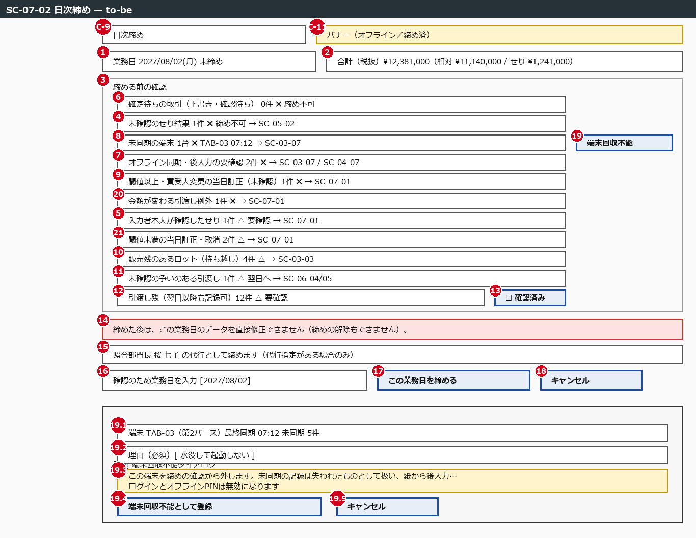
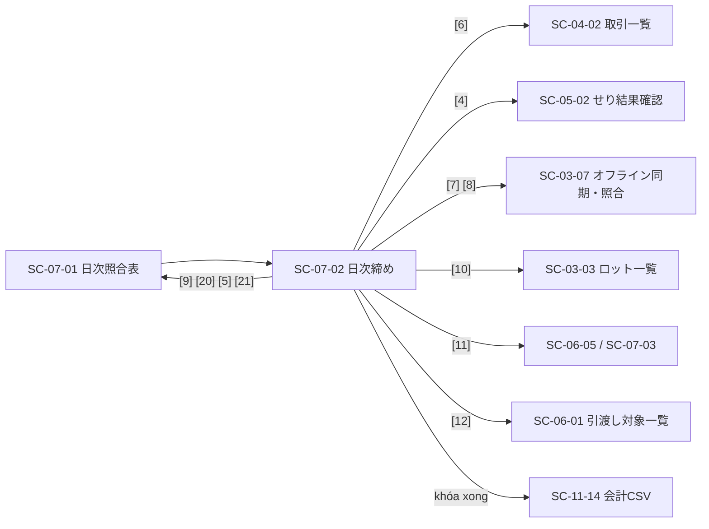

# SC-07-02 — 日次締め

> 様式: **BM-2-901-51 v2.1** — 画面仕様書 · SUN ASTERISK VIETNAM CO., LTD · ISO/IEC 27001:2013 & ISO 9001:2015

---

## 1. 変更履歴

| No | Version | Action | 変更内容 | 更新日 | 更新者 | Approve |
|---|---|---|---|---|---|---|
| 1 | 0.1.0 | Add New | ワイヤーフレーム WF-SC-07-02 0.2.0 から作成; チェックリスト 11 項目、ADR-005 §2.5 / CLOSE_DB 4.24 と一致 | 2026-11-25 | phuongnnm-23344 | |
| 2 | 0.1.1 | Update | 顧客 Q-STL-02: 項目 [22] チェック「未入力の引渡し確認票なし（紙台帳で確認）」、チェックリスト 12 項目; Q-STL-01/02/03 を解決; G2-M03: エラーは `detail.blocking[]` から読む; 注釈付き画像を再作成 | 2026-11-25 | phuongnnm-23344 |  |
| 3 | 0.1.2 | Update | LAB-4: 注釈付き画像をワイヤーフレーム HTML `wireframes/html/SC-07-02.html`（WF 0.2.3）のバリアント A に差し替え; 画像にないバッジを記載; HTML / PNG / PDF のリンク; §2 は現行の WF を参照（0.2.0 より前） | 2026-11-25 | phuongnnm-23344 | |

---

## 2. レイアウト

**デザイン:** [ワイヤーフレーム SC-07-02 0.2.4](../../../wireframes/SC-07-02-daily-close-business-day-lock-wireframe.md) · 画像の元 HTML [`wireframes/html/SC-07-02.html`](../../../../wireframes/html/SC-07-02.html) · 全バリアント: [`wireframes/png/SC-07-02.png`](../../../../wireframes/png/SC-07-02.png) / [`wireframes/pdf/wireframes-all.pdf`](../../../../wireframes/pdf/wireframes-all.pdf) · 共通枠 [_common-layout](../../../wireframes/_common-layout.md) · 試作品のそのままの画像: `wireframes/assets/SC-07-02_prototype.png`

> - 画像 = **バリアント A**（メイン画面）の HTML ワイヤーフレーム。`scripts/render-wireframes.py --spec` で生成（Figma はまだ無い）。画像上の番号 = 4 章の `ID` 列 = ワイヤーフレームの `No` 列; `C-x` = `_common-layout.md` の共通項目。
> - この画像にないバッジ: ダイアログ 19.1–19.5 端末回収不能 (B)、C-30 · C-31 (C)、C-11 · C-12 (E) → 対応するバリアントは [`wireframes/png/SC-07-02.png`](../../../../wireframes/png/SC-07-02.png) / PDF を参照。

---

## 3. 説明

画面は **判断** の画面: 照合部門長（STL-HEAD）または指定された代行者が**業務日を締める**（日次締め）。締めた後は、誰もその日のデータを直接修正しない — 修正申請を通してのみ（BR-CLOSE-01、ルール 4）。**締めた日を再度開くボタンは、どの画面にも無い**（PRM-031、ADR-005 §2.7）。

締める前に、画面には**標準のチェックリスト 12 項目**を表示する（ADR-005 §2.5 = CLOSE_DB 4.24 `close_checklist`）: ✖ の 6 項目は締めをブロックし、⚠ の 6 項目は通過できる — そのうち #8 と #12 はチェックが必要。各行には件数と、対応する処理画面へのリンクがある。締め = C-31 で結果を確認 → C-30 MFA（**常にコードを再確認** — 元に戻せない操作、ADR-002 §2.2-6a）→ 一つのトランザクションで締める、**市場カレンダーに従って次の市場業務日を同時に開く**（ADR-005 §2.4）、IF-ACC-01 のバッチ作成を開始（SC-11-14）。

オフラインの端末が故障 / 紛失して同期できない場合 → 出口は **「端末回収不能」** [19]（ADR-005 §2.6）: その端末は ✖ の行 [8] から外れ、セッションと オフライン PIN は取り消され、後から届く記録は SC-03-07 に入る。「チェックリストを飛ばして締める」経路は無い。

締めの目標は 10:00、遅くとも 10:30（PRM-030）。

---

## 4. 表示

項目 ID は to-be のワイヤーフレームの番号。「ADR #」列は、チェックリストの行と ADR-005 §2.5 / CLOSE_DB 4.24 の番号を結ぶ。

### 4.1 項目一覧

| ID | Item Name | Item Type | Required | Note |
|---|---|---|---|---|
| **H** | **枠** | | | |
| C-9 | 画面タイトル「日次締め」 | Label | - | |
| C-11 | バナー | Label | - | C-28 オフライン / 「締め済」 / C-26 |
| **A** | **日の概要** | | | |
| 1 | 業務日 + 状態 | Label | - | 「{YYYY/MM/DD(曜)} 未締め」/「締め済（{氏名} {hh:mm}、MFA済）」 |
| 2 | 合計（税抜） | Label | - | 「¥{合計}（相対 ¥… / せり ¥…）」 — 相対 を先に表示（主要フロー） |
| **B** | **チェックリスト** | | | |
| 3 | 締める前の確認 | Label（表） | - | 列: 区分 / 件数 / 締めへの影響 (✖ 締め不可 / ⚠ 要確認・持ち越し・翌日へ) / 対応 (リンク). 下の 12 行（件数の 11 行 + [22] のチェック）、ワイヤーフレームの順序どおり |
| 6 | 確定待ちの取引（下書き・確認待ち） | Label + link | - | ✖ — ADR #1 → SC-04-02（絞り込み） |
| 4 | 未確認のせり結果 | Label + link | - | ✖ — ADR #2 → SC-05-02 |
| 8 | 未同期の端末（最終同期時刻） | Label + link | - | ✖ — ADR #3; 各端末: コード、場所、最終同期時刻、待機中の件数; 各端末の [19] ボタン → SC-03-07 |
| 7 | オフライン同期・後入力の要確認 | Label + link | - | ✖ — ADR #4 → SC-03-07 / SC-04-07 |
| 9 | 閾値以上・買受人変更の当日訂正（未確認） | Label + link | - | ✖ — ADR #5 → SC-07-01 タブ 要確認; 元の確定者と修正者を表示 |
| 20 | 金額が変わる引渡し例外（不足・返品・一部取消） | Label + link | - | ✖ — ADR #6 → SC-07-01 タブ 要確認 |
| 5 | 入力者本人が確認したせり | Label + link | - | ⚠ — ADR #11 → SC-07-01 |
| 21 | 閾値未満の当日訂正・取消 | Label + link | - | ⚠ — ADR #9 → SC-07-01 |
| 10 | 販売残のあるロット（持ち越し） | Label + link | - | ⚠ — ADR #7 → SC-03-03 |
| 11 | 未確認の争いのある引渡し | Label + link | - | ⚠ 「翌日へ」 — ADR #10 → SC-06-05 / SC-07-03 |
| 12 | 引渡し残（翌日以降も記録可） | Label + link | - | ⚠ — ADR #8 → SC-06-01 |
| 13 | 確認済み（引渡し残） | Checkbox | 有 | 必ずチェック（[12] が 0 件の場合も — Q-STL-03、顧客が同意） |
| 22 | 未入力の引渡し確認票なし（紙台帳で確認） | Checkbox | 有 | ⚠ — ADR #12。件数は無い（システムに伝票の発行台帳が無い）; ラベルの下に小さく「配送部門の紙台帳（連番）と照合してください」。締めるにはチェックが必須（【顧客（模擬）、2026-11-25 — Q-STL-02】） |
| **C** | **締めの確認** | | | |
| 14 | 警告文 | Label | - | 常に表示: 「締めた後は、この業務日のデータを直接修正できません（締めの解除もできません）。訂正は修正申請で行います。」 |
| 15 | 代行表示 | Label | - | 閲覧者が代行の場合のみ: 「照合部門長 {氏名} の代行として締めます」 |
| 16 | 業務日の再入力 | Text box | 有 | |
| 17 | この業務日を締める | Button | - | |
| 18 | キャンセル | Button | - | → SC-07-01 |
| **D** | **ダイアログ [19] 端末回収不能** | | | |
| 19 | 端末回収不能 | Button | - | [8] の端末の行にあり; ダイアログを開く |
| 19.1 | 端末情報 | Label | - | 「端末 {code}（{location}）最終同期 {hh:mm} 未同期 {n}件」 |
| 19.2 | 理由 | Text box | 有 | |
| 19.3 | 影響の説明 | Label | - | 固定の文: 端末はチェックリストから外れる; 未同期の記録は失われたとみなし、紙から後で入力する; 後から届く記録は SC-03-07（要確認）へ; 端末のログインとオフライン PIN は無効化される |
| 19.4 | 端末回収不能として登録 | Button | - | → C-30 MFA（常にコードを再確認） |
| 19.5 | キャンセル | Button | - | |

### 4.2 バリデーション

| ID | Type | Min | Max | Default | 備考 |
|---|---|---|---|---|---|
| [13] | Boolean | — | — | false | [17] を押したときにチェックが無い → `E-STL-003`「引渡し残の確認（確認済み）にチェックしてください」 |
| [22] | Boolean | — | — | false | [17] を押したときにチェックが無い → `E-STL-013`「未入力の引渡し確認票がないこと（紙台帳で確認）にチェックしてください」 |
| [16] | Date (string) | 10 | 10 | （空） | `YYYY/MM/DD` と `YYYY-MM-DD` を受け付ける; 締めている業務日と異なる → `E-STL-001`「確認のため業務日を正しく入力してください」 |
| 19.2 | String | 1 | 200 | （空） | → `E-STL-006`「理由を入力してください（200文字以内）」 |

> [17] が有効になるのは次の場合のみ: ✖ の件数がすべて 0、[13] と [22] がチェック済み、[16] が一致。サーバーが全て再検査する（クライアントを信用しない）。

### 4.3 データ対応

| ID | Data Source | API ID | API URL | Key / Param | 備考 |
|---|---|---|---|---|---|
| [1], [2], [3]–[12], [20], [21], [15] | API | `API-STL-001` | `GET /api/v1/business-days/{businessDate}/close-checklist` | `businessDate` | `checklistVersion`（内容のハッシュ）を返す |
| [13], [22], [16], [17] | API | `API-STL-002` | `POST /api/v1/business-days/{businessDate}/close` | `confirmDate`, `deliveryRemainderAcknowledged`, `paperSlipsAllEnteredAcknowledged`, `checklistVersion`, header `X-MFA-Token` | ★ MFA はワンタイム |
| 19.2, 19.4 | API | `API-STL-003` | `POST /api/v1/devices/{deviceId}/lost` | `reason`, header `X-MFA-Token` | ★ MFA はワンタイム |
| C-30 | API | — (module `iam`) | コード検証 `purpose` 付き → `mfaToken` | `purpose = DAY_CLOSE` \| `DEVICE_LOST` | `iam` の API、未仕様化 — [`specs/_index.md`](../../_index.md) の依存の節（DEP-01）; トークンの約束: [api-conventions §4](../../_common/api-conventions.md#4-mfa-step-up) |

---

## 5. イベント

| ID | Given (Pre-condition) | When (Trigger/Action) | Then (Result) | Note |
|---|---|---|---|---|
| **Initializing Process（初期処理）** | | | | |
| - | STL-HEAD / 代行 / SETTLE、オンライン | 画面を開く（既定は最も早い `OPEN` の業務日） | `API-STL-001` → [1]–[21]; 件数 > 0 の ✖ 行は赤、⚠ 行は黄色; ✖ が残る場合 [17] は非活性 + 「✖ の項目を解消すると締められます」 | |
| - | 締め済みの日 | その日で開く | 画面全体は閲覧のみ: [1] 「締め済（{氏名} {hh:mm}、MFA済）」、チェックリストは締めた時点の `close_checklist` のスナップショットを表示; **再オープンのボタンは無い**; リンク「訂正は修正申請へ」 → SC-08-01 | PRM-031 |
| **Standard Process（通常処理）** | | | | |
| [3]（全行） | - | 対応のリンクをクリック | 該当の処理画面を開く（新しいタブ）、業務日で絞り込む | |
| - | タブに戻る | 画面がフォーカスされる | `API-STL-001` を再度呼ぶ（チェックリストが変わっている可能性） | |
| [19] | STL-HEAD / 代行、[8] の端末 | クリック | ダイアログ D（19.1–19.5）を開く | |
| 19.4 | 19.2 が有効 | クリック | C-30（常にコードを再確認）→ `API-STL-003` → 200: ダイアログを閉じる、C-12「端末 {code} を端末回収不能として登録しました」、チェックリストを再読込（端末は [8] から外れる） | |
| [17] | 4.2 の条件を満たす | クリック | 1. C-31:「{業務日} を締めます。締めた後は解除できません。合計 ¥{合計}」+ ボタン「締める」。 2. C-30（常にコードを再確認）→ `mfaToken`。 3. `API-STL-002`。 4. 200 → C-12「{業務日} を締めました（{氏名} {hh:mm}）。次の業務日 {翌業務日} を開きました」、画面は閲覧のみに; ヘッダー C-2 を更新; 通知「会計CSVの作成を開始しました（11:00まで）」 | |
| [18] | - | クリック | → SC-07-01、締めない | |
| **Error Handling（エラー制御）** | | | | |
| [17] | - | 422 `E-STL-003` / `E-STL-013`（[13] / [22] のチェックが無い — サーバー） | 該当チェックボックスの下に C-22（`field`） | |
| [17] | - | 409 `E-STL-010`（表示時からチェックリストが変わった） | C-23「チェックリストが更新されました。最新の内容を確認してください」; 再読込 | |
| [17] | - | 409 `E-STL-002`（✖ が残る — サーバー） | C-23 + ✖ の行の一覧を `detail.blocking[]`（`adrNo`、`label`、`count`）から表示; 再読込 | |
| [17] | - | 409 `E-STL-004`（他の人がちょうど締めた） | 締めた人の情報を添えて閲覧のみに切り替え | |
| [17] | - | 409 `E-STL-005`（前の日が未締め） | C-23「前の業務日 {date} が未締めです。先に締めてください」+ リンク | |
| [17] | - | 409 `E-STL-008`（カレンダーに次の業務日が無い） | C-23; ルール管理者に SC-10-05 でカレンダーの入力を案内 | |
| [17], 19.4 | - | 403 `E-CMN-005` / MFA 誤り / キャンセル | 画面に留まる、締めない | |
| - | - | 通信断 | C-28:「通信が回復するまで締められません」; [17]、[19] を非活性 | |

---

## 6. その他の注記

### 6.1 画面の状態

| 状態 | 表示 |
|---|---|
| 読込中 | C-20 を [3] に表示 |
| ✖ が残る | [17] 非活性 + 「✖ の項目を解消すると締められます」 |
| 条件を満たす | [13]、[22] がチェック済み、[16] が一致 → [17] 有効 |
| 締め済み | 閲覧のみ + 締めた時点のチェックリストのスナップショット; 再オープンのボタン無し |
| 端末の故障 / 紛失 | [8] の端末の行に [19]; 「チェックを飛ばして締める」は無い |
| オフライン | C-28; 締めない、端末回収不能もできない |
| 権限なし / 代行なし | SETTLE: チェックリストは閲覧のみ（[13]、[22]、[16]、[17]、[19] は無し）; 他の役割は C-25 |
| 締め済みの日（423） | N/A — 画面はその日の業務データを書き込まない; 締め済みの日は閲覧のみ |

### 6.2 役割ごとの表示権限

| Item | STL-HEAD / 代行 (STL_HEAD) | SETTLE | OPS-HEAD | その他の役割 |
|---|---|---|---|---|
| [1], [2], [3]–[12], [20], [21], [14] | 表示（+ リンク） | 表示（+ リンク） | 非表示 — 日の状態は SC-07-01 で確認 | 非表示（C-25） |
| [13], [22], [16], [17], [18] | T | 非表示 | 非表示 | 非表示 |
| [15] | 表示（代行のみ） | 非表示 | 非表示 | 非表示 |
| [19], ダイアログ D | T | 非表示 | 非表示 | 非表示 |

SETTLE は行 [9]、[20] を SC-07-01 の「確認済」ボタンで処理する（この画面ではない）。

### 6.3 画面遷移

### 6.4 トレーサビリティ

FT-07-04, FR-SETTLE-01, FR-SETTLE-02, BR-CLOSE-01, E-08, E-12, PRM-030, PRM-031, PRM-036, PRM-110, PRM-115, PRM-119, PRM-123, PRM-127, NFR-AVL-02, RACI-01, S8; ADR-002 §2.2-6a, ADR-005 §2.4–2.7, ADR-008; CLOSE_DB 4.24, IAM_AUDIT_DB 4.6, 4.55, ADJUST_DB 4.32, TRADE_DB 4.35; Gate 1 M-01, M-05; 顧客 #1, #4, #25。

### 6.5 質問 / 新しい前提

| 提案 ID | 内容 | 暫定前提 | 前提が誤っていた場合の影響 |
|---|---|---|---|
| Q-STL-01 | 業務日は順番どおり（古い日から）締める必要があるか? | **回答済み** 【顧客（模擬）、2026-11-25】: はい — D−1 が `OPEN` のとき D の締めをブロック（`E-STL-005`、BR-CLOSE-01） | 順序を飛ばして締められると、修正申請の「最も早い開いている日」が直前に締めた日より古くなりうる — ADR-005 を再確認する必要がある |
| Q-STL-02 | 発行済みだが未入力の引渡し確認票（紙）— システムに伝票の発行台帳が無い | **回答済み** 【顧客（模擬）、2026-11-25 — Q-STL-02】: 伝票の発行台帳は作らない; 別のチェック [22]（ADR #12）を追加、番号付きの紙台帳は配送部門が保管 | —（チェックリストの一行） |
| Q-STL-03 | [13] は引渡し残が 0 件のときもチェックが必要か? | **回答済み** 【顧客（模擬）、2026-11-25】: はい、チェックは「確認済み」の意味 | — |
