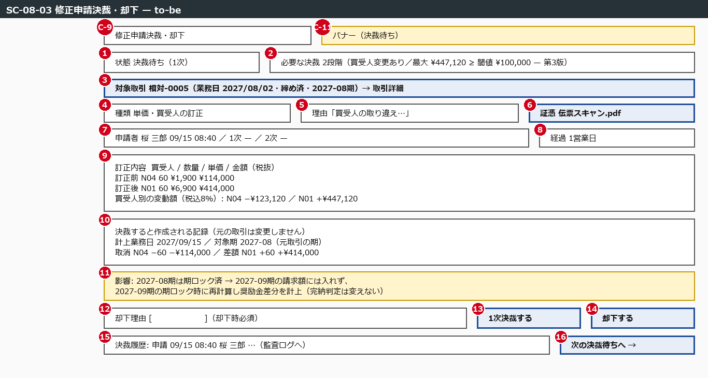

# SC-08-03 — 修正申請決裁・却下

> 様式: **BM-2-901-51 v2.1** — 画面仕様書 · SUN ASTERISK VIETNAM CO., LTD · ISO/IEC 27001:2013 & ISO 9001:2015

---

## 1. 変更履歴

| No | Version | Action | 変更内容 | 更新日 | 更新者 | Approve |
|---|---|---|---|---|---|---|
| 1 | 0.1.0 | Add New | ワイヤーフレーム WF-SC-08-03 0.2.1 から作成 | 2026-11-25 | phuongnnm-23344 | |
| 2 | 0.1.1 | Update | 顧客 Q-STL-04: 段階 1 = 照合部門長または事前指定の代行、運用部門長は段階 2 のみ; Q-STL-04/05 を解決; G2-M03: LATE_ENTRY のエラーは `message` + `detail.sourceCode` を表示 | 2026-11-25 | phuongnnm-23344 |  |
| 3 | 0.1.2 | Update | LAB-4: 注釈付き画像をワイヤーフレーム HTML `wireframes/html/SC-08-03.html`（WF 0.2.3）のバリアント A に差し替え; 画像にないバッジを記載; HTML / PNG / PDF のリンク | 2026-11-25 | phuongnnm-23344 | |

---

## 2. レイアウト

**デザイン:** [ワイヤーフレーム SC-08-03 0.2.3](../../../wireframes/SC-08-03-correction-request-approve-reject-wireframe.md) · 画像の元 HTML [`wireframes/html/SC-08-03.html`](../../../../wireframes/html/SC-08-03.html) · 全バリアント: [`wireframes/png/SC-08-03.png`](../../../../wireframes/png/SC-08-03.png) / [`wireframes/pdf/wireframes-all.pdf`](../../../../wireframes/pdf/wireframes-all.pdf) · 共通枠 [_common-layout](../../../wireframes/_common-layout.md) · 試作品のそのままの画像: `wireframes/assets/SC-08-03_prototype.png`

> - 画像 = **バリアント A**（メイン画面）の HTML ワイヤーフレーム。`scripts/render-wireframes.py --spec` で生成（Figma はまだ無い）。画像上の番号 = 4 章の `ID` 列 = ワイヤーフレームの `No` 列; `C-x` = `_common-layout.md` の共通項目。
> - この画像にないバッジ: C-31 (C)、C-30 (D)、C-12 (E)、C-28 (I) → 対応するバリアントは [`wireframes/png/SC-08-03.png`](../../../../wireframes/png/SC-08-03.png) / PDF を参照。
> - [16] はバリアント A では注釈のみ; 実際のボタン「次の決裁待ちへ」は決裁の後に表示される（バリアント E）。

---

## 3. 説明

画面は **決裁** / **却下** の画面: 照合部門長（段階 1）/ 運用部門長（段階 2）が修正申請（確定後の訂正の依頼）を決める — 決める人は人（CAP-HUMAN-01）。LAB-1 の画面名は「修正申請承認・却下」だったが、LAB-4 で「修正申請決裁・却下」に改めた — 「承認」の語は売買参加者の資格（承認（売買参加者））にのみ使う（ルール 2、L4-D03）。画面 ID は変えない。

決裁は**元の取引を修正しない**: REVERSE + DELTA を、**業務日の未締めの最も早い日**（計上業務日）に記録する; **行の期 = 元取引の期**（対象期）。画面は、押す前に、作成される記録と期 / 奨励金への影響を [10] と [11] で確認させる。段階数 [2] は提出時に規程の版に従って確定している: 購入者ごとの金額の最大変化（税込）≥ 閾値、**または購入者の変更 → 常に 2 段階**、`KANNO` / `INCENTIVE` も常に 2 段階。

[4] の種類は 4 つ: `TRADE`（取引の数量 / 価格 / 購入者）、`KANNO`（締め済みの期の完納の変更）、`INCENTIVE`（締め済みの期の奨励金の修正）、`LATE_ENTRY`（締め済みの日の新しい記録 — 後入力）。

---

## 4. 表示

### 4.1 項目一覧

| ID | Item Name | Item Type | Required | Note |
|---|---|---|---|---|
| **H** | **枠** | | | |
| C-9 | 画面タイトル 「修正申請決裁・却下」 | Label | - | |
| C-11 | バナー | Label | - | C-27 決裁待ち / C-28 / C-26 |
| **A** | **申請の概要** | | | |
| 1 | 状態 | Label | - | 決裁待ち（1次）/ 決裁待ち（2次）/ 決裁・反映済 / 却下. **使わない**「承認」 |
| 2 | 必要な決裁 | Label | - | 「{1\|2}段階（{理由}— 規則版 第{n}版）」; 理由: 「買受人変更あり」 / 「買受人別の変動額 最大 ¥{額} ≥ 閾値 ¥{閾値}」 / 「完納・奨励金の訂正」 |
| 3 | 対象 | Button (link) | - | `TRADE`: 「{取引}（業務日 {日付}・締め済・{期}期）→ 取引詳細」 → SC-04-04. `KANNO` / `INCENTIVE`: 「{買受人} {期}期」 → SC-09-xx. `LATE_ENTRY`: 「{業務日}（締め済）の後入力: {種類}」 |
| 4 | 種類 | Label | - | 種類のラベル（`TRADE` → 「数量・単価・買受人の訂正」 など） |
| 5 | 理由 | Label | - | |
| 6 | 証憑 | Button (link) | - | 証憑ファイルを開く（`CORRECTION_EVIDENCE`）; 「{件}件」 |
| 7 | 申請者 / 1次 / 2次 | Label | - | 氏名 + 時刻; 代行の場合は 「（{氏名} の代行）」 を表示 |
| 8 | 経過 | Label | - | 「{n}営業日」; > 2 営業日 → 黄色「2営業日超」 |
| **B** | **内容 + 影響** | | | |
| 9 | 訂正内容 | Label（表） | - | 訂正前 / 訂正後: 買受人 / 数量 / 単価 / 金額（税抜） + 行 「買受人別の変動額（税込 {率}%）」 |
| 10 | 決裁すると作成される記録 | Label（表） | - | 「計上業務日 {日付}（未締めの最も早い業務日）／ 対象期 {期}（元取引の期）」 + 行 取消（REVERSE）/ 差額（DELTA）; 反映後は実際の記録を表示。固定の文「元の取引は変更しません」 |
| 11 | 影響 | Label | - | 元の期が開いている: 「元取引の期（{期}）はまだ期ロック前のため、同期の請求額に反映されます」; 元の期が締め済み: 「{期}期は期ロック済 → {現期}期の請求額には入れず、{現期}期の期ロック時に {期}期を再計算し奨励金差分を計上（完納判定は変えない）」; `KANNO`: 「完納判定を変更します（次の期ロックで差分）」 |
| **C** | **操作** | | | |
| 12 | 却下理由 | Text box（複数行） | 却下のとき必須 | |
| 13 | 決裁 | Button | - | ラベル 「1次決裁する」/「2次決裁する（反映）」; `required_levels = 1` のとき: 「決裁する（反映）」 |
| 14 | 却下する | Button | - | |
| 15 | 決裁履歴 | Label（表）+ リンク | - | 各ステップ: 日時 / 段階 / 氏名 / 代行 / 結果 / コメント → SC-13-01 |
| 16 | 次の決裁待ちへ | Button | - | 決裁 / 却下の後にのみ表示、閲覧者に待ち申請がある場合 |

### 4.2 バリデーション

| ID | Type | Min | Max | Default | 備考 |
|---|---|---|---|---|---|
| [12] | String | 1 (却下のとき) | 200 | （空） | 却下で空 / 200 文字超 → `E-STL-025`「却下理由を入力してください（200文字以内）」 |

> 他の入力欄は無い — 申請の内容はすべて閲覧のみ（内容を変えたい場合は却下して SC-08-01 で作り直す）。

### 4.3 データ対応

| ID | Data Source | API ID | API URL | Key / Param | 備考 |
|---|---|---|---|---|---|
| [1]–[11], [15] | API | `API-STL-004` | `GET /api/v1/corrections/{correctionId}` | `correctionId` | `preview`、`allowedActions` を含む |
| [6] | API | — (共通モジュール `attachments`) | 証憑のダウンロード | `attachmentId` | 未仕様化 — [`specs/_index.md`](../../_index.md) の依存の節（DEP-03） |
| [12]–[14] | API | `API-STL-005` | `POST /api/v1/corrections/{correctionId}/decisions` | `level`, `decision`, `comment` | MFA step-up |
| [16] | API | `API-STL-005` (response) | — | `nextPendingId` | |

---

## 5. イベント

| ID | Given (Pre-condition) | When (Trigger/Action) | Then (Result) | Note |
|---|---|---|---|---|
| **Initializing Process（初期処理）** | | | | |
| - | SC-08-02 / 通知から開く、オンライン | `/corrections/{id}` を開く | `API-STL-004` → [1]–[15]; `allowedActions` に従い §6.2 を適用 | |
| **Standard Process（通常処理）** | | | | |
| [3] | - | クリック | → SC-04-04（TRADE）/ 期の画面（KANNO、INCENTIVE） | |
| [6] | - | クリック | 証憑を開く（新しいタブ） | |
| [13] | `allowedActions` に `DECIDE_L1` / `DECIDE_L2` がある | クリック | 1. C-31:「{段階}決裁します。計上業務日 {日付}、対象期 {期}。元の取引は変更しません」。 2. step-up が切れていれば C-30 MFA。 3. `API-STL-005`（`decision = APPROVE`、`level`）。 4. 200 → C-12「1次決裁しました」/「決裁しました。取消・差額を記録しました（計上 {日付}）」; 再読込; `nextPendingId` があれば [16] を表示 | |
| [14] | [12] が有効 | クリック | C-31「却下します。申請者に通知されます」 → C-30 → `API-STL-005`（`REJECT`）→ C-12「却下しました」; 閲覧のみ | |
| [16] | `nextPendingId` がある | クリック | 次の申請を開く; 10 分以内は MFA を再度求めない（ただし idle が 3 分を超えた場合を除く） | 顧客 #29 |
| [15] | - | リンクをクリック | → SC-13-01 を申請で絞り込み | |
| **Error Handling（エラー制御）** | | | | |
| [13], [14] | - | 403 `E-STL-023` / `E-STL-024` | 理由の文とともに C-23; [13] [14] を非表示 | サーバーが再検査（UI で隠していても） |
| [13], [14] | - | 409 `E-STL-026` / `E-STL-022`（他の人がちょうど決裁） | C-23「この修正申請は既に処理されました」; 再読込 | |
| [13] | - | 409 `E-STL-027`（ロットの数量が不足） | 残数量を添えて C-23; 申請は状態を維持 | |
| [13] | - | 409 反映先モジュールのエラー（`LATE_ENTRY`） | `message` を C-23 に表示; 反映先のエラーコードは `detail.sourceCode` | |
| [13], [14] | - | 403 `E-CMN-005` | C-30 を開き、再送信 | |
| - | - | 通信断 | C-28; [13] [14] を非活性 | 決裁はオフラインで実行しない |

---

## 6. その他の注記

### 6.1 画面の状態

| 状態 | 表示 |
|---|---|
| 閲覧者が申請者 | [13] [14] 非表示; 「申請者本人は決裁できません」 |
| 閲覧者が段階 1 を決裁済み | [13] [14] 非表示; 「1次と2次を同じ人は決裁できません」 |
| 段階 2 待ち | [1] 「決裁待ち（2次）」; [7] に段階 1 の氏名 |
| 元の期が開いている | [11] に開いている期の文 |
| 反映済み | 閲覧のみ; [10] に実際の記録を表示（REVERSE / DELTA を記録済み） |
| 却下 | 閲覧のみ + 理由 |
| 2 営業日超 | [8] 黄色 |
| オフライン | C-28 |
| 同じ取引に別の待ち申請 | 起きない（待ち申請は取引 1 件につき最大 1 件） |
| 締め済みの日（423） | N/A — 修正申請こそが締め済みの日に対する正規の経路; 記録は常に開いている業務日に入る |

### 6.2 役割ごとの表示権限

| Item | STL-HEAD (申請者以外) | OPS-HEAD | 申請者 (TRADE / DELIVERY / SETTLE) | SETTLE その他 | その他の役割 |
|---|---|---|---|---|---|
| [1]–[11], [15] | 表示 | 表示 | 表示（自分の申請） | 表示（閲覧権限に従う） | 非表示（C-25） |
| [12], [14] | T（段階 1） | T（段階 2） | 非表示 | 非表示 | 非表示 |
| [13]「1次決裁」 | T（または指定された代行 STL-HEAD） | 非表示（段階 1 の代わりはしない — Q-STL-04） | 非表示 | 非表示 | 非表示 |
| [13]「2次決裁」 | 非表示 | T（段階 1 の決裁者と別人） | 非表示 | 非表示 | 非表示 |
| [16] | T | T | 非表示 | 非表示 | 非表示 |

有効な代行（`delegations` に事前に指定）は、代わられる人の権限として扱う; STL-HEAD が不在または自分で申請した → 段階 1 は代行が行う（PRM-033、PRM-120 (a)）; 代行がいなければ申請は SC-08-02 で待機、運用部門長が段階 1 を代わりに決裁することは**しない**（Q-STL-04 【顧客（模擬）、2026-11-25】）。

### 6.3 画面遷移

SC-08-01（作成）→ SC-08-02（一覧、既定は「自分の決裁待ち」）→ **SC-08-03** → [3] SC-04-04 · [15] SC-13-01 · [16] SC-08-03（次の申請）· 完了 → SC-08-02。

### 6.4 トレーサビリティ

FT-08-02, FT-08-03, FR-CORR-01..03, 07-03, D.4, CAP-HUMAN-01, PRM-033, PRM-043, PRM-055, PRM-120, PRM-121, E-08, GOV-RULE-01, FR-NOTIFY-03, S3, S8; ADR-002, ADR-004, ADR-006, ADR-007; ADJUST_DB 4.37–4.39; L4-D03, L4-A04 (2), L4-A07; Gate 1 C-02, M-06, recheck n-05; 顧客 #3, #29。

### 6.5 質問 / 新しい前提

| 提案 ID | 内容 | 暫定前提 | 前提が誤っていた場合の影響 |
|---|---|---|---|
| Q-STL-04 | 運用部門長が段階 1 を照合部門長の代わりに決裁するか? | **回答済み** Q-STL-04 【顧客（模擬）、2026-11-25】: いいえ; 段階 1 = 照合部門長または事前指定の代行; 運用部門長は段階 2 のみ。経営陣に確認中: 事前指定の代行の人事（UAT まで） | go-live 時に代行がいないと、照合部門長が不在のとき修正申請が止まる |
| Q-STL-05 | 修正申請で数量を増やしたとき、ロットが不足 — ブロックするか、警告付きで負を許すか? | **回答済み** 【顧客（模擬）、2026-11-25】: ブロック（`E-STL-027`） — 帳簿がどこかで誤っているので、先に確認が必要（ロットの数量を先に直す場合もある） | 負を許す場合: 持ち越し / 返品のための別のルールが必要 |
