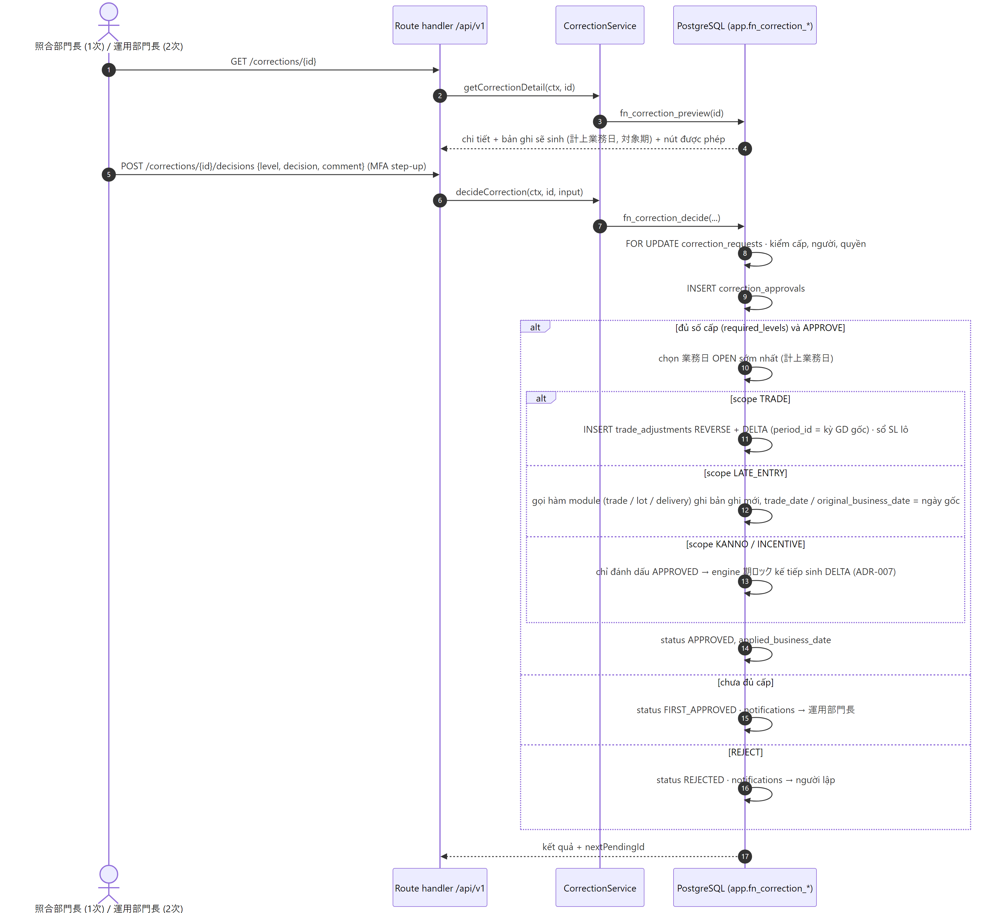
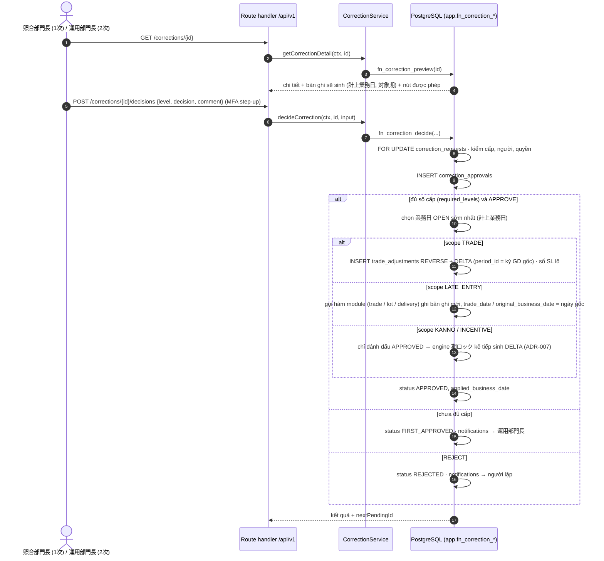

# STL_CORRECTION_DECIDE — 修正申請の決裁と調整記録の生成

> 様式: **BM-2-901-53 v01** — 詳細設計（チャート + 説明） · SUN ASTERISK VIETNAM CO., LTD · ISO/IEC 27001:2013 & ISO 9001:2015

---

## 1. 変更履歴

| No | Version | Action | 対象箇所 / ステップ | 変更内容 | 更新日 | 更新者 | Approve |
|---|---|---|---|---|---|---|---|
| 1 | 0.1.0 | Add new | — | 初版 | 2026-11-25 | phuongnnm-23344 | |
| 2 | 0.1.1 | Update | — | Gate 2 G2-M02: 完了条件（LAB-5）; G2-M03: LATE_ENTRY が拒否される → 409 E-STL-029 + `detail.sourceCode`; 顧客 Q-STL-04: 段階 1 の権限; Q-INC-02: 締め済みの期の LATE_ENTRY 取引は `incentive_period_id` を記録 | 2026-11-25 | phuongnnm-23344 |  |
| 3 | 0.1.2 | Update | §2 | FB-EXP-236: Mermaid ブロックから書き出した PNG `./assets/STL_CORRECTION_DECIDE_sequence.png` を埋め込み（`scripts/export-mermaid-png.py`）; Mermaid は引き続き出典 | 2026-11-25 | phuongnnm-23344 |  |
| 4 | 0.1.3 | Update | §4.4 | Error 表: `correction_approvals` の行も併せてロールバックすることを明記（誤解されやすい "approval" の語を置換、`ja/` 作成時の点検） | 2026-11-26 | phuongnnm-23344 |  |

---

## 2. シーケンス図

出典: 下の Mermaid ブロック（編集用の版）; 画像はそのブロックから `python scripts/export-mermaid-png.py STL_CORRECTION_DECIDE` で生成 — Mermaid を修正したら再実行し、二つの版がずれないようにする。

---

## 3. 説明

内部の決裁による修正申請（確定後の訂正の依頼） — **「決裁 / 却下」の語を使い、「承認」は使わない**（L4-D03、ルール 2）。決裁は**元の取引を修正しない**（ルール 4、ADR-004）: REVERSE（購入者 / 旧価格、負の数）+ DELTA（購入者 / 新価格）のペアを、**二つの軸**で生成する:

- **計上業務日** (`trade_adjustments.business_date`, `correction_requests.applied_business_date`) = 決裁時点で**最も早い** `OPEN` の業務日（PRM-120 (b)）— 日の帳簿、精算、IF-ACC-01。
- **対象期** (`trade_adjustments.period_id`) = **元取引の期**（`trades.trade_date` を含む期、L4-A04 (2)、ADR-007 §2.3）。元の期がまだ `OPEN` → 元の期の期のお支払額に入る; 元の期が期ロック済み → 開いている期には入らず、次の期ロックの DELTA にのみ現れる。**完納は遡及しない**（scope `KANNO` を除く）。

必要な段階数（`required_levels`）は**提出時に確定**（SC-08-01 — この function の対象外）し、閾値とバージョンのスナップショットを保存する: 購入者 1 人の金額の最大変化（税込）≥ `CORR_TWO_LEVEL_THRESHOLD_JPY`（暫定 100,000 JPY、E-08）**または** 購入者の変更**または** scope `KANNO` / `INCENTIVE`（ADJUST_DB 4.37）の場合は 2 段階。この function は、提出後に規程が変わっても段階数を**再計算しない**。

誰が決裁するか（ADJUST_DB 4.38、S3、PRM-033、PRM-120 (a); Q-STL-04 【顧客（模擬）、2026-11-25】 — **運用部門長は段階 1 を照合部門長の代わりに決裁しない**; 市場に運用部門長は一人のみ）:

| 段階 | 決裁できる人 | 禁止 |
|---|---|---|
| 1 | `STL_HEAD`、または照合部門長が不在 / 申請者である場合に**事前に指定された代行 STL_HEAD**（有効な `delegations`）。代行がいなければ → **待機**（迂回路なし） | 申請者; `OPS_HEAD`（照合部門長が不在の場合も） |
| 2 | `OPS_HEAD`、または事前に指定された代行 OPS_HEAD | 申請者; 段階 1 を決裁した人（`uq_correction_approvals_person`） |

MFA の step-up は毎回必要（10 分、idle 3 分 — ★ ではない）。そのため「次の決裁待ちへ」ボタン（SC-08-03 [16]）は、窓の中であればコードを再度求めずに次へ進める（顧客 #29）。

---

## 4. 詳細関数

### 4.1. 事前確認（`fn_correction_preview` — GET）

| 項目 | 値 |
|---|---|
| Input | `correctionId`, `SessionContext` |
| Output | `CorrectionDetail`（申請内容、取引 / 期 / 対象日、`before` / `after`、購入者ごとの税込の増減、`preview.records[]`、`preview.appliedBusinessDate`、`preview.targetPeriod`、`preview.periodLocked`、`preview.effectText`、`approvals[]`、`elapsedBusinessDays`、`allowedActions`）→ API-STL-004 のレスポンス |

**Error**

| エラー条件 | 処理 | Status code |
|---|---|---|
| セッションなし | 停止; `E-CMN-001` | 401 |
| RLS で非表示 / 存在しない | 停止; `E-STL-021` | 404 |
| 役割が修正申請を読めない | 停止; `E-CMN-002` | 403 |

**Detail**

| No | 処理内容 |
|---|---|
| 1 | `correction_requests` + `correction_approvals` + `attachments`（`CORRECTION_EVIDENCE`）を読む |
| 2 | `TRADE`: 生成される記録を `change.before` / `after` から計算（REVERSE: −旧数量 × 旧価格、旧購入者; DELTA: 新数量 × 新価格、新購入者; 金額 = floor(数量 × 価格)、PRM-053）; 購入者ごとの税込の増減を取引の税率で計算 |
| 3 | `appliedBusinessDate` = `business_days.business_date` の最小値 `WHERE status = 'OPEN'` **閲覧時点** — 画面への注記: 実際の日は最終決裁時に確定 |
| 4 | `targetPeriod` = `trades.trade_date` を含む期（`LATE_ENTRY`: `target_business_date` を含む）; `periodLocked` は `payment_periods.status` から |
| 5 | `allowedActions`: §3 の表と閲覧者により `DECIDE_L1` / `DECIDE_L2` / `REJECT`; `elapsedBusinessDays` は `market_calendar` で計算（> 2 → 警告、FR-NOTIFY-03） |

### 4.2. 検証 + 申請のロック（POST）

| 項目 | 値 |
|---|---|
| Input | `correctionId`, body `{ level: 1 \| 2, decision: APPROVE \| REJECT, comment? }`, MFA |
| Output | 行をロックした申請 → 4.3 |

**Error**

| エラー条件 | 処理 | Status code |
|---|---|---|
| セッションなし | 停止; `E-CMN-001` | 401 |
| 有効な MFA が無い | 停止; `E-CMN-005` | 403 |
| 申請が無い | 停止; `E-STL-021` | 404 |
| `status ∉ (SUBMITTED, FIRST_APPROVED)` | 停止; `E-STL-022` | 409 |
| `level` ≠ 現在の段階（SUBMITTED → 1, FIRST_APPROVED → 2） | 停止; `E-STL-026`（他の人がちょうど決裁した） | 409 |
| 呼び出し者 = `created_by` | 停止; `E-STL-023`「申請者本人は決裁できません」 | 403 |
| 段階 2 で、呼び出し者 = 段階 1 の決裁者 | 停止; `E-STL-024`「1次と2次を同じ人は決裁できません」 | 403 |
| 権限が §3 の表と合わない（例: `OPS_HEAD` が `level = 1` を送る; 代行が期限切れ） | 停止; `E-CMN-002` | 403 |
| `REJECT` で `comment` が空 / 200 文字超 | 停止; `E-STL-025` | 422 |

**Detail**

| No | 処理内容 |
|---|---|
| 1 | `SELECT … FROM correction_requests WHERE id = :id FOR UPDATE` |
| 2 | 上の Error 表に従って検査; 代行で決裁する場合は `delegation_id` を決める |
| 3 | INSERT `correction_approvals`（`level`, `decision`, `approver_id`, `delegation_id`, `mfa_verified_at`, `comment`）— unique (`correction_id`, `level`) と (`correction_id`, `approver_id`) で DB レベルの重複を防ぐ |

### 4.3. 状態の遷移

| 項目 | 値 |
|---|---|
| Input | 4.2 の結果 |
| Output | `REJECTED` / `FIRST_APPROVED` → 4.5; 全段階完了 + `APPROVE` → 4.4 |

**Error**

`N/A — chỉ rẽ nhánh theo dữ liệu đã kiểm`

**Detail**

| No | 処理内容 |
|---|---|
| 1 | `REJECT` → `status = REJECTED`; 記録は生成しない; `notifications` → 申請者（理由を添えて） |
| 2 | `APPROVE` かつ `level < required_levels` → `status = FIRST_APPROVED`; `notifications` → OPS-HEAD「修正申請の2次決裁待ち」 |
| 3 | `APPROVE` かつ `level = required_levels` → 4.4 |

### 4.4. 反映（REVERSE / DELTA または新しい記録の生成）

| 項目 | 値 |
|---|---|
| Input | 全段階完了の申請 |
| Output | `status = APPROVED`、`applied_business_date`、生成された記録 → 4.5 |

**Error**

| エラー条件 | 処理 | Status code |
|---|---|---|
| 業務日 `OPEN` が無い | ロールバック; `E-STL-028`（ADR-005 §2.4 が正しく動けば起きない — アラート） | 409 |
| `TRADE` で数量を増やしたが、ロットの利用可能数量が足りない | ロールバック（`correction_approvals` の行も併せてロールバック）; `E-STL-027` と残数量 | 409 |
| `LATE_ENTRY`: 反映先モジュールの関数が拒否（例: 伝票上の時刻に許可 / 承認 が無効 — ADR-008 §2.4-11） | ロールバック; `E-STL-029`、`detail` = `{ sourceCode, sourceMessage }`（反映先モジュールのコード + メッセージ、例 `E-TRD-005`） | 409 |

**Detail**

| No | 処理内容 |
|---|---|
| 1 | `applied` = 最小の `OPEN` 業務日（`business_days` 行を FOR SHARE）— `LOCKED` の日には決して書かない（トリガー `enforce_open_business_day` が最後の防御） |
| 2 | **`TRADE`**: `trade_adjustments` に REVERSE（旧 `buyer_id`、旧 `unit_price_jpy`、`qty_delta` = −旧数量）+ DELTA（新 `buyer_id`、新価格、`qty_delta` = 新数量; 全部取消の場合は DELTA なし）を INSERT、`source = CORRECTION`、`correction_id`、`business_date = applied`、`period_id` = `trades.trade_date` を含む期、`tax_rate_id` = 元取引の税率、`rule_version_id` = `applied` の日の版。ロットの数量帳: 数量の差 → `SALE_REVERSE` / `SALE`（利用可能数量を検査）。`trade_status_history` に `CORRECTION_APPLIED` を追加 |
| 3 | **`LATE_ENTRY`**: `change.kind` に従い `fn_trade_late_entry` / `fn_lot_late_entry` / `fn_delivery_record`（late フラグ）を呼ぶ — 新しい記録、`business_date = applied`、`trades.trade_date` / `*.original_business_date` = `target_business_date`; 取引（`fn_trade_late_entry`）: `trade_date` の期を `FOR SHARE` で読み、その期が `LOCKED` → `trades.incentive_period_id` = 記帳の業務日を含む期（開いている期 — Q-INC-02、ADR-007 §2.3-7a、TRADE_DB 4.30 列 3b）を記録; `sync_record_id` があれば `offline_sync_records.result = APPLIED`、`applied_ref_*` |
| 4 | **`KANNO` / `INCENTIVE`**: `trade_adjustments` には書かない; 次の期ロックのエンジンが `APPROVED` の申請を読んで DELTA の `incentive_results` を生成（ADR-007 §2.4-8, §2.5）— この function の対象外 |
| 5 | UPDATE `status = APPROVED`、`applied_business_date = applied`（`KANNO` / `INCENTIVE` も: 追跡のため決裁日を記録） |

### 4.5. 監査、通知、レスポンス

| 項目 | 値 |
|---|---|
| Input | 4.3 / 4.4 の結果 |
| Output | `{ correction: { id, status, appliedBusinessDate? }, approval, records[], nextPendingId? }` → 200 |

**Error**

`N/A — ghi log / outbox; lỗi outbox không rollback nghiệp vụ`

**Detail**

| No | 処理内容 |
|---|---|
| 1 | `audit_logs`（`CORRECTION_DECIDE`、段階、決裁、代行「…の代わり」、MFA、before / after） |
| 2 | `notifications`: APPROVED → 申請者 + SETTLE「修正申請 {番号} を反映しました（計上 {日付}・対象期 {期}）」 |
| 3 | `nextPendingId` = 呼び出し者が決裁できる、最も古い待ち申請（`allowedActions` と同じロジック）、今処理した申請を除く |

---

## 5. その他の注記

- **対象外:** `trades` は修正しない; `required_levels` を再計算しない; 日を再度開かない; 自動的に決裁しない（時間による自動決裁は無い）。
- **同時実行:** 取引 1 件につき待ち申請は最大 1 件（`uq_correction_requests_one_pending`）; 二つの修正申請が同じ取引の調整に重ならない。
- **例（ワイヤーフレーム SC-08-03）:** 取引 相対-0005、業務日 2027-08-02（期 2027-08）、2027-09-15 に提出、2027-09-15 に段階 2 を決裁 → REVERSE N04 −60 −¥114,000 / DELTA N01 +60 +¥414,000; `business_date = 2027-09-15`、`period_id = 2027-08`（09-14 に期ロック済み）→ 期 2027-09 の期のお支払額には入らない; 奨励金の DELTA は期 2027-09 の期ロック時に現れる。
- トレーサビリティ: ルール 2、ルール 4; FR-CORR-01..03, 07-03, D.4, CAP-HUMAN-01, PRM-033, PRM-043, PRM-053, PRM-055, PRM-120, E-08, GOV-RULE-01, FR-NOTIFY-03, S3, S8; ADR-002, ADR-004 §2.2, ADR-005 §2.8, ADR-006, ADR-007 §2.3–2.5; ADJUST_DB 4.37–4.39; L4-D03, L4-A04 (2); Gate 1 C-02, M-04, M-05, M-10; 顧客 #3, #29。

### 完了条件（LAB-5）

各行は検査可能なケース（API / DB 関数を呼ぶ統合テスト）; 全行が通れば LAB-5 の issue は完了。書式は流れ 1 と同じ（例: `trade/technical-design/TRADE_AITAI_CONFIRM_TECH.md` §5）。

| # | Cho / Khi | 期待結果 |
|---|---|---|
| 1 | `required_levels = 1`（TRADE、金額の最大変化 50,000 < 閾値）; 照合部門長（≠ 申請者）が `level = 1` で `APPROVE` | 200; `status = APPROVED`; `trade_adjustments` に REVERSE 1 件 + DELTA 1 件、`business_date` = 最も早い `OPEN` の業務日、`period_id` = `trades.trade_date` を含む期; 元の `trades` 行は変わらない（before / after で比較） |
| 2 | `required_levels = 2`（閾値超え、または購入者の変更、または `KANNO` / `INCENTIVE`）; 段階 1 が決裁 | `FIRST_APPROVED`、記録は未生成; `notifications` → 運用部門長 |
| 3 | 上と同じ、運用部門長が `level = 2` で `APPROVE` | `APPROVED`; 行 1 と同様の REVERSE + DELTA; 期ロック済みの期の元取引 → 開いている期の期のお支払額には入らない（次の期ロックの DELTA） |
| 4 | 申請者本人が decide を呼ぶ（どの段階でも） | 403 `E-STL-023` |
| 5 | 同じ人が段階 1 を決裁した後に段階 2 を呼ぶ | 403 `E-STL-024`（DB では `uq_correction_approvals_person` でも防ぐ） |
| 6 | **運用部門長が `level = 1` を送る**（照合部門長が不在でも、代行がいなくても） | 403 `E-CMN-002`; 申請は `SUBMITTED` のまま（Q-STL-04） |
| 7 | 照合部門長が不在; `delegations` で指定された人（有効、principal = 照合部門長）が段階 1 を決裁 | 200; `correction_approvals.delegation_id` に値; 監査に「…の代わり」; 代行の期限切れ → 403 `E-CMN-002` |
| 8 | 二人が同時にクリック: 段階 1 が終わった直後に、別の人が `level = 1` を送る | 409 `E-STL-026` `detail.currentLevel = 2` |
| 9 | `REJECT` で理由なし / 200 文字超 | 422 `E-STL-025`; 理由ありなら `REJECTED`、記録は生成せず、申請者へ通知 |
| 10 | TRADE で数量を増やしたがロットの利用可能数量が足りない | 409 `E-STL-027`; `correction_approvals` の行もロールバック（Q-STL-05） |
| 11 | `LATE_ENTRY` で反映先の関数が拒否（例: 伝票上の時刻に許可が無効） | 409 `E-STL-029`、`detail.sourceCode` = 元のコード（例 `E-TRD-005`）; 新しい記録は無く、申請は以前の状態のまま |
| 12 | 有効な `LATE_ENTRY` | 新しい記録が最も早い `OPEN` の業務日に、`trade_date` / `original_business_date` = 元の日; 元の日は `LOCKED` のまま; 元の日の期が `LOCKED` の取引 → `trades.incentive_period_id` = 開いている期、奨励金の DELTA は生成しない（Q-INC-02、INCENTIVE_DB TV-13 / TV-15） |
| 13 | MFA の step-up が無い | 403 `E-CMN-005` |
| 14 | `APPROVED` / `REJECTED` の申請に decide を送る | 409 `E-STL-022` |
