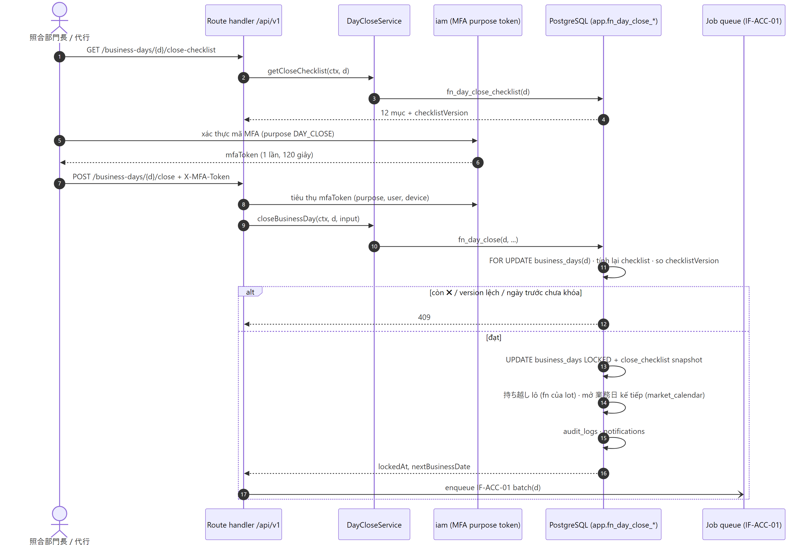
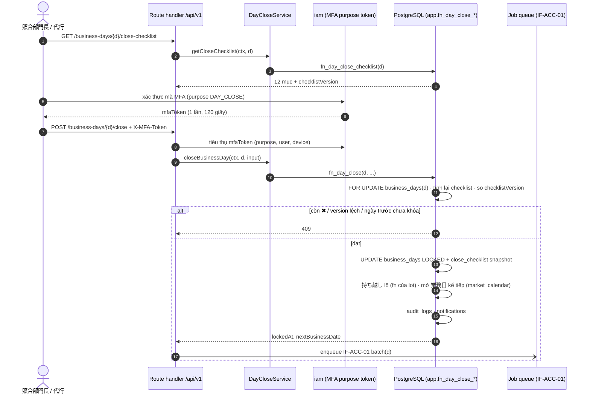

# STL_DAY_CLOSE — 日次締め

> 様式: **BM-2-901-53 v01** — 詳細設計（チャート + 説明） · SUN ASTERISK VIETNAM CO., LTD · ISO/IEC 27001:2013 & ISO 9001:2015

---

## 1. 変更履歴

| No | Version | Action | 対象箇所 / ステップ | 変更内容 | 更新日 | 更新者 | Approve |
|---|---|---|---|---|---|---|---|
| 1 | 0.1.0 | Add new | — | 初版 | 2026-11-25 | phuongnnm-23344 | |
| 2 | 0.1.1 | Update | — | Gate 2 G2-M02: 完了条件（LAB-5）; G2-M03: `detail.blocking` は配列 `{adrNo, label, count}`; 顧客 Q-STL-02: チェックリスト 12 項目、#12 はチェック、E-STL-013 | 2026-11-25 | phuongnnm-23344 |  |
| 3 | 0.1.2 | Update | §2 | FB-EXP-236: Mermaid ブロックから書き出した PNG `./assets/STL_DAY_CLOSE_sequence.png` を埋め込み（`scripts/export-mermaid-png.py`）; Mermaid は引き続き出典 | 2026-11-25 | phuongnnm-23344 |  |

---

## 2. シーケンス図

出典: 下の Mermaid ブロック（編集用の版）; 画像はそのブロックから `python scripts/export-mermaid-png.py STL_DAY_CLOSE` で生成 — Mermaid を修正したら再実行し、二つの版がずれないようにする。

---

## 3. 説明

権限のある人が標準のチェックリストを確認した後に、一つの業務日をロックする（ADR-005 §2.5）。ロックは DB の状態 + トリガー `enforce_open_business_day` で行う → その日へのすべての業務テーブルへの書き込みは `DAY_LOCKED`（HTTP 423）を返す — ボタンを隠すだけでなく、データのレベルでロックする（ADR-005 §3 案 C は廃止）。**再オープンの関数は無い**（ADR-005 §2.7）。

チェックリスト（一つの関数 `fn_day_close_checklist(d)` を画面と締め時の検査で共用 — 同じソース）:

| ADR # | レベル | カウント条件（日 `d`） | Item SC-07-02 |
|---|---|---|---|
| 1 | ✖ | `trades.business_date = d` かつ `status IN ('DRAFT','PENDING')` | [6] |
| 2 | ✖ | `d` の `seri_sessions` のうち `status = 'ENTERING'`（未確認） | [4] |
| 3 | ✖ | `devices` の `is_active` かつ `lost_reported_at IS NULL` で `pending_sync_count > 0`、**または** `offline_sync_records.result = 'PENDING'` かつ `business_date_for(captured_at) = d` | [8] |
| 4 | ✖ | `offline_sync_records.result = 'HELD'` かつ `business_date_for(captured_at) = d` + 紙伝票後入力で重複が疑われ、人の判断待ちの行（`trades.source = 'PAPER_LATE'` かつ未確認） | [7] |
| 5 | ✖ | `trade_fixes.business_date = d`、`reviewed_at IS NULL`、かつ（`d` の version の `max_buyer_diff_incl_jpy ≥ CORR_TWO_LEVEL_THRESHOLD_JPY` **または** `buyer_changed`）— ただし受渡しの例外から生じた fix は**除く**（Q-DEL-09） | [9] |
| 6 | ✖ | `delivery_exceptions.affects_amount = true`、`settle_reviewed_at IS NULL`、`business_date = d` の取引 | [20] |
| 7 | ⚠ | `business_date ≤ d` のロットで利用可能数量 > 0 かつ未 `CLOSED` → 持ち越しされる | [10] |
| 8 | ⚠ (tick) | `business_date ≤ d` の `CONFIRMED` の取引で、引渡し残 > 0 | [12] + [13] |
| 9 | ⚠ | #5 と同じだが閾値未満で、購入者の変更なし | [21] |
| 10 | ⚠ | `delivery_exceptions.is_dispute` かつ `status = 'OPEN'`、`business_date ≤ d` | [11] |
| 11 | ⚠ | 日 `d` のせり セッションで、確認者 = 入力者（理由あり） | [5] |
| 12 | ⚠ (tick) | 数えない — 締めを行う人が、配送の番号付き引渡し確認票（紙台帳）と照合する（Q-STL-02）; `count` は常に `null` | [22] |

`checklistVersion` = 11 の集計値 #1–#11 と #3 の端末 ID の一覧の SHA-256 ハッシュ。締め時にクライアントが送り返す — 不一致なら見直しを求める（古い画面による締めを防ぐ）。

完了時: `business_days(d).status = LOCKED`、`locked_by`、`lock_delegation_id`、`locked_at`、`close_checklist`（12 項目のスナップショット、#8 / #12 のチェック状態を含む + 「端末回収不能」で除外した端末）を持つ; 次の市場業務日を `OPEN`; IF-ACC-01 のバッチをキューに入れる。

---

## 4. 詳細関数

### 4.1. 認証、権限、ワンタイム MFA

| 項目 | 値 |
|---|---|
| Input | Cookie `sid`; header `X-MFA-Token`（POST のみ）; path `businessDate` |
| Output | `SessionContext` + `mfaVerifiedAt` → 4.2 / 4.3 |

**Error**

| エラー条件 | 処理 | Status code |
|---|---|---|
| セッションなし | 停止; `E-CMN-001` | 401 |
| GET: 役割が STL-HEAD / 代行 / SETTLE 以外。POST: 権限 `STL_HEAD` が無く、有効な代行 STL_HEAD も無い | 停止; `E-CMN-002` | 403 |
| POST: `X-MFA-Token` が無い / 期限切れ（120 秒） / 使用済み / `purpose = DAY_CLOSE` と異なる / 人または端末が異なる | 停止; `E-CMN-005` | 403 |
| `businessDate` の書式が不正 | 停止; `E-CMN-007` | 422 |

**Detail**

| No | 処理内容 |
|---|---|
| 1 | セッション、権限、代行を読み込む (S8, RACI-01) |
| 2 | POST: `iam` を呼んで `mfaToken` を消費（使用済みにする）— ★ 常にコードを再確認、10 分の step-up 窓は使わない（ADR-002 §2.2-6a） |
| 3 | `set_config` `app.user_id`, `app.device_id`, `app.mfa_verified_at`, `app.delegation_id` を設定 |

### 4.2. チェックリストの計算（`fn_day_close_checklist`）

| 項目 | 値 |
|---|---|
| Input | `d` |
| Output | `{ businessDate, status, totals: { aitai, seri, all }, items: [{ adrNo, itemNo, level: BLOCK \| WARN, count, details[] }], devices[], checklistVersion, lockedInfo? }` → API-STL-001 のレスポンス、または 4.3 で使用 |

**Error**

| エラー条件 | 処理 | Status code |
|---|---|---|
| `d` が `business_days` に無い | 停止; `E-STL-012`「指定の業務日が存在しません」 | 404 |

**Detail**

| No | 処理内容 |
|---|---|
| 1 | §3 の 11 件の集計クエリを実行（#12 は数えない）（インデックス: `idx_trades_business_date`, `idx_trade_fixes_unreviewed`, `idx_delivery_exceptions_open`, `idx_offline_sync_held`）— 目標 ≤ 1 秒 |
| 2 | #5 / #9 の閾値は `business_days(d).rule_version_id` の `rule_parameters` から読む |
| 3 | 合計金額: `business_date = d` の取引の有効な税抜の合計（`business_date = d` の調整を含む）、相対 / せり に分ける（`v_daily_settlement`） |
| 4 | `LOCKED` の日 → 再計算せず、`close_checklist` のスナップショット + `lockedInfo` を返す |

### 4.3. 再検査と締め（`fn_day_close`）

| 項目 | 値 |
|---|---|
| Input | `d`, `confirmDate`, `deliveryRemainderAcknowledged`, `paperSlipsAllEnteredAcknowledged`, `checklistVersion` |
| Output | 日 `d` が `LOCKED` → 4.4 |

**Error**

| エラー条件 | 処理 | Status code |
|---|---|---|
| `confirmDate`（`/` → `-` に正規化後）≠ `d` | 停止; `E-STL-001` | 422 |
| `deliveryRemainderAcknowledged ≠ true` | 停止; `E-STL-003`、`field` = `deliveryRemainderAcknowledged` | 422 |
| `paperSlipsAllEnteredAcknowledged ≠ true`（ADR #12） | 停止; `E-STL-013`、`field` = `paperSlipsAllEnteredAcknowledged` | 422 |
| `d` が既に `LOCKED` | 停止; `E-STL-004`（締めた人 / 時刻を添えて） | 409 |
| `d` より前に `OPEN` の業務日がある | 停止; `E-STL-005`（Q-STL-01） | 409 |
| `checklistVersion` ≠ 再計算した値 | 停止; `E-STL-010` | 409 |
| `count > 0` の ✖ の項目が残っている | 停止; `E-STL-002` + `detail.blocking` = 配列 `{ adrNo, label, count }`（✖ の行ごとに一要素） | 409 |
| 通信断 / タイムアウトの途中 | トランザクションをロールバック; クライアントはネットワークエラーを受け取る → GET を再度呼んで実際の状態を確認 | — |

**Detail**

| No | 処理内容 |
|---|---|
| 1 | `SELECT … FROM business_days WHERE business_date = d FOR UPDATE` — 二人が同時に締めるのを防ぎ、検査中の新しい書き込みを防ぐ（業務の書き込みはトリガーで同じ行の日の状態を読む） |
| 2 | 同一トランザクション内で `fn_day_close_checklist(d)` を呼ぶ; `checklistVersion` を比較し、✖ を検査 |
| 3 | UPDATE `business_days` `status = LOCKED`、`locked_by`、`lock_delegation_id`、`locked_at = now()`、`close_checklist` = 12 項目の JSON（#8、#12 = `true`、チェックした人 = 締めた人）+ `lost_reported_at` が null でない端末の一覧（#3 から除外したもの） |

### 4.4. 締め後の影響（同一トランザクション内）

| 項目 | 値 |
|---|---|
| Input | ロックした直後の `d` |
| Output | `{ lockedAt, lockedBy, delegatedFor?, nextBusinessDate }` → 200 |

**Error**

| エラー条件 | 処理 | Status code |
|---|---|---|
| `market_calendar` で次の開く市場日が見つからない（今後 14 日間） | 全体をロールバック（締めない）; `E-STL-008` | 409 |
| `lot` の持ち越し関数のエラー | ロールバック; `E-CMN-004`; アラート | 500 |

**Detail**

| No | 処理内容 |
|---|---|
| 1 | `lot` モジュールの `fn_lot_carry_over(d)` を呼ぶ: 数量の残るロットは同じロット番号で翌日へ `CARRY_OVER` の行を作る（PRM-110, E-12 — 暫定のルール） |
| 2 | 次に開く市場日 `n` を探す（`market_calendar.is_market_open`）; `business_days(n)` がまだ無ければ `OPEN` を INSERT、`intake_opens_at = n 01:00`、`rule_version_id` = `n` の日に発効している版（01:00 のジョブと冪等 — ADR-005 §2.4） |
| 3 | COMMIT 後に `party` の `expireDueQualifications(n)` を呼ぶ（エラーは締めに影響しない — SPEC-PARTY_FUNC-001 §2.8） |
| 4 | `audit_logs`（`DAY_CLOSE`、代行「…の代わり」、MFA、チェックリストのスナップショット）; `notifications` → SETTLE 「{d} を締めました」 |
| 5 | COMMIT 後: `d` の IF-ACC-01 バッチを作るジョブをキューに入れる（BILLING_DB 4.41, PRM-123; 期限 11:00）。キューイングのエラー → ERROR をログ + アラート、締めはロールバックしない |

---

## 5. その他の注記

- **対象外:** 再オープンは無い; 時刻で自動的に締めない（ADR-005 §3 E — CAP-HUMAN-01 に反する）; 日 `d` のデータは修正しない。
- **締めの順序:** 順序の逆転を防ぐ（Q-STL-01）→ 「最も早い未締めの業務日」が常に直前の締め日の翌日になるようにする。
- **締め時刻前の警告:** ジョブが通知する（設定ファイル、ADR-005 §3 E）— この関数の対象外。
- **ワンタイム MFA トークン** は `iam` の詳細（まだ P3 の仕様なし） — 提案: `POST /api/v1/auth/mfa/verify` {code, purpose} → `mfaToken` — [api-conventions §4](../../_common/api-conventions.md#4-mfa-step-up) で確定; iam の API は未仕様化（DEP-01、`specs/_index.md`）。
- トレーサビリティ: ルール 3、ルール 4; BR-CLOSE-01, FR-SETTLE-02, PRM-030, PRM-031, PRM-036, PRM-110, PRM-119, PRM-123, PRM-127, NFR-AVL-02, S8, RACI-01; ADR-002, ADR-005 §2.4–2.7, ADR-008; CLOSE_DB 4.20, 4.24; Gate 1 M-01, M-05; 顧客 #1, #4, #25。

### 完了条件（LAB-5）

各行は検査可能なケース（API / DB 関数を呼ぶ統合テスト）; 全行が通れば LAB-5 の issue は完了。書式は流れ 1 と同じ（例: `trade/technical-design/TRADE_AITAI_CONFIRM_TECH.md` §5）。

| # | Cho / Khi | 期待結果 |
|---|---|---|
| 1 | 日 `d` に 12 項目のデータがある（#1–#11 は件数あり、#12 は数えない）; API-STL-001 を呼ぶ | `items` が正確に 12 要素、`adrNo` 1..12 が ADR-005 §2.5 と一致; #12 は `count = null`、`requiresAck = true`; #1–#11 の件数のいずれかが変わると `checklistVersion` も変わる |
| 2 | ✖ の項目が 1 件以上残る（例: #2 = 1、#3 = 1）; 正しいトークンで POST close | 409 `E-STL-002`、`detail.blocking` は**配列**で、ちょうど `{adrNo, label, count}` の 2 要素; 日は `OPEN` のまま |
| 3 | ✖ が全て 0; #8 または #12 のチェックが無い（`deliveryRemainderAcknowledged` / `paperSlipsAllEnteredAcknowledged` ≠ true） | 422 `E-STL-003` / `E-STL-013`、`field` = 該当のキー; ロックしない |
| 4 | `confirmDate` が `d` と異なる（2027-08-02 を締める際に `2027/08/03`） | 422 `E-STL-001` |
| 5 | 正常、トークン `purpose = DAY_CLOSE` | 200; `business_days(d).status = LOCKED`、`close_checklist` に 12 項目 + #8/#12 のチェック + 除外端末; 次の市場業務日は `OPEN`（`nextBusinessDate`）; `audit_logs` の `DAY_CLOSE`; IF-ACC-01 のジョブがキューに入る（`accountingExport = QUEUED`） |
| 6 | `d` を締めた後に、`d` へ取引 / ロット / 引渡し / 調整を書き込む（全ての業務テーブル） | 423 `E-CMN-003`（トリガー `enforce_open_business_day`）; 再オープンのエンドポイントは無い |
| 7 | トークン `purpose = DEVICE_LOST`（または使用済み、120 秒超、端末が違う） | 403 `E-CMN-005`; 日は `OPEN` のまま |
| 8 | step-up が有効だが `X-MFA-Token` を送らない | 403 `E-CMN-005`（★ 常にコードを再確認） |
| 9 | `d−1` が `OPEN` のまま | 409 `E-STL-005` `detail.openDate`（Q-STL-01） |
| 10 | GET と POST の間にチェックリストが変わった（古い `checklistVersion`） | 409 `E-STL-010` `detail.currentVersion` |
| 11 | 二人が同じ `d` を同時に締める | 一方は 200、一方は 409 `E-STL-004` |
| 12 | 次の 14 日間に開く市場日が無いカレンダー | 409 `E-STL-008`; 全体をロールバック、`d` は `OPEN` のまま |
| 13 | 代行 STL_HEAD が期限切れ; 役割 SETTLE が POST を呼ぶ | 403 `E-CMN-002` |
