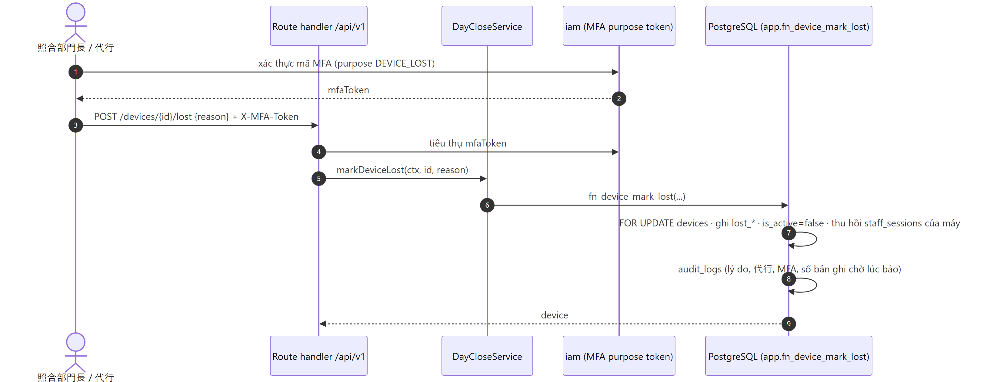
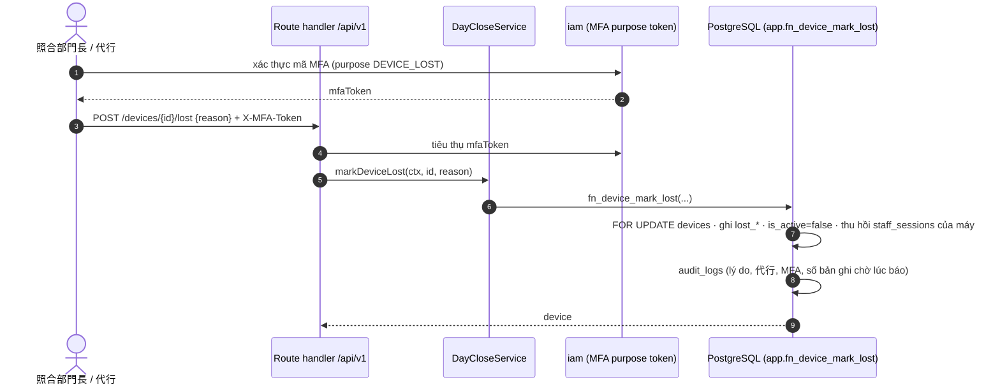

# STL_DEVICE_LOST — 端末回収不能

> 様式: **BM-2-901-53 v01** — 詳細設計（チャート + 説明） · SUN ASTERISK VIETNAM CO., LTD · ISO/IEC 27001:2013 & ISO 9001:2015

---

## 1. 変更履歴

| No | Version | Action | 対象箇所 / ステップ | 変更内容 | 更新日 | 更新者 | Approve |
|---|---|---|---|---|---|---|---|
| 1 | 0.1.0 | Add new | — | 初版 | 2026-11-25 | phuongnnm-23344 | |
| 2 | 0.1.1 | Update | — | Gate 2 G2-M02: 完了条件（LAB-5） | 2026-11-25 | phuongnnm-23344 |  |
| 3 | 0.1.2 | Update | §2 | FB-EXP-236: Mermaid ブロックから書き出した PNG `./assets/STL_DEVICE_LOST_sequence.png` を埋め込み（`scripts/export-mermaid-png.py`）; Mermaid は引き続き出典 | 2026-11-25 | phuongnnm-23344 |  |

---

## 2. シーケンス図

出典: 下の Mermaid ブロック（編集用の版）; 画像はそのブロックから `python scripts/export-mermaid-png.py STL_DEVICE_LOST` で生成 — Mermaid を修正したら再実行し、二つの版がずれないようにする。

---

## 3. 説明

一つの日次締めのチェックリストを、故障 / 紛失 / 電池切れの端末が引き止めている場合の唯一の出口（ADR-005 §2.6、顧客 #1）。「チェックリストを飛ばして締める」仕組みではない: **その端末だけ**を項目 #3 から除外し、他の ✖ の項目は引き続きブロックする。未同期の記録は失われたとみなす → 紙から後で入力（後入力）; 後に端末が同期できた場合、記録は `offline_sync_records` の `HELD` に入る → SC-03-07 → 修正申請 `LATE_ENTRY` または「反映しない」（ADR-008 §2.2-6）。第1期では「登録解除」の操作は無い — 端末の再登録は SYSADM の仕事（新しい `device_code` を発行）。

---

## 4. 詳細関数

### 4.1. 認証、権限、ワンタイム MFA

| 項目 | 値 |
|---|---|
| Input | Cookie `sid`; header `X-MFA-Token`; path `deviceId`; body `{ reason }` |
| Output | `SessionContext` → 4.2 |

**Error**

| エラー条件 | 処理 | Status code |
|---|---|---|
| セッションなし | 停止; `E-CMN-001` | 401 |
| 権限なし `STL_HEAD` / 代行 | 停止; `E-CMN-002` | 403 |
| MFA トークンが無い / 目的が違う / 使用済み | 停止; `E-CMN-005` | 403 |
| `reason` が空 / 200 文字超 | 停止; `E-STL-006` | 422 |

**Detail**

| No | 処理内容 |
|---|---|
| 1 | STL_DAY_CLOSE §4.1 と同様、`purpose = DEVICE_LOST`（★ 常にコードを再確認 — PREMISE §3.2） |

### 4.2. 端末の紛失マーク付け

| 項目 | 値 |
|---|---|
| Input | `deviceId`, `reason` |
| Output | `{ device: { id, code, lostReportedAt, lostReportedBy, pendingSyncCountAtReport } }` → 200 |

**Error**

| エラー条件 | 処理 | Status code |
|---|---|---|
| 端末が無い | 停止; `E-STL-009` | 404 |
| 既にマーク済み | 停止; `E-STL-007`（人 / 時刻を添えて） | 409 |

**Detail**

| No | 処理内容 |
|---|---|
| 1 | `SELECT … FROM devices WHERE id = :id FOR UPDATE` |
| 2 | UPDATE `lost_reported_at = now()`, `lost_reported_by`, `lost_reason`, `is_active = false` (IAM_AUDIT_DB 4.6) |
| 3 | `device_id` の `staff_sessions` を削除 / 無効化（サーバー側のセッション — ADR-002 §2.1-2）; 以後この端末からの API は 401 を返す; オンライン時、端末上での PIN による担当者の切り替えは拒否される; 端末上のオフライン PIN ハッシュはリモートから削除できない → この端末から以後送られる記録はすべて `HELD` になる（同期関数内で `lost_reported_at` を検査） |
| 4 | `audit_logs`（`DEVICE_LOST`、理由、代行、MFA、報告時の `pending_sync_count`）; `notifications` → SYSADM, SETTLE |

---

## 5. その他の注記

- **対象外:** 受信済みのオフライン記録は削除しない; 遅れて届いた記録について修正申請を自動生成しない。
- 日締めレポート（`close_checklist`）は、除外した端末の一覧を記録し、監査でどの近道が使われたか分かるようにする（ADR-005 §4）。
- トレーサビリティ: NFR-AVL-02, BR-CLOSE-01, NFR-SEC-03; ADR-002, ADR-005 §2.6, ADR-008 §2.2-7; IAM_AUDIT_DB 4.6, 4.7, 4.55; PREMISE §3.2; 顧客 #1。

### 完了条件（LAB-5）

各行は検査可能なケース（API / DB 関数を呼ぶ統合テスト）; 全行が通れば LAB-5 の issue は完了。書式は流れ 1 と同じ（例: `trade/technical-design/TRADE_AITAI_CONFIRM_TECH.md` §5）。

| # | Cho / Khi | 期待結果 |
|---|---|---|
| 1 | 端末 TAB-03 に未同期の記録が 5 件ある; STL-HEAD が理由 + トークン `purpose = DEVICE_LOST` を送る | 200; `devices.lost_reported_at`、`lost_reason`、`is_active = false`; 端末のセッションが取り消される; API-STL-001 の項目 #3 に TAB-03 が無くなる; ロック時の `close_checklist` に TAB-03 が除外端末として記録される |
| 2 | マーク後、端末が（オンラインで）記録を同期する | 古いセッションでは 401; 同期経路で届いた記録 → `HELD` → SC-03-07 |
| 3 | 理由が空 / 200 文字超 | 422 `E-STL-006`、`field = reason` |
| 4 | 同じ端末を二回マーク | 409 `E-STL-007`、初回の人 / 時刻を添えて |
| 5 | `deviceId` が存在しない | 404 `E-STL-009` |
| 6 | トークンの `purpose = DAY_CLOSE` / step-up が有効でもトークンが無い | 403 `E-CMN-005` |
| 7 | 役割 SETTLE が呼ぶ | 403 `E-CMN-002` |
| 8 | 全ケースの成功 | `audit_logs` の `DEVICE_LOST` 行が一つ（`pending_sync_count`、代行、MFA の時刻を含む）; `notifications` → SYSADM, SETTLE |
