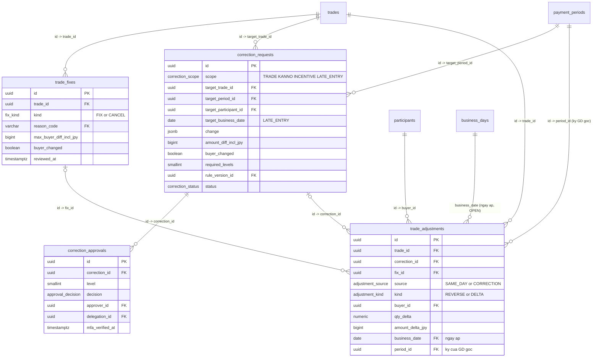

# ADJUST_DB — 当日訂正、修正申請、調整行 REVERSE / DELTA

| | |
|---|---|
| System Name | 水産物卸売市場業務支援システム（Product A、顧客 株式会社 桜水産市場 — 架空） |
| Schema | `app` |
| CHARACTER SET | UTF8 (PostgreSQL 16, RDS Multi-AZ, AWS Tokyo) |
| Updated by | phuongnnm-23344 |
| Note | ER単位で分割したデータベース設計の1ファイル（QC-01 §4：1ファイル1グループ）。P1–P7の原則、共通規約 + enum（4.0）、公開ビュー、プロトタイプとの差異表、パリティ結果、共通の未決事項は総括ファイル [MKT_DB.md](MKT_DB.md) にある。**4.xx の番号はスキーマ全体のテーブル番号を維持**（MKT_DB §2 の No 列）しているため、ファイル間の相互参照や ADR / spec からの参照は分割後も変わらない |

---

## 1. 改訂履歴

| No | Version | Action | シート / 表 | 変更内容 | 更新日 | 更新者 | Approve |
|---|---|---|---|---|---|---|---|
| 1 | 0.1.0 | Add new | — | 初期内容は `MKT_DB.md` 0.1.0 にあった（スキーマ全体で1ファイル） | 2026-11-25 | phuongnnm-23344 | |
| 2 | 0.2.0 | Add new | ファイル全体 | ER単位で `MKT_DB.md` 0.1.1 から分割（Gate 1 M-09）；Gate 1 に従い修正：`trade_adjustments.period_id` = 元取引の期、適用日の `business_date` とは分離（C-02）；`correction_scope` に `INCENTIVE`、`LATE_ENTRY` を追加し `KANNO` の意味を明記（M-04, M-05, M-10）；2段階のしきい値は1人の買い手の最大の金額変動で測り、`buyer_changed` を追加（顧客 #3）；`trade_fixes` にしきい値の測定値と `reviewed_*` を追加（日次締め のチェックリスト、顧客 #25） | 2026-11-25 | phuongnnm-23344 | |
| 3 | 0.3.0 | Update | 4.37, 4.39 | Gate 1 再チェック：KANNO / INCENTIVE の待ち依頼は人 × 期につき一意（n-02）；4.39 の例は期 2027-08 を使用（n-05） | 2026-11-25 | phuongnnm-23344 | |
| 4 | 0.3.1 | Update | 4.37 | P3 を統合：`uq_correction_requests_one_pending_period` から列 `scope` を削除 — 人 × 期につき **最大1件** の KANNO **または** INCENTIVE の待ち依頼、ADR-007 §2.5-12 に一致（旧版では KANNO と INCENTIVE が同時に待機できた）。ADR は Gate 1 で決裁済みの決定であり、2種類とも同じ人・期の完納奨励金の結果を変えるため、DB 側を修正することを選択 — 並行して待たせると重複して決裁しやすい | 2026-11-25 | phuongnnm-23344 | |
| 5 | 0.3.2 | Update | — | 顧客 Q-STL-04：4.38 のメモ — 第1段階は 照合部門長 / 事前に指定された代行、運用部門長 は第2段階のみ | 2026-11-25 | phuongnnm-23344 |  |

---

## 2. テーブル一覧

| No | Schema | Category | テーブル名（論理） | テーブル名（物理） | 説明 | Note | Status |
|---|---|---|---|---|---|---|---|
| 32 | app | transaction | 当日訂正 / 取消 | [`trade_fixes`](#432-trade_fixes) | 未締めの日の取引の修正 / 取消、理由あり、2段階決裁なし | 新規 | Decision (provisional) |
| 37 | app | transaction | 修正申請 | [`correction_requests`](#437-correction_requests) | 締め後の修正依頼（FORM-CORR-01） | プロトタイプ: `correction_requests` | Decision (provisional) |
| 38 | app | history | 修正申請の決裁ステップ | [`correction_approvals`](#438-correction_approvals) | 決裁 / 却下ごとに1行、代行・MFAあり | 新規 | Decision (provisional) |
| 39 | app | transaction | 調整行 | [`trade_adjustments`](#439-trade_adjustments) | REVERSE（旧買い手）+ DELTA（新買い手） | プロトタイプ: `trade_adjustments` | Decision (provisional) |

---

## 3. ER図

`trade_adjustments` は発生元が一つだけ：`correction_id`（締め後の修正申請）**または** `fix_id`（締め前の当日訂正 / 取消）。各行は **二つの時間軸** を持つ（Gate 1 C-02）：`business_date` = 適用日 / 記帳日（業務日 `OPEN`；日次の記帳、日次精算、IF-ACC-01）と、`period_id` = **元取引の期**（`trades.trade_date` を含む期）。`trades`、`participants`、`business_days`、`payment_periods` は各ファイル [TRADE_DB.md](TRADE_DB.md)、[PARTY_DB.md](PARTY_DB.md)、[CLOSE_DB.md](CLOSE_DB.md) にある。

---

## 4. テーブル定義

共通規約（型、共通列、追記のみ、開いている日、関数経由の書き込み、enum）：[MKT_DB.md §4.0](MKT_DB.md#40-共通規約)。

### 4.32. `trade_fixes`

| | | | |
|---|---|---|---|
| テーブル名（論理） | 当日訂正 / 取消 | 作成者 / 作成日 | phuongnnm-23344 / 2026-11-25 |
| テーブル名（物理） | `trade_fixes` | 更新者 / 更新日 | — |
| Overview | 業務日が **締め前** の取引の修正 / 取消を SC-04-05 で行う（PRM-127、FR-AITAI-03）：理由を付け、履歴を残し、**2段階決裁は不要**。修正申請と同じ仕組みで `trade_adjustments` を作成（REVERSE + DELTA；取消は REVERSE のみ）→ 元取引は上書きされない（法則4、D11 を修正）。**追記のみ。開いている日**（元取引の日が `OPEN` でなければならない）。 | Note | 締め後は 修正申請（4.37）の経路のみ。入力中に日が締められた場合（エラー `DAY_LOCKED`、HTTP 423）→ 画面は内容を保持し、SC-08-01 に引き継ぐ（顧客 #5）。UPDATE は `reviewed_by` / `reviewed_at` のみ、1回だけ |

**列定義**

| No. | Key | 論理名 | 物理名 | Data Type | Size | Not Null | Default | Note |
|---|---|---|---|---|---|---|---|---|
| 1 | PRI | ID | `id` | UUID | N/A | Yes | `gen_random_uuid()` | |
| 2 | FK | 取引 | `trade_id` | UUID | N/A | Yes | | |
| 3 | FK | 業務日 | `business_date` | DATE | N/A | Yes | | = `trades.business_date`（関数内で CHECK） |
| 4 | | 種類 | `kind` | `fix_kind` | N/A | Yes | | |
| 5 | | 変更内容 | `change` | JSONB | N/A | No | | `qty`、`unit_price_jpy`、`buyer_id` の `{before, after}`；`CANCEL` のとき NULL |
| 6 | | 理由コード | `reason_code` | VARCHAR | 20 | Yes | | `code_values`（`FIX_REASON`） |
| 7 | | 理由のメモ | `reason_note` | VARCHAR | 200 | No | | |
| 7a | | 買い手1人あたりの最大の金額変動（税込） | `max_buyer_diff_incl_jpy` | BIGINT | N/A | Yes | | 4.37 の列7 と同じ測り方；`CANCEL` = 取引の税込金額 |
| 7b | | 買受人の変更 | `buyer_changed` | BOOLEAN | N/A | Yes | `false` | |
| 7c | FK | 照合の確認済 実施者 / 日時 | `reviewed_by`, `reviewed_at` | UUID / TIMESTAMPTZ | | No | | 照合事務局 が 要確認 SC-07-01 で 「確認済」 を押す。`max_buyer_diff_incl_jpy` ≥ `CORR_TWO_LEVEL_THRESHOLD_JPY` **または** `buyer_changed` の行で、まだ確認済みでないもの → 日次締め のチェックリストで ✖；しきい値未満 → ⚠（Q-SC0405-01、顧客 #25 【模擬】）。`reviewed_by` ≠ `created_by` |
| 8 | | 共通列 | `created_at`, `created_by` | | | | | |

**Index** — `trade_fixes_pkey`; `idx_trade_fixes_trade` (`trade_id`); `idx_trade_fixes_unreviewed` (`business_date`) partial `reviewed_at IS NULL`.

**外部キー** — `trade_id` → `trades.id`; `business_date` → `business_days`.

---

### 4.37. `correction_requests`

| | | | |
|---|---|---|---|
| テーブル名（論理） | 修正申請 | 作成者 / 作成日 | phuongnnm-23344 / 2026-11-25 |
| テーブル名（物理） | `correction_requests` | 更新者 / 更新日 | — |
| Overview | FORM-CORR-01：締め後の修正（FT-08-01）。決裁段階の数は **提出時** に、有効な版の `CORR_TWO_LEVEL_THRESHOLD_JPY` と **1人の買い手の最大の金額変動** を比べて確定する（しきい値と版のスナップショットを保存 — D07 を修正、顧客 #3）；**買受人を変えた場合、`KANNO`、`INCENTIVE` は常に2段階**（PRM-033）。1取引につき待機中の依頼は1件まで（0029 を維持）。範囲は4種類：`TRADE` — 決裁後 → REVERSE + DELTA を **最も早い未締めの業務日** に記録（PRM-120 (b)）、期は元取引による（4.39）；`KANNO` — 入金は支払期日より前に届いたが、消込が遅れた / 誤って割り当てられた場合（PRM-055）：「完納を遡及しない」原則の、決裁付きの例外。結果は次の 期ロック での DELTA 行（INCENTIVE_DB 4.52）；`INCENTIVE` — 適用率の誤りで計算された締め済みの期の奨励金の修正（R-L4-01）→ 理由付きの DELTA 行；`LATE_ENTRY` — 締め済みの日の取引 / ロット / 引渡し **新規**（紙伝票の後入力、遅れて届いたオフライン記録）：決裁後、開いている業務日に記録し、元の日付（`trades.trade_date`、`*.original_business_date`）を参照（Gate 1 M-04, M-05, M-10）。 | Note | 列 `approver1`、`approver2` を削除 → テーブル `correction_approvals`（代行、MFA あり） |

**列定義**

| No. | Key | 論理名 | 物理名 | Data Type | Size | Not Null | Default | Note |
|---|---|---|---|---|---|---|---|---|
| 1 | PRI | ID | `id` | UUID | N/A | Yes | `gen_random_uuid()` | |
| 2 | | 範囲 | `scope` | `correction_scope` | N/A | Yes | `'TRADE'` | `TRADE` · `KANNO` · `INCENTIVE` · `LATE_ENTRY` |
| 3 | FK | 対象の取引 | `target_trade_id` | UUID | N/A | No | | `TRADE` のとき必須 |
| 4 | FK | 対象の期 | `target_period_id` | UUID | N/A | No | | `KANNO`、`INCENTIVE` のとき必須（期が `LOCKED`） |
| 5 | FK | 対象の参加者 | `target_participant_id` | UUID | N/A | No | | `KANNO`、`INCENTIVE` のとき必須 |
| 5a | | 元の業務日 | `target_business_date` | DATE | N/A | No | | `LATE_ENTRY` のとき必須；`LOCKED` の日 |
| 6 | | 変更内容 | `change` | JSONB | N/A | Yes | | `TRADE`: `{before, after}`; `KANNO`: `{kanno_after, evidence}`; `INCENTIVE`: `{amount_jpy, basis}`; `LATE_ENTRY`: `{kind: TRADE \| LOT \| DELIVERY, payload, paper_slip_no, sync_record_id}` |
| 7 | | 買い手1人あたりの最大の金額変動（税込） | `amount_diff_incl_jpy` | BIGINT | N/A | Yes | | = 関係する買い手ごとの \|Σ 税込の差額\| の最大値；買受人を変え、同じ単価の場合は各側に数値を持ち、0 に相殺しない（顧客 #3）。しきい値との比較に使用。`KANNO` / `INCENTIVE`：奨励金の変動額 |
| 7a | | 買受人の変更 | `buyer_changed` | BOOLEAN | N/A | Yes | `false` | `true` → `required_levels = 2` |
| 8 | | しきい値（提出時） | `threshold_jpy_snapshot` | BIGINT | N/A | Yes | | |
| 9 | FK | 規程の版 | `rule_version_id` | UUID | N/A | Yes | | |
| 10 | | 必要な段階数 | `required_levels` | SMALLINT | N/A | Yes | | CHECK 1..2；`buyer_changed`、`KANNO`、`INCENTIVE` の場合、または `amount_diff_incl_jpy` ≥ しきい値 のとき = 2 |
| 11 | | 理由 | `reason` | VARCHAR | 500 | Yes | | |
| 12 | | 状態 | `status` | `correction_status` | N/A | Yes | `'SUBMITTED'` | |
| 13 | | 適用した業務日 | `applied_business_date` | DATE | N/A | No | | REVERSE / DELTA を記録した日 |
| 14 | | 共通列 | `created_at`, `created_by`, `updated_at` | | | | | `created_by` = 作成者（TRADE / DELIVERY / SETTLE） |

証拠（取引の入出金明細、写真）は `attachments`（`ref_table = 'correction_requests'`）にある。2営業日を超えて決裁待ちの場合 → 警告（`notifications`）。

**Index** — `correction_requests_pkey`; `uq_correction_requests_one_pending` (`target_trade_id`) unique partial `status IN ('SUBMITTED','FIRST_APPROVED')`; `uq_correction_requests_one_pending_period` (`target_period_id`, `target_participant_id`) unique partial `scope IN ('KANNO','INCENTIVE') AND status IN ('SUBMITTED','FIRST_APPROVED')` — 人 × 期につき KANNO / INCENTIVE の待ち依頼は最大1件、`scope` で分けない（ADR-007 §2.5-12；再チェック n-02）；`idx_correction_requests_status` (`status`, `created_at`).

**外部キー** — `target_trade_id` → `trades.id`; `target_period_id` → `payment_periods.id`; `target_participant_id` → `participants.id`; `rule_version_id` → `rule_versions.id`; `applied_business_date` → `business_days`. `target_business_date` は開いている日への FK ではない（締め済みの日も `business_days` に存在するため、通常の FK）。

---

### 4.38. `correction_approvals`

| | | | |
|---|---|---|---|
| テーブル名（論理） | 修正申請の決裁ステップ | 作成者 / 作成日 | phuongnnm-23344 / 2026-11-25 |
| テーブル名（物理） | `correction_approvals` | 更新者 / 更新日 | — |
| Overview | 決裁 / 却下 ごとに1行。第1段階 = 照合部門長（不在の場合 → 事前に指定された代行。運用部門長 は第1段階の代わりにならない — Q-STL-04）、第2段階 = 運用部門長；**1人が2段階とも決裁しない**；依頼者は決裁しない；照合部門長 本人が依頼した場合 → 第1段階は事前に指定された代行が行う（PRM-120 (a)）。MFA 必須。**追記のみ。** | Note | 新規 — `approver1` / `approver2` を置き換える |

**列定義**

| No. | Key | 論理名 | 物理名 | Data Type | Size | Not Null | Default | Note |
|---|---|---|---|---|---|---|---|---|
| 1 | PRI | ID | `id` | UUID | N/A | Yes | `gen_random_uuid()` | |
| 2 | FK | 修正申請 | `correction_id` | UUID | N/A | Yes | | |
| 3 | | 段階 | `level` | SMALLINT | N/A | Yes | | CHECK 1..2 |
| 4 | | 判断 | `decision` | `approval_decision` | N/A | Yes | | |
| 5 | FK | 決裁者 | `approver_id` | UUID | N/A | Yes | | |
| 6 | FK | 代行 | `delegation_id` | UUID | N/A | No | | |
| 7 | | MFA 実施日時 | `mfa_verified_at` | TIMESTAMPTZ | N/A | Yes | | |
| 8 | | コメント / 却下理由 | `comment` | VARCHAR | 500 | No | | `REJECT` のとき必須 |
| 9 | | 共通列 | `created_at` | | | | | |

**Index** — `correction_approvals_pkey`; `uq_correction_approvals_level` (`correction_id`, `level`) unique; `uq_correction_approvals_person` (`correction_id`, `approver_id`) unique（1人1段階）.

**外部キー** — `correction_id` → `correction_requests.id`; `approver_id` → `staff_accounts.id`; `delegation_id` → `delegations.id`.

---

### 4.39. `trade_adjustments`

| | | | |
|---|---|---|---|
| テーブル名（論理） | 調整行 | 作成者 / 作成日 | phuongnnm-23344 / 2026-11-25 |
| テーブル名（物理） | `trade_adjustments` | 更新者 / 更新日 | — |
| Overview | 確定後のすべての変更について、REVERSE（買い手 / 単価 **旧**、負の数）+ DELTA（買い手 / 単価 **新**）のペア — 二つの発生元 `SAME_DAY` と `CORRECTION` が同じテーブルを使う（ADR-004 §2.2）。元取引は変わらない；有効な値 = 元 + Σ 調整（`v_trade_effective`）。`business_date` = **適用日**（常に `OPEN`；日次の記帳、日次精算、IF-ACC-01）。`period_id` = **元取引の期**：元の期がまだ `OPEN` → 行は元の期の 期のお支払額 に入り、元の期の締めの時に奨励金へ反映；元の期が `LOCKED` → 開いている期の 期のお支払額 には **入らず**、次の 期ロック の DELTA（INCENTIVE_DB 4.52）のみ — 二重計上しない。締め済みの期の差額は、次の期の通知に 「前期以前の調整」 の別行として表示し、完納判定の額には加えない（OPEN-DB-08）。**追記のみ。開いている日。**（Gate 1 C-02） | Note | プロトタイプと比べ `adjustment_source`、`fix_id`、`tax_rate_id`、`rule_version_id`、`created_by` を追加 |

**列定義**

| No. | Key | 論理名 | 物理名 | Data Type | Size | Not Null | Default | Note |
|---|---|---|---|---|---|---|---|---|
| 1 | PRI | ID | `id` | UUID | N/A | Yes | `gen_random_uuid()` | |
| 2 | FK | 元取引 | `trade_id` | UUID | N/A | Yes | | |
| 3 | | 発生元 | `source` | `adjustment_source` | N/A | Yes | | |
| 4 | FK | 修正申請 | `correction_id` | UUID | N/A | No | | CHECK：`source = CORRECTION` のとき必須 |
| 5 | FK | 当日訂正 / 取消 | `fix_id` | UUID | N/A | No | | CHECK：`source = SAME_DAY` のとき必須；4 と 5 のうちちょうど一つ |
| 6 | | 種類 | `kind` | `adjustment_kind` | N/A | Yes | | |
| 7 | FK | 行の買い手 | `buyer_id` | UUID | N/A | Yes | | REVERSE = 旧、DELTA = 新（プロトタイプの M4 を維持） |
| 8 | | 行の単価 | `unit_price_jpy` | BIGINT | N/A | Yes | | CHECK > 0 |
| 9 | | 変更数量 | `qty_delta` | NUMERIC | 12,1 | Yes | | |
| 10 | | 変更金額（税抜） | `amount_delta_jpy` | BIGINT | N/A | Yes | | トリガーで 数量 × 単価 を検査（0025 を維持） |
| 11 | FK | 税率 | `tax_rate_id` | UUID | N/A | Yes | | = 元取引の税率 |
| 12 | FK | 適用する規程の版 | `rule_version_id` | UUID | N/A | Yes | | |
| 13 | FK | 適用する業務日（記帳） | `business_date` | DATE | N/A | Yes | | 記帳時の最も早い `OPEN` の日。期は **決めない** |
| 13a | FK | 元取引の期 | `period_id` | UUID | N/A | Yes | | 関数が `trades.trade_date` を含む期を設定（L4-A04 (2)、Gate 1 C-02）；利用者は入力しない。例：取引 2027-08-31、修正申請が 2027-09-03 に決裁 → `business_date` 2027-09-03、`period_id` = 2027-08（INCENTIVE_DB TV-01） |
| 14 | | 共通列 | `created_at`, `created_by` | | | | | |

**Index** — `trade_adjustments_pkey`; `idx_adjustments_trade` (`trade_id`); `idx_adjustments_buyer_date` (`buyer_id`, `business_date`); `idx_adjustments_business_date` (`business_date`); `idx_adjustments_period_created` (`period_id`, `created_at`) — 期ロック 後に入力が変わったことの検出 (C-01).

**外部キー** — `trade_id` → `trades.id`; `correction_id` → `correction_requests.id`; `fix_id` → `trade_fixes.id`; `buyer_id` → `participants.id`; `tax_rate_id` → `tax_rates.id`; `rule_version_id` → `rule_versions.id`; `business_date` → `business_days`; `period_id` → `payment_periods.id`.
