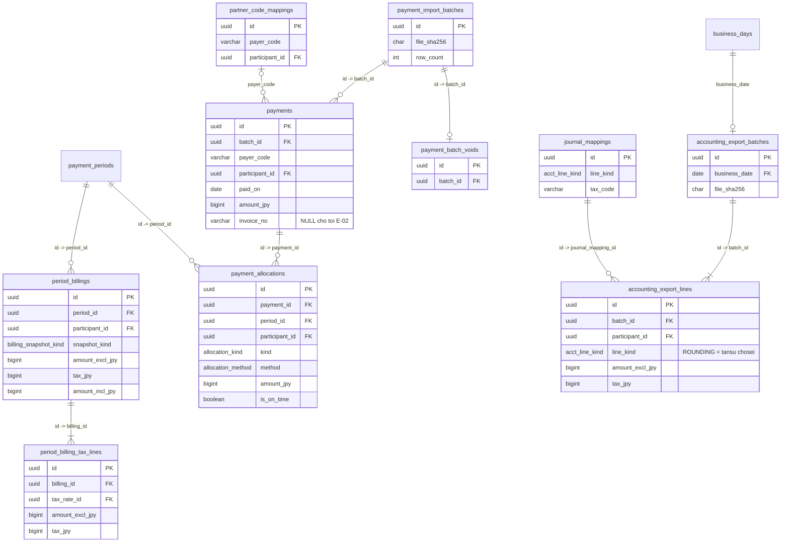

# BILLING_DB — 期のお支払額 / 入金 / 配分 / 会計連携バッチ IF-ACC-01

| | |
|---|---|
| System Name | 水産物卸売市場業務支援システム（Product A, 顧客 株式会社 桜水産市場 — 架空） |
| Schema | `app` |
| CHARACTER SET | UTF8 (PostgreSQL 16, RDS Multi-AZ, AWS Tokyo) |
| Updated by | phuongnnm-23344 |
| Note | 本ファイルは Database Design 一式のうち ER クラスタ単位で分割したもの（QC-01 §4: 1ファイルにつきテーブル群1つ）。P1–P7 の原則、共通規約と enum（4.0）、公開ビュー、プロトタイプとの差異表、parity 結果、共通の未決事項は総括ファイル [MKT_DB.md](MKT_DB.md) にある。**4.xx の番号はスキーマ全体のテーブル番号（MKT_DB §2 の No 列）のまま**とし、ファイル間の相互参照や ADR・仕様からの参照が分割後も変わらないようにする |

---

## 1. 改訂履歴

| No | Version | Action | シート / 表 | 変更内容 | 更新日 | 更新者 | Approve |
|---|---|---|---|---|---|---|---|
| 1 | 0.1.0 | Add new | — | 初版は `MKT_DB.md` 0.1.0 の中にあった（スキーマ全体で1ファイル） | 2026-11-25 | phuongnnm-23344 | |
| 2 | 0.2.0 | Add new | 全ファイル | `MKT_DB.md` 0.1.1 から ER クラスタ単位に分割（Gate 1 M-09）。Gate 1 に従い修正: 期のお支払額 は `period_id`（元の取引の期）で調整を取り込み、締め済みの期の調整は未締めの期には入れない（C-02）; 締め済みの期への入金配分は DELTA として再計算（C-01）; 消費税 8% の計算例を追加（m-07） | 2026-11-25 | phuongnnm-23344 | |
| 3 | 0.3.0 | Update | 4.48, 4.49 | Gate 1 再確認: 4.49 の列 5 は、期の締め前に記録された取引のみを集計（N-02）; FIFO のための締め済みの期の「未払い」の定義（n-03） | 2026-11-25 | phuongnnm-23344 | |
| 4 | 0.3.1 | Update | 4.48, 4.49 | 顧客 Q-INC-02: 締め済みの期の取引の後入力は、`trades.incentive_period_id` の期（未締めの期）の 期のお支払額 に入る。DELTA は経由しない; 締め済みの期の「未払い」は調整の加算のみ | 2026-11-25 | phuongnnm-23344 | |

---

## 2. テーブル一覧

| No | Schema | Category | テーブル名（論理） | テーブル名（物理） | 説明 | Note | Status |
|---|---|---|---|---|---|---|---|
| 40 | app | history | 仕訳マッピング | [`journal_mappings`](#440-journal_mappings) | 行の種類ごとの勘定科目 / 税区分、履歴あり | 新規 | Decision (provisional) |
| 41 | app | transaction | 会計連携バッチ IF-ACC-01 | [`accounting_export_batches`](#441-accounting_export_batches) | 締め済みの業務日ごとに1バッチ、作成時に固定 | 新規 | Undecided |
| 42 | app | transaction | 会計連携バッチの行 | [`accounting_export_lines`](#442-accounting_export_lines) | 参加者 × 税率; 端数調整の行 | 新規 | Undecided |
| 44 | app | history | 取引先コードのマッピング | [`partner_code_mappings`](#444-partner_code_mappings) | 入金ファイル内の振込人コード → 参加者 | 新規 | Decision (provisional) |
| 45 | app | transaction | 入金インポートバッチ | [`payment_import_batches`](#445-payment_import_batches) | ファイルごとに1バッチ、SHA-256 による重複を防止 | Prototype: `payment_import_batches` | Decision (provisional) |
| 46 | app | transaction | 入金バッチの取消 | [`payment_batch_voids`](#446-payment_batch_voids) | 取消は行の追加で行う; 取消者 ≠ インポート者 | Prototype: `payment_batch_voids` | Decision (provisional) |
| 47 | app | transaction | 入金 | [`payments`](#447-payments) | 入金の1行 | Prototype: `payments` | Decision (provisional) |
| 48 | app | transaction | 入金の期への配分 | [`payment_allocations`](#448-payment_allocations) | 請求番号（E-02）がない場合は FIFO | 新規 | Decision (provisional) |
| 49 | app | transaction | 期のお支払額 | [`period_billings`](#449-period_billings) | 参加者 × 期の支払額; 通知時と期ロック時のスナップショット | 新規 | Decision (provisional) |
| 50 | app | transaction | 期の税率別の税額 | [`period_billing_tax_lines`](#450-period_billing_tax_lines) | 税抜合計 + 税率ごとに一度だけ計算した税額 | 新規 | Decision (provisional) |

---

## 3. ER Diagram

`payment_periods`、`business_days` は [CLOSE_DB.md](CLOSE_DB.md)、`participants` は [PARTY_DB.md](PARTY_DB.md)、`tax_rates`、`rule_versions` は [RULE_DB.md](RULE_DB.md)、奨励金の結果は [INCENTIVE_DB.md](INCENTIVE_DB.md) にある。

数値の例（生鮮水産物は食品 → **軽減税率 8%**、Gate 1 m-07）: 買受人が期内に税抜 1,000,000 JPY → 税額 80,000（税率ごとの合計に対して一度だけ、`FLOOR`）→ 期のお支払額 1,080,000。

---

## 4. 定義テーブル

共通規約（型、共通列、追記のみ、日付のオープン、関数経由の更新、enum）: [MKT_DB.md §4.0](MKT_DB.md#40-共通規約).

### 4.40. `journal_mappings`

| | | | |
|---|---|---|---|
| テーブル名（論理） | 仕訳マッピング | 作成者 / 作成日 | phuongnnm-23344 / 2026-11-25 |
| テーブル名（物理） | `journal_mappings` | 更新者 / 更新日 | — |
| Overview | 仕訳対応表（FT-11-14）: 行の種類 × 税率 → 勘定科目 / 税区分。履歴を持つ; 変更は変更時点以降に作成されたバッチにのみ適用し、遡及しない（PRM-123）。**追記のみ**（変更 = 新しい行、古い行は関数で `superseded_at` を記入）。 | Note | 新規（M06） |

**列定義**

| No. | Key | 論理名 | 物理名 | Data Type | Size | Not Null | Default | Note |
|---|---|---|---|---|---|---|---|---|
| 1 | PRI | ID | `id` | UUID | N/A | Yes | `gen_random_uuid()` | |
| 2 | | 行の種類 | `line_kind` | `acct_line_kind` | N/A | Yes | | |
| 3 | | 税コード | `tax_code` | VARCHAR | 10 | Yes | | |
| 4 | | 勘定科目 | `account_code` | VARCHAR | 20 | Yes | | E-01 待ちの形式 |
| 5 | | 税区分 | `tax_category` | VARCHAR | 20 | Yes | | |
| 6 | | 有効開始日時 | `effective_at` | TIMESTAMPTZ | N/A | Yes | `now()` | |
| 7 | | 置換日時 | `superseded_at` | TIMESTAMPTZ | N/A | No | | |
| 8 | | 共通列 | `created_at`, `created_by` | | | | | |

**インデックス** — `journal_mappings_pkey`; `uq_journal_mappings_current`（`line_kind`, `tax_code`）unique partial `superseded_at IS NULL`。**外部キー** — N/A。

---

### 4.41. `accounting_export_batches`

| | | | |
|---|---|---|---|
| テーブル名（論理） | 会計連携バッチ IF-ACC-01 | 作成者 / 作成日 | phuongnnm-23344 / 2026-11-25 |
| テーブル名（物理） | `accounting_export_batches` | 更新者 / 更新日 | — |
| Overview | 日次締めの後に作成する。内容は作成時に固定し、適用済みのマッピングを含む; 同じ業務日を再出力すると、作成済みのファイルと同じものを返す（PRM-123, ADR-005 §2.10）。会計ソフトへは手動でインポートする。**追記のみ。** | Note | **Undecided**: 形式 / 項目は E-01 待ち。最小限の項目は IF-ACC-01 / DR-SETTLE-01 に従う |

**列定義**

| No. | Key | 論理名 | 物理名 | Data Type | Size | Not Null | Default | Note |
|---|---|---|---|---|---|---|---|---|
| 1 | PRI | ID | `id` | UUID | N/A | Yes | `gen_random_uuid()` | |
| 2 | UNI | バッチコード | `batch_code` | VARCHAR | 20 | Yes | | |
| 3 | UNI/FK | 業務日 | `business_date` | DATE | N/A | Yes | | `LOCKED` の日付; 1日1バッチ |
| 4 | | 適用済みマッピング | `mapping_snapshot` | JSONB | N/A | Yes | | |
| 5 | | ファイルのハッシュ | `file_sha256` | CHAR | 64 | Yes | | 元ファイルは S3 にある |
| 6 | | S3 ファイルキー | `storage_key` | VARCHAR | 300 | Yes | | |
| 7 | | 共通列 | `created_at`, `created_by` | | | | | 会計 CSV の出力には MFA が必要（PREMISE §3.2） |

**インデックス** — `accounting_export_batches_pkey`; `uq_acct_batches_code`; `uq_acct_batches_business_date`。

**外部キー** — `business_date` → `business_days`。

---

### 4.42. `accounting_export_lines`

| | | | |
|---|---|---|---|
| テーブル名（論理） | 会計連携バッチの行 | 作成者 / 作成日 | phuongnnm-23344 / 2026-11-25 |
| テーブル名（物理） | `accounting_export_lines` | 更新者 / 更新日 | — |
| Overview | 参加者 × 税率 × 行の種類。ここの日別の税額は**照合のためだけ**に使い、完納の判定には使わない。期ロック時に、次のバッチへ端数調整の行 `ROUNDING`（期の税額 − 日別税額の合計）を生成し、売掛 = 期のお支払額 とする（PRM-053, FT-09-10）。**追記のみ。** | Note | 4.41 と同じく **Undecided** |

**列定義**

| No. | Key | 論理名 | 物理名 | Data Type | Size | Not Null | Default | Note |
|---|---|---|---|---|---|---|---|---|
| 1 | PRI | ID | `id` | UUID | N/A | Yes | `gen_random_uuid()` | |
| 2 | FK | バッチ | `batch_id` | UUID | N/A | Yes | | |
| 3 | FK | 参加者 | `participant_id` | UUID | N/A | Yes | | |
| 4 | | 行の種類 | `line_kind` | `acct_line_kind` | N/A | Yes | | |
| 5 | FK | 税率 | `tax_rate_id` | UUID | N/A | Yes | | |
| 6 | FK | マッピング | `journal_mapping_id` | UUID | N/A | Yes | | |
| 7 | | 税抜金額 | `amount_excl_jpy` | BIGINT | N/A | Yes | | |
| 8 | | 税額 | `tax_jpy` | BIGINT | N/A | Yes | | |
| 9 | | 行の状態 | `line_status` | `acct_line_status` | N/A | Yes | | 保留 / 確認済み / 調整済み |
| 10 | FK | 期（端数調整の行） | `period_id` | UUID | N/A | No | | `ROUNDING` のとき必須 |

**インデックス** — `accounting_export_lines_pkey`; `idx_acct_lines_batch`（`batch_id`）。

**外部キー** — `batch_id` → `accounting_export_batches.id`; `participant_id` → `participants.id`; `tax_rate_id` → `tax_rates.id`; `journal_mapping_id` → `journal_mappings.id`; `period_id` → `payment_periods.id`。

---

### 4.44. `partner_code_mappings`

| | | | |
|---|---|---|---|
| テーブル名（論理） | 取引先コードのマッピング | 作成者 / 作成日 | phuongnnm-23344 / 2026-11-25 |
| テーブル名（物理） | `partner_code_mappings` | 更新者 / 更新日 | — |
| Overview | 取引先コード対応表（FT-09-02）: 入金ファイル内の振込人のコード / 名称 → 参加者。一致しない行は 照合事務局 向けの「要判断」一覧に入る。**追記のみ**（変更 = `valid_to` を閉じて新しい行を追加）。 | Note | 新規（M07） |

**列定義**

| No. | Key | 論理名 | 物理名 | Data Type | Size | Not Null | Default | Note |
|---|---|---|---|---|---|---|---|---|
| 1 | PRI | ID | `id` | UUID | N/A | Yes | `gen_random_uuid()` | |
| 2 | | 振込人コード | `payer_code` | VARCHAR | 30 | Yes | | 経理部のファイル形式に従う（E-02） |
| 3 | FK | 参加者 | `participant_id` | UUID | N/A | Yes | | |
| 4 | | 有効開始 / 終了 | `valid_from`, `valid_to` | DATE | N/A | Yes / No | | |
| 5 | | 共通列 | `created_at`, `created_by` | | | | | |

**インデックス** — `partner_code_mappings_pkey`; `uq_partner_code_current`（`payer_code`）unique partial `valid_to IS NULL`。

**外部キー** — `participant_id` → `participants.id`。

---

### 4.45. `payment_import_batches`

| | | | |
|---|---|---|---|
| テーブル名（論理） | 入金インポートバッチ | 作成者 / 作成日 | phuongnnm-23344 / 2026-11-25 |
| テーブル名（物理） | `payment_import_batches` | 更新者 / 更新日 | — |
| Overview | 入金 CSV ファイルごとに1バッチ。元ファイルは S3 に保存; 取り消されていないファイルと同じ SHA-256 のインポートを防止する（0024 を維持）。**追記のみ。** | Note | |

**列定義**

| No. | Key | 論理名 | 物理名 | Data Type | Size | Not Null | Default | Note |
|---|---|---|---|---|---|---|---|---|
| 1 | PRI | ID | `id` | UUID | N/A | Yes | `gen_random_uuid()` | |
| 2 | | ファイル名 | `file_name` | VARCHAR | 200 | Yes | | |
| 3 | | ファイルのハッシュ | `file_sha256` | CHAR | 64 | Yes | | Prototype は NULL 可; to-be では必須 |
| 4 | | S3 ファイルキー | `storage_key` | VARCHAR | 300 | Yes | | |
| 5 | | 行数 | `row_count` | INT | N/A | Yes | | CHECK ≥ 0 |
| 6 | | 共通列 | `created_at`, `created_by` | | | | | `created_by` = インポート者（prototype: `imported_by`, `imported_at`） |

**インデックス** — `payment_import_batches_pkey`; `idx_payment_batches_sha`（`file_sha256`）。**外部キー** — `created_by` → `staff_accounts.id`。

---

### 4.46. `payment_batch_voids`

| | | | |
|---|---|---|---|
| テーブル名（論理） | 入金バッチの取消 | 作成者 / 作成日 | phuongnnm-23344 / 2026-11-25 |
| テーブル名（物理） | `payment_batch_voids` | 更新者 / 更新日 | — |
| Overview | 誤ったバッチは、行を追加して取り消す（削除しない）; 照合部門長 はインポート者と別人であること; 期に締め済みバッチの入金がある場合は取消を拒否する（0024 を維持）。取消により `payment_allocations` に符号の負の `REVERSE` 行を生成する。**追記のみ。** | Note | |

**列定義**

| No. | Key | 論理名 | 物理名 | Data Type | Size | Not Null | Default | Note |
|---|---|---|---|---|---|---|---|---|
| 1 | PRI | ID | `id` | UUID | N/A | Yes | `gen_random_uuid()` | |
| 2 | UNI/FK | バッチ | `batch_id` | UUID | N/A | Yes | | |
| 3 | | 理由 | `reason` | VARCHAR | 500 | Yes | | |
| 4 | | 共通列 | `created_at`, `created_by` | | | | | `created_by` = 取消者（prototype: `voided_by`） |

**インデックス** — `payment_batch_voids_pkey`; `uq_payment_batch_voids_batch`。**外部キー** — `batch_id` → `payment_import_batches.id`。

---

### 4.47. `payments`

| | | | |
|---|---|---|---|
| テーブル名（論理） | 入金 | 作成者 / 作成日 | phuongnnm-23344 / 2026-11-25 |
| テーブル名（物理） | `payments` | 更新者 / 更新日 | — |
| Overview | 入金の1行。参加者は `partner_code_mappings` で特定する; 未一致 → `participant_id` は NULL となり「要判断」一覧に入る; 後から `payment_allocations` の行で割り当てる。この行は修正しない。**追記のみ。** | Note | |

**列定義**

| No. | Key | 論理名 | 物理名 | Data Type | Size | Not Null | Default | Note |
|---|---|---|---|---|---|---|---|---|
| 1 | PRI | ID | `id` | UUID | N/A | Yes | `gen_random_uuid()` | |
| 2 | FK | バッチ | `batch_id` | UUID | N/A | Yes | | |
| 3 | | ファイル内の行番号 | `row_no` | INT | N/A | Yes | | |
| 4 | | 振込人コード | `payer_code` | VARCHAR | 30 | Yes | | Prototype: `buyer_no` |
| 5 | FK | 参加者 | `participant_id` | UUID | N/A | No | | |
| 6 | | 入金日 | `paid_on` | DATE | N/A | Yes | | 口座に入金された日 — 支払期日と比較 |
| 7 | | 金額 | `amount_jpy` | BIGINT | N/A | Yes | | CHECK > 0 |
| 8 | | 請求番号 | `invoice_no` | VARCHAR | 30 | No | | E-02 の回答まで NULL |
| 9 | | 共通列 | `created_at` | | | | | |

**インデックス** — `payments_pkey`; `uq_payments_batch_row`（`batch_id`, `row_no`）; `idx_payments_participant_paid_on`（`participant_id`, `paid_on`）。

**外部キー** — `batch_id` → `payment_import_batches.id`; `participant_id` → `participants.id`。`payer_code` は FK なし（`partner_code_mappings` は履歴を持ち、1コードに複数行があるため）。

---

### 4.48. `payment_allocations`

| | | | |
|---|---|---|---|
| テーブル名（論理） | 入金の期への配分 | 作成者 / 作成日 | phuongnnm-23344 / 2026-11-25 |
| テーブル名（物理） | `payment_allocations` | 更新者 / 更新日 | — |
| Overview | 独立したテーブル、追記のみ（ADR-007 §2.7、D03 を修正）: 既定は**その人の、未払いが残る最も古い期からの FIFO**。期の「未払い」= `period_billings` の LOCK（期がまだ開いていれば現在の数値）**+ 締め後にその期に割り当てられた調整の合計** − 配分の合計。結果: 新しい期への支払いが、先に締めた期の差額の支払いに FIFO で充てられ、新しい期が完納を失うことがある — OPEN-DB-08 に記載（recheck n-03）。請求番号（E-02）があれば番号で配分する。照合は手動で割り当てられる（`MANUAL`、理由が必要）。バッチを取り消す → 符号が負の `REVERSE` 行。支払期日を過ぎた入金は、古い期に割り当てるが `is_on_time = false` となり、その期は完納にならない（L4-A04 (2)）。期ロック画面は、どの金額がどの期に割り当てられたかをこのテーブルから表示する（OPEN-L4-02）。**追記のみ。** | Note | 必須のテストベクター: 古い期の未払い + FIFO により新しい期が完納を失う（OPEN-L4-02） |

**列定義**

| No. | Key | 論理名 | 物理名 | Data Type | Size | Not Null | Default | Note |
|---|---|---|---|---|---|---|---|---|
| 1 | PRI | ID | `id` | UUID | N/A | Yes | `gen_random_uuid()` | |
| 2 | FK | 入金 | `payment_id` | UUID | N/A | Yes | | |
| 3 | FK | 期 | `period_id` | UUID | N/A | Yes | | `OPEN` の期、または未払いが残る古い期。締め済みの期への割り当て（取消による `REVERSE` を含む）→ その期は次の期ロックで DELTA として再計算され、完納は遡及しない（Gate 1 C-01）; 完納 を変えるには 修正申請 `KANNO` が必要 |
| 4 | FK | 参加者 | `participant_id` | UUID | N/A | Yes | | |
| 5 | | 種類 | `kind` | `allocation_kind` | N/A | Yes | `'ALLOCATE'` | |
| 6 | | 方法 | `method` | `allocation_method` | N/A | Yes | `'FIFO'` | |
| 7 | | 金額 | `amount_jpy` | BIGINT | N/A | Yes | | CHECK ≠ 0; 符号は種類による |
| 8 | | 期日内 | `is_on_time` | BOOLEAN | N/A | Yes | | `paid_on <= payment_periods.due_date` |
| 9 | FK | 取消対象の行 | `reverses_id` | UUID | N/A | No | | `REVERSE` のとき必須 |
| 10 | | 理由 | `note` | VARCHAR | 200 | No | | `MANUAL` のとき必須 |
| 11 | | 共通列 | `created_at`, `created_by` | | | | | `created_by` が NULL = システム |

**インデックス** — `payment_allocations_pkey`; `idx_allocations_period_participant`（`period_id`, `participant_id`）; `idx_allocations_payment`（`payment_id`）; `idx_allocations_period_created`（`period_id`, `created_at`）— 期ロック後の配分を検出する（C-01）。

**外部キー** — `payment_id` → `payments.id`; `period_id` → `payment_periods.id`; `participant_id` → `participants.id`; `reverses_id` → `payment_allocations.id`。

---

### 4.49. `period_billings`

| | | | |
|---|---|---|---|
| テーブル名（論理） | 期のお支払額 | 作成者 / 作成日 | phuongnnm-23344 / 2026-11-25 |
| テーブル名（物理） | `period_billings` | 更新者 / 更新日 | — |
| Overview | 参加者 × 期の支払額の**唯一の情報源**（PRM-040, PRM-053）: 税抜の税率別合計 + 税率別合計に対して一度だけ計算した税額。支払義務の通知を送るとき（遅くとも営業日の3日目まで）`NOTICE` のスナップショットを記録し、期ロック時に `LOCK` を記録する — 通知した数字と締めた数字を照合できるようにするため。それ以前は関数で計算する（事前確認）。LOCK − NOTICE の差（例: 通知後に修正申請が決裁された、期はまだ開いている）は期ロック画面に表示する。**締め済みの期**の差額はここには入らない; 次の期の通知では「前期以前の調整」の行として別に表示し、完納の判定には加算しない（OPEN-DB-08）。**追記のみ。** | Note | 新規（D02, D04） |

**列定義**

| No. | Key | 論理名 | 物理名 | Data Type | Size | Not Null | Default | Note |
|---|---|---|---|---|---|---|---|---|
| 1 | PRI | ID | `id` | UUID | N/A | Yes | `gen_random_uuid()` | |
| 2 | FK | 期 | `period_id` | UUID | N/A | Yes | | |
| 3 | FK | 参加者 | `participant_id` | UUID | N/A | Yes | | |
| 4 | | スナップショットの種類 | `snapshot_kind` | `billing_snapshot_kind` | N/A | Yes | | |
| 5 | | 税抜合計 | `amount_excl_jpy` | BIGINT | N/A | Yes | | = Σ 取引のうち 奨励金の計算期 = この期（`COALESCE(incentive_period_id, trade_date の期)`）で、期の締め前に記録されたもの + Σ `trade_adjustments` のうち `period_id` = この期で、締め前に記録されたもの。`LATE_ENTRY` の取引は、`trade_date` の期が締め済みの場合、元の期には入らず、`trades.incentive_period_id` の期の 期のお支払額 に入る（Q-INC-02 【顧客（模擬）、2026-11-25】; ADR-007 §2.3-7a; INCENTIVE_DB TV-13 / TV-15）。この期の期ロック後に記録された調整は、ここにも未締めの期にも入らず、DELTA を経由する（Gate 1 C-02） |
| 6 | | 税額合計 | `tax_jpy` | BIGINT | N/A | Yes | | = Σ `period_billing_tax_lines.tax_jpy` |
| 7 | | 期のお支払額（税込） | `amount_incl_jpy` | BIGINT | N/A | Yes | | |
| 8 | FK | 規程のバージョン | `rule_version_id` | UUID | N/A | Yes | | |
| 9 | | 共通列 | `created_at`, `created_by` | | | | | |

**インデックス** — `period_billings_pkey`; `uq_period_billings_snapshot`（`period_id`, `participant_id`, `snapshot_kind`）unique。

**外部キー** — `period_id` → `payment_periods.id`; `participant_id` → `participants.id`; `rule_version_id` → `rule_versions.id`。

---

### 4.50. `period_billing_tax_lines`

| | | | |
|---|---|---|---|
| テーブル名（論理） | 期の税率別の税額 | 作成者 / 作成日 | phuongnnm-23344 / 2026-11-25 |
| テーブル名（物理） | `period_billing_tax_lines` | 更新者 / 更新日 | — |
| Overview | `period_billings` 1件につき、税率1つごとに1行: 税額 = round(`TAX_ROUNDING`)（税抜合計 × 税率）。**追記のみ。** | Note | |

**列定義**

| No. | Key | 論理名 | 物理名 | Data Type | Size | Not Null | Default | Note |
|---|---|---|---|---|---|---|---|---|
| 1 | PRI | ID | `id` | UUID | N/A | Yes | `gen_random_uuid()` | |
| 2 | FK | 期のお支払額 | `billing_id` | UUID | N/A | Yes | | |
| 3 | FK | 税率 | `tax_rate_id` | UUID | N/A | Yes | | |
| 4 | | 税率別の税抜合計 | `amount_excl_jpy` | BIGINT | N/A | Yes | | |
| 5 | | 税額 | `tax_jpy` | BIGINT | N/A | Yes | | |

**インデックス** — `period_billing_tax_lines_pkey`; `uq_billing_tax_line`（`billing_id`, `tax_rate_id`）unique。

**外部キー** — `billing_id` → `period_billings.id`; `tax_rate_id` → `tax_rates.id`。
