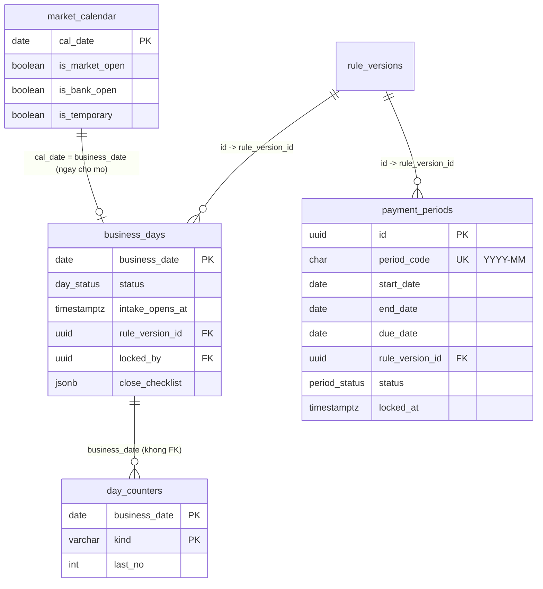

# CLOSE_DB — 市場・銀行カレンダー、業務日 / 期ロックの締め、採番カウンター

| | |
|---|---|
| System Name | 水産物卸売市場業務支援システム（Product A、顧客 株式会社 桜水産市場 — 架空） |
| Schema | `app` |
| CHARACTER SET | UTF8 (PostgreSQL 16, RDS Multi-AZ, AWS Tokyo) |
| Updated by | phuongnnm-23344 |
| Note | ER単位で分割したデータベース設計の1ファイル（QC-01 §4：1ファイル1グループ）。P1–P7の原則、共通規約 + enum（4.0）、公開ビュー、プロトタイプとの差異表、パリティ結果、共通の未決事項は総括ファイル [MKT_DB.md](MKT_DB.md) にある。**4.xx の番号はスキーマ全体のテーブル番号を維持**（MKT_DB §2 の No 列）しているため、ファイル間の相互参照や ADR / spec からの参照は分割後も変わらない |

---

## 1. 改訂履歴

| No | Version | Action | シート / 表 | 変更内容 | 更新日 | 更新者 | Approve |
|---|---|---|---|---|---|---|---|
| 1 | 0.1.0 | Add new | — | 初期内容は `MKT_DB.md` 0.1.0 にあった（スキーマ全体で1ファイル） | 2026-11-25 | phuongnnm-23344 | |
| 2 | 0.2.0 | Add new | ファイル全体 | ER単位で `MKT_DB.md` 0.1.1 から分割（Gate 1 M-09）；Gate 1 に従い修正：業務日の定義は1つ（開始は `LOT_INTAKE_START_TIME`）、日次締め で翌営業日を必ず開く、01:00 のジョブは安全網（M-01）；チェックリストの標準 ✖ / ⚠（M-05、顧客 #1、#4、#25）；支払期日は銀行営業日で前倒し（M-03）；DELTA の再計算の範囲はすべての締め済みの期（C-01）；解決済みの OPEN-DB-02 の注記を削除 | 2026-11-25 | phuongnnm-23344 | |
| 3 | 0.2.1 | Update | 4.43 | P3 を統合（incentive の仕様）：月の期は **その月の最初の業務日を開くとき** に作成（日次締め で翌日を開く / 01:00 のジョブ）、前の期のロックを待たない — `trade_adjustments.period_id` は NOT NULL のため、前の期が締まる前に新しい月の取引の期が必要（例：期08 がまだ締まっていない時に、09-02 の取引へ 09-05 に修正申請）。期ロックは期が存在することのみを保証。前提 [PL] Q-INC-03；プロトタイプ 0023 と異なる | 2026-11-25 | phuongnnm-23344 | |
| 4 | 0.2.2 | Update | — | 顧客 Q-STL-02：4.24 `close_checklist` に項目 (12) を追加 — 「未入力の引渡し確認票なし」にチェック | 2026-11-25 | phuongnnm-23344 |  |

---

## 2. テーブル一覧

| No | Schema | Category | テーブル名（論理） | テーブル名（物理） | 説明 | Note | Status |
|---|---|---|---|---|---|---|---|
| 20 | app | master | 市場・銀行カレンダー | [`market_calendar`](#420-market_calendar) | 1テーブル、フラグ2つ；臨時休市 / 臨時開市 は決裁が必要 | 新規 | Decision (provisional) |
| 24 | app | transaction | 業務日 | [`business_days`](#424-business_days) | カレンダーに従って開く（日の始まり = ロット受付時刻 01:00）、照合部門長 が締める | プロトタイプ: `business_days` | Decision (provisional) |
| 43 | app | transaction | 支払期 | [`payment_periods`](#443-payment_periods) | 業務日に基づく月；支払期日は規程 + カレンダーによる | プロトタイプ: `payment_periods` | Decision (provisional) |
| 57 | app | master | 日別採番カウンター | [`day_counters`](#457-day_counters) | 業務日ごとにロット番号 / 取引番号を連番で採番 | プロトタイプ: `day_counters` | Decision (provisional) |

---

## 3. ER図

2つの鍵の軸：**日**（`business_days`、日次締め）と **期**（`payment_periods`、期ロック）。他クラスタの取引系テーブルは `business_days.business_date` に FK（「開いている日」トリガー）；金額系テーブルは `payment_periods.id` に FK。`rule_versions` は [RULE_DB.md](RULE_DB.md)。

**業務日の定義（唯一の定義 — Gate 1 M-01）：** 業務日 D = 区間 [D 01:00, D+1 01:00) JST。01:00 は有効な版の `LOT_INTAKE_START_TIME`（E-16）。01:00 から受け付けたロットはその朝の業務日に属する；取引の確定は `TRADE_START_TIME`（02:00、PRM-116）からのみ。関数 `business_date_for(t)` = (t − `LOT_INTAKE_START_TIME`) の日。**期** = 元の取引（`trades.trade_date`）の業務日による暦月。

---

## 4. テーブル定義

共通規約（型、共通列、追記のみ、開いている日、関数経由の書き込み、enum）：[MKT_DB.md §4.0](MKT_DB.md#40-共通規約)。

### 4.20. `market_calendar`

| | | | |
|---|---|---|---|
| テーブル名（論理） | 市場・銀行カレンダー | 作成者 / 作成日 | phuongnnm-23344 / 2026-11-25 |
| テーブル名（物理） | `market_calendar` | 更新者 / 更新日 | — |
| Overview | 1テーブル、フラグ2つ（PRM-054）。ルール管理者 が来年のカレンダーを一度（12月）入力し、照合部門長 が決裁；臨時休市 / 臨時開市 は日中に変更し、maker-checker は簡素化、**回数には含めない**（PREMISE §3.1、FB-CUS-239 **【模擬】**）。業務日は `is_market_open` の日にのみ開く（4.24、ADR-005）。 | Note | カレンダーは **マスターデータ** で、年4回の回数の対象ではない（PRM-054；OPEN-DB-02 は PREMISE 0.4.0 §3.1 で解決済み）。支払期日の計算式（`PAYMENT_DUE_RULE`）こそが規程 |

**列定義**

| No. | Key | 論理名 | 物理名 | Data Type | Size | Not Null | Default | Note |
|---|---|---|---|---|---|---|---|---|
| 1 | PRI | 日付 | `cal_date` | DATE | N/A | Yes | | |
| 2 | | 市場の営業 | `is_market_open` | BOOLEAN | N/A | Yes | | |
| 3 | | 銀行の営業 | `is_bank_open` | BOOLEAN | N/A | Yes | | 支払期日が **銀行** の休業日に当たる → **銀行** の直前の営業日へ前倒し（`PAYMENT_DUE_RULE`、RULE_DB 4.23）。土曜：市場は開く（週6日）、銀行は休業 |
| 4 | | 臨時変更 | `is_temporary` | BOOLEAN | N/A | Yes | `false` | 臨時休市 / 臨時開市 |
| 5 | | メモ | `note` | VARCHAR | 100 | No | | 理由（台風、時化、年末前の日曜など） |
| 6 | FK | 作成者 / 確認者 | `maker_id`, `checker_id` | UUID | N/A | Yes / No | | CHECK `checker_id <> maker_id`；確認者がまだいない行は有効ではない |
| 7 | | 決裁日時 | `approved_at` | TIMESTAMPTZ | N/A | No | | |
| 8 | | 共通列 | `updated_at`, `updated_by` | | | | | 変更のたびに → `audit_logs`（変更前 / 変更後） |

**Index** — `market_calendar_pkey` (`cal_date`).

**外部キー**

| No. | 外部キー名 | カラム | 参照先テーブル | 参照先カラム | Note |
|---|---|---|---|---|---|
| 1 | `fk_market_calendar_maker` / `_checker` | `maker_id`, `checker_id` | `staff_accounts` | `id` | |

---

### 4.24. `business_days`

| | | | |
|---|---|---|---|
| テーブル名（論理） | 業務日 | 作成者 / 作成日 | phuongnnm-23344 / 2026-11-25 |
| テーブル名（物理） | `business_days` | 更新者 / 更新日 | — |
| Overview | 業務日 D = [D 01:00, D+1 01:00) JST（01:00 = `LOT_INTAKE_START_TIME`）。**日の開始：** 日次締め で日 D を締めると、`market_calendar` に従って次の業務日を必ず開く（OPEN、`intake_opens_at` = その日の 01:00）ことで、修正申請 / 後入力 のための「未締めの最も早い業務日」が常に存在する；**01:00 の JST のジョブ**（EventBridge、Asia/Tokyo）は冪等な安全網 — まだなければ開く（例：前日がまだ締められていない場合）。実際の時刻による記録（ロット、取引、引渡し）は `business_date_for(now())` の `OPEN` の日へのみ；取引の確定は `TRADE_START_TIME` から。締めは照合部門長 または 代行（MFA）がチェックリストの後に行い、**再び開くことはできない**（BR-CLOSE-01）。D22、Gate 1 M-01 を修正。 | Note | `current_business_date()` の to-be = `business_date_for(now())`；実際の時刻によらない記録（修正申請の REVERSE / DELTA、`LATE_ENTRY`）は `OPEN` の最も早い業務日へ |

**列定義**

| No. | Key | 論理名 | 物理名 | Data Type | Size | Not Null | Default | Note |
|---|---|---|---|---|---|---|---|---|
| 1 | PRI | 業務日 | `business_date` | DATE | N/A | Yes | | |
| 2 | | 状態 | `status` | `day_status` | N/A | Yes | `'OPEN'` | `LOCKED` → `OPEN` はトリガーで阻止 |
| 3 | | ロット受付の開始 | `intake_opens_at` | TIMESTAMPTZ | N/A | Yes | | = 日付 + 有効な版の `LOT_INTAKE_START_TIME` = 業務日の開始 |
| 4 | | 開いた時刻 | `opened_at` | TIMESTAMPTZ | N/A | Yes | `now()` | 前日の日次締め の関数による（`created_by` = 締めた人）または 01:00 のジョブによる（`created_by` NULL） |
| 5 | FK | 適用する規程の版 | `rule_version_id` | UUID | N/A | Yes | | その日に有効な版（FR-AUDIT-03） |
| 6 | FK | 締めた人 | `locked_by` | UUID | N/A | No | | |
| 7 | FK | 代行による締め | `lock_delegation_id` | UUID | N/A | No | | |
| 8 | | 締めた時刻 | `locked_at` | TIMESTAMPTZ | N/A | No | | |
| 9 | | 締め時のチェックリスト | `close_checklist` | JSONB | N/A | No | | チェックリストのスナップショット（PRM-119、ADR-005 §2.5）。**✖ 締めを阻止：** (1) 下書き / 確認待ちの取引が残っている；(2) 確認していないせりのセッション；(3) 同期されていない記録が残っている端末 — ただし「端末回収不能」と報告された端末を除く（`devices.lost_reported_at`、IAM_AUDIT_DB 4.6）；(4) その日の SC-03-07 の記録が 要確認 のまま；(5) 当日訂正 / 取消 が買い手ごとの2段階のしきい値以上、または買受人の変更があり、「確認済」 でないもの（`trade_fixes.reviewed_at`）；(6) 金額を変える引渡し例外で 「確認済」 でないもの（`delivery_exceptions.settle_reviewed_at`）。**⚠ 確認すれば可：** (7) 数量が残るロット → 持ち越し；(8) 引渡しの残り — チェック（PRM-036）；(9) しきい値未満の当日訂正；(10) 未確認の引渡し紛争 → 翌日へ持ち越し；(11) 入力者本人がせりのセッションを確認した場合（理由あり）— 点検；(12) 「未入力の引渡し確認票なし（紙台帳で確認）」 — チェック必須、システムは数えない（Q-STL-02）。スナップショットには (8)、(12) のチェック状態と、チェックリストから除外された端末の一覧を記録する |

**Index** — `business_days_pkey`; `idx_business_days_status` (`status`) partial `status = 'OPEN'`.

**外部キー**

| No. | 外部キー名 | カラム | 参照先テーブル | 参照先カラム | Note |
|---|---|---|---|---|---|
| 1 | `fk_business_days_rule_version` | `rule_version_id` | `rule_versions` | `id` | |
| 2 | `fk_business_days_locked_by` | `locked_by` | `staff_accounts` | `id` | |
| 3 | `fk_business_days_delegation` | `lock_delegation_id` | `delegations` | `id` | |

---

### 4.43. `payment_periods`

| | | | |
|---|---|---|---|
| テーブル名（論理） | 支払期 | 作成者 / 作成日 | phuongnnm-23344 / 2026-11-25 |
| テーブル名（物理） | `payment_periods` | 更新者 / 更新日 | — |
| Overview | 期 = 元の取引（`trades.trade_date`、L4-A04 (2)）の業務日による暦月；調整行は元の取引の `period_id` を持つ（ADJUST_DB 4.39、Gate 1 C-02）。支払期日は有効な版の `PAYMENT_DUE_RULE` + `market_calendar` から計算：**直前の銀行営業日** へ前倒し（D05 を修正、Gate 1 M-03）。期ロック：照合部門長 + MFA、結果の正式な計算と記録は **同じトランザクション内**（ADR-007）；再び開かない。締めた後、期の入力が変わった場合（調整 / 配分 が `locked_at` の後に記録）→ 次の 期ロック で DELTA として再計算 — **締め済みのすべての期、TC年による制限なし**（Gate 1 C-01、INCENTIVE_DB 4.52）。 | Note | 月の期は **その月の最初の業務日を開くとき** に作成（日次締め で開く処理と同じトランザクション、`period_code` で冪等）、前の期の締めを待たない — 複数の `OPEN` の期が同時にあるのは正常；期ロックは従来どおり古い順 → 新しい順（`E-INC-003`）で、次の期が存在することだけを保証する。前提 [PL] Q-INC-03（プロトタイプ 0023 は前の期の締め時に期を作成） |

**列定義**

| No. | Key | 論理名 | 物理名 | Data Type | Size | Not Null | Default | Note |
|---|---|---|---|---|---|---|---|---|
| 1 | PRI | ID | `id` | UUID | N/A | Yes | `gen_random_uuid()` | |
| 2 | UNI | 期コード | `period_code` | CHAR | 7 | Yes | | `YYYY-MM` |
| 3 | | TC年 | `fiscal_year` | INT | N/A | Yes | | マイナスの差分（CARRY）を、**計上した** 期のTC年末まで順に差し引く場合と、規程の回数の計算にのみ使用；DELTA の再計算の範囲は制限しない（Gate 1 C-01） |
| 4 | | 業務日の開始 / 終了 | `start_date`, `end_date` | DATE | N/A | Yes | | CHECK `end_date >= start_date` |
| 5 | | 支払期日 | `due_date` | DATE | N/A | Yes | | |
| 6 | FK | 期の規程の版 | `rule_version_id` | UUID | N/A | Yes | | `start_date` 時点で有効な版（適用開始日が1日 = 期の境界） |
| 7 | | 状態 | `status` | `period_status` | N/A | Yes | `'OPEN'` | |
| 8 | FK | 締めた人 / 代行 | `locked_by`, `lock_delegation_id` | UUID | N/A | No | | |
| 9 | | 締めた時刻 | `locked_at` | TIMESTAMPTZ | N/A | No | | 締め後に入力が変わったことを検出する基準（`created_at > locked_at`） |

**Index** — `payment_periods_pkey`; `uq_payment_periods_code`; `idx_payment_periods_fy` (`fiscal_year`, `status`).

**外部キー** — `rule_version_id` → `rule_versions.id`; `locked_by` → `staff_accounts.id`; `lock_delegation_id` → `delegations.id`.

---

### 4.57. `day_counters`

| | | | |
|---|---|---|---|
| テーブル名（論理） | 日別採番カウンター | 作成者 / 作成日 | phuongnnm-23344 / 2026-11-25 |
| テーブル名（物理） | `day_counters` | 更新者 / 更新日 | — |
| Overview | 業務日ごとに、ロット番号 / 取引番号を途切れなく採番（0025 を維持、トランザクション内）。app ロールには付与しない；関数 `next_day_counter` のみが使用。 | Note | 技術的なテーブル、監査の対象外 |

**列定義**

| No. | Key | 論理名 | 物理名 | Data Type | Size | Not Null | Default | Note |
|---|---|---|---|---|---|---|---|---|
| 1 | PRI | 業務日 | `business_date` | DATE | N/A | Yes | | |
| 2 | PRI | 番号の種類 | `kind` | VARCHAR | 20 | Yes | | `LOT`, `TRADE` |
| 3 | | 最後の番号 | `last_no` | INT | N/A | Yes | | CHECK > 0 |

**Index** — `day_counters_pkey` (`business_date`, `kind`). **外部キー** — N/A（プロトタイプどおり維持；日を開くジョブが順序に依存しないよう `business_days` への FK は付けない）。
