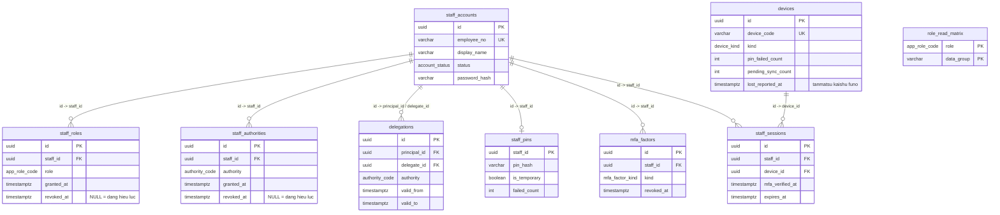
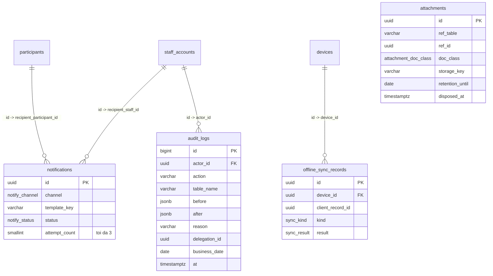

# IAM_AUDIT_DB — アカウント・ロール・決裁権限・端末・セッション + 横断（通知・添付・オフライン同期・監査ログ）

| | |
|---|---|
| System Name | 水産物卸売市場業務支援システム（Product A, 顧客 株式会社 桜水産市場 — 架空） |
| Schema | `app, audit` |
| CHARACTER SET | UTF8 (PostgreSQL 16, RDS Multi-AZ, AWS Tokyo) |
| Updated by | phuongnnm-23344 |
| Note | 本ファイルは Database Design 一式のうち ER クラスタ単位で分割したもの（QC-01 §4: 1ファイルにつきテーブル群1つ）。P1–P7 の原則、共通規約と enum（4.0）、公開ビュー、プロトタイプとの差異表、parity 結果、共通の未決事項は総括ファイル [MKT_DB.md](MKT_DB.md) にある。**4.xx の番号はスキーマ全体のテーブル番号（MKT_DB §2 の No 列）のまま**とし、ファイル間の相互参照や ADR・仕様からの参照が分割後も変わらないようにする |

---

## 1. 改訂履歴

| No | Version | Action | シート / 表 | 変更内容 | 更新日 | 更新者 | Approve |
|---|---|---|---|---|---|---|---|
| 1 | 0.1.0 | Add new | — | 初版は `MKT_DB.md` 0.1.0 の中にあった（スキーマ全体で1ファイル） | 2026-11-25 | phuongnnm-23344 | |
| 2 | 0.2.0 | Add new | 全ファイル | `MKT_DB.md` 0.1.1 から ER クラスタ単位に分割（Gate 1 M-09）。Gate 1 に従い修正: テーブル `staff_roles`（4.58）を追加、列 `staff_accounts.role` を削除（m-10）; `devices.lost_*` — 「端末回収不能」（M-05、顧客 #1）; `attachments.doc_class` を追加し、証憑種別ごとに TBL-ATTACH-01 で保存、物理削除は決裁を経て実施（M-08）; ER `staff_accounts ||--o| staff_pins`（m-08） | 2026-11-25 | phuongnnm-23344 | |
| 3 | 0.3.0 | Update | 4.54 | Gate 1 再確認 n-06: `archive_after` / `retention_until` を分離。保存期限は親レコードの TC 年末から起算 | 2026-11-25 | phuongnnm-23344 | |

---

## 2. テーブル一覧

| No | Schema | Category | テーブル名（論理） | テーブル名（物理） | 説明 | Note | Status |
|---|---|---|---|---|---|---|---|
| 1 | app | master | スタッフアカウント | [`staff_accounts`](#41-staff_accounts) | 社内スタッフ1人につき1行。`auth.users` + `profiles` を置き換える | Prototype: `profiles` | Decision (provisional) |
| 2 | app | history | 決裁権限の付与・取消 | [`staff_authorities`](#42-staff_authorities) | 照合部門長 / 運用部門長 / 配送部門責任者 をアカウントに紐づけ、取消履歴を持つ | Prototype: `user_authorities` | Decision (provisional) |
| 3 | app | master | 代行者 | [`delegations`](#43-delegations) | 決裁権限の委任。開始日・終了日つき | 新規 | Decision (provisional) |
| 4 | app | master | 利用者切替用 PIN | [`staff_pins`](#44-staff_pins) | 4桁 PIN のハッシュ、仮 PIN、失敗回数 | Prototype: `profile_pins` | Decision (provisional) |
| 5 | app | master | MFA 方式 | [`mfa_factors`](#45-mfa_factors) | 本人ごとのアプリ TOTP / ハードウェアトークン / 使い捨てバックアップコード | 新規 | Decision (provisional) |
| 6 | app | master | 登録端末 | [`devices`](#46-devices) | 桟橋タブレット、取引担当 PC、事務所 PC。PIN ロックは端末単位 | 新規 | Decision (provisional) |
| 7 | app | transaction | ログインセッション | [`staff_sessions`](#47-staff_sessions) | サーバー側セッション（人・端末）、MFA step-up の時刻 | 新規 | Decision (provisional) |
| 58 | app | history | アカウントのロール | [`staff_roles`](#458-staff_roles) | 1アカウントに複数ロール、付与・取消の履歴あり（Gate 1 m-10） | 新規 — prototype `profiles.role` は1ロールのみ | Decision (provisional) |
| 8 | app | master | 閲覧権限マトリクス | [`role_read_matrix`](#48-role_read_matrix) | ロール × データグループの閲覧可否。RLS とメニューが同じものを参照 | 新規 | Decision (provisional) |
| 53 | app | transaction | 通知（outbox） | [`notifications`](#453-notifications) | アプリ内 + メール、再送は3回まで | 新規 | Decision (provisional) |
| 54 | app | transaction | 添付 | [`attachments`](#454-attachments) | S3 上のファイルのメタデータ。保存期間は証憑種別ごと（TBL-ATTACH-01） | 新規 | Decision (provisional) |
| 55 | app | transaction | オフライン同期レコード | [`offline_sync_records`](#455-offline_sync_records) | 仮受付 / 引渡し / 紙伝票後入力 のキュー + SC-03-07 との突合 | 新規 | Decision (provisional) |
| 56 | audit | history | 監査ログ | [`audit_logs`](#456-audit_logs) | 誰が・いつ・理由・代行・変更前後。TC 年ごとに分割 | Prototype: `audit_logs` | Decision (provisional) |

---

## 3. ER Diagram

### 3.1 アカウント・ロール・決裁権限・端末（`iam`）

`staff_accounts ||--o| staff_pins`: PIN は共用端末の利用者のみが持つ。事務所 PC だけを使うアカウントは PIN を持たない（Gate 1 m-08）。

### 3.2 横断: 通知・添付・オフライン同期・監査ログ

3テーブル `notifications`、`attachments`、`audit_logs` は、複数の業務テーブルを（`ref_table`, `ref_id`）または（`table_name`, `record_id`）の組で参照する。FK は宣言しない。理由は 4.53–4.56。`participants` は [PARTY_DB.md](PARTY_DB.md) にある。

---

## 4. 定義テーブル

共通規約（型、共通列、追記のみ、日付のオープン、関数経由の更新、enum）: [MKT_DB.md §4.0](MKT_DB.md#40-共通規約).

### 4.1. `staff_accounts`

| | | | |
|---|---|---|---|
| テーブル名（論理） | スタッフアカウント | 作成者 / 作成日 | phuongnnm-23344 / 2026-11-25 |
| テーブル名（物理） | `staff_accounts` | 更新者 / 更新日 | — |
| Overview | 社内スタッフ1人につき1行（PRM-089: 1人1アカウント）。プロトタイプの `auth.users` + `profiles` を置き換える。モジュール `iam` が自己管理する（ADR-002）。 | Note | 外部の参加者は第1期にはアカウントを持たない（L4-A08）。ロールはこのテーブルではなく `staff_roles`（4.58）にある — 1人が複数ロール、1アカウント（Gate 1 m-10） |

**列定義**

| No. | Key | 論理名 | 物理名 | Data Type | Size | Not Null | Default | Note |
|---|---|---|---|---|---|---|---|---|
| 1 | PRI | ID | `id` | UUID | N/A | Yes | `gen_random_uuid()` | |
| 2 | UNI | 社員番号 | `employee_no` | VARCHAR | 20 | Yes | | 「PIN による利用者切替」で使用 |
| 3 | | 表示名 | `display_name` | VARCHAR | 50 | Yes | | 全画面で大きく表示（PRM-112 (a)） |
| 4 | UNI | ログインメール | `login_email` | VARCHAR | 254 | No | | 共用端末のみを使う人は NULL |
| 5 | | パスワードハッシュ | `password_hash` | VARCHAR | 255 | No | | argon2id（ADR-002）。ログには決して出力しない |
| 6 | | 状態 | `status` | `account_status` | N/A | Yes | `'ACTIVE'` | 停止 → 全セッションを即時削除（ADR-002） |
| 7 | | ログイン時に MFA 必須 | `mfa_required_at_login` | BOOLEAN | N/A | Yes | `false` | `SYSADM` ロールを持つ場合は `true` 必須（ロール付与関数で検査）— L4-A07 |
| 8 | | 共通列 | `created_at`, `created_by`, `updated_at`, `updated_by` | | | | | 4.0 を参照 |

**インデックス**

| No. | インデックス名 | カラム | Primary key | Unique | Note |
|---|---|---|---|---|---|
| 1 | `staff_accounts_pkey` | `id` | Yes | Yes | |
| 2 | `uq_staff_accounts_employee_no` | `employee_no` | No | Yes | |
| 3 | `uq_staff_accounts_login_email` | `lower(login_email)` | No | Yes | Partial: `login_email IS NOT NULL` |

**外部キー**

| No. | 外部キー名 | カラム | 参照先テーブル | 参照先カラム | Note |
|---|---|---|---|---|---|
| — | N/A | | | | 親テーブル。`created_by` / `updated_by` は `staff_accounts.id` を自己参照 |

---

### 4.2. `staff_authorities`

| | | | |
|---|---|---|---|
| テーブル名（論理） | 決裁権限の付与・取消 | 作成者 / 作成日 | phuongnnm-23344 / 2026-11-25 |
| テーブル名（物理） | `staff_authorities` | 更新者 / 更新日 | — |
| Overview | 決裁権限はアカウントに紐づくもので、新しいロールではない（PRM-051, PRM-058, PRM-111）。取消 = `revoked_at` を記入し、行は削除しない（ADR-003: 付与・取消の履歴を持つ）。 | Note | UPDATE は1回のみ許可: `revoked_at` / `revoked_by` を一度だけ記入 |

**列定義**

| No. | Key | 論理名 | 物理名 | Data Type | Size | Not Null | Default | Note |
|---|---|---|---|---|---|---|---|---|
| 1 | PRI | ID | `id` | UUID | N/A | Yes | `gen_random_uuid()` | |
| 2 | FK | 社員 | `staff_id` | UUID | N/A | Yes | | |
| 3 | | 権限 | `authority` | `authority_code` | N/A | Yes | | |
| 4 | | 付与日時 | `granted_at` | TIMESTAMPTZ | N/A | Yes | `now()` | |
| 5 | FK | 付与者 | `granted_by` | UUID | N/A | Yes | | SYSADM |
| 6 | | 取消日時 | `revoked_at` | TIMESTAMPTZ | N/A | No | | NULL = 有効中 |
| 7 | FK | 取消者 | `revoked_by` | UUID | N/A | No | | |
| 8 | | 共通列 | `created_at`, `created_by` | | | | | |

**インデックス**

| No. | インデックス名 | カラム | Primary key | Unique | Note |
|---|---|---|---|---|---|
| 1 | `staff_authorities_pkey` | `id` | Yes | Yes | |
| 2 | `uq_staff_authorities_active` | `staff_id`, `authority` | No | Yes | Partial: `revoked_at IS NULL` |

**外部キー**

| No. | 外部キー名 | カラム | 参照先テーブル | 参照先カラム | Note |
|---|---|---|---|---|---|
| 1 | `fk_staff_authorities_staff` | `staff_id` | `staff_accounts` | `id` | ON DELETE RESTRICT |
| 2 | `fk_staff_authorities_granted_by` / `_revoked_by` | `granted_by`, `revoked_by` | `staff_accounts` | `id` | |

---

### 4.3. `delegations`

| | | | |
|---|---|---|---|
| テーブル名（論理） | 代行者（代わりに行う者） | 作成者 / 作成日 | phuongnnm-23344 / 2026-11-25 |
| テーブル名（物理） | `delegations` | 更新者 / 更新日 | — |
| Overview | 決裁権限を持つ者が、期間つきで代行者を指定する。期間が過ぎると自動的に失効する（PRM-057, PRM-129 — SC-02-03 のタブ）。`assert_caller` は [`valid_from`, `valid_to`) の間、`delegate_id` が `authority` を持つものとみなす。 | Note | 早期取消 = `revoked_at` を記入。代行による操作はすべて `audit_logs` に `delegation_id` を記録する |

**列定義**

| No. | Key | 論理名 | 物理名 | Data Type | Size | Not Null | Default | Note |
|---|---|---|---|---|---|---|---|---|
| 1 | PRI | ID | `id` | UUID | N/A | Yes | `gen_random_uuid()` | |
| 2 | FK | 委任者 | `principal_id` | UUID | N/A | Yes | | `authority` を持っていること |
| 3 | FK | 代行者 | `delegate_id` | UUID | N/A | Yes | | CHECK `delegate_id <> principal_id` |
| 4 | | 代行される権限 | `authority` | `authority_code` | N/A | Yes | | |
| 5 | | 開始 | `valid_from` | TIMESTAMPTZ | N/A | Yes | | |
| 6 | | 終了 | `valid_to` | TIMESTAMPTZ | N/A | Yes | | CHECK `valid_to > valid_from` |
| 7 | | 理由 | `reason` | VARCHAR | 200 | Yes | | |
| 8 | | 取消 | `revoked_at` | TIMESTAMPTZ | N/A | No | | |
| 9 | | 共通列 | `created_at`, `created_by` | | | | | |

**インデックス**

| No. | インデックス名 | カラム | Primary key | Unique | Note |
|---|---|---|---|---|---|
| 1 | `delegations_pkey` | `id` | Yes | Yes | |
| 2 | `idx_delegations_delegate_period` | `delegate_id`, `authority`, `valid_from`, `valid_to` | No | No | `assert_caller` で有効な権限を検索する |

**外部キー**

| No. | 外部キー名 | カラム | 参照先テーブル | 参照先カラム | Note |
|---|---|---|---|---|---|
| 1 | `fk_delegations_principal` | `principal_id` | `staff_accounts` | `id` | |
| 2 | `fk_delegations_delegate` | `delegate_id` | `staff_accounts` | `id` | |

---

### 4.4. `staff_pins`

| | | | |
|---|---|---|---|
| テーブル名（論理） | 利用者切替用 PIN | 作成者 / 作成日 | phuongnnm-23344 / 2026-11-25 |
| テーブル名（物理） | `staff_pins` | 更新者 / 更新日 | — |
| Overview | 共用端末で利用者を切り替えるための4桁 PIN（PRM-112）。アプリ用ロールには SELECT を付与しない — 関数 `verify_pin` だけが読む。 | Note | ロックは**人単位**でここに、**端末単位**は `devices` にある（M22）。オフライン PIN の写しは端末に保存され、このテーブルにはない（ADR-008） |

**列定義**

| No. | Key | 論理名 | 物理名 | Data Type | Size | Not Null | Default | Note |
|---|---|---|---|---|---|---|---|---|
| 1 | PRI/FK | 社員 | `staff_id` | UUID | N/A | Yes | | `staff_accounts` と 1 : 1 |
| 2 | | PIN ハッシュ | `pin_hash` | VARCHAR | 255 | Yes | | argon2id（salt 付き） |
| 3 | | 仮 PIN | `is_temporary` | BOOLEAN | N/A | Yes | `false` | 当番責任者がリセットした後 `true`。オンラインのみで使用、初回ログイン時に変更必須（PRM-112 (c)） |
| 4 | | 失敗回数 | `failed_count` | INT | N/A | Yes | `0` | CHECK ≥ 0; 閾値は設定ファイル |
| 5 | | ロック期限 | `locked_until` | TIMESTAMPTZ | N/A | No | | |
| 6 | | 失敗カウント期限 | `failed_window_ends_at` | TIMESTAMPTZ | N/A | No | | 一定時間の経過後、失敗カウントは 0 に戻る（M22） |
| 7 | | 共通列 | `updated_at`, `updated_by` | | | | | |

**インデックス** — `staff_pins_pkey`（`staff_id`）のみ。

**外部キー**

| No. | 外部キー名 | カラム | 参照先テーブル | 参照先カラム | Note |
|---|---|---|---|---|---|
| 1 | `fk_staff_pins_staff` | `staff_id` | `staff_accounts` | `id` | ON DELETE RESTRICT（アカウントを削除しない） |

---

### 4.5. `mfa_factors`

| | | | |
|---|---|---|---|
| テーブル名（論理） | MFA 方式 | 作成者 / 作成日 | phuongnnm-23344 / 2026-11-25 |
| テーブル名（物理） | `mfa_factors` | 更新者 / 更新日 | — |
| Overview | 決裁権限を持つ者・管理者は、それぞれ少なくとも1つの方式を登録する（ADR-002 §2.2、約12–13人 — PRM-088）。コードは所有者のアカウントに対してのみ有効。 | Note | トークンを失った → SYSADM が直ちに `revoked_at` を記入。**メール OTP はない**（ADR-002 0.2.0、Gate 1 m-06）: 忘失・紛失 → SYSADM が**当日中に失効する使い捨てバックアップコード**（`BACKUP_CODE`）を発行するか、決裁を代行者に移す |

**列定義**

| No. | Key | 論理名 | 物理名 | Data Type | Size | Not Null | Default | Note |
|---|---|---|---|---|---|---|---|---|
| 1 | PRI | ID | `id` | UUID | N/A | Yes | `gen_random_uuid()` | |
| 2 | FK | 社員 | `staff_id` | UUID | N/A | Yes | | |
| 3 | | 種類 | `kind` | `mfa_factor_kind` | N/A | Yes | | |
| 4 | | TOTP 秘密鍵 / バックアップコードのハッシュ | `secret_encrypted` | BYTEA | N/A | Yes | | TOTP: アプリ層で KMS 鍵により暗号化し、DB は平文を見ない。`BACKUP_CODE`: ハッシュのみ保存 |
| 5 | | トークンのシリアル番号 | `hardware_serial` | VARCHAR | 40 | No | | `kind = TOTP_HARDWARE` のとき必須 |
| 6 | | 取消 | `revoked_at` | TIMESTAMPTZ | N/A | No | | |
| 6a | | 有効期限 | `expires_at` | TIMESTAMPTZ | N/A | No | | `BACKUP_CODE` のとき必須（発行日の業務日末）; TOTP では NULL |
| 6b | | 使用日時 | `used_at` | TIMESTAMPTZ | N/A | No | | `BACKUP_CODE` は1回のみ使用（UPDATE 1回） |
| 7 | | 共通列 | `created_at`, `created_by` | | | | | `BACKUP_CODE`: `created_by` = 発行した SYSADM、`audit_logs` に記録 |

**インデックス** — `mfa_factors_pkey`（`id`）; `idx_mfa_factors_staff`（`staff_id`）partial `revoked_at IS NULL`。

**外部キー**

| No. | 外部キー名 | カラム | 参照先テーブル | 参照先カラム | Note |
|---|---|---|---|---|---|
| 1 | `fk_mfa_factors_staff` | `staff_id` | `staff_accounts` | `id` | |

---

### 4.6. `devices`

| | | | |
|---|---|---|---|
| テーブル名（論理） | 登録端末 | 作成者 / 作成日 | phuongnnm-23344 / 2026-11-25 |
| テーブル名（物理） | `devices` | 更新者 / 更新日 | — |
| Overview | SYSADM が `device_code` を発行した端末（ADR-002 §2.1）。セッション、オフライン記録、印刷ログ、監査に紐づく。 | Note | 端末単位の PIN ロックにより、1台での PIN の総当たりを防ぐ（M22, NFR-SEC-03）。「端末回収不能」となった端末の記録は、後に同期されると `offline_sync_records.result = HELD` → SC-03-07 → 修正申請 `LATE_ENTRY`（ADJUST_DB 4.37）となる |

**列定義**

| No. | Key | 論理名 | 物理名 | Data Type | Size | Not Null | Default | Note |
|---|---|---|---|---|---|---|---|---|
| 1 | PRI | ID | `id` | UUID | N/A | Yes | `gen_random_uuid()` | |
| 2 | UNI | 端末コード | `device_code` | VARCHAR | 20 | Yes | | |
| 3 | | 種類 | `kind` | `device_kind` | N/A | Yes | | タイムアウトは種類ごとに設定ファイル（PRM-126） |
| 4 | | 設置場所 | `location_label` | VARCHAR | 50 | No | | 桟橋番号…、取引担当卓… |
| 5 | | 使用中 | `is_active` | BOOLEAN | N/A | Yes | `true` | |
| 6 | | 端末上の PIN 失敗回数 | `pin_failed_count` | INT | N/A | Yes | `0` | |
| 7 | | PIN ロック期限 | `pin_locked_until` | TIMESTAMPTZ | N/A | No | | |
| 8 | | 最終同期 | `last_synced_at` | TIMESTAMPTZ | N/A | No | | 日次締めのチェックリストに表示（PRM-119 (a)） |
| 9 | | 最終ハートビート | `last_heartbeat_at` | TIMESTAMPTZ | N/A | No | | オンライン時に端末が送信（ADR-008 §2.2-7） |
| 10 | | 同期待ち件数 | `pending_sync_count` | INT | N/A | Yes | `0` | ハートビートで通知; > 0 → 日次締めのチェックリストで ✖ 表示（ADR-005 §2.5） |
| 11 | | 「端末回収不能」報告日時 | `lost_reported_at` | TIMESTAMPTZ | N/A | No | | 故障・紛失・電池切れで回収不能になった端末（顧客 #1）。値があると、端末は日次締めのチェックリストから外れ、端末のセッションとオフライン PIN は取り消され、`is_active = false` となる |
| 12 | FK | 報告者 | `lost_reported_by` | UUID | N/A | No | | `STL_HEAD` または代行、**MFA**; `audit_logs` に記録（理由、代行、MFA） |
| 13 | | 理由 | `lost_reason` | VARCHAR | 200 | No | | `lost_reported_at` に値があるとき必須（CHECK） |
| 14 | | 共通列 | `created_at`, `created_by`, `updated_at`, `updated_by` | | | | | |

**インデックス** — `devices_pkey`（`id`）; `uq_devices_device_code`（`device_code`、unique）。

**外部キー** — `lost_reported_by` → `staff_accounts.id`; その他は共通列の FK のみ。

---

### 4.7. `staff_sessions`

| | | | |
|---|---|---|---|
| テーブル名（論理） | ログインセッション | 作成者 / 作成日 | phuongnnm-23344 / 2026-11-25 |
| テーブル名（物理） | `staff_sessions` | 更新者 / 更新日 | — |
| Overview | サーバー側セッションで、即時に取り消せる（ADR-002 §2.1）。1セッション = （人、端末）; PIN で利用者を切り替えると旧セッションを閉じて新セッションを開く → MFA step-up は無効になる。 | Note | 運用データ: 期限切れセッションは job により30日後に削除する（業務データではない。ログイン履歴は `audit_logs` にある） |

**列定義**

| No. | Key | 論理名 | 物理名 | Data Type | Size | Not Null | Default | Note |
|---|---|---|---|---|---|---|---|---|
| 1 | PRI | セッション ID | `id` | UUID | N/A | Yes | `gen_random_uuid()` | Cookie にはトークンのハッシュ値を保持し、`id` は保持しない |
| 2 | UNI | トークンハッシュ | `token_hash` | CHAR | 64 | Yes | | SHA-256 |
| 3 | FK | 社員 | `staff_id` | UUID | N/A | Yes | | |
| 4 | FK | 端末 | `device_id` | UUID | N/A | No | | NULL = 未登録の個人 PC |
| 5 | | MFA 実施日時 | `mfa_verified_at` | TIMESTAMPTZ | N/A | No | | Step-up は10分間有効（ADR-002 §2.2、値は設定ファイル） |
| 6 | | 最終アクセス | `last_seen_at` | TIMESTAMPTZ | N/A | Yes | `now()` | |
| 7 | | 有効期限 | `expires_at` | TIMESTAMPTZ | N/A | Yes | | |
| 8 | | 取消日時 | `revoked_at` | TIMESTAMPTZ | N/A | No | | |
| 9 | | 作成日時 | `created_at` | TIMESTAMPTZ | N/A | Yes | `now()` | |

**インデックス** — `staff_sessions_pkey`; `uq_staff_sessions_token_hash`（一意）; `idx_staff_sessions_staff`（`staff_id`）partial `revoked_at IS NULL`。

**外部キー**

| No. | 外部キー名 | カラム | 参照先テーブル | 参照先カラム | Note |
|---|---|---|---|---|---|
| 1 | `fk_staff_sessions_staff` | `staff_id` | `staff_accounts` | `id` | |
| 2 | `fk_staff_sessions_device` | `device_id` | `devices` | `id` | |

---

### 4.8. `role_read_matrix`

| | | | |
|---|---|---|---|
| テーブル名（論理） | 閲覧権限マトリクス | 作成者 / 作成日 | phuongnnm-23344 / 2026-11-25 |
| テーブル名（物理） | `role_read_matrix` | 更新者 / 更新日 | — |
| Overview | ロール × データグループの閲覧可否。TBL-ROLE-01 の 閲 列に従う（L4-A06）。全テーブルの RLS ポリシーは `can_read(data_group)` を呼び、このテーブルを読む。UI のメニューも同じものを読む（ADR-003 §2.5 — 一度だけ記述）。 | Note | 各行の内容は LAB-1 の role-list から取得。画面仕様ではアイテムごとの表示権限を記載する |

**列定義**

| No. | Key | 論理名 | 物理名 | Data Type | Size | Not Null | Default | Note |
|---|---|---|---|---|---|---|---|---|
| 1 | PRI | ロール | `role` | `app_role_code` | N/A | Yes | | |
| 2 | PRI | データグループ | `data_group` | VARCHAR | 30 | Yes | | 例: `PARTY`, `LOT`, `TRADE`, `DELIVERY`, `SETTLE`, `INCENTIVE`, `RULE`, `AUDIT`, `IAM` |
| 3 | | 範囲 | `scope` | VARCHAR | 10 | Yes | `'ALL'` | `ALL` · `OWN`（自分が作成したレコードのみ） |
| 4 | | 共通列 | `updated_at`, `updated_by` | | | | | マトリクスの変更 = 権限の変更 → 監査 |

**インデックス** — `role_read_matrix_pkey`（`role`, `data_group`）。決裁権限（`authority_code`）による閲覧の拡張は関数で行い、このテーブルには書かない。複数ロールを持つ人（4.58）は、有効な全ロールの行の和集合で読む。

**外部キー** — N/A.

---

### 4.58. `staff_roles`

| | | | |
|---|---|---|---|
| テーブル名（論理） | アカウントのロール（付与・取消） | 作成者 / 作成日 | phuongnnm-23344 / 2026-11-25 |
| テーブル名（物理） | `staff_roles` | 更新者 / 更新日 | — |
| Overview | 1人が TBL-ROLE-01 の**複数ロール**を、**1つ**のアカウントに持てる（例: 受付 + 目利き記録、照合事務局 + ルール管理者）。PRM-089（1人1アカウント）を維持する。0.1.x の `staff_accounts.role` 列を置き換える（Gate 1 m-10）。取消 = `revoked_at` を記入し、削除しない（4.2 と同じ）。`assert_caller` と `can_read` は、有効な全ロールを持つ利用者として扱う。職務分離（SoD）は「1ロール1人」ではなく、関数内で人単位に検査する: 規程のメーカー ≠ チェッカー、起票者 ≠ 決裁者、記録者 ≠ 確認者（ADR-003 §2.4）。 | Note | 前提 [PL] — RFP はロール数 / アカウント数を規定しない; OPEN-DB-10（MKT_DB §7）。新規テーブル。全スキーマの採番後に追加したため 4.58 と採番する |

**列定義**

| No. | Key | 論理名 | 物理名 | Data Type | Size | Not Null | Default | Note |
|---|---|---|---|---|---|---|---|---|
| 1 | PRI | ID | `id` | UUID | N/A | Yes | `gen_random_uuid()` | |
| 2 | FK | 社員 | `staff_id` | UUID | N/A | Yes | | |
| 3 | | ロール | `role` | `app_role_code` | N/A | Yes | | |
| 4 | | 付与日時 | `granted_at` | TIMESTAMPTZ | N/A | Yes | `now()` | |
| 5 | FK | 付与者 | `granted_by` | UUID | N/A | Yes | | SYSADM |
| 6 | | 取消日時 | `revoked_at` | TIMESTAMPTZ | N/A | No | | NULL = 有効中 |
| 7 | FK | 取消者 | `revoked_by` | UUID | N/A | No | | |
| 8 | | 共通列 | `created_at`, `created_by` | | | | | `revoked_at` / `revoked_by` のみ1回だけ UPDATE 可 |

`SYSADM` アカウントは業務ロールを追加で持たない（ロール付与関数の CHECK）— 管理と業務を分離する。

**インデックス**

| No. | インデックス名 | カラム | Primary key | Unique | Note |
|---|---|---|---|---|---|
| 1 | `staff_roles_pkey` | `id` | Yes | Yes | |
| 2 | `uq_staff_roles_active` | `staff_id`, `role` | No | Yes | Partial: `revoked_at IS NULL` |

**外部キー**

| No. | 外部キー名 | カラム | 参照先テーブル | 参照先カラム | Note |
|---|---|---|---|---|---|
| 1 | `fk_staff_roles_staff` | `staff_id` | `staff_accounts` | `id` | ON DELETE RESTRICT |
| 2 | `fk_staff_roles_granted_by` / `_revoked_by` | `granted_by`, `revoked_by` | `staff_accounts` | `id` | |

---

### 4.53. `notifications`

| | | | |
|---|---|---|---|
| テーブル名（論理） | 通知（outbox） | 作成者 / 作成日 | phuongnnm-23344 / 2026-11-25 |
| テーブル名（物理） | `notifications` | 更新者 / 更新日 | — |
| Overview | 業務トランザクションと同じトランザクション内で記録する。ワーカーが SES でメールを送信する; 最大3回まで再送（BR-NOTIFY-01）; `FAILED` → 翌日に窓口で印刷する一覧 + 照合部門向けの「未送信」一覧（L4-A08）。アプリ内表示は SC-00-03（PRM-130）。 | Note | 運用テーブル: `status`, `attempt_count`, `read_at` を UPDATE する; 金銭データではない。多態参照（`ref_table`, `ref_id`）— 複数テーブルを指すため FK なし |

**列定義**

| No. | Key | 論理名 | 物理名 | Data Type | Size | Not Null | Default | Note |
|---|---|---|---|---|---|---|---|---|
| 1 | PRI | ID | `id` | UUID | N/A | Yes | `gen_random_uuid()` | |
| 2 | | チャネル | `channel` | `notify_channel` | N/A | Yes | | |
| 3 | FK | 社内受信者 | `recipient_staff_id` | UUID | N/A | No | | |
| 4 | FK | 参加者の受信者 | `recipient_participant_id` | UUID | N/A | No | | 3、4 のいずれか一方のみ |
| 5 | | メールアドレス | `email_to` | VARCHAR | 254 | No | | キュー投入時に保存 |
| 6 | | テンプレート | `template_key` | VARCHAR | 50 | Yes | | 文面は設定ファイル（PRM-126） |
| 7 | | データ | `payload` | JSONB | N/A | Yes | | |
| 8 | | 重要度 | `is_critical` | BOOLEAN | N/A | Yes | `false` | Critical は5分以内（FG-12） |
| 9 | | 状態 | `status` | `notify_status` | N/A | Yes | `'QUEUED'` | |
| 10 | | 送信回数 | `attempt_count` | SMALLINT | N/A | Yes | `0` | CHECK 0..3 |
| 11 | | 最終エラー | `last_error` | VARCHAR | 300 | No | | |
| 12 | | 送信日時 / 既読日時 | `sent_at`, `read_at` | TIMESTAMPTZ | N/A | No | | |
| 13 | | 参照 | `ref_table`, `ref_id` | VARCHAR(50) / UUID | | No | | |
| 14 | | 共通列 | `created_at` | | | | | |

**インデックス** — `notifications_pkey`; `idx_notifications_queue`（`status`, `created_at`）partial `status IN ('QUEUED','RETRYING')`; `idx_notifications_staff_unread`（`recipient_staff_id`）partial `read_at IS NULL`。

**外部キー** — `recipient_staff_id` → `staff_accounts.id`; `recipient_participant_id` → `participants.id`。

---

### 4.54. `attachments`

| | | | |
|---|---|---|---|
| テーブル名（論理） | 添付 | 作成者 / 作成日 | phuongnnm-23344 / 2026-11-25 |
| テーブル名（物理） | `attachments` | 更新者 / 更新日 | — |
| Overview | S3 上のファイルのメタデータ: ロットの証憑、紙伝票のスキャン、紛争時の紙の書類、修正申請の証拠。第1期は PC でのスキャン / 添付のみ（E-21）。**証憑種別ごとの保存期間**（`doc_class`、TBL-ATTACH-01）: 受入票・取引票・照合表は **オンライン7年**、その後は顧客の保存方針に従う; 写真 / 紛争・配送の証拠、および rehearsal / 検収 migration の記録は **オンライン3年 → コールドアーカイブ**、復元は2営業日以内。**自動では削除しない:** `retention_until` に達したらジョブが「保存期限到来」一覧に入れる; 物理削除は 運用部門長 の決裁（MFA、理由）後のみ — B.7 「保存期間満了後の物理削除は承認を要する」 (Gate 1 M-08, ADR-009). | Note | 多態参照（`ref_table`, `ref_id`）— FK なし; 書き込み関数は `ref_table` が許可リストに含まれるか検査する。B.7 は「添付書類は3年間」と記すが、TBL-ATTACH-01 は種類により3年 / 7年に分けている → より具体的な TBL-ATTACH-01 に従う — 前提 [PL]、Q-ARCH-07 |

**列定義**

| No. | Key | 論理名 | 物理名 | Data Type | Size | Not Null | Default | Note |
|---|---|---|---|---|---|---|---|---|
| 1 | PRI | ID | `id` | UUID | N/A | Yes | `gen_random_uuid()` | |
| 2 | | 親テーブル / 親レコード | `ref_table`, `ref_id` | VARCHAR(50) / UUID | | Yes | | |
| 2a | | 証憑種別 | `doc_class` | `attachment_doc_class` | N/A | Yes | | アップロード時に必須; S3 オブジェクトに同じ値の **タグ** を付け、ライフサイクルを種別ごとに実行（ADR-009 §2.2-9） |
| 3 | | ファイル名 | `file_name` | VARCHAR | 200 | Yes | | |
| 4 | | 種類 | `content_type` | VARCHAR | 100 | Yes | | |
| 5 | | サイズ | `size_bytes` | BIGINT | N/A | Yes | | CHECK ≤ 上限（設定ファイル） |
| 6 | | S3 キー | `storage_key` | VARCHAR | 300 | Yes | | |
| 7 | | ハッシュ | `sha256` | CHAR | 64 | Yes | | |
| 8 | | コールドアーカイブ移行日 | `archive_after` | DATE | N/A | No | | `DISPUTE_EVIDENCE`、`MIGRATION_RECORD` のみ: 起点 + 3年; 7年の種類は NULL（recheck n-06） |
| 8a | | 保存期限（削除検討日） | `retention_until` | DATE | N/A | Yes | | **起点**から計算する = 親レコードの `business_date` の属する TC 年の年末（アップロード日ではない — 紙伝票を後からアップロードしても、帳簿より長く保存しない）: `RECEIPT_SLIP`、`TRADE_SLIP`、`RECONCILIATION_SHEET`、`CORRECTION_EVIDENCE` は7年; 3年の種類は保存期間を顧客が決める（Q-ARCH-07）。暫定 = 帳簿と同じ7年 — 3年目に削除リストへ**入れない**。前提 [PL] |
| 9 | FK | 物理削除の決裁 | `disposal_approved_by` | UUID | N/A | No | | `OPS_HEAD`（決裁、MFA） |
| 9a | | 決裁日時 / 理由 | `disposal_approved_at`, `disposal_reason` | TIMESTAMPTZ / VARCHAR(200) | | No | | |
| 9b | | ファイル削除日時 | `disposed_at` | TIMESTAMPTZ | N/A | No | | `disposal_approved_by` が記録された後のみ書き込み可; メタデータ行は**保持**する（B.7 は取引記録を物理削除しない） |
| 10 | | 共通列 | `created_at`, `created_by` | | | | | `disposal_*`、`disposed_at` 列のみ1回だけ UPDATE 可 |

**インデックス** — `attachments_pkey`; `idx_attachments_ref`（`ref_table`, `ref_id`）; `idx_attachments_retention`（`retention_until`）partial `disposed_at IS NULL`。**外部キー** — `disposal_approved_by` → `staff_accounts.id`。

---

### 4.55. `offline_sync_records`

| | | | |
|---|---|---|---|
| テーブル名（論理） | オフライン同期レコード | 作成者 / 作成日 | phuongnnm-23344 / 2026-11-25 |
| テーブル名（物理） | `offline_sync_records` | 更新者 / 更新日 | — |
| Overview | 3種類のオフライン操作のキューを受け取る（仮受付、通常の引渡し、紙伝票後入力 — ADR-008）。`client_record_id` は冪等キー: 同じ id を再受信したら前回の結果を返す。オンラインと**同じ業務関数**で同期する; 拒否された場合（数量がマイナスになる、締め済みの日付…）→ `HELD`、SC-03-07 に権限者向けに表示 — 強制書き込みも上書きもしない。締め済みの日付（「端末回収不能」の端末を含む）の `HELD` は次の2つの経路のみ: 「修正申請（後入力）を作成」→ 修正申請 `LATE_ENTRY` を事前入力（`applied_ref_table = 'correction_requests'`）、または理由つきの「反映しない」（`REJECTED`） — ADR-008 §2.2-6 と同じ経路（Gate 1 M-05）。 | Note | 更新できるのは `result`、`resolved_*` のみ。未締めの業務日の `HELD` 記録は、日次締めのチェックリストの ✖ (4) の行になる |

**列定義**

| No. | Key | 論理名 | 物理名 | Data Type | Size | Not Null | Default | Note |
|---|---|---|---|---|---|---|---|---|
| 1 | PRI | ID | `id` | UUID | N/A | Yes | `gen_random_uuid()` | |
| 2 | FK | 端末 | `device_id` | UUID | N/A | Yes | | |
| 3 | UNI | 端末側レコード番号 | `client_record_id` | UUID | N/A | Yes | | |
| 4 | | 種類 | `kind` | `sync_kind` | N/A | Yes | | |
| 5 | | 内容 | `payload` | JSONB | N/A | Yes | | |
| 6 | FK | 操作者（PIN による） | `captured_by` | UUID | N/A | Yes | | |
| 7 | | 端末時刻 | `captured_at` | TIMESTAMPTZ | N/A | Yes | | |
| 8 | | オフライン中の利用者切替 | `is_offline_switch` | BOOLEAN | N/A | Yes | `false` | 「オフライン切替」フラグ（PRM-112 (d)） |
| 9 | | 結果 | `result` | `sync_result` | N/A | Yes | `'PENDING'` | |
| 10 | | 保留 / 拒否の理由 | `result_reason` | VARCHAR | 200 | No | | |
| 11 | | 作成したレコード | `applied_ref_table`, `applied_ref_id` | VARCHAR(50) / UUID | | No | | |
| 12 | FK | 処理者 / 日時 | `resolved_by`, `resolved_at` | UUID / TIMESTAMPTZ | | No | | |
| 13 | | サーバー受信日時 | `received_at` | TIMESTAMPTZ | N/A | Yes | `now()` | |

**インデックス** — `offline_sync_records_pkey`; `uq_offline_sync_client`（`device_id`, `client_record_id`）unique; `idx_offline_sync_held`（`result`）partial `result IN ('PENDING','HELD')`。

**外部キー** — `device_id` → `devices.id`; `captured_by`, `resolved_by` → `staff_accounts.id`。

---

### 4.56. `audit_logs`

| | | | |
|---|---|---|---|
| テーブル名（論理） | 監査ログ | 作成者 / 作成日 | phuongnnm-23344 / 2026-11-25 |
| テーブル名（物理） | `audit.audit_logs`（スキーマ `audit`） | 更新者 / 更新日 | — |
| Overview | 全業務テーブルの変更前後を記録するトリガー + 理由、代行、MFA、端末を補足する関数（FR-AUDIT-01, B.7）。**追記のみ; 監査を飛ばすフラグも、リセット関数もない**（ADR-004 §2-5、D19 / M24 の修正）。TC 年ごとにテーブルを分割（`PARTITION BY RANGE (at)`）; 7年を超えたパーティションは切り離して S3 へ書き出し、決裁手続きを経て削除する（ADR-009 §2.2-7）。 | Note | 初回マイグレーションの監査は、実行者 = マイグレーション用アカウントで記録する |

**列定義**

| No. | Key | 論理名 | 物理名 | Data Type | Size | Not Null | Default | Note |
|---|---|---|---|---|---|---|---|---|
| 1 | PRI | ID | `id` | BIGINT | N/A | Yes | IDENTITY | PK（`id`, `at`）（パーティションのため） |
| 2 | FK | 実行者 | `actor_id` | UUID | N/A | No | | NULL = ジョブ |
| 3 | | 操作 | `action` | VARCHAR | 50 | Yes | | `INSERT` / `UPDATE` / 業務関数名 / `LOGIN` / `EXPORT` … |
| 4 | | テーブル | `table_name` | VARCHAR | 63 | No | | |
| 5 | | レコード | `record_id` | VARCHAR | 64 | No | | |
| 6 | | 変更前 / 変更後 | `before`, `after` | JSONB | N/A | No | | |
| 7 | | 理由 | `reason` | VARCHAR | 500 | No | | |
| 8 | | 代行 | `delegation_id` | UUID | N/A | No | | |
| 9 | | MFA 実施日時 | `mfa_verified_at` | TIMESTAMPTZ | N/A | No | | |
| 10 | | 端末 | `device_id` | UUID | N/A | No | | |
| 11 | | リクエスト ID | `request_id` | VARCHAR | 64 | No | | アプリケーションログと紐づける |
| 12 | | 業務日 | `business_date` | DATE | N/A | No | | |
| 13 | | 日時 | `at` | TIMESTAMPTZ | N/A | Yes | `now()` | パーティションキー |

**インデックス** — PK（`id`, `at`）; `idx_audit_logs_at`（`at` desc）; `idx_audit_logs_record`（`table_name`, `record_id`）; `idx_audit_logs_actor_at`（`actor_id`, `at`）。

**外部キー** — FK は宣言しない（パーティションの大きなテーブルで7年保持し、元レコードに誤りがあっても書き込めることが必要）; `actor_id`、`delegation_id`、`device_id` は書き込み関数で検査する。
