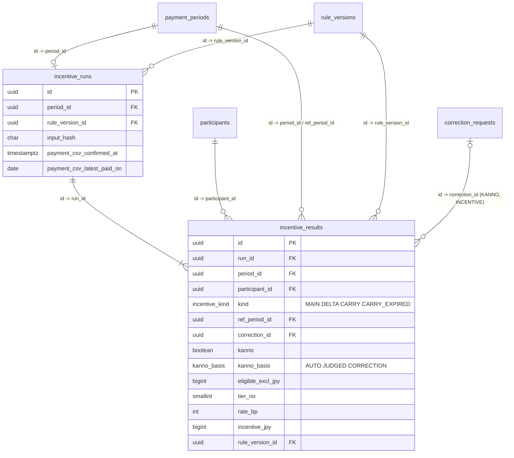

# INCENTIVE_DB — 完納奨励金（実行、結果、テストベクター）

| | |
|---|---|
| System Name | 水産物卸売市場業務支援システム（Product A, 顧客 株式会社 桜水産市場 — 架空） |
| Schema | `app` |
| CHARACTER SET | UTF8 (PostgreSQL 16, RDS Multi-AZ, AWS Tokyo) |
| Updated by | phuongnnm-23344 |
| Note | 本ファイルは Database Design 一式のうち ER クラスタ単位で分割したもの（QC-01 §4: 1ファイルにつきテーブル群1つ）。P1–P7 の原則、共通規約と enum（4.0）、公開ビュー、プロトタイプとの差異表、parity 結果、共通の未決事項は総括ファイル [MKT_DB.md](MKT_DB.md) にある。**4.xx の番号はスキーマ全体のテーブル番号（MKT_DB §2 の No 列）のまま**とし、ファイル間の相互参照や ADR・仕様からの参照が分割後も変わらないようにする |

---

## 1. 改訂履歴

| No | Version | Action | シート / 表 | 変更内容 | 更新日 | 更新者 | Approve |
|---|---|---|---|---|---|---|---|
| 1 | 0.1.0 | Add new | — | 初版は `MKT_DB.md` 0.1.0 の中にあった（スキーマ全体で1ファイル） | 2026-11-25 | phuongnnm-23344 | |
| 2 | 0.2.0 | Add new | 全ファイル | `MKT_DB.md` 0.1.1 から ER クラスタ単位に分割（Gate 1 M-09）。Gate 1 に従い修正: DELTA の再計算の範囲を締め済みのすべての期に拡大、年 TC の制限は CARRY にのみ適用、`CARRY_EXPIRED` を追加（C-01, m-05）; 入力は元の取引の期 `period_id` による（C-02）; 修正申請 KANNO / INCENTIVE 用の `correction_id`（M-10, M-04）; 「手数料差引の疑い」用の `kanno_basis`、`judgement_note`（顧客 #7）; 試算は監査に記録（顧客 #6, M-02）; §5 のテストベクターを追加 | 2026-11-25 | phuongnnm-23344 | |
| 3 | 0.3.0 | Update | 4.52, §5 | Gate 1 再確認: ラベル INC-EDGE を C.3 に合わせる（N-01）+ TV-12 INC-EDGE-01; GD `LATE_ENTRY` を DELTA の入力に追加 + TV-13（N-02）; `CARRY_EXPIRED`（正の値）で残高を閉じ、TV-04 で負の値を二重に数えない（n-01）; TV-14 修正申請 INCENTIVE（n-02）; 仲卸の仮の交付率表; TV-06 への参照（n-04） | 2026-11-25 | phuongnnm-23344 | |
| 4 | 0.3.1 | Update | §5 TV-14 | diff 5b0ef16 D-05 を確認: 期 10 / 11 / 12 の締め日と、TRADE の決裁日 2027-12-20 を固定; INCENTIVE の金額は固定であることを明記。決裁が締めより前の変異ケースは、合計 +2,990 を 2 行に分ける（+2,000 は correction_id 付き、+990）。（D-04: TV-13 の DB 版は 09-21 で正しい。ADR-007 側を修正） | 2026-11-25 | phuongnnm-23344 | |
| 5 | 0.3.2 | Update | — | 顧客 Q-INC-01/02: `incentive_runs` に `payment_csv_confirmed_at`、`payment_csv_latest_paid_on` を追加; TV-13 を書き直し、TV-15 を追加 | 2026-11-25 | phuongnnm-23344 |  |

---

## 2. テーブル一覧

| No | Schema | Category | テーブル名（論理） | テーブル名（物理） | 説明 | Note | Status |
|---|---|---|---|---|---|---|---|
| 51 | app | transaction | 奨励金計算の実行 | [`incentive_runs`](#451-incentive_runs) | 期ごとに1回 | Prototype: `incentive_runs` | Decision (provisional) |
| 52 | app | transaction | 完納奨励金の結果 | [`incentive_results`](#452-incentive_results) | 参加者 × 期ごとの MAIN / DELTA / CARRY | Prototype: `incentive_results` | Decision (provisional) |

---

## 3. ER Diagram

エンジンの入力は他のファイルにある: 有効な取引（[TRADE_DB.md](TRADE_DB.md) `trades.trade_date` + [ADJUST_DB.md](ADJUST_DB.md) `trade_adjustments.period_id`）、期のお支払額と入金の配分（[BILLING_DB.md](BILLING_DB.md)）、期 / 支払期日（[CLOSE_DB.md](CLOSE_DB.md)）、規程のバージョン + 交付率表（[RULE_DB.md](RULE_DB.md)）。

---

## 4. 定義テーブル

共通規約（型、共通列、追記のみ、日付のオープン、関数経由の更新、enum）: [MKT_DB.md §4.0](MKT_DB.md#40-共通規約).

### 4.51. `incentive_runs`

| | | | |
|---|---|---|---|
| テーブル名（論理） | 奨励金計算の実行 | 作成者 / 作成日 | phuongnnm-23344 / 2026-11-25 |
| テーブル名（物理） | `incentive_runs` | 更新者 / 更新日 | — |
| Overview | 期ごとに1回。**期ロックと同じトランザクション内で記録**（ADR-007 §2.1 — prototype の「計算済み・未締め」の段階を廃止、N13; Gate 1 M-02）。バージョンと入力のハッシュを保存し、同じ入力から同じ結果になる純粋関数であることを示せるようにする。**追記のみ。** | Note | 試算（事前確認）は何回実行してもよいが、**このテーブルには書かない**; 試算のたびに `audit_logs` に1行記録する（時刻、`input_hash`、奨励金の合計）。前回と比較するため（顧客 #6） |

**列定義**

| No. | Key | 論理名 | 物理名 | Data Type | Size | Not Null | Default | Note |
|---|---|---|---|---|---|---|---|---|
| 1 | PRI | ID | `id` | UUID | N/A | Yes | `gen_random_uuid()` | |
| 2 | UNI/FK | 期 | `period_id` | UUID | N/A | Yes | | |
| 3 | FK | 規程のバージョン | `rule_version_id` | UUID | N/A | Yes | | |
| 4 | | 入力のハッシュ | `input_hash` | CHAR | 64 | Yes | | 有効な取引 + 配分 + バージョンの SHA-256 |
| 4a | | 入金CSV取込の確認日時 | `payment_csv_confirmed_at` | TIMESTAMPTZ | N/A | Yes | | 「支払期日分までの入金CSV取込済」のチェックを、締める人（= `created_by`）が入れる。期ロックと同じトランザクションで記録; チェックがなければ締められない（`E-INC-014`）— Q-INC-01 【顧客（模擬）、2026-11-25】 |
| 4b | | 入金日の最大値（入力済み） | `payment_csv_latest_paid_on` | DATE | N/A | No | | 締め時点で取り消されていない入金 CSV バッチの MAX(`payments.paid_on`) — どの日付まで入力済みかの証拠; バッチがない場合は NULL |
| 5 | | 共通列 | `created_at`, `created_by` | | | | | Prototype: `run_by`, `run_at` |

**インデックス** — `incentive_runs_pkey`; `uq_incentive_runs_period`。**外部キー** — `period_id` → `payment_periods.id`; `rule_version_id` → `rule_versions.id`。

---

### 4.52. `incentive_results`

| | | | |
|---|---|---|---|
| テーブル名（論理） | 完納奨励金の結果 | 作成者 / 作成日 | phuongnnm-23344 / 2026-11-25 |
| テーブル名（物理） | `incentive_results` | 更新者 / 更新日 | — |
| Overview | BR-INC-01 / PRM-041 に従う: **適格金額** = 期内の買受代金の合計（**税抜**）。その人が完納していればその額、そうでなければ 0; 等級は、期のバージョンに含まれる**参加者区分ごとの**交付率表から引く; **奨励金 = floor(適格金額 × 交付率 × 110/100)**（D01, D02 を修正; 110/100 は BR-INC-01 / 13-06 の固定の税係数で、品目ごとの税率には従わない）。**DELTA — 再計算の範囲（Gate 1 C-01）:** 期 N の期ロック時に、締め済みの**すべての期を、TC 年の制限なしに**再計算する。対象は締め後に変わった入力（`trade_adjustments.period_id` = その期 かつ `created_at` > `locked_at`; **`trade_date` がその期に属し、`created_at` > `locked_at` の `trades` — GD `LATE_ENTRY`**（recheck N-02, TV-13）; 締め後にその期に割り当てられた `payment_allocations`; その期について決裁された修正申請 `KANNO` / `INCENTIVE`）。再計算は**古い期の規程バージョン**で行い、記録済みの合計（MAIN + 前の DELTA）と比較する → 期 N に `DELTA` 行を生成し、`ref_period_id` = 古い期とする; 古い期の完納は変えない（遡及しない — PRM-043）、ただし修正申請 `KANNO`（2段階決裁の例外、PRM-055 — Gate 1 M-10）は除く。`INCENTIVE`: 誤った率で計算された締め済みの期の奨励金を修正する（R-L4-01）。**CARRY / CARRY_EXPIRED（TC 年の制限はここにのみ適用）:** 負の delta は、記録した期の TC 年の末までの後続の期の奨励金から少しずつ差し引く（CARRY）; 年末に残った負の部分は `CARRY_EXPIRED` の行として記録し、照合部門 が処理するため RPT-07 に表示する（回収方法: Q-ARCH-08）。`CARRY_EXPIRED` は、TC 年の最後の期における残高を閉じる**正の値の行**（+ 残った負の部分）で、その人の Σ を 0 に戻し、負の値を二重に数えないようにする; `ref_period_id` = delta が発生した期; RPT-07 は未回収分の絶対値を表示する。年をまたぐ delta: 古い期のバージョンで計算し、期 N の TC 年に従って CARRY を記録・計算する。**追記のみ。** | Note | 適格金額、等級、率のすべての要素を保存し、RPT-07 / FORM-INC-01 で計算を再現できるようにする。期 N にその人へ支払う額 = max(0, 期 N のその人の `incentive_jpy` の合計); 合計が負 → 同じ TC 年の期 N+1 に `CARRY`（負の値）の行 |

**列定義**

| No. | Key | 論理名 | 物理名 | Data Type | Size | Not Null | Default | Note |
|---|---|---|---|---|---|---|---|---|
| 1 | PRI | ID | `id` | UUID | N/A | Yes | `gen_random_uuid()` | |
| 2 | FK | 実行 | `run_id` | UUID | N/A | Yes | | |
| 3 | FK | 記録する期 | `period_id` | UUID | N/A | Yes | | |
| 4 | FK | 参加者 | `participant_id` | UUID | N/A | Yes | | `NAKAOROSHI` または `BAIBAI` |
| 5 | | 種類 | `kind` | `incentive_kind` | N/A | Yes | | |
| 6 | FK | 再計算された期 | `ref_period_id` | UUID | N/A | No | | `DELTA`、`CARRY`、`CARRY_EXPIRED` のとき必須; 記録する期と異なる TC 年に属することがある |
| 6a | FK | 修正申請 | `correction_id` | UUID | N/A | No | | 修正申請 `KANNO` / `INCENTIVE` から生じた DELTA のとき必須（Gate 1 M-10, M-04） |
| 7 | | 交付率表の区分 | `participant_class` | `participant_kind` | N/A | Yes | | |
| 8 | | 期のお支払額 | `payable_incl_jpy` | BIGINT | N/A | Yes | | `period_billings` から |
| 9 | | 期日内に支払った額 | `paid_on_time_jpy` | BIGINT | N/A | Yes | | `payment_allocations` の `is_on_time` の合計 |
| 10 | | 完納 | `kanno` | BOOLEAN | N/A | Yes | | DELTA は MAIN の値を引き継ぐ。ただし `correction_id` を持つ修正申請 `KANNO` の DELTA は除く（2段階決裁の例外） |
| 10a | | 完納の根拠 | `kanno_basis` | `kanno_basis` | N/A | Yes | `'AUTO'` | `AUTO`（エンジン）· `JUDGED`（期ロックのダイアログで 照合部門長 が 要確認 の行を判断。同じトランザクション、MFA — 例: 「手数料差引の疑い」、顧客 #7）· `CORRECTION`（修正申請 `KANNO`） |
| 10b | | 判断の理由 | `judgement_note` | VARCHAR | 500 | No | | `JUDGED` のとき必須 |
| 11 | | 適格金額（税抜） | `eligible_excl_jpy` | BIGINT | N/A | Yes | | 完納していなければ 0 |
| 12 | | 等級 | `tier_no` | SMALLINT | N/A | Yes | | |
| 13 | | 交付率 | `rate_bp` | INT | N/A | Yes | | |
| 14 | | 奨励金 / 差額 | `incentive_jpy` | BIGINT | N/A | Yes | | MAIN ≥ 0; DELTA、CARRY は負の値もあり得る; `CARRY_EXPIRED` は正の値 = TC 年末の負の残高を閉じる（その人の年末の期の Σ を 0 に戻す） |
| 15 | FK | 適用された規程のバージョン | `rule_version_id` | UUID | N/A | Yes | | |
| 16 | | 共通列 | `created_at` | | | | | |

**インデックス** — `incentive_results_pkey`; `idx_incentive_results_period`（`period_id`）; `idx_incentive_results_participant`（`participant_id`, `period_id`）; `uq_incentive_results_main`（`period_id`, `participant_id`）unique partial `kind = 'MAIN'`。

**外部キー** — `run_id` → `incentive_runs.id`; `period_id`, `ref_period_id` → `payment_periods.id`; `participant_id` → `participants.id`; `rule_version_id` → `rule_versions.id`; `correction_id` → `correction_requests.id`。

---

## 5. 完納奨励金のテストベクター

> *帳票 BM-2-901-50 にはこの項目はない — Gate 1（C-01, C-02）で追加し、完納奨励金の Technical Design（P3）と LAB-5 のタスクで CI の標準テストセットとして使えるようにする（ADR-007 §2.7）。* 交付率表は、`incentive-rate-table.csv`（E-03, L4-A02）が届くまで**仮**: 売買参加者の表 — 等級1 0–<500,000 = 0 bp · 等級2 500,000–<1,000,000 = 50 bp · 等級3 1,000,000–<3,000,000 = 90 bp · 等級4 3,000,000–<10,000,000 = 120 bp · 等級5 ≥ 10,000,000 = 150 bp（適格金額 税抜 で引く）; 仲卸の仮の表は、SC-09-04 の例（N01 仲卸 1,000,000 = 等級3）に合わせるため**同じ水準**とする。版 v2（2027-10 より前）は等級3 = 80 bp と前提 — TV-12 でのみ使用。税率は一律 **8%**（軽減税率、食品）; 奨励金 = floor(適格金額 × 交付率 × 110/100)（BR-INC-01, 13-06）。L4-A09 の基準日: 稼働開始 2027-08-01、システム上の最初の期は 2027-08（そのため TV-01 / TV-02 は brief の7月の代わりに8〜9月を使う）。数値はスクリプトで検算済み。

| TV | 入力 | 帰属する期（取引 / 調整 / 入金） | DELTA | 完納 | 奨励金 / 結果 | 出典 |
|---|---|---|---|---|---|---|
| TV-01 | 買受人 B01: 8月の取引の合計 1,000,000 税抜; 業務日 2027-08-31 の取引に対する修正申請 `TRADE`（+50,000 税抜）が **2027-09-03** に決裁; 期 2027-08 はまだ `OPEN`（支払期日 2027-09-10 金曜日） | 調整: `business_date` 2027-09-03、`period_id` **2027-08** → 期 08 の 期のお支払額 に入る = 1,050,000 + 税 84,000 = **1,134,000** | 無 | 2027-09-09 に 1,134,000 を支払い、期日以内 → 完納 | MAIN 期 08: floor(1,050,000 × 0.9% × 1.1) = **10,395** | C-02 (c); L4-A04 (2) |
| TV-02 | B02: 期 08 = 1,000,000 税抜、2027-09-08 に 1,080,000 を支払う → MAIN 9,900; 期 08 は 2027-09-14 に `LOCKED`。2027-08-20 の取引に対する修正申請 `TRADE`（+200,000 税抜）が **2027-09-20** に決裁 | `business_date` 2027-09-20、`period_id` **2027-08**; 期 09 の 期のお支払額 には**入らない**; 216,000 は期 09 の通知に「前期以前の調整」として表示（OPEN-DB-08） | 期ロック 期 09: 期 08 を期 08 のバージョンで再計算: floor(1,200,000 × 0.9% × 1.1) = 11,880 → 行 **DELTA +1,980**、ref_period 2027-08、期 09 に記録 | 期 08 は完納 = true のまま（遡及しない） | 期 09 に +1,980 を加算 | C-02 (a)(b) — 二重に数えない; INC-EDGE-02; PRM-043 |
| TV-03 | B03: 期 2028-03（TC 年 2027）適格金額 2,000,000、バージョン v3 → MAIN 19,800; 期 2028-03 は 2028-04-12 に締め、期 2028-04 は 2028-05-12 に締め。2028-03-15 の取引を取り消す修正申請（−1,200,000）が **2028-05-20** に決裁 | `period_id` **2028-03**、`business_date` 2028-05-20 | 期ロック **2028-05**（2028-06-12、TC 年 2028）: 期 2028-03 を **v3** で再計算: 800,000 → 等級2 → floor(800,000 × 0.5% × 1.1) = 4,400 → **DELTA −15,400**、期 2028-05 に記録、ref_period 2028-03。0.1.x の設計（同じ TC 年の期だけを再計算）ではこの行が**漏れていた** | 期 2028-03 は完納のまま | CARRY / 報告用に TC 年 2028 に属する | **C-01**; BR-INC-01, FR-INC-03, INC-EDGE-02 |
| TV-04 | TV-03 の続き: B03 の期 2028-05 の MAIN = 3,300（600,000、等級2）; MAIN 2028-06 = 9,900; 2028-07 から 2029-03 までは完納なし（MAIN 0） | — | — | — | 期 2028-05: 3,300 − 15,400 = −12,100 → 支払 **0**、行 **CARRY −12,100** を期 2028-06 に; 期 2028-06: 9,900 − 12,100 = −2,200 → 支払 **0**、CARRY −2,200 を 2028-07 に … 期ロック **2029-03**: 期の Σ = CARRY −2,200（MAIN 0）→ 行 **CARRY_EXPIRED +2,200** で残高を閉じる（Σ = 0、支払 0）。RPT-07 に 照合部門 向けの **2,200 未回収** として表示（Q-ARCH-08）; TC 年 2029 に繰り越さず、−2,200 を二重に数えない | m-05; PRM-043 (c); D23 |
| TV-05 | B04: 期のお支払額 期 2027-09 = 1,080,000; 支払期日: 10日 = 2027-10-10（日曜）→ 銀行が開いている直前の日 2027-10-08 に繰り上げ（金曜日; 10-09 は土曜日で銀行休業）。2027-10-12 に全額支払 | 配分は期 09 へ、`is_on_time = false` | 無 | 完納**しない**（猶予なし） | 適格金額 0 → MAIN **0** | B.5 「超過時は0」; L4-A04 (2) |
| TV-06 | B05: 期 2027-09 は 108,000 不足（完納なし）; 期 2027-10 の期のお支払額 540,000（税抜 500,000）、期日 2027-11-10。2027-11-05 に 540,000 を振込、**請求番号なし** | FIFO: 108,000 → 期 09（遅延）、432,000 → 期 10 | 無 | 期 10 は**完納しない**（432,000 < 540,000） | MAIN 期 10 = **0**。請求番号（E-02）があり 540,000 全額を期 10 に割り当てれば → 完納、floor(500,000 × 0.5% × 1.1) = 2,750。期ロック画面は、どの金額をどの期に割り当てたかを表示すること | OPEN-L4-02; E-02; ADR-007 §2.7-14 |
| TV-07 | B06: 期 2027-10 = 1,080,000、期日 2027-11-10; 入金は **2027-11-10** に届いたが、振込人コードが未マッピング → 要判断; 期 10 は 2027-11-15 に締め（完納なし、MAIN 0）。マッピングを 2027-11-16 に修正 → 期 10（締め済み）へ `MANUAL` 配分、`is_on_time = true` | 締め後に期 10 へ配分 → 期 10 は再計算の対象に入る | 期 10 の再計算: 完納 = false のまま → DELTA 0（遡及しない）。修正申請 **`KANNO`**（取引明細を証拠として）が 2段階で 2027-11-20 に決裁 → 期ロック 期 11: 行 **DELTA +9,900**、correction_id、kanno_basis = CORRECTION、ref_period 2027-10 | 期 10: 完納 = true になるのは `correction_id` を持つ DELTA 行**によってのみ** | 期 11 に +9,900 | **M-10**; PRM-055; FQ-08; INC-EDGE-02 |
| TV-08 | B07: 期 2028-05、10日 = **2028-06-10 土曜日**（市場は週6日営業、銀行休業） | 支払期日 = **2028-06-09**（金曜日、`PREV_BANK_DAY`）。休市日を基準に繰り上げると 06-10 のままになる — **誤り** | 無 | 2028-06-12（月曜日）に記録された入金 → 完納しない; 2028-06-09 → 完納 | — | **M-03**; PRM-054; Q-ARCH-11 |
| TV-09 | バッチ受信 **2027-09-01 01:30**; 同日の取引確定 01:45; 取引確定 02:05 | バッチ: 業務日 **2027-09-01** → 期 2027-09（締め済みの 08-31 には属さない）。取引 01:45: **拒否**（`TRADE_START_TIME` 02:00 より前）。取引 02:05: 業務日 2027-09-01、期 09 | — | — | 0.1.x の「取引確定 01:30 は前の期に属する」のケースは**起こり得ない** | **M-01**; E-16; PRM-116; L4-A09 |
| TV-10 | B08: 期 2027-11 = 1,080,000、期日 2027-12-10（金曜日）。2027-12-09 に **1,079,560** を受領（440 不足; 設定ファイルの `KANNO_FEE_SUSPECT_MAX_JPY` 以下） | 期 11 へ配分、期日内 | 無 | エンジンは**自動で結論しない**: 行は **要確認 「手数料差引の疑い」**; 照合部門長 が期ロックのダイアログ（MFA）で選び、理由を添える → `kanno_basis = JUDGED`。既定の提案は非完納（FQ-02, PRM-040: 振込手数料は買受人負担） | 非完納 → **0**; 理由を添えて完納を選択 → **9,900** | 顧客 #7 【模擬】; CAP-HUMAN-01; 経理部待ち |
| TV-11 | B09: 完納、適格金額 1,234,567 税抜、等級3 | — | 無 | 完納 | 1,234,567 × 0.9% × 1.1 = 12,222,21 → floor **12,222** | INC-EDGE-03 |
| TV-12 | B10（売買参加者）: 期 2027-10 の適格金額 **1,000,000**（等級3 の下限ちょうど、「以上」）; B11: 期 2027-10 **999,999**。バージョン v3 は 2027-10-01 から有効（等級3 = 90 bp、仮の表どおり）; 期 2027-09 は v2 を使用（等級3 = 80 bp と前提）— B10 の期 09 も 1,000,000 | 取引は trade_date による | 無 | 完納 | B10 期 10: 等級3 → floor(1,000,000 × 0.9% × 1.1) = **9,900**; B11 期 10: 等級2 → floor(999,999 × 0.5% × 1.1) = floor(5,499,99) = **5,499**; B10 期 09（v2）: floor(1,000,000 × 0.8% × 1.1) = **8,800** — バージョンは締め日ではなく**期**で選ぶ | **INC-EDGE-01**; TBL-RATE-01; PRM-041 |
| TV-13 | B12: 期 08 は 2027-09-14 に締め、適格金額 1,000,000（MAIN 9,900）。期 09: 別の取引 600,000 税抜。紙伝票の取引 **2027-08-31**（+200,000 税抜）が 2027-09-20 に判明 → 修正申請 `LATE_ENTRY` が 2027-09-21 に決裁 → 新しい `trades`、`trade_date` 2027-08-31、`business_date` 2027-09-21; 記録時点で期 08 は `LOCKED` 済み → `incentive_period_id` = **2027-09**。期 09 の支払期日 = 2027-10-08（TV-05）; B12 は 2027-10-07 に **864,000** を支払う; 期 09 は 2027-10-13 に締め | 奨励金の計算期 = 2027-09（`trade_date` 08-31 は日付の帳簿用に保持、IF-ACC-01）; 期 09 の 期のお支払額 = (600,000 + 200,000) × 1.08 = 864,000（請求 期 09）; 「前期分の後入力 08/31 200,000」と表示、「前期以前の調整」には**入らない** | **なし** — 期 08 は候補に入らない（0.3.1 では期 08 の完納で DELTA +1,980 が出ていた — Q-INC-02 により廃止） | 期 09 は完納（864,000 を期日内に支払い）。変異ケース: 648,000 のみ支払う（後入力分が不足）→ 期 09 は**非完納** | 期 09: 適格金額 800,000 → 等級2 → floor(800,000 × 0.5% × 1.1) = **4,400**; 変異ケース **0**。期 08 は MAIN 9,900 を維持 | **Q-INC-02** 【顧客（模擬）、2026-11-25】; Gate 1 再確認 N-02; ADR-005 §2-8; ADR-007 §2.3-7a; BR-INC-01 |
| TV-14 | B13: 期 2027-10 は 2027-11-15 に締め、MAIN 9,900 は誤った率で計算されていた; 修正申請 `INCENTIVE` +2,000 が 2段階で 2027-11-20 に決裁。期 11 は **2027-12-14** に締め。期 10 の取引に対する修正申請 `TRADE`（+100,000 税抜）が **2027-12-20** に決裁（期 11 の締め後）; 期 12 は 2028-01-13 に締め | `TRADE`: `period_id` 2027-10、`business_date` 2027-12-20 | 期ロック 期 11（2027-12-14）: **DELTA +2,000**（correction_id は INCENTIVE）。期ロック 期 12（2028-01-13）: 期 10 を再計算 = (1,100,000 → 10,890) **+ 2,000**（INCENTIVE は加算される入力で、**固定額 — 新しい 適格金額 で再計算しない**）を、記録済みの合計 9,900 + 2,000 と比較 → **DELTA +990**; −2,000 は**生成しない**。変異ケース: TRADE が期 11 の締め前に決裁されていれば、両方が期 11 の期ロックの同じ回に入り → 合計 **DELTA +2,990**、2行に記録: +2,000 は correction_id INCENTIVE 付き、+990 は付かない（行の分割ルール: specs/incentive/technical-design/INC_ENGINE_TECH.md K6） | 維持 | 期 11 +2,000; 期 12 +990。率の修正は新しい 適格金額 に合わせて変える必要がある → 照合部門 が新しい修正申請 `INCENTIVE` を作成 | Gate 1 再確認 n-02, D-05; ADR-007 §2.5-12; R-L4-01 |
| TV-15 | B14（売買参加者）: 期 08 の取引は**ない**（期 08 の MAIN もない）、期 09 にも他の取引はない。紙伝票の取引 **2027-08-30**（600,000 税抜）→ 修正申請 `LATE_ENTRY` が **2027-09-22** に決裁、`business_date` 2027-09-22; 期 08 は 2027-09-14 に締め済み → `incentive_period_id` = 2027-09。期 09 の期日 2027-10-08; 期 09 は 2027-10-13 に締め; B14 は **2027-10-05** に **648,000** を支払う | 奨励金の計算期 **2027-09**; 期 09 の 期のお支払額 = 600,000 × 1.08 = 648,000 | 無 | 完納（648,000 を期日内に支払い）。変異ケース: 2027-10-12 に支払う → 非完納 | floor(600,000 × 0.5% × 1.1) = **3,300**; 変異ケース **0**。0.3.1 版（期 08 に MAIN がないため K' = false）は、どのケースでも **0** となっていた — この版から TV-13 と同じルール | **Q-INC-02** 【顧客（模擬）、2026-11-25】; BR-INC-01 |
