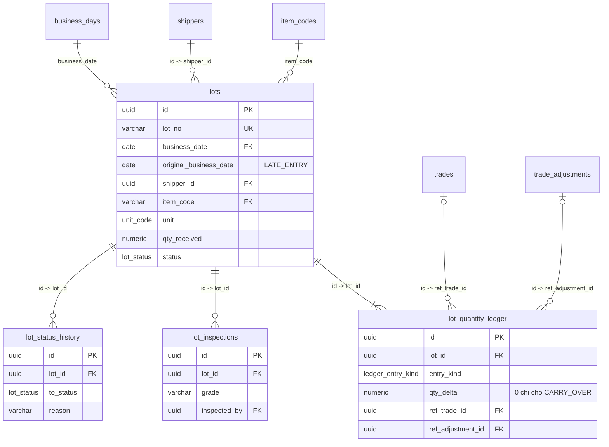

# LOT_DB — ロット：仮受付 / 本登録 / 目利き / 数量台帳

| | |
|---|---|
| System Name | 水産物卸売市場業務支援システム（Product A、顧客 株式会社 桜水産市場 — 架空） |
| Schema | `app` |
| CHARACTER SET | UTF8 (PostgreSQL 16, RDS Multi-AZ, AWS Tokyo) |
| Updated by | phuongnnm-23344 |
| Note | ER単位で分割したデータベース設計の1ファイル（QC-01 §4：1ファイル1グループ）。P1–P7の原則、共通規約 + enum（4.0）、公開ビュー、プロトタイプとの差異表、パリティ結果、共通の未決事項は総括ファイル [MKT_DB.md](MKT_DB.md) にある。**4.xx の番号はスキーマ全体のテーブル番号を維持**（MKT_DB §2 の No 列）しているため、ファイル間の相互参照や ADR / spec からの参照は分割後も変わらない |

---

## 1. 改訂履歴

| No | Version | Action | シート / 表 | 変更内容 | 更新日 | 更新者 | Approve |
|---|---|---|---|---|---|---|---|
| 1 | 0.1.0 | Add new | — | 初期内容は `MKT_DB.md` 0.1.0 にあった（スキーマ全体で1ファイル） | 2026-11-25 | phuongnnm-23344 | |
| 2 | 0.2.0 | Add new | ファイル全体 | ER単位で `MKT_DB.md` 0.1.1 から分割（Gate 1 M-09）；Gate 1 M-05 に従い修正：締め済みの日に後から入力されたロット（`LATE_ENTRY`）のための `lots.original_business_date`；受付の業務日は新しい定義による（M-01、01:00–02:00 のロットはその朝の業務日に属する） | 2026-11-25 | phuongnnm-23344 | |
| 3 | 0.2.1 | Modify | `lots`, `lot_inspections` | P3 を統合（ロットの仕様）：`lots.voucher_no` 30 → **20**（WF SC-03-01 [8]、`E-LOT-005`、`trades.paper_slip_no` と一致）；`lots.registered_at` を追加（本登録の時刻 — API-LOT-003 の並び順 `-registeredAt`）；`lot_inspections` に `second_checker_id`（確認者、WF SC-03-05 [8]）+ `rerecord_reason`（取引のあるロットを記録し直す場合、[9]）を追加；`grade` は `code_values` の `INSPECTION_GRADE` で検査（RULE_DB 0.2.1、Q-LOT-03）。`lot_no NOT NULL` は維持 — 前提 Q-LOT-01 | 2026-11-25 | phuongnnm-23344 | |
| 4 | 0.2.2 | Update | — | 顧客 Q-LOT-01：4.25 の `CANCELLED` 状態は番号を保持し、削除せず、仮番号で検索できるインデックスを追加 | 2026-11-25 | phuongnnm-23344 |  |

---

## 2. テーブル一覧

| No | Schema | Category | テーブル名（論理） | テーブル名（物理） | 説明 | Note | Status |
|---|---|---|---|---|---|---|---|
| 25 | app | transaction | ロット | [`lots`](#425-lots) | 仮受付 → 本登録 → 下見済 → 公開 → 確定 → 引渡し完了 | プロトタイプ: `lots` | Decision (provisional) |
| 26 | app | history | ロット状態履歴 | [`lot_status_history`](#426-lot_status_history) | ロット状態が変わるたびに記録。販売終了、持ち越し | 新規 | Decision (provisional) |
| 27 | app | transaction | 目利き・下見 | [`lot_inspections`](#427-lot_inspections) | 記録者による評価結果 | プロトタイプ: `lot_inspections` | Decision (provisional) |
| 28 | app | transaction | ロット数量台帳 | [`lot_quantity_ledger`](#428-lot_quantity_ledger) | 利用可能数量 = `qty_delta` の合計 | プロトタイプ: `lot_quantity_ledger` | Decision (provisional) |

---

## 3. ER図

`business_days` は [CLOSE_DB.md](CLOSE_DB.md)；`shippers`、`item_codes` は [RULE_DB.md](RULE_DB.md)；`trades` は [TRADE_DB.md](TRADE_DB.md)；`trade_adjustments` は [ADJUST_DB.md](ADJUST_DB.md)。

---

## 4. テーブル定義

共通規約（型、共通列、追記のみ、開いている日、関数経由の書き込み、enum）：[MKT_DB.md §4.0](MKT_DB.md#40-共通規約)。

### 4.25. `lots`

| | | | |
|---|---|---|---|
| テーブル名（論理） | ロット | 作成者 / 作成日 | phuongnnm-23344 / 2026-11-25 |
| テーブル名（物理） | `lots` | 更新者 / 更新日 | — |
| Overview | 2段階の受付：岸壁の 仮受付（タブレット、オフライン可）→ PC での 本登録（出荷者、証憑、正式なロット番号）（PRM-116）。状態は FIG-011 + PRM-110 の解釈（複数回の販売；数量 = 0 または 販売終了 のとき 確定）。**開いている日。** | Note | 利用可能数量は **ここには保存しない** — 常に `lot_quantity_ledger` から計算（BR-LOT-02）。SC-03-04 で締め前に属性を変更（PRM-128）→ 監査；締め後 → 修正申請 |

**列定義**

| No. | Key | 論理名 | 物理名 | Data Type | Size | Not Null | Default | Note |
|---|---|---|---|---|---|---|---|---|
| 1 | PRI | ID | `id` | UUID | N/A | Yes | `gen_random_uuid()` | |
| 2 | UNI | ロット番号 | `lot_no` | VARCHAR | 20 | Yes | | `L{YYYYMMDD}-{n}`、`day_counters` による採番（0025 を維持）、レコードがサーバーに上がった時点で付与；**再利用しない**（仮受付のロットを取り消しても番号は保持し、状態は `CANCELLED` — Q-LOT-01）。持ち越し時も変わらない（PRM-110 (d)） |
| 3 | FK | 記帳用の業務日 | `business_date` | DATE | N/A | Yes | | = `business_date_for(giờ nhận)` — 1日の 01:30 に受け付けたロットは 1日の業務日に属する（Gate 1 M-01） |
| 3a | | 実際の業務日（後入力） | `original_business_date` | DATE | N/A | No | | `LATE_ENTRY` の修正申請（ADJUST_DB 4.37）で締め済みの日に後から入力されたロットのみ；NULL = `business_date` と同じ（Gate 1 M-05） |
| 4 | | 仮番号 | `provisional_no` | VARCHAR | 10 | No | | 岸壁での仮の番号；全画面で、その業務日の終わりまで検索可能（Q-LOT-01） |
| 5 | FK | 出荷者 | `shipper_id` | UUID | N/A | No | | `PROVISIONAL` の間は NULL；`RECEIVED` から必須（CHECK） |
| 6 | FK | 品目 | `item_code` | VARCHAR | 10 | Yes | | |
| 7 | | 荷目 | `nime_code` | VARCHAR | 20 | No | | `code_values`（`NIME`） |
| 8 | | 単位 | `unit` | `unit_code` | N/A | Yes | | |
| 9 | | 仮受付時の数量 | `qty_provisional` | NUMERIC | 12,1 | No | | |
| 10 | | 本登録の数量（受付数量） | `qty_received` | NUMERIC | 12,1 | No | | CHECK > 0；`RECEIVED` から必須 |
| 11 | | 証憑番号 | `voucher_no` | VARCHAR | 20 | No | | 英数字 + 「-」（`E-LOT-005`）；証憑の画像：`attachments`（PC のみ — E-21） |
| 12 | | 状態 | `status` | `lot_status` | N/A | Yes | `'PROVISIONAL'` | 変更のたびに `lot_status_history` を作成。`CANCELLED`（取消）は `PROVISIONAL` からのみ（重複・誤入力）、履歴に理由を残す；ロットは **削除しない**（Q-LOT-01） |
| 13 | FK | 仮受付 / 本登録 の担当者 | `provisional_by`, `registered_by` | UUID | N/A | No | | |
| 13a | | 本登録の時刻 | `registered_at` | TIMESTAMPTZ | N/A | No | | `RECEIVED` へ移行時に記録（新規ロット = `created_at`）；`RECEIVED` から必須（`shipper_id` と同じ CHECK）。SC-03-01 [11] の「本登録したばかりのロット」に使用 |
| 14 | FK | 仮受付の端末 | `device_id` | UUID | N/A | No | | |
| 15 | | 共通列 | `created_at`, `created_by`, `updated_at`, `updated_by` | | | | | |

**Index** — `lots_pkey`; `uq_lots_lot_no`; `idx_lots_business_date_status` (`business_date`, `status`); `idx_lots_shipper` (`shipper_id`); `idx_lots_business_date_provisional_no` (`business_date`, `provisional_no`) — 仮番号の検索 (Q-LOT-01).

**外部キー**

| No. | 外部キー名 | カラム | 参照先テーブル | 参照先カラム | Note |
|---|---|---|---|---|---|
| 1 | `fk_lots_business_day` | `business_date` | `business_days` | `business_date` | |
| 2 | `fk_lots_shipper` | `shipper_id` | `shippers` | `id` | |
| 3 | `fk_lots_item` | `item_code` | `item_codes` | `item_code` | |
| 4 | `fk_lots_device` | `device_id` | `devices` | `id` | |
| — | （FK なし） | `nime_code` | `code_values` | | 複合 FK（`code_type`, `code`）には定数の列が必要 — 関数内で検査 |

---

### 4.26. `lot_status_history`

| | | | |
|---|---|---|---|
| テーブル名（論理） | ロット状態履歴 | 作成者 / 作成日 | phuongnnm-23344 / 2026-11-25 |
| テーブル名（物理） | `lot_status_history` | 更新者 / 更新日 | — |
| Overview | RPT-02 ロット履歴（FT-11-03）の元データ。販売終了（数量が残っていれば理由が必須）と 持ち越し（次の業務日へ）の両方を記録。**追記のみ。** | Note | 新規（D12） |

**列定義**

| No. | Key | 論理名 | 物理名 | Data Type | Size | Not Null | Default | Note |
|---|---|---|---|---|---|---|---|---|
| 1 | PRI | ID | `id` | UUID | N/A | Yes | `gen_random_uuid()` | |
| 2 | FK | ロット | `lot_id` | UUID | N/A | Yes | | |
| 3 | FK | 記録時の業務日 | `business_date` | DATE | N/A | Yes | | |
| 4 | | 変更前 / 変更後の状態 | `from_status`, `to_status` | `lot_status` | N/A | No / Yes | | |
| 5 | | 販売終了の印 | `is_sale_end` | BOOLEAN | N/A | Yes | `false` | |
| 6 | | 持ち越し先の日 | `carried_to_date` | DATE | N/A | No | | |
| 7 | | 理由 | `reason` | VARCHAR | 200 | No | | `is_sale_end` かつ数量が > 0 のまま残っている場合に必須 |
| 8 | | 共通列 | `created_at`, `created_by` | | | | | |

**Index** — `lot_status_history_pkey`; `idx_lot_status_history_lot` (`lot_id`, `created_at`).

**外部キー** — `fk_lot_status_history_lot` (`lot_id` → `lots.id`); `fk_lot_status_history_day` (`business_date` → `business_days.business_date`).

---

### 4.27. `lot_inspections`

| | | | |
|---|---|---|---|
| テーブル名（論理） | 目利き・下見 | 作成者 / 作成日 | phuongnnm-23344 / 2026-11-25 |
| テーブル名（物理） | `lot_inspections` | 更新者 / 更新日 | — |
| Overview | **人が決定し記録する** 鮮度・品質の評価結果（CAP-HUMAN-01）。自動の採点列はなく、OCR もない（ルール3）。同じ品目・船の複数のロットをまとめて記録できるが、各ロットは1行のまま（PRM-117）。**追記のみ。開いている日。** | Note | プロトタイプから維持、`batch_no` を追加 |

**列定義**

| No. | Key | 論理名 | 物理名 | Data Type | Size | Not Null | Default | Note |
|---|---|---|---|---|---|---|---|---|
| 1 | PRI | ID | `id` | UUID | N/A | Yes | `gen_random_uuid()` | |
| 2 | FK | ロット | `lot_id` | UUID | N/A | Yes | | |
| 3 | FK | 業務日 | `business_date` | DATE | N/A | Yes | | |
| 4 | | 等級 | `grade` | VARCHAR | 10 | Yes | | 評価者が選んだラベル；使用中の `code_values` の `INSPECTION_GRADE` に属すること — 関数内で検査（RULE_DB 4.23、Q-LOT-03）。推奨の等級はない（ルール3） |
| 5 | | 鮮度のメモ | `freshness_note` | VARCHAR | 200 | No | | |
| 6 | | 一括記録の番号 | `batch_no` | UUID | N/A | No | | 1回の記録で入力したロットには同じ値 |
| 7 | FK | 評価者 | `inspected_by` | UUID | N/A | Yes | | |
| 7a | FK | 確認者（2人目） | `second_checker_id` | UUID | N/A | No | | 社員番号で検索（WF SC-03-05 [8]）；CHECK `second_checker_id IS NULL OR second_checker_id <> inspected_by` |
| 7b | | 記録し直しの理由 | `rerecord_reason` | VARCHAR | 200 | No | | 有効な取引がある場合は必須 — 関数内で検査（`E-LOT-011`）。`trades` を参照する必要があるため CHECK にはしない |
| 8 | | 共通列 | `created_at`, `created_by` | | | | | 後の記録が前の結果を置き換える（最新の行を取得）、古い行は残す |

**Index** — `lot_inspections_pkey`; `idx_lot_inspections_lot` (`lot_id`, `created_at`).

**外部キー** — `lot_id` → `lots.id`; `business_date` → `business_days`; `inspected_by` → `staff_accounts.id`; `second_checker_id` → `staff_accounts.id`.

---

### 4.28. `lot_quantity_ledger`

| | | | |
|---|---|---|---|
| テーブル名（論理） | ロット数量台帳 | 作成者 / 作成日 | phuongnnm-23344 / 2026-11-25 |
| テーブル名（物理） | `lot_quantity_ledger` | 更新者 / 更新日 | — |
| Overview | 利用可能数量 = `qty_delta` の合計（ビュー `v_lot_available_qty`）、負にはならない（BR-LOT-02）— 取引を確定する関数はロットの行をロック（`FOR UPDATE`）してから検査する。**追記のみ。開いている日。** | Note | 変更：`reason`（text）→ `entry_kind`；`qty_delta = 0` は **`CARRY_OVER` のときのみ** 可（N01） |

**列定義**

| No. | Key | 論理名 | 物理名 | Data Type | Size | Not Null | Default | Note |
|---|---|---|---|---|---|---|---|---|
| 1 | PRI | ID | `id` | UUID | N/A | Yes | `gen_random_uuid()` | |
| 2 | FK | ロット | `lot_id` | UUID | N/A | Yes | | |
| 3 | FK | 業務日 | `business_date` | DATE | N/A | Yes | | |
| 4 | | 行の種類 | `entry_kind` | `ledger_entry_kind` | N/A | Yes | | |
| 5 | | 変更数量 | `qty_delta` | NUMERIC | 12,1 | Yes | | CHECK (`entry_kind = 'CARRY_OVER'` AND `qty_delta = 0`) OR (`entry_kind <> 'CARRY_OVER'` AND `qty_delta <> 0`) |
| 6 | FK | 関連する取引 | `ref_trade_id` | UUID | N/A | No | | `SALE` のとき必須 |
| 7 | FK | 関連する調整行 | `ref_adjustment_id` | UUID | N/A | No | | `SALE_REVERSE` のとき必須 |
| 8 | | メモ | `note` | VARCHAR | 200 | No | | `RETURN_DISPOSE` のとき必須 |
| 9 | | 共通列 | `created_at`, `created_by` | | | | | |

**Index** — `lot_quantity_ledger_pkey`; `idx_ledger_lot` (`lot_id`); `idx_ledger_business_date` (`business_date`).

**外部キー** — `lot_id` → `lots.id`; `business_date` → `business_days`; `ref_trade_id` → `trades.id`; `ref_adjustment_id` → `trade_adjustments.id`.
