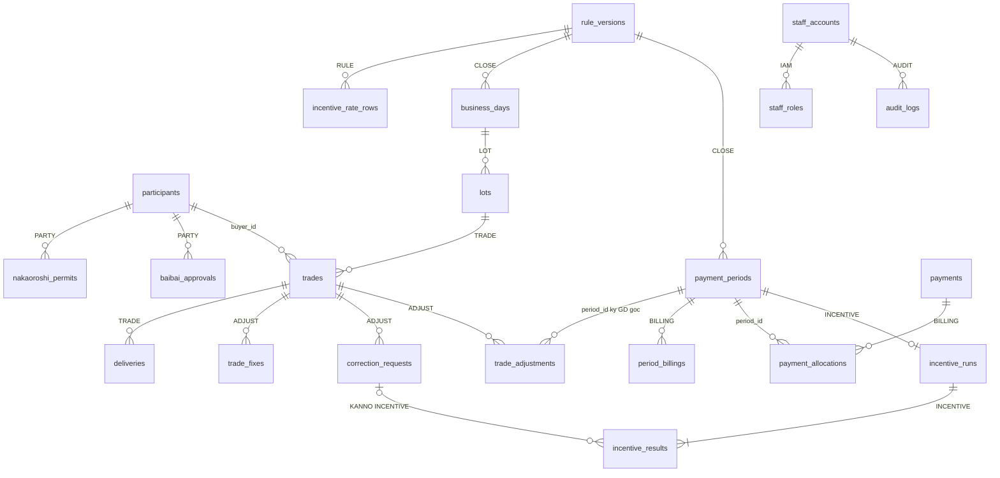

# 水産物卸売市場業務支援システム — データベース設計（to-be、第1期）— 総括ファイル

| | |
|---|---|
| System Name | 水産物卸売市場業務支援システム（Product A、顧客 株式会社 桜水産市場 — 架空） |
| Schema | `app`（業務データ、業務関数）· `audit`（監査ログ、TC年ごとに分割） |
| CHARACTER SET | UTF8、コード列は collation `C`、名称列は並べ替え時に `ja-JP-x-icu` |
| DBMS | AWS東京リージョンのRDS Multi-AZ上のPostgreSQL 16（L4-D01, ADR-001） |
| Updated by | phuongnnm-23344 |
| Note | **総括ファイル**です。このデータベース設計一式は、Gate 1 M-09 に従いクラスタ（ER単位）ごとに分割しています（QC-01 §4 — 1ファイル1グループ）。このファイルには**共通部分**のみを載せます。すなわち原則P1–P7、クラスタファイルを指す60テーブルの一覧（§2）、全体ER図（§3）、共通規約・enum・公開ビュー（§4）、LAB-2プロトタイプとの差異表（§5）、パリティ結果（§6）、未決事項と拡張点（§7）です。テーブル定義は同じフォルダの9つのクラスタファイルにあります。**4.xx の番号はスキーマ全体のテーブル番号を維持**しているため、§2 の No 列を見ると該当ファイルが分かります。総括ファイルは「1グループのテーブル群」ではないため、README §3 の例外 #7 に該当します。範囲は第1期のR1パッケージ（P0 + P1、99 FT — DEC-031）で、オプションと第2期の17項目にはテーブルがありません。用語：相対取引（当事者間の直接売買 — 主要フロー、取引額の約90%）、せり（競り売り — 副次フロー）、許可（仲卸向けの審査付き許可）、承認（売買参加者向けの、より軽い手続きによる承認）、完納奨励金（支払が全額かつ期限内に完了した場合の奨励金）、業務日（JST基準の業務日。ロット受付開始時刻 `LOT_INTAKE_START_TIME` の 01:00 から翌日 01:00 まで。取引の締めは 02:00 から） |

**全体を通す設計原則**（各原則の表現箇所は第4節に記載）：

| # | 原則 | スキーマでの表現 | 出典 |
|---|---|---|---|
| P1 | 相対取引が主要フロー。せりは確認者が入力する最終結果のみを記録 | `trades.channel` の既定値は `AITAI`。`seri_sessions` は結果のグループにすぎず、入札・価格提示の表は持たない | ルール1; FR-SERI-01; B.3 |
| P2 | 許可 ≠ 承認 | テーブル2つ、履歴2つ、参加者種別を検査するトリガー2つ。「共通の許可」テーブルや enum は **存在しない** | ルール2; 02-08; ADR-003 |
| P3 | 最終判断は人 | `lot_inspections`、`seri_sessions`、`correction_approvals`、`dispute_confirmations` に記録者・確認者の列を置く。機械採点の列はない | ルール3; CAP-HUMAN-01 |
| P4 | 履歴を上書きしない | 帳簿・履歴テーブルは追記のみ（トリガーで UPDATE、DELETE を阻止）。`trades` は確定時に凍結。修正 = `trade_adjustments` の REVERSE + DELTA。締め済みの日・期には書き込めない | ルール4; BR-CLOSE-01; B.4; B.7 |
| P5 | 規程には版を持たせる | `rule_versions` + `incentive_rate_rows`（交付率表2つ）+ `rule_parameters`。金額の各行は適用した `rule_version_id` を保存 | ルール5; GOV-RULE-01; TBL-RATE-01; FR-AUDIT-03 |
| P6 | 書き込みはすべてDB内の関数経由 | アプリのDBロールは関数への EXECUTE と RLS 経由の SELECT のみ。テーブルへの INSERT / UPDATE / DELETE は付与しない | ADR-001, ADR-003 |
| P7 | 業務日を時間軸とする | 取引系の全テーブルに `business_date` を持たせる（FK は `business_days`、**記帳日**）。UTC の時刻から推定しない。**期** = 元の取引（`trades.trade_date`）の業務日に基づく暦月。調整行は元取引の `period_id` を持ち、適用日とは分けて扱う（Gate 1 C-02） | BR-INC-01; L4-A04 (2) |

---

## 1. 改訂履歴

| No | Version | Action | シート / 表 | 変更内容 | 更新日 | 更新者 | Approve |
|---|---|---|---|---|---|---|---|
| 1 | 0.1.0 | Add new | — | to-be版を、LAB-2 プロトタイプのデータモデル（migration 0001–0030）、LAB-1（機能一覧、前提一覧）、PREMISE 0.3.0 から初期作成 | 2026-11-25 | phuongnnm-23344 | |
| 2 | 0.1.0 | Add new | 57 テーブル（第2節） | プロトタイプから名称を維持したテーブル22（列を修正）、名称変更3（`profiles` → `staff_accounts`、`profile_pins` → `staff_pins`、`user_authorities` → `staff_authorities`）、新規テーブル32。差異 D01–D24 を修正し、新たな差異 N01–N14 を追加（第5節） | 2026-11-25 | phuongnnm-23344 | |
| 3 | 0.1.1 | Update | §7 OPEN-DB-02 | OPEN-DB-02 を終結：PREMISE 0.4.0 §3.1 で市場・銀行カレンダーの年次分を規程から分離し、年4回の回数に含めない（PRM-054）。テーブル設計は変更なし | 2026-11-25 | phuongnnm-23344 | |
| 4 | 0.2.0 | Update | 全体 | Gate 1 M-09：テーブル定義を9つのクラスタファイル（IAM_AUDIT, PARTY, RULE, CLOSE, LOT, TRADE, ADJUST, BILLING, INCENTIVE）へ分離し、このファイルを総括ファイルとした。テーブル `staff_roles` を追加（58テーブル、m-10）。Gate 1（C-01, C-02, M-05, M-07, M-08, M-10, m-06）に従い enum を新設・変更。差異表：D07 → 意図的な簡略化、N10 → 高、N15（C-01）、N16（C-02）を追加 — 40行（m-04）。frontmatter から `status` を削除し、§2 はひな型の `Note` 列を使用（m-02）。§7 に OPEN-DB-08..10 を追加 | 2026-11-25 | phuongnnm-23344 | |
| 5 | 0.3.0 | Update | §4.0, §5 N15, §7 | Gate 1 再チェック：N15 のラベルを INC-EDGE-02 とする（N-01）；OPEN-DB-08 にFIFOの帰結を明記（n-03）；Index / FK の記法規約（n-07） | 2026-11-25 | phuongnnm-23344 | |
| 6 | 0.3.1 | Update | §4.0, §7 OPEN-DB-09 | 差分 5b0ef16 を確認：Index / FK の規約を各ファイルの実態に合わせて書き直し（既定は1行；表形式で書いているテーブルを正確に列挙；2つの書き方は同等）（D-03）；OPEN-DB-09 に、新規の許可に運用部門長の決裁が必要か、承認は軽い審査で、更新は PRM-121 で確定済みの通りとする点を追加（D-02） | 2026-11-25 | phuongnnm-23344 | |
| 7 | 0.3.2 | Update | §2, §4.0, §4.0a | P3 を統合（機能仕様7項目）：待ち依頼テーブル2つを追加 4.59 `nakaoroshi_permit_requests`、4.60 `baibai_approval_requests`（PARTY_DB 0.3.1）→ **60テーブル**；新 enum `qualification_request_kind`、`qualification_request_status`；注記 `ATTR_FIX` = SC-03-04 の本登録 **後** の数量修正（A-LOT-01）；`trade_event.APPROVE` のラベルを 確認 に変更（社内の確認には「承認」を使わない — L4-D03）、`REJECT` に せり の 差し戻し を含む；`seri_status` は値2つを維持、差し戻しは取引行の単位（Q-TRD-04）；`rule_status` に 「決裁待ち」 を N2 として明記；ビュー `v_qualification_current`、`v_buyer_period_usage` の列定義。クラスタファイルの新規列：LOT_DB 0.2.1、RULE_DB 0.2.1、TRADE_DB 0.2.1、CLOSE_DB 0.2.1、ADJUST_DB 0.3.1 | 2026-11-25 | phuongnnm-23344 | |
| 8 | 0.3.3 | Update | §4.0, §4.0a, §7 OPEN-DB-08 | 顧客 Q-LOT-01：`lot_status` に `CANCELLED` を追加；Q-TRD-02：`v_buyer_period_usage` に `used_excl_jpy` / `used_incl_jpy` を追加（参加上限を税込で比較）；Q-INC-02：範囲 「前期以前の調整」 は修正のみ（修正申請 TRADE）；取引の後入力は開いている期へ移す；`trades.incentive_period_id`（TRADE_DB 0.2.2） | 2026-11-25 | phuongnnm-23344 | |

---

## 2. テーブル一覧

Category: `master` = 基礎データ、変更は少なく、管理者がいる · `transaction` = 日々の業務で発生 · `history`（本プロジェクトで新規に追加）= あるmasterテーブルの履歴を記録する **追記専用** テーブルで、UPDATE / DELETE はない。`Note` 列には、定義を含むファイルと LAB-2 プロトタイプ上の対応テーブルを記載する。

| No | Schema | Category | テーブル名（論理） | テーブル名（物理） | 説明 | Note | Status |
|---|---|---|---|---|---|---|---|
| 1 | app | master | 職員アカウント | [`staff_accounts`](IAM_AUDIT_DB.md#41-staff_accounts) | 社内職員1人につき1行。`auth.users` + `profiles` を置き換える | ファイル: [IAM_AUDIT_DB.md](IAM_AUDIT_DB.md)。プロトタイプ: `profiles` | Decision (provisional) |
| 2 | app | history | 決裁権限の付与・回収 | [`staff_authorities`](IAM_AUDIT_DB.md#42-staff_authorities) | 照合部門長 / 運用部門長 / 配送部門責任者 をアカウントに紐づける。回収の履歴あり | ファイル: [IAM_AUDIT_DB.md](IAM_AUDIT_DB.md)。プロトタイプ: `user_authorities` | Decision (provisional) |
| 3 | app | master | 代行者（代わりに行う者） | [`delegations`](IAM_AUDIT_DB.md#43-delegations) | 決裁の委任。開始日・終了日あり | ファイル: [IAM_AUDIT_DB.md](IAM_AUDIT_DB.md)。新規 | Decision (provisional) |
| 4 | app | master | 担当者交代時のPIN | [`staff_pins`](IAM_AUDIT_DB.md#44-staff_pins) | 4桁PINのハッシュ、仮PIN、誤入力回数 | ファイル: [IAM_AUDIT_DB.md](IAM_AUDIT_DB.md)。プロトタイプ: `profile_pins` | Decision (provisional) |
| 5 | app | master | MFA方式 | [`mfa_factors`](IAM_AUDIT_DB.md#45-mfa_factors) | 各人のTOTPアプリ / ハードウェアトークン | ファイル: [IAM_AUDIT_DB.md](IAM_AUDIT_DB.md)。新規 | Decision (provisional) |
| 6 | app | master | 登録端末 | [`devices`](IAM_AUDIT_DB.md#46-devices) | 岸壁タブレット、取引デスクPC、事務所PC。PINロックは端末単位 | ファイル: [IAM_AUDIT_DB.md](IAM_AUDIT_DB.md)。新規 | Decision (provisional) |
| 7 | app | transaction | ログインセッション | [`staff_sessions`](IAM_AUDIT_DB.md#47-staff_sessions) | サーバー側セッション（人・端末単位）、MFA step-up の時刻 | ファイル: [IAM_AUDIT_DB.md](IAM_AUDIT_DB.md)。新規 | Decision (provisional) |
| 8 | app | master | 閲覧権限マトリクス | [`role_read_matrix`](IAM_AUDIT_DB.md#48-role_read_matrix) | 役割 × 閲覧可能なデータグループ。RLS とメニューが同じものを参照 | ファイル: [IAM_AUDIT_DB.md](IAM_AUDIT_DB.md)。新規 | Decision (provisional) |
| 9 | app | master | 参加者 | [`participants`](PARTY_DB.md#49-participants) | 4種類：卸売業者 / 仲卸 / 売買参加者 / 買出人 | ファイル: [PARTY_DB.md](PARTY_DB.md)。プロトタイプ: `participants` | Decision (provisional) |
| 10 | app | master | 参加者の連絡先メール | [`participant_contacts`](PARTY_DB.md#410-participant_contacts) | 最大2件、有効期間あり | ファイル: [PARTY_DB.md](PARTY_DB.md)。新規 | Decision (provisional) |
| 11 | app | history | 保証金額の履歴 | [`participant_deposit_history`](PARTY_DB.md#411-participant_deposit_history) | 保証金額が変わるたびに1行 | ファイル: [PARTY_DB.md](PARTY_DB.md)。新規 | Decision (provisional) |
| 12 | app | master | 許可（仲卸） | [`nakaoroshi_permits`](PARTY_DB.md#412-nakaoroshi_permits) | 仲卸の許可 | ファイル: [PARTY_DB.md](PARTY_DB.md)。プロトタイプ: `nakaoroshi_permits` | Decision (provisional) |
| 13 | app | history | 許可の履歴 | [`nakaoroshi_permit_events`](PARTY_DB.md#413-nakaoroshi_permit_events) | 許可の登録 / 更新 / 一時停止 / 失効 / 再審査 | ファイル: [PARTY_DB.md](PARTY_DB.md)。新規 | Decision (provisional) |
| 14 | app | master | 承認（売買参加者） | [`baibai_approvals`](PARTY_DB.md#414-baibai_approvals) | 売買参加者の承認 + 参加上限 | ファイル: [PARTY_DB.md](PARTY_DB.md)。プロトタイプ: `baibai_approvals` | Decision (provisional) |
| 15 | app | history | 承認の履歴 | [`baibai_approval_events`](PARTY_DB.md#415-baibai_approval_events) | 上記と同様、承認について | ファイル: [PARTY_DB.md](PARTY_DB.md)。新規 | Decision (provisional) |
| 16 | app | master | 出荷者（荷の発送者） | [`shippers`](RULE_DB.md#416-shippers) | 出荷者コード表 | ファイル: [RULE_DB.md](RULE_DB.md)。新規 | Decision (provisional) |
| 17 | app | master | 品目（商品） | [`item_codes`](RULE_DB.md#417-item_codes) | 品目コード + 既定単位 | ファイル: [RULE_DB.md](RULE_DB.md)。新規 | Decision (provisional) |
| 18 | app | master | 共通コード表 | [`code_values`](RULE_DB.md#418-code_values) | 荷目、選択用の理由、配送例外の種類 | ファイル: [RULE_DB.md](RULE_DB.md)。新規 | Decision (provisional) |
| 19 | app | master | 税率 | [`tax_rates`](RULE_DB.md#419-tax_rates) | 10% / 8%、適用開始日あり | ファイル: [RULE_DB.md](RULE_DB.md)。新規 | Decision (provisional) |
| 20 | app | master | 市場・銀行カレンダー | [`market_calendar`](CLOSE_DB.md#420-market_calendar) | 1テーブル、フラグ2つ；臨時休市 / 臨時開市 は決裁が必要 | ファイル: [CLOSE_DB.md](CLOSE_DB.md)。新規 | Decision (provisional) |
| 21 | app | master | 規程の版 | [`rule_versions`](RULE_DB.md#421-rule_versions) | 適用開始日は毎月1日、メーカー・チェッカー、ロールバック、TC年ごとに年4回の上限 | ファイル: [RULE_DB.md](RULE_DB.md)。プロトタイプ: `rule_versions` | Decision (provisional) |
| 22 | app | master | 交付率の等級 | [`incentive_rate_rows`](RULE_DB.md#422-incentive_rate_rows) | **2テーブル（仲卸 / 売買参加者）× 5等級**、適格金額（税抜）による | ファイル: [RULE_DB.md](RULE_DB.md)。プロトタイプ: `incentive_rate_rows` | Decision (provisional) |
| 23 | app | master | 規程パラメータ | [`rule_parameters`](RULE_DB.md#423-rule_parameters) | 同一版内の金額・業務日に関わるパラメータ（PREMISE §3.1） | ファイル: [RULE_DB.md](RULE_DB.md)。新規 | Decision (provisional) |
| 24 | app | transaction | 業務日 | [`business_days`](CLOSE_DB.md#424-business_days) | カレンダーに従って開く（日の始まり = ロット受付時刻 01:00）、照合部門長が締める | ファイル: [CLOSE_DB.md](CLOSE_DB.md)。プロトタイプ: `business_days` | Decision (provisional) |
| 25 | app | transaction | ロット | [`lots`](LOT_DB.md#425-lots) | 仮受付 → 本登録 → 下見済 → 公開 → 確定 → 引渡し完了 | ファイル: [LOT_DB.md](LOT_DB.md)。プロトタイプ: `lots` | Decision (provisional) |
| 26 | app | history | ロット状態履歴 | [`lot_status_history`](LOT_DB.md#426-lot_status_history) | ロット状態が変わるたびに記録。販売終了、持ち越し | ファイル: [LOT_DB.md](LOT_DB.md)。新規 | Decision (provisional) |
| 27 | app | transaction | 目利き・下見 | [`lot_inspections`](LOT_DB.md#427-lot_inspections) | 記録者による評価結果 | ファイル: [LOT_DB.md](LOT_DB.md)。プロトタイプ: `lot_inspections` | Decision (provisional) |
| 28 | app | transaction | ロット数量台帳 | [`lot_quantity_ledger`](LOT_DB.md#428-lot_quantity_ledger) | 利用可能数量 = `qty_delta` の合計 | ファイル: [LOT_DB.md](LOT_DB.md)。プロトタイプ: `lot_quantity_ledger` | Decision (provisional) |
| 29 | app | transaction | せりセッション | [`seri_sessions`](TRADE_DB.md#429-seri_sessions) | せり結果のグループ、入力者 ≠ 確認者 | ファイル: [TRADE_DB.md](TRADE_DB.md)。プロトタイプ: `seri_sessions` | Decision (provisional) |
| 30 | app | transaction | 取引 | [`trades`](TRADE_DB.md#430-trades) | 相対（主要）およびせり結果；確定時に凍結 | ファイル: [TRADE_DB.md](TRADE_DB.md)。プロトタイプ: `trades` | Decision (provisional) |
| 31 | app | history | 取引状態履歴 | [`trade_status_history`](TRADE_DB.md#431-trade_status_history) | FIG-012：提出 / 確認 / 差し戻し / 確定 / 取消、実行者と時刻を含む | ファイル: [TRADE_DB.md](TRADE_DB.md)。新規 | Decision (provisional) |
| 32 | app | transaction | 当日訂正 / 取消 | [`trade_fixes`](ADJUST_DB.md#432-trade_fixes) | 未締めの日の取引の修正 / 取消、理由あり、2段階決裁なし | ファイル: [ADJUST_DB.md](ADJUST_DB.md)。新規 | Decision (provisional) |
| 33 | app | transaction | 伝票印刷ログ | [`print_logs`](TRADE_DB.md#433-print_logs) | 印刷 / 再印刷（再発行）の取引確認票、引渡票 | ファイル: [TRADE_DB.md](TRADE_DB.md)。新規 | Decision (provisional) |
| 34 | app | transaction | 引渡し回 | [`deliveries`](TRADE_DB.md#434-deliveries) | 複数回の引渡し、「残り全部」、受取人名 | ファイル: [TRADE_DB.md](TRADE_DB.md)。プロトタイプ: `deliveries` | Decision (provisional) |
| 35 | app | transaction | 引渡し例外・紛争 | [`delivery_exceptions`](TRADE_DB.md#435-delivery_exceptions) | SC-06-04、紛争のSLA | ファイル: [TRADE_DB.md](TRADE_DB.md)。新規 | Decision (provisional) |
| 36 | app | transaction | 紛争のある引渡しの確認 | [`dispute_confirmations`](TRADE_DB.md#436-dispute_confirmations) | 配送部門責任者が確認（MFA）、自己確認は禁止 | ファイル: [TRADE_DB.md](TRADE_DB.md)。新規 | Decision (provisional) |
| 37 | app | transaction | 修正申請 | [`correction_requests`](ADJUST_DB.md#437-correction_requests) | 締め後の修正依頼（FORM-CORR-01） | ファイル: [ADJUST_DB.md](ADJUST_DB.md)。プロトタイプ: `correction_requests` | Decision (provisional) |
| 38 | app | history | 修正申請の決裁ステップ | [`correction_approvals`](ADJUST_DB.md#438-correction_approvals) | 決裁 / 却下ごとに1行、代行・MFAあり | ファイル: [ADJUST_DB.md](ADJUST_DB.md)。新規 | Decision (provisional) |
| 39 | app | transaction | 調整行 | [`trade_adjustments`](ADJUST_DB.md#439-trade_adjustments) | REVERSE（旧買い手）+ DELTA（新買い手） | ファイル: [ADJUST_DB.md](ADJUST_DB.md)。プロトタイプ: `trade_adjustments` | Decision (provisional) |
| 40 | app | history | 仕訳マッピング | [`journal_mappings`](BILLING_DB.md#440-journal_mappings) | 行の種類ごとの勘定科目 / 税区分、履歴あり | ファイル: [BILLING_DB.md](BILLING_DB.md)。新規 | Decision (provisional) |
| 41 | app | transaction | 会計連携バッチ IF-ACC-01 | [`accounting_export_batches`](BILLING_DB.md#441-accounting_export_batches) | 締め済みの業務日ごとに1バッチ、作成時に凍結 | ファイル: [BILLING_DB.md](BILLING_DB.md)。新規 | Undecided |
| 42 | app | transaction | 会計連携バッチの行 | [`accounting_export_lines`](BILLING_DB.md#442-accounting_export_lines) | 参加者 × 税率；端数調整の行 | ファイル: [BILLING_DB.md](BILLING_DB.md)。新規 | Undecided |
| 43 | app | transaction | 支払期 | [`payment_periods`](CLOSE_DB.md#443-payment_periods) | 業務日に基づく月；支払期日は規程 + カレンダーによる | ファイル: [CLOSE_DB.md](CLOSE_DB.md)。プロトタイプ: `payment_periods` | Decision (provisional) |
| 44 | app | history | 取引先コード対応 | [`partner_code_mappings`](BILLING_DB.md#444-partner_code_mappings) | 入金ファイル内の振込人コード → 参加者 | ファイル: [BILLING_DB.md](BILLING_DB.md)。新規 | Decision (provisional) |
| 45 | app | transaction | 入金取込バッチ | [`payment_import_batches`](BILLING_DB.md#445-payment_import_batches) | ファイルごとに1バッチ、SHA-256 による重複を阻止 | ファイル: [BILLING_DB.md](BILLING_DB.md)。プロトタイプ: `payment_import_batches` | Decision (provisional) |
| 46 | app | transaction | 入金バッチの取消 | [`payment_batch_voids`](BILLING_DB.md#446-payment_batch_voids) | 追記の記録で取消、取消者 ≠ 取込者 | ファイル: [BILLING_DB.md](BILLING_DB.md)。プロトタイプ: `payment_batch_voids` | Decision (provisional) |
| 47 | app | transaction | 入金 | [`payments`](BILLING_DB.md#447-payments) | 入金の明細 | ファイル: [BILLING_DB.md](BILLING_DB.md)。プロトタイプ: `payments` | Decision (provisional) |
| 48 | app | transaction | 入金の期への配分 | [`payment_allocations`](BILLING_DB.md#448-payment_allocations) | 請求番号がない場合は FIFO（E-02） | ファイル: [BILLING_DB.md](BILLING_DB.md)。新規 | Decision (provisional) |
| 49 | app | transaction | 期のお支払額 | [`period_billings`](BILLING_DB.md#449-period_billings) | 参加者 × 期の支払額；通知時と期ロック時のスナップショット | ファイル: [BILLING_DB.md](BILLING_DB.md)。新規 | Decision (provisional) |
| 50 | app | transaction | 期の税率別税額 | [`period_billing_tax_lines`](BILLING_DB.md#450-period_billing_tax_lines) | 税抜合計 + 税率ごとに1回計算した税額 | ファイル: [BILLING_DB.md](BILLING_DB.md)。新規 | Decision (provisional) |
| 51 | app | transaction | 奨励金計算の実行 | [`incentive_runs`](INCENTIVE_DB.md#451-incentive_runs) | 期ごとに1回 | ファイル: [INCENTIVE_DB.md](INCENTIVE_DB.md)。プロトタイプ: `incentive_runs` | Decision (provisional) |
| 52 | app | transaction | 完納奨励金の結果 | [`incentive_results`](INCENTIVE_DB.md#452-incentive_results) | 参加者 × 期ごとの MAIN / DELTA / CARRY | ファイル: [INCENTIVE_DB.md](INCENTIVE_DB.md)。プロトタイプ: `incentive_results` | Decision (provisional) |
| 53 | app | transaction | 通知（アウトボックス） | [`notifications`](IAM_AUDIT_DB.md#453-notifications) | アプリ内 + メール、再送は3回以内 | ファイル: [IAM_AUDIT_DB.md](IAM_AUDIT_DB.md)。新規 | Decision (provisional) |
| 54 | app | transaction | 添付 | [`attachments`](IAM_AUDIT_DB.md#454-attachments) | S3上のファイルのメタデータ；保存期間は証憑の種類ごと（TBL-ATTACH-01） | ファイル: [IAM_AUDIT_DB.md](IAM_AUDIT_DB.md)。新規 | Decision (provisional) |
| 55 | app | transaction | オフライン同期レコード | [`offline_sync_records`](IAM_AUDIT_DB.md#455-offline_sync_records) | 仮受付 / 引渡し / 紙伝票後入力のキュー + SC-03-07 との照合 | ファイル: [IAM_AUDIT_DB.md](IAM_AUDIT_DB.md)。新規 | Decision (provisional) |
| 56 | audit | history | 監査ログ | [`audit_logs`](IAM_AUDIT_DB.md#456-audit_logs) | 誰が、いつ、理由、代行、変更前 / 変更後；TC年ごとに分割 | ファイル: [IAM_AUDIT_DB.md](IAM_AUDIT_DB.md)。プロトタイプ: `audit_logs` | Decision (provisional) |
| 57 | app | master | 日別採番カウンター | [`day_counters`](CLOSE_DB.md#457-day_counters) | 業務日ごとにロット番号 / 取引番号を連番で採番 | ファイル: [CLOSE_DB.md](CLOSE_DB.md)。プロトタイプ: `day_counters` | Decision (provisional) |
| 58 | app | history | アカウントの役割 | [`staff_roles`](IAM_AUDIT_DB.md#458-staff_roles) | 1アカウントに複数の役割、付与 / 回収の履歴（Gate 1 m-10） | ファイル: [IAM_AUDIT_DB.md](IAM_AUDIT_DB.md)。新規 — プロトタイプは `profiles.role` の1役割のみ | Decision (provisional) |
| 59 | app | transaction | 許可の待ち依頼 | [`nakaoroshi_permit_requests`](PARTY_DB.md#459-nakaoroshi_permit_requests) | 入力 / 起案 → 決裁・確認 / 却下（許可） | ファイル: [PARTY_DB.md](PARTY_DB.md)。新規（P3） | Decision (provisional) |
| 60 | app | transaction | 承認の待ち依頼 | [`baibai_approval_requests`](PARTY_DB.md#460-baibai_approval_requests) | 入力 → 確認・決裁 / 却下（承認。参加上限の変更を含む） | ファイル: [PARTY_DB.md](PARTY_DB.md)。新規（P3） | Decision (provisional) |

> `accounting_export_batches` / `accounting_export_lines` は会計ファイルの形式が E-01（PRM-123）の回答待ちのため **Undecided** とする。他のテーブルは **Decision (provisional)**：顧客はこの版をまだ決裁していないこと、また一部の列が E-xx の回答待ちであることによる。各列の Note と第7節に記載。

| クラスタファイル | テーブル群 | テーブル数 | Module (ARCHITECTURE §2) |
|---|---|---|---|
| [IAM_AUDIT_DB.md](IAM_AUDIT_DB.md) | アカウント、役割、決裁権限、端末、セッション + 横断（通知、添付、オフライン同期、監査ログ） | 13 | `iam`, `notify`, `sync`, `audit` |
| [PARTY_DB.md](PARTY_DB.md) | 参加者、許可（仲卸）≠ 承認（売買参加者）、各当事者ごとに分けた待ち依頼 | 9 | `party` |
| [RULE_DB.md](RULE_DB.md) | 版管理された規程 + コード・税率のマスター | 7 | `rule` |
| [CLOSE_DB.md](CLOSE_DB.md) | カレンダー、日・期のロック、採番カウンター | 4 | `calendar`, `settle`, `incentive` |
| [LOT_DB.md](LOT_DB.md) | ロット / 受付 / 目利き / 数量台帳 | 4 | `lot` |
| [TRADE_DB.md](TRADE_DB.md) | 相対 / せり / 伝票印刷 / 引渡し | 7 | `trade`, `delivery` |
| [ADJUST_DB.md](ADJUST_DB.md) | 当日訂正、修正申請、REVERSE / DELTA | 4 | `trade`, `settle` |
| [BILLING_DB.md](BILLING_DB.md) | 期のお支払額 / 入金 / 配分 / 会計連携バッチ | 10 | `settle`, `incentive` |
| [INCENTIVE_DB.md](INCENTIVE_DB.md) | 完納奨励金 + テストベクター | 2 | `incentive` |
| | **合計** | **60** | |

---

## 3. ER図（全体概要）

クラスタ間の主要な関係のみを描く（代表テーブル）。列を含む完全な図は各クラスタファイルの §3 にある。操作者の列（`*_by`）はすべて `staff_accounts.id` への FK だが、図には描かない。

> 図中のテーブル名・列名は、そのテーブルを含むファイルの第4節と **1文字ずつ一致** させること。図中の型は小文字で省略形（`varchar` は長さを書かない）；完全な型は第4節に記載。

---

## 4. 共通規約、enum、公開ビュー

### 4.0. 共通規約

**型と共通列**

| 規約 | 値 | 理由 / 出典 |
|---|---|---|
| 主キー | `gen_random_uuid()` で生成する `UUID`；`audit_logs` は `BIGINT IDENTITY` | プロトタイプどおり維持。id から業務上の順序が分からないようにする。人が読む業務番号（`lot_no`、`trade_no`）は別の列 |
| 金額 | 単位は JPY の `BIGINT`、小数なし。金額列は **税抜**（税なし）とする。列名に接尾辞 `_incl_` がある場合を除く | PRM-053: 行の金額 = 数量 × 単価、円未満は切り捨て；税は税率ごとに合計に対して1回計算 |
| 数量 | ロットの単位に従う `NUMERIC(12,1)`（kg は 0.1 kg 単位；ケース、尾 は整数 — `unit` による CHECK） | PRM-053 |
| 率 | basis point 単位の `INT`（1 bp = 0.01%） | PL の提案：`incentive-rate-table.csv` はまだない（E-03）。bp で 0.25% 単位の率を十分に表せる |
| 時刻 / 日付 | 時刻は `TIMESTAMPTZ`；業務日と適用日は `DATE`。業務日は `now()` から推定せず `business_days` から取得する | P7; BR-INC-01 (JST, 業務日) |
| `transaction` / `history` テーブルの共通列 | `created_at TIMESTAMPTZ NOT NULL DEFAULT now()`、`created_by UUID` の FK `staff_accounts.id`（NULL = システムジョブ） | FR-AUDIT-01 |
| `master` テーブルの共通列 | `updated_at`、`updated_by` を追加；変更のたびに `audit_logs` の行（変更前 / 変更後）を伴う | FR-AUDIT-01 |
| 追記のみ（append-only） | 概要に "**追記のみ**" と記載されたテーブルにトリガー `forbid_update_delete` を置く | ルール4; B.7（物理削除しない） |
| 開いている日 | 概要に "**開いている日**" と記載されたテーブルにトリガー `enforce_open_business_day`：`LOCKED` の業務日へ書き込むと `DAY_LOCKED` エラー | BR-CLOSE-01 |
| 書き込み | テーブルを所有するモジュールの `security definer` 関数経由のみ；関数は `assert_caller(vai, quyền duyệt)` を呼び、`app.user_id`、`app.device_id`、`app.mfa_verified_at` を読む（ADR-002 §2.1） | P6 |
| 読み取り | `role_read_matrix`（4.8）による RLS | L4-A06; ADR-003 |
| 削除 | 業務上の DELETE はない。業務データはオンラインで7年保存；証憑は種類ごとに保存（`attachment_doc_class`、TBL-ATTACH-01：受入票・取引票・照合表は7年、画像 / 紛争の証拠・移行記録は3年 → コールドアーカイブ）。期限到来 → 「保存期限到来」の一覧 → 物理削除は **決裁後のみ**（B.7）。自動削除のライフサイクルは持たない（Gate 1 M-08） | DR-RET-01; B.7; TBL-ATTACH-01 |

共通列は各テーブル（クラスタファイル内）の末尾に「共通列」の1行として記載し、列一覧を不必要に長くしない。ER図と第4節は同じ名称を使う。

**Index / 外部キーの書き方**（再チェック n-07、D-03；README §3 の例外 #8）：ひな型 BM-2-901-50 では Index と外部キーに表を用いる。この10ファイルでは **どちらの書き方も有効で、含む情報は同じ**。表か行かで **意味は持たない**（index の複雑さで選ばない）：
- **1行**（既定） — `**Index** — tên (cột) … unique / partial …` / `**Khoá ngoại** — cột → bảng.cột …`；index 名、列、unique、partial の条件を、複数列の unique index や partial も含めてすべて書く。
- **ひな型どおりの表形式** — Index を表で書くのは IAM_AUDIT_DB 4.1、4.2、4.3、4.58 と PARTY_DB 4.9 のみ。外部キーを表で書くのは IAM_AUDIT_DB 4.1–4.5、4.7、4.58、PARTY_DB 4.10–4.15、RULE_DB 4.21–4.23、CLOSE_DB 4.20、4.24、LOT_DB 4.25（規約の前に書かれたもの — そのまま維持、変換しない）。既定と異なる `ON DELETE` を持つ 外部キー は Note 列に記載する。

**Enum**

| Enum | 値（意味） | 使用箇所 | プロトタイプとの違い |
|---|---|---|---|
| `app_role_code` | `INTAKE` 受付 · `JUDGE` 目利き記録 · `TRADE` 取引 · `DELIVERY` 配送 · `SETTLE` 照合事務局 · `RULE` ルール管理者 · `SYSADM` システム管理者 | `staff_roles`, `role_read_matrix` | 値は維持；1アカウントに複数の役割（m-10） |
| `authority_code` | `STL_HEAD` 照合部門長 · `OPS_HEAD` 運用部門長 · `DEL_HEAD` 配送部門責任者 | `staff_authorities`, `delegations` | 維持 |
| `account_status` | `ACTIVE` · `SUSPENDED`（一時停止） · `RETIRED`（退職） | `staff_accounts` | 新規 — `is_active` + `banned_until` を置き換え |
| `mfa_factor_kind` | `TOTP_APP` · `TOTP_HARDWARE`（キーホルダー型トークン。個人の携帯を使わない人向け） · `BACKUP_CODE`（SYS-ADMIN が発行する一回限りの予備コード。当日中に失効 — メールOTPに代わる） | `mfa_factors` | 新規（ADR-002 §2.2；`BACKUP_CODE` は ADR-002 0.2.0、Gate 1 m-06 による） |
| `device_kind` | `DOCK_TABLET`（岸壁） · `DELIVERY_TABLET` · `TRADE_PC`（取引デスク） · `OFFICE_PC` | `devices` | 新規 |
| `participant_kind` | `WHOLESALER` 卸売業者 · `NAKAOROSHI` 仲卸 · `BAIBAI` 売買参加者 · `KAIDASHI` 買出人 | `participants`, `incentive_rate_rows` | 維持 |
| `participant_status` | `ACTIVE` · `WITHDRAWN`（市場から撤退） | `participants` | 変更：`SUSPENDED` は 許可 / 承認 の段階へ移す（FIG-010） |
| `qualification_status` | `VALID` 有効 · `SUSPENDED` 一時停止 · `EXPIRED` 失効 · `UNDER_REVIEW` 再審査 | `nakaoroshi_permits`, `baibai_approvals` | 変更：プロトタイプは `ACTIVE` / `SUPERSEDED` / `EXPIRED` |
| `qualification_event_kind` | `REVIEWED`（審査結果 + 条件 — **許可のみ**） · `REGISTERED` · `RENEWED`（期限前の更新 — 再審査の状態は変えない） · `LIMIT_CHANGED`（参加上限の変更 — **承認のみ**） · `SUSPENDED` · `RESUMED` · `EXPIRED`（失効日を過ぎると自動 — 前提 [PL]） · `REVIEW_STARTED` · `REINSTATED` | `nakaoroshi_permit_events`, `baibai_approval_events`（テーブルごとに CHECK） | 新規（PRM-045, PRM-121; Gate 1 M-07） |
| `qualification_request_kind` / `qualification_request_status` | `NEW` · `RENEW` · `LIMIT_CHANGE`（**承認のみ**、テーブルごとに CHECK） · `SUSPEND` · `RESUME` · `REVIEW_START` · `REINSTATE` / `ENTERED`（入力済み、確認待ち） · `PROPOSED`（起案済み、決裁待ち） · `DECIDED` · `REJECTED` | `nakaoroshi_permit_requests`, `baibai_approval_requests` | 新規（P3、PARTY_DB 0.3.1） |
| `day_status` / `period_status` | `OPEN` · `LOCKED` | `business_days` / `payment_periods` | 維持 |
| `unit_code` | `KG` · `CASE`（ケース） · `PIECE`（尾） | `lots`, `item_codes` | 新規 — プロトタイプの `unit` は text |
| `lot_status` | `PROVISIONAL` 仮受付 · `RECEIVED` 受付 · `INSPECTED` 下見済 · `PUBLISHED` 公開 · `CLOSED` 確定 · `DELIVERED` 引渡し完了 · `CANCELLED` 取消 | `lots`, `lot_status_history` | 変更：`SOLD_OUT` → `CLOSED`（数量 = 0 または販売終了のとき確定 — PRM-110）。`CANCELLED` は `PROVISIONAL` からのみ遷移可（仮受付の重複・誤入力）：正式番号は保持し、削除せず、番号は再利用しない（Q-LOT-01 【顧客（模擬）、2026-11-25】；LOT_DB 4.25） |
| `ledger_entry_kind` | `RECEIVE` 受入 · `SALE` · `SALE_REVERSE`（数量の返却 — 訂正 / 取消 / 修正申請による） · `CARRY_OVER` 持ち越し（数量 0） · `RETURN_DISPOSE` 返品・廃棄 · `ATTR_FIX`（**本登録の後**の数量修正 — SC-03-04、未締めの日、PRM-128；本登録では確認数量の `RECEIVE` 行を1行だけ記録、仮受付は台帳に記録しない — A-LOT-01） | `lot_quantity_ledger` | 新規 — プロトタイプは text の `reason` を使用 |
| `trade_channel` | `AITAI` 相対 · `SERI` せり | `trades` | 維持 |
| `trade_status` | `DRAFT` 下書き · `PENDING` 確認待ち · `CONFIRMED` 確定 · `CANCELLED` 取消。FIG-012 の更正は保存する値では **ない**：取引に修正申請が待機中のときに表示される状態 | `trades` | 変更：プロトタイプは `PROVISIONAL` / `CONFIRMED` |
| `trade_event` | `SUBMIT` 提出 · `APPROVE` 確認（内部の確認 — FIG-012 の表記は「承認」だが、本プロジェクトでは内部の確認にこの語を使わない、L4-D03） · `REJECT` 却下 / 差し戻し（理由必須；せり結果行を入力者へ戻すことを含む — API-TRD-007） · `CONFIRM` 確定 · `FIX` 当日訂正 · `CANCEL` 取消 · `CORRECTION_APPLIED` | `trade_status_history` | 新規（PRM-114 (a)） |
| `trade_source` | `ONLINE` · `PAPER_LATE` 紙伝票後入力 | `trades` | 新規（FT-04-07） |
| `seri_status` | `ENTERING` · `CONFIRMED` | `seri_sessions` | 維持。差し戻しはセッションの状態 **ではない**：戻された行は `trades.status` が `PENDING` → `DRAFT` になり `trade_event` `REJECT` を記録；セッションは待ち行がなくなるまで `ENTERING` を保ち、複数回の確認が可能（前提 Q-TRD-04） |
| `fix_kind` | `FIX` 当日訂正 · `CANCEL` 取消 | `trade_fixes` | 新規（PRM-127） |
| `print_doc_kind` | `TRADE_SLIP` 取引確認票 · `DELIVERY_SLIP` 引渡票 | `print_logs` | 新規 |
| `exception_status` | `OPEN` · `RESOLVED` | `delivery_exceptions` | 新規 |
| `correction_scope` | `TRADE`（数量 / 単価 / 1取引の買い手） · `KANNO`（締め済みの期の完納を変更 — 入金は期日どおりだが消込が遅れた場合 — PRM-055、常に2段階） · `INCENTIVE`（適用率の誤りによる締め済みの期の奨励金修正 — R-L4-01、常に2段階） · `LATE_ENTRY`（締め済みの日の取引 / ロット / 引渡し **新規**） | `correction_requests` | 新規（Gate 1 M-04, M-05, M-10） |
| `correction_status` | `SUBMITTED` · `FIRST_APPROVED` · `APPROVED` · `REJECTED` | `correction_requests` | 維持 |
| `approval_decision` | `APPROVE`（決裁） · `REJECT`（却下） | `correction_approvals` | 新規 |
| `adjustment_kind` | `REVERSE` · `DELTA` | `trade_adjustments` | 維持 |
| `adjustment_source` | `SAME_DAY`（当日訂正 / 取消、未締めの日） · `CORRECTION`（修正申請） | `trade_adjustments` | 新規（ADR-004 §2.2） |
| `rule_status` | `DRAFT` · `PENDING` · `APPROVED`（決裁済み、適用開始日を待つ） · `ACTIVE` · `SUPERSEDED` · `CANCELLED`。「決裁待ち（運用部門長）」の N2 分岐は独立した値ではない：`PENDING` + `checker_id` あり + `second_approver_id` が NULL（RULE_DB 4.21） | `rule_versions` | `APPROVED` を追加（ADR-006 §2.2） |
| `rule_change_kind` | `BASELINE`（稼働開始時の初期値セット、**回数に含めない**） · `CHANGE` · `ROLLBACK` | `rule_versions` | 新規（D06） |
| `allocation_kind` / `allocation_method` | `ALLOCATE` · `REVERSE` / `FIFO` · `INVOICE_NO` · `MANUAL` | `payment_allocations` | 新規（D03） |
| `billing_snapshot_kind` | `NOTICE`（参加者へ通知済みの額） · `LOCK`（期ロック時の額） | `period_billings` | 新規 |
| `incentive_kind` | `MAIN` · `DELTA`（締め済みの期を再計算 — 全TC年） · `CARRY`（マイナスのデルタを TC年内で翌期へ繰越） · `CARRY_EXPIRED`（TC年末に残るマイナス → RPT-07） | `incentive_results` | `CARRY`（D23）、`CARRY_EXPIRED`（Gate 1 C-01、m-05）を追加 |
| `kanno_basis` | `AUTO`（エンジン） · `JUDGED`（期ロック時に照合部門長が要確認の行を決定） · `CORRECTION`（修正申請 KANNO） | `incentive_results` | 新規（Gate 1 M-10、顧客 #7） |
| `acct_line_kind` | `SALE` · `ADJUSTMENT` · `ROUNDING` 端数調整 | `accounting_export_lines` | 新規 |
| `acct_line_status` | `HOLD` 保留 · `CONFIRMED` 確認済み · `ADJUSTED` 調整済み | `accounting_export_lines` | 新規（IF-ACC-01） |
| `attachment_doc_class` | `RECEIPT_SLIP` 受入票 · `TRADE_SLIP` 取引票（紙伝票のスキャンを含む） · `RECONCILIATION_SHEET` 照合表 · `CORRECTION_EVIDENCE` 修正申請の証拠（前提 [PL]：7年の水準）→ オンライン7年 · `DISPUTE_EVIDENCE` 画像 / 引渡しの紛争の証拠 · `MIGRATION_RECORD` 移行のリハーサル / 検収記録 → オンライン3年の後コールドアーカイブ | `attachments` | 新規（TBL-ATTACH-01、Gate 1 M-08） |
| `notify_channel` / `notify_status` | `IN_APP` · `EMAIL` / `QUEUED` · `SENT` · `RETRYING` · `FAILED`（3回を超えると → 印刷用一覧） | `notifications` | 新規 |
| `sync_kind` / `sync_result` | `PROVISIONAL_LOT` 仮受付 · `DELIVERY` 引渡し · `PAPER_TRADE` 紙伝票後入力 / `PENDING` · `APPLIED` · `HELD` 要確認 · `REJECTED` | `offline_sync_records` | 新規（L4-A05） |

### 4.0a. 公開ビュー

**公開ビュー**（他モジュールはこのモジュールのテーブルをビュー経由でのみ読む — ARCHITECTURE §2）：`v_lot_available_qty`、`v_trade_effective`（元 + Σ 調整；適用日の `business_date` と元取引の `period_id` の両方を返す — Gate 1 C-02）、`v_settlement_lines`、`v_delivery_status`、`v_daily_settlement`（プロトタイプ 0004 から維持、**業務日の範囲パラメータ必須** — D24 を修正）、そして `v_participant_current_deposit`、`v_qualification_current`、`v_period_paid`、`v_buyer_period_usage`（`trade_date` による期ごとの参加上限、相対 + せり）を追加。すべてのビューは `security_invoker` で、呼び出し側の RLS が適用される。

**取引の確定時に使う2つのビューの列**（P3 を統合 — TRADE_QUALIFICATION_CHECK_TECH、SC-01-02）：

| View | カラム | 出典 / ルール |
|---|---|---|
| `v_qualification_current`（モジュール `party`） | `participant_id`, `basis` (`KYOKA` \| `SHONIN`), `qualification_id`, `qualification_no`, `status` (`qualification_status`), `valid_from`, `valid_to`, `limit_mode` (`DEPOSIT` \| `INDIVIDUAL`、`KYOKA` のとき NULL), `participation_limit_jpy` (`KYOKA` のとき、または保証金による場合は NULL) | **2つ**のテーブル `nakaoroshi_permits`（→ `KYOKA`）と `baibai_approvals`（→ `SHONIN`）の `UNION ALL` — テーブルは統合しない（ルール2、ADR-003）。1人 × 根拠につき1行、現行の行（`SUPERSEDED` ではない）。検査関数はさらに時点 `p_at`（後から入力する場合は `paper_slip_time`）を受け取り、`valid_from ≤ p_at::date ≤ valid_to` を比較する |
| `v_buyer_period_usage`（モジュール `trade`） | `buyer_id`, `period_id`, `period_ym`, `used_excl_jpy` (税抜), `used_incl_jpy` (税込 = floor(`used_excl_jpy` × (100 + 税率) / 100)、税率は `tax_rates` から、設定ファイルのパラメータ `PARTICIPATION_LIMIT_TAX_CODE` のコードで指定 — **参加上限と比較**、Q-TRD-02 【顧客（模擬）、2026-11-25】；BR-INC-01 の 110/100 は使わない), `trade_count` | `v_trade_effective`（元 + 調整、相対 + せり `CONFIRMED`）の合計を、期内の **`trade_date`** で集計 — D08 を修正（プロトタイプは業務日で比較）。上限 = `participation_limit_jpy` または現行の保証金 `v_participant_current_deposit` |

---

## 5. 差異表：to-be設計 ↔ LAB-2 プロトタイプ

> *ひな型 BM-2-901-50 にはこの節はない — LAB-4 の課題では、プロトタイプが設計と異なる箇所の発見が求められている。* 「Prototype」列は `prototype/supabase/migrations/` の **実際のコード** を記述（各関数の最新版 = 最後の `create or replace`）。`tkm:audit-doc-parity` で検証済み、結果は第6節。

**読み方**

- **差異の種類：** `Thiếu` = to-be で必要なテーブル / 列 / 制約が prototype にない · `Sai` = prototype が LAB-1 / PREMISE で確定したルールと異なる動作をする（そのまま使うと業務上の誤った結果になる） · `Giản lược có chủ đích` = prototype が意図的に簡略化しており、モック一覧 M01–M24 に記載済み。
- **重大度：** `Cao` = 金額、ルール1–5、または監査データに関わる · `TB` = 業務プロセス / 権限に関わる · `Thấp` = 技術的なもので、業務上の結果は変わらない。
- **0.2.0で追加された種類：** `Giữ hành vi prototype (to-be 0.1 từng sai)` = prototype は正しく、設計版 0.1.x が誤っていた；to-be はプロトタイプの動作に合わせて修正。
- **ID：** `D01`–`D24` は as-built P1 報告書（§5）から取得；`N01`–`N16` は列ごとの照合で発見された差異（N15、N16 は Gate 1 で追加）。To-be 列の `4.xx` はスキーマ全体のテーブル番号 — テーブルを含むファイルは §2 で確認。

| # | テーブル / カラム | Prototype (migration) | To-be（4節） | 差異の種類 | レベル | トレース |
|---|---|---|---|---|---|---|
| D01 | `incentive_rate_rows` | 参加者全員で1つの交付率表、列 `min_paid_jpy`、`max_paid_jpy`、`rate_permille`；参加者種別がなく、等級数もない（0003） | `participant_class`（仲卸 / 売買参加者）ごとに2テーブル、5等級 `tier_no`、等級1 = 0%、提出時に等級の連続性を検査（4.22） | 誤り | 高 | PRM-041, BR-INC-01, TBL-RATE-01, ADR-006 |
| D02 | `incentive_results`, 関数 `compute_incentive_rows` / `incentive_for` | 等級の判定と料率の乗算を **税込の支払額** `floor(tiền × 110/100)` に対して行う：奨励金 = floor(payable × rate / 1000)（0023） | 等級は **適格金額（税抜）** で判定；奨励金 = floor(適格金額 × 交付率 × 110/100)；`eligible_excl_jpy`、`tier_no`、`rate_bp` を保存（4.52） | 誤り | 高 | PRM-041, BR-INC-01, ADR-007, M08 |
| D03 | `payments` → 期 | 配分テーブルなし；`period_payables` は 入金 を、`paid_on` ∈ (`end_date`, `end_date` + 1か月] の範囲で期に割り当てる（0024）。LAB-2 のモック一覧は「FIFO」と記すが、コードは FIFO ではない | append-only の `payment_allocations` テーブル、未払いの最も古い期から FIFO で配分、E-02 のとき `INVOICE_NO`、バッチ取消時に取り消す（4.48） | 誤り | 高 | ADR-007 §2.7, L4-A04 (2), OPEN-L4-02, E-02, M07, M21 |
| D04 | `trades`, `period_payables` | 税率なし；合計に対して固定の `floor(amount × 110/100)`（0023, 0024）；端数調整の行なし | `tax_rates` + `trades.tax_rate_id`；`period_billings` / `period_billing_tax_lines` が税率ごとに1回税額を計算；`accounting_export_lines` の `ROUNDING` 行（4.19, 4.49, 4.50, 4.42） | 意図的な簡略化 | 高 | PRM-053, FT-09-10, M08 |
| D05 | `payment_periods.due_date` | `lock_period` は次の期を作成し、`due_date` は翌月10日に固定（0023） | 版の `PAYMENT_DUE_RULE` と `market_calendar` から計算し、直前の銀行営業日へ前倒し；期は `rule_version_id` を保存（4.43, 4.23）；期は月初の最初の業務日を開く時に作成し、前の期のロックを待たない（CLOSE_DB 0.2.1、前提 Q-INC-03） | 意図的な簡略化 | 高 | PRM-054, ADR-005, M10 |
| D06 | `rule_versions`, `rule_version_quota_used` | 同じTC年内の `ACTIVE` / `SUPERSEDED` の版をすべて数える、**稼働開始時の初期値セットも含む**（0020） | `change_kind = BASELINE` は数えない；`APPROVED` / `ACTIVE` / `SUPERSEDED` にある `CHANGE` + `ROLLBACK` を数える（4.21） | 誤り | 高 | L4-A03, L4-A04 (3), ADR-006 §2.3, M15 |
| D07 | `correction_requests`, `approve_correction` | 2段階のしきい値は、コード内の定数 **300,000**（0019、最終版 0027） | `rule_parameters` の `CORR_TWO_LEVEL_THRESHOLD_JPY`（暫定 100,000）、1人の買い手の最大の金額変動で測る；提出時にしきい値と版を保存（4.23, 4.37） | 意図的な簡略化（mock M13） | 高 | PRM-033, E-08, PREMISE §2 の5行目, M13 |
| D08 | `check_buyer_qualification` | 参加上限を、同じ **業務日** の `CONFIRMED` 取引の元の `trades.amount_jpy` 合計と比較（調整は含めない）（0025） | **期**単位で比較（ビュー `v_buyer_period_usage`、相対 + せり）、既定値 = 現行の保証金額（4.14, 4.11） | 意図的な簡略化 | 高 | PRM-046, L4-A04 (1), M19 |
| D09 | （テーブルなし） | 規程は `rule_versions` + `incentive_rate_rows` のみ（0003） | 同じ版内の `rule_parameters`（2段階のしきい値、ロット受付時刻、「残り全部」、支払期日、税の端数処理、締め時刻、E-12 / E-13）（4.23） | 欠落 | 高 | PREMISE §3.1, ADR-006 §2.1, GOV-RULE-01 |
| D10 | `trades.status` | enum `trade_status` は `PROVISIONAL` / `CONFIRMED` のみ；`confirm_aitai_trade` は `CONFIRMED` を直接 insert；状態履歴なし（0001, 0026） | FIG-012 の `DRAFT` / `PENDING` / `CONFIRMED` / `CANCELLED` + `trade_status_history` が 提出 / 確認 / 確定 を実行者と時刻つきで記録（4.30, 4.31） | 欠落 | 中 | FIG-012, PRM-114 (a), ADR-004 §2-4 |
| D11 | （テーブルなし） | 未締めの日を含め、すべての修正を `correction_requests` で処理（0019） | `trade_fixes`（当日訂正 / 取消、2段階決裁なし）→ `trade_adjustments.source = SAME_DAY`（4.32, 4.39） | 意図的な簡略化 | 中 | FR-AITAI-03, PRM-127, ADR-004 §2-2, M17 |
| D12 | `lots.status`、（履歴テーブルなし） | `lot_status` は6値で `SOLD_OUT` を含む；販売終了 / 持ち越し を記録しない（0001） | `CLOSED`（数量 = 0 または販売終了のとき確定）；`lot_status_history` に `is_sale_end`、`carried_to_date`（4.25, 4.26） | 欠落 | 中 | FIG-011, PRM-110, E-12 |
| D13 | `nakaoroshi_permits.status`, `baibai_approvals.status`, `participants.status` | `qualification_status` = `ACTIVE` / `SUPERSEDED` / `EXPIRED`；一時停止 は `participants.status = SUSPENDED` の段階のみ。許可 / 承認 を再登録するには、古い行を `SUPERSEDED` にして新しい行を追加（0012）— 行ごとの履歴はあるが、一時停止 / 失効 / 再審査 / 更新 のイベントがなく、起案 / 決裁 の担当者も記録しない（0001, 0012） | 許可 / 承認 の段階で FIG-010 の `VALID` / `SUSPENDED` / `EXPIRED` / `UNDER_REVIEW`；2つの履歴テーブルがそれぞれ 起案 / 決裁 + MFA を持つ（4.12–4.15） | 欠落 | 中 | FIG-010, PRM-045, PRM-121, ADR-003 §2-2 |
| D14 | `participants.deposit_jpy` | 数値列を上書き（痕跡は `audit_logs` にのみ残る）（0001） | `participant_deposit_history` を追記専用（4.11） | 欠落 | 中 | PRM-046 |
| D15 | `lots.shipper_name`, `lots.species`, `lots.unit` | 自由記述の `text` 列3つ、`unit` の既定値 `'kg'`（0002） | `shipper_id` → `shippers`、`item_code` → `item_codes`、`unit` は enum `unit_code`（4.16, 4.17, 4.25） | 欠落 | 中 | FT-10-06, PRM-116 |
| D16 | （テーブルなし） | 無：代行者、通知、市場・銀行カレンダー、添付、会計連携バッチ + 仕訳マッピング、引渡し例外 / 紛争、端末 + オフライン同期、税率 | `delegations`, `notifications`, `market_calendar`, `attachments`, `accounting_export_*`, `journal_mappings`, `delivery_exceptions`, `dispute_confirmations`, `devices`, `offline_sync_records`, `tax_rates` | 意図的な簡略化 | 中 | PRM-123, PRM-129, PRM-130, M04, M06, M09–M11, M16 |
| D17 | `profile_pins` | PINはオンラインのみ、誤入力回数の計数 + 対象者単位でのロック；仮PINなし、端末単位のロックなし；MFA / セッションのテーブルなし（0001, 0013） | `staff_pins.is_temporary`、`failed_window_ends_at`；`devices.pin_failed_count`；`mfa_factors`；`staff_sessions.mfa_verified_at`（4.4–4.7） | 意図的な簡略化 | 中 | PRM-112, NFR-SEC-03, ADR-002, ADR-008, M02, M03, M22 |
| D18 | Policy SELECT (RLS) | すべての業務テーブル：`(select app_role()) is not null` — 社内の全員がすべて読める（0029） | `role_read_matrix` + `can_read(data_group)`（4.8） | 意図的な簡略化 | 中 | TBL-ROLE-01, L4-A06, ADR-003 §2-5, M18 |
| D19 | `write_audit_log`, `reset_demo_business_data` | `app.seeding = on` のとき監査の記録を省略（0006）；リセット関数が `audit_logs` も `truncate`（0029、最終版 0030） | スキップフラグなし、リセット関数なし（4.56） | 意図的な簡略化 | Cao（本番） | FR-AUDIT-01, ADR-004 §2-5, M24 |
| D20 | `participants.is_sample`, `profiles.is_demo_protected`, 関数 `seed_demo_*` | 有（0001, 0008–0010, 0030） | 削除；入力データは migration から（DEC-005） | 意図的な簡略化 | 低 | M01 |
| D21 | `profiles.user_id` | FK `auth.users(id)`；識別子は `auth.uid()` から；Supabase の `banned_until` でアカウント停止（0001, 0004） | `staff_accounts` が自己管理 + `account_status`；識別は `app.user_id` で（4.1） | 意図的な簡略化 | 中 | L4-D01, ADR-001, ADR-002 |
| D22 | `business_days` | ロット受付時刻なし、規程の版なし；`current_business_date()` = 最大の `OPEN` の日（0002, 0004） | `intake_opens_at`（業務日の開始 = ロット受付時刻 01:00）、`rule_version_id`；日次締め で翌日を開く、01:00 のジョブが `market_calendar` に沿ったセーフティネット（4.24） | 意図的な簡略化 | 中 | PRM-116, ADR-005, M10 |
| D23 | `incentive_results.kind` | `MAIN` / `DELTA`；DELTA は MAIN の版で再計算（PRM-043 に一致）が、マイナスの DELTA は後の期へ繰り越さない（0023） | `CARRY` を追加；TC年末に残る額は RPT-07 に一覧（4.52） | 欠落 | 中 | PRM-043 (c), ADR-007 §2.4, M08 |
| D24 | ビュー `v_trade_effective`, `v_settlement_lines`, `v_daily_settlement` | 全履歴をスキャン、日付範囲パラメータなし（0004） | ビュー / 関数は業務日の範囲を受け取る；大きなテーブルに `(…, business_date)` の index（第2節、4.30, 4.39） | 意図的な簡略化 | 低（プロトタイプ）/ 中（7年） | NFR-PERF-01, DR-RET-01, ADR-009 §2.2-8, M23 |
| N01 | `lot_quantity_ledger.qty_delta` | `CHECK (qty_delta <> 0)`、列 `reason` は text（0002） | `qty_delta = 0` を許すのは **`entry_kind = CARRY_OVER`** の場合のみ — 数量が変わらない持ち越しの行を記録するため；プロトタイプではこの行を記録できない（4.28） | 欠落 | 中 | PRM-110 (d), BR-LOT-02 |
| N02 | `trades.seri_session_id` | `channel` と `seri_session_id` の間に制約なし — `AITAI` の取引がせりのセッションを持ち得て、逆もあり（0002；シード関数のみ正しく入力） | CHECK (`channel = 'SERI'`) = (`seri_session_id IS NOT NULL`) (4.30) | 欠落 | 低 | FR-SERI-01, B.3 |
| N03 | `lots.qty_received`, `trades.qty`, … | `NUMERIC(12,2)`、単位と結びつかない（0002）；関数が小数点以下2桁までを検査（`assert_two_decimals`、0026） | `NUMERIC(12,1)` + `CASE` / `PIECE` のとき整数の CHECK（4.0） | 誤り | 低 | PRM-053 |
| N04 | `participants.email` | メール列1つを上書き（0001） | `participant_contacts`、最大2件、有効期間あり（4.10） | 欠落 | 中 | PRM-122 (e), L4-A08 |
| N05 | `correction_requests.approver1`, `approver2` | 決裁者の列が2つ；代行、MFA、適用したしきい値 / 版は記録しない；「完納の状態変更」の範囲がない（0002, 0019, 0027） | `correction_approvals` は1ステップ1行（代行、MFA）；`threshold_jpy_snapshot`、`rule_version_id`、`scope = KANNO`（4.37, 4.38） | 欠落 | 高 | PRM-033, PRM-055, PRM-120, FT-09-09, FR-AUDIT-03 |
| N06 | `trade_adjustments` | `created_by`、税率、規程の版、発生元がない（0002） | `source`、`fix_id`、`tax_rate_id`、`rule_version_id`、`created_by` を追加（4.39） | 欠落 | 高 | ADR-004 §2-2, FR-AUDIT-01, FR-AUDIT-03 |
| N07 | `audit_logs` | 列：`actor_id`, `action`, `table_name`, `record_id`, `before`, `after`, `business_date`, `at`；理由 / 代行 / MFA / 端末 なし；パーティションなし（0003） | `reason`、`delegation_id`、`mfa_verified_at`、`device_id`、`request_id` を追加；TC年でパーティション分割（4.56） | 欠落 | 高 | FR-AUDIT-01, B.7, ADR-009 §2.2-7 |
| N08 | `deliveries` | `qty_delivered` のみ；「残り全部」は関数内で計算するがフラグは保存しない；買い手側の受取人、端末、冪等キーなし（0002, 0018） | `is_remaining_all`、`receiver_name`、`device_id`、`client_record_id`（4.34） | 欠落 | 中 | PRM-118 (a)(c), ADR-008 §2.2-4 |
| N09 | `business_days` | `status`、`locked_by`、`locked_at` のみ；チェックリストのスナップショットなし、代行の記録なし（0002） | `close_checklist`、`lock_delegation_id`、`rule_version_id`（4.24） | 欠落 | 中 | PRM-119, PRM-129 |
| N10 | `user_authorities` | 権限変更 = 全件 `delete` してから `insert` し直す（`admin_upsert_account`、0013 → 0028）：元の付与日が失われ、回収の行もない | `staff_authorities` は `revoked_at` で回収、削除しない（4.2） | 誤り | Cao（監査データの喪失） | ADR-003 §2-1, FR-AUDIT-01 |
| N11 | `payment_import_batches.file_sha256`, `payments` | `file_sha256` は DDL で NULL 可（関数 `import_payments` は実行時に有効なハッシュを必須とする — テーブルではなく関数で阻止）；`payments` にはファイルの行番号、請求番号がなく、振込人コードの名称は `buyer_no`（0003, 0024） | `file_sha256` 必須、`storage_key`；`payments.row_no`、`invoice_no`、`payer_code`（4.45, 4.47） | 欠落 | 中 | FT-09-01, E-02 |
| N12 | `trades` | 取引に適用した規程の版を保存しない（版は `/api/trades/[id]` で日付から再検索するのみ）（0002） | `trades.rule_version_id`、`period_billings.rule_version_id`（4.30, 4.49） | 欠落 | 中 | FR-AUDIT-03, ADR-006 §2.1-3 |
| N13 | `incentive_runs`, 関数 `run_incentive_calc` / `lock_period` | 3ステップに分離：プレビュー → 実行（結果を書く、期は `OPEN` のまま）→ ロック（0023） | 正式な結果は **期ロックと同じトランザクション内** で記録；`incentive_runs.input_hash`（4.51） | 誤り | 中 | ADR-007 §2.1 |
| N14 | `rule_versions.status`, `approve_rule_version` | 確認者が確認すると即座に `ACTIVE` になり、現在 `ACTIVE` の版でより早い適用日を持つものは、適用日が未来でも `SUPERSEDED` に変わる（0028）；日付で検索するため金額は正しく計算される | `APPROVED`（発効待ち）を追加 → 適用日に `ACTIVE`（4.21） | 意図的な簡略化 | 低 | ADR-006 §2.2-4 |
| N15 | `incentive_results` DELTA — 再計算の範囲 | `compute_incentive_rows`（0023）は、ロック中の期より `end_date` が前のすべての `LOCKED` の期を再計算 — TC年による制限 **なし**（BR-INC-01 どおり） | プロトタイプの動作を維持：締め後に入力が変わったすべての締め済みの期を **再計算**；TC年の制限は CARRY のみ（4.52）。設計 0.1.x / ADR-007 0.1.0 は「同じTC年内」に制限していた → 3月の取引を、新しいTC年に入った後に修正しても差分が決して生成されなかった | プロトタイプの動作を維持（to-be 0.1 が誤っていた） | 高 | BR-INC-01, FR-INC-03, INC-EDGE-02, Gate 1 C-01, TV-03 |
| N16 | `trade_adjustments` → 期 | `period_buyer_amounts`（0022）は、調整を **元取引** の `trades.business_date` で期に集計 | `trade_adjustments.period_id` = 元取引の期、適用日の `business_date` とは分離；元の期がロック済み → 開いている期の 期のお支払額 には入らず、DELTA のみ（4.39, 4.49）。設計 0.1.x は適用日で期に割り当てていたため、現在の期の完納がずれ、二重に数えていた | プロトタイプの動作を維持（to-be 0.1 が誤っていた） | 高 | BR-INC-01, L4-A04 (2), Gate 1 C-02, TV-01, TV-02 |

**件数：** 40行（D 24 + N 16）。

| レベル | 行数 | ID |
|---|---|---|
| 高 | 16 | D01–D09, D19, N05, N06, N07, N10, N15, N16 |
| 中 | 19 | D10–D18, D21–D23, N01, N04, N08, N09, N11–N13 |
| 低 | 5 | D20, D24（7年運用時は 中）, N02, N03, N14 |

種類別：欠落 17 · 意図的な簡略化 14 · 誤り 7 · プロトタイプの動作を維持（to-be 0.1 が誤っていた）2。**誤り** の7行（D01, D02, D03, D06, N03, N10, N13）は、プロトタイプが確定ルールと異なる業務結果を出す箇所 — プロトタイプのロジックを実コードへ持ち込む前に修正が必要。N15、N16 は逆向き：プロトタイプが正しく、設計版 0.1.x の方が劣っていた — to-be 0.2.0 はプロトタイプの動作を維持（Gate 1 C-01、C-02）。D07 の分類（モック M13 に既にあるため 意図的な簡略化）と N10 の重大度（監査データのため 高）は Gate 1 m-04 に従い修正。

**プロトタイプからそのまま維持（to-be と一致、差異ではない）：** 許可 / 承認 の2テーブル + 種別検査トリガー · 取引は確定後に凍結し削除を阻止 · REVERSE / DELTA は行ごとに買い手を保持 · 締め済みの日への書き込みを阻止するトリガー · 金額 = 数量 × 単価、切り捨て（トリガー 0025） · maker ≠ checker、適用開始日は1日 · せりでは確認者が入力者と異なり、理由の入力を必須とする · 1取引につき待機中の修正申請は1件 · SHA-256 で入金の重複取込を阻止、取消は追記の記録で行う · `day_counters` による連番採番 · 数量台帳、引渡し、調整、入金、奨励金、監査の追記専用化 · すべての書き込みは DB 内で役割を検査する `security definer` 関数経由。

---

## 6. 「Prototype」列の検証結果（`tkm:audit-doc-parity`）

| | |
|---|---|
| 検証日 | 2026-11-25 |
| 重大度 | `low` — 対象は第5節の38行における「Prototype (migration)」列のみ ↔ `prototype/supabase/migrations/0001–0030` |
| 進め方 | skill のパイプラインスクリプトは `path:N-M` 付きの rebuild-spec 形式の文書を必要とするが、本ファイルはその形式ではない → skill の原則に従い手作業で実施：(1) **盲目的な記述し直し** — SQL のみを読むエージェントが、`.md` ファイルは一切開かずに、中立な質問30問に答える（差異表の主張は含めない）。各回答には migration の行番号を付す；(2) 行ごとに照合；(3) 不一致の行は該当箇所のコードを読み直して判定（0012:76-84, 0029:54, 0030:57, 0024:36-42） |
| 結果 | **修正後 PASS** — 修正前：33 MATCH · 3 DRIFT · 2 詳細不足 · 0 FABRICATED；5件すべて第5節で修正済み |

| 行 | 修正前の結果 | 実際のコード | 修正内容 |
|---|---|---|---|
| D13 | DRIFT | 許可 / 承認 の再登録は上書きしない：古い行 → `SUPERSEDED`、新しい行を追加（0012:79-83）。差異表の「上書きされ、履歴がない」という記述は誤り | 記載し直し：行ごとの履歴はあるが、FIG-010 のイベントと 起案 / 決裁 の担当者が欠けている — 差異の種類と重大度は据え置き |
| D19 | DRIFT（migration の引用が誤り） | `reset_demo_business_data` の最終版は 0030（`truncate` は57行目）、0029 ではない | 0029 を引用、最終版は 0030 |
| N11 | DRIFT（一部） | `file_sha256` は DDL で NULL 可 (0024:10) だが、`import_payments` は実行時に有効なハッシュを必須とする (0024:39) | 関数で阻止し、テーブルでは阻止しないことを明記 |
| D08 | 詳細不足 | 合計は元の `trades.amount_jpy` を使用し、調整は加算しない (0025:83-86) | 説明に追記 |
| N03 | 詳細不足 | 関数 `assert_two_decimals` がある (0026:9) | 説明に追記 |

**発見（本ファイルの範囲外）：** as-built P1 報告書（`plans/reports/pl-261125-lab4-p1-prototype-as-built-extraction.md` §1、§2.2）は「23テーブル」と記載しているが、コードには **25** 個の `create table` がある（同報告書の §2.2 表の25行と一致）。P2-B の範囲外のため修正せず — 調整担当へ報告。

パリティの対象は版 0.1.1 の38行。0.2.0 で追加した N15、N16 は、有識者（Expert）による Gate 1 のスポットチェックに基づき、0023 `compute_incentive_rows` と 0022 `period_buyer_amounts` と直接照合した（`project/07_feedbacks/expert-review-lab4-gate1-261125.md` C-01, C-02）。

---

## 7. 未決事項 / TBD と拡張点

> *ひな型 BM-2-901-50 にはこの節はない — サンプル `sample-AUTH_DATABASE.md` §5 の書き方に倣って追加。「影響先」列はスキーマ全体のテーブル番号を使用（ファイルは §2）。*

| # | 質問 | 影響先 | 暫定前提 | 回答者 | 状態 |
|---|---|---|---|---|---|
| OPEN-DB-01 | IF-ACC-01 のファイル形式と 勘定科目 / 税区分 のコード (E-01) | 4.40–4.42 (Undecided) | 最小限の項目は DR-SETTLE-01 による | 経理部 / 顧客IT | open |
| OPEN-DB-02 | 翌年の**通常の**市場・銀行カレンダーは年4回の回数に含めるか：PRM-054 は **含めない** と記す（カレンダーはマスター）、PREMISE §3.1 の「交付率表、支払期日、締め時刻、通常の市場・銀行カレンダー」の行は **含める** と記す | 4.20、回数の集計は 4.21 | PRM-054 に従う：カレンダーはメーカー・チェッカーを持つマスターで、回数には **含めない**；支払期日の計算式が規程（`PAYMENT_DUE_RULE`）になる | PL が PREMISE を修正（本ファイルの範囲外） | closed — PREMISE 0.4.0 §3.1 を PRM-054 に合わせて修正済み |
| OPEN-DB-03 | 入金ファイルに 請求番号 があるか (E-02) | 4.47 `invoice_no`、4.48 `method` | 既定は FIFO；`invoice_no` は NULL | 経理部 | open (OPEN-L4-02) |
| OPEN-DB-04 | 4回に達した後のロールバック (E-14) | 4.21 `second_approver_id` | 列は既存で、N2 分岐でのみ使用；設定スイッチはない | 経営陣（ワークショップ） | open (OPEN-L4-01) |
| OPEN-DB-05 | E-12 持ち越し、E-13 下見済の前の販売は金額を変えるか | 4.23 の2つの `param_key`；4.26 | 暫定で規程パラメータとして扱う | 運用部門 | open (OPEN-L4-03) |
| OPEN-DB-06 | 実際の交付率表、列の型 / 長さ（fixture による）(E-03) | 4.22 `rate_bp`、VARCHAR の長さ | bp；長さは TBL-* とプロトタイプに従う | 顧客（fixture 約2026-12-01 **【模擬】**） | open (L4-A02) |
| OPEN-DB-07 | 期の税額の切り捨て (E-06) | 4.23 `TAX_ROUNDING`、4.50 | `FLOOR`（DEC-011） | 経理部 | open |
| OPEN-DB-08 | 締め済みの**期の差額**（古い期の `period_id` を持つ調整）について、買い手が支払う / 受け取る方法：暫定として、次の期の通知に「前期以前の調整」の行を表示し、完納を判定する新しい期の 期のお支払額 には **加算しない** | ADJUST_DB 4.39、BILLING_DB 4.49、4.48 | 通知に別行で表示；入金は FIFO で古い期の未払いから充当（「締め済みの期の未払い」= LOCK + 締め後の調整 − 配分；取引の後入力 `LATE_ENTRY` はこの範囲に含まれない — Q-INC-02 により開いている期へ入る、ADR-007 §2.3-7a）。**顧客が決めるべき影響**：買い手が新しい期の 期のお支払額 をちょうど支払ったが締め済みの期の差額をまだ支払っていない場合、FIFO は先に差額の支払に充当するため、締め後に決裁された誤修正のせいで新しい期は **完納を失う**（例：TV-02：期09に1,080,000円を支払う → 216,000円が先に期08へ充当され、期09は不足）。案：(a) FIFO を維持；(b) 締め済みの期の差額に独自の期限を設け、その期限までは FIFO の対象外とする | 照合部門 / 経理部 | open (Gate 1 C-02, recheck n-03) |
| OPEN-DB-09 | 許可 と 承認 の新規付与 / 一時停止の手続き（両者の通常の更新は PRM-121 で確定済み：照合事務局 が入力 + 照合部門長 が確認、MFA）：(1) 新規の許可に 運用部門長 の決裁が必要か；(2) 新規の承認は 保証金 / 資力 を軽く審査してから 照合部門長 が確認する、で正しいか；(3) 一時停止 / 取消を誰が決裁するか、弁明の機会は必要か | PARTY_DB 4.12–4.15 | (1) 許可：審査 + 運用部門長 決裁 [PL]；(2) 承認：届出 + 軽い審査 + 照合部門長 確認 [PL]；(3) 両者の一時停止：運用部門長 決裁 [PL] | 運用部門 | open (Gate 1 M-07, recheck D-02) |
| OPEN-DB-10 | 1人が1アカウントで複数の役割を持つか（例：受付 + 目利き、照合 + ルール管理） | IAM_AUDIT_DB 4.58 `staff_roles` | 1アカウントに複数の役割を認める（PRM-089 は1人1アカウント）；職務分掌（SoD）は関数内で人単位に検査 | 顧客IT / 運用部門 | open (Gate 1 m-10) |

**拡張点（オプション / 第2期 — 第1期にはテーブルなし、ルール6）：**

| 項目 | スキーマ上の接続点 | ID |
|---|---|---|
| 買い手ポータル / 遠隔取引 / 外部の方のメールOTPログイン | 外部アカウント用の**別の**テーブル（`staff_accounts` は使わない）、`participants.id` を参照；公開ビュー経由で読む | SCOPE-OUT-03/04, SEC-IAM-02, FT-01-08, FT-02-03 |
| AI提案のみ | 提案用の別テーブル。書き込み関数を呼ぶ権限は持たない；確認者は現在どおり `lot_inspections` / `trades` に記録する | SCOPE-OUT-06, CAP-HUMAN-01, ADR-010 |
| 分析 / 予測 | ビューから構造化データを出力（FT-11-15）；テーブルは追加しない | 08-06 |
| 実際の未払残高 + 保証金の取引 | 保証金の取引用の別テーブル、`participant_deposit_history` は変更しない | PRM-046 (option) |
