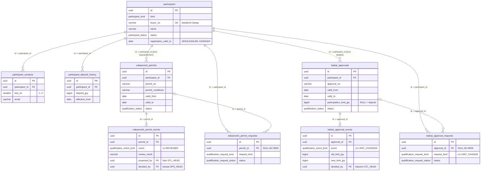

# PARTY_DB — 参加者と資格 — 許可（仲卸）≠ 承認（売買参加者）

| | |
|---|---|
| System Name | 水産物卸売市場業務支援システム（Product A, 顧客 株式会社 桜水産市場 — 架空） |
| Schema | `app` |
| CHARACTER SET | UTF8 (PostgreSQL 16, RDS Multi-AZ, AWS Tokyo) |
| Updated by | phuongnnm-23344 |
| Note | 本ファイルは Database Design 一式のうち ER クラスタ単位で分割したもの（QC-01 §4: 1ファイルにつきテーブル群1つ）。P1–P7 の原則、共通規約と enum（4.0）、公開ビュー、プロトタイプとの差異表、parity 結果、共通の未決事項は総括ファイル [MKT_DB.md](MKT_DB.md) にある。**4.xx の番号はスキーマ全体のテーブル番号（MKT_DB §2 の No 列）のまま**とし、ファイル間の相互参照や ADR・仕様からの参照が分割後も変わらないようにする |

---

## 1. 改訂履歴

| No | Version | Action | シート / 表 | 変更内容 | 更新日 | 更新者 | Approve |
|---|---|---|---|---|---|---|---|
| 1 | 0.1.0 | Add new | — | 初版は `MKT_DB.md` 0.1.0 の中にあった（スキーマ全体で1ファイル） | 2026-11-25 | phuongnnm-23344 | |
| 2 | 0.2.0 | Add new | 全ファイル | `MKT_DB.md` 0.1.1 から ER クラスタ単位に分割（Gate 1 M-09）。Gate 1 M-07 に従い修正: 許可 の手続き（審査 + 運用部門長 決裁）と 承認 の手続き（届出 + 照合部門長 確認）の違いを明記、イベント `REVIEWED`（許可）と `LIMIT_CHANGED`（承認、参加上限は上書きしない）、§3 の比較表、失効の自動化という前提、OPEN-DB-09; 顧客 #20（保証金の変更が NULL の参加上限に波及する） | 2026-11-25 | phuongnnm-23344 | |
| 3 | 0.3.0 | Update | §3, 4.12–4.15 | Gate 1 再確認 N-03: 許可 の通常の更新は PRM-121 に従う（照合部門長 確認）。審査 + 運用部門長 決裁 は新規発行のみ（前提 PL）; 承認 は「審査なし」から「簡易審査」に変更 | 2026-11-25 | phuongnnm-23344 | |
| 4 | 0.3.1 | Add new | 4.59, 4.60, §2, §3, 4.15 | P3（spec party）を統合: 申請待ちのテーブルを**別々に**追加 `nakaoroshi_permit_requests`（許可）と `baibai_approval_requests`（承認）— SC-01-02 [19] の 起案中 / 確認待ち の状態の元。新規発行の 許可 は決裁時に `REVIEWED` + `REGISTERED` を記録。新 enum `qualification_request_kind`、`qualification_request_status`（MKT_DB 0.3.2 §4.0）。4.15 の列 11: `LIMIT_CHANGED` にも MFA を必須化 — PREMISE §3.2 を合わせて修正（Q-PTY-07 は顧客の確認のため保留） | 2026-11-25 | phuongnnm-23344 | |
| 5 | 0.3.2 | Update | — | 顧客 Q-PTY-06: 4.11、4.15（LIMIT_CHANGED は一段階の CHECK）、4.60 は LIMIT_CHANGE を受け付けない; Q-PTY-07 は確定 | 2026-11-25 | phuongnnm-23344 |  |

---

## 2. テーブル一覧

| No | Schema | Category | テーブル名（論理） | テーブル名（物理） | 説明 | Note | Status |
|---|---|---|---|---|---|---|---|
| 9 | app | master | 参加者 | [`participants`](#49-participants) | 4種類: 卸売業者 / 仲卸 / 売買参加者 / 買出人 | Prototype: `participants` | Decision (provisional) |
| 10 | app | master | 参加者のメール連絡先 | [`participant_contacts`](#410-participant_contacts) | 最大2アドレス、有効期間つき | 新規 | Decision (provisional) |
| 11 | app | history | 保証金額の履歴 | [`participant_deposit_history`](#411-participant_deposit_history) | 保証金額（保証金）を変更するたびに1行 | 新規 | Decision (provisional) |
| 12 | app | master | 許可（仲卸） | [`nakaoroshi_permits`](#412-nakaoroshi_permits) | 仲卸の許可証 | Prototype: `nakaoroshi_permits` | Decision (provisional) |
| 13 | app | history | 許可の履歴 | [`nakaoroshi_permit_events`](#413-nakaoroshi_permit_events) | 許可の登録 / 更新 / 一時停止 / 失効 / 再審査 | 新規 | Decision (provisional) |
| 14 | app | master | 承認（売買参加者） | [`baibai_approvals`](#414-baibai_approvals) | 売買参加者の承認 + 参加上限 | Prototype: `baibai_approvals` | Decision (provisional) |
| 15 | app | history | 承認の履歴 | [`baibai_approval_events`](#415-baibai_approval_events) | 上と同じ、承認について | 新規 | Decision (provisional) |
| 59 | app | transaction | 許可の待ち申請 | [`nakaoroshi_permit_requests`](#459-nakaoroshi_permit_requests) | 許可の入力 / 起案 → 決裁・確認 / 却下 | 新規（P3） | Decision (provisional) |
| 60 | app | transaction | 承認の待ち申請 | [`baibai_approval_requests`](#460-baibai_approval_requests) | 上と同じ、承認について（参加上限の変更を含む） | 新規（P3） | Decision (provisional) |

---

## 3. ER Diagram

許可 と 承認 の2系統は分けて描く。両系統をつなぐ共通テーブルは `participants`（事業者）だけである。2系統は**手続きと固有の項目が異なり**、テーブル名だけが違うわけではない（Gate 1 M-07）:

| | 許可（仲卸）— 4.12 / 4.13 | 承認（売買参加者）— 4.14 / 4.15 |
|---|---|---|
| 根拠 | 審査（審査）を伴う許可証 | 承認 — **手続きは軽い**: 届出 + 簡易審査（保証金 / 資力の条件を 確認） |
| 新規発行 | 照合事務局 が申請を入力 → 照合部門長 が 起案（審査結果 + 条件を添付、イベント `REVIEWED`） → **運用部門長 決裁（MFA）** — 前提 [PL]、PRM-121 の 再審査 → 有効 と同じ水準 | 照合事務局 が 届出 を入力 → **照合部門長 確認（MFA）**、保証金 / 資力 の条件を簡易に確認して記録 — 一人で行う簡易審査。OPEN-DB-09 待ち |
| 通常の更新（失効日の前） | **PRM-121 に従う（顧客が LAB-1 で確定）:** 照合事務局 が新しい失効日を入力 → **照合部門長 確認（MFA）**、許可条件の見直し結果を記録; **再審査はしない**、運用部門長 決裁もしない | 左と同じ（PRM-121） |
| 固有の項目 | `permit_conditions`、審査結果（`review_result`, `reviewed_on`） | `participation_limit_jpy`（参加上限） — **上書きしない**、変更はイベント `LIMIT_CHANGED`（旧 / 新 / 理由）で行う |
| 一時停止 / 失効 / 再審査 → 有効 | 照合部門長 起案 → 運用部門長 決裁（MFA） | 左と同じ（PRM-121） |
| 失効日を過ぎた場合 | 自動で `EXPIRED`（前提 [PL]、FIG-010 に接続） | 左と同じ |
| 未決 | 誰が 決裁 して 停止 / 取消 するか、弁明の機会があるか — OPEN-DB-09 | 新規の 承認 は 照合部門長 確認（簡易審査）だけで足りるか — OPEN-DB-09 |

---

## 4. 定義テーブル

共通規約（型、共通列、追記のみ、日付のオープン、関数経由の更新、enum）: [MKT_DB.md §4.0](MKT_DB.md#40-共通規約).

### 4.9. `participants`

| | | | |
|---|---|---|---|
| テーブル名（論理） | 参加者 | 作成者 / 作成日 | phuongnnm-23344 / 2026-11-25 |
| テーブル名（物理） | `participants` | 更新者 / 更新日 | — |
| Overview | 市場に参加する事業者 / 個人。4種類を「買受人」として一括りにしない（TBL-ACTOR-01）。**事業者と 許可 / 承認 の根拠は別の実体**（PRM-044）: 資格は 4.12、4.14 にある。 | Note | prototype から `email`（→ 4.10）、`deposit_jpy`（→ 4.11）、`is_sample`（M01）を削除 |

**列定義**

| No. | Key | 論理名 | 物理名 | Data Type | Size | Not Null | Default | Note |
|---|---|---|---|---|---|---|---|---|
| 1 | PRI | ID | `id` | UUID | N/A | Yes | `gen_random_uuid()` | |
| 2 | | 種類 | `kind` | `participant_kind` | N/A | Yes | | 作成後は変更不可（trigger） |
| 3 | | 名称 | `name` | VARCHAR | 100 | Yes | | |
| 4 | | カナ名 | `name_kana` | VARCHAR | 100 | No | | 並び替え / 窓口での検索 |
| 5 | UNI | 買受人番号 | `buyer_no` | VARCHAR | 10 | No | | `^[A-Z0-9]{1,10}$`; `NAKAOROSHI`、`BAIBAI` では必須（0029 のルールを維持） |
| 6 | UNI | 会計上の取引先コード | `accounting_partner_code` | VARCHAR | 20 | No | | 会計ソフトのコード（IF-ACC-01） |
| 7 | | 事業者の状態 | `status` | `participant_status` | N/A | Yes | `'ACTIVE'` | 一時停止 / 失効 は 許可 / 承認 にあり、ここにはない |
| 8 | | 登録番号 | `registration_no` | VARCHAR | 20 | No | | `WHOLESALER`（市場登録）と `KAIDASHI`（地点登録 — EX-02）のみ |
| 9 | | 登録の有効期限 | `registration_valid_to` | DATE | N/A | No | | 警告のみ、**取引はブロックしない**（PRM-044）。CHECK: `kind` が（`NAKAOROSHI`、`BAIBAI`）のとき NULL |
| 10 | | 共通列 | `created_at`, `created_by`, `updated_at`, `updated_by` | | | | | |

**インデックス**

| No. | インデックス名 | カラム | Primary key | Unique | Note |
|---|---|---|---|---|---|
| 1 | `participants_pkey` | `id` | Yes | Yes | |
| 2 | `uq_participants_buyer_no` | `buyer_no` | No | Yes | 取引窓口・受渡場での主な検索キー（PRM-114 (b)） |
| 3 | `uq_participants_accounting_partner_code` | `accounting_partner_code` | No | Yes | |
| 4 | `idx_participants_kind_status` | `kind`, `status` | No | No | |

**外部キー** — N/A（共通列の FK のみ）。

---

### 4.10. `participant_contacts`

| | | | |
|---|---|---|---|
| テーブル名（論理） | 参加者のメール連絡先 | 作成者 / 作成日 | phuongnnm-23344 / 2026-11-25 |
| テーブル名（物理） | `participant_contacts` | 更新者 / 更新日 | — |
| Overview | 事業者ごとに有効なアドレスは最大2件（PRM-122 (e), L4-A08）。メールを変更するには古い行を閉じ（`valid_to`）、新しい行を追加する — 履歴を保持。市場の職員のみが、申請書に基づいて変更する。 | Note | 個人データ（APPI, FT-13-04）: メールアドレスを含む一覧の出力には MFA step-up が必要 |

**列定義**

| No. | Key | 論理名 | 物理名 | Data Type | Size | Not Null | Default | Note |
|---|---|---|---|---|---|---|---|---|
| 1 | PRI | ID | `id` | UUID | N/A | Yes | `gen_random_uuid()` | |
| 2 | FK | 参加者 | `participant_id` | UUID | N/A | Yes | | |
| 3 | | 位置 | `slot_no` | SMALLINT | N/A | Yes | | CHECK 1..2 |
| 4 | | メール | `email` | VARCHAR | 254 | Yes | | |
| 5 | | 有効期間（開始 / 終了） | `valid_from`, `valid_to` | DATE | N/A | Yes / No | | `valid_to` が NULL = 使用中 |
| 6 | | 申請書番号 | `request_ref` | VARCHAR | 30 | No | | |
| 7 | | 共通列 | `created_at`, `created_by` | | | | | `valid_to` のみ1回だけ UPDATE 可 |

**インデックス** — `participant_contacts_pkey`; `uq_participant_contacts_active_slot`（`participant_id`, `slot_no`）unique partial `valid_to IS NULL`。

**外部キー**

| No. | 外部キー名 | カラム | 参照先テーブル | 参照先カラム | Note |
|---|---|---|---|---|---|
| 1 | `fk_participant_contacts_participant` | `participant_id` | `participants` | `id` | |

---

### 4.11. `participant_deposit_history`

| | | | |
|---|---|---|---|
| テーブル名（論理） | 保証金額の履歴 | 作成者 / 作成日 | phuongnnm-23344 / 2026-11-25 |
| テーブル名（物理） | `participant_deposit_history` | 更新者 / 更新日 | — |
| Overview | 保証金額は履歴を持つ数値項目であり、入金・出金の取引は**ない**（PRM-046）。現在の値 = 判定日以前で `effective_from` が最も大きい行（ビュー `v_participant_current_deposit`）。**追記のみ。** | Note | 売買参加者（4.14）の既定の参加上限として使う（`participation_limit_jpy` が NULL のとき）: 保証金を変えると上限は `effective_from` から変わる — 保証金変更のダイアログには「参加上限も ¥… に変わります」または「参加上限は変わりません」と表示する（顧客 #20） |

**列定義**

| No. | Key | 論理名 | 物理名 | Data Type | Size | Not Null | Default | Note |
|---|---|---|---|---|---|---|---|---|
| 1 | PRI | ID | `id` | UUID | N/A | Yes | `gen_random_uuid()` | |
| 2 | FK | 参加者 | `participant_id` | UUID | N/A | Yes | | |
| 3 | | 保証金額 | `deposit_jpy` | BIGINT | N/A | Yes | | CHECK ≥ 0。照合部門長（STL-HEAD / 代行）のみ記録、MFA step-up、監査、確認者なし（Q-PTY-06 【顧客（模擬）、2026-11-25】） |
| 4 | | 有効開始日 | `effective_from` | DATE | N/A | Yes | | |
| 5 | | 理由 | `reason` | VARCHAR | 200 | Yes | | |
| 6 | | 共通列 | `created_at`, `created_by` | | | | | |

**インデックス** — `participant_deposit_history_pkey`; `uq_deposit_participant_from`（`participant_id`, `effective_from`）unique。

**外部キー**

| No. | 外部キー名 | カラム | 参照先テーブル | 参照先カラム | Note |
|---|---|---|---|---|---|
| 1 | `fk_deposit_participant` | `participant_id` | `participants` | `id` | |

---

### 4.12. `nakaoroshi_permits`

| | | | |
|---|---|---|---|
| テーブル名（論理） | 許可（仲卸） | 作成者 / 作成日 | phuongnnm-23344 / 2026-11-25 |
| テーブル名（物理） | `nakaoroshi_permits` | 更新者 / 更新日 | — |
| Overview | 仲卸の、**審査（審査）を伴う**許可証。**根拠の法令も、テーブルも、手続きも別**（ルール 2、ADR-003）: 新規発行は審査を経る — 照合事務局 が申請を入力、照合部門長 が審査結果 + 条件を添えて起案（`REVIEWED`）、運用部門長 が決裁（MFA つき、`REGISTERED`、前提 [PL]）; 通常の更新は PRM-121 に従う — 照合事務局 が入力、照合部門長 が確認（MFA つき、`RENEWED`）、再審査はしない。トリガー `enforce_qualification_kind` は、`NAKAOROSHI` 以外の参加者への紐づけを拒否する（prototype 0005 から継承）。 | Note | `status`、`valid_to`、`permit_conditions` は、同じトランザクション内でイベント行 `nakaoroshi_permit_events` を生成する関数によってのみ変更する。`valid_to` を過ぎると、ジョブが自動で `EXPIRED` を生成 — 前提 [PL]（FIG-010 は 有効 → 失効 を直接描いていない） |

**列定義**

| No. | Key | 論理名 | 物理名 | Data Type | Size | Not Null | Default | Note |
|---|---|---|---|---|---|---|---|---|
| 1 | PRI | ID | `id` | UUID | N/A | Yes | `gen_random_uuid()` | |
| 2 | FK | 参加者 | `participant_id` | UUID | N/A | Yes | | `kind = NAKAOROSHI`（trigger） |
| 3 | UNI | 許可番号 | `permit_no` | VARCHAR | 20 | Yes | | |
| 4 | | 許可の条件 | `permit_conditions` | VARCHAR | 500 | No | | 許可の固有項目（ADR-003 §2.2） |
| 5 | | 有効開始日 | `valid_from` | DATE | N/A | Yes | | |
| 6 | | 失効日 | `valid_to` | DATE | N/A | Yes | | CHECK `valid_to >= valid_from`; 30日前に警告（PRM-045） |
| 7 | | 状態 | `status` | `qualification_status` | N/A | Yes | `'VALID'` | FIG-010 |
| 8 | | 共通列 | `created_at`, `created_by`, `updated_at`, `updated_by` | | | | | |

**インデックス** — `nakaoroshi_permits_pkey`; `uq_nakaoroshi_permits_permit_no`; `idx_nakaoroshi_permits_participant`（`participant_id`, `status`）。

**外部キー**

| No. | 外部キー名 | カラム | 参照先テーブル | 参照先カラム | Note |
|---|---|---|---|---|---|
| 1 | `fk_nakaoroshi_permits_participant` | `participant_id` | `participants` | `id` | |

---

### 4.13. `nakaoroshi_permit_events`

| | | | |
|---|---|---|---|
| テーブル名（論理） | 許可の履歴 | 作成者 / 作成日 | phuongnnm-23344 / 2026-11-25 |
| テーブル名（物理） | `nakaoroshi_permit_events` | 更新者 / 更新日 | — |
| Overview | 許可 の資格が変わるたびに1行。**追記のみ。** 新規発行: `REVIEWED`（照合部門長 が審査結果 + 条件を記録）の後、`REGISTERED`（運用部門長 が決裁、MFA — 前提 [PL]）。通常の更新: 照合事務局 が入力した `RENEWED` を 照合部門長 が確認（MFA）、再審査はせず、再審査の状態にもしない（PRM-121）。一時停止 / 再審査 → 有効: 照合部門長 が起案（`proposed_by`）、運用部門長 が決裁（`decided_by`、MFA）。 | Note | 内部の審査・決定の語は 決裁 / 確認 のみを使う（PRM-121）。許可の 停止 / 取消 の手続き（誰が決裁するか、弁明の機会）は OPEN-DB-09 待ち |

**列定義**

| No. | Key | 論理名 | 物理名 | Data Type | Size | Not Null | Default | Note |
|---|---|---|---|---|---|---|---|---|
| 1 | PRI | ID | `id` | UUID | N/A | Yes | `gen_random_uuid()` | |
| 2 | FK | 許可 | `permit_id` | UUID | N/A | Yes | | |
| 3 | | イベント | `event` | `qualification_event_kind` | N/A | Yes | | CHECK ≠ `LIMIT_CHANGED`（許可 に参加上限はない） |
| 3a | | 審査結果 / 審査日 | `review_result`, `reviewed_on` | VARCHAR(500) / DATE | | No | | `REVIEWED` のとき必須; 新しい条件は `REGISTERED` / `RENEWED` のとき `nakaoroshi_permits.permit_conditions` にも書き込む |
| 4 | | 変更前 / 後の状態 | `from_status`, `to_status` | `qualification_status` | N/A | No / Yes | | `REGISTERED` のとき `from_status` は NULL; `REVIEWED` は状態を変えない |
| 5 | | 変更前 / 後の失効日 | `old_valid_to`, `new_valid_to` | DATE | | No | | `RENEWED` のみ |
| 6 | | 有効開始日 | `effective_on` | DATE | N/A | Yes | | |
| 7 | | 理由 | `reason` | VARCHAR | 500 | Yes | | |
| 8 | FK | 起案者 | `proposed_by` | UUID | N/A | No | | `STL_HEAD` |
| 9 | FK | 決裁 / 確認者 | `decided_by` | UUID | N/A | No | | `REGISTERED` / 一時停止 / 再開 / 再審査 は `OPS_HEAD`; `RENEWED` の確認は `STL_HEAD`（PRM-121）; `REVIEWED`（記録者 = `proposed_by`）と自動の `EXPIRED` は NULL。CHECK `decided_by <> proposed_by` |
| 10 | | MFA 実施日時 | `mfa_verified_at` | TIMESTAMPTZ | N/A | No | | `decided_by` に値があるとき必須（PREMISE §3.2） |
| 11 | | 共通列 | `created_at`, `created_by` | | | | | |

**インデックス** — `nakaoroshi_permit_events_pkey`; `idx_permit_events_permit`（`permit_id`, `created_at`）。

**外部キー**

| No. | 外部キー名 | カラム | 参照先テーブル | 参照先カラム | Note |
|---|---|---|---|---|---|
| 1 | `fk_permit_events_permit` | `permit_id` | `nakaoroshi_permits` | `id` | |
| 2 | `fk_permit_events_proposed_by` / `_decided_by` | `proposed_by`, `decided_by` | `staff_accounts` | `id` | |

---

### 4.14. `baibai_approvals`

| | | | |
|---|---|---|---|
| テーブル名（論理） | 承認（売買参加者） | 作成者 / 作成日 | phuongnnm-23344 / 2026-11-25 |
| テーブル名（物理） | `baibai_approvals` | 更新者 / 更新日 | — |
| Overview | 売買参加者の承認 — 許可とは別の根拠、別のテーブル、**手続きはより軽い**（ルール 2）: 届出 → 照合事務局 が入力 → 照合部門長 確認（MFA）、保証金 / 資力 の条件を簡易に確認 — 許可 のような独立した 審査 のステップはない（OPEN-DB-09 待ち）。参加上限（取引の上限）を持つ: 期間内の 買受代金の合計（相対 + せり）が上限を超えると、警告と理由の入力を求める。強制的にはブロックしない（PRM-046, L4-A04 (1)）。トリガーが `kind = BAIBAI` を検査。 | Note | 上限はビュー `v_buyer_period_usage` で期間ごとに計算 — M19 / D08 を修正。`valid_to` を過ぎると自動で `EXPIRED` — 前提 [PL]、4.12 と同じ |

**列定義**

| No. | Key | 論理名 | 物理名 | Data Type | Size | Not Null | Default | Note |
|---|---|---|---|---|---|---|---|---|
| 1 | PRI | ID | `id` | UUID | N/A | Yes | `gen_random_uuid()` | |
| 2 | FK | 参加者 | `participant_id` | UUID | N/A | Yes | | `kind = BAIBAI`（trigger） |
| 3 | UNI | 承認番号 | `approval_no` | VARCHAR | 20 | Yes | | |
| 4 | | 有効開始日 | `valid_from` | DATE | N/A | Yes | | |
| 5 | | 失効日 | `valid_to` | DATE | N/A | Yes | | CHECK `valid_to >= valid_from` |
| 6 | | 現行の参加上限 | `participation_limit_jpy` | BIGINT | N/A | No | | NULL = 現行の保証金額を使う（PRM-046）。値がある場合 CHECK > 0。**上書きしない:** 変更はイベント `baibai_approval_events.LIMIT_CHANGED`（旧 / 新 / 理由 / 確認者）を生成する関数だけで、同じトランザクション内で行う — この列は現行値であり、履歴は 4.15 にある（Gate 1 M-07） |
| 7 | | 状態 | `status` | `qualification_status` | N/A | Yes | `'VALID'` | FIG-010 |
| 8 | | 共通列 | `created_at`, `created_by`, `updated_at`, `updated_by` | | | | | |

**インデックス** — `baibai_approvals_pkey`; `uq_baibai_approvals_approval_no`; `idx_baibai_approvals_participant`（`participant_id`, `status`）。

**外部キー**

| No. | 外部キー名 | カラム | 参照先テーブル | 参照先カラム | Note |
|---|---|---|---|---|---|
| 1 | `fk_baibai_approvals_participant` | `participant_id` | `participants` | `id` | |

---

### 4.15. `baibai_approval_events`

| | | | |
|---|---|---|---|
| テーブル名（論理） | 承認の履歴 | 作成者 / 作成日 | phuongnnm-23344 / 2026-11-25 |
| テーブル名（物理） | `baibai_approval_events` | 更新者 / 更新日 | — |
| Overview | 承認 の資格の履歴 — 4.13 から**テーブルを分ける**（ADR-003: 資格の履歴を共通のテーブルにしない）。4.13 と異なる点: `REVIEWED` イベントはない（個別の審査はない — 簡易審査の内容は `reason` に書く）; 旧 / 新 の 参加上限 を持つ `LIMIT_CHANGED` イベントがある; 登録 / 更新は 照合部門長 確認 だけで足りる。**追記のみ。** | Note | 4.13 と列が重なるのは意図的 — 片方を変えても、もう片方は変わらない |

**列定義** — 承認 専用（4.13 の写しではない: 審査の列はなく、上限の列がある）:

| No. | Key | 論理名 | 物理名 | Data Type | Size | Not Null | Default | Note |
|---|---|---|---|---|---|---|---|---|
| 1 | PRI | ID | `id` | UUID | N/A | Yes | `gen_random_uuid()` | |
| 2 | FK | 承認 | `approval_id` | UUID | N/A | Yes | | |
| 3 | | イベント | `event` | `qualification_event_kind` | N/A | Yes | | CHECK ≠ `REVIEWED`（承認 に個別の審査ステップはない） |
| 4 | | 変更前 / 後の状態 | `from_status`, `to_status` | `qualification_status` | N/A | No / Yes | | `REGISTERED` のとき `from_status` は NULL; `LIMIT_CHANGED` は状態を変えない |
| 5 | | 変更前 / 後の失効日 | `old_valid_to`, `new_valid_to` | DATE | | No | | `RENEWED` のみ |
| 6 | | 変更前 / 後の参加上限 | `old_limit_jpy`, `new_limit_jpy` | BIGINT | N/A | No | | `LIMIT_CHANGED` のとき必須（NULL = 保証金額に従う）。上限を変更する関数はこの行を記録し、4.14 の列 6 を**同じトランザクション内で**更新する |
| 7 | | 有効開始日 | `effective_on` | DATE | N/A | Yes | | `LIMIT_CHANGED`: この日を含む期間から適用 |
| 8 | | 理由 | `reason` | VARCHAR | 500 | Yes | | |
| 9 | FK | 起案者 | `proposed_by` | UUID | N/A | No | | `STL_HEAD`（一時停止 / 再開 / 再審査） |
| 10 | FK | 決裁 / 確認者 | `decided_by` | UUID | N/A | No | | `REGISTERED` / `RENEWED` / `LIMIT_CHANGED` は `STL_HEAD` の確認; `SUSPENDED` / `RESUMED` / `REVIEW_STARTED` / `REINSTATED` は `OPS_HEAD` の決裁; 自動の `EXPIRED` は NULL。CHECK `decided_by <> proposed_by` かつ ≠ `created_by` — **ただし `LIMIT_CHANGED` を除く**: 照合部門長 による一段階の処理のため、`decided_by = created_by` を許す（Q-PTY-06 【顧客（模擬）、2026-11-25】; `mfa_verified_at` は必須のまま） |
| 11 | | MFA 実施日時 | `mfa_verified_at` | TIMESTAMPTZ | N/A | No | | `decided_by` に値があるとき必須、**`LIMIT_CHANGED` を含む**（Q-PTY-07 顧客が同意 【顧客（模擬）、2026-11-25】） |
| 12 | | 共通列 | `created_at`, `created_by` | | | | | `created_by` = 照合事務局 が入力; `LIMIT_CHANGED` のときは 照合部門長 が実行 |

**インデックス** — `baibai_approval_events_pkey`; `idx_approval_events_approval`（`approval_id`, `created_at`）。

**外部キー**

| No. | 外部キー名 | カラム | 参照先テーブル | 参照先カラム | Note |
|---|---|---|---|---|---|
| 1 | `fk_approval_events_approval` | `approval_id` | `baibai_approvals` | `id` | |

---

### 4.59. `nakaoroshi_permit_requests`

| | | | |
|---|---|---|---|
| テーブル名（論理） | 許可の待ち申請 | 作成者 / 作成日 | phuongnnm-23344 / 2026-11-25 |
| テーブル名（物理） | `nakaoroshi_permit_requests` | 更新者 / 更新日 | — |
| Overview | 許可（仲卸）の申請を、入力 / 起案から 決裁・確認 または 却下 まで保持する — SC-01-02 [19] の 「起案中」「確認待ち」 の状態の元（C-27）。決裁時に関数が 4.12 を更新し、4.13 に行を追加する（新規発行: `REVIEWED` + `REGISTERED` を同時に）— **同じトランザクション内**。**許可専用** — 承認 は 4.60 を使う（ADR-003、ルール 2: 共通の申請テーブルは持たない）。DELETE しない; 決定の列だけを1回 UPDATE（`ENTERED` / `PROPOSED` → `DECIDED` / `REJECTED`） | Note | 新規（P3 を統合 — PTY_PERMIT_LIFECYCLE_TECH §5、前提 [PL]） |

**列定義**

| No. | Key | 論理名 | 物理名 | Data Type | Size | Not Null | Default | Note |
|---|---|---|---|---|---|---|---|---|
| 1 | PRI | ID | `id` | UUID | N/A | Yes | `gen_random_uuid()` | |
| 2 | FK | 参加者 | `participant_id` | UUID | N/A | Yes | | 種類 `NAKAOROSHI`（関数で検査） |
| 3 | FK | 許可 | `permit_id` | UUID | N/A | No | | `NEW` のとき NULL（まだ許可がない） |
| 4 | | 申請の種類 | `request_kind` | `qualification_request_kind` | N/A | Yes | | CHECK ≠ `LIMIT_CHANGE`（参加上限は 承認 にのみある） |
| 5 | | 状態 | `status` | `qualification_request_status` | N/A | Yes | | `NEW` / `RENEW` の `ENTERED`（照合事務局 が入力）; 照合部門長 が起案したら `PROPOSED`（審査後の新規発行、一時停止 / 再開 / 再審査 / 再有効） |
| 6 | | 提案内容 | `payload` | JSONB | N/A | Yes | | 許可番号、有効期間、`permit_conditions`、審査結果（`review_result`, `reviewed_on`）— 関数が `request_kind` ごとに検査 |
| 7 | | 理由 | `reason` | VARCHAR | 500 | No | | `SUSPEND` / `RESUME` / `REVIEW_START` / `REINSTATE` のとき必須 |
| 8 | FK | 入力者 / 起案者 | `entered_by`, `proposed_by` | UUID | N/A | No | | 少なくとも一方に値がある |
| 9 | FK | 決裁・確認者 / 却下者 | `decided_by` | UUID | N/A | No | | CHECK `decided_by` ≠ `entered_by`、≠ `proposed_by`（メーカー・チェッカー、`E-PTY-012`） |
| 10 | | 決裁日時 | `decided_at` | TIMESTAMPTZ | N/A | No | | `DECIDED` / `REJECTED` のときに値がある |
| 11 | FK | 代行 | `delegation_id` | UUID | N/A | No | | |
| 12 | | MFA 実施日時 | `mfa_verified_at` | TIMESTAMPTZ | N/A | No | | `DECIDED` のとき必須（PREMISE §3.2） |
| 13 | | 決定のコメント | `decision_comment` | VARCHAR | 500 | No | | `REJECTED` のとき必須（`E-PTY-023`） |
| 14 | | 共通列 | `created_at`, `created_by`, `updated_at`, `updated_by` | | | | | |

**インデックス** — `nakaoroshi_permit_requests_pkey`; `uq_permit_requests_open`（`participant_id`）unique partial `status IN ('ENTERED','PROPOSED')`（参加者ごとに未処理の申請は1件 — 前提 Q-PTY-01、`E-PTY-011`）; `idx_permit_requests_status`（`status`, `created_at`）。

**外部キー** — `participant_id` → `participants.id`; `permit_id` → `nakaoroshi_permits.id`; `entered_by`, `proposed_by`, `decided_by` → `staff_accounts.id`; `delegation_id` → `delegations.id`。

---

### 4.60. `baibai_approval_requests`

| | | | |
|---|---|---|---|
| テーブル名（論理） | 承認の待ち申請 | 作成者 / 作成日 | phuongnnm-23344 / 2026-11-25 |
| テーブル名（物理） | `baibai_approval_requests` | 更新者 / 更新日 | — |
| Overview | 4.59 と同じだが、承認（売買参加者）について — **別のテーブル**。4.59 と異なり: `NEW` には 起案 のステップがない; **`LIMIT_CHANGE` を含まない**（参加上限の変更は 照合部門長 による一段階の操作で、4.14 + 4.15 に直接書く — Q-PTY-06）。（承認は簡易審査、照合部門長 確認 — PARTY_DB §3）。確認・決裁 の時、関数が 4.14 を更新し、4.15 に行を追加する。同じトランザクション内。DELETE しない | Note | 新規（P3 を統合 — PTY_APPROVAL_LIFECYCLE_TECH §3、前提 [PL]） |

**列定義** — 列名は 4.59 と同じ（テーブルは共用しない）。違いは次のとおり:

| No. | Key | 論理名 | 物理名 | Data Type | Size | Not Null | Default | Note |
|---|---|---|---|---|---|---|---|---|
| 1 | PRI | ID | `id` | UUID | N/A | Yes | `gen_random_uuid()` | |
| 2 | FK | 参加者 | `participant_id` | UUID | N/A | Yes | | 種類 `BAIBAI`（関数で検査） |
| 3 | FK | 承認 | `approval_id` | UUID | N/A | No | | `NEW` のとき NULL |
| 4 | | 申請の種類 | `request_kind` | `qualification_request_kind` | N/A | Yes | | CHECK ≠ `LIMIT_CHANGE`（Q-PTY-06 — 4.59 と同じ） |
| 5 | | 状態 | `status` | `qualification_request_status` | N/A | Yes | | `NEW` / `RENEW` の `ENTERED`; 起案の種類（一時停止 / 再開 / 再審査 / 再有効）の `PROPOSED`。CHECK: `NEW` のとき `PROPOSED` 不可 |
| 6 | | 提案内容 | `payload` | JSONB | N/A | Yes | | 承認番号、有効期間、`limitMode`、`participationLimitJpy`（`NEW` の初期上限）、簡易審査のメモ |
| 7–14 | | （4.59 と同じ） | `reason`, `entered_by`, `proposed_by`, `decided_by`, `decided_at`, `delegation_id`, `mfa_verified_at`, `decision_comment`, 共通列 | | | | | メーカー・チェッカーの CHECK は 4.59 と同じ; `DECIDED` のとき `mfa_verified_at` 必須 |

**インデックス** — `baibai_approval_requests_pkey`; `uq_approval_requests_open`（`participant_id`）unique partial `status IN ('ENTERED','PROPOSED')`; `idx_approval_requests_status`（`status`, `created_at`）。

**外部キー** — `participant_id` → `participants.id`; `approval_id` → `baibai_approvals.id`; `entered_by`, `proposed_by`, `decided_by` → `staff_accounts.id`; `delegation_id` → `delegations.id`。
