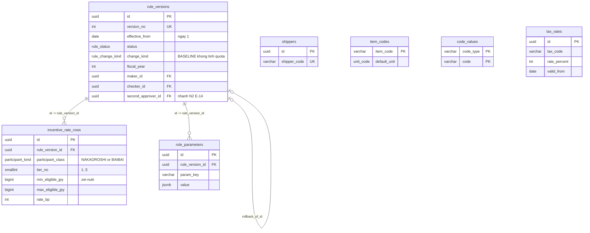

# RULE_DB — 版管理された規程（交付率表、パラメータ）+ コード・税率のマスター

| | |
|---|---|
| System Name | 水産物卸売市場業務支援システム（Product A、顧客 株式会社 桜水産市場 — 架空） |
| Schema | `app` |
| CHARACTER SET | UTF8 (PostgreSQL 16, RDS Multi-AZ, AWS Tokyo) |
| Updated by | phuongnnm-23344 |
| Note | ER単位で分割したデータベース設計の1ファイル（QC-01 §4：1ファイル1グループ）。P1–P7の原則、共通規約 + enum（4.0）、公開ビュー、プロトタイプとの差異表、パリティ結果、共通の未決事項は総括ファイル [MKT_DB.md](MKT_DB.md) にある。**4.xx の番号はスキーマ全体のテーブル番号を維持**（MKT_DB §2 の No 列）しているため、ファイル間の相互参照や ADR / spec からの参照は分割後も変わらない |

---

## 1. 改訂履歴

| No | Version | Action | シート / 表 | 変更内容 | 更新日 | 更新者 | Approve |
|---|---|---|---|---|---|---|---|
| 1 | 0.1.0 | Add new | — | 初期内容は `MKT_DB.md` 0.1.0 にあった（スキーマ全体で1ファイル） | 2026-11-25 | phuongnnm-23344 | |
| 2 | 0.2.0 | Add new | ファイル全体 | ER単位で `MKT_DB.md` 0.1.1 から分割（Gate 1 M-09）；Gate 1 に従い修正：パラメータ `TRADE_START_TIME` と `LOT_INTAKE_START_TIME` の意味を業務日の開始とする（M-01）；`PAYMENT_DUE_RULE` の銀行営業日による前倒しを確定ルールとし、前提と質問を付記（M-03）；2段階のしきい値は、顧客 #3 に従い1人の買い手の最大の金額変動で測る；`APPROVED` 版の取消は maker-checker 付き（m-09）；110/100 の固定を前提として明記（m-07） | 2026-11-25 | phuongnnm-23344 | |
| 3 | 0.2.1 | Modify | `code_values`, `rule_versions` | P3 を統合：`code_values` に種別 `INSPECTION_GRADE` を追加（目利きの等級 A / B / C / 規格外 — 前提 Q-LOT-03）；`rule_versions` に `cancel_requested_by`、`cancel_requested_at`、`cancel_request_reason` を追加（`APPROVED` 版の取消の1ステップ目、maker-checker 付き — Q-RULE-02、API-RULE-006）；N2 分岐の表示上の状態「決裁待ち」 = `PENDING` + `checker_id` NOT NULL + `second_approver_id` NULL を明記（enum の値は追加しない） | 2026-11-25 | phuongnnm-23344 | |
| 4 | 0.2.2 | Update | — | 顧客 Q-TRD-02：4.19 `tax_rates` を使い、参加上限を税込へ換算（コードは設定ファイル `PARTICIPATION_LIMIT_TAX_CODE`） | 2026-11-25 | phuongnnm-23344 |  |

---

## 2. テーブル一覧

| No | Schema | Category | テーブル名（論理） | テーブル名（物理） | 説明 | Note | Status |
|---|---|---|---|---|---|---|---|
| 16 | app | master | 出荷者（荷の発送者） | [`shippers`](#416-shippers) | 出荷者コード表 | 新規 | Decision (provisional) |
| 17 | app | master | 品目（商品） | [`item_codes`](#417-item_codes) | 品目コード + 既定単位 | 新規 | Decision (provisional) |
| 18 | app | master | 共通コード表 | [`code_values`](#418-code_values) | 荷目、選択用の理由、配送例外の種類、目利きの等級 | 新規 | Decision (provisional) |
| 19 | app | master | 税率 | [`tax_rates`](#419-tax_rates) | 10% / 8%、適用開始日あり | 新規 | Decision (provisional) |
| 21 | app | master | 規程の版 | [`rule_versions`](#421-rule_versions) | 適用開始日は毎月1日、maker-checker、ロールバック、TC年ごとに年4回の上限 | プロトタイプ: `rule_versions` | Decision (provisional) |
| 22 | app | master | 交付率のランク | [`incentive_rate_rows`](#422-incentive_rate_rows) | **2テーブル（仲卸 / 売買参加者）× 5ランク**、適格金額（税抜）による | プロトタイプ: `incentive_rate_rows` | Decision (provisional) |
| 23 | app | master | 規程パラメータ | [`rule_parameters`](#423-rule_parameters) | 同一版内の金額・業務日に関わるパラメータ（PREMISE §3.1） | 新規 | Decision (provisional) |

---

## 3. ER図

`business_days`、`payment_periods` は `rule_versions` を使い、[CLOSE_DB.md](CLOSE_DB.md) に定義がある；`trades.tax_rate_id` は [TRADE_DB.md](TRADE_DB.md)。

---

## 4. テーブル定義

共通規約（型、共通列、追記のみ、開いている日、関数経由の書き込み、enum）：[MKT_DB.md §4.0](MKT_DB.md#40-共通規約)。

### 4.16. `shippers`

| | | | |
|---|---|---|---|
| テーブル名（論理） | 出荷者（荷の発送者） | 作成者 / 作成日 | phuongnnm-23344 / 2026-11-25 |
| テーブル名（物理） | `shippers` | 更新者 / 更新日 | — |
| Overview | 出荷者コード表（FT-10-06、P0）。本登録（PRM-116）で使用。プロトタイプの自由記述の `lots.shipper_name`（text）を置き換える（D15）。 | Note | 使用停止 = `valid_to`、削除しない |

**列定義**

| No. | Key | 論理名 | 物理名 | Data Type | Size | Not Null | Default | Note |
|---|---|---|---|---|---|---|---|---|
| 1 | PRI | ID | `id` | UUID | N/A | Yes | `gen_random_uuid()` | |
| 2 | UNI | 出荷者コード | `shipper_code` | VARCHAR | 10 | Yes | | |
| 3 | | 名称 | `name` | VARCHAR | 100 | Yes | | |
| 4 | | 有効期間（開始 / 終了） | `valid_from`, `valid_to` | DATE | N/A | Yes / No | | |
| 5 | | 共通列 | `created_at`, `created_by`, `updated_at`, `updated_by` | | | | | |

**Index** — `shippers_pkey`; `uq_shippers_shipper_code`. **外部キー** — N/A.

---

### 4.17. `item_codes`

| | | | |
|---|---|---|---|
| テーブル名（論理） | 品目（商品） | 作成者 / 作成日 | phuongnnm-23344 / 2026-11-25 |
| テーブル名（物理） | `item_codes` | 更新者 / 更新日 | — |
| Overview | 品目コードと既定単位（FT-10-06）。テキストの `lots.species` を置き換える。 | Note | |

**列定義**

| No. | Key | 論理名 | 物理名 | Data Type | Size | Not Null | Default | Note |
|---|---|---|---|---|---|---|---|---|
| 1 | PRI | 品目コード | `item_code` | VARCHAR | 10 | Yes | | |
| 2 | | 名称 | `name` | VARCHAR | 50 | Yes | | |
| 3 | | 既定単位 | `default_unit` | `unit_code` | N/A | Yes | `'KG'` | |
| 4 | | 既定の税区分 | `default_tax_code` | VARCHAR | 10 | Yes | `'REDUCED8'` | 食品 → 軽減税率 8%（入力時の提案；行の実際の税は `trades.tax_rate_id`） |
| 5 | | 使用中 | `is_active` | BOOLEAN | N/A | Yes | `true` | |
| 6 | | 共通列 | `created_at`, `created_by`, `updated_at`, `updated_by` | | | | | |

**Index** — `item_codes_pkey`. **外部キー** — N/A (`default_tax_code` はコードで、日付によって `tax_rates` を引く；`tax_rates` は1つのコードに対して時期ごとに複数行があるため、FK は置かない).

---

### 4.18. `code_values`

| | | | |
|---|---|---|---|
| テーブル名（論理） | 共通コード表 | 作成者 / 作成日 | phuongnnm-23344 / 2026-11-25 |
| テーブル名（物理） | `code_values` | 更新者 / 更新日 | — |
| Overview | 運用担当者が編集する小さな区分一覧：`NIME` 荷目、`OVER_LIMIT_REASON`（参加上限を超えたときの選択用の理由 — L4-A04 (1)）、`DELIVERY_EXCEPTION`（引渡し例外の種類）、`FIX_REASON`（当日訂正 / 取消 の理由）、`INSPECTION_GRADE`（SC-03-05 で査定者が選ぶ目利きの等級 — 初期データは A / B / C / 規格外、前提 Q-LOT-03；ラベルのみで、自動の採点・提案はない — ルール3）。 | Note | 金額に影響するものはここには置かない — `rule_parameters` に置く |

**列定義**

| No. | Key | 論理名 | 物理名 | Data Type | Size | Not Null | Default | Note |
|---|---|---|---|---|---|---|---|---|
| 1 | PRI | 区分の種類 | `code_type` | VARCHAR | 30 | Yes | | |
| 2 | PRI | コード | `code` | VARCHAR | 20 | Yes | | |
| 3 | | ラベル | `label` | VARCHAR | 100 | Yes | | 日本語、画面に表示 |
| 4 | | 表示順 | `sort_order` | INT | N/A | Yes | `0` | |
| 5 | | 使用中 | `is_active` | BOOLEAN | N/A | Yes | `true` | |
| 6 | | 共通列 | `updated_at`, `updated_by` | | | | | |

**Index** — `code_values_pkey` (`code_type`, `code`). **外部キー** — N/A.

---

### 4.19. `tax_rates`

| | | | |
|---|---|---|---|
| テーブル名（論理） | 税率 | 作成者 / 作成日 | phuongnnm-23344 / 2026-11-25 |
| テーブル名（物理） | `tax_rates` | 更新者 / 更新日 | — |
| Overview | 税率マスタ（FT-10-05）：コード + 税率 + 適用開始日。各取引は適用した `tax_rate_id` を保存；期の税は税率ごとに合計に対して1回計算（PRM-053）。プロトタイプの固定10%（D04）を修正。 | Note | 完納奨励金の 110/100 の係数は BR-INC-01 / B.5 / 13-06 の **固定** の税係数であり、品目の税率（生鮮水産物は食品 → 軽減税率 8%）には従わず、本テーブルからも読まない — 前提 [PL] として Gate 1 m-07 に従い記載；完納奨励金を IF-ACC-01 へ出力する際の税区分は質問 Q-ARCH-12（E-01 / E-06 に従う）。**参加上限を税込で比較するためにも使用**（Q-TRD-02 【顧客（模擬）、2026-11-25】）：係数 = 設定ファイル `PARTICIPATION_LIMIT_TAX_CODE`（既定 `REDUCED8`）のコードの `rate_percent`、取引日時点；`valid_from` / `valid_to` により履歴を持ち、変更は 年4回 の回数に含めない（規程の版ではないため） |

**列定義**

| No. | Key | 論理名 | 物理名 | Data Type | Size | Not Null | Default | Note |
|---|---|---|---|---|---|---|---|---|
| 1 | PRI | ID | `id` | UUID | N/A | Yes | `gen_random_uuid()` | |
| 2 | | 税コード | `tax_code` | VARCHAR | 10 | Yes | | `STD10`, `REDUCED8` |
| 3 | | 税率（%） | `rate_percent` | INT | N/A | Yes | | CHECK 0..100 |
| 4 | | 有効期間（開始 / 終了） | `valid_from`, `valid_to` | DATE | N/A | Yes / No | | 同じ `tax_code` で期間の重複を禁止（EXCLUDE gist） |
| 5 | | 共通列 | `created_at`, `created_by` | | | | | |

**Index** — `tax_rates_pkey`; `ex_tax_rates_no_overlap` (`tax_code`, daterange). **外部キー** — N/A.

---

### 4.21. `rule_versions`

| | | | |
|---|---|---|---|
| テーブル名（論理） | 規程の版 | 作成者 / 作成日 | phuongnnm-23344 / 2026-11-25 |
| テーブル名（物理） | `rule_versions` | 更新者 / 更新日 | — |
| Overview | 1版 = 交付率表（4.22）+ パラメータ（4.23）、適用開始は月の **1日**（PRM-042）。作成者（maker）は ルール管理者、確認者（checker）は 照合部門長（MFA）。ライフサイクル：DRAFT → PENDING → APPROVED（発効待ち）→ ACTIVE → SUPERSEDED；差し戻し → DRAFT；適用前の取消 → CANCELLED（ADR-006 §2.2）。回数は TC年（4月→3月）ごとに年4回まで。適用日がその年にある `APPROVED` / `ACTIVE` / `SUPERSEDED` の版の `CHANGE` + `ROLLBACK` を数える；**`BASELINE`（稼働開始時）は数えない**；`CANCELLED` は数えない（L4-A04 (3)、D06 を修正）。決裁の関数は TC年単位でロック（advisory lock）し、2人の確認者が同時に上限を超えないようにする。5回目の新しい版は拒否。4回に達した後のロールバック：**E-14 の回答待ち** — 列 `second_approver_id` は N2 分岐で使う（OPEN-L4-01）。**「決裁待ち（運用部門長）」は enum の値ではない：** = `status = 'PENDING'` + `checker_id IS NOT NULL` + `second_approver_id IS NULL`（確認者が確認済み、運用部門長 の決裁待ち — RULE_VERSION_TECH R5）；差し戻し → `DRAFT` にして `checker_id` を削除。**適用前の `APPROVED` 版の取消：** maker（RULE）が取消を提案し、checker の 照合部門長 が決裁 + MFA + 理由を付して確定（maker-checker を維持；Gate 1 m-09）→ `CANCELLED`、回数に含めない。決裁済みの料率が誤っていても、それがその期の「正しい」版であり続ける → エンジンは DELTA を自動生成しない；締め済みの期の奨励金の誤りは 修正申請 `INCENTIVE` で修正（ADJUST_DB 4.37、R-L4-01）。 | Note | N1 / N2 の切替スイッチはない（PREMISE §6）：分岐はワークショップの後に関数で確定 |

**列定義**

| No. | Key | 論理名 | 物理名 | Data Type | Size | Not Null | Default | Note |
|---|---|---|---|---|---|---|---|---|
| 1 | PRI | ID | `id` | UUID | N/A | Yes | `gen_random_uuid()` | |
| 2 | UNI | 版番号 | `version_no` | INT | N/A | Yes | | CHECK > 0 |
| 3 | | 適用開始日 | `effective_from` | DATE | N/A | Yes | | CHECK 日 = 1；決裁の関数は将来の月であることを検査 |
| 4 | | 年度（TC年） | `fiscal_year` | INT | N/A | Yes | | `effective_from` から生成（月 ≥ 4 → その年、それ以外 → 年 − 1） |
| 5 | | 変更の種類 | `change_kind` | `rule_change_kind` | N/A | Yes | `'CHANGE'` | システム全体で `BASELINE` は1つのみ（部分一意） |
| 6 | | 状態 | `status` | `rule_status` | N/A | Yes | `'DRAFT'` | |
| 7 | FK | ロールバック元の版 | `rollback_of_id` | UUID | N/A | No | | `change_kind = ROLLBACK` のとき必須；内容は対象の版から新しい行へコピー |
| 8 | FK | 置き換えられる版 | `replaced_version_id` | UUID | N/A | No | | 直前の版は `SUPERSEDED` に変わる |
| 9 | | 理由 / メモ | `note` | VARCHAR | 500 | No | | `ROLLBACK` のとき必須 |
| 10 | FK | 作成者（maker） | `maker_id` | UUID | N/A | Yes | | `RULE` |
| 11 | FK | 確認者（checker） | `checker_id` | UUID | N/A | No | | `STL_HEAD`；CHECK `checker_id <> maker_id` |
| 12 | FK | 第二の決裁者 | `second_approver_id` | UUID | N/A | No | | E-14 の N2 分岐のみ：4回に達した後のロールバックには 運用部門長（MFA）が必要 |
| 13 | | 決裁日時 | `approved_at` | TIMESTAMPTZ | N/A | No | | |
| 13a | FK | 取消：決裁者 / 理由 | `cancelled_by`, `cancel_reason` | UUID / VARCHAR(500) | | No | | `APPROVED` → `CANCELLED` のとき必須；`cancelled_by` は `STL_HEAD` で `maker_id` と ≠、かつ `cancel_requested_by` と ≠、`audit_logs` に MFA を含む |
| 13b | FK | 取消の提案：人 / 時刻 / 理由 | `cancel_requested_by`, `cancel_requested_at`, `cancel_request_reason` | UUID / TIMESTAMPTZ / VARCHAR(500) | | No | | Maker（`RULE` の役割）が、`effective_from` より前の `APPROVED` 版の取消を提案（API-RULE-006）。3列は同時に NULL または同時に値あり（CHECK）；`status = 'APPROVED'` のときのみ記録。未処理の提案 = `status = 'APPROVED' AND cancel_requested_at IS NOT NULL` — 確認者が取消するための条件（`E-RULE-012`）。上書きしない：既に存在する場合の2回目の提案 → `E-RULE-014`（Q-RULE-02） |
| 14 | | 共通列 | `created_at`, `created_by`, `updated_at`, `updated_by` | | | | | |

**Index** — `rule_versions_pkey`; `uq_rule_versions_version_no`; `uq_rule_versions_baseline` (`change_kind`) unique partial `change_kind = 'BASELINE'`; `idx_rule_versions_fy_status` (`fiscal_year`, `status`); `uq_rule_versions_active_from` (`effective_from`) unique partial `status = 'ACTIVE'`.

**外部キー**

| No. | 外部キー名 | カラム | 参照先テーブル | 参照先カラム | Note |
|---|---|---|---|---|---|
| 1 | `fk_rule_versions_rollback_of` | `rollback_of_id` | `rule_versions` | `id` | |
| 2 | `fk_rule_versions_replaced` | `replaced_version_id` | `rule_versions` | `id` | |
| 3 | `fk_rule_versions_maker` / `_checker` / `_second` | `maker_id`, `checker_id`, `second_approver_id` | `staff_accounts` | `id` | |

---

### 4.22. `incentive_rate_rows`

| | | | |
|---|---|---|---|
| テーブル名（論理） | 交付率のランク | 作成者 / 作成日 | phuongnnm-23344 / 2026-11-25 |
| テーブル名（物理） | `incentive_rate_rows` | 更新者 / 更新日 | — |
| Overview | **交付率表2つ** — 仲卸 と 売買参加者 — それぞれ **5ランク、最も低いランクは 0%** を含む（PRM-041）。ランクは **適格金額（税抜）**（完納者の期内の買受代金の合計・税抜）で判定、下限は「以上」（D01、D02 を修正）。`DRAFT` の版でのみ変更可（トリガー 0005 を維持）。 | Note | ランクの実際の値は `incentive-rate-table.csv` の回答待ち（E-03, L4-A02） |

**列定義**

| No. | Key | 論理名 | 物理名 | Data Type | Size | Not Null | Default | Note |
|---|---|---|---|---|---|---|---|---|
| 1 | PRI | ID | `id` | UUID | N/A | Yes | `gen_random_uuid()` | |
| 2 | FK | 版 | `rule_version_id` | UUID | N/A | Yes | | |
| 3 | | 種別ごとの表 | `participant_class` | `participant_kind` | N/A | Yes | | CHECK ∈ (`NAKAOROSHI`, `BAIBAI`) |
| 4 | | ランク | `tier_no` | SMALLINT | N/A | Yes | | CHECK 1..5 |
| 5 | | 下限（以上） | `min_eligible_jpy` | BIGINT | N/A | Yes | | 税抜。ランク 1：`0` |
| 6 | | 上限（未満） | `max_eligible_jpy` | BIGINT | N/A | No | | ランク 5 では NULL。CHECK > `min_eligible_jpy` |
| 7 | | 交付率 | `rate_bp` | INT | N/A | Yes | | CHECK 0..10000；ランク 1 = 0 |

関数 `submit_rule_version` は次を検査：各 `participant_class` が5ランクそろっていること、連続していること（ランク n の上限 = ランク n+1 の下限）、ランク 1 は 0 から始まり `rate_bp = 0` であること。

**Index** — `incentive_rate_rows_pkey`; `uq_rate_rows_version_class_tier` (`rule_version_id`, `participant_class`, `tier_no`) unique.

**外部キー**

| No. | 外部キー名 | カラム | 参照先テーブル | 参照先カラム | Note |
|---|---|---|---|---|---|
| 1 | `fk_rate_rows_version` | `rule_version_id` | `rule_versions` | `id` | |

---

### 4.23. `rule_parameters`

| | | | |
|---|---|---|---|
| テーブル名（論理） | 規程パラメータ | 作成者 / 作成日 | phuongnnm-23344 / 2026-11-25 |
| テーブル名（物理） | `rule_parameters` | 更新者 / 更新日 | — |
| Overview | 金額、支払期日、帳簿の締め、業務日、完納に関わるパラメータは **規程の版の中** に置く（PREMISE §3.1、L4-A03）— D07、D09、M13 を修正。パラメータを1つ変えると新しい版になり、回数を1回使う。`DRAFT` の版でのみ変更可。 | Note | 純粋に運用するパラメータ（提出先、送信時刻、文面、タイムアウト、紛争の SLA）は **ログ付きの設定ファイル**（PRM-126）にあり、このテーブルにはない |

**列定義**

| No. | Key | 論理名 | 物理名 | Data Type | Size | Not Null | Default | Note |
|---|---|---|---|---|---|---|---|---|
| 1 | PRI | ID | `id` | UUID | N/A | Yes | `gen_random_uuid()` | |
| 2 | FK | 版 | `rule_version_id` | UUID | N/A | Yes | | |
| 3 | | パラメータのキー | `param_key` | VARCHAR | 50 | Yes | | CHECK 下記の一覧に含まれること |
| 4 | | 値 | `value` | JSONB | N/A | Yes | | `save_rule_parameters` 関数内で `param_key` ごとに型を検査 |

| `param_key` | 型 | go-live 時の値（暫定） | ID |
|---|---|---|---|
| `CORR_TWO_LEVEL_THRESHOLD_JPY` | 整数 JPY（税込、「以上」）。比較対象は **1人の買い手の最大の金額変動** = 買い手ごとの \|Σ 税込の差額\| の最大値（顧客 #3）；買受人を変えた場合 → 常に2段階、しきい値は比較しない。同じしきい値を 日次締め のチェックリストの ✖ 当日訂正 の行にも使う（顧客 #25） | 100000 | E-08, PRM-033, PRM-120 |
| `LOT_INTAKE_START_TIME` | `HH:MM` JST | `"01:00"` | **業務日の開始**: 業務日 D = [D 01:00, D+1 01:00) JST；`business_date_for(t)` = (t − この値) の日（Gate 1 M-01）。E-16, PRM-116 |
| `TRADE_START_TIME` | `HH:MM` JST | `"02:00"` | 業務日の中で取引（相対 / せりの確認）を確定できる最も早い時刻。PRM-116 |
| `DELIVERY_MATCH_RULE` | コード | `"REMAINING_ALL_MATCHES"`（「残り全部」= 精算と一致） | E-17, PRM-118 |
| `PAYMENT_DUE_RULE` | `{ "day": 10, "shift": "PREV_BANK_DAY" }` | 翌月10日；**銀行の休業日** に当たる場合（`market_calendar.is_bank_open = false`）→ **直前の銀行営業日** へ前倒し — 振込期限は銀行営業日基準で、休市日基準ではない。前提 [PL]、経理部 に質問（Q-ARCH-11）。例：期 2028-05 の場合、2028-06-10 は土曜日（市場は開く、銀行は休業）→ 2028-06-09 | PRM-054, D05, Gate 1 M-03 |
| `TAX_ROUNDING` | コード | `"FLOOR"`（期の税額は切り捨て） | DEC-011, PRM-053, E-06 |
| `DAY_CLOSE_DEADLINE` | `HH:MM` JST | `"11:00"`（バッチは 11:00 前に完了） | FG-11, PRM-119 |
| `LOT_CARRYOVER_ON_CLOSE` | boolean | `true`（持ち越し — 暫定で規程として扱う） | E-12, PRM-110, OPEN-L4-03 |
| `SELL_BEFORE_INSPECTION` | boolean | `false`（FIG-011 に従う） | E-13, PRM-117, OPEN-L4-03 |

**Index** — `rule_parameters_pkey`; `uq_rule_parameters_version_key` (`rule_version_id`, `param_key`) unique.

**外部キー**

| No. | 外部キー名 | カラム | 参照先テーブル | 参照先カラム | Note |
|---|---|---|---|---|---|
| 1 | `fk_rule_parameters_version` | `rule_version_id` | `rule_versions` | `id` | |
