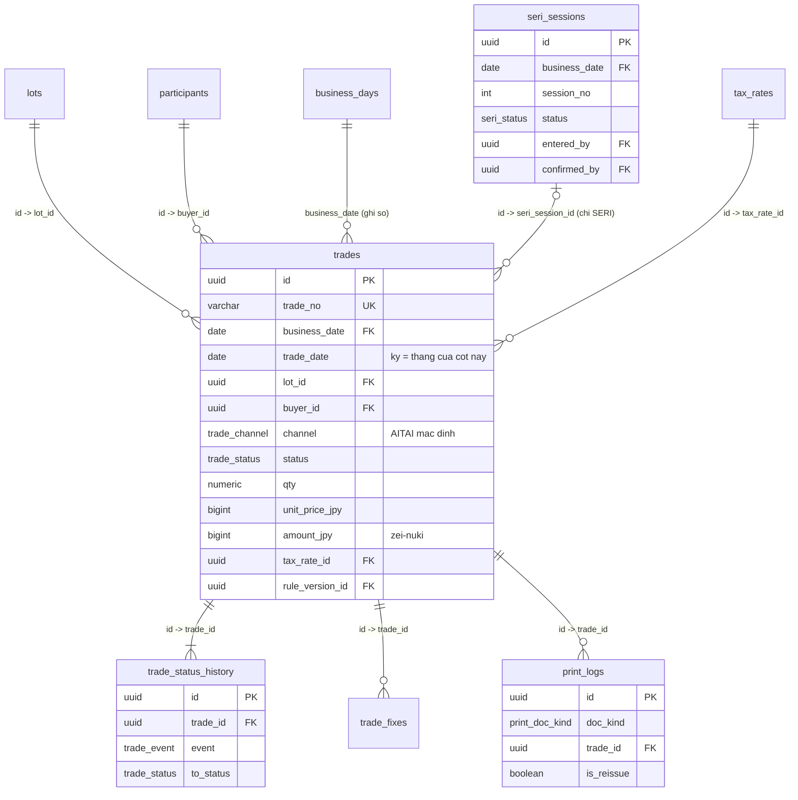
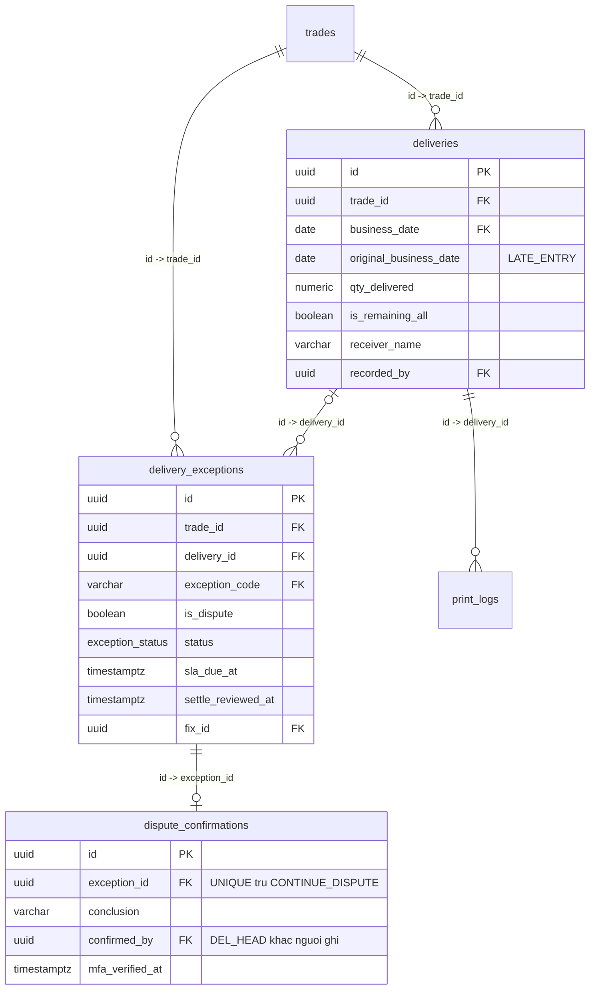

# TRADE_DB — 相対（主要フロー）/ せり / 伝票印刷 / 引渡し

| | |
|---|---|
| System Name | 水産物卸売市場業務支援システム（Product A、顧客 株式会社 桜水産市場 — 架空） |
| Schema | `app` |
| CHARACTER SET | UTF8 (PostgreSQL 16, RDS Multi-AZ, AWS Tokyo) |
| Updated by | phuongnnm-23344 |
| Note | ER単位で分割したデータベース設計の1ファイル（QC-01 §4：1ファイル1グループ）。P1–P7の原則、共通規約 + enum（4.0）、公開ビュー、プロトタイプとの差異表、パリティ結果、共通の未決事項は総括ファイル [MKT_DB.md](MKT_DB.md) にある。**4.xx の番号はスキーマ全体のテーブル番号を維持**（MKT_DB §2 の No 列）しているため、ファイル間の相互参照や ADR / spec からの参照は分割後も変わらない |

---

## 1. 改訂履歴

| No | Version | Action | シート / 表 | 変更内容 | 更新日 | 更新者 | Approve |
|---|---|---|---|---|---|---|---|
| 1 | 0.1.0 | Add new | — | 初期内容は `MKT_DB.md` 0.1.0 にあった（スキーマ全体で1ファイル） | 2026-11-25 | phuongnnm-23344 | |
| 2 | 0.2.0 | Add new | ファイル全体 | ER単位で `MKT_DB.md` 0.1.1 から分割（Gate 1 M-09）；Gate 1 に従い修正：`trades.trade_date`（実際の取引日、期を決める）を記帳用の `business_date` から分離、`deliveries.original_business_date`（M-05, C-02）；`delivery_exceptions.settle_reviewed_*` — 金額が変わる引渡し例外は、日次締め の前に 「確認済」 とすること（顧客 #4）；4.36 に、署名者が不在のとき紙の引渡し確認票を別の配送部門責任者が確認できるように（顧客 #16） | 2026-11-25 | phuongnnm-23344 | |
| 3 | 0.2.1 | Modify | `delivery_exceptions`, `dispute_confirmations`, `trade_status_history` | P3 を統合（delivery・trade の仕様）：`delivery_exceptions.fix_id` → `trade_fixes`（DELIVERY の役割が例外の関数を通じて未締めの日に作成する金額変更 — ADR-004 0.3.x §2.2；日次締め のチェックリストで二重計上しない — Q-DEL-04, Q-DEL-09）；`dispute_confirmations.conclusion`（`COMPLETED` / `PARTIAL_RETURN` / `CONTINUE_DISPUTE`）と、一意キー `exception_id` を部分一意 `conclusion <> 'CONTINUE_DISPUTE'` に変更し、継続協議 を複数回記録できるように（Q-DEL-07）；せりの行の差し戻しは `trade_status_history`（`REJECT` + 理由）に記録、`seri_status` に値は追加しない（Q-TRD-04）；FIG-012 のイベント名から、内部の確認に使う「承認」の語を外す（L4-D03） | 2026-11-25 | phuongnnm-23344 | |
| 4 | 0.2.2 | Modify | `trades` | Gate 2 / 顧客 Q-INC-02：列 3b `incentive_period_id`（取引日の期が書き込み時点で LOCKED の場合の、後入力取引の奨励金の期）+ FK + CHECK を追加 — ADR-007 §2.3-7a、INCENTIVE_DB TV-13 / TV-15 | 2026-11-25 | phuongnnm-23344 | |

---

## 2. テーブル一覧

| No | Schema | Category | テーブル名（論理） | テーブル名（物理） | 説明 | Note | Status |
|---|---|---|---|---|---|---|---|
| 29 | app | transaction | せりセッション | [`seri_sessions`](#429-seri_sessions) | せり結果のグループ、入力者 ≠ 確認者 | プロトタイプ: `seri_sessions` | Decision (provisional) |
| 30 | app | transaction | 取引 | [`trades`](#430-trades) | 相対（主要）およびせり結果；確定時に凍結 | プロトタイプ: `trades` | Decision (provisional) |
| 31 | app | history | 取引状態履歴 | [`trade_status_history`](#431-trade_status_history) | FIG-012：提出 / 確認 / 差し戻し / 確定 / 取消、実行者と時刻を含む | 新規 | Decision (provisional) |
| 33 | app | transaction | 伝票印刷ログ | [`print_logs`](#433-print_logs) | 印刷 / 再印刷（再発行）の取引確認票、引渡票 | 新規 | Decision (provisional) |
| 34 | app | transaction | 引渡し回 | [`deliveries`](#434-deliveries) | 複数回の引渡し、「残り全部」、受取人名 | プロトタイプ: `deliveries` | Decision (provisional) |
| 35 | app | transaction | 引渡し例外・紛争 | [`delivery_exceptions`](#435-delivery_exceptions) | SC-06-04、紛争のSLA | 新規 | Decision (provisional) |
| 36 | app | transaction | 紛争のある引渡しの確認 | [`dispute_confirmations`](#436-dispute_confirmations) | 配送部門責任者が確認（MFA）、自己確認は禁止 | 新規 | Decision (provisional) |

---

## 3. ER図

`lots` は [LOT_DB.md](LOT_DB.md)；`participants` は [PARTY_DB.md](PARTY_DB.md)；`business_days`、`payment_periods` は [CLOSE_DB.md](CLOSE_DB.md)；`tax_rates` は [RULE_DB.md](RULE_DB.md)；`trade_fixes` は [ADJUST_DB.md](ADJUST_DB.md)。

### 3.1 相対（主要フロー）、せり

### 3.2 引渡し

---

## 4. テーブル定義

共通規約（型、共通列、追記のみ、開いている日、関数経由の書き込み、enum）：[MKT_DB.md §4.0](MKT_DB.md#40-共通規約)。

### 4.29. `seri_sessions`

| | | | |
|---|---|---|---|
| テーブル名（論理） | せりセッション | 作成者 / 作成日 | phuongnnm-23344 / 2026-11-25 |
| テーブル名（物理） | `seri_sessions` | 更新者 / 更新日 | — |
| Overview | FORM-SERI-01 に基づく、1回のせりの最終結果のグループ。せり人が場で決定し、システムは **記録のみ**（FR-SERI-01）；確認者がセッション全体を一度に確認する。既定では入力者と別の人、同一の場合は理由を入力して 要確認 に表示（PRM-115）。入札・価格提示の表は持たない（ルール1）。**開いている日。** | Note | プロトタイプから維持 |

**列定義**

| No. | Key | 論理名 | 物理名 | Data Type | Size | Not Null | Default | Note |
|---|---|---|---|---|---|---|---|---|
| 1 | PRI | ID | `id` | UUID | N/A | Yes | `gen_random_uuid()` | |
| 2 | FK | 業務日 | `business_date` | DATE | N/A | Yes | | |
| 3 | | セッション番号 | `session_no` | INT | N/A | Yes | | CHECK > 0 |
| 4 | | 状態 | `status` | `seri_status` | N/A | Yes | `'ENTERING'` | |
| 5 | FK | 入力者 | `entered_by` | UUID | N/A | Yes | | |
| 6 | FK | 確認者 | `confirmed_by` | UUID | N/A | No | | |
| 7 | | 確認日時 | `confirmed_at` | TIMESTAMPTZ | N/A | No | | |
| 8 | | 同一人物の理由 | `same_person_reason` | VARCHAR | 200 | No | | CHECK：`confirmed_by = entered_by` のとき必須 |
| 9 | | 共通列 | `created_at`, `created_by` | | | | | |

**Index** — `seri_sessions_pkey`; `uq_seri_sessions_day_no` (`business_date`, `session_no`) unique.

**外部キー** — `business_date` → `business_days`; `entered_by`, `confirmed_by` → `staff_accounts.id`.

---

### 4.30. `trades`

| | | | |
|---|---|---|---|
| テーブル名（論理） | 取引 | 作成者 / 作成日 | phuongnnm-23344 / 2026-11-25 |
| テーブル名（物理） | `trades` | 更新者 / 更新日 | — |
| Overview | 1行が1件の元取引。**相対が主要フロー**（`channel` の既定値は `AITAI`）；せりの行はセッションの記録済み結果。FIG-012 の状態；取引デスクは単価欄から確定まで一度のクリックで進められるが、システムは 提出 / 確認 / 確定 を実行者と時刻つきで `trade_status_history` に記録する（PRM-114 (a)、D10 を修正）。許可（仲卸）または 承認 + 期ごとの参加上限（売買参加者）は、数量の減算と **同じトランザクション内** で検査する（BR-PERM-01、ADR-003）。**削除不可；`CONFIRMED` で凍結**（数量、単価、金額、買い手、ロット、チャネル、日付、税）— 修正は `trade_adjustments` のみで行う。**開いている日。** | Note | 取引の確定はオンライン必須（L4-A05）；`PAPER_LATE` は後入力（紙伝票からの入力）として印を付ける |

**列定義**

| No. | Key | 論理名 | 物理名 | Data Type | Size | Not Null | Default | Note |
|---|---|---|---|---|---|---|---|---|
| 1 | PRI | ID | `id` | UUID | N/A | Yes | `gen_random_uuid()` | |
| 2 | UNI | 取引番号 | `trade_no` | VARCHAR | 20 | Yes | | `day_counters` による採番 |
| 3 | FK | 記帳用の業務日 | `business_date` | DATE | N/A | Yes | | 記帳時の `OPEN` の日；日次の記帳、日次精算、IF-ACC-01 に使用 |
| 3a | | 取引日（実際の取引日） | `trade_date` | DATE | N/A | Yes | | = `business_date`。ただし 修正申請 `LATE_ENTRY` で締め済みの日に入力された取引は除く（紙伝票の日付と同じ）。**取引の期 = この列の月**（L4-A04 (2)；Gate 1 C-02, M-05）。CHECK `trade_date <= business_date` |
| 3b | FK | 奨励金の期（後入力） | `incentive_period_id` | UUID | N/A | No | | `LATE_ENTRY` の修正申請で入力された取引のみ、書き込み時に `trade_date` の期が `LOCKED` だった場合：`business_date` を含む期（常に `OPEN`）。書き込み関数は元の期を `FOR SHARE` で読む（期ロックと並行しない）。NULL = `trade_date` の期。期のお支払額 / 完納奨励金 にのみ使用；日次の記帳、IF-ACC-01 は引き続き `business_date` / `trade_date` による。CHECK `incentive_period_id IS NULL OR (source = 'PAPER_LATE' AND trade_date <> business_date)`（Q-INC-02 【顧客（模擬）、2026-11-25】；ADR-007 §2.3-7a） |
| 4 | FK | ロット | `lot_id` | UUID | N/A | Yes | | |
| 5 | FK | 買い手 | `buyer_id` | UUID | N/A | Yes | | 確定時点で資格が `VALID` の `NAKAOROSHI` または `BAIBAI` |
| 6 | | チャネル | `channel` | `trade_channel` | N/A | Yes | `'AITAI'` | |
| 7 | FK | せりセッション | `seri_session_id` | UUID | N/A | No | | CHECK (`channel = 'SERI'`) = (`seri_session_id IS NOT NULL`) (N02) |
| 8 | | 発生元 | `source` | `trade_source` | N/A | Yes | `'ONLINE'` | |
| 9 | | 紙伝票番号 | `paper_slip_no` | VARCHAR | 20 | No | | `PAPER_LATE` のとき必須；部分一意。`PAPER_LATE` は **未締め** の日では直接記録（後入力）；**締め済み** の日は修正申請 `LATE_ENTRY` でのみ |
| 9a | | 伝票記入時刻 | `paper_slip_time` | TIMESTAMPTZ | N/A | No | | `PAPER_LATE` のとき必須；許可 / 承認 の資格は、この時点の有効性で検査（ADR-008 §2.4-11） |
| 10 | | 状態 | `status` | `trade_status` | N/A | Yes | `'DRAFT'` | |
| 11 | | 数量 | `qty` | NUMERIC | 12,1 | Yes | | CHECK > 0 |
| 12 | | 単価 | `unit_price_jpy` | BIGINT | N/A | Yes | | CHECK > 0、税抜 |
| 13 | | 金額（税抜） | `amount_jpy` | BIGINT | N/A | Yes | | = floor(`qty` × `unit_price_jpy`) — トリガー（0025 を維持） |
| 14 | FK | 税率 | `tax_rate_id` | UUID | N/A | Yes | | `business_date` 時点で有効な税率（D04） |
| 15 | FK | 規程の版 | `rule_version_id` | UUID | N/A | Yes | | = `business_days.rule_version_id` |
| 16 | | 参加上限超過の理由コード | `over_limit_reason_code` | VARCHAR | 20 | No | | `code_values`（`OVER_LIMIT_REASON`）。`BAIBAI` のみ（L4-A04 (1)） |
| 17 | | 上限超過の備考 | `over_limit_note` | VARCHAR | 200 | No | | |
| 18 | | 確定日時 / 確定者 | `confirmed_at`, `confirmed_by` | TIMESTAMPTZ / UUID | N/A | No | | |
| 19 | | 共通列 | `created_at`, `created_by`, `updated_at`, `updated_by` | | | | | `created_by` = 入力者 |

**Index** — `trades_pkey`; `uq_trades_trade_no`; `idx_trades_business_date` (`business_date`); `idx_trades_lot` (`lot_id`); `idx_trades_buyer_date` (`buyer_id`, `business_date`) — 精算：買い手 × 日; `idx_trades_buyer_trade_date` (`buyer_id`, `trade_date`) — 参加上限と期ごとの 期のお支払額; `idx_trades_seri_session` (`seri_session_id`). テーブルは分割しない（ADR-009 §2.2-7：`audit_logs` のみ TC年で分割）；一覧の問い合わせは常に `business_date` の範囲とページングを伴う（M23）。

**外部キー** — `business_date` → `business_days`; `lot_id` → `lots.id`; `buyer_id` → `participants.id`; `seri_session_id` → `seri_sessions.id`; `incentive_period_id` → `payment_periods.id`; `tax_rate_id` → `tax_rates.id`; `rule_version_id` → `rule_versions.id`; `confirmed_by` → `staff_accounts.id`. `over_limit_reason_code`：関数内で検査（複合 FK は 4.25 と同様）。

---

### 4.31. `trade_status_history`

| | | | |
|---|---|---|---|
| テーブル名（論理） | 取引状態履歴 | 作成者 / 作成日 | phuongnnm-23344 / 2026-11-25 |
| テーブル名（物理） | `trade_status_history` | 更新者 / 更新日 | — |
| Overview | FIG-012 のイベントごとに1行。実行者・時刻・端末を含む（PRM-114 (a)）；RPT-02（取引状態ログ）の元データ。**追記のみ。** | Note | 新規（D10） |

**列定義**

| No. | Key | 論理名 | 物理名 | Data Type | Size | Not Null | Default | Note |
|---|---|---|---|---|---|---|---|---|
| 1 | PRI | ID | `id` | UUID | N/A | Yes | `gen_random_uuid()` | |
| 2 | FK | 取引 | `trade_id` | UUID | N/A | Yes | | |
| 3 | | イベント | `event` | `trade_event` | N/A | Yes | | |
| 4 | | 変更前 / 変更後の状態 | `from_status`, `to_status` | `trade_status` | N/A | No / Yes | | |
| 5 | | 理由 | `reason` | VARCHAR | 200 | No | | `REJECT`（せりの行を入力者へ戻す差し戻しを含む — API-TRD-007、`E-TRD-017`）、`CANCEL` のとき必須 |
| 6 | FK | 端末 | `device_id` | UUID | N/A | No | | |
| 7 | | 共通列 | `created_at`, `created_by` | | | | | |

**Index** — `trade_status_history_pkey`; `idx_trade_status_history_trade` (`trade_id`, `created_at`).

**外部キー** — `trade_id` → `trades.id`; `device_id` → `devices.id`.

---

### 4.33. `print_logs`

| | | | |
|---|---|---|---|
| テーブル名（論理） | 伝票印刷ログ | 作成者 / 作成日 | phuongnnm-23344 / 2026-11-25 |
| テーブル名（物理） | `print_logs` | 更新者 / 更新日 | — |
| Overview | 確定後、取引確認票を直接印刷；用紙切れ / 詰まり → 取引は 確定 のまま、一覧から再印刷し、伝票には 「再発行」 と記録（PRM-114 (d)、PRM-118 (d)）。**追記のみ。** | Note | 新規（M05 はプリンタ連携の接続点） |

**列定義**

| No. | Key | 論理名 | 物理名 | Data Type | Size | Not Null | Default | Note |
|---|---|---|---|---|---|---|---|---|
| 1 | PRI | ID | `id` | UUID | N/A | Yes | `gen_random_uuid()` | |
| 2 | | 伝票の種類 | `doc_kind` | `print_doc_kind` | N/A | Yes | | |
| 3 | FK | 取引 | `trade_id` | UUID | N/A | No | | `TRADE_SLIP` のとき必須 |
| 4 | FK | 引渡し回 | `delivery_id` | UUID | N/A | No | | `DELIVERY_SLIP` のとき必須 |
| 5 | | 再印刷 | `is_reissue` | BOOLEAN | N/A | Yes | `false` | 2回目の印刷から `true` |
| 6 | FK | 端末 | `device_id` | UUID | N/A | No | | |
| 7 | | 共通列 | `created_at`, `created_by` | | | | | |

**Index** — `print_logs_pkey`; `idx_print_logs_trade` (`trade_id`); `idx_print_logs_delivery` (`delivery_id`).

**外部キー** — `trade_id` → `trades.id`; `delivery_id` → `deliveries.id`; `device_id` → `devices.id`.

---

### 4.34. `deliveries`

| | | | |
|---|---|---|---|
| テーブル名（論理） | 引渡し回 | 作成者 / 作成日 | phuongnnm-23344 / 2026-11-25 |
| テーブル名（物理） | `deliveries` | 更新者 / 更新日 | — |
| Overview | 引渡しごとに1行；複数回の引渡し、累計 / 残量は `v_delivery_status` が有効な数量（調整後）から計算する。照合が `DELIVERY_MATCH_RULE`（規程）に一致した時点で完了（BR-DEL-03、PRM-118）。通常の引渡しはオフラインでも可能（ADR-008）。**追記のみ。開いている日。** | Note | `receiver_name`、`is_remaining_all`、`device_id`、`client_record_id` を追加 |

**列定義**

| No. | Key | 論理名 | 物理名 | Data Type | Size | Not Null | Default | Note |
|---|---|---|---|---|---|---|---|---|
| 1 | PRI | ID | `id` | UUID | N/A | Yes | `gen_random_uuid()` | |
| 2 | FK | 取引 | `trade_id` | UUID | N/A | Yes | | 取引が `CONFIRMED` |
| 3 | FK | 記帳用の業務日 | `business_date` | DATE | N/A | Yes | | サーバーが決定（ADR-005） |
| 3a | | 実際の業務日（後入力） | `original_business_date` | DATE | N/A | No | | `LATE_ENTRY` で締め済みの日に入力された引渡しのみ（「端末回収不能」の端末からのオフライン記録、紙に書かれた引渡し）；NULL = `business_date` と同じ（Gate 1 M-05） |
| 4 | | 引渡し数量 | `qty_delivered` | NUMERIC | 12,1 | Yes | | CHECK > 0；合計が有効な数量（関数）を超えないこと |
| 5 | | 「残り全部」 | `is_remaining_all` | BOOLEAN | N/A | Yes | `false` | kg 単位で量り直さない取引（PRM-118 (a)） |
| 6 | | 買い手側の受取人 | `receiver_name` | VARCHAR | 50 | Yes | | PRM-118 (c) |
| 7 | FK | 記録者 | `recorded_by` | UUID | N/A | Yes | | |
| 8 | FK | 端末 | `device_id` | UUID | N/A | No | | |
| 9 | UNI | 端末の記録番号 | `client_record_id` | UUID | N/A | No | | オフライン同期時の冪等キー（ADR-008 §2.2-4） |
| 10 | | 端末上の時刻 | `device_recorded_at` | TIMESTAMPTZ | N/A | No | | オフライン記録 |
| 11 | | 共通列 | `created_at`, `created_by` | | | | | |

**Index** — `deliveries_pkey`; `idx_deliveries_trade` (`trade_id`); `idx_deliveries_business_date` (`business_date`); `uq_deliveries_client_record` (`client_record_id`) unique partial NOT NULL.

**外部キー** — `trade_id` → `trades.id`; `business_date` → `business_days`; `recorded_by` → `staff_accounts.id`; `device_id` → `devices.id`.

---

### 4.35. `delivery_exceptions`

| | | | |
|---|---|---|---|
| テーブル名（論理） | 引渡し例外・紛争 | 作成者 / 作成日 | phuongnnm-23344 / 2026-11-25 |
| テーブル名（物理） | `delivery_exceptions` | 更新者 / 更新日 | — |
| Overview | SC-06-04 引渡し例外登録（FT-06-04）と、紛争管理・SLA（FT-07-05, RPT-04, RPT-09）の元データ。紛争（`is_dispute`）は 4.36 で配送部門責任者の確認が必要。紛争中の取引も、同じ買い手の別の取引の引渡しを妨げない（PRM-111）。通信が切れた場合の紙の経路：争いのある引渡し確認票の伝票番号 + スキャン（ADR-008 §2.4-12）。 | Note | UPDATE は次のものだけ可：`status` を `RESOLVED` にする（1回、`resolved_at` 付き）、`settle_reviewed_*`（1回）、`fix_id` + `affects_amount`（NULL / `false` → 値、1回 — 例外の記録時、または紛争の結論が `PARTIAL_RETURN` のとき） |

**列定義**

| No. | Key | 論理名 | 物理名 | Data Type | Size | Not Null | Default | Note |
|---|---|---|---|---|---|---|---|---|
| 1 | PRI | ID | `id` | UUID | N/A | Yes | `gen_random_uuid()` | |
| 2 | FK | 取引 | `trade_id` | UUID | N/A | Yes | | |
| 3 | FK | 引渡し回 | `delivery_id` | UUID | N/A | No | | |
| 4 | FK | 業務日 | `business_date` | DATE | N/A | Yes | | |
| 5 | | 例外の種類 | `exception_code` | VARCHAR | 20 | Yes | | `code_values`（`DELIVERY_EXCEPTION`） |
| 6 | | 紛争である | `is_dispute` | BOOLEAN | N/A | Yes | `false` | |
| 7 | | 説明 | `description` | VARCHAR | 500 | Yes | | |
| 8 | | 状態 | `status` | `exception_status` | N/A | Yes | `'OPEN'` | |
| 9 | | SLA期限 | `sla_due_at` | TIMESTAMPTZ | N/A | No | | 設定ファイルの SLA から計算（PRM-048、暫定 3 営業日） |
| 10 | | 紙伝票番号 | `paper_form_no` | VARCHAR | 20 | No | | 通し番号のある 争いのある引渡し確認票 |
| 11 | | 紙での署名日時 | `paper_signed_at` | TIMESTAMPTZ | N/A | No | | 伝票に記載された時刻 |
| 12 | FK | 紙の署名者 | `paper_signed_by` | UUID | N/A | No | | 既定は 4.36 の確認者；署名者が不在の場合は別の配送部門責任者が確認でき、理由は必須（`dispute_confirmations.signer_absent_reason`）— 顧客 #16 |
| 13 | | 解決日時 | `resolved_at` | TIMESTAMPTZ | N/A | No | | |
| 13a | | 金額変更 | `affects_amount` | BOOLEAN | N/A | Yes | `false` | `true` の場合、不足 / 返品 / 一部取消 で REVERSE / DELTA を発生（ADJUST_DB 4.39） |
| 13b | FK | 照合の確認済 実施者 / 日時 | `settle_reviewed_by`, `settle_reviewed_at` | UUID / TIMESTAMPTZ | | No | | 照合事務局 が 要確認 SC-07-01 で 「確認済」 を押す。`affects_amount = true` なのにこれがない → 日次締め のチェックリストで ✖ の行（顧客 #4） |
| 13c | FK | 当日訂正の生成元 | `fix_id` | UUID | N/A | No | | `affects_amount = true` かつ取引の日がまだ `OPEN` の場合に、例外の関数が作成する `trade_fixes`（DELIVERY の役割 — ADR-004 §2.2、前提 Q-DEL-04）。日次締め のチェックリストは、例外が指していない `trade_fixes` の行を 当日訂正 の項目で数え、残りは例外の項目で数える（Q-DEL-09）。取引の日が締め済み → NULL、修正申請へ。`trade_fixes` を作成するトランザクション内で1回だけ設定し、以後変更しない |
| 14 | | 共通列 | `created_at`, `created_by` | | | | | `created_by` = 記録者 |

**Index** — `delivery_exceptions_pkey`; `idx_delivery_exceptions_open` (`status`, `sla_due_at`) partial `status = 'OPEN'`; `idx_delivery_exceptions_trade` (`trade_id`).

**外部キー** — `trade_id` → `trades.id`; `delivery_id` → `deliveries.id`; `business_date` → `business_days`; `paper_signed_by` → `staff_accounts.id`; `fix_id` → `trade_fixes.id` (ADJUST_DB 4.32). スキャンは `attachments`（`ref_table = 'delivery_exceptions'`）にある。

---

### 4.36. `dispute_confirmations`

| | | | |
|---|---|---|---|
| テーブル名（論理） | 紛争のある引渡しの確認 | 作成者 / 作成日 | phuongnnm-23344 / 2026-11-25 |
| テーブル名（物理） | `dispute_confirmations` | 更新者 / 更新日 | — |
| Overview | SC-06-05：配送部門責任者（または代行）が完了を確認 — CAP-HUMAN-01 の4番目の最終判断者。自分が記録した引渡し / 例外を **自己確認することは禁止**（PRM-111）；MFA を要し、オフラインでは行わない。**追記のみ。** | Note | 新規（M16） |

**列定義**

| No. | Key | 論理名 | 物理名 | Data Type | Size | Not Null | Default | Note |
|---|---|---|---|---|---|---|---|---|
| 1 | PRI | ID | `id` | UUID | N/A | Yes | `gen_random_uuid()` | |
| 2 | FK | 例外 | `exception_id` | UUID | N/A | Yes | | `is_dispute = true`；部分一意（Index 参照） |
| 3 | FK | 確認者 | `confirmed_by` | UUID | N/A | Yes | | `DEL_HEAD`；≠ `delivery_exceptions.created_by` かつ ≠ `deliveries.recorded_by`（関数） |
| 4 | FK | 代行 | `delegation_id` | UUID | N/A | No | | |
| 5 | | MFA 実施日時 | `mfa_verified_at` | TIMESTAMPTZ | N/A | Yes | | |
| 5a | | 結論（コード） | `conclusion` | VARCHAR | 20 | Yes | | CHECK ∈ `COMPLETED` 完了 · `PARTIAL_RETURN` 一部返品 · `CONTINUE_DISPUTE` 継続協議。`CONTINUE_DISPUTE` は例外を `OPEN` のまま保ち、複数回記録できる（Q-DEL-07） |
| 6 | | 結論のメモ | `decision_note` | VARCHAR | 500 | Yes | | コメントまたは結論のラベル |
| 6a | | 署名者不在の理由 | `signer_absent_reason` | VARCHAR | 200 | No | | `confirmed_by` ≠ `delivery_exceptions.paper_signed_by` のとき必須；それでも自己確認は禁止（顧客 #16 【模擬】） |
| 7 | | 共通列 | `created_at`, `created_by` | | | | | |

**Index** — `dispute_confirmations_pkey`; `uq_dispute_confirmations_exception` (`exception_id`) unique partial `conclusion <> 'CONTINUE_DISPUTE'`（例外ごとに最終結論は1件、継続協議は複数回）; `idx_dispute_confirmations_exception` (`exception_id`, `created_at`).

**外部キー** — `exception_id` → `delivery_exceptions.id`; `confirmed_by` → `staff_accounts.id`; `delegation_id` → `delegations.id`.
