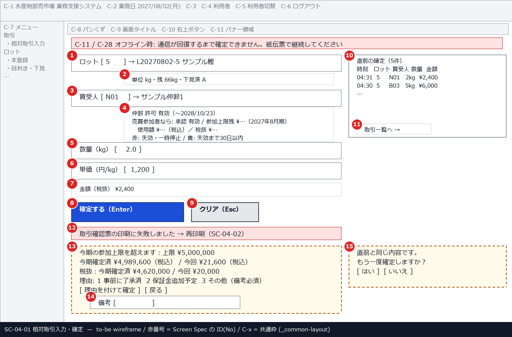

# SC-04-01 — 相対取引入力・確定

> 様式: **BM-2-901-51 v2.1** — Screen Specification · SUN ASTERISK VIETNAM CO., LTD · ISO/IEC 27001:2013 & ISO 9001:2015

---

## 1. 変更履歴

| No | Version | Action | 変更内容 | 更新日 | 更新者 | Approve |
|---|---|---|---|---|---|---|
| 1 | 0.1.0 | Add New | ワイヤーフレーム WF-SC-04-01 0.2.0 から作成（LAB-4 P3） | 2026-11-25 | phuongnnm-23344 | |
| 2 | 0.1.1 | Update | 顧客（模擬）Q-TRD-02: 使用額の税込 / 税抜を表示; G2-m07: 性能目標のラベル [PL] | 2026-11-25 | phuongnnm-23344 |  |
| 3 | 0.1.2 | Update | LAB-4: 注釈付き画像をワイヤーフレーム HTML `wireframes/html/SC-04-01.html` のバリアントA（WF 0.2.2）に差し替え; 画像にないバッジを記載; HTML / PNG / PDF へのリンク | 2026-11-25 | phuongnnm-23344 | |
| 4 | 0.1.3 | Update | 有識者（Expert）Gate 3 G3-m05: §6.1 画面の状態を追加（§5 Event から集約）、旧注記を §6.2 へ | 2026-11-25 | phuongnnm-23344 | |
| 5 | 0.1.4 | Update | 有識者 Gate 3 差分確認 D3-n02: §6.1 の「参加上限超過」行にサーバーの 422 `E-TRD-007` を追加; 「入力エラー」行にクライアントのエラー `E-TRD-009`..`011`（§4.2）を追加 | 2026-11-26 | phuongnnm-23344 |  |
| 6 | 0.1.5 | Update | §3 FIG-012 の状態: 内部ステップの表記を 承認 から 確認 に変更（L4-D03、`ja/` 作成時の点検） | 2026-11-26 | phuongnnm-23344 |  |

---

## 2. レイアウト

**設計:** [Wireframe SC-04-01 0.2.2](../../../wireframes/SC-04-01-aitai-trade-entry-confirm-wireframe.md) · HTML 元データ [`wireframes/html/SC-04-01.html`](../../../../wireframes/html/SC-04-01.html) · 全バリアント: [`wireframes/png/SC-04-01.png`](../../../../wireframes/png/SC-04-01.png) / [`wireframes/pdf/wireframes-all.pdf`](../../../../wireframes/pdf/wireframes-all.pdf) · 共通レイアウト [_common-layout](../../../wireframes/_common-layout.md) · as-is プロトタイプ画像: [SC-04-01_prototype.png](../../../../wireframes/assets/SC-04-01_prototype.png)

> - 画像 = ワイヤーフレーム HTML の **バリアントA**（メイン画面）。`scripts/render-wireframes.py --spec` で生成（Figma はまだなし）。画像上の番号 = §4 の `ID` 列 = ワイヤーフレームの `No` 列; `C-x` = `_common-layout.md` の共通項目。
> - この画像にはバッジがありません: 12 (E), 13 (B), 14 (C), 15 (D), C-12 (E), C-24 (F) → 対応するバリアントは [`wireframes/png/SC-04-01.png`](../../../../wireframes/png/SC-04-01.png) / PDF を参照。

---

## 3. 概要

- **目的:** 相対取引（直接取引）の入力と **確定** — **主要フロー、最も使われる画面**（価値の約90%、C.5; FR-AITAI-01/02）。取引担当者が購入者と内容を読み合わせ（読み合わせ）してから、一度のクリックで確定します: ロット → 買受人 → 数量 → 単価 → Enter。慣れた場合の目標は取引1件あたり約10秒 **【模擬】**。
- **確定時点の検証。サーバーで、ロットの数量減算と同じトランザクション内で実施**（BR-PERM-01, BR-LOT-02, ADR-003）: 仲卸 → **許可** が有効; 売買参加者 → **承認** が有効 + 期ごとの **参加上限**（相対 + せり、警告 + 理由、強制ブロックではない — PRM-046, L4-A04 (1)）。2つの根拠は異なり、**メッセージも異なります**（ルール 2）。
- **FIG-012 の状態:** 一度のクリックで 提出 / 確認 / 確定 を同じ人と時刻で `trade_status_history` に記録（PRM-114 (a)）; 確定した取引は凍結され、修正は SC-04-05 / SC-08-01 経由のみ（ルール 4）。画面上には内部ステップの 「承認」 という文字は表示しない（L4-D03）。
- **オンライン必須**（L4-A05, ADR-008）: 通信断 → 紙の伝票で記録、SC-04-07 で後から入力。
- **利用者:** TRADE。SETTLE / STL-HEAD / OPS-HEAD は SC-04-03 / SC-04-04 で取引を閲覧し、この画面は開きません（role-list P16）。
- **遷移先:** SC-04-03 ([11]); SC-04-02 ([12] 再印刷); SC-04-07（通信断時 — メニュー経由）; SC-08-01 (C-24)。

---

## 4. 表示

**ID の付け方:** `ID` 列 = to-be ワイヤーフレームの項目番号; `A`, `B`, `C` はグループ名のみ。

### 4.1 項目一覧

| ID | Item Name | Item Type | Required | Note |
|---|---|---|---|---|
| **C** | **共通枠（PC）** | | | C-1..C-12, C-20..C-26, C-28, C-29。C-27 は使用しない（相対には決裁ステップがない）、C-30 は使用しない（MFA なし — PREMISE §3.2）、C-31 も使用しない |
| **A** | **入力** | | | |
| 1 | ロット | Text box (番号 + 候補) | 必須 | プレースホルダー 「番号」。末尾の数字を入力 → 販売公開中で数量が残るロットを最大10件候補表示; 右側に `→ {lotNo} {品目}` を表示 |
| 2 | 単位・残・下見 | Label | - | `単位 {kg/箱/尾}・残 {available}{unit}・下見済 {grade}`（目利きは参考のみ、**価格を自動で決めない** — CAP-HUMAN-01） |
| 3 | 買受人 | Text box (コード + 候補) | 必須 | プレースホルダー 「例：N01」; 右側に名前を表示 |
| 4 | 購入者の資格 | Label | - | 仲卸: 「仲卸 許可 {状態}（〜{YYYY/MM/DD}）」. 売買参加者: 「売買参加者 承認 {状態}（〜…）／参加上限残 ¥{n}（{YYYY年M月}期）」 + 小さい行 「使用額 ¥{usedIncl}（税込）／ 税抜 ¥{usedExcl}」 (Q-TRD-02: 残 = 上限 − 使用額 税込). 色 **+ 文字**: 赤 = 失効 / 一時停止 / 再審査 / 購入不可の区分; 黄 = 失効日まで30日以内; 緑 = 有効. **「資格OK」にはまとめない** |
| 5 | 数量（{単位}） | Text box (数値) | 必須 | ラベルはロットの単位に応じて変わる |
| 6 | 単価（円/{単位}） | Text box (数値) | 必須 | フォーカスを外すと千単位区切りを表示 |
| 7 | 金額（税抜） | Label | - | `¥{floor(数量 × 単価)}`; 税は精算で計算 (PRM-053) |
| 8 | 確定する（Enter） | Button | - | 主ボタン; [6] で Enter = [8] を押下 |
| 9 | クリア（Esc） | Button | - | [3]–[7] を消去、ロットは保持 |
| **B** | **補助パネル** | | | |
| 10 | 直前の確定（5件） | Label (表) | - | **本人が** 確定した直近5件の取引、新しい順: 時刻 · ロット · 買受人 · 数量 · 金額 |
| 11 | 取引一覧へ → | Button (リンク) | - | → SC-04-03 |
| 12 | 印刷エラーバナー | Label (バナー) | - | 「取引確認票の印刷に失敗しました。取引は確定済みです → 再印刷」 → SC-04-02 |
| **D** | **ダイアログ** | | | |
| 13 | 参加上限超過 | Label (dialog) | - | 売買参加者のみ。「今期の参加上限を超えます：上限 ¥{limit} / 今期確定済 ¥{usedIncl}（税込） / 今回 ¥{amountIncl}（税込）」 + 小さい行 「税抜：今期確定済 ¥{usedExcl} / 今回 ¥{amountExcl}」 + 数字キー `1` 事前に了承済 · `2` 保証金追加予定 · `3` その他（備考必須） の3択 + [理由を付けて確定] [戻る] |
| 14 | 備考 | Text box | 「3 その他」を選んだ場合は必須 | [13] 内 |
| 15 | 同一内容の再確定確認 | Label (dialog) | - | 「直前と同じ内容です。もう一度確定しますか？」 [はい] [いいえ]（初期カーソルは [いいえ]） |

### 4.2 入力検証

クライアントは各欄で即時チェック; サーバー (API-TRD-002) は確定時に **すべて** を再チェック — サーバーの結果が最終です。

| ID | Type | Min | Max | Default | 備考 |
|---|---|---|---|---|---|
| 1 | ロットの選択 (uuid) | - | - | 前回確定時のロット | 候補から選択必須; 販売対象でなくなったロットは `E-TRD-001` 「ロット {lotNo} は販売公開中ではありません（{状態}）」 |
| 3 | String `^[A-Z0-9]{1,10}$` | 1 | 10 | 空 | 小文字は自動で大文字化。見つからない → `E-TRD-003` 「買受人番号が見つかりません（{buyerNo}）」; 仲卸 / 売買参加者 でない → `E-TRD-004` 「買受人は仲卸または売買参加者のみ指定できます」 |
| 4 | （検証結果） | - | - | - | 仲卸が有効でない → `E-TRD-005` 「仲卸の許可が有効ではないため確定できません（{状態}・有効期限 {date}）」; 売買参加者が有効でない → `E-TRD-006` 「売買参加者の承認が有効ではないため確定できません（{状態}・有効期限 {date}）」. クライアントは赤で警告するのみ、[8] は押下可能（サーバーが判断） |
| 5 | Number | > 0 | ≤ 残 | 空 | ≤ 0 / 空 → `E-TRD-009` 「数量は0より大きい値を入力してください」; kg は小数第1位を超える、箱 / 尾 は小数あり → 入力時に禁止、`E-TRD-010` 「kg は小数第1位まで、箱・尾は整数で入力してください」; > 残 → `E-TRD-002` 「残数量が {n}{unit} に変わりました（不足しています）」 |
| 6 | Integer | 1 | 99,999,999 | 空 | 不正 → `E-TRD-011` 「単価は1円以上の整数で入力してください」 |
| 13 | Code `OVER_LIMIT_REASON` | - | - | 未選択 | 理由なしで上限超過 → `E-TRD-007` 「今期の参加上限を超えます。超過理由を選択してください（…）」 |
| 14 | String | 1 | 200 | 空 | 「その他」を選んで空 / > 200 → `E-TRD-008` 「「その他」を選んだ場合は備考を入力してください（200文字以内）」 |
| 8 | (時刻) | - | - | - | 規程で定められた取引確定の開始時刻前（暫定 02:00, PRM-116） → `E-TRD-012` 「取引の確定は {HH:MM} 以降にできます」 |

### 4.3 データマッピング

| ID | Data Source | API ID | API URL | Key / Param | 備考 |
|---|---|---|---|---|---|
| 1, 2 | API | `API-LOT-003` | `GET /api/v1/lots` | `onSale=true&q={số}&include=latestInspection&limit=10` | lot 機能; デバウンス 150 ms |
| 3, 4, 13 | API | `API-TRD-001` | `GET /api/v1/trades/buyers` | `q={mã}` → `buyers[].qualification`, `buyers[].participationLimit`, `overLimitReasonOptions[]` | 入力時（デバウンス 150 ms）および [3] から離れた時に呼び出し |
| 1–8, 13, 14 | API | `API-TRD-002` | `POST /api/v1/trades/aitai` | `lotId`, `buyerId`, `qty`, `unitPriceJpy`, `overLimitReasonCode`, `overLimitNote` | → `tradeId`, `tradeNo`, `displayNo`, `amountJpy`, `availableQtyAfter`, `overLimit` |
| 10 | API | `API-TRD-003` | `GET /api/v1/trades` | `mine=true&channel=AITAI&status=CONFIRMED&sort=-confirmedAt&limit=5` | 画面を開いた時 + 確定するたび |
| 12 | API | `API-TRD-004` | `POST /api/v1/trades/{tradeId}/slip-prints` | `isReissue=false` → PDF | API-TRD-002 の 201 の直後に呼び出し |

### 4.4 役割別の表示権限

| Vai \ Item | 1–9 | 10, 11 | 12 | 13–15 |
|---|---|---|---|---|
| TRADE | 操作 | 閲覧のみ / リンク | 印刷エラー時に表示 | 操作 |
| SETTLE · STL-HEAD · OPS-HEAD | 画面に入らない (C-25); 取引は SC-04-03 / SC-04-04 で閲覧 | | | |
| INTAKE · JUDGE · DELIVERY · RULE · SYSADM | 画面に入らない (C-25) | | | |

---

## 5. イベント

| ID | Given (Pre-condition) | When (Trigger/Action) | Then (Result) | Note |
|---|---|---|---|---|
| **Initializing Process（初期処理）** | | | | |
| - | TRADE 役割、オンライン | 画面を開く（ホームから1キーのショートカット） | 1. API-TRD-003 を呼び出し → [10] 2. カーソルは [1] | |
| 1 | 販売公開中のロットがない | [1] に入力 | C-21 「販売公開中のロットがありません」 + SC-03-03 へのリンク | |
| **Standard Process（通常処理）** | | | | |
| 1 | - | 数字 + Enter | 先頭の候補を選択（またはポイント中の行）; [2] に単位 · 残 · 下見を表示; カーソルを [3] へ | FB LAB-2 #1 |
| 3 | - | コード + Enter | API-TRD-001 を呼び出し; [4] に 許可 / 承認 の正しい文言を表示; カーソルを [5] へ（赤でも — サーバーが判断） | ルール 2 |
| 5, 6 | - | 入力 | [7] を即時更新; [5] で Enter → [6] へ | |
| 8 | クライアント上で各欄が有効 | [6] で Enter / [8] を押下 | 1. [10] に同じロット · 購入者 · 数量 · 単価の取引が3分以内にあれば → [15] を開く 2. 購入者が売買参加者で、金額を税込換算（サーバーと同じ式、API-TRD-001 の `taxRatePercent` から）が参加上限残を超えれば → 先に [13] を開く; 最終判断はサーバー (E-TRD-007) 3. API-TRD-002 を呼び出し（[8] はグレー表示、ダブルクリック不可） | |
| 15 | [15] が開いている | [はい] / [いいえ] | はい → 上記の手順 2–3 へ; いいえ → 閉じ、カーソルを [5] へ | FB LAB-2 #6 |
| 13 | [13] が開いている | `1`/`2`/`3`（+ [14]）を押す → [理由を付けて確定] | `overLimitReasonCode`（+ `overLimitNote`）を付けて API-TRD-002 を呼び出し | 理由付きの取引は要確認 SC-07-01 に表示（顧客 #10） |
| 8 | - | API-TRD-002 が 201 を返す | 1. C-12 「確定：{buyerNo} {名前}／{品目} {qty}{unit} × ¥{単価} = ¥{金額}（{displayNo}）」 2. API-TRD-004 を呼び出し → 直接印刷、プレビューなし 3. [1] を保持し、[2] を `availableQtyAfter` で更新; [3]–[7] を消去; カーソルを [3] へ 4. [10] を再読込 | DEC-033, M05 |
| 12 | 印刷失敗（API-TRD-004 のエラー / プリンターのエラー） | - | [12] を表示; 取引は **引き続き確定済み** | PRM-114 (d) |
| 9 | - | Esc / [9] | [3]–[7] を消去、ロットは保持 | |
| 11 | - | クリック | → SC-04-03 | |
| **Error Handling（エラー制御）** | | | | |
| 1, 5 | 他の人が同じロットを確定したばかり | 409 `E-TRD-002` / `E-TRD-001` | 実際の数値を含む C-23; [2] の残を `detail.availableQty` で更新; カーソルは [5] | |
| 3, 4 | 確定時点で資格が無効 | 422 `E-TRD-003`..`006` | [3] の下に C-22、許可 / 承認 それぞれの文言; [4] を赤 | BR-PERM-01 |
| 13 | クライアントが超過を把握していない（上限が途中で変更） | 422 `E-TRD-007` | サーバーが返した `detail.limitJpy` / `usedInclJpy` / `amountInclJpy`（+ `usedExclJpy` / `amountExclJpy`）で [13] を開く | |
| 14 | - | 422 `E-TRD-008` | [14] の下に C-22 | |
| 8 | 確定時刻前 | 409 `E-TRD-012` | C-23 | |
| 8 | 業務日がロック済み | 423 `E-CMN-003` | C-24、内容は保持（稀: 画面は開始日のみ書き込む） | |
| 8 | - | 403 / 5xx / タイムアウト 10 s | C-25 / C-26（内容は保持）。タイムアウト: **自動で再送しない** — API-TRD-003 で取引が既に存在するか確認してから再度押下可能に | 二重確定を避ける |
| - | - | 通信断 | C-28: フォーム固定、バナー 「通信が回復するまで確定できません。紙伝票で継続してください」; 回復後 → C-29 と最後の押下結果 「確定済」/「未確定」（API-TRD-003 で確認） | L4-A05, ADR-008 |

---

## 6. その他の注記

### 6.1 画面の状態

§5 Event から集約; 状態コード `C-xx` は `wireframes/_common-layout.md` で定義。役割別の権限は §4.4 を参照。

| 状態 | 表示 / 挙動 |
|---|---|
| 新規に開いた | カーソルは [1]; [10] は API-TRD-003 から読み込み |
| 販売公開中のロットがない | C-21 「販売公開中のロットがありません」 + SC-03-03 へのリンク |
| 購入者の資格 | [4] に 許可 / 承認 を正しく表示; 無効なら赤（サーバーが判断） |
| 3分以内の重複の疑い | ダイアログ [15] |
| 参加上限超過 | ダイアログ [13] (+ [14]) で理由を選択; 強制ブロックではない。サーバー: 422 `E-TRD-007`（クライアントが超過を把握していない場合、例: 途中で上限変更） → サーバーの数値で [13] を開く（§5） |
| 送信中 | [8] はグレー、ダブルクリック不可 |
| 保存完了 | C-12 トースト; 直接印刷; [1] を保持、[3]–[7] を消去 |
| 印刷失敗 | [12]; 取引は確定のまま |
| 入力エラー（クライアント: `E-TRD-009`..`011` — コードは §4.2; サーバー: 422 `E-TRD-003`..`006`, `E-TRD-008`） | 該当欄の下に C-22 |
| 競合 / 確定時刻前 (409 `E-TRD-001`, `002`, `012`) | C-23; [2] の残を更新 |
| 業務日がロック済み (423 `E-CMN-003`) | C-24、内容は保持 |
| 権限なし / サーバーエラー / タイムアウト | C-25 / C-26、内容は保持; タイムアウトでは自動再送しない |
| オフライン | C-28: フォーム固定、「紙伝票で継続してください」; 回復後 → C-29 と最後の押下結果 |

### 6.2 その他の注記

- **トレーサビリティ:** FR-AITAI-01, FR-AITAI-02, FT-04-01..04, FT-01-05, FT-01-09, FT-03-04, BR-PERM-01, BR-LOT-02, NFR-USE-01, PRM-046, PRM-053, PRM-114, PRM-116, FIG-012, DEC-033, ADR-003, ADR-004, ADR-008, L4-A04 (1), L4-A05; ルール 1, 2, 3, 4; FB LAB-2 #1, #3, #5, #6, #7; 顧客 #10 (FB-CUS-269), #11 (FB-CUS-270); 差異表 D08 / M19（期ごとの上限）, D10 (FIG-012)。
- **参加上限を強制ブロックしない:** 取引担当者がピーク時に自分で判断する。理由は `trades.over_limit_reason_code` / `over_limit_note` に記録; 要確認 SC-07-01 で照合。
- **参加上限の期:** `trade_date` の月（= 業務日）、確定済みの相対 + せり を有効値（原値 + 調整）で合算 — view `v_buyer_period_usage`（PARTY_DB）。**税込** = floor(Σ税抜 × (100 + 税率) / 100); 税率は `tax_rates` にあり、パラメータ `PARTICIPATION_LIMIT_TAX_CODE` のコードで指定 — BR-INC-01 の 110/100 は使わない（Q-TRD-02 【顧客（模擬）、2026-11-25】; 台帳照合は税抜、購入者とは税込で話すため画面には両方の数値を表示）。
- **表示する取引コード:** `相対-{nnnn}`（日内の連番） — PL の提案、確定待ち（Q-TRD-01）; `trade_no` は `A{YYYYMMDD}-{nnnn}` 形式で保存。
- **性能:** API-TRD-002 p95 ≤ 1 s、ピーク時60名同時 — [PL] 書き込み API の社内目標（RFP は検索に NFR-PERF-01、負荷に NFR-PERF-02 のみ）; 同じロットを2人が確定する場合はロット行のロックで直列化。
- **未決事項 / TBD:** Q-TRD-01（取引番号の形式）, Q-TRD-03（現場プリンター — PDF の直接印刷方法）— [TRADE_FUNC §3](../function-specifications/TRADE_FUNC.md#3-モジュールのエラーコード質問前提) を参照。
