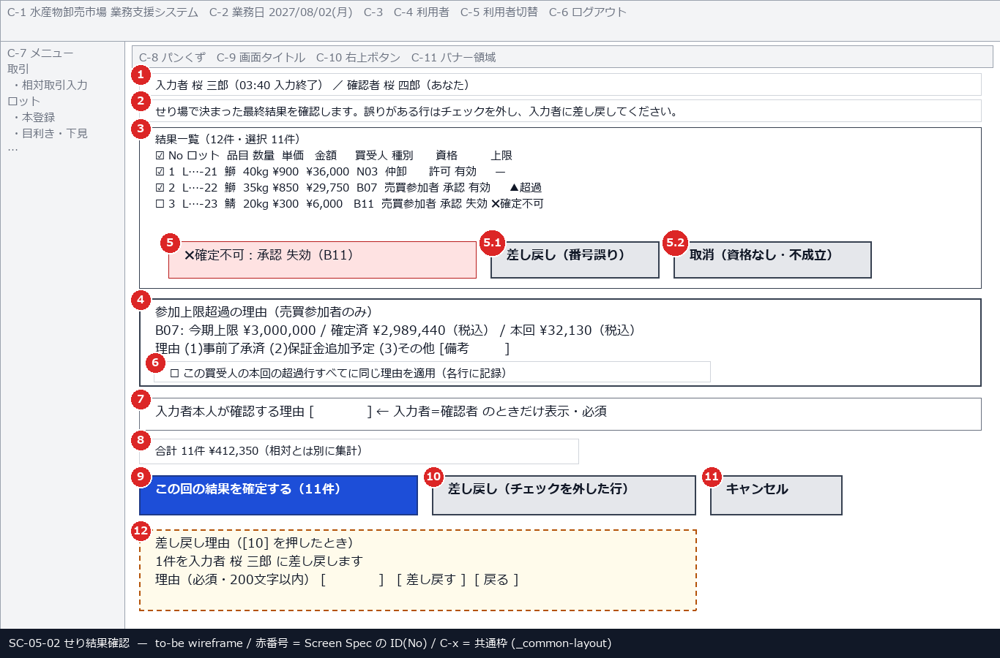

# SC-05-02 — せり結果確認

> 様式: **BM-2-901-51 v2.1** — Screen Specification · SUN ASTERISK VIETNAM CO., LTD · ISO/IEC 27001:2013 & ISO 9001:2015

---

## 1. 変更履歴

| No | Version | Action | 変更内容 | 更新日 | 更新者 | Approve |
|---|---|---|---|---|---|---|
| 1 | 0.1.0 | Add New | ワイヤーフレーム WF-SC-05-02 0.2.0 から作成（LAB-4 P3） | 2026-11-25 | phuongnnm-23344 | |
| 2 | 0.1.1 | Update | 顧客（模擬）Q-TRD-05: 2つのボタン 5.1 「差し戻し（番号誤り）」 / 5.2 「取消（資格なし・不成立）」; Q-TRD-02 | 2026-11-25 | phuongnnm-23344 |  |
| 3 | 0.1.2 | Update | LAB-4: 注釈付き画像をワイヤーフレーム HTML `wireframes/html/SC-05-02.html` のバリアントA（WF 0.2.3）に差し替え; 画像にないバッジを記載; HTML / PNG / PDF へのリンク | 2026-11-25 | phuongnnm-23344 | |
| 4 | 0.1.3 | Update | 有識者（Expert）Gate 3 G3-m05: §6.1 画面の状態を追加（§5 Event から集約）、旧注記を §6.2 へ | 2026-11-25 | phuongnnm-23344 | |
| 5 | 0.1.4 | Update | 有識者 Gate 3 差分確認 D3-n03: §6.1 の「競合」行を 409（`E-TRD-013` / `018`: C-23 + 再読込）と 422（`E-TRD-015`: 未処理行をハイライト、再読込なし; `E-TRD-016` は §5 に従う）に分割 | 2026-11-26 | phuongnnm-23344 |  |

---

## 2. レイアウト

**設計:** [Wireframe SC-05-02 0.2.4](../../../wireframes/SC-05-02-seri-result-session-confirm-wireframe.md) · HTML 元データ [`wireframes/html/SC-05-02.html`](../../../../wireframes/html/SC-05-02.html) · 全バリアント: [`wireframes/png/SC-05-02.png`](../../../../wireframes/png/SC-05-02.png) / [`wireframes/pdf/wireframes-all.pdf`](../../../../wireframes/pdf/wireframes-all.pdf) · 共通レイアウト [_common-layout](../../../wireframes/_common-layout.md) · as-is プロトタイプ画像: [SC-05-02_prototype-seri-list-ref.png](../../../../wireframes/assets/SC-05-02_prototype-seri-list-ref.png)（セッション一覧が空の場合のみ）

> - 画像 = ワイヤーフレーム HTML の **バリアントA**（メイン画面）。`scripts/render-wireframes.py --spec` で生成（Figma はまだなし）。画像上の番号 = §4 の `ID` 列 = ワイヤーフレームの `No` 列; `C-x` = `_common-layout.md` の共通項目。
> - この画像にはバッジがありません: 入力者 = 確認者 の場合の 7 理由 (B), 差し戻しダイアログ 12 (C), C-31 (D), C-12 (E), C-23 (F), C-28 (G) → 対応するバリアントは [`wireframes/png/SC-05-02.png`](../../../../wireframes/png/SC-05-02.png) / PDF を参照。
> - バリアントA では [9] ボタンが **グレー** で表示されるのは意図的（未処理の No 4 行が残っており、有効化の条件を見せるため）; 有効状態はバリアント B を参照。

---

## 3. 概要

- **目的:** 確認者（確認する人）が、せり（競り）**1セッションの最終結果を一括で確認** — 人による最終判断点（CAP-HUMAN-01）。価格と買受人はせり人が場で決定し、システムは SC-05-01 で入力された結果を **記録するだけ** で、直接の競りの画面や入札表はない（FR-SERI-01/02, ルール 1）。せりは主要フローではなく補助フロー（約10%）で、合計は相対とは別に管理。
- **確定時点の再チェック**（BR-PERM-01, BR-LOT-02）: 行ごと — 許可 (仲卸) / 承認 (売買参加者) が有効であること、ロットの数量が十分であること; 参加上限は期ごとで **売買参加者のみ**、相対 + せり 合算、警告 + 理由、強制ブロックなし（L4-A04 (1), M20）。
- **確認者 ≠ 入力者** が原則; 同一人物の場合は理由を入力させ、要確認 SC-07-01 に表示 + チェックリスト SC-07-02 (S2, PRM-115)。
- **オンライン必須**、**MFA なし**（PREMISE §3.2 にはない）。確認後は取引が凍結されるため、確認ダイアログ C-31 がある。
- **利用者:** TRADE（確認者）。SETTLE / STL-HEAD / OPS-HEAD は閲覧専用で開ける（P20）。
- **遷移先:** セッション一覧（C-10 「回の一覧へ」）; 差し戻し行は入力者の SC-05-01 に戻る; 確認後の修正 → SC-04-05（日が未締め）/ SC-08-01（締め済み）。

---

## 4. 表示

**ID の付け方:** `ID` 列 = to-be ワイヤーフレームの項目番号; `A`, `B`, `C` はグループ名のみ。

### 4.1 項目一覧

| ID | Item Name | Item Type | Required | Note |
|---|---|---|---|---|
| **C** | **共通枠（PC）** | | | C-1..C-12（C-9 「せり結果確認：第{n}回（{日付}）」, C-10 「回の一覧へ」）, C-20..C-26, C-28, C-29, **C-31**（[9] の前に確認）。C-27, C-30 は使用しない |
| **A** | **セッション** | | | |
| 1 | 入力者 / 確認者 | Label | - | 「入力者 {名前}（{HH:MM} 入力終了） ／ 確認者 {名前}（あなた）」; 同一人物の場合は黄色のラベル 「入力者本人による確認」 |
| 2 | 案内 | Label | - | 「せり場で決まった最終結果を確認します。誤りがある行はチェックを外し、入力者に差し戻してください。」 |
| **B** | **結果** | | | |
| 3 | 結果一覧（N件・選択 M件） | Label (選択表) | - | FORM-SERI-01 のレイアウト。列: ☑ · No · ロット · 品目 · 数量 · 単価 · 金額 · 買受人 · 種別 · **資格**（仲卸は 「許可 {状態}」、売買参加者は 「承認 {状態}」） · 上限（「▲超過」 / 「—」）. 初期状態では確認可能な全行を選択 |
| 5 | 確認できない行 | Label (行内で赤) | - | 「✖確定不可：{理由}」 + 小さい行 「この行は確定できません。番号誤りなら差し戻し、資格なしなら取消を選んでください」. ☑ はチェックを外した状態で固定。**自動で取消さない** — 5.1 または 5.2 を選ぶ必要がある（Q-TRD-05） |
| 5.1 | 差し戻し（番号誤り） | Button (行 [5] 内) | - | 行を差し戻し対象にし、理由候補 「買受人番号誤りの可能性（せり原票と照合してください）」 付きで [12] を開く → API-TRD-007. 入力者が番号を打ち間違えた可能性がある場合に使用（本人はまだ有効） |
| 5.2 | 取消（資格なし・不成立） | Button (行 [5] 内) | - | [9] 押下時に取消対象にする（`cancelTradeIds`）; 行のラベルが 「取消予定：ロットは販売公開中に戻ります（再せり・相対）」 に変わる; 再度押すと解除。**「別の買受人に変更」ボタンはない** — 2番目に高い入札者を繰り上げない（ルール 3） |
| 4 | 参加上限超過の理由 | Label (購入者ごとのブロック) | ▲超過 の行を選んだ場合は必須 | 売買参加者で超過行がある購入者ごとに1ブロック: 「{buyerNo} {名前}: 今期上限 ¥{limit} / 確定済 ¥{usedIncl}（税込） / 本回 ¥{sumIncl}（税込）」 + 小さい行 「税抜：確定済 ¥{usedExcl} / 本回 ¥{sumExcl}」 (Q-TRD-02 — 税込で比較) + 理由 `(1)事前了承済 (2)保証金追加予定 (3)その他` + 備考（行ごと） |
| 6 | この買受人の本回の超過行すべてに同じ理由を適用 | Button (checkbox) | 不要 | 選んだ理由を、その購入者のセッション内の超過行すべてに適用; **それでも行ごとに保存**（望ましい仕様 — L4-A04 (1)） |
| 7 | 入力者本人が確認する理由 | Text box | 入力者 = 確認者 の場合は必須 | 同一人物の場合のみ表示 |
| 8 | 合計 | Label | - | 「合計 {M}件 ¥{Σ金額}（相対とは別に集計）」 選択中の行を対象 |
| 9 | この回の結果を確定する（M件） | Button | - | 条件を満たさない場合はグレー + 理由（行 [5] で 5.1 / 5.2 が未選択の場合を含む: 「未処理の行があります（{n}件）」） |
| 10 | 差し戻し（チェックを外した行） | Button | - | 確認可能なのにチェックを外した行がある場合に表示（行 [5] は含まない） |
| 11 | キャンセル | Button | - | セッション一覧に戻る、保存はしない |
| **D** | **ダイアログ** | | | |
| 12 | 差し戻し理由 | Label (dialog) | - | P3 で追加、WF-SC-05-02 0.2.1 にある（番号は次の番号を採番、挿入はしない — 番号保持のルール）: 「{n}件を入力者 {名前} に差し戻します」 + 理由欄（必須、≤ 200）+ [差し戻す] [戻る] — `trade_status_history.reason` は `REJECT` で必須のため（TRADE_DB 4.31） |

### 4.2 入力検証

| ID | Type | Min | Max | Default | 備考 |
|---|---|---|---|---|---|
| 3 | 行の選択 | 1 | 行数 | 確認可能な全行 | 0 行 → [9] グレー; サーバー `E-TRD-016` 「確定する行がありません」. 確認可能なチェック外れの行が差し戻されていない → [9] グレー 「チェックを外した行を先に差し戻してください」; サーバー `E-TRD-015` |
| 4 | Code `OVER_LIMIT_REASON` / 行 | - | - | 未選択 | ▲超過 の行を選んだが理由がない → [9] グレー、行の枠を赤（C-22）; サーバー `E-TRD-007`（`detail.tradeNos` 付き） |
| 4 | 備考 String | 1 | 200 | 空 | 「その他」を選んで空 → `E-TRD-008` |
| 7 | String | 1 | 200 | 空 | 同一人物で空 → `E-TRD-014` 「入力者と同じ人が確認する場合は理由を入力してください」 |
| 12 | String | 1 | 200 | 空 | 空 → `E-TRD-017` 「差し戻しの理由を入力してください」 |

### 4.3 データマッピング

| ID | Data Source | API ID | API URL | Key / Param | 備考 |
|---|---|---|---|---|---|
| 1–5, 8 | API | `API-TRD-005` | `GET /api/v1/seri-sessions/{sessionId}` | → `session`, `rows[]`（`qualification`, `confirmable`, `notConfirmableReason`, `overLimit` を含む）, `overLimitReasonOptions[]`, `viewerIsEntrant` | 行の順に事前評価（プレビュー）、上限は累積; 最終結果は API-TRD-006 |
| 3, 4, 6, 7, 9 | API | `API-TRD-006` | `POST /api/v1/seri-sessions/{sessionId}/confirm` | `confirmTradeIds[]`, `overLimitReasons{tradeId: {code, note}}`, `samePersonReason` | → `confirmedCount`, `cancelledTradeNos[]`, `sessionStatus` |
| 10, 12 | API | `API-TRD-007` | `POST /api/v1/seri-sessions/{sessionId}/send-back` | `tradeIds[]`, `reason` | → `sentBackCount` |

### 4.4 役割別の表示権限

| Vai \ Item | 1–3, 5, 8 | 4, 6 | 7 | 9, 10, 12 | 11 |
|---|---|---|---|---|---|
| TRADE ≠ 入力者 | 表示 | 操作 | 非表示 | 操作 | 操作 |
| TRADE = 入力者 | 表示 + [1] に黄色のラベル | 操作 | 操作（必須） | 操作 | 操作 |
| SETTLE · STL-HEAD · OPS-HEAD | 閲覧のみ（☑ 非表示） | 非表示 | 保存済みの値を表示（閲覧のみ）があれば | 非表示 | 表示（「戻る」） |
| INTAKE · JUDGE · DELIVERY · RULE · SYSADM | 画面に入らない (C-25) | | | | |

---

## 5. イベント

| ID | Given (Pre-condition) | When (Trigger/Action) | Then (Result) | Note |
|---|---|---|---|---|
| **Initializing Process（初期処理）** | | | | |
| - | セッション一覧から開く | 画面を開く | 1. API-TRD-005 を呼び出し 2. `confirmable = true` の行を全て選択; `false` の行 → [5] 3. `viewerIsEntrant` → [7] を表示 + [1] に黄色のラベル | |
| - | セッションが `CONFIRMED`（全行処理済み） | 画面を開く | 閲覧のみ; [1] に 「確定済（{名前} {HH:MM}）」 を追加; [9][10] 非表示 | |
| 3 | 確認待ちの行がないセッション | 画面を開く | C-21 「確認待ちの結果はありません」 + SC-05-01 へのリンク | |
| **Standard Process（通常処理）** | | | | |
| 3 | - | 行をチェックの付け外し | [3] (M件), [8] を更新、上限の累積を再計算（クライアント）して ▲ と [4] を表示 / 非表示; 確認可能でチェックを外した行があれば [10] を表示 | |
| 5.1 | 行 [5] | 「差し戻し（番号誤り）」を押す | その行用に [12] を開く（理由候補、編集可）; [差し戻す] → API-TRD-007 → 行は `DRAFT` に戻り、待機表から外れる | Q-TRD-05 |
| 5.2 | 行 [5] | 「取消（資格なし・不成立）」を押す | 行のラベルが 「取消予定」 に変わる; [9] を押した時の `cancelTradeIds` に ID を追加; C-31 に 「取消 {k}件（ロットは販売公開中に戻ります）」 を表示 | Q-TRD-05, 顧客 #9 |
| 4 | ▲超過 の行がある | 理由（+ 備考）を選ぶ | その行に保存; [6] をチェック → その購入者の超過行すべてにコピー | L4-A04 (1) |
| 10 | チェックを外した行がある | [10] を押す | [12] を開く; [差し戻す] → API-TRD-007 → トースト 「{n}件を差し戻しました」 + API-TRD-005 を再呼び出し | 行は `DRAFT` に戻り、入力者にアプリ内通知 |
| 9 | 条件を満たす | [9] を押す | C-31: 「第{n}回の結果 {M}件 ¥{Σ} を確定します。確定後の修正は当日訂正（締め後は修正申請）になります。」 [確定する] [戻る] | |
| 9 | C-31 → [確定する] | - | 1. API-TRD-006 を呼び出し（`confirmTradeIds`, `cancelTradeIds` = 5.2 の行） 2. 200 → C-12 「せり確定：第{n}回 {M}件 ¥{Σ}」; 取消行 (`cancelledTradeNos`) をトーストに列挙 3. `sessionStatus = CONFIRMED` → 閲覧のみ; 編集中の差し戻し行があれば → 留まり、入力者の再提出を待つ | |
| 11 | - | クリック | セッション一覧へ戻る | |
| **Error Handling（エラー制御）** | | | | |
| 3, 5 | 開いた時と押した時の間に資格 / 数量が変わった（例: 相対が先に確定） | 409 `E-TRD-018` | C-23 「確認中に状態が変わった行があります（{tradeNos}）」; API-TRD-005 を再呼び出し、その行は [5] へ; **行は1つも保存されない** | 全件か無か |
| 4 | - | 422 `E-TRD-007` / `E-TRD-008` | `detail.tradeNos` の行の枠を赤 | |
| 7 | - | 422 `E-TRD-014` | [7] の下に C-22 | |
| 9 | 他の人がセッションを確認したばかり | 409 `E-TRD-013` | C-23 + 再読込（閲覧のみ） | |
| 3, 5 | - | 422 `E-TRD-015` / `E-TRD-016` | C-23; `E-TRD-015` → 未処理の行をハイライト（チェックを外して差し戻していない行、[5] で 5.1 / 5.2 を選んでいない行） | |
| 5.2 | 取消予定の行が、確定時点で有効な資格を得た（例: 更新が完了） | 409 `E-TRD-018` (`NOW_CONFIRMABLE`) | C-23 + 再読込; 行は通常の行になり、確認者が選び直す | |
| - | 日がロック済み | 423 `E-CMN-003` | C-24 → SC-08-01 (`LATE_ENTRY`) | ADR-005 |
| - | - | 403 / 5xx | C-25 / C-26 | |
| - | - | 通信断 | C-28 「通信が回復するまで確定できません」; [9][10] 固定、選択 + 理由は保持 | L4-A05 |

---

## 6. その他の注記

### 6.1 画面の状態

§5 Event から集約; 状態コード `C-xx` は `wireframes/_common-layout.md` で定義。役割別の権限は §4.4 を参照。

| 状態 | 表示 / 挙動 |
|---|---|
| 確認中のセッション | `confirmable = true` の行を選択済み; `false` の行は [5]; `viewerIsEntrant` → [7] + [1] の黄色のラベル |
| 確定済のセッション | 閲覧のみ; [1] 「確定済（{名前} {HH:MM}）」; [9][10] 非表示 |
| 待ちの行がない | C-21 「確認待ちの結果はありません」 + SC-05-01 へのリンク |
| 取消予定の行 | 「取消予定」のラベル (5.2)、C-31 に列挙 |
| 確認待ち | C-31 に行数の合計 + 金額 |
| 保存完了 | C-12 トースト; `CONFIRMED` → 閲覧のみ; 差し戻し行が残る → 留まる |
| 入力エラー (422 `E-TRD-007`, `008`, `014`) | `detail.tradeNos` の行の枠を赤 / [7] の下に C-22 |
| 競合 (409 `E-TRD-013`, `E-TRD-018`) | C-23 + 再読込（API-TRD-005）; 行は1つも保存されない。`E-TRD-013`（他の人がセッションを確認したばかり）→ 閲覧のみ; `E-TRD-018` → 資格 / 数量が変わった行は [5] へ、有効になった取消予定の行（`NOW_CONFIRMABLE`）は通常の行に変わる |
| 未処理の行が残る (422 `E-TRD-015`, `E-TRD-016`) | C-23、行は1つも保存されない。`E-TRD-015` → 未処理の行をハイライト（チェックを外して差し戻していない行、[5] で 5.1 / 5.2 を選んでいない行）、**再読込しない**ことでハイライトと選択を保持; `E-TRD-016` → C-23（§5） |
| 日がロック済み (423 `E-CMN-003`) | C-24 → SC-08-01 (`LATE_ENTRY`) |
| 権限なし / サーバーエラー | C-25 / C-26 |
| オフライン | C-28; [9][10] 固定、選択 + 理由は保持 |

### 6.2 その他の注記

- **トレーサビリティ:** FR-SERI-01, FR-SERI-02, FT-05-02, FT-01-05, FORM-SERI-01, BR-PERM-01, BR-LOT-02, CAP-HUMAN-01, PRM-046, PRM-115, ACT-03, L4-A04 (1), L4-A05, M19, M20, S2, ADR-003, FIG-012; ルール 1, 2, 3, 4; 顧客 #9 (FB-CUS-268)。
- **確認できない行（Q-TRD-05 【顧客（模擬）、2026-11-25】）:** 確認者が選ぶ — 5.1 差し戻し: 番号を打ち間違えた疑いがある場合（入力者がせり原票に従って正しい勝者の番号に修正、履歴は旧 / 新の番号と修正者を保持; BR-PERM-01 により次回の確認時に再チェック）、または 5.2 取消: 番号は正しいがその人に資格がない場合（`CANCELLED`, `CANCEL`, 理由 「資格なし・不成立（{原因}）」, 取消者 = 確認者, 数量は **減らさない**, ロットは販売公開中のまま / 販売公開中に戻る — 顧客 #9）。購入者を変更するボタンはなく、2番目に高い入札者を繰り上げない（ルール 3）。記録は保持、削除しない（ルール 4）。`5.x` は [5] の子項目（注釈画像の同じ領域、番号の振り直しなし）。
- **セッションの状態:** `seri_status` は `ENTERING` / `CONFIRMED` のみ → 全行が `CONFIRMED` / `CANCELLED` になるとセッションが `CONFIRMED` になる; 差し戻し行が残る間は `ENTERING` のままで、この画面が次のラウンドを確認する（PL の仮定 — Q-TRD-04）。
- **項目 [12]** は P3 で追加（次の番号、挿入なし）; WF-SC-05-02 0.2.1 で項目 [12] を仕様に合わせて追加済み。
- **未決事項 / TBD:** Q-TRD-04（差し戻しがある場合のセッションの複数ラウンド確認）, Q-TRD-05 は回答済み（2ボタン）— [TRADE_FUNC §3](../function-specifications/TRADE_FUNC.md#3-モジュールのエラーコード質問前提) を参照。
