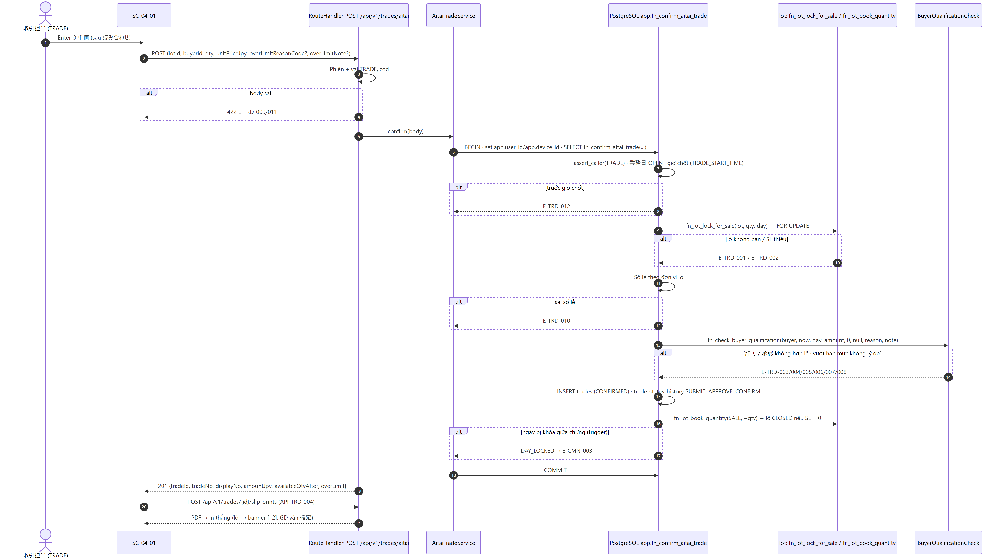
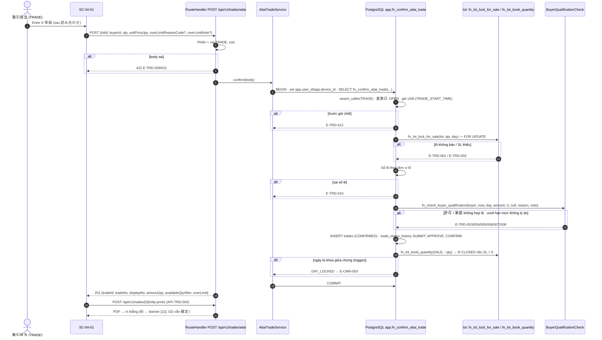

# TRADE_AITAI_CONFIRM — 相対取引の確定（主要フロー）+ FIG-012 の状態 + ロットの数量減算

> 様式: **BM-2-901-53 v01** — Detail Design (Chart + Description) · SUN ASTERISK VIETNAM CO., LTD · ISO/IEC 27001:2013 & ISO 9001:2015

---

## 1. 変更履歴

| No | Version | Action | 対象箇所 / ステップ | 変更内容 | 更新日 | 更新者 | Approve |
|---|---|---|---|---|---|---|---|
| 1 | 0.1.0 | Add new | — | 初期作成（LAB-4 P3） | 2026-11-25 | phuongnnm-23344 | |
| 2 | 0.1.1 | Update | — | Gate 2 G2-m03: 現状（as-is）の文を修正（prototype の取引コードは `next_day_counter` 0025/0026 を使用済み） | 2026-11-25 | phuongnnm-23344 |  |
| 3 | 0.1.2 | Update | §2 | FB-EXP-236: 画像 PNG `./assets/TRADE_AITAI_CONFIRM_sequence.png` を Mermaid ブロックから出力して埋め込み（`scripts/export-mermaid-png.py`）; Mermaid が引き続きソース | 2026-11-25 | phuongnnm-23344 |  |
| 4 | 0.1.3 | Update | §3 | FIG-012: 内部ステップの表記を 承認 から 確認 に変更（L4-D03、`ja/` 作成時の点検） | 2026-11-26 | phuongnnm-23344 |  |

---

## 2. シーケンス図

出典: 下の Mermaid ブロック（編集用の原本）; 画像はそのブロックから `python scripts/export-mermaid-png.py TRADE_AITAI_CONFIRM` で生成 — Mermaid を編集したら再実行し、両者がずれないようにする。

**図の元ファイル:** このファイル内の Mermaid ブロック。

---

## 3. 概要

- **1件** の相対取引を確定 — 主要フロー（価値の約90%）— **一つの** transaction 内で: ロットをロック、数量を検査、確定時点で 許可 / 承認 + 参加上限 を検査、取引を `CONFIRMED` で記録、FIG-012 のイベントをすべて記録、ロットの数量を減算。全部成功するか、何も書かれないか（BR-PERM-01, BR-LOT-02, ADR-003）。
- FIG-012（提出 → 確認 → 確定）: 取引台は一度クリックするだけ; システムは同じ人・時刻・端末で `trade_status_history` に3行記録（PRM-114 (a), D10 の修正）。UI 上の `APPROVE` イベントは 「確認」 と表示（L4-D03, A-TRD-02）。
- 確定後は取引が凍結される（トリガー `TRADE_FROZEN`）: 数値の変更は `trade_adjustments` 経由のみ（当日訂正 / 修正申請 — ルール 4）。
- 呼び出し元: SC-04-01。取引確認票の印刷は確定後の別の呼び出し（API-TRD-004）— 印刷に失敗しても取引は消えない。

---

## 4. 詳細な関数

### 4.1. リクエスト、呼び出し元、確定時刻の検査

| 項目 | 値 |
|---|---|
| Input | Body `AitaiConfirmBody`, セッションの cookie |
| Output | 検証済みの body, `v_caller`, `v_day` → 4.2 |

**Error**

| エラー条件 | 処理 | Status code |
|---|---|---|
| 未ログイン | `E-CMN-001` を返して停止 | 401 |
| 役割 TRADE がない（app または `assert_caller`） | `E-CMN-002` を返して停止 | 403 |
| `qty` ≤ 0 / 数値でない | `E-TRD-009` を返して停止 | 422 |
| `unitPriceJpy` が整数でない / < 1 | `E-TRD-011` を返して停止 | 422 |
| 業務日 `OPEN` がない | `E-CMN-003` を投げ、rollback | 423 |
| 現在時刻（JST）< 業務日の `rule_parameters.TRADE_START_TIME`（暫定 02:00） | `E-TRD-012: {HH:MM}` を投げ、rollback | 409 |

**Detail**

| No | 処理内容 |
|---|---|
| 1 | `requireRole(["TRADE"])`; zod |
| 2 | BEGIN; `app.user_id`, `app.device_id` を付与 |
| 3 | `v_caller := assert_caller(['TRADE'], [])`; `v_day :=` 業務日 `OPEN`; `business_days.rule_version_id` から `TRADE_START_TIME` を読む |

### 4.2. ロットのロック、数量と小数桁の検査

| 項目 | 値 |
|---|---|
| Input | `p_lot_id`, `p_qty`, `v_day` |
| Output | `v_available`, `v_unit` → 4.3 |

**Error**

| エラー条件 | 処理 | Status code |
|---|---|---|
| ロットが存在しない | `E-LOT-014` を投げ、rollback | 404 |
| ロットが `PUBLISHED` でない / `v_day` に属さない（持ち越しでもない） | `E-TRD-001: {lot_no} {状態}` を投げ、rollback | 409 |
| `p_qty > v_available` | `E-TRD-002: {v_available}{unit}` を投げ、rollback; クライアントは残を更新 | 409 |
| `unit = KG` で `p_qty` が小数第1位を超える; `CASE` / `PIECE` で小数あり | `E-TRD-010` を投げ、rollback | 422 |

**Detail**

| No | 処理内容 |
|---|---|
| 1 | `v_available := app.fn_lot_lock_for_sale(p_lot_id, p_qty, v_day)`（LOT_FUNC 2.9）— ロットの行を `FOR UPDATE` でロック、同じロットの2人の確定は順番待ち |
| 2 | `lots.unit` を読み、小数桁を検査（DB の CHECK が最後の網） |

### 4.3. 購入者の資格と参加上限の検査

| 項目 | 値 |
|---|---|
| Input | `p_buyer_id`, `now()`, `v_day`, `v_amount = floor(p_qty × p_unit_price_jpy)`, 理由 |
| Output | `v_qual`（`basis`, `over_limit`）→ 4.4 |

**Error**

| エラー条件 | 処理 | Status code |
|---|---|---|
| [TRADE_QUALIFICATION_CHECK_TECH](TRADE_QUALIFICATION_CHECK_TECH.md) §4 による | `E-TRD-003` / `004` / `005` / `006` / `007` / `008` を投げ、rollback | 422 |

**Detail**

| No | 処理内容 |
|---|---|
| 1 | `v_qual := app.fn_check_buyer_qualification(p_buyer_id, now(), v_day, v_amount, 0, NULL, p_over_limit_reason_code, p_over_limit_note)` |
| 2 | 4.2 でロック済みのロットなので、資格と数量を同じ時点で検査 |

### 4.4. 取引の記録と FIG-012 のイベント

| 項目 | 値 |
|---|---|
| Input | 4.1–4.3 の結果 |
| Output | `v_trade_id`, `v_trade_no`, `v_display_no` → 4.5 |

**Error**

| エラー条件 | 処理 | Status code |
|---|---|---|
| 現在の `v_day` に有効な `tax_rates` がない | ログ `ERROR`、`E-CMN-004`、rollback（master の設定エラー） | 500 |
| トリガー `DAY_LOCKED` | `E-CMN-003`、rollback | 423 |

**Detail**

| No | 処理内容 |
|---|---|
| 1 | `v_seq := next_day_counter(v_day, 'AITAI')`; `trade_no := 'A' || YYYYMMDD || '-' || lpad(v_seq, 4, '0')`; `display_no := '相対-' || lpad(v_seq, 4, '0')`（Q-TRD-01） |
| 2 | `INSERT trades (trade_no, business_date = v_day, trade_date = v_day, lot_id, buyer_id, channel = 'AITAI', source = 'ONLINE', status = 'CONFIRMED', qty, unit_price_jpy, amount_jpy = v_amount, tax_rate_id, rule_version_id = business_days.rule_version_id, over_limit_reason_code / note` は `v_qual.over_limit` の時**のみ**, `confirmed_at = now(), confirmed_by = created_by = v_caller)` |
| 3 | `fn_record_trade_event`: `SUBMIT`（NULL → `PENDING`）, `APPROVE`（`PENDING` → `PENDING`）, `CONFIRM`（`PENDING` → `CONFIRMED`）— 同じ `v_caller`, 同じ `now()` |

### 4.5. ロットの数量を減算

| 項目 | 値 |
|---|---|
| Input | `v_trade_id`, `p_lot_id`, `p_qty`, `v_day` |
| Output | `available_qty_after` → 4.6 |

**Error**

| エラー条件 | 処理 | Status code |
|---|---|---|
| 記録後の数量 < 0（ロック済みのため起きない; `fn_lot_book_quantity` の安全網） | `E-TRD-002`、rollback | 409 |

**Detail**

| No | 処理内容 |
|---|---|
| 1 | `app.fn_lot_book_quantity(p_lot_id, 'SALE', -p_qty, v_trade_id, NULL, v_day)`（LOT_FUNC 2.10）— 数量 = 0 → ロット `CLOSED` + `lot_status_history` |

### 4.6. コミット、結果の返却、伝票の印刷

| 項目 | 値 |
|---|---|
| Input | 4.4, 4.5 の結果 |
| Output | 201 `{tradeId, tradeNo, displayNo, amountJpy, availableQtyAfter, overLimit}` |

**Error**

| エラー条件 | 処理 | Status code |
|---|---|---|
| `40P01` / `40001` | Rollback、`E-CMN-006`; クライアントは再度押す前に API-TRD-003 で確認 | 409 |
| その他 | ログ `ERROR` + traceId、`E-CMN-004` | 500 |

**Detail**

| No | 処理内容 |
|---|---|
| 1 | `COMMIT`; log `INFO trade.aitai.confirmed tradeNo={…} overLimit={…}`（購入者名は書かない） |
| 2 | クライアントは API-TRD-004 を呼ぶ（直接印刷）。印刷エラーは取引に **影響しない**（PRM-114 (d)） |

---

## 5. その他の注記

- **オンライン必須:** この関数にはオフラインのキューがない（ADR-008 §2.1）; 通信断 → 紙伝票 → SC-04-07 で後入力（`source = PAPER_LATE`, 伝票上の時刻で資格を検査 — `p_at = paper_slip_time` で 4.2–4.5 を再利用）。
- **この関数がしないこと:** 取引の修正 / 取消（→ [TRADE_SAME_DAY_FIX_TECH](TRADE_SAME_DAY_FIX_TECH.md)）; 精算での税計算; 3分以内の重複チェック（クライアント、ブロックしない）。
- **prototype との差:** prototype は 参加上限 を 業務日 + 元の金額で計算（`0025` `check_buyer_qualification` — D08）、`status` は履歴のない2値（`0001`, D10）。取引コード: prototype は **既に** `next_day_counter`（`0025`、`0026:33` で呼び出し）で採番済み; `count(*)` は、その日のカウンターがまだない時だけ元の番号になる — to-be は `day_counters` テーブルでこの方式を維持、差異ではない。
- **完了条件（LAB-5）:** (a) 有効な取引 → `trades` に `CONFIRMED` 1行 + `trade_status_history` 3行 + 数量台帳 `SALE` 1行; (b) 同じロットに2つのリクエストが並行、合計数量 > 残 → 1件は 201、1件は 409 `E-TRD-002`、数量台帳は負にならない; (c) 仲卸 の 許可 が昨日で期限切れ → 422 `E-TRD-005`、行は1つも書かれない; (d) 売買参加者 が期の上限を超える（同月の確定済みのせりも合算）→ 422 `E-TRD-007`; 理由を付けて再送 → 201 `overLimit = true`; (e) 01:59 → 409 `E-TRD-012`; (f) ロットの数量が 0 → `CLOSED`。
