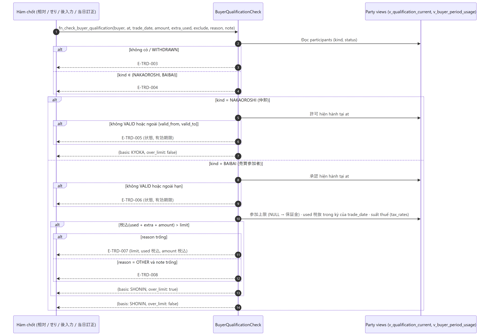
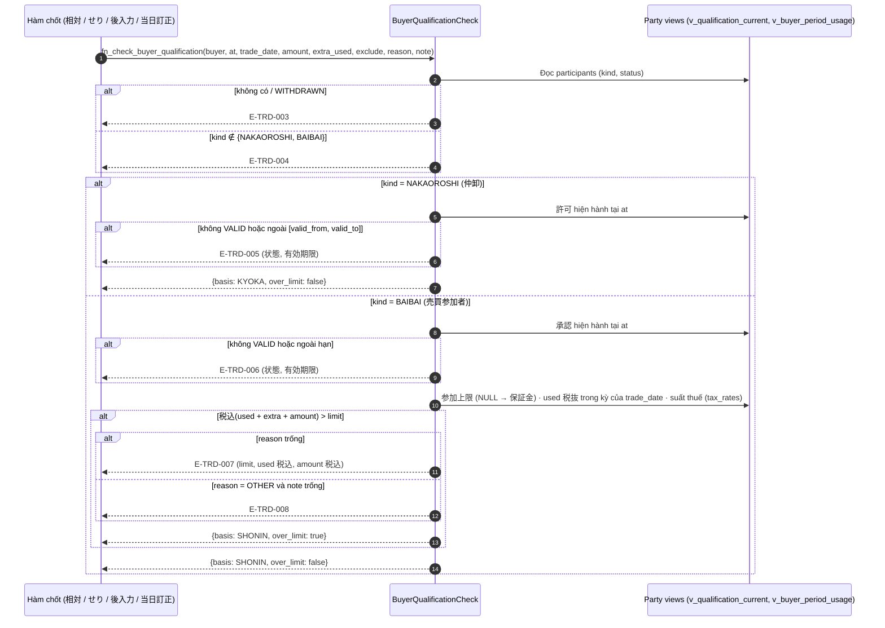

# TRADE_QUALIFICATION_CHECK — 確定時点での 許可 / 承認 と 参加上限 の検査

> 様式: **BM-2-901-53 v01** — Detail Design (Chart + Description) · SUN ASTERISK VIETNAM CO., LTD · ISO/IEC 27001:2013 & ISO 9001:2015

---

## 1. 変更履歴

| No | Version | Action | 対象箇所 / ステップ | 変更内容 | 更新日 | 更新者 | Approve |
|---|---|---|---|---|---|---|---|
| 1 | 0.1.0 | Add new | — | 初期作成（LAB-4 P3） | 2026-11-25 | phuongnnm-23344 | |
| 2 | 0.1.1 | Update | — | 顧客（模擬）Q-TRD-02: 参加上限 を 税込 = floor(Σ税抜 × (100 + 税率) / 100) で比較、DoD d2, d3 を追加 | 2026-11-25 | phuongnnm-23344 |  |
| 3 | 0.1.2 | Update | §2 | FB-EXP-236: 画像 PNG `./assets/TRADE_QUALIFICATION_CHECK_sequence.png` を Mermaid ブロックから出力して埋め込み（`scripts/export-mermaid-png.py`）; Mermaid が引き続きソース | 2026-11-25 | phuongnnm-23344 |  |

---

## 2. シーケンス図

出典: 下の Mermaid ブロック（編集用の原本）; 画像はそのブロックから `python scripts/export-mermaid-png.py TRADE_QUALIFICATION_CHECK` で生成 — Mermaid を編集したら再実行し、両者がずれないようにする。

**図の元ファイル:** このファイル内の Mermaid ブロック。

---

## 3. 概要

- 1つの関数を **すべて** の確定経路で共有する（相対 SC-04-01, せり確認 SC-05-02, 紙伝票後入力 SC-04-07, 当日訂正 SC-04-05 で購入者 / 数量を変える場合）。呼び出し元の transaction の中で、ロットの行をロックした後に実行 — 資格と数量が同じ時点で検査されるように（BR-PERM-01, BR-LOT-02, ADR-003 §2-3）。
- 根拠法による2分岐（ルール 2）: 仲卸 の **許可**（テーブル `nakaoroshi_permits`、上限はない）と 売買参加者 の **承認**（テーブル `baibai_approvals`、参加上限あり）。「共通の購入権」という概念はない; エラーコードとメッセージは異なる。
- 参加上限: **期ごと**の上限（`trade_date` の西暦の月）、**相対 + せり 合算**、既定 = 現行の保証金; 超過 → 理由を入力させる、**強制ブロックしない** — 確定者が判断（PRM-046, L4-A04 (1), CAP-HUMAN-01）。
- 関数は読み取りのみで書き込みはしない; 結果を返し、呼び出し元が `over_limit_reason_code` / `over_limit_note` を `trades` に保存する。

---

## 4. 詳細な関数

### 4.1. 購入者と区分の特定

| 項目 | 値 |
|---|---|
| Input | `p_buyer_id` |
| Output | `v_kind`（`NAKAOROSHI` / `BAIBAI`）→ 4.2 または 4.3 |

**Error**

| エラー条件 | 処理 | Status code |
|---|---|---|
| `participants` がない、または `status = WITHDRAWN` | `E-TRD-003: {buyer_no}` を投げ; 呼び出し元は rollback | 422 |
| `kind` が `WHOLESALER` / `KAIDASHI` | `E-TRD-004` を投げる | 422 |

**Detail**

| No | 処理内容 |
|---|---|
| 1 | `participants` を読む（kind, status, buyer_no） |
| 2 | `kind` で分岐 — 共通の分岐はない |

### 4.2. 仲卸の分岐 — 許可 を検査

| 項目 | 値 |
|---|---|
| Input | `p_buyer_id`, `p_at` |
| Output | `{kind: NAKAOROSHI, basis: KYOKA, over_limit: false}` → 呼び出し元へ返す |

**Error**

| エラー条件 | 処理 | Status code |
|---|---|---|
| 現行の 許可 がない、または状態が `VALID` でない（`SUSPENDED` 一時停止 / `EXPIRED` 失効 / `UNDER_REVIEW` 再審査）、または `p_at::date` が `[valid_from, valid_to]` の外 | `E-TRD-005: {状態} {valid_to}` を投げる | 422 |

**Detail**

| No | 処理内容 |
|---|---|
| 1 | `v_qualification_current` を読み、`basis = KYOKA` の購入者を日 `p_at`（JST）で絞り込む |
| 2 | 仲卸 には 参加上限 がない — `p_amount_jpy`, `p_reason_code` は無視（送られた理由は破棄、保存しない） |

### 4.3. 売買参加者の分岐 — 承認 を検査

| 項目 | 値 |
|---|---|
| Input | `p_buyer_id`, `p_at` |
| Output | 有効な 承認 → 4.4 |

**Error**

| エラー条件 | 処理 | Status code |
|---|---|---|
| 現行の 承認 がない / `VALID` でない / 期間外 | `E-TRD-006: {状態} {valid_to}` を投げる | 422 |

**Detail**

| No | 処理内容 |
|---|---|
| 1 | `v_qualification_current` を読み、`basis = SHONIN` を日 `p_at` で絞り込む |

### 4.4. 期ごとの参加上限

| 項目 | 値 |
|---|---|
| Input | `p_trade_date`, `p_amount_jpy`, `p_extra_used_jpy`, `p_exclude_trade_id`, `p_reason_code`, `p_note` |
| Output | `{kind: BAIBAI, basis: SHONIN, over_limit, limit_jpy, used_excl_jpy, used_incl_jpy, total_incl_jpy}` |

**Error**

| エラー条件 | 処理 | Status code |
|---|---|---|
| `total_incl > limit` かつ `p_reason_code` が NULL | `E-TRD-007: {limit} {used_incl} {amount_incl}` を投げる（`amount_incl = total_incl − floor((used + extra) × k)`）— クライアントが理由ダイアログを開く | 422 |
| `p_reason_code` が `OVER_LIMIT_REASON` に含まれない | `E-TRD-007` を投げる（未選択として扱う） | 422 |
| `p_reason_code = OTHER` かつ `p_note` が空 | `E-TRD-008` を投げる | 422 |

**Detail**

| No | 処理内容 |
|---|---|
| 1 | `v_limit :=` 現行の `baibai_approvals.participation_limit_jpy`; NULL → `p_trade_date` 時点の `v_participant_current_deposit` |
| 2 | `v_used :=`（税抜）`trade_date` が `p_trade_date` と同じ月の `CONFIRMED` の取引の、有効値（原値 + REVERSE / DELTA）の合計（チャネル `AITAI` + `SERI`）— view `v_buyer_period_usage`; `p_exclude_trade_id` があれば除く |
| 3 | 参加上限は **税込** で比較（Q-TRD-02 【顧客（模擬）、2026-11-25】）: `税込 = floor(Σ税抜 × (100 + rate_percent) / 100)`。`rate_percent` = 設定ファイルのパラメータ `PARTICIPATION_LIMIT_TAX_CODE`（既定 `REDUCED8`）のコードの税率、`p_trade_date` 時点で `tax_rates` を照会 — 110/100 は BR-INC-01 のものなので使わない、ハードコードしない。`v_used_incl := floor(v_used × (100 + r) / 100)`; `v_total_incl := floor((v_used + p_extra_used_jpy + p_amount_jpy) × (100 + r) / 100)`; `v_total_incl` を `v_limit` と比較。期全体に 1 つの税率を適用（仮定: 軽減税率 8% のみ — 経理部に確認; 期内に税率が2つある → 各取引の税率でグループ化、+0.2日）。請求書のように行ごとに税を計算し直すことはしない |
| 3b | `p_trade_date` 時点でコードに有効な `tax_rates` の行がない → `E-CMN-004` を投げる（設定エラー、`ERROR` をログ）— 税抜で黙って比較しない |
| 4 | 超過しない → `over_limit = false`（送られた理由は破棄） |

---

## 5. その他の注記

- **前提:** 呼び出し元はロットの行をロック済みで、transaction は `READ COMMITTED`; 同じ購入者に2人が並行して確定すると、両方が古い `v_used` を見る可能性がある → 少額の超過で理由が求められないことがある。許容する（上限は強制ブロックではなく警告; 要確認 で照合）。顧客が完全な正確さを求める場合 → `buyer_id` 単位の advisory lock（約0.3日）— Q-TRD-02 に記録。
- **判定時刻:** オンラインでは `p_at` = `now()`; `PAPER_LATE` では = `paper_slip_time`（ADR-008 §2.4-11）; 業務日 / 期 は `p_trade_date` で決め、時計の時刻では決めない（L4-A04 (2)）。
- **view の列**（MKT_DB 0.3.2 §4.0a に定義済み — `qualification_no`, `limit_mode`, `period_id`, `trade_count` を追加）: `v_qualification_current(participant_id, basis KYOKA|SHONIN, qualification_id, status, valid_from, valid_to, participation_limit_jpy NULL with KYOKA)` — 1人 × 根拠ごとに1行、テーブル **2つ** `nakaoroshi_permits`, `baibai_approvals` から取得（テーブルは統合しない）; `v_buyer_period_usage(buyer_id, period_ym, used_excl_jpy, used_incl_jpy)` を `trade_date` で、有効値で集計; `used_incl_jpy` は §4.4-3 の式で計算（MKT_DB §4.0a の修正を提案 — Q-TRD-02）。正式な定義は MKT_DB §4.0a。
- **この関数がしないこと:** 資格の状態を変える（module party）; 30日前の警告を送る（module notify）; 上限超過で取引をブロックする。
- **完了条件（LAB-5）:** (a) 仲卸 の 許可 が `EXPIRED` → `E-TRD-005` で「仲卸の許可」の文言; (b) 売買参加者 の 承認 が `SUSPENDED` → `E-TRD-006` で「売買参加者の承認」の文言; (c) 売買参加者 が理由なしで超過 → 3つの数値を付けた `E-TRD-007`; 理由ありなら `over_limit = true`; (d) 仲卸 はどれだけ金額が大きくても `E-TRD-007` を受けない; (d2) 売買参加者 上限 5,000,000、税抜の使用済み 4,620,000（税込 4,989,600）、新しい取引 税抜 9,000（税込の合計 4,999,320）→ 超過なし; 新しい取引 24,000（税込の合計 5,015,520）→ `E-TRD-007`、`detail.usedInclJpy` 4,989,600、`amountInclJpy` 25,920 — 税抜がまだ超えていなくても税込で比較; (d3) `tax_rates` の `rate_percent` を変更（有効日付の新しい行）→ その日以降の取引は新しい税率を使う、コード変更は不要; (e) せり 2 行が同じ購入者、行2 が加算された `p_extra_used_jpy` のおかげで超過 → 理由が必要なのは行2 のみ; (f) 7月の取引は 8月の上限に算入されない。
