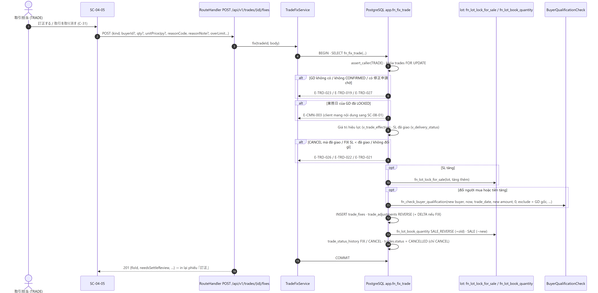
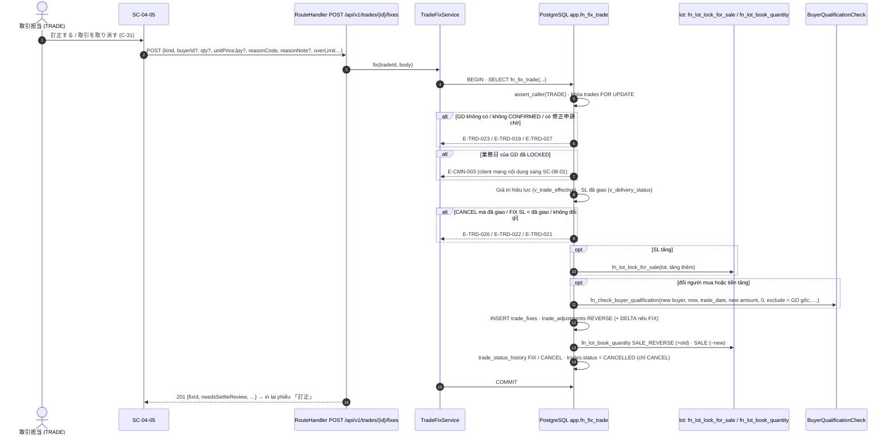

# TRADE_SAME_DAY_FIX — 当日訂正 / 取消 を REVERSE / DELTA で行う（業務日が未締め）

> 様式: **BM-2-901-53 v01** — Detail Design (Chart + Description) · SUN ASTERISK VIETNAM CO., LTD · ISO/IEC 27001:2013 & ISO 9001:2015

---

## 1. 変更履歴

| No | Version | Action | 対象箇所 / ステップ | 変更内容 | 更新日 | 更新者 | Approve |
|---|---|---|---|---|---|---|---|
| 1 | 0.1.0 | Add new | — | 初期作成（LAB-4 P3） | 2026-11-25 | phuongnnm-23344 | |
| 2 | 0.1.1 | Update | §2 | FB-EXP-236: 画像 PNG `./assets/TRADE_SAME_DAY_FIX_sequence.png` を Mermaid ブロックから出力して埋め込み（`scripts/export-mermaid-png.py`）; Mermaid が引き続きソース | 2026-11-25 | phuongnnm-23344 |  |

---

## 2. シーケンス図

出典: 下の Mermaid ブロック（編集用の原本）; 画像はそのブロックから `python scripts/export-mermaid-png.py TRADE_SAME_DAY_FIX` で生成 — Mermaid を編集したら再実行し、両者がずれないようにする。

**図の元ファイル:** このファイル内の Mermaid ブロック。

---

## 3. 概要

- 確定済みの取引を **業務日が未締めの間に** 訂正（訂正）または取消（取消）する — 取引台（SC-04-05、SC-04-04 から開く）で。理由が必要、履歴を保持、**二段階の決裁はない**（FR-AITAI-03, PRM-127, M17）。日の締め後は 修正申請（SC-08-01）のみ。
- **上書きしない**（ルール 4, ADR-004）: 元の取引は数値を保持; `trade_fixes` + `trade_adjustments` REVERSE（現在の有効値を打ち消す、旧い購入者）+ DELTA（新しい値、新しい購入者）を作成; 取消は REVERSE のみ。ロットの数量台帳には戻し / 減算の行が入る。
- 第2の確認者: 修正時には不要; 1人の購入者について税込の金額変動が最大の行が、規程の二段階しきい値以上 **または** 購入者の変更 → 日次締めのチェックリストで ✖ のまま、照合事務局が 確認済 を押すまで（Q-SC0405-01 【顧客（模擬）、2026-11-25】, ADJUST_DB 4.32）。

---

## 4. 詳細な関数

### 4.1. リクエストと元の取引の検査

| 項目 | 値 |
|---|---|
| Input | `tradeId`, body（API-TRD-008 §3） |
| Output | ロック済みの `v_trade`, `v_effective`, `v_delivered` → 4.2 |

**Error**

| エラー条件 | 処理 | Status code |
|---|---|---|
| 未ログイン / TRADE でない | `E-CMN-001` / `E-CMN-002` | 401 / 403 |
| `reasonCode` が空 / `FIX_REASON` に含まれない | `E-TRD-020` | 422 |
| `reasonCode = OTHER` で `reasonNote` が空 / > 200 | `E-TRD-008` | 422 |
| 取引が存在しない | `E-TRD-023` | 404 |
| `trades.status ≠ CONFIRMED` | `E-TRD-019: {状態}` | 409 |
| 取引に状態 `SUBMITTED` / `FIRST_APPROVED` の `correction_requests` がある | `E-TRD-027` | 409 |
| `trades.business_date` の `business_days.status` = `LOCKED` | `E-CMN-003` — クライアントは内容を保持、ボタンで SC-08-01 へ持ち越す（顧客 #5） | 423 |

**Detail**

| No | 処理内容 |
|---|---|
| 1 | `assert_caller(TRADE)`; `SELECT … FROM trades WHERE id = … FOR UPDATE` |
| 2 | `v_effective :=` `v_trade_effective` の該当行（購入者、数量、有効な単価 — 前回の修正後） |
| 3 | `v_delivered :=` 引渡済の数量（`v_delivery_status`） |

### 4.2. 新しい内容の計算と業務検査

| 項目 | 値 |
|---|---|
| Input | `p_kind`, 新しい値, `v_effective`, `v_delivered` |
| Output | `v_new`（buyer, qty, price, amount）, `v_qty_increase` → 4.3 |

**Error**

| エラー条件 | 処理 | Status code |
|---|---|---|
| `CANCEL` かつ `v_delivered > 0` | `E-TRD-026`（SC-06-04 へ案内） | 409 |
| `FIX` かつ新しい値 = 有効値 | `E-TRD-021` | 422 |
| 新しい数量 ≤ 0 / 小数桁が不正 / 単価 < 1 | `E-TRD-009` / `E-TRD-010` / `E-TRD-011` | 422 |
| 新しい数量 < `v_delivered` | `E-TRD-022: {v_delivered}{unit}` | 409 |
| 数量の増加がロットの利用可能数量を超える | `E-TRD-002`（`fn_lot_lock_for_sale` 経由） | 409 |
| 新しい購入者が無効 / 理由なしで参加上限超過 | `E-TRD-003`..`008`（2.4 経由） | 422 |

**Detail**

| No | 処理内容 |
|---|---|
| 1 | 送られなかった値 = 有効値を保持 |
| 2 | `v_qty_increase := new_qty − eff_qty`; > 0 → `fn_lot_lock_for_sale(lot, v_qty_increase, v_day)`; ≤ 0 → ロットの行をロックするだけ |
| 3 | 購入者の変更 **または** 金額の増加 → `fn_check_buyer_qualification(new_buyer, now(), trades.trade_date, new_amount, 0, p_exclude_trade_id = tradeId, …)`; 同じ購入者で金額の減少 → 検査しない |

### 4.3. 当日訂正の記録と調整行の作成

| 項目 | 値 |
|---|---|
| Input | `v_trade`, `v_effective`, `v_new` |
| Output | `v_fix_id`, REVERSE / DELTA の id → 4.4 |

**Error**

| エラー条件 | 処理 | Status code |
|---|---|---|
| トリガー `DAY_LOCKED`（処理中に日が締まった） | `E-CMN-003`、rollback; クライアントは内容を保持 | 423 |
| トリガーの `amount_delta = qty × price` の検査が失敗 | ログ `ERROR`、`E-CMN-004`、rollback | 500 |

**Detail**

| No | 処理内容 |
|---|---|
| 1 | `v_max_buyer_diff_incl :=` 購入者ごとの |Δ 税込金額| の最大値（元の取引の税率、切り捨て）; 購入者の変更 → 旧い購入者 = 旧い金額、新しい購入者 = 新しい金額; `CANCEL` = 取引の税込金額 |
| 2 | `INSERT trade_fixes (trade_id, business_date = trades.business_date, kind, change = {before, after}（CANCEL の時は NULL）, reason_code, reason_note, max_buyer_diff_incl_jpy, buyer_changed)` |
| 3 | `INSERT trade_adjustments` **REVERSE**: 旧い `buyer_id`, 旧い `unit_price_jpy`, `qty_delta = −eff_qty`, `amount_delta_jpy = −eff_amount`, `source = SAME_DAY`, `fix_id`, 元の取引の `tax_rate_id`, 業務日の `rule_version_id`, `business_date` = 開いている日, `period_id` = `trades.trade_date` を含む期 |
| 4 | `FIX`: **DELTA** を `INSERT`: 新しい購入者 / 単価, `qty_delta = new_qty`, `amount_delta_jpy = floor(new_qty × new_price)`, 残りの列は REVERSE と同じ |
| 5 | 数量台帳: `fn_lot_book_quantity(lot, 'SALE_REVERSE', +eff_qty, NULL, reverse_id, v_day)`; `FIX` はさらに `fn_lot_book_quantity(lot, 'SALE', −new_qty, trade_id, NULL, v_day)` — `CLOSED` のロットに数量が戻る → `PUBLISHED`（Q-LOT-05） |

### 4.4. 取引の状態とコミット

| 項目 | 値 |
|---|---|
| Input | 4.3 の結果 |
| Output | 201 `{fixId, kind, adjustments[], needsSettleReview, displayNo}` |

**Error**

| エラー条件 | 処理 | Status code |
|---|---|---|
| `40P01` / `40001` | Rollback、`E-CMN-006` | 409 |

**Detail**

| No | 処理内容 |
|---|---|
| 1 | `FIX`: `fn_record_trade_event(FIX, CONFIRMED → CONFIRMED, reason)`. `CANCEL`: `UPDATE trades SET status = 'CANCELLED'`（状態の列のみ — 数値は変わらない）+ `fn_record_trade_event(CANCEL, CONFIRMED → CANCELLED, reason)` |
| 2 | `needsSettleReview := v_max_buyer_diff_incl ≥ rule_parameters.CORR_TWO_LEVEL_THRESHOLD_JPY OR buyer_changed` — クライアントは文 [14] を表示するため; 日次締めのチェックリストは `trade_fixes` を直接読む |
| 3 | `COMMIT`; log `INFO trade.fixed kind={…} tradeNo={…} review={bool}`; クライアントは API-TRD-004 を呼び、「訂正」 / 「取消」 の文字付きで伝票を再印刷 |

---

## 5. その他の注記

- **この関数がしないこと:** 締め済みの日の取引の修正（→ 修正申請、settle モジュール）; 決裁; 引渡しの例外から REVERSE / DELTA を自動生成（delivery モジュール — ADR-004 で同じテーブルを共有）。
- **期:** 調整は元の取引の期（`trade_date`）の `period_id` を持つ; 当日訂正は常に同じ日なので、元の期はまだ `OPEN`（Gate 1 C-02）。
- **prototype との差:** prototype には 当日訂正 がない — 修正はすべて 修正申請 を経る（D11, M17）。
- **完了条件（LAB-5）:** (a) 訂正 数量 30 → 28 kg → `trade_fixes` + REVERSE −30 + DELTA +28、数量台帳 +30 / −28、元の取引は 30 のまま; (b) 引渡し前の取消 → REVERSE −30、台帳 +30、`trades.status = CANCELLED`、DELTA なし; (c) 引渡済 12 kg の取引の取消 → 409 `E-TRD-026`; (d) 購入者を 売買参加者 承認 失効 に変更 → 422 `E-TRD-006`; (e) 同じ単価のまま購入者を変更 → `buyer_changed = true`, `needsSettleReview = true`; (f) 押した時点で日がロック → 423、行は1つも書かれない; (g) 2回目の修正は1回目の後の値を REVERSE の元にする。
