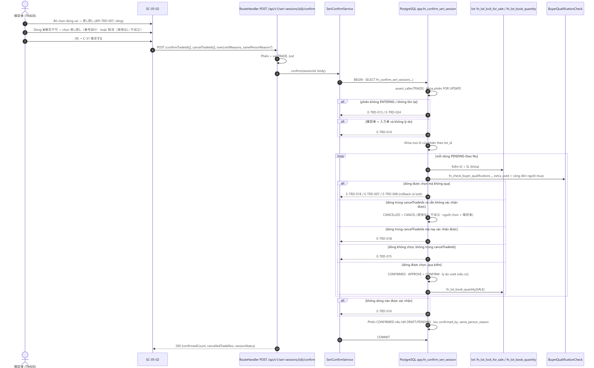
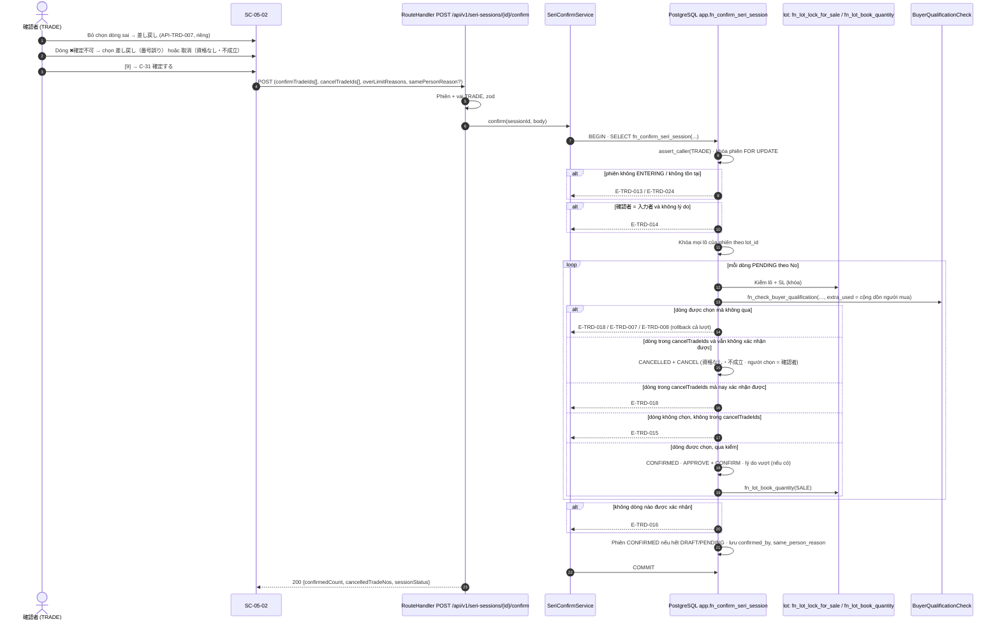

# TRADE_SERI_CONFIRM — せりセッションの結果の確認（確認者）+ 差し戻し

> 様式: **BM-2-901-53 v01** — Detail Design (Chart + Description) · SUN ASTERISK VIETNAM CO., LTD · ISO/IEC 27001:2013 & ISO 9001:2015

---

## 1. 変更履歴

| No | Version | Action | 対象箇所 / ステップ | 変更内容 | 更新日 | 更新者 | Approve |
|---|---|---|---|---|---|---|---|
| 1 | 0.1.0 | Add new | — | 初期作成（LAB-4 P3） | 2026-11-25 | phuongnnm-23344 | |
| 2 | 0.1.1 | Update | — | Gate 2 G2-m03: 現状（as-is）の文を修正（超過理由の入力欄は UI が全行に表示していた; 0027 の S7 は approve_correction）; 顧客 Q-TRD-05: 差し戻し / 取消、DoD b–b5 を追加 | 2026-11-25 | phuongnnm-23344 |  |
| 3 | 0.1.2 | Update | §2 | FB-EXP-236: 画像 PNG `./assets/TRADE_SERI_CONFIRM_sequence.png` を Mermaid ブロックから出力して埋め込み（`scripts/export-mermaid-png.py`）; Mermaid が引き続きソース | 2026-11-25 | phuongnnm-23344 |  |

---

## 2. シーケンス図

出典: 下の Mermaid ブロック（編集用の原本）; 画像はそのブロックから `python scripts/export-mermaid-png.py TRADE_SERI_CONFIRM` で生成 — Mermaid を編集したら再実行し、両者がずれないようにする。

**図の元ファイル:** このファイル内の Mermaid ブロック。

---

## 3. 概要

- 確認者が、**セッション全体** について せり人 が場で決めた **最終結果** を確認する — CAP-HUMAN-01 の最終判断者。システムは記録のみ; 入札や入札表はない（ルール 1, FR-SERI-01）。
- 確認時点で行ごとに 許可 / 承認 + 数量 を再検査（BR-PERM-01, BR-LOT-02）; 参加上限は 売買参加者 のみ、同じセッション内の同じ購入者の行を、確定済みの 相対 + せり と合算（L4-A04 (1)）。
- 確認者 ≠ 入力者 が原則; 同一人物の場合は理由を必須にし、`seri_sessions.same_person_reason` に保存、要確認 SC-07-01 に表示（S2, PRM-115）。
- 確認できない行（失効 / 一時停止 / 数量不足）は **自動で取消さない** — 確認者が行ごとに どちらかを選ぶ（Q-TRD-05 【顧客（模擬）、2026-11-25】）: **差し戻し（番号誤り）** — 入力者が購入者の番号を打ち間違えた可能性がある場合 → `fn_send_back_seri_results` で入力者に戻し、せり原票 / 紙の伝票と照合して **実際に せり で勝った人** の番号に直させる; または **取消（資格なし・不成立）** — 番号は正しいが、その人に本当に資格がない場合（BR-PERM-01）→ 行は履歴付きの `CANCELLED` になり、数量は減算しない、ロットは販売公開中のまま / 販売公開中に戻り、再せり または 相対 へ（顧客 #9）。**次点の入札者に繰り上げる経路はない** — それは新しいせりの結果を決めることになり、せり直しが必要（ルール 3, CAP-HUMAN-01）。入力者が修正して再提出した行は、次の回の確認時に BR-PERM-01 を再検査する。
- すべてか無か: 選んだ行が検査を通らない場合 → どの行も書かれない; クライアントは再読込。

---

## 4. 詳細な関数

### 4.1. リクエスト、セッション、確認者の検査

| 項目 | 値 |
|---|---|
| Input | `sessionId`, body `SeriConfirmBody` |
| Output | ロック済みの `v_session`, `v_caller` → 4.2 |

**Error**

| エラー条件 | 処理 | Status code |
|---|---|---|
| 未ログイン / TRADE 役割がない | `E-CMN-001` / `E-CMN-002` | 401 / 403 |
| セッションが存在しない | `E-TRD-024` | 404 |
| `seri_sessions.status ≠ ENTERING` | `E-TRD-013: {状態}` | 409 |
| `v_caller = entered_by` かつ `p_same_person_reason` が空 | `E-TRD-014` | 422 |
| 業務日 `OPEN` がない / セッションが締め済みの日に属する | `E-CMN-003` | 423 |
| 取引の確定時刻より前 | `E-TRD-012` | 409 |

**Detail**

| No | 処理内容 |
|---|---|
| 1 | `requireRole(["TRADE"])`; zod |
| 2 | `v_caller := assert_caller(['TRADE'], [])`; `SELECT … FROM seri_sessions WHERE id = … FOR UPDATE`（セッションをロックする **前** に役割を検査 — prototype の `0027` の `approve_correction` の S7 修正と同じ原則; 最終版の関数 `confirm_seri_session` は `0027`） |
| 3 | 同一人物、業務日、確定時刻を検査 |

### 4.2. 行ごとのロックと判定

| 項目 | 値 |
|---|---|
| Input | セッションの `status = PENDING` の `trades` の行, `p_confirm_trade_ids`, `p_cancel_trade_ids`, `p_over_limit_reasons` |
| Output | 確認 / 取消 の行のリスト → 4.3 |

**Error**

| エラー条件 | 処理 | Status code |
|---|---|---|
| `p_confirm_trade_ids` / `p_cancel_trade_ids` の id がセッションに属さない / `PENDING` でない、または1つの id が両方のリストにある | `E-TRD-018: {trade_no}`、rollback | 409 |
| `p_cancel_trade_ids` の行が、今は **確認できる**（例: 資格が再度有効になった） | `E-TRD-018: {trade_no}`（`detail.rows[].reason = NOW_CONFIRMABLE`）、rollback — 確認者が見直す | 409 |
| 選んだ行: ロットが販売対象でない / 数量不足 / 許可 · 承認 が無効 | `E-TRD-018: {trade_nos}`（`detail.rows[].reason` 付き）、1回の操作全体を rollback | 409 |
| 選んだ行が参加上限超過で理由なし / `OTHER` で備考なし | `E-TRD-007` / `E-TRD-008`、`detail.tradeNos` 付き、rollback | 422 |
| `PENDING` の行が `p_confirm_trade_ids` にも `p_cancel_trade_ids` にもない（✖確定不可 で処理方法を未選択のものを含む） | `E-TRD-015: {n}`、rollback | 422 |

**Detail**

| No | 処理内容 |
|---|---|
| 1 | セッションの全ロットを `ORDER BY lot_id FOR UPDATE` でロック（デッドロック回避 — prototype 0027 W12） |
| 2 | 行を `No` の順に処理; `v_used_in_batch[buyer]` は同じ購入者について **確認された** 前の行の金額を累積 |
| 3 | 各行: ロットと数量を検査（`fn_lot_lock_for_sale`、同じロットの前の行の数量を順に差し引く）; `fn_check_buyer_qualification(buyer, now(), trade_date, amount, v_used_in_batch[buyer], NULL, reason, note)` を呼び、エラーは「通らない」という結果として捕捉 |
| 4 | `p_cancel_trade_ids` の行 + まだ通らない → 取消の印を付ける; 理由 `資格なし・不成立` と システム上の原因（`資格失効` / `一時停止` / `残数量不足` / `販売公開外`）; 取消者 = 確認者 |

### 4.3. 行の結果の記録

| 項目 | 値 |
|---|---|
| Input | 4.2 のリスト |
| Output | `confirmed_count`, `cancelled_trade_nos` → 4.4 |

**Error**

| エラー条件 | 処理 | Status code |
|---|---|---|
| 確認された行が1つもない | `E-TRD-016`、rollback | 422 |
| トリガー `DAY_LOCKED` / `TRADE_FROZEN` | `E-CMN-003` / `E-CMN-004`、rollback | 423 / 500 |

**Detail**

| No | 処理内容 |
|---|---|
| 1 | 確認する行: `UPDATE trades SET status = 'CONFIRMED', confirmed_by = v_caller, confirmed_at = now(), over_limit_reason_code / note`（超過の時のみ） — 凍結前に許される最後の UPDATE |
| 2 | `fn_record_trade_event`: `APPROVE`（`PENDING` → `PENDING`）, `CONFIRM`（`PENDING` → `CONFIRMED`） |
| 3 | `fn_lot_book_quantity(lot, 'SALE', -qty, trade_id, NULL, v_day)` — 数量 0 → `CLOSED` |
| 4 | 取消の行: `UPDATE trades SET status = 'CANCELLED'` + `CANCEL`（`PENDING` → `CANCELLED`、理由 `資格なし・不成立（{原因}）`、`created_by` = 確認者）; 数量台帳は **記録しない**; ロットは保持 / `PUBLISHED`（販売公開中）に戻る |

### 4.4. セッションの更新、コミット

| 項目 | 値 |
|---|---|
| Input | `v_session`, 4.3 の結果 |
| Output | 200 `{confirmedCount, cancelledTradeNos, sessionStatus}` |

**Error**

| エラー条件 | 処理 | Status code |
|---|---|---|
| `40P01` / `40001` | Rollback、`E-CMN-006` | 409 |
| その他 | ログ `ERROR`、`E-CMN-004` | 500 |

**Detail**

| No | 処理内容 |
|---|---|
| 1 | 行がまだ `DRAFT` / `PENDING`（差し戻し済み、入力者待ち）→ セッションは `ENTERING` のまま; なくなれば → `CONFIRMED`、`confirmed_by`、`confirmed_at` |
| 2 | `v_caller = entered_by` の時 `same_person_reason` を保存（4.29 の CHECK） |
| 3 | `COMMIT`; log `INFO trade.seri.confirmed session={…} confirmed={n} cancelled={m} samePerson={bool}` |

### 4.5. 差し戻し (`fn_send_back_seri_results`, API-TRD-007)

| 項目 | 値 |
|---|---|
| Input | `sessionId`, `tradeIds[]`, `reason` |
| Output | 200 `{sentBackCount}` |

**Error**

| エラー条件 | 処理 | Status code |
|---|---|---|
| `reason` が空 / > 200 | `E-TRD-017` | 422 |
| セッションが `ENTERING` でない | `E-TRD-013` | 409 |
| id がセッションに属さない / `PENDING` でない | `E-TRD-018` | 409 |

✖確定不可 の行（資格 / 数量）も **差し戻せる**（Q-TRD-05 — 購入者番号の打ち間違い）。`reason` には 「買受人番号誤りの可能性（せり原票と照合してください）」 を初期値として入れ、編集可能。

**Detail**

| No | 処理内容 |
|---|---|
| 1 | `assert_caller(TRADE)`; セッションをロック |
| 2 | 各行: `UPDATE trades SET status = 'DRAFT'` + `REJECT`（`PENDING` → `DRAFT`、理由）— 数量は減算しない |
| 3 | `entered_by` 宛てのアプリ内通知を outbox に書く 「第{n}回 {k}件が差し戻されました：{理由}」（module `notify`） |
| 4 | 入力者は SC-05-01 で修正（未仕様化 — `specs/_index.md` の依存関係）してから `DRAFT` → `PENDING` へ `SUBMIT` し直す: 旧 / 新 の購入者番号と修正者は `trade_status_history`（`SUBMIT`, `reason` に 「買受人 {旧} → {新}」）と `audit_logs` の before / after に保持 — 履歴は上書きしない（ルール 4） |

---

## 5. その他の注記

- **オンライン必須、MFA なし**（ADR-008, PREMISE §3.2）。C-31 のダイアログはサーバー呼び出しの前にクライアントで表示。
- **この関数がしないこと:** せりの結果の入力 / 修正（SC-05-01, `DRAFT` → `PENDING` の `SUBMIT` は入力者が行う）; 確認後の修正（→ 当日訂正 / 修正申請）。
- **prototype との差:** server prototype は超過理由を 売買参加者 の時だけ要求する（`check_buyer_qualification` は 仲卸 に対して `false` を返し、上限の検査の前に抜ける — `0025`）が、上限は 業務日 で計算（M20, D08）; **UI のみ**（`src/app/(app)/seri/[id]/confirm/page.tsx:53-58`）が 仲卸 を含む全行に理由欄を表示 — to-be は 売買参加者 で上限超過の行にだけ欄を表示（ワイヤーフレーム SC-05-02 に一致）; 行の取消 / 差し戻しはない; エラーの行でセッション全体が詰まり、出口がない。
- **完了条件（LAB-5）:** (a) 入力者が理由なしで自分を確認 → 422 `E-TRD-014`; 理由ありなら保存されて要確認に表示; (b) 12行、1行は 承認 失効 で 「取消（資格なし・不成立）」 を選択（`cancelTradeIds`）→ 11行 `CONFIRMED`、1行 `CANCELLED`（理由 資格なし・不成立、取消者 = 確認者）、数量は確認した11行だけ減算、取消行のロットは `PUBLISHED` のまま; (b2) 同じセッションで失効の行の処理方法が未選択 → 422 `E-TRD-015`、行は1つも書かれない; (b3) 失効の行 → 差し戻し → `DRAFT`、入力者が購入者番号を修正 → 再提出 → 次の確認で BR-PERM-01 を再検査、履歴に旧 / 新の番号; (b4) `cancelTradeIds` の行の資格が再度有効になった → 409 `E-TRD-018` `NOW_CONFIRMABLE`; (b5) SC-05-02 上で購入者を変更する API / ボタンはない; (c) 同じ 売買参加者 の2行、行2 が加算で超過 → 理由が必要なのは行2 のみ; (d) 仲卸 には理由が不要; (e) 確認できる行の選択を外して [9] → 422 `E-TRD-015`; 先に差し戻し → 行は `DRAFT`、セッションは `ENTERING`; (f) 相対 が直前に、選んだ行のロットの数量を使い切った → 409 `E-TRD-018`、行は1つも書かれない。
