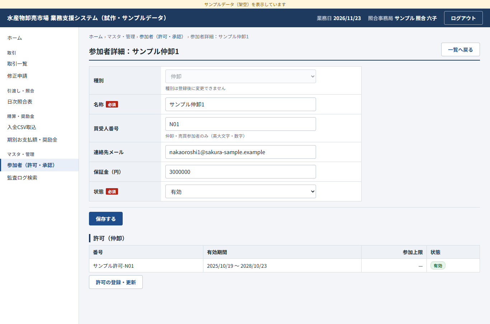
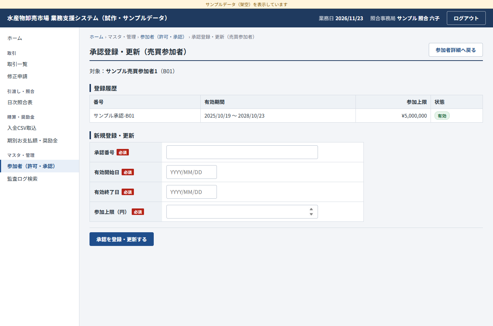
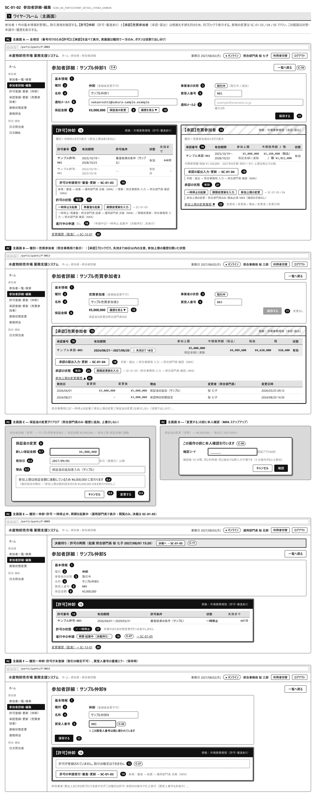

# SC-01-02 参加者詳細・編集 — ワイヤーフレーム

| 項目 | 内容 |
|---|---|
| 画面の役割 | **管理**（参加者 1 名の書類を管理し、法的な資格を確認） |
| 記録の役割 | SETTLE, STL-HEAD（P01–P03）。閲覧：OPS-HEAD（閲）。その他の役割：C-25 |
| 端末 | PC |
| 要点 | **許可（仲卸 — 審査を伴う許可）と 承認（売買参加者 — 届出による承認、手続きは軽い）は別々のブロック**：項目、状態、**手続き**（許可: 審査 + 運用部門長 決裁；承認: 届出 + 照合部門長 確認）、根拠が異なる（L4-D02, 原則2, S5）。共通の「取引資格」ブロックはない |

## 1. プロトタイプ（as-is）

| 仲卸 | 売買参加者 — 画面 承認 |
|---|---|
|  |  |

補助画像：`assets/SC-01-02_prototype-baibai.png`、`assets/SC-01-03_prototype-nakaoroshi-permits.png`。プロトタイプ：書類フォーム + 種別ごとの資格表。許可の表には「参加上限」列があるが空欄（—）；保証金は上書き編集；状態は選択欄で直接変更。

## 2. to-be ワイヤーフレーム

> **標準の図（LAB-4）：** 図のソースは [`html/SC-01-02.html`](../../wireframes/html/SC-01-02.html) — 1 つの HTML で全バリアントを扱い、`scripts/render-wireframes.py` で [`png/SC-01-02.png`](../../wireframes/png/SC-01-02.png) と [`pdf/wireframes-all.pdf`](../../wireframes/pdf/wireframes-all.pdf) に出力；SPEC の BM-51 画像はバリアント A を使用。下の ASCII ブロックは配置の説明用に残し、食い違う場合は HTML + SPEC が正。




2 つのブロックは同時に表示しない。ブロックの見出しは大きい文字、枠の色を変える（許可: 濃い青；承認: オレンジ）ことで一目で区別できるようにする — 顧客 #18。資格の状態は**各ブロックの中**に置き、Database Design の enum どおり（有効 VALID · 一時停止 SUSPENDED · 失効 EXPIRED · 再審査中 UNDER_REVIEW）；事業者レベルは 取引中 / 退会 のみ。

```
[C-9] 参加者詳細：サンプル仲卸1                                     [C-10] 一覧へ戻る
┌─ [1] 基本情報 ─────────────────────────────────────────────────────────────────┐
│ [2] 種別      仲卸（登録後変更不可）           [3] 事業者の状態  取引中（取引中 / 退会）  │
│ [4] 名称      [ サンプル仲卸1          ]        [5] 買受人番号  [ N01 ]                 │
│ [6] 通知メール1 [ …@sakura-sample.example ]   [7] 通知メール2 [            ]（最大2件） │
│ [8] 保証金額   ¥3,000,000   [9] 保証金の変更（履歴に追加）  [10] 履歴を見る ▼           │
│ [11] [ 保存する ]                                                                │
└─────────────────────────────────────────────────────────────────────────────┘

── 種別 = 仲卸 のときだけ表示 ───────────────────────────────────────────────
┏━ [12] 【許可】仲卸 ─ 根拠: 市場業務規程（許可・審査あり） ━━━━━━━━━━━━━━━━━━━━━━━┓
┃ [13] 許可番号  有効期間                 許可条件            状態   失効まで            ┃
┃      サンプル許可-N01 2025/10/19〜2028/10/23  （審査結果の条件）  有効   448日          ┃
┃      （履歴: 更新前の許可は「更新済」で残る）                                        ┃
┃ [14] [ 許可の申請受付・審査・更新 → SC-01-03 ]  新規: 審査→起案→運用部門長決裁／更新: 照合部門長確認（MFA） ┃
┃ [17] 許可の状態  有効   [ 一時停止を起案 ] [ 再審査を起案 ] [ 期限前更新を入力 ]  → SC-01-05 ┃
┃      （一時停止・再審査: 運用部門長 決裁, MFA／期限前更新: 照合事務局 入力 → 照合部門長 確認, MFA） ┃
┃      （一時停止中は [ 再開を起案 ]。申請が決裁待ちの間は状態変更ボタンを隠す）             ┃
┃ [19] 進行中の申請: なし（申請中は「一時停止 起案中（決裁待ち）」(C-27) を表示）          ┃
┗━━━━━━━━━━━━━━━━━━━━━━━━━━━━━━━━━━━━━━━━━━━━━━━━━━━━━━━━━━━━━━━━━━━━━━━━━━━━━━┛

── 種別 = 売買参加者 のときだけ表示 ─────────────────────────────────────────
┏━ [15] 【承認】売買参加者 ─ 根拠: 市場業務規程（承認・届出） ━━━━━━━━━━━━━━━━━━━━━━━┓
┃ [16] 承認番号  有効期間                 参加上限      今期使用額 / 残     状態        ┃
┃      サンプル承認-B01 2025/10/19〜2028/10/23 ¥5,000,000  ¥1,188,000（税込）/ ¥3,812,000 有効 ┃
┃      （今期使用額 税抜 ¥1,100,000）                                                    ┃
┃      （参加上限: 保証金額に連動 / 個別設定。変更は照合部門長のみ・理由必須・履歴あり → [22]）┃
┃ [18] [ 承認の届出入力・更新 → SC-01-04 ]  手続: 届出 → 照合事務局 入力 → 照合部門長 確認（MFA） ┃
┃ [21] 承認の状態  有効   [ 一時停止を起案 ] [ 期限前更新を入力 ] [ 参加上限の変更 ] → SC-01-05 / 04 ┃
┃ [22] 参加上限の変更履歴 ▼（変更前 / 変更後 / 理由 / 変更者 / 変更日時）                  ┃
┗━━━━━━━━━━━━━━━━━━━━━━━━━━━━━━━━━━━━━━━━━━━━━━━━━━━━━━━━━━━━━━━━━━━━━━━━━━━━━━┛

── [9] 保証金の変更ダイアログ（売買参加者の場合）
│ 新しい保証金額 [ ¥6,000,000 ]  発効日 [ 2027/09/01 ]  理由 [            ]          │
│ 「参加上限は保証金額に連動しているため ¥6,000,000 に変わります」                      │
│  （個別設定の場合:「参加上限は ¥5,000,000 のまま変わりません」）                       │

[20] 変更履歴（監査）→ SC-13-01 で絞込み表示
```

## 3. 項目

| No | Item | 種別 | 必須 | ルール | 閲覧 / 編集できる役割 | 出典 |
|---|---|---|---|---|---|---|
| 1 | 基本情報ブロック | 領域 | — | | 閲覧：SETTLE, STL-HEAD, OPS-HEAD | FT-01-01 |
| 2 | 種別 | ラベル | — | 4 種類（卸売業者 / 仲卸 / 売買参加者 / 買出人）；登録後は変更不可 | — | TBL-ACTOR-01 |
| 3 | 事業者の状態 | ラベル | — | 取引中 (ACTIVE) / 退会 (WITHDRAWN) のみ — enum `participant_status`。**表示しない**：参加者レベルの 一時停止 / 失効（これらは 許可 / 承認 に属する；[17], [21]） | — | FIG-010, D13 |
| 4 | 名称 | テキスト | ✓ | 1〜100 文字 | 編集：SETTLE, STL-HEAD | — |
| 5 | 買受人番号 | テキスト | ✓（仲卸 / 売買参加者） | `^[A-Z0-9]{1,10}$`、一意 | 同上 | TBL-ACTOR-01 |
| 6–7 | 通知メール 1, 2 | メール | — | 最大 2 件；紙の申請書に基づいて変更、履歴あり | 同上 | L4-A08 |
| 8 | 保証金額 | ラベル | — | 現在の値 | — | PRM-046 |
| 9 | 保証金の変更 | ボタン → ダイアログ | — | 新しい額 + 発効日 + 理由；**履歴に行を追加、上書きしない**。売買参加者：ダイアログで参加上限が連動するかを明示（保証金に連動 → 変わる；個別設定 → 変わらない）— 顧客 #20。**照合部門長のみ**、MFA、確認者は置かない（Q-PTY-06 【顧客（模擬）、2026-11-25】） | 編集：STL-HEAD | ルール4, D14, PRM-046 |
| 9.1 | 新しい保証金額 | テキストボックス | ✓ | 詳細は SPEC §4.1（W-m01） | — | `SC-01-02_SPEC.md` |
| 9.2 | 発効日 | テキストボックス（日付） | ✓ | 詳細は SPEC §4.1（W-m01） | — | `SC-01-02_SPEC.md` |
| 9.3 | 理由 | テキストボックス | ✓ | 詳細は SPEC §4.1（W-m01） | — | `SC-01-02_SPEC.md` |
| 9.4 | 参加上限への影響の文 | ラベル | — | 詳細は SPEC §4.1（W-m01） | — | `SC-01-02_SPEC.md` |
| 9.5 | 変更する | ボタン | — | 詳細は SPEC §4.1（W-m01） | — | `SC-01-02_SPEC.md` |
| 9.6 | キャンセル | ボタン | — | 詳細は SPEC §4.1（W-m01） | — | `SC-01-02_SPEC.md` |
| 10 | 保証金の履歴 | 折りたたみ表 | — | | 閲覧 | D14 |
| 11 | 保存する | ボタン | — | 監査ログ（変更前後）を記録 | SETTLE, STL-HEAD | FR-AUDIT-01 |
| 12 | **許可ブロック** | 領域 | — | **種別 = 仲卸 のときのみ表示。** 大きい見出し「【許可】仲卸」、独立した枠。参加上限の列はなし | 閲覧：SETTLE, STL-HEAD, OPS-HEAD | 02-08, S5, 顧客 #18 |
| 13 | 許可の表 | 表 | — | 番号、有効期間、**許可条件（審査結果）**、状態、失効までの日数（業務日から計算、例 業務日 2027/08/02 → 2028/10/23 = 448 日）；古いものは「更新済」ラベルで残す | — | FT-01-02, ADR-003 |
| 14 | 許可の申請受付・審査・更新 | ボタン | — | → SC-01-03。**新規の許可（審査あり）：** 照合事務局が書類を入力 → 照合部門長が審査結果と条件を記録し起案 → **運用部門長 決裁（MFA）**（仮定 [PL], OPEN-DB-09）。**通常の更新（PRM-121）：** 照合事務局が新しい失効日を入力 → **照合部門長 確認（MFA）**、条件の見直しを記録；審査はやり直さない | SETTLE, STL-HEAD, OPS-HEAD | FT-01-02, PRM-121, ADR-003 §2.2 |
| 15 | **承認ブロック** | 領域 | — | **種別 = 売買参加者 のときのみ表示。** 大きい見出し「【承認】売買参加者」、[12] と異なる枠の色 | [12] と同様 | 02-08, S5, 顧客 #18 |
| 16 | 承認の表 + 参加上限 | 表 | — | 参加上限の初期値 = 保証金額；**今期の使用額 / 残**は期ごとに計算、相対 + せりを合算；**税込**で比較（税抜の合計 × 税率係数、切り捨て）、税込 / 税抜 の両方を表示（Q-TRD-02 【顧客（模擬）、2026-11-25】） | — | PRM-046, L4-A04 |
| 17 | 許可の状態 | ラベル + ボタン | — | 有効 / 一時停止 / 失効 / 再審査中；状態に応じて「一時停止を起案」「再審査を起案」「再開を起案」（一時停止時）「期限前更新を入力」。一時停止 / 再審査 / 回復 = 照合部門長が起案 → 運用部門長が決裁（MFA）。失効日を過ぎると → 自動で失効（仮定 PL — FIG-010 は 有効 → 失効 を直接描いていない）。許可の決裁による停止・取消、および弁明の機会の扱いは運用部門の判断待ち（OPEN-DB-09） | 状態に応じたボタン | FT-01-04, PRM-121, FIG-010 |
| 18 | 承認の届出入力・更新 | ボタン | — | → SC-01-04。**承認の手続き（より軽い）：** 届出 → 照合事務局が入力 → **照合部門長 確認（MFA）**、保証金 / 資力 の条件を軽く確認 → 有効；許可のような独立した審査はない | SETTLE, STL-HEAD | P03, PRM-121 |
| 19 | 決裁待ちの申請 | ラベル | — | C-27 は「決裁待ち」/「確認待ち」のラベルを使用 — **「承認待ち」は決して使わない**（隣の 承認 ブロックと混同しないため）— 顧客 #19。待ちの申請がある間は [17] / [21] の状態変更ボタンを**非表示**（SPEC §6.1） | 閲覧 | ルール2, S6 |
| 20 | 監査履歴 | リンク | — | → SC-13-01 を参加者で絞り込み | SETTLE, STL-HEAD | FR-AUDIT-01 |
| 21 | 承認の状態 | ラベル + ボタン | — | 有効 / 一時停止 / 失効 / 再審査中；状態と役割に応じて「一時停止を起案」「再開を起案」（一時停止時）「期限前更新を入力」「参加上限の変更」。一時停止 / 再審査 / 回復 = 照合部門長 起案 → 運用部門長 決裁（MFA）。期限前更新 = SETTLE が入力 + STL-HEAD が **確認（MFA）**、再審査は経由しない。期限前更新の MFA は PREMISE §3.2 の一覧に追加が必要（顧客 #21） | 役割に応じたボタン | FT-01-04, PRM-121, NFR-SEC-01 |
| 22 | 参加上限の履歴 | 折りたたみ表 | — | 参加上限は**上書きしない**：変更のたびに 承認 の履歴に 1 件のイベント `LIMIT_CHANGED`（旧 / 新 / 理由 / 実施者）。変更 = 照合部門長が 1 段階、MFA（Q-PTY-06） | 閲覧；SC-01-04 で変更（STL-HEAD） | ルール4, PRM-046, ADR-003 |

## 4. 状態

| 状態 | 表示 |
|---|---|
| 仲卸で許可が未登録 | [13] C-21：「許可が登録されていません。取引の確定はできません」 + [14] |
| 売買参加者で承認が未登録 | [16] 同様に C-21 + [18] |
| 卸売業者 / 買出人 | [12], [15] は表示しない；「この種別は許可・承認の対象外です」 |
| 失効まで 30 日以内 | [13] / [16] に黄色のラベル（SC-04-01 と同じしきい値） |
| 許可 / 承認 が一時停止 / 失効 | ブロック内の状態（[17] / [21]）は赤 + 文字；[14] / [18] は手続きに従い更新のため引き続き使用可能 |
| 決裁 / 確認の待ち | [19] C-27；完了まで状態変更ボタンは非表示 |
| 退会 | [3] グレー；記録系のボタンはすべて非表示 |
| 買受人番号の重複エラー | [5] の下に C-22 |

## 5. 役割による違い

| 役割 | [4]–[11] | [12]–[16], [22] | [17] / [21] |
|---|---|---|---|
| SETTLE | 編集 | 閲覧 + ボタン [14] / [18]（新規の 許可 の書類 / 承認 の届出を入力；更新時は両方とも新しい失効日を入力） | 「期限前更新を入力」（許可 / 承認 — PRM-121） |
| STL-HEAD | 編集 | 閲覧 + ボタン；新規の 許可: 審査結果を記録 + 起案；新規の 承認: 確認（MFA）；更新の 許可 / 承認: 確認（MFA, PRM-121） | 「一時停止を起案」、「再審査を起案」、「期限前更新を確認」（許可 / 承認、MFA） |
| OPS-HEAD | 閲覧 | 閲覧；新規の **許可** は「決裁」（MFA — 仮定 [PL], OPEN-DB-09）。更新は決裁**しない**（PRM-121） | 待ちの申請があるとき、再審査 / 一時停止 / 回復 を「決裁」（MFA） |
| その他 | C-25 | | |

## 6. プロトタイプとの to-be の違い

| # | Prototype | To-be | 出典 |
|---|---|---|---|
| 1 | 許可の表に参加上限の列（空欄） | 許可ブロックから列を削除；参加上限は承認ブロックのみ | ルール2, S5 |
| 2 | 状態は参加者レベルの選択欄で直接変更 | 状態は各ブロック内；変更は 起案 → 決裁 + MFA のみ；参加者レベルは 取引中 / 退会 のみ | FT-01-04, D13, FIG-010 |
| 3 | 保証金は上書き | 履歴に行を追加 | D14 |
| 4 | メール 1 件 | 最大 2 件 | L4-A08 |
| 5 | 今期の使用額 / 残なし | 有、期ごと | M19 |
| 6 | 許可と承認を同じ登録操作で | 新規の許可: 審査 + 起案 → 運用部門長 決裁；承認: 届出 → 照合部門長 確認；更新は両方とも: 照合部門長 確認（PRM-121） | ルール2, ADR-003, PRM-121 |
| 7 | 参加上限を上書き | 履歴付きのイベント `LIMIT_CHANGED` | PRM-046 |

## 変更履歴

| No | Version | Action | 変更内容 | 更新日 | 更新者 | Approve |
|---|---|---|---|---|---|---|
| 1 | 0.1.0 | Add new | 初版 | 2026-11-25 | phuongnnm-23344 | |
| 2 | 0.2.0 | Update | Gate 1 M-07：資格状態を各ブロックの正しい enum に移動（参加者レベルは 取引中 / 退会 のみ）；手続きの違いを表現（許可 は 審査 + 運用部門長 決裁、承認 は 届出 + 照合部門長 確認）；参加上限に履歴 LIMIT_CHANGED [22]；失効の自動化を仮定。顧客 #18（ブロックを目で区別）、#19（C-27 で「承認待ち」を使わない）、#20（保証金ダイアログで参加上限に言及）、#21（期限前更新の MFA）。プロトタイプ画像は据え置き | 2026-11-25 | phuongnnm-23344 | |
| 3 | 0.2.1 | Update | Gate 1 recheck N-03：新規の許可 = 審査 + 運用部門長 決裁（仮定 PL）；通常の更新は PRM-121 に従う（照合部門長 確認）；承認は軽い審査 | 2026-11-25 | phuongnnm-23344 | |
| 4 | 0.2.2 | Update | Gate 1 recheck D-01（diff 5b0ef16 を確認）：§5 の表を N-03 / PRM-121 に合わせる — 許可・承認 の更新は両方とも 照合事務局 が入力 + 照合部門長 が確認（MFA）；運用部門長 は新規の許可の決裁（仮定 [PL]）と 再審査 / 一時停止 / 回復 のみ | 2026-11-25 | phuongnnm-23344 | |
| 5 | 0.2.3 | Update | P3 でまとめ（D-01 の小さなずれを解消）：図 [17] に 許可 ブロックの「期限前更新を入力」ボタンを追加、手続きの注記を追加し、§5 の表と SC-01-02_SPEC に合わせる | 2026-11-25 | phuongnnm-23344 | |
| 6 | 0.2.4 | Update | 顧客 Q-PTY-06（照合部門長のみが 保証金 / 参加上限 を変更）、Q-TRD-02（税込 / 税抜） | 2026-11-25 | phuongnnm-23344 |  |
| 7 | 0.2.5 | Update | LAB-4 wireframe HTML：図のソース `html/SC-01-02.html`、`png/SC-01-02.png` を埋め込み；[19] 状態変更ボタンは待ちの申請がある間は非表示、[17]/[21] に「再開を起案」を追加（SPEC §6 に合わせる）；失効まで は業務日から計算（448 日） | 2026-11-25 | phuongnnm-23344 | |
| 8 | 0.2.6 | Update | W-m01：項目表に 保証金変更ダイアログ の子 ID 9.1–9.6 を追加（HTML のバッジ / SPEC §4.1 に合わせる） | 2026-11-25 | phuongnnm-23344 |  |
