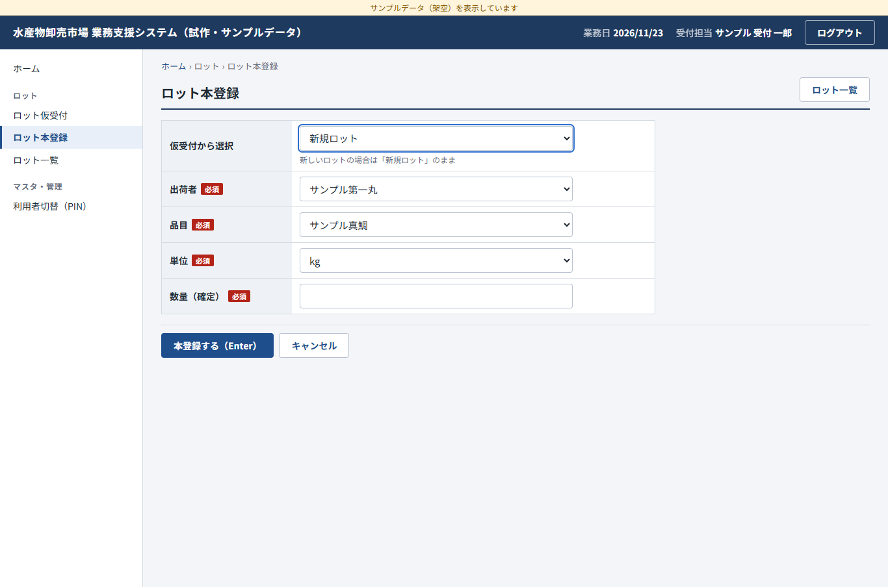
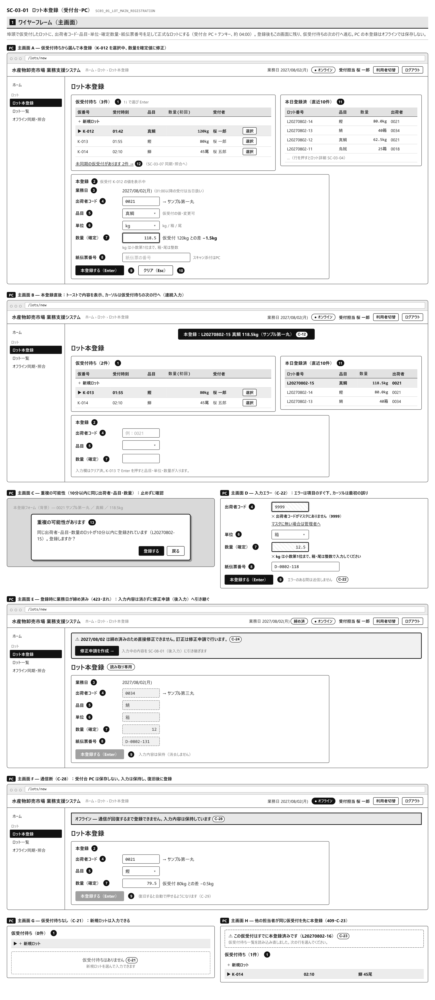

# SC-03-01 ロット本登録（受付台・PC）— ワイヤーフレーム

| 項目 | 内容 |
|---|---|
| 画面の役割 | **入力**：ロット受付の第 2 段階（04:00 頃）。仮受付のロットを正式なロットとして補完する |
| 記録の役割 | INTAKE。閲覧：SETTLE, STL-HEAD, OPS-HEAD（SC-03-03 / SC-03-04 経由、P13） |
| 端末 | PC + テンキー；連続入力、保存後もフォームに留まる（DEC-033） |

## 1. プロトタイプ（as-is）



`/lots/new`、intake@。機能：仮受付または新規から選択、出荷者 / 品目 / 単位 は選択欄、数量、本登録する（Enter）。

## 2. to-be ワイヤーフレーム

> **標準の図（LAB-4）：** 図のソースは [`html/SC-03-01.html`](../../wireframes/html/SC-03-01.html) — 1 つの HTML で全バリアントを扱い、`scripts/render-wireframes.py` で [`png/SC-03-01.png`](../../wireframes/png/SC-03-01.png) と [`pdf/wireframes-all.pdf`](../../wireframes/pdf/wireframes-all.pdf) に出力；BM-51 の画像はバリアント A を使用。下の ASCII ブロックは配置の説明用に残し、食い違う場合は HTML + SPEC が正。




```
┌─ [1] 仮受付待ち（3件）────────────────────────────────┐  ┌─ [11] 本日登録済（直近10件）──────┐
│ 仮番号  受付時刻 品目    数量(初回)  受付者              │  │ ロット番号    品目  数量  出荷者  │
│ ▶ K-012  01:42  真鯛    120kg    桜 一郎   [選択]      │  │ L20270802-14 鰹  80kg  S0021   │
│   K-013  01:55  鰹      80kg     桜 一郎              │  │ …                              │
│   (未同期の仮受付があります 2件 → [12]) (C-28/C-29)      │  └───────────────────────────────┘
└──────────────────────────────────────────────────┘
┌─ [2] 本登録 ─────────────────────────────────────────┐
│ [3] 業務日      2027/08/02(月)（{受付開始時刻}以降の受付は当日扱い）│
│ [4] 出荷者コード [ 0021 ] → サンプル第一丸（候補表示）     │
│ [5] 品目        [ 真鯛 ▼ ]（仮受付の値、変更可）         │
│ [6] 単位        [ kg ▼ ]  kg / 箱 / 尾                │
│ [7] 数量（確定）  [ 118.5 ]  仮受付 120kg との差 −1.5kg  │
│ [8] 証憑        紙伝票番号 [        ]（スキャン添付はPC）│
│ [9] [ 本登録する（Enter） ] [10] クリア（Esc）           │
└──────────────────────────────────────────────────┘
 確定後: C-12 「本登録：L20270802-15 真鯛 118.5kg（サンプル第一丸）」、カーソルは [1] の次の行
 [13] 重複疑い: 同じ出荷者・品目・数量が10分以内 →「重複の可能性があります。登録しますか？」
```

## 3. 項目

| No | Item | 種別 | 必須 | ルール | 出典 |
|---|---|---|---|---|---|
| 1 | 仮受付待ちの一覧 | 選択表 | — | 業務日の PROVISIONAL ロット；↑↓ + Enter で選択；先頭行に「新規ロット」 | FT-03-01 |
| 2 | 本登録ブロック | 領域 | — | | — |
| 3 | 業務日 | ラベル | — | 業務日 D は、ロット受付開始時刻（`LOT_INTAKE_START_TIME`、暫定 01:00）から翌日の同じ時刻まで；day 1 の 01:30 に受け付けたロットは業務日 1 に属する。文中の時刻は**現在有効な規則から取得**し、固定値で書かない（顧客 #27） | PRM-116, E-16, PREMISE §3.1, ADR-005 |
| 4 | 出荷者コード | コード + 候補 | ✓ | SC-10-07 のマスタにあるコード（自由入力テキストは不可） | FT-10-06, D15 |
| 5 | 品目 | 選択 | ✓ | 品目マスタ | FT-10-06 |
| 6 | 単位 | 選択 | ✓ | kg / 箱 / 尾 | FB LAB-2 #5 |
| 7 | 数量（確定） | 数値 | ✓ | > 0；kg は小数 1 桁、箱 / 尾 は整数；仮受付との差を表示 | BR-LOT-02, N03 |
| 8 | 紙伝票番号 | テキスト | — | 20 文字以内；証憑画像は PC でのスキャンのみ（第1期は埠頭で撮影しない） | E-21, M11 |
| 9 | 本登録する | ボタン | — | 正式なロットコードと在庫台帳の行「受入」を発行 | FR-LOT-01 |
| 10 | クリア | ボタン | — | | — |
| 11 | 本日登録済の表 | 表 | — | 直近 10 ロット、SC-03-04 へのリンク | — |
| 12 | 未同期の仮受付の通知 | リンク | — | → SC-03-07 | ADR-008 |
| 13 | 重複の疑いの確認 | ダイアログ | — | 止めない | PRM-116 |

## 4. 状態

| 状態 | 表示 |
|---|---|
| 仮受付がない | [1] C-21「仮受付待ちはありません」；新規の入力は可能 |
| 出荷者コードがない | [4] の下に C-22 + リンク「マスタに無い場合は管理者へ」 |
| 業務日がロック済み | C-24；フォームは閲覧のみ |
| 通信断 | C-28：この PC 画面は**オフライン保存しない**（オフラインは 仮受付 / 引渡し / 紙伝票後入力 のみ、L4-A05） |

## 5. 役割による違い

INTAKE：画面全体。SETTLE / STL-HEAD / OPS-HEAD：入力メニューはなし、SC-03-03 / 03-04 で閲覧。その他の役割：C-25。

## 6. プロトタイプとの to-be の違い

| # | Prototype | To-be | 出典 |
|---|---|---|---|
| 1 | 出荷者は名前（テキスト）を一覧から選択 | 出荷者はマスタのコード | D15 |
| 2 | 仮受付はドロップダウンで選択 | 待ちの表、キーで選択 | NFR-USE-01 |
| 3 | [3] の業務日の説明なし、業務日を開くジョブなし | 有、時刻は規則に従う；業務日は受付開始時刻から開く | M10, D22 |
| 4 | [8], [11], [13] なし | 有 | M11, PRM-116 |

## 変更履歴

| No | Version | Action | 変更内容 | 更新日 | 更新者 | Approve |
|---|---|---|---|---|---|---|
| 1 | 0.1.0 | Add new | 初版 | 2026-11-25 | phuongnnm-23344 | |
| 2 | 0.2.0 | Update | Gate 1: [3] 受付開始時刻は規則から取得、固定値で書かない（顧客 #27, M-01）；小数桁は単位ごと（m-11）。プロトタイプ画像は据え置き | 2026-11-25 | phuongnnm-23344 | |
| 3 | 0.2.1 | Update | LAB-4 wireframe HTML：図のソース `html/SC-03-01.html`、`png/SC-03-01.png` を埋め込み | 2026-11-25 | phuongnnm-23344 | |
