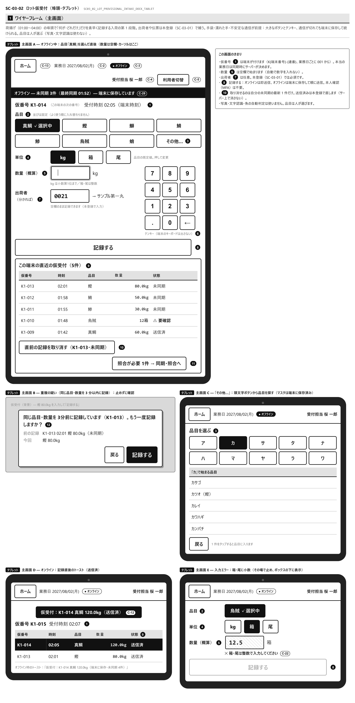

# SC-03-02 ロット仮受付（埠頭・タブレット）— ワイヤーフレーム

> **ワイヤーフレームのみ、完全な Screen Specification はなし**（L4-D05 — 受講者が 2026-11-25 に顧客 #22 に従い決定）。書き込みのロジック（`仮受付` → ロット `PROVISIONAL`、オフラインのキュー）は feature `lot` / `sync` に属する；完全な spec は画面が詳細スコープに入ったときに作成します。

| 項目 | 内容 |
|---|---|
| 画面の役割 | **入力**：ロット受付の第 1 段階（埠頭、01:00〜04:00）。荷が揚がったとき「どのロットを何 kg か」を素早く記録；出荷者コードと証憑は後で SC-03-01 の本登録で補完 |
| 記録の役割 | INTAKE。この画面を閲覧する役割はなし（ロットは SC-03-01 [1]、SC-03-03 で確認） |
| 端末 | 縦向きタブレット 1024 × 1366、**手袋・濡れた手・不安定な通信**（PERSONA-DOCK-01）；ボタン 64px 以上、文字 20px 以上；共用機 — 利用者切替は PIN（C-5） |
| オフライン | **あり** — オフライン対応の 3 画面のひとつ（ADR-008 §2.1, L4-A05）：ローカル保存 + キュー、`client_record_id` は冪等 |
| 枠 / 共通の状態 | `_common-layout.md` のタブレット枠（C-2..C-5, C-11..C-14, C-20..C-29） |

## 1. プロトタイプ（as-is）

`assets/` に画像はありません。プロトタイプには `/lots/provisional`（INTAKE、**オンラインのみ**、自由入力のテキスト 3 欄 出荷者 / 魚種 / 数量概算 — オフラインは M04 のモック）があります。`prototype/src/app/(app)/lots/provisional/page.tsx`、関数 `provisional_receive_lot`（0014）を参照。仮受付の操作はデモ版へ**データを書き込む**ため、これ以上撮影していません。

## 2. to-be ワイヤーフレーム

> **標準の図（LAB-4）：** 図のソースは [`html/SC-03-02.html`](../../wireframes/html/SC-03-02.html) — 1 つの HTML で全バリアントを扱い、`scripts/render-wireframes.py` で [`png/SC-03-02.png`](../../wireframes/png/SC-03-02.png) と [`pdf/wireframes-all.pdf`](../../wireframes/pdf/wireframes-all.pdf) に出力；BM-51 の画像はバリアント A を使用。下の ASCII ブロックは配置の説明用に残し、食い違う場合は HTML + SPEC が正。




```
[C-13]ホーム  業務日 2027/08/02  ●オフライン  受付担当 桜 一郎  [C-5]利用者切替
[C-28] ███ オフライン — 未同期 3件（最終同期 01:52）— 端末に保存しています ███
┌─ [1] 仮番号 K1-014（この端末の次の番号） ── 受付時刻 02:05（端末時刻） ───────┐
├─ [2] 品目（よく使う順ではなく、固定の並び） ────────────────────────────┤
│  ( 真鯛 ) ( 鰹 ) ( 鰤 ) ( 鯖 )                                            │
│  ( 鯵 )  ( 烏賊 ) ( 蛸 ) ( その他… → [3] )                                  │
│  選択中: 真鯛（塗りつぶし＋「選択中」）                                       │
├─ [4] 単位 ── [ kg ] [ 箱 ] [ 尾 ]  ← 品目の既定値、押して変更                  │
├─ [5] 数量（概算） [ _ ] kg  ← 空欄・カーソルはここ    ┌─ [6] テンキー ─────┐ │
│                                                     │  7   8   9        │ │
├─ [7] 出荷者（分かれば） [ 0021 ] → サンプル第一丸       │  4   5   6        │ │
│      （空欄のまま記録可。本登録で入力）                  │  1   2   3        │ │
│                                                     │  .   0   ←        │ │
│                                                     └───────────────────┘ │
│ [8] [          記録する          ]   ← 最大のボタン                         │
└───────────────────────────────────────────────────────────────────────┘
 記録後: C-12 「仮受付：K1-014 真鯛 120kg（端末に保存・未同期 4件）」 オンライン時は「送信済」
┌─ [9] この端末の直近の仮受付（5件） ──────────────────────────────────────┐
│ K1-014 02:05 真鯛 120kg   未同期                                         │
│ K1-013 01:58 鰹    80kg   送信済                                         │
│ K1-012 01:42 鯖    50kg   ⚠要確認 → [11]                                   │
│ [10] [ 直前の記録を取り消す ]（未同期の最新1件のみ）                          │
└─────────────────────────────────────────────────────────────────────┘
 [11] 「照合が必要 1件 → 同期・照合へ」（SC-03-07）
 [12] 重複確認: 「同じ品目・数量を 3分前に記録しています（K1-013）。もう一度記録しますか？」 [記録する] [戻る]
 [3] 品目検索: 大きな一覧（50音の頭文字ボタン ア カ サ タ ナ …）→ 1件をタップ
```

## 3. 項目

| No | Item | 種別 | 必須 | ルール | 出典 |
|---|---|---|---|---|---|
| 1 | 仮番号 + 受付時刻 | ラベル | — | **端末上で**採番、ネットワーク不要：`K{端末番号}-{連番}`（例 `K1-014`）、端末の業務日ごとに 001 から再採番；時刻 = 端末時刻（`captured_at`）。実際の業務日はサーバーが同期時に決定（ADR-005） | ADR-008 §2.2-4, Q-SC0302-01 |
| 2 | 品目の大きいボタン | 1 つを選ぶボタン群 | ✓ | よく使う 6〜8 品目、**順序固定**（管理者が設定ファイルで決定；使用頻度で位置を変えない — C-14 と同じ原則）；選択中のボタンは塗りつぶし + 文字「選択中」。ドロップダウンは使わない（手袋で操作しにくい — 顧客 #13） | FB LAB-2 #13, PRM-086, Q-SC0302-03 |
| 3 | 品目検索 (その他) | 大きい一覧 | — | 「その他…」を押すと開く：頭文字のボタン行（ア カ サ …）→ 大きい文字の品目一覧；マスタを事前に読み込み、オフラインでも使用 | FT-10-06 |
| 4 | 単位 | 大きいボタン 3 つ | ✓ | 品目により初期値；押して変更 | FB LAB-2 #5 |
| 5 | 数量（概算） | 数値 | ✓ | **空欄**、カーソルはここ（顧客 #8 の教訓）；> 0；kg は小数 1 桁、箱 / 尾 は整数 — 入力時点で制限；誤りは欄の下に赤い文字（C-22） | BR-LOT-02, m-11 |
| 6 | テンキー | 大きいテンキー | — | キー ≥ 64 px、SC-06-02 と同様；機器の画面キーボードは出さない | PRM-086, 顧客 #23, #24 |
| 7 | 出荷者（分かれば） | コード + 候補 | 任意 | マスタのコード（事前に読み込み）；通信がなくてもコードは入力可、マスタにあれば名前を表示。ここでは**必須ではない**（Q-SC0302-02 は【顧客（模擬）、2026-11-25】により回答済み：一度に荷揚げするのは 1 つの埠頭で 1 隻のみ、混同しやすいのは 04:00 の本登録の机）；空欄でも保存可 — 本登録で必須（DB の `lots.shipper_id` は `PROVISIONAL` で NULL、追跡 A.1） | D15, LOT_DB 4.25, Q-SC0302-02 |
| 8 | 記録する | 最大のボタン | — | オンライン：すぐ送信。オフライン：IndexedDB + キューに保存、トーストに「端末に保存」と明記。MFA なし（PREMISE §3.2「ロット受付」） | ADR-008, L4-A05 |
| 9 | 直近の一覧（この端末） | 表 | — | **この端末**の直近 5 件、状態「未同期」/「送信済」/「⚠要確認」（文字 + 色） | ADR-008 §2.1-3 |
| 10 | 直前の記録を取り消す | ボタン | — | 利用中の本人の、**未同期の最新 1 件のみ**；確認を 1 回。送信済みの分は 本登録 SC-03-01 で修正（サーバーでは削除しない — ルール4） | ルール4 |
| 11 | 照合が必要 N件 | リンク | — | `HELD` のレコードがあるとき（例：重複の疑い、締め済みの日） → SC-03-07 | ADR-008 §2.2-6, C-14 |
| 12 | 重複の疑いの確認 | ダイアログ | — | 同じ品目 + 数量をこの端末で 3 分以内に記録している場合；止めない | PRM-116 |

## 4. 状態

| 状態 | 表示 |
|---|---|
| オンライン | C-3 ●オンライン；[9] の新しい行は数秒後に「送信済」 |
| 通信断 | C-28 の赤い帯（固定）+ 未同期の数；**記録は可能** — ローカル保存、トースト「端末に保存」 |
| 通信復帰 | C-29；キューは作成順に**オンラインと同じ関数**で送信；保留された分は [11] |
| 業務日の締め後に届いた記録 | 締め済みの日には書き込まない；SC-03-07 で 修正申請 `LATE_ENTRY` または「反映しない」（ADR-008 §2.2-6） |
| 通信断中の利用者切替 | オフライン PIN（12 時間以内にこの端末へログインした人 — ADR-008 §2.3）；レコードに「オフライン切替」フラグ |
| 端末の故障・紛失 | 照合部門長が SC-07-02 で「端末回収不能」を付ける；未送信のレコードは失われたものとし、紙から後入力 |
| INTAKE 以外の役割 | C-25 |

## 5. 役割による違い

INTAKE：画面全体。その他の役割：入れない（C-25）。SETTLE / STL-HEAD は、未同期のレコードを持つ端末を SC-03-07 / SC-07-02 のチェックリストで確認。

## 6. プロトタイプとの to-be の違い

| # | Prototype | To-be | 出典 |
|---|---|---|---|
| 1 | オンラインのみ（オフラインは M04 のモック） | ローカル保存 + キュー + SC-03-07 での照合 | ADR-008, M04 |
| 2 | 出荷者 / 魚種 は自由入力テキスト | 品目は master から大きいボタン；出荷者は master のコード、この段階では必須ではない | D15, 顧客 #13 |
| 3 | 埠頭に仮番号がない | 仮番号を端末で採番し、本登録時の照合に使用 | PRM-116 |
| 4 | 数字欄は機器のキーボードを使用 | 大きいテンキー、SL 欄は空欄 | 顧客 #8, #23 |
| 5 | 直近の一覧 / 送信状態がない | [9] + [11] | ADR-008 §2.1-3 |

## 7. 制約と質問

- **第1期は埠頭で写真を撮影しない**（E-21 — 証憑画像は PC でのスキャンのみ）。手書きの記号 / 符丁の OCR は**行わない**、魚種の AI 認識も**行わない**（原則3, ADR-010）— 品目はユーザーが押す。
- Q-SC0302-01（新規）：仮番号の形式 `K{端末番号}-{連番}` は受付担当に読みやすいか、それとも既存の箱に掛けた札番号を使うか？仮定 PL：端末が採番する形式；誤った場合の影響：「札番号」欄を追加（約 0.2 日）。
- Q-SC0302-02 — **回答済み**【顧客（模擬）、2026-11-25】：埠頭では出荷者は必須でない（フィードバック #15 261118 と一致、タブレットは 3〜4 欄）；本登録では必須のまま。
- **後回し（あると良い、約 0.3 日 — 余裕があるときだけ）：** 画面の先頭に欄「いま荷揚げ中の船」 — **船ごとに 1 回**タップ（ロットごとではない）、以降の入力ロットは船を替えるまでその船を持つ；空欄でも保存可。まだ wireframe に描いておらず、DB の列もない；実装時は 仮受付 のレコードに保存先が必要（例：`lots.shipper_id` の候補または専用の列）— 実装時に決める。当面、受付は船ごとの仮番号の範囲を紙の荷受伝票に記入（作業中）。
- Q-SC0302-03（新規）：品目の大きいボタン 6〜8 件は 1 年固定か、季節で変えるか（誰が変えるか）？仮定 PL：履歴付きの設定ファイル（PRM-126）、管理者が季節ごとに変更。
- 関連：Q-LOT-01 — 回答済み【顧客（模擬）、2026-11-25】：正式なコードはレコードがサーバーに上がったときに発行；仮番号は業務日の終わりまで全画面で検索可能、番号は再利用しない、印刷する伝票は正式なコードを使用 — `specs/lot/function-specifications/LOT_FUNC.md` §3 を参照。

## 変更履歴

| No | Version | Action | 変更内容 | 更新日 | 更新者 | Approve |
|---|---|---|---|---|---|---|
| 1 | 0.1.0 | Add new | 顧客 #22（FB-CUS-281）、L4-D05 に基づく初版 — wireframe のみ（LAB-4 P3） | 2026-11-25 | phuongnnm-23344 | |
| 2 | 0.1.1 | Update | 顧客 Q-SC0302-02：出荷者は必須でない；「いま荷揚げ中の船」はあると良い（後回し）；Q-LOT-01 | 2026-11-25 | phuongnnm-23344 |  |
| 3 | 0.1.2 | Update | LAB-4 wireframe HTML：図のソース `html/SC-03-02.html`、`png/SC-03-02.png` を埋め込み | 2026-11-25 | phuongnnm-23344 | |
