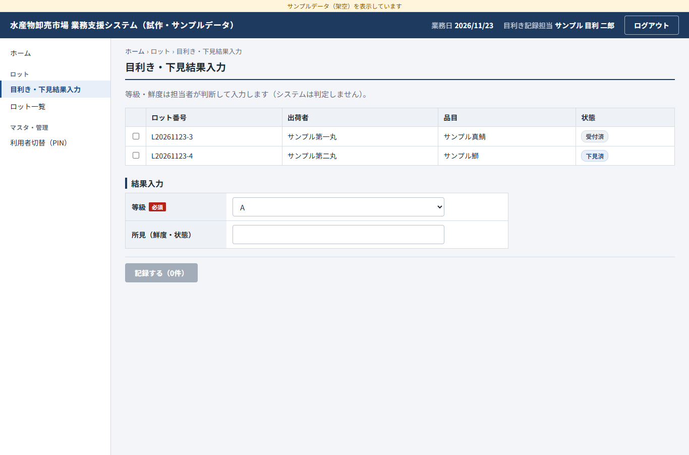
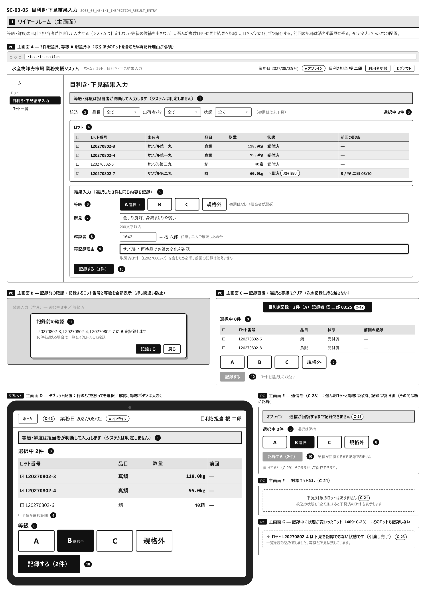

# SC-03-05 目利き・下見結果入力 — ワイヤーフレーム

| 項目 | 内容 |
|---|---|
| 画面の役割 | **評価担当者が決定した結果の入力**（CAP-HUMAN-01）。システムは**採点せず、等級を提案せず、OCR / AI を使わない**（SCOPE-OUT-01/02, ADR-010） |
| 記録の役割 | JUDGE（◎）。閲覧：SETTLE, STL-HEAD, OPS-HEAD（P14） |
| 端末 | PC/TAB（2 種類のレイアウト；タブレット：等級のボタンを大きく） |

## 1. プロトタイプ（as-is）



`/lots/inspection`、judge@。機能：複数のロットを選択、等級 + 所見、「システムは判定しません」の文。

## 2. to-be ワイヤーフレーム

> **標準の図（LAB-4）：** 図のソースは [`html/SC-03-05.html`](../../wireframes/html/SC-03-05.html) — 1 つの HTML で全バリアントを扱い、`scripts/render-wireframes.py` で [`png/SC-03-05.png`](../../wireframes/png/SC-03-05.png) と [`pdf/wireframes-all.pdf`](../../wireframes/pdf/wireframes-all.pdf) に出力；BM-51 の画像はバリアント A を使用。下の ASCII ブロックは配置の説明用に残し、食い違う場合は HTML + SPEC が正。




```
[1] 等級・鮮度は担当者が判断して入力します（システムは判定しません）
[2] 絞込: 品目 [全て▼] 出荷者/船 [全て▼] 状態 [未下見▼]           [3] 選択中 3件
┌─ [4] ─────────────────────────────────────────────────────────────────┐
│ ☑ ロット番号      出荷者      品目   数量    状態     前回の記録            │
│ （タブレットでは行のどこを触っても選択／解除）                              │
│ ☑ L20270802-3   第一丸      真鯛   118kg  受付済   —                     │
│ ☑ L20270802-4   第一丸      真鯛    95kg  受付済   —                     │
│ ☐ L20270802-6   第三丸      鯖     40箱  受付済   —                     │
│ ☑ L20270802-7   第二丸      鰤     60kg  下見済(取引あり) B / 桜 二郎 03:10 │
└──────────────────────────────────────────────────────────────────────┘
┌─ [5] 結果入力（選択した 3件に同じ内容を記録）──────────────────────────────┐
│ [6] 等級   ( A ) ( B ) ( C ) ( 規格外 )   ← 大きなボタン                  │
│ [7] 所見   [ 色つや良好、身締まりやや弱い                 ]               │
│ [8] 確認者  [ 社員番号 ____ ]（任意。二人で確認した場合）                    │
│ [9] 取引済ロットの再記録理由 [                ]（取引後のみ必須）            │
│ [10] [ 記録する（3件） ]                                              │
└──────────────────────────────────────────────────────────────────────┘
 [11] 記録前の確認: 「L20270802-3, L20270802-4, L20270802-7 に A を記録します」 [記録する] [戻る]
 記録後: C-12 「目利き記録：3件（A）記録者 桜 二郎 03:25」。前回の記録は消えず履歴に残る
```

## 3. 項目

| No | Item | 種別 | 必須 | ルール | 出典 |
|---|---|---|---|---|---|
| 1 | 原則の文 | ラベル | — | 常に表示 | CAP-HUMAN-01 |
| 2 | 絞り込み | 選択 | — | 品目、出荷者 / 船、状態 | FT-03-02 |
| 3 | 選択件数 | ラベル | — | | — |
| 4 | ロットの表 | 複数選択表 | — | 開いている業務日のロット；「前回の記録」列 = 直近のレコード。タブレットでは行のどこを触っても選択 / 解除（☑ の小さい欄は押しにくい — 顧客 #14） | FR-LOT-02, PRM-086 |
| 5 | 入力ブロック | 領域 | — | 選択したロットすべてに 1 つの結果を適用、**ロットごとに 1 行ずつ保存** | FT-03-02 |
| 6 | 等級 | 選択ボタン | ✓ | 市場の規則に基づく等級の一覧（fixture 待ち、L4-A02）；**初期値なし** | CAP-HUMAN-01 |
| 7 | 所見 | テキスト | — | 200 文字以内 | — |
| 8 | 確認者 | 社員番号 | — | 2 人目（いる場合） | FT-03-02 |
| 9 | 記録の理由 | テキスト | 取引のあるロットの場合 | 再記録しても古い記録は消さない（追記のみ） | ルール4 |
| 10 | 記録する | ボタン | — | 記録前に [11] を開く；記録者 + 日時を保存；ロット → 下見済 | — |
| 11 | ロット一覧の確認 | ダイアログ | — | 記録するロットのコードと等級を正確に一覧表示；誤タップで未確認のロットに等級を付けないため（顧客 #15） | CAP-HUMAN-01 |

## 4. 状態

| 状態 | 表示 |
|---|---|
| ロットがない | C-21「下見対象のロットはありません」 |
| ロット / 等級が未選択 | [10] を薄く表示 + 理由をボタンの隣に |
| 取引のあるロット | 行に「取引あり」ラベル；[9] 必須 |
| 業務日がロック済み | C-24 |
| 通信断 | C-28：**選択したロットと押した等級を保持**；保存はできない（この画面はオフライン対象外、L4-A05）；通信が戻ったら [10] を押せば直ちに保存。通信断中の目利きは現状どおり紙に記録（Q-SC0305-01 回答済み） |

## 5. 役割による違い

JUDGE：画面全体。SETTLE / STL-HEAD / OPS-HEAD：結果は SC-03-04（目利きの履歴）で閲覧。INTAKE、TRADE：SC-03-03 / SC-04-01 [2] の [前回の記録] で確認、この画面には入らない。

## 6. プロトタイプとの to-be の違い

| # | Prototype | To-be | 出典 |
|---|---|---|---|
| 1 | 等級の選択欄の初期値は「A」 | **初期値なし** — 評価担当者に代わって等級を誤記録しないため | CAP-HUMAN-01 |
| 2 | [2], [8], [9] なし | 有 | FT-03-02, ルール4 |
| 3 | 小さい選択欄 | タブレット用の大きいボタン | PRM-086 |

## 7. 質問

- Q-SC0305-01：目利きは埠頭でオフライン記録が必要か？**回答済み【顧客（模擬）、2026-11-25】：** 第1期では不要 — 通信断では 相対 も確定できず、市場全体が紙に移る。条件：画面が選択したロット / 等級を保持し、通信が戻ったら直ちに保存できること（§4 に反映済み）。紙からの後入力のときの「下見時刻」欄は あれば望ましい — 後回し（今回の版では作らない）。
- Q-SC0305-02（新規、E-13 / OPEN-L4-03 に関連）：通信断のとき、目利きをシステムに記録していないロットを紙で販売してよいか？E-13 と同時に運用部門へ確認。

## 変更履歴

| No | Version | Action | 変更内容 | 更新日 | 更新者 | Approve |
|---|---|---|---|---|---|---|
| 1 | 0.1.0 | Add new | 初版 | 2026-11-25 | phuongnnm-23344 | |
| 2 | 0.2.0 | Update | 顧客：タブレットで行全体をタップして選択（#14）；記録前に対象ロットを確認するダイアログ（#15）；Q-SC0305-01 回答済み — 選択したロット / 等級の保持、通信断時の挙動；Q-SC0305-02 を追加。プロトタイプ画像は据え置き | 2026-11-25 | phuongnnm-23344 | |
| 3 | 0.2.1 | Update | LAB-4 wireframe HTML：図のソース `html/SC-03-05.html`、`png/SC-03-05.png` を埋め込み；選択中のロットは -3, -4, -7 で統一（-7 は 取引あり → [9] 必須）、[11] は正確に 3 件のロットを一覧表示 | 2026-11-25 | phuongnnm-23344 | |
