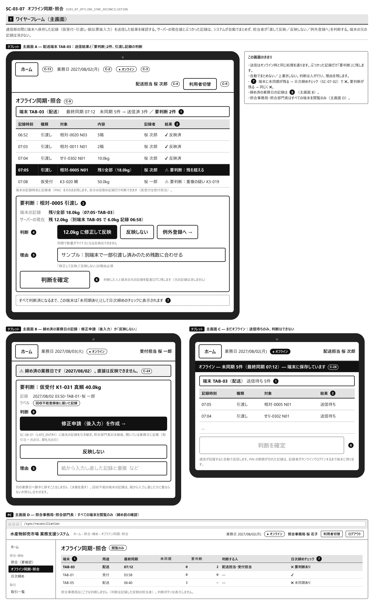

# SC-03-07 オフライン同期・照合 — ワイヤーフレーム（新規画面、ワイヤーフレーム段階）

| 項目 | 内容 |
|---|---|
| 画面の役割 | **決定・復旧**：通信断の後、ローカル保存したレコード（仮受付、引渡し、紙伝票後入力）を送信する。競合したものは**決定者**が 残す / 削除 / 修正 を選ぶ。システムは**自動で統合しない** |
| 記録の役割 | INTAKE（仮受付）、DELIVERY（引渡し）、TRADE（紙伝票後入力 — SC-04-07 を参照）。閲覧：SETTLE, STL-HEAD |
| 端末 | PC/TAB |

## 1. プロトタイプ（as-is）

なし（M04：プロトタイプはオンラインのみ）。画像なし。

## 2. to-be ワイヤーフレーム

> **標準の図（LAB-4）：** 図のソースは [`html/SC-03-07.html`](../../wireframes/html/SC-03-07.html) — 1 つの HTML で全バリアントを扱い、`scripts/render-wireframes.py` で [`png/SC-03-07.png`](../../wireframes/png/SC-03-07.png) と [`pdf/wireframes-all.pdf`](../../wireframes/pdf/wireframes-all.pdf) に出力；BM-51 の画像はバリアント A を使用。下の ASCII ブロックは配置の説明用に残し、食い違う場合は HTML + SPEC が正。




```
[1] 端末 TAB-03（配送）  最終同期 07:12  未同期 5件 → 送信済 3件 ／ 要判断 2件
┌─ [2] 同期結果 ───────────────────────────────────────────────────────────────┐
│ 記録時刻 種類    対象          内容            記録者   結果                       │
│ 06:52   引渡し  相対-0020 N03  5箱             桜 次郎  ✔ 反映済                  │
│ 07:03   引渡し  相対-0011 N01  2箱             桜 次郎  ✔ 反映済                  │
│ 07:04   引渡し  せり-0302 N01  10kg            桜 次郎  ✔ 反映済                  │
│ 07:05   引渡し  相対-0005 N01  残り全部(18kg)    桜 次郎  ⚠ 要判断: 残を超える [3]    │
│ 07:08   仮受付  K3-020 鯖 50kg                 桜 一郎  ⚠ 要判断: 重複の疑い K3-019 │
└──────────────────────────────────────────────────────────────────────────┘
┌─ [3] 要判断: 相対-0005 引渡し ─────────────────────────────────────────────────┐
│ 端末の記録: 残り全部 18kg（07:05）  ／ サーバーの現在: 残 12kg（別端末 TAB-05 で 6kg 記録 06:58）│
│ [4] 判断 (12kg に修正して反映) (反映しない) (例外登録へ → SC-06-04)                │
│ [5] 理由 [                    ]                                               │
│ [6] [ 判断を確定 ]                                                            │
└──────────────────────────────────────────────────────────────────────────┘
[7] すべて判断済になるまで、この端末は「未同期あり」として日次締めのチェックに表示されます
```

## 3. 項目

| No | Item | 種別 | ルール | 出典 |
|---|---|---|---|---|
| 1 | 端末の概要 | ラベル | 端末コード、最終同期時刻、未送信 / 送信済 / 要判断 の件数 | ADR-008 |
| 2 | 一覧 | 表 | 端末上の実際の記録時刻 + 記録者（PIN）を保持。行数 = [1] の未同期（例：5 = 送信済 3 + 要判断 2）。仮番号は SC-03-02 の `K{端末番号}-{連番}` 形式（例 `K3-020`）。例では端末 TAB-03（埠頭 / 配送の共用機）に仮受付のレコードを置いている — 実際の端末一覧が揃った時点で見直す | NFR-AVL-02, SC-03-02 [1] |
| 3 | 競合の詳細 | 領域 | 端末のレコードとサーバーの現在のデータを比較 | — |
| 4 | 判断 | 選択ボタン | 修正して反映 / 反映しない / 例外へ；**同期によってロットの SL が負になることは決してない** | BR-LOT-02, L4-A05 |
| 5 | 理由 | テキスト | 「反映しない」と「修正」の場合は必須 | ルール4 |
| 6 | 判断を確定 | ボタン | 監査に決定者 + 端末の元のレコードを記録（削除しない） | FR-AUDIT-01 |
| 7 | 締めとの関係 | ラベル | 未同期のレコードが残る端末 = SC-07-02 [8] の ✖ 行；その日のレコードがまだ 要判断 = SC-07-02 [7] の ✖ 行 | ADR-005 |
| 8 | 締め済みの日のレコード | 選択ボタン | 2 つの道：「修正申請（後入力）を作成」→ SC-08-01 を種別 `LATE_ENTRY` で開き、端末のレコードから初期入力（取引 / ロット / 新しい引渡し、**元の日**を参照）；照合部門長 決裁（閾値以上なら 2 段）；決裁後は開いている業務日に記帳、**取引の実際の日 = 元の日**、期は元の日による。または「反映しない」+ 理由。締め済みの日の紙伝票後入力と同じ経路（ADR-008 §2.2-6） | BR-CLOSE-01, ADR-005, ADR-008 |

## 4. 状態

| 状態 | 表示 |
|---|---|
| 競合なし | すべて ✔；C-29 の後に閉じる |
| 通信断が続く | C-28；送信待ちの一覧、決定はできない |
| 締め済みの日のレコード | ⚠ 「締め済の業務日です」→ [8]：「修正申請（後入力）を作成」または「反映しない」（C-24）。締め済みの日へ直接書き込まない；決裁なしに別の日へ移さない |
| 「端末回収不能」の端末のレコード | 常に要判断に入り、ラベル「回収不能登録後に届いた記録」；上記と同様に処理（紙から再入力した分と照合し、重複を防ぐ） |
| 端末のオフライン PIN が期限切れ | レコードは保持；送信するには記録者がオンラインでログインする必要がある（M03, E-18） |

## 5. 役割による違い

INTAKE は仮受付のレコード、DELIVERY は引渡しのレコードを表示；利用者は自分の役割のレコードだけを決定できる。SETTLE / STL-HEAD：すべての端末を閲覧のみ（締め前に確認するため）。

## 変更履歴

| No | Version | Action | 変更内容 | 更新日 | 更新者 | Approve |
|---|---|---|---|---|---|---|
| 1 | 0.1.0 | Add new | 初版 | 2026-11-25 | phuongnnm-23344 | |
| 2 | 0.2.0 | Update | Gate 1 M-05：締め済みの日のレコードは 修正申請 `LATE_ENTRY`（取引の実際の日 = 元の日、決裁あり）または「反映しない」— ADR-008 と同じ経路；端末回収不能 の端末から届いたレコード（顧客 #1） | 2026-11-25 | phuongnnm-23344 | |
| 3 | 0.2.1 | Update | LAB-4 wireframe HTML：図のソース `html/SC-03-07.html`、`png/SC-03-07.png`；[2] は 未同期 5件 に合わせて 5 行、仮番号は K{端末}- 形式（K3-020） | 2026-11-25 | phuongnnm-23344 | |
