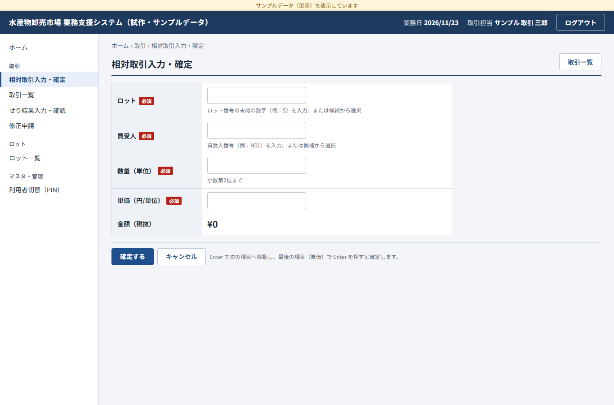
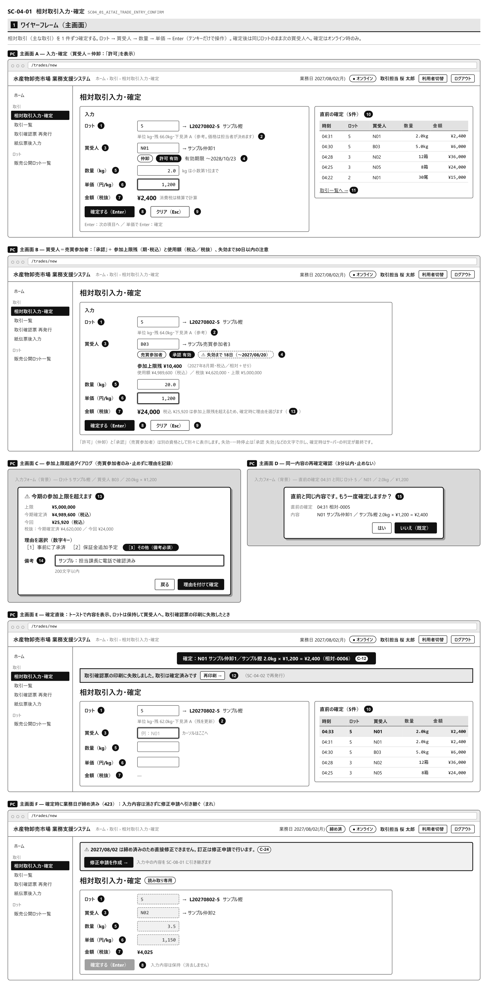

# SC-04-01 相対取引入力・確定 — ワイヤーフレーム

| 項目 | 内容 |
|---|---|
| 画面の役割 | **入力**（最も使用頻度の高い画面、主要フローで取引額の約 90%（C.5）） |
| 記録の役割 | TRADE。閲覧：SETTLE, STL-HEAD, OPS-HEAD（role-list P16）— これらの役割は SC-04-03 / SC-04-04 で取引を見る。**入力画面は開けない** |
| 端末 | PC + テンキー；すべてキーボードで操作 |
| 目標 | 1 件の取引を約 10 秒（慣れた場合）**【模擬】**：ロット → 買受人 → 数量 → 単価 → Enter |
| 枠 / 共通の状態 | `_common-layout.md`（C-1..C-31） |

## 1. プロトタイプ（as-is）



`/trades/new`、アカウント trade@（データは「サンプル」）。実装済み：4 欄、短い数字を入力するか候補から選択、Enter で次の欄へ、単価で Enter すると確定、確定後もフォームに留まる（DEC-033）。

## 2. to-be ワイヤーフレーム

> **標準の図（LAB-4）：** 図のソースは [`html/SC-04-01.html`](../../wireframes/html/SC-04-01.html) — 1 つの HTML で全バリアントを扱い、`scripts/render-wireframes.py` で [`png/SC-04-01.png`](../../wireframes/png/SC-04-01.png) と [`pdf/wireframes-all.pdf`](../../wireframes/pdf/wireframes-all.pdf) に出力；BM-51 の画像はバリアント A を使用。下の ASCII ブロックは配置の説明用に残し、食い違う場合は HTML + SPEC が正。




```
[C-11] ┌ オフライン時: 「通信が回復するまで確定できません。紙伝票で継続してください」(C-28) ┐
┌─ 入力 ──────────────────────────────────────────┐ ┌─ [10] 直前の確定（5件） ─────────┐
│[1] ロット   [ 5      ] → L20270802-5 サンプル鰹       │ │ 時刻  ロット 買受人  数量  金額   │
│             [2] 単位 kg・残 66kg・下見済 A            │ │ 04:31  5   N01  2kg  ¥2,400 │
│[3] 買受人   [ N01    ] → サンプル仲卸1                 │ │ 04:30  5   B03  5kg  ¥6,000 │
│     [4] ┌ 仲卸 許可 有効（〜2028/10/23）        ┐     │ │ …                           │
│         │ 売買参加者なら: 承認 有効 / 参加上限残 ¥… │     │ │ [11] 取引一覧へ →             │
│         └ 赤: 失効・一時停止 / 黄: 失効まで30日以内  ┘     │ └────────────────────────────┘
│[5] 数量（kg）[    2.0 ]                            │
│[6] 単価（円/kg）[  1,200 ]                         │
│[7] 金額（税抜） ¥2,400                              │
│                                                    │
│[8] [ 確定する（Enter） ]  [9] クリア（Esc）            │
│    Enter: 次の項目へ ／ 単価で Enter: 確定             │
└────────────────────────────────────────────────────┘
 ── 確定後: [C-12] 「確定：N01 サンプル仲卸1／鰹 2kg × ¥1,200 = ¥2,400（相対-0005）」
    取引確認票を印刷中…（[12] 印刷失敗時: 「再印刷 →」SC-04-02）
    ロット・残 を保持、買受人以降を空欄、カーソルは [3]

 ── [13] 参加上限超過ダイアログ（売買参加者のみ）
   ┌ 今期の参加上限を超えます：上限 ¥5,000,000 / 今期確定済 ¥4,989,600（税込） / 今回 ¥25,920（税込） ┐
   │ 理由を選択: 1 事前に了承済  2 保証金追加予定  3 その他（備考必須）  [14] 備考 [   ] │
   └ [ 理由を付けて確定 ]  [ 戻る ]                                              ┘
 ── [15] 同一内容の再確定確認: 「直前と同じ内容です。もう一度確定しますか？」 [はい] [いいえ]
```

## 3. 項目

| No | Item | 種別 | 必須 | ルール / validation | 出典 |
|---|---|---|---|---|---|
| 1 | ロット | 数字入力 + 候補 | ✓ | 末尾の数字を入力（「5」）→ 現在の業務日のロット；販売公開中で SL が残っているロットのみ；候補は 10 行以内 | FB LAB-2 #1, FIG-011 |
| 2 | 単位 · 残 · 目利き | ラベル | — | `単位 kg・残 66kg`；目利きの結果は参考表示、**価格は自動で決めない** | FR-LOT-03, CAP-HUMAN-01 |
| 3 | 買受人 | コード入力 + 候補 | ✓ | 買受人番号 `^[A-Z0-9]{1,10}$`；仲卸 / 売買参加者のみ | TBL-ACTOR-01 |
| 4 | 買受人の資格 | 状態ラベル | — | **仲卸 → 文字「許可」；売買参加者 → 文字「承認」+ 参加上限の残（期ごと、税込で比較 — Q-TRD-02）+「使用額 ¥…（税込）／ 税抜 ¥…」**；「資格OK」のようにまとめない。色 + 文字 | BR-PERM-01, ADR-003, ルール2 |
| 5 | 数量 | 数値 | ✓ | > 0、残以下（確定時にサーバーで再確認）。ロットの単位ごと：kg は **小数 1 桁**；箱 (ケース) / 尾 は **整数** — 入力欄で即座に制限（Database Design の `NUMERIC(12,1)` + 単位ごとの CHECK と一致；N03） | BR-LOT-02, PRM-053, 顧客 #11 |
| 6 | 単価 | 数値 | ✓ | > 0、整数；ラベルはロットの単位ごと | FB LAB-2 #5 |
| 7 | 金額 | 計算ラベル | — | floor(数量 × 単価)、税抜；税は 精算 で計算 | PRM-053 |
| 8 | 確定する | 主ボタン | — | オンライン必須；1 キー；確定者 + 日時を記録 | PRM-114, L4-A05 |
| 9 | クリア | 補助ボタン | — | フォームを消去、ロットは保持 | — |
| 10 | 直前の確定 | 表 | — | 利用者本人の直近 5 件の取引、新しいものが上 | FB LAB-2 #7 |
| 11 | 取引一覧へ | リンク | — | → SC-04-03 | — |
| 12 | 印刷エラー | バナー | — | 伝票をそのまま印刷、プレビューなし；エラー → SC-04-02「再発行」 | M05, FT-04-04 |
| 13 | 参加上限のダイアログ | ダイアログ | — | 売買参加者のみ；上限は**期ごと**、相対 + せりで共通、初期値 = 保証金額；**強制的には止めない**（混雑時は確定者が判断）；理由は数字キーで選択。理由付きで超過した取引は SC-07-01 の 要確認 タブに表示し、照合が確認（顧客 #10） | PRM-046, L4-A04 (1), M19 |
| 14 | 備考 | テキスト | 「その他」のとき | 200 文字以内 | FT-01-09 |
| 15 | 重複時の再確認 | ダイアログ | — | 同じロット、買受人、数量、単価が 3 分以内；止めない | FB LAB-2 #6 |

## 4. 状態

| 状態 | 表示 |
|---|---|
| 空 — 販売公開のロットがない | C-21：「販売公開中のロットがありません」+ SC-03-03 へのリンク（権限のある役割） |
| 買受人が失効 / 一時停止 / 種別違い | [4] 赤；ボタン [8] は押せるが、サーバーが [3] の下にエラーを返して拒否（C-22）— 確定時の確認が最終 |
| 数量不足 / 別の人が同じロットを確定 | C-23：「残数量が 1kg に変わりました」、[2] を更新 |
| 業務日がロック済み | C-24（まれ：この画面は開いている業務日にのみ記録） |
| 通信断 | C-28：フォームをロック、紙の伝票のバナー；通信が戻ると → C-29 が直前の押下の 確定済 / 未確定 を表示 |
| 決裁待ち | 該当なし（相対は読み合わせの後、確定者が確定する。決裁は不要） |

## 5. 役割による違い

| 役割 | 表示内容 |
|---|---|
| TRADE | 画面全体 |
| SETTLE / STL-HEAD / OPS-HEAD | このメニューはなし；SC-04-03, SC-04-04 で取引を閲覧（閲） |
| その他の役割 | C-25 |

## 6. プロトタイプとの to-be の違い

| # | Prototype | To-be | 出典 |
|---|---|---|---|
| 1 | 版 1.2 は買受人を選ぶと 許可 / 承認 + 期限を表示 | 維持、参加上限の残（期ごと、売買参加者）を追加し、失効日まで 30 日以内で黄色の警告 | FB LAB-2 #3, ルール2, FR-AITAI-02 |
| 2 | 参加上限を業務日で計算 | 期ごと、相対 + せりで共通 | M19, D08 |
| 3 | 印刷なし | 現場のプリンタで直接印刷；エラー時 [12] | M05 |
| 4 | [10] なし | 直近 5 件の取引の表 | FB LAB-2 #7 |
| 5 | 上限超過の理由を自由入力 | 数字キーで選択 + 備考 | L4-A04 (1) |
| 6 | 通信断のバナーなし | C-28 | M04, ADR-008 |
| 7 | 取引コード `T20261123-5-1` | 読みやすい短いコード（例 相対-0005）— Database Design で形式を確定するまで待ち | FB LAB-2 #7 |
| 8 | 数量は全単位で小数 2 桁まで | kg は小数 1 桁、箱 / 尾 は整数 | N03, m-11 |

## 変更履歴

| No | Version | Action | 変更内容 | 更新日 | 更新者 | Approve |
|---|---|---|---|---|---|---|
| 1 | 0.1.0 | Add new | 初版 | 2026-11-25 | phuongnnm-23344 | |
| 2 | 0.2.0 | Update | Gate 1 m-11 / 顧客 #11：数量は kg で小数 1 桁、箱 / 尾 で整数；顧客 #10：参加上限超過の取引は 要確認 SC-07-01 に表示。プロトタイプ画像は据え置き | 2026-11-25 | phuongnnm-23344 | |
| 3 | 0.2.1 | Update | 顧客 Q-TRD-02：使用額 税込 / 税抜 | 2026-11-25 | phuongnnm-23344 |  |
| 4 | 0.2.2 | Update | LAB-4 wireframe HTML：図のソース `html/SC-04-01.html`、`png/SC-04-01.png` を埋め込み | 2026-11-25 | phuongnnm-23344 | |
